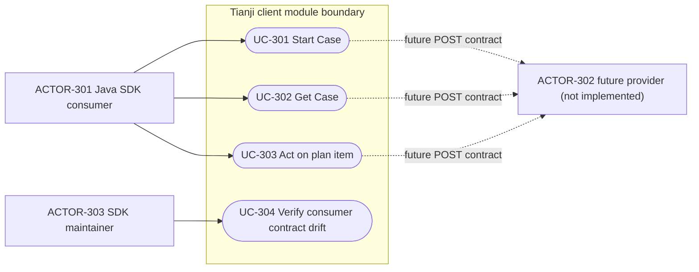
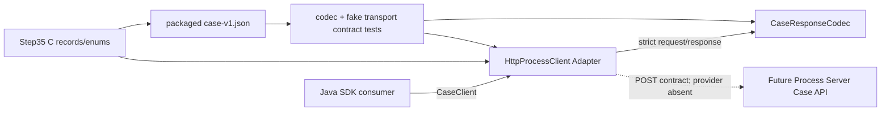
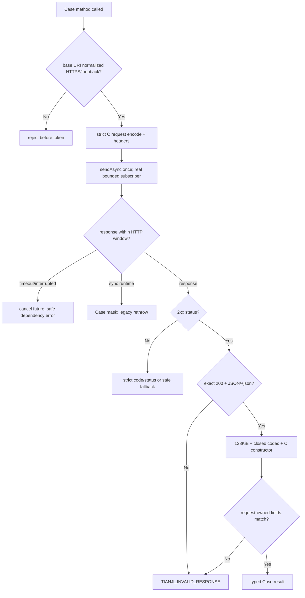

# CMMN Case HTTP SDK 与 Contract-First OpenAPI

| Field | Value |
| --- | --- |
| Document | `2026-11-01-23-45-case-http-client.md` |
| Template Version | `9` |
| Archetype Cleanup | `Not applicable` |
| Status | `Review` |
| Type | `Feature` |
| Complexity | `Complex` |
| Complexity Drivers | `外部 REST consumer compatibility、strict JSON/error disclosure、HTTPS/timeout/body bounds、OpenAPI 3.1 drift authority、legacy transport preservation` |
| Created | `2026-11-01 23:45 Asia/Shanghai` |
| Updated | `2026-11-04 15:22 Asia/Shanghai` |
| Owner | `Root source-grounded design review；原用户继续范围授权，完成后审查` |
| Repository | `tianji-service` |
| Scope | `stellar-enclosure-tianji-client CaseClient HTTP adapter、strict codec、consumer OpenAPI artifact/tests` |
| Change Surface | `HttpProcessClient implements CaseClient；new CaseResponseCodec；two pure fake transport/codec tests；packaged contract-first case-v1.json` |
| Affected Chapters | `§7, §8, §9, §13, §14, §15, §16, §17, §18` |
| Source Requirement | `Step36 consumer-only Case REST SDK；provider CaseController/routes deferred` |
| Baseline Revision | `main@4584acb35f87f4a811596e80a54c85b8fdbf42e1；clean` |
| Amends | `None` |
| Supersedes | `None` |
| Depends On | [Case Java contract](2026-11-01-23-20-case-client-contract.md)；[Agent Framework Upgrade Plan](../../../../docs/plans/agent-framework-upgrade-plan.md) `§10–11, §14.4, §17.3, T3-08`，SHA-256 `dda8a338c6848317a78a6769641308e0dbc43b9ddc097cec9390d0386d2b2c79` |
| Related Specs | `None` |
| Related Plans | [Case HTTP client Plan](../plan/2026-11-01-23-45-case-http-client.md) |

## 1. Summary

Step36 extends the existing JDK `HttpProcessClient` Adapter to implement `CaseClient` through three fixed POST operations and a Case-only strict decoder。A packaged OpenAPI 3.1 JSON document is the contract-first consumer authority and ships in the client JAR；reflection/codec/request tests prove its fields, paths, responses and security remain aligned with the Step35 C contracts。

This is not provider readiness。No CaseController、route registration、permission、DB or server OpenAPI generation exists。The SDK sends each method once, requires normalized HTTPS or loopback before credential retrieval, applies a Case-only 128 KiB response cap and strict JSON/error rules, and preserves all legacy Process/Decision/Worker/HumanTask behavior and limits。

## 2. Background and Current State

### 2.1 Business and user context

Java consumers now have an engine-neutral Case contract but no transport。A governed SDK must fix request/response/error semantics before a provider is implemented, without allowing the client to choose tenant/actor/roles or leaking server error bodies。

### 2.2 Repository evidence

| Evidence ID | Classification | Exact path/symbol/decision | Observed fact | Design significance | Limit |
| --- | --- | --- | --- | --- | --- |
| `EVD-301` | Static repository | `HttpProcessClient` | shared JDK HttpClient adapter, one-send async future, 9 MiB request/2 MiB response, redirect NEVER | extend existing Adapter, preserve old paths | no Case support at baseline |
| `EVD-302` | Static repository | `HumanTaskResponseCodec` | strict Jackson3 duplicate/unknown/trailing/coercion pattern | reuse pattern, not class | Case shape differs |
| `EVD-303` | Static repository | `BoundedBodySubscriber`, `ProcessClientException` | bounded streaming/cancel and masked structured errors already exist | Case cap/error mapping can reuse | no end-to-end timeout over token supplier |
| `EVD-304` | Static repository | Step35 11 C types / `OrchestrationErrorDTO` | exact request/success fields and two-field error | wire/schema source | no codec/provider |
| `EVD-305` | User/Root decision | Step36 frozen report | exact routes, headers, errors, limits, legacy boundary, contract-first OAS | closes major choices | Review, not provider implementation |
| `EVD-306` | Candidate source review | `/tmp/tianji-step36-case-sdk` | production/test candidates use fake JDK HttpClient and real subscriber | implementation-ready evidence | unexecuted until GO |

### 2.3 Problem statement and gap

Without a Case SDK boundary, consumers would either implement unsafe ad hoc JSON/HTTP or require a server route first。Existing generic decoding is intentionally permissive for legacy compatibility and cannot safely decode the new Case contract。

### 2.4 Evidence and current-chain map

| Entry/trigger | Current call chain | Data | External dependency | Consumers | Evidence |
| --- | --- | --- | --- | --- | --- |
| legacy Process/Decision/Worker/Human | C interface → HttpProcessClient → JDK HttpClient → generic/task codec | existing DTOs | provider | existing Java consumers | `EVD-301–303` |
| Case start/get/action | C interface only；no CL path | Step35 records | none | future Java consumer | `EVD-304/305` |
| API documentation | none for Case | no artifact | none | SDK/provider implementers | `EVD-305` |

### 2.5 Archetype example cleanup

Cleanup disposition: Not applicable

Reason: existing technical client/contract modules；no generated business project or example domain chain。

## 3. Goals and Non-goals

### 3.1 Goals

- Implement CaseClient through exact three POST paths under preserved base prefix。
- Strictly encode C requests and decode closed Case successes/errors with bounded bodies and correlation suppression。
- Package one canonical OpenAPI 3.1 consumer artifact and prove it against C reflection and decoder tests。
- Preserve legacy routes, limits, errors and sync-exception behavior。

### 3.2 Non-goals

- No provider Controller/routes/server startup、springdoc dependency/annotations、`/v3/api-docs` generation or provider runtime claim。
- No POM/dependency、permission/OAuth scope、DB/migration、Case release enum/admission、C/PS/schema changes。
- No automatic retry、redirect、response `Cache-Control` enforcement、freshness/chronology check or token-supplier timeout guarantee。
- No real HTTP listener in focused tests；existing listener-starting `HttpProcessClientTest` excluded。

### 3.3 Change Surface and Design Depth

| Area/layer | Disposition | Exact repository evidence | Changed or preserved behavior/contract | Required Spec treatment | Chapter(s) |
| --- | --- | --- | --- | --- | --- |
| HttpProcessClient Case adapter | Affected | EVD-301/305 | Case implementation + Case-only guards/cap/errors | full flow/security/compatibility | `§7, §8, §9, §13, §14, §15, §16, §17, §18` |
| CaseResponseCodec | Affected | EVD-302/304 | strict closed success/error decoder | full JSON/failure design | `§7, §8, §9, §13, §14, §15, §16, §17, §18` |
| Contract-first OAS | Affected | no current artifact | packaged OpenAPI3.1 authority | full API governance/gates | `§8, §9, §14, §15, §16, §17, §18` |
| Tests | Affected | candidate fake transport/tests | listener-free codec/HTTP/OAS proof | full test design | `§8, §14, §15, §16, §17, §18` |
| Step35 C models | Context-only | EVD-304 | unchanged final invariants | reflection/constructor boundary | `§9, §10, §14` |
| Legacy client paths | Context-only | EVD-301–303 | old 9MiB/2MiB/error/sync behavior unchanged | controlled fake smoke | `§14, §16` |
| Provider/server/DB/permissions | Unchanged | absent/outside scope | no implementation | explicit boundary | `§9, §16` |
| Frontend | Not applicable | no page | none | N/A | `§12` |

## 4. Requirements and Acceptance Criteria

| ID | Requirement | Priority | Observable acceptance | Source |
| --- | --- | --- | --- | --- |
| `REQ-301` | HttpProcessClient implements CaseClient with exact 3 POST paths and request/response binding | Must | fake transport sees exact paths/bodies and bound results | Root |
| `REQ-302` | Case guard requires normalized HTTPS or loopback before token；redirect NEVER；Bearer/Accept/Content-Type/no-store request headers | Must | guard/token/order/header tests | Root/security report |
| `REQ-303` | each method sends once；existing async timeout cancels future；Case response cap 128KiB using real subscriber；no auto retry | Must | fake future/subscription tests | Root |
| `REQ-304` | Case success exact 200 and JSON/+json；strict closed decoder requires all fields/explicit nullable finishedAt | Must | codec/media/status/required-field tests | API report |
| `REQ-305` | decoder rejects duplicate/unknown/trailing/coercion/numeric enum/numeric Instant and bounds items/actions | Must | strict mutation tests | API report |
| `REQ-306` | request/result correlation checks bind every consumer-owned field while accepting ACTIVE or terminal start replay/sparse history | Must | mismatch matrix and terminal replay | Root |
| `REQ-307` | only nine trusted error code/status pairs；safe status fallback；correlation/body/cause/token never exposed；Retry-After bounded metadata | Must | error matrix/privacy tests | Root |
| `REQ-308` | Case sync sendAsync RuntimeException masked as dependency unavailable；legacy sync path rethrows unchanged | Must | paired fake test | Root |
| `REQ-309` | packaged contract-first OpenAPI3.1 defines exact 3 operations, 11 schemas, bearer security and 200+8 error statuses | Must | artifact parse/reflection/local-ref test | API report |
| `REQ-310` | absolute offset textual Instants decode to UTC Instant preserving nanos；numeric/naive invalid；no chronology/freshness generation | Must | codec time tests | Root/API |
| `REQ-311` | old Process/Decision/Human controlled fake smoke and old limits/error method remain unchanged | Must | smoke/source diff | Root |
| `REQ-312` | exact 8 paths；no C/PS/POM/DB/permission/schema edit | Must | path/static checks | Root |

### 4.1 Scenario matrix

| Scenario | Actor/trigger | Preconditions | Main path | Failure/recovery | State effect | Result | REQ |
| --- | --- | --- | --- | --- | --- | --- | --- |
| Case success | SDK consumer calls method | normalized secure base/token | encode→send once→cap→strict decode→bind | mismatch/invalid response masked | none client-side | typed DTO/result | 301–306 |
| unsafe transport | HTTP remote or nonnormalized URI | none | reject before token | caller fixes configuration | no send/token | IllegalArgumentException | 302 |
| timeout/oversize | incomplete future or >128KiB | request sent once | cancel future/subscription | no retry | no result | dependency/too-large code | 303 |
| error response | non-2xx bounded body | bounded body | accept exact code/status or fallback | correlation/body suppressed | no retry | safe exception metadata | 307 |
| legacy call | Process/Decision/Human | existing config | original path/codec/limits | original sync exception retained | unchanged | same DTO/error | 308/311 |

### 4.2 Use-case analysis

#### 4.2.1 Actor inventory

| Actor ID | Actor/role | Goal | Channel | Permission/tenant | Evidence |
| --- | --- | --- | --- | --- | --- |
| `ACTOR-301` | Java SDK consumer | call Case operations safely | CaseClient/HttpProcessClient | Bearer; tenant/actor server-derived | Step35/Root |
| `ACTOR-302` | Future provider implementer | implement exact consumer contract later | packaged OAS | provider security not yet built | Root/API |
| `ACTOR-303` | SDK maintainer | detect wire/schema drift | focused tests | local source | candidates |

#### 4.2.2 Use-case artifact



| UC | Trigger/preconditions | Success | Failure/postcondition | Requirements/tests |
| --- | --- | --- | --- | --- |
| UC-301 | valid StartCaseCommand + secure base | bound Case snapshot incl terminal replay | safe exception/no retry | 301–310 / TEST-301–306 |
| UC-302 | valid query + secure base | current/historical snapshot | safe error/timeout/oversize | 301–305/307/310 |
| UC-303 | valid versioned command | exact transition receipt | mismatch/conflict/error safe | 301–310 |
| UC-304 | artifact/test run | paths/schemas/security align | test blocks drift | 309/311/312 |

## 5. Constraints, Assumptions, and Decisions

### 5.1 Confirmed constraints

- Provider currently has no CaseController/route；OAS is consumer contract-first authority only。
- Case-only response max 128KiB；legacy request 9MiB/response2MiB unchanged。
- `OrchestrationErrorDTO` actual fields only `code`, nullable/optional `correlationId`；SDK never exposes correlation。
- Future provider should return response `Cache-Control:no-store`; SDK sends request header but does not enforce response header。`API-GATE-*`/`MC-*` PASS 在本文件表示设计闭合；候选 source/test 尚未执行，RED/GREEN 与实际计数只能由执行 Evidence 给出。

### 5.2 Small-gap assumptions

| ID | Inference | Evidence | Reversible | Impact |
| --- | --- | --- | --- | --- |
| `ASM-301` | JDK Instant.parse first validates textual absolute timestamp grammar, then Jackson3 converts to unchanged Instant C fields | Jackson3.1.7 accepts quoted numeric epochs even with scalar coercion disabled；existing contract forbids them | codec-local, no dependency | future mapper upgrade needs regression; no chronology/normalization added |
| `ASM-302` | OAS only declares application/json while SDK accepts structured +json | fixed test/contract | additive docs later | provider may publish +json explicitly later |

### 5.3 Resolved decisions

| ID | Decision | Owner | Evidence/rationale | REQ |
| --- | --- | --- | --- | --- |
| `DEC-301` | Adapter reuse: HttpProcessClient implements CaseClient | Root | current transport owns shared auth/timeout/body subscriber | 301–303/311 |
| `DEC-302` | separate strict Case codec with Function decoder extension | Root | legacy generic compatibility must not tighten | 304/305/311 |
| `DEC-303` | contract-first packaged OAS3.1, no springdoc/provider annotation | Root/API | provider absent；client drift proof required | 309 |
| `DEC-304` | no retry；Retry-After metadata only | Root | write uncertainty and current policy | 303/307 |

### 5.4 Open major decisions

None for consumer slice。Provider implementation、permissions and server documentation ownership remain later affected work, not blockers here。

## 6. Project Technology Context

| Concern | Current choice | Evidence | Constraint |
| --- | --- | --- | --- |
| HTTP | JDK HttpClient async | HttpProcessClient | fake subclass tests/no listener |
| JSON | Jackson3 managed | client POM/codecs | reuse; no dependency |
| Contracts | Step35 JDK records/enums | C module | constructor final invariants |
| API docs | new packaged OpenAPI3.1 JSON | explicit decision | contract-first/no springdoc |
| Tests | JUnit only | client POM | no Mockito/new deps |

### 6.1 Java architecture profile and capability baseline

| Profile | Base package | Evidence | Deviation | Action |
| --- | --- | --- | --- | --- |
| Existing technical client Adapter module | `top.egon.cola.platform.tianji.client` | current HttpProcessClient/codecs/tests | no business layer/Bean | preserve and extend directly |

| Need | JDK/Spring | Starter | Module candidate | Gap | Decision |
| --- | --- | --- | --- | --- | --- |
| transport | JDK HttpClient | none | HttpProcessClient | Case methods absent | extend |
| bounded body | Flow Subscriber | none | BoundedBodySubscriber | Case cap selector absent | reuse |
| strict decode | Jackson3 | existing | HumanTask codec pattern | Case shape absent | new codec |
| API artifact | JSON resource | none | none | authority absent | create no dependency |

### 6.2 User-mandated Java rule compliance

| Literal rule | Affected? | Repository evidence | Exact design decision | Files/types/interfaces | Validation/test evidence | Status/blocker |
| --- | --- | --- | --- | --- | --- | --- |
| Rule 1 | Yes | Adapter/Codec/Test roles | semantic names | Java paths | compile | PASS |
| Rule 2 | No | no Spring layer handoff | C constructors/client checks | none | request tests | N/A |
| Rule 3 | No | no new carrier/mapping | reuse C records | none | reflection | N/A |
| Rule 4 | No | no Spring Bean/business class | plain technical types | none | scope | N/A |
| Rule 5 | Yes | JDK/Jackson existing | no utility dependency | Java | POM/import diff | PASS |
| Rule 6 | Yes | external JSON | strict Jackson3 only | codec/client/OAS | codec/OAS tests | PASS |
| Rule 7 | No | no config | none | none | scope | N/A |
| Rule 9 | Yes | complex transport/error flow | reuse Adapter + decoder Function strategy | client/codec | branch tests | PASS |
| Rule 10 | Yes | Instant/Duration/Retry-After | explicit time contract | client/codec/tests | time tests | PASS |
| Rule 11 | Yes | existing client module | no layer/module | all paths | path gate | PASS |

### 6.3 Time semantics and conversion contract

Time contract: Required

| Time ID | Fields/symbols | Semantics | Java/runtime type | Storage policy | Wire policy | Business zone source | Display zone source | Boundary / DST rules | Precision / Clock | Compatibility | Verification |
| --- | --- | --- | --- | --- | --- | --- | --- | --- | --- | --- | --- |
| `TIME-301` | `CaseInstanceDTO.submittedAt/finishedAt`, `CaseOperationResult.occurredAt` | Occurred instant | `Instant` | Not persisted | UTC Z | Not applicable: no business calendar | Not applicable: no frontend | textual absolute offsets accepted and normalized；numeric/naive invalid；no DST calculation | nanoseconds preserved；no freshness/chronology/Clock generation | Step35 contract；wire decoder new | `TEST-301`, `TEST-302` |
| `TIME-302` | `HttpProcessClient.timeout`, HttpRequest timeout, future wait | Duration | `Duration` | Not persisted | Internal | Not applicable: transport wait | Not applicable: no frontend | applies after token retrieval；token supplier is not bounded；cancel future on timeout | nanosecond Duration must fit long；existing behavior | legacy timeout behavior reused | `TEST-305` |
| `TIME-303` | `ProcessClientException.retryAfter`, `retryAfter(String)` | Duration | `Duration` | Not persisted | Internal | Not applicable: retry metadata only | Not applicable: no frontend | seconds/RFC1123 parsed through existing Instant/ZonedDateTime helper；past→zero；max one day；invalid→null | uses existing `Instant.now`；SDK never auto-retries | existing helper reused for Case errors | `TEST-303`, `TEST-306` |

## 7. Architecture Design

### 7.0 Minimum-design baseline and element-necessity audit

| Proposed element | Change | Requirements | Existing/direct alternative | Concrete inadequacy of alternative | Added calls/state/coupling/failures/migration/operations | Verdict |
| --- | --- | --- | --- | --- | --- | --- |
| HttpProcessClient Case adapter | Expand | 301–303/306–308 | new CaseHttpClient | duplicates auth/timeout/error | branches in existing adapter | Keep/Expand |
| CaseResponseCodec | New | 304/305/307/310 | generic mapper | unsafe/tightening legacy breaks | one package type | Add |
| OAS artifact | New | 309 | provider `/v3/api-docs` | provider absent | packaged JSON | Add |
| new transport abstraction/dependency | None | 311/312 | current Function/body subscriber | already fits | avoided | Remove |

| Path | Network calls | Client states | Server contracts/state | Failures/TOCTOU | Value |
| --- | --- | --- | --- | --- | --- |
| Separate client | 1 | duplicate config | extra adapter | more drift | no added value |
| Selected existing adapter | 1 | current timeout/error | contract artifact only | bounded explicit failures | smallest compatible path |

### 7.1 System Architecture Design



| Component | Owns | Inputs/outputs | Allowed deps | Forbidden | REQ |
| --- | --- | --- | --- | --- | --- |
| HttpProcessClient | HTTP adapter/auth/wait/correlation | C records ↔ bytes | JDK/Jackson/codec | provider business auth | 301–308/311 |
| CaseResponseCodec | closed Case success/error decode | bytes→C values/code | Jackson/C | legacy response semantics | 304/305/307/310 |
| OAS | consumer wire authority | JSON schema | none | provider readiness claim | 309 |

### 7.2 High-Level Design



#### 7.2.2 High-level decision and quality matrix

| Concern/use case | Required | Mechanism | Failure | Trade-off | Verification | REQ |
| --- | --- | --- | --- | --- | --- | --- |
| credential safety | no token on unsafe URI | guard before supplier | local reject | no remote HTTP fixtures except loopback | fake counter | 302 |
| bounded decode | 128KiB Case only | real subscriber + codec cap | cancel/too-large | stricter than legacy | subscription test | 303–305 |
| compatibility | old paths unchanged | branch by `cases/` + dedicated codec | controlled smoke blocks drift | added local branches | fake legacy smoke/source diff | 311 |
| contract drift | OAS/C/wire match | packaged artifact + reflection/local refs | test failure | provider still later | artifact test | 309 |

### 7.3 Detailed Design

#### 7.3.1 Detailed component collaboration

| Step | Caller→callee | Symbol | Mapping | Effect | Failure | REQ |
| --- | --- | --- | --- | --- | --- | --- |
| 1 | CaseClient→HttpProcessClient | start/get/act | C input to exact POST JSON | one send | local guard/encode | 301/302 |
| 2 | client→HttpClient | call | headers/body/timeout | network only | cancel/mask | 303/308 |
| 3 | body handler→subscriber→codec | shared `call(..., Function<byte[],T>)` | ≤128KiB bytes to C | none | strict invalid | 304/305 |
| 4 | client correlation | method-specific | requested fields vs response | none | invalid response | 306 |
| 5 | error branch | caseError | status/body→safe code/retry metadata | none | fallback | 307 |

#### 7.3.2 Critical-path Mermaid swimlane

```mermaid
sequenceDiagram
  participant U as SDK consumer
  participant C as HttpProcessClient
  participant T as token supplier
  participant H as JDK HttpClient/future
  participant D as CaseResponseCodec
  participant P as Future provider (not implemented here)
  U->>C: CaseClient method(C record)
  C->>C: validate normalized HTTPS/loopback
  C->>T: get bearer token
  C->>H: sendAsync once with bounded BodyHandler
  H-->>P: POST contract
  P-->>H: future response
  alt timeout/interruption/oversize
    C->>H: cancel future/subscription
    C-->>U: masked safe exception
  else non-2xx
    C->>D: strict errorCode(body,status)
    C-->>U: safe code + bounded Retry-After; no correlation/body
  else other 2xx or invalid success media
    C-->>U: TIANJI_INVALID_RESPONSE
  else exact 200 JSON/+json
    C->>D: strict instance/operation decode
    D-->>C: immutable C record
    C->>C: correlate request-owned fields
    C-->>U: typed result
  end
```

#### 7.3.3 Failure semantics

| Failure | Detection | Immediate flow | State | Retry | Caller result | Verification |
| --- | --- | --- | --- | --- | --- | --- |
| unsafe URI | pre-token guard | reject | no request/token | caller fixes | IllegalArgumentException | transport test |
| timeout | future wait | cancel | outcome unknown | SDK no retry | dependency unavailable | fake future |
| oversize | subscriber | cancel | no decoded value | no retry | response too large | real subscriber fake |
| invalid JSON/binding | codec/correlation | reject | no value | no retry | invalid response | codec/mismatch tests |
| non-2xx | strict error decode | safe exception | no retained body | Retry-After metadata only | trusted/fallback code | matrix |

#### 7.3.6 Conclusion evidence chain

| Conclusion | Evidence | Constraint | Decision | Consequence | Verification |
| --- | --- | --- | --- | --- | --- |
| extend current adapter | EVD-301/303 | preserve legacy transport | Adapter + Function decoder | no duplicate client; branch complexity | fake legacy/Case tests |
| separate strict codec | EVD-302/304 | legacy JSON behavior frozen | Case-only closed mapper | duplicate mapper config, isolated risk | codec mutations |
| contract-first OAS | provider absent + consumer need | no fake server docs | packaged 3.1 artifact | future provider must conform later | reflection/ref test |

## 8. Package Structure and Code File Tree

```text
stellar-enclosure-tianji-client
├── src/main/java/.../HttpProcessClient.java                                      MODIFY
├── src/main/java/.../CaseResponseCodec.java                                     CREATE
├── src/test/java/.../CaseResponseCodecTest.java                                 CREATE
├── src/test/java/.../HttpCaseClientTest.java                                    CREATE
└── src/main/resources/META-INF/tianji/openapi/case-v1.json                      CREATE
docs/egon/spec/2026-11-01-23-45-case-http-client.md                              CREATE
docs/egon/plan/2026-11-01-23-45-case-http-client.md                              CREATE
docs/egon/evidence/2026-11-01-case-http-client.md                                CREATE
```

## 9. Interface Definitions

### 9.0 API protocol and documentation governance

| Concern | Decision/evidence |
| --- | --- |
| Protocol selection | REST consumer contract；three fixed POST operations；no GraphQL |
| CQE application level | L1 boundary objects already exist：start/act Commands, get Query；no bus/read store/event sourcing |
| REST source of truth | Contract-first packaged `META-INF/tianji/openapi/case-v1.json` + C records + consumer tests |
| GraphQL source of truth | N/A：no GraphQL protocol |
| Springdoc/OpenAPI compatibility | provider untouched；no springdoc dependency or generated `/v3/api-docs` claim；artifact uses OpenAPI3.1 and is parsed by existing Jackson |
| Legacy Swagger/Springfox status | absent from affected client scope；no new annotation stack |
| Security and documentation exposure | HTTP bearer scheme only；no invented OAuth URL/scope；artifact ships in client JAR, no UI/docs endpoint |
| Contract publication and drift gate | resource test asserts paths/methods/operationIds/C reflection/required/enums/security/errors/local refs |

### 9.0.1 Shared HTTP and wire boundary

下列规则对三个操作逐项生效；它们是 consumer contract，provider 对应功能当前未发现，不代表已注册路由或完成服务端安全验证。

| Concern | Exact consumer contract | Failure/boundary |
| --- | --- | --- |
| Base URI | absolute http/https URI, host present；no user-info/query/fragment；preserve normalized path prefix；redirect NEVER | constructor rejects invalid URI/redirect policy；Case guard rejects non-normalized path or non-HTTPS non-loopback before token retrieval |
| Loopback fixture | HTTP host case-insensitive `localhost`, `127.0.0.1`, `[::1]` or `::1` | focused tests use a fake HttpClient and never open a listener |
| Request | POST UTF-8 Jackson JSON; exact C record members only；legacy request maximum `9 * 1_048_576` bytes remains shared | null argument or encoding/size failure is local；no tenant/actor/role/engine fields |
| Credentials/headers | supplier token matches `[A-Za-z0-9._~+/-]+=*`；`Authorization: Bearer …`, `Accept: application/json`, `Content-Type: application/json`, `Cache-Control: no-store` | supplier RuntimeException→safe unauthenticated exception；invalid token rejected；no credential/body logs |
| Timeout/calls | positive configured Duration ≤Long.MAX_VALUE nanoseconds；one `sendAsync` then bounded future wait；no retry | token retrieval precedes HTTP window and is not bounded；timeout/interruption cancels future；interrupt flag restored |
| Success | exactly HTTP200；Content-Type media before `;` is case-insensitive application/json or ends +json；direct DTO/result with no envelope | other 2xx/media/strict decode/binding errors→TIANJI_INVALID_RESPONSE；no redirect follows |
| Response body | `128 * 1_024` bytes maximum at real BoundedBodySubscriber and codec；nonempty object only | oversize cancels subscriber and maps TIANJI_RESPONSE_TOO_LARGE；empty/null/malformed success maps invalid response |
| Closed JSON | duplicate/unknown/trailing tokens/coerced scalar/numeric enum/numeric or naive Instant rejected；all success members required | finishedAt is required but may be explicit null；C constructors retain final cross-field invariants |
| Error | nine trusted codes paired with eight statuses；two members only: required code, optional nullable correlationId | malformed/unknown/wrong-status body uses safe status fallback；correlation/body/cause/token suppressed；non-200 Content-Type is not used to trust body |
| Retry-After | optional seconds or RFC1123 date；nonnegative seconds/date delay clipped to one day；past date→zero；invalid/negative seconds→null | metadata only；no automatic retry；existing helper/time source unchanged |
| Cache/pagination | request no-store；future provider should send response no-store, which SDK does not enforce；single lookup has no pagination | no client cache/state/database/transaction introduced |

本 OAS3.1 文档保留每个 error schema 的 `$ref`，以 sibling `properties.code.enum` 收窄该 status 的 code；不得改成使 sibling 被忽略的 OpenAPI3.0 Reference Object。Authorization 由 bearer security 记录，Accept/Content-Type 由 content 与描述记录；Cache-Control 以显式 required header parameter 记录。Schema 约束与示例是协议证据，现有测试的 reflection/local-ref/code-status 检查不是完整第三方 OpenAPI validator，也不证明 provider 可运行。

### 9.0.2 Exact field constraints and binding

所有下列成功/请求字段均无默认值，未注明 nullable 的均 required/non-null。Schema 的 properties/required 与 C record components 一致；`OrchestrationErrorDTO` 仅 required code。安全引用约束还包括 nonblank、trimmed、无控制/NUL/非法 surrogate；Java constructor 是 UTF-16 长度与 cross-field 约束的最终边界。

| Schema/fields | Type/constraint | Ownership/binding |
| --- | --- | --- |
| StartCaseCommand.definitionKey | string `^[A-Za-z_][A-Za-z0-9_.-]{0,127}$` | caller；response definitionKey exact equality |
| StartCaseCommand.releaseVersion | string `^[A-Za-z0-9][A-Za-z0-9_.-]{0,127}$` | caller；response releaseVersion exact equality |
| StartCaseCommand.businessKey | safe reference max255 | caller；response businessKey exact equality |
| StartCaseCommand.commandId / correlationId | string `^[A-Za-z0-9][A-Za-z0-9_.:-]{0,127}$` | caller intent/correlation；response correlationId exact equality；snapshot does not carry commandId |
| CaseInstanceQuery.caseInstanceId | safe reference max255 | caller；response caseInstanceId exact equality |
| ActOnPlanItemCommand.commandId | command pattern above | caller；receipt commandId exact equality |
| ActOnPlanItemCommand.caseInstanceId / planItemInstanceId | safe reference max255 | caller；receipt IDs exact equality |
| ActOnPlanItemCommand.expectedVersion | string `^[0-9a-f]{64}$` | caller；receipt previousVersion exact equality |
| ActOnPlanItemCommand.action | DISABLE / ENABLE / START / TERMINATE | caller；receipt action exact equality |
| CaseInstanceDTO.caseInstanceId / businessKey | safe reference max255 | future provider；API-specific bindings above |
| CaseInstanceDTO.definitionKey / releaseVersion / correlationId | same identifier/release/command constraints above | future provider；API-specific bindings above |
| CaseInstanceDTO.status | ACTIVE / COMPLETED / TERMINATED | terminal start replay is accepted |
| CaseInstanceDTO.submittedAt | textual offset/Z date-time→Instant | required；nanosecond preservation；canonical producer UTC Z |
| CaseInstanceDTO.finishedAt | required member, nullable textual date-time→Instant | ACTIVE iff null；terminal iff nonnull；no ordering/freshness rule |
| CaseInstanceDTO.planItems | required array, 0..16 | unique item instance IDs and definition keys；sparse history accepted；terminal Case has no advertised actions |
| CasePlanItemDTO.planItemInstanceId / planItemDefinitionKey | safe reference max255 / definition pattern | future provider; definition key means the XML plan-item definition ID (primaryTask etc), distinct from element ID primary; no raw native revision field |
| CasePlanItemDTO.kind / state / version | HUMAN_TASK or MILESTONE / six-state enum / lowercase SHA256 | future provider；no ordinal/numeric enums |
| CasePlanItemDTO.availableActions | required array, 0..4 unique enum values | AVAILABLE/COMPLETED/TERMINATED none；ENABLED subset of DISABLE/START；DISABLED subset of ENABLE；ACTIVE subset of TERMINATE；MILESTONE none |
| CaseOperationResult.commandId / caseInstanceId / planItemInstanceId / action / previousVersion | command / safe IDs / finite enum / lowercase SHA256 | bind to submitted command fields as above |
| CaseOperationResult.planItemDefinitionKey / definitionKey / releaseVersion | definition / definition / release pattern | future provider；not consumer-owned action input |
| CaseOperationResult.previousState / resultingState / resultingVersion | six-state enum / six-state enum / lowercase SHA256 | only DISABLE ENABLED→DISABLED, ENABLE DISABLED→ENABLED, START ENABLED→ACTIVE, TERMINATE ACTIVE→TERMINATED；versions unequal |
| CaseOperationResult.occurredAt | required textual offset/Z date-time→Instant | nanoseconds；canonical producer UTC Z；no generated/freshness rule |
| OrchestrationErrorDTO.code | string `^[A-Z0-9_]{1,80}$` | trust only exact frozen code/status pair |
| OrchestrationErrorDTO.correlationId | absent/null/string `^[A-Za-z0-9._:-]{1,128}$` | never propagated through Case ProcessClientException |

### 9.1 Interface Inventory

| ID | Change/necessity verdict | Name/purpose | Kind | API style/CQE role | Consumer | Owner | Method + URL / GraphQL field / symbol / topic | Operation ID/schema source | Input | Output | Auth/tenant | Error model | Idempotency/version | Requirements |
| --- | --- | --- | --- | --- | --- | --- | --- | --- | --- | --- | --- | --- | --- | --- |
| `API-301` | New/Add direct Case start | Start Case | HTTP | REST Command | HttpProcessClient | future provider; consumer artifact now | `POST /api/tianji/v1/cases/start` | `startCase`; case-v1.json | StartCaseCommand | direct CaseInstanceDTO | Bearer；tenant/actor server-derived | exact 8 statuses/9 codes | commandId in body；one-send | 301–310 |
| `API-302` | New/Add independent read | Get Case | HTTP | REST Query | HttpProcessClient | future provider; consumer artifact now | `POST /api/tianji/v1/cases/get` | `getCase`; case-v1.json | CaseInstanceQuery | direct CaseInstanceDTO | same | same | no mutation；one-send | 301–310 |
| `API-303` | New/Add finite task action | Act plan item | HTTP | REST Command | HttpProcessClient | future provider; consumer artifact now | `POST /api/tianji/v1/cases/act-plan-item` | `actOnCasePlanItem`; case-v1.json | ActOnPlanItemCommand | direct CaseOperationResult | same | same | commandId+expectedVersion；one-send | 301–310 |

### 9.2 Per-interface Detailed Contracts

#### 9.2.1 API-301 — Start Case

##### Necessity and interaction-cost decision
| Concern | Decision |
| --- | --- |
| Change classification | New consumer REST command |
| Independent consumer goal | start/replay one release-bound Case and receive snapshot |
| Parameter ownership and derivation | caller owns business/release refs；provider derives tenant/actor/native IDs/time |
| Direct/no-new-interface alternative | Process start cannot represent Case plan items/actions |
| Caller use of result | consumes snapshot; does not forward mechanical parameters |
| Round trips and failure points | one send；timeout/response/error/binding points；no retry |
| Verdict | Add for REQ-301 |

##### API style and CQE semantics
| Concern | Decision/evidence |
| --- | --- |
| Protocol style | REST Command |
| CQE role | Start task Command using existing StartCaseCommand |
| Resource/task semantics | POST starts or idempotently replays a Case |
| Read/write and side effects | future provider writes；SDK only sends/decodes |
| Consistency and idempotency | commandId/provider later；SDK sends once, accepts terminal replay |
| Why this style | frozen private POST convention and stable consumer goal |

##### Identity and purpose
| Concern | Definition |
| --- | --- |
| Purpose/owner/consumer | Start or replay one release-bound Case；consumer is HttpProcessClient；future provider ownership is not implemented |
| Protocol and endpoint | `HTTP POST /api/tianji/v1/cases/start` under the preserved base-URI prefix |
| Content type/version | request `application/json`; response `application/json` or structured `+json`; v1 path |
| Auth/permission/tenant | HTTP bearer token；future provider derives tenant/actor and permissions |
| Timeout/retry/rate limit | existing HTTP network window；no SDK retry；bounded Retry-After metadata only |
| Idempotency/concurrency | body commandId identifies intent；SDK sends once；provider semantics later |

##### Request parameters
Headers: Authorization required from token supplier；Accept application/json；Content-Type application/json；Cache-Control no-store。No path/query/cookie fields。Body:
| Name | Location | Type/format | Required/null | Default | Validation/range/enum | Meaning | Example | Source |
| --- | --- | --- | --- | --- | --- | --- | --- | --- |
| Authorization | Header | Bearer | Required | None | existing token regex；never logged | credential | `Bearer ***` | token supplier |
| Accept | Header | media type | Required | application/json | exact header | accepted success media | `application/json` | SDK |
| Content-Type | Header | media type | Required | application/json | exact for body | request encoding | `application/json` | SDK |
| Cache-Control | Header | string | Required | no-store | exact | prohibit request caching | `no-store` | SDK |
| body | Body | StartCaseCommand JSON | Required/non-null | None | all five C constructor constraints；unknown/duplicate server later | start intent | below | caller C record |
```jsonc
{
  "definitionKey": "formalCase", // Required. Released Case definition key; identifier pattern, max 128.
  "releaseVersion": "release-1", // Required. Exact release version; release pattern, max 128.
  "businessKey": "business-1", // Required. Safe trimmed business reference, max 255.
  "commandId": "start-command", // Required. Stable idempotency command ID, max 128.
  "correlationId": "correlation-1" // Required. Safe correlation value, max 128.
}
```

##### Success response
HTTP200 direct JSON; all fields required including explicit null `finishedAt`:
```jsonc
{
  "caseInstanceId": "case-1", // Required. Provider Case instance ID.
  "definitionKey": "formalCase", // Required. Must equal request definitionKey.
  "releaseVersion": "release-1", // Required. Must equal request releaseVersion.
  "businessKey": "business-1", // Required. Must equal request businessKey.
  "correlationId": "correlation-1", // Required. Must equal request correlationId.
  "status": "ACTIVE", // Required. ACTIVE, COMPLETED or TERMINATED; terminal replay accepted.
  "submittedAt": "2026-11-01T10:00:00.123456789Z", // Required. Absolute timestamp decoded to Instant.
  "finishedAt": null, // Required member. Null only for ACTIVE; string for terminal status.
  "planItems": [ // Required. Zero through sixteen unique instance/definition entries.
    {
      "planItemInstanceId": "primary-1", // Required. Bounded instance ID.
      "planItemDefinitionKey": "primaryTask", // Required. Definition identifier.
      "kind": "HUMAN_TASK", // Required. HUMAN_TASK or MILESTONE.
      "state": "ENABLED", // Required. One closed plan-item state.
      "version": "aaaaaaaaaaaaaaaaaaaaaaaaaaaaaaaaaaaaaaaaaaaaaaaaaaaaaaaaaaaaaaaa", // Required. Lowercase SHA-256 version.
      "availableActions": ["DISABLE", "START"] // Required. Up to four unique state-compatible actions.
    }
  ]
}
```

##### Error responses
| Condition | Status | Code | Shape | Retryable | Consumer handling |
| --- | --- | --- | --- | --- | --- |
| invalid | 400 | TIANJI_INVALID_COMMAND | error DTO | correct input | no retry |
| auth | 401 | TIANJI_UNAUTHENTICATED | error DTO | after credential | refresh credential externally |
| forbidden | 403 | TIANJI_PERMISSION_DENIED | error DTO | no | deny safely |
| absent | 404 | TIANJI_RESOURCE_NOT_FOUND | error DTO | no | no disclosure |
| conflict | 409 | TIANJI_IDEMPOTENCY_CONFLICT or TIANJI_TENANT_CONTEXT_CHANGED | error DTO | controlled | same intent only |
| too large | 413 | TIANJI_REQUEST_TOO_LARGE | error DTO | no | reduce input |
| capacity | 429 | TIANJI_CAPACITY_EXCEEDED | error DTO | metadata only | caller decides |
| dependency | 503 | TIANJI_DEPENDENCY_UNAVAILABLE | error DTO | metadata only | caller decides |
```jsonc
{
  "code": "TIANJI_PERMISSION_DENIED", // Required. Trusted only with matching HTTP status.
  "correlationId": null // Optional member; null/string accepted but never exposed by SDK.
}
```

##### Interface logic for frontend and consumers
1. Require non-null C command and normalized HTTPS or loopback base before credentials.
2. Encode the already-validated C record; obtain bearer token; add exact headers.
3. Send `POST /api/tianji/v1/cases/start` once through existing JDK HttpClient.
4. No client database/cache/transaction exists; future provider owns all writes and authorization.
5. Wait only through the existing HTTP future window and cancel on timeout/interruption/oversize.
6. Map non-2xx to a safe trusted/fallback error; reject other2xx/media as invalid response; decode exact200 JSON/+json through the closed codec.
7. Bind definition/release/business/correlation to the request and return; consumer chooses UI/cache behavior, and SDK never polls/retries.

##### Documentation contract
| Concern | Decision/evidence |
| --- | --- |
| Documentation authority | Contract-first `case-v1.json` consumer authority |
| REST OpenAPI operation / GraphQL SDL operation | Explicit `operationId` `startCase` for `POST /api/tianji/v1/cases/start` |
| Annotation/mapping ownership | N/A：client only, no Controller/provider annotations |
| Generated schema elements | Generated OAS effect: contract-first resource elements only; no provider document is generated; request/success/error schemas, bearer security, 200+8 statuses |
| Compatibility and drift proof | resource parse + C reflection + codec/request tests |

##### Compatibility and verification
New Case consumer path；terminal replay accepted；provider unimplemented。Tests assert URI/headers/body/status/media/binding/OAS。

#### 9.2.2 API-302 — Get Case

##### Necessity and interaction-cost decision
| Concern | Decision |
| --- | --- |
| Change classification | New independent REST query |
| Independent consumer goal | retrieve current or historical Case snapshot |
| Parameter ownership and derivation | caller knows Case ID；provider derives tenant/visibility |
| Direct/no-new-interface alternative | start result cannot replace later reads |
| Caller use of result | displays/branches on snapshot/actions |
| Round trips and failure points | one POST query；same bounded failure path |
| Verdict | Add for REQ-301 |

##### API style and CQE semantics
| Concern | Decision/evidence |
| --- | --- |
| Protocol style | REST Query |
| CQE role | read-only Query despite POST transport；no business mutation |
| Resource/task semantics | POST task query avoids caller-controlled tenant/path fields |
| Read/write and side effects | provider read only；SDK no durable effect |
| Consistency and idempotency | snapshot only；no freshness promise |
| Why this style | frozen private POST convention and distinct read goal |

##### Identity and purpose
| Concern | Definition |
| --- | --- |
| Purpose/owner/consumer | Retrieve one authorized current/historical Case snapshot；HttpProcessClient consumer；provider later |
| Protocol and endpoint | `HTTP POST /api/tianji/v1/cases/get` under preserved base prefix |
| Content type/version | request JSON；response JSON or structured +json；v1 path |
| Auth/permission/tenant | bearer token；tenant/visibility derived by provider later |
| Timeout/retry/rate limit | existing network wait；no auto retry；Retry-After metadata only |
| Idempotency/concurrency | read-only Query；one send；no freshness/snapshot-isolation promise |

##### Request parameters
| Name | Location | Type/format | Required/null | Default | Validation/range/enum | Meaning | Example | Source |
| --- | --- | --- | --- | --- | --- | --- | --- | --- |
| Authorization | Header | Bearer | Required | None | existing token regex | credential | `Bearer ***` | token supplier |
| Accept | Header | media type | Required | application/json | exact | accepted media | `application/json` | SDK |
| Content-Type | Header | media type | Required | application/json | exact | request encoding | `application/json` | SDK |
| Cache-Control | Header | string | Required | no-store | exact | no request cache | `no-store` | SDK |
| body | Body | CaseInstanceQuery JSON | Required/non-null | None | one safe ID max255 | lookup intent | below | caller C record |
```jsonc
{
  "caseInstanceId": "case-1" // Required. Safe trimmed Case instance ID, max 255; provider applies tenant visibility.
}
```

##### Success response
HTTP200 same full CaseInstanceDTO shape as API-301。Terminal sparse history is accepted; example:
```jsonc
{
  "caseInstanceId": "case-1", // Required. Must equal request ID.
  "definitionKey": "formalCase", // Required. Released definition key.
  "releaseVersion": "release-1", // Required. Fixed release version.
  "businessKey": "business-1", // Required. Business reference.
  "correlationId": "correlation-1", // Required. Business correlation.
  "status": "COMPLETED", // Required. Terminal status.
  "submittedAt": "2026-11-01T10:00:00.123456789Z", // Required Instant.
  "finishedAt": "2026-11-01T11:00:00.987654321Z", // Required member and terminal Instant; no chronology assertion.
  "planItems": [ // Required bounded historical projection.
    {
      "planItemInstanceId": "supplemental-1", // Required item identity.
      "planItemDefinitionKey": "supplementalTask", // Required definition key.
      "kind": "HUMAN_TASK", // Required kind.
      "state": "AVAILABLE", // Historical nonterminal state allowed in terminal Case.
      "version": "aaaaaaaaaaaaaaaaaaaaaaaaaaaaaaaaaaaaaaaaaaaaaaaaaaaaaaaaaaaaaaaa", // Required opaque version.
      "availableActions": [] // Terminal Case advertises no actions.
    }
  ]
}
```

##### Error responses
Same eight statuses/nine trusted codes and error JSON as API-301；404 does not disclose cross-tenant existence。No automatic retry。
```jsonc
{
  "code": "TIANJI_RESOURCE_NOT_FOUND", // Required. Trusted only with HTTP 404; may hide cross-tenant existence.
  "correlationId": null // Optional. Missing/null/string accepted; SDK never exposes it.
}
```

##### Interface logic for frontend and consumers
1. Require non-null query and secure normalized base before credential retrieval.
2. Encode CaseInstanceQuery and exact headers; tenant/actor are never sent as fields or headers.
3. Send `POST /api/tianji/v1/cases/get` once.
4. Perform no client mutation, database, cache or transaction; provider query remains future work.
5. Cancel the future/subscriber on timeout/interruption/oversize; do not retry automatically.
6. Apply strict status/media/error/Case decoder rules and suppress correlation/body details.
7. Require response caseInstanceId equals query and return; no freshness, chronology or polling guarantee.

##### Documentation contract
| Concern | Decision/evidence |
| --- | --- |
| Documentation authority | Contract-first `case-v1.json` consumer authority |
| REST OpenAPI operation / GraphQL SDL operation | Explicit `operationId` `getCase` for `POST /api/tianji/v1/cases/get` |
| Annotation/mapping ownership | N/A client-only |
| Generated schema elements | Generated OAS effect: contract-first resource elements only; no provider document is generated; CaseInstanceQuery/CaseInstanceDTO/errors/bearer |
| Compatibility and drift proof | artifact/reflection/strict codec/fake transport |

##### Compatibility and verification
Tests cover active/terminal/sparse/offset-nanos/missing/unknown/oversize/mismatch；provider not run。

#### 9.2.3 API-303 — Act on Case plan item

##### Necessity and interaction-cost decision
| Concern | Decision |
| --- | --- |
| Change classification | New finite REST task command |
| Independent consumer goal | request one allowed version-bound action |
| Parameter ownership and derivation | caller owns command/scope/action/version；provider derives actor/policy/native transition |
| Direct/no-new-interface alternative | raw engine method forbidden；HumanTask API is different lifecycle |
| Caller use of result | observes exact transition receipt |
| Round trips and failure points | one send；conflict/mismatch/timeout/error |
| Verdict | Add for REQ-301/306 |

##### API style and CQE semantics
| Concern | Decision/evidence |
| --- | --- |
| Protocol style | REST Command |
| CQE role | task Command；future provider owns state transition |
| Resource/task semantics | POST fixed plan-item action task |
| Read/write and side effects | SDK none；provider later validates/persists/audits |
| Consistency and idempotency | commandId + expectedVersion；one send；no retry |
| Why this style | finite action cannot be represented as raw field update |

##### Identity and purpose
| Concern | Definition |
| --- | --- |
| Purpose/owner/consumer | Request one finite version-bound plan-item action；HttpProcessClient consumer；future provider owns transition |
| Protocol and endpoint | `HTTP POST /api/tianji/v1/cases/act-plan-item` |
| Content type/version | request JSON；response JSON or structured +json；v1 path |
| Auth/permission/tenant | bearer；provider later derives actor/tenant and checks released policy/native state |
| Timeout/retry/rate limit | existing HTTP window；one send/no auto retry；Retry-After metadata only |
| Idempotency/concurrency | commandId + expectedVersion；response previousVersion must match expectedVersion |

##### Request parameters
| Name | Location | Type/format | Required/null | Default | Validation/range/enum | Meaning | Example | Source |
| --- | --- | --- | --- | --- | --- | --- | --- | --- |
| Authorization | Header | Bearer | Required | None | existing token regex | credential | `Bearer ***` | token supplier |
| Accept | Header | media type | Required | application/json | exact | accepted media | `application/json` | SDK |
| Content-Type | Header | media type | Required | application/json | exact | request encoding | `application/json` | SDK |
| Cache-Control | Header | string | Required | no-store | exact | no request cache | `no-store` | SDK |
| body | Body | ActOnPlanItemCommand JSON | Required/non-null | None | IDs/hash/action constrained by C | versioned action intent | below | caller C record |
```jsonc
{
  "commandId": "action-command", // Required. Stable command ID, max 128.
  "caseInstanceId": "case-1", // Required. Bounded Case ID.
  "planItemInstanceId": "primary-1", // Required. Bounded plan-item instance ID.
  "expectedVersion": "aaaaaaaaaaaaaaaaaaaaaaaaaaaaaaaaaaaaaaaaaaaaaaaaaaaaaaaaaaaaaaaa", // Required. Current opaque lowercase SHA-256.
  "action": "START" // Required. DISABLE, ENABLE, START or TERMINATE; provider revalidates released policy/state.
}
```

##### Success response
```jsonc
{
  "commandId": "action-command", // Required. Must equal request commandId.
  "caseInstanceId": "case-1", // Required. Must equal request Case ID.
  "planItemInstanceId": "primary-1", // Required. Must equal request item ID.
  "planItemDefinitionKey": "primaryTask", // Required. Released definition key.
  "action": "START", // Required. Must equal request action.
  "releaseVersion": "release-1", // Required. Fixed release version.
  "definitionKey": "formalCase", // Required. Case definition key.
  "previousState": "ENABLED", // Required. State before the transition.
  "previousVersion": "aaaaaaaaaaaaaaaaaaaaaaaaaaaaaaaaaaaaaaaaaaaaaaaaaaaaaaaaaaaaaaaa", // Required. Must equal expectedVersion.
  "resultingState": "ACTIVE", // Required. Exact result state for action.
  "resultingVersion": "bbbbbbbbbbbbbbbbbbbbbbbbbbbbbbbbbbbbbbbbbbbbbbbbbbbbbbbbbbbbbbbb", // Required. New distinct opaque version.
  "occurredAt": "2026-11-01T11:00:00.987654321Z" // Required. Absolute timestamp decoded to Instant; no freshness rule.
}
```

##### Error responses
Same common error shape。409 may trust `TIANJI_IDEMPOTENCY_CONFLICT` or `TIANJI_TENANT_CONTEXT_CHANGED`; native version/state conflict mapping is provider-later and cannot invent a new trusted code in this slice。
```jsonc
{
  "code": "TIANJI_IDEMPOTENCY_CONFLICT", // Required. Trusted with HTTP 409; status/version-specific new codes are not invented here.
  "correlationId": "provider-correlation" // Optional. Decoder accepts it, but ProcessClientException exposes null.
}
```

##### Interface logic for frontend and consumers
1. Require non-null action command and secure normalized base before token retrieval.
2. Encode exact command fields and headers; no tenant/actor/role/native command is added.
3. Send `POST /api/tianji/v1/cases/act-plan-item` exactly once.
4. Client performs no state mutation/transaction; future provider owns authorization, release/native state and audit.
5. Cancel on timeout/interruption/oversize and never auto-retry an uncertain write.
6. Strictly decode safe error or exact200 JSON/+json operation result.
7. Bind commandId/Case/item/action/previousVersion to the request and return; supplemental-only termination remains provider policy.

##### Documentation contract
| Concern | Decision/evidence |
| --- | --- |
| Documentation authority | Contract-first `case-v1.json` consumer authority |
| REST OpenAPI operation / GraphQL SDL operation | Explicit `operationId` `actOnCasePlanItem` for `POST /api/tianji/v1/cases/act-plan-item` |
| Annotation/mapping ownership | N/A client-only |
| Generated schema elements | Generated OAS effect: contract-first resource elements only; no provider document is generated; action command/result/errors/enums/security |
| Compatibility and drift proof | artifact/reflection/codec/request correlation tests |

##### Compatibility and verification
Tests cover all response correlation mismatches、strict result fields、time precision、one-send/error masking。No provider transition executed。

### 9.3 OpenAPI 3 and springdoc annotation plan

| Target | Required annotation/configuration | Exact values/source | Generated OAS effect | Verification |
| --- | --- | --- | --- | --- |
| packaged consumer artifact | Contract-first JSON；no annotation | OpenAPI3.1 `case-v1.json` | exact 3 POST operations/11 schemas/bearer/errors | resource semantic test |
| provider annotations | N/A — no Controller/provider in scope | future Spec required | none now | absence/path scope |
| springdoc configuration | N/A — client module no springdoc dependency | POM unchanged | no `/v3/api-docs` claim | POM/static gate |

### 9.4 API contract generation and blocking gate

| Gate ID | Applicability | Status | Evidence | Finding | Required action/exception |
| --- | --- | --- | --- | --- | --- |
| `API-GATE-001` | Applicable | PASS | UC/API inventory | 3 atomic consumer goals; no fetch-forward | None |
| `API-GATE-002` | Applicable | PASS | CQE tables | REST Commands + REST Query, L1 boundary only | None |
| `API-GATE-003` | Applicable | PASS | full contracts/OAS | methods/status/headers/idempotency/compat explicit | None |
| `API-GATE-004` | Not applicable | N/A | no GraphQL schema/consumer | GraphQL absent | None |
| `API-GATE-005` | Applicable | PASS | strict codec+C constructors+OAS reflection | fields/coercion/examples align | None |
| `API-GATE-006` | Applicable | PASS | guard/bearer/no identity fields/error suppression | consumer security/disclosure explicit；provider auth later | None |
| `API-GATE-007` | Applicable | PASS | contract-first decision/client POM | no controller/springdoc/legacy mix | None |
| `API-GATE-008` | Applicable | PASS | packaged resource semantic/local-ref test | exact feasible drift proof | None |
| `API-GATE-009` | Applicable | PASS | §4/6.3/9/14/16 cross-check | C/wire/time/errors/tests consistent | None |

## 10. POJO and Data Model Design

Context-only。No new data carrier；codec maps strict JSON directly into unchanged Step35 records/enums。C constructors remain final cross-field/state/version/uniqueness authority；no MapStruct/DTO-PO conversion。

## 11. Database Design

Unchanged。No schema、migration、persistence or transaction work。

## 12. Frontend Page Design

N/A。No frontend consumer/page；consumer logic is Java SDK only。

## 13. Design Patterns and Architecture Principles

Selected existing Adapter：`HttpProcessClient implements CaseClient`。Existing decoder `Function<byte[],T>` extension selects CaseResponseCodec without a new Strategy type。Dedicated strict codec isolates compatibility variation；no new facade/factory/inheritance/dependency。

## 14. Test Design

| ID | Level | Target | Scenario | Expected | REQ |
| --- | --- | --- | --- | --- | --- |
| `TEST-301` | Unit | codec | active/terminal/sparse/offset nanos/four transitions | exact C values | 304–306/310 |
| `TEST-302` | Unit | codec | required fields/duplicates/unknown/trailing/coercion/numeric/bounds | reject safely | 304/305/310 |
| `TEST-303` | Unit | errors | 9 code/status pairs + malformed/unknown/correlation | trusted or fallback/no leak | 307 |
| `TEST-304` | Contract | OAS | paths/POST/operationIds/schemas/required/enums/security/errors/refs | exact artifact | 309 |
| `TEST-305` | Unit | fake transport | URI/header/body/prefix/one-send/timeout/subscriber | exact request/cancel | 301–303 |
| `TEST-306` | Unit | binding/error | terminal replay/mismatch/status/media/sync error/privacy | safe results | 306–308 |
| `TEST-307` | Regression | controlled fake legacy | Process/Decision/Human smoke | old semantics | 311/312 |

超时 fake 测试以 `assertTimeoutPreemptively(Duration.ofSeconds(2))` 包围 incomplete-future 调用，并在 finally cancel pending future，防止错误实现的无界 get/join 挂住验证。

RED：OAS resource exists first；CaseResponseCodec reject-all and HttpProcessClient implements CaseClient with three UOE methods。Valid positives fail for missing behavior, not fixture/class absence。Focused selectors only `CaseResponseCodecTest,HttpCaseClientTest`; do not run listener-starting legacy HttpProcessClientTest。

## 15. Non-functional and Cross-cutting Design

- Security：pre-token transport guard、Bearer only、no tenant/actor/role headers、strict errors/no correlation/body/cause/token。
- Capacity：Case response 128KiB at subscriber and codec；items16/actions4；legacy caps unchanged。
- Availability：one send/no auto retry；future caller uses bounded Retry-After metadata only。
- Time：network timeout only, not token-supplier end-to-end；`Instant.parse` grammar prevalidation rejects quoted numeric epochs before Jackson conversion；offsets/nanos preserved without chronology/freshness checks。
- Maintainability：contract-first artifact + reflection/codec/request drift tests；no provider readiness claim。

## 16. Compatibility, Migration, Rollout, and Rollback

Additive Case methods/resource/tests plus localized existing-client branches。No migration/config/permission/dependency。Legacy request 9MiB/response2MiB/error method/sync runtime semantics unchanged。Provider must implement later and return no-store；SDK does not enforce response header。Rollback removes new files and reverts one modified client file before provider consumers depend on it。

## 17. Alternatives and Decisions

| Option | Advantage | Risk/cost | Fit | Decision |
| --- | --- | --- | --- | --- |
| extend existing Adapter + strict codec | reuse transport, isolate JSON | local branches/mapper duplicate | exact | Selected |
| new Case HTTP client | isolated | duplicate auth/timeout/errors/config | poor | Rejected |
| generic existing mapper | less code | unsafe/legacy tightening | forbidden | Rejected |
| provider-first/springdoc | generated docs | provider absent, scope expansion | poor | Deferred |

## 18. Risks and Open Questions

| ID | Risk | Probability | Impact | Mitigation/owner | Status |
| --- | --- | --- | --- | --- | --- |
| `RISK-301` | artifact mistaken for provider route | Medium | false readiness | repeated boundary/tests | Closed |
| `RISK-302` | strict codec changes legacy behavior | Low | regression | path branch/dedicated mapper/smoke | Closed by design |
| `RISK-303` | timeout mistaken end-to-end | Medium | hanging token supplier | explicit network-window boundary | Closed |
| `RISK-304` | future provider diverges | Medium | incompatibility | packaged artifact/drift test; future provider Spec | Deferred owner |

## 19. Traceability Matrix

| Requirement | UC/API | Design | Boundary | Tests | Evidence |
| --- | --- | --- | --- | --- | --- |
| `REQ-301` | `UC-301`, `UC-302`, `UC-303` / `API-301–303` | Adapter/§9 | provider later | `TEST-305/306` | exact requests |
| `REQ-302` | `UC-301–303` | guard/headers | no provider auth | `TEST-305` | pre-token |
| `REQ-303` | `UC-301–303` | bounded flow | no retry | `TEST-305` | cancellation |
| `REQ-304` | all APIs | codec/contracts | C invariant | `TEST-301/302` | strict success |
| `REQ-305` | all APIs | codec | legacy separate | `TEST-302` | mutations |
| `REQ-306` | all APIs | correlation | no policy execution | `TEST-301/306` | mismatch |
| `REQ-307` | all APIs | error flow | no body/corr | `TEST-303/306` | matrix |
| `REQ-308` | all APIs | sync branch | legacy preserved | `TEST-306/307` | paired test |
| `REQ-309` | `UC-304` / all APIs | OAS/gates | provider absent | `TEST-304` | artifact |
| `REQ-310` | all APIs | §6.3 | no chronology | `TEST-301/302` | time |
| `REQ-311` | `UC-304` | compatibility | old paths context | `TEST-307` | smoke |
| `REQ-312` | `UC-304` | exact8 | C/PS/POM/DB unchanged | static | diff |

## 20. Review and Acceptance

### 20.1–20.4 Fidelity and consistency

Every route、field、header、status/code、time、limit、legacy and scope requirement maps to design/tests。OAS is consumer authority, not generated provider proof。No unresolved major decision in this slice。

### 20.5 Blocking Manual Check

| Check ID | Applicability | Status | Evidence | Finding | Required action/exception |
| --- | --- | --- | --- | --- | --- |
| `MC-ARCH-001` | Applicable | PASS | client Adapter tree | current structure preserved | None |
| `MC-REUSE-001` | Applicable | PASS | HttpProcessClient/subscriber/Jackson/C/OAS analysis | existing capabilities reused | None |
| `MC-DEP-001` | Applicable | PASS | client POM unchanged | no springdoc/Mockito/new dep | None |
| `MC-NAME-001` | Applicable | PASS | Codec/Test/resource names | semantic roles | None |
| `MC-VALID-001` | Applicable | PASS | C constructors + client/codec validation | consumer input/response boundaries covered；provider later | None |
| `MC-MODEL-001` | Not applicable | N/A | no new carrier | C records unchanged | None |
| `MC-CONVERT-001` | Not applicable | N/A | direct Jackson to same C types | no semantic mapping | None |
| `MC-LOG-001` | Not applicable | N/A | no business/log | no payload log | None |
| `MC-BEAN-001` | Not applicable | N/A | no Spring Bean/DI | plain client | None |
| `MC-UTIL-001` | Applicable | PASS | JDK/Jackson existing | allowlist/current dep | None |
| `MC-JSON-001` | Applicable | PASS | strict Jackson/OAS/jsonc | one JSON stack/closed wire | None |
| `MC-TIME-001` | Applicable | PASS | §6.3/tests | Instant/timeout/retry semantics | None |
| `MC-CONFIG-001` | Not applicable | N/A | no config/docs endpoint | profiles unchanged | None |
| `MC-PATTERN-001` | Applicable | PASS | existing Adapter + Function decoder | complex technical variation isolated | None |
| `MC-SCOPE-001` | Applicable | PASS | exact8 | no provider/C/PS/POM/DB | None |
| `MC-TEST-001` | Applicable | PASS | TEST301–307 + API gates | exact future gates | Execute after GO |
| `MC-BLOCKER-001` | Applicable | PASS | all API/MC rows | no open consumer blocker | None |

### 20.6 Final verdict

`PASS — Ready for user review`

## Java / CQE contract review

Existing Commands/Query/DTO/Result are reused；no PO/ORM/persistence/DDL/Event/outbox。HTTP operations are CQE-classified without adding a bus or handler layer。

## Backend generation and dependency evidence

N/A：no DDL/CRUD/generator/dependency introduction。OpenAPI JSON is a manually reviewed contract-first resource, not generated provider code。
