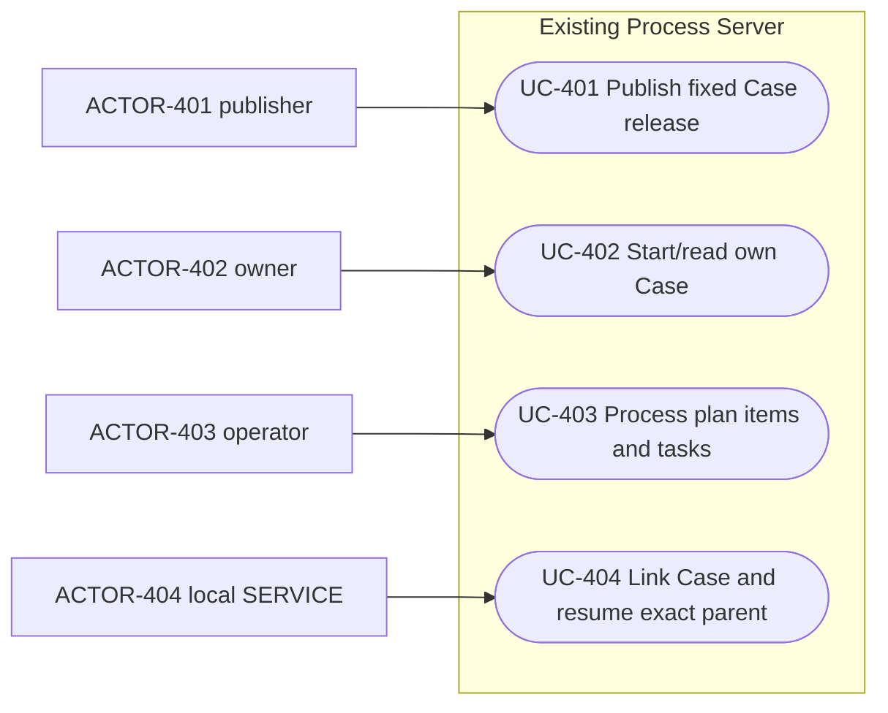
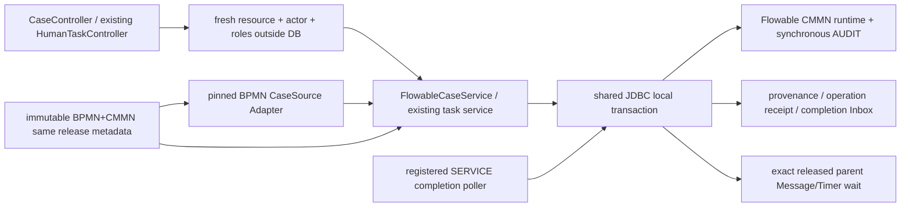
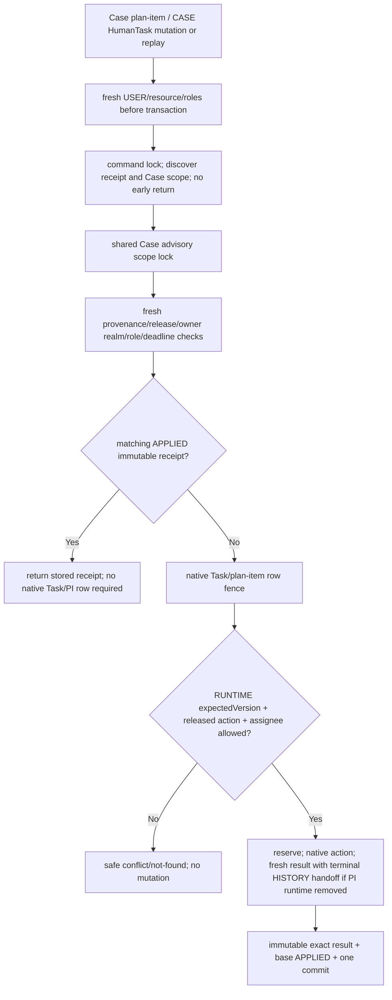
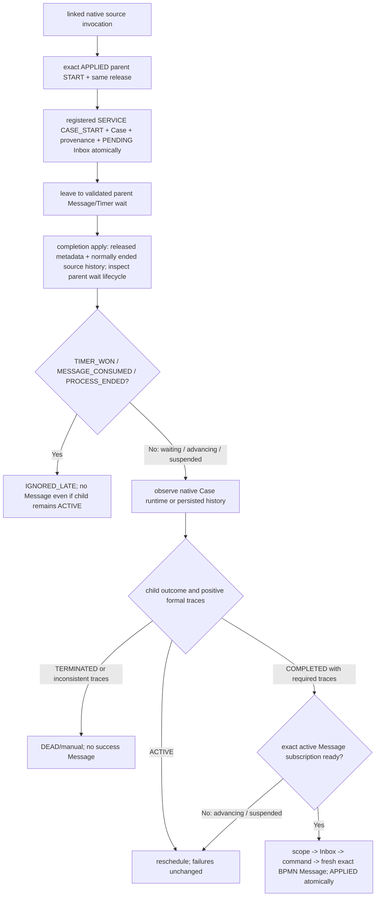
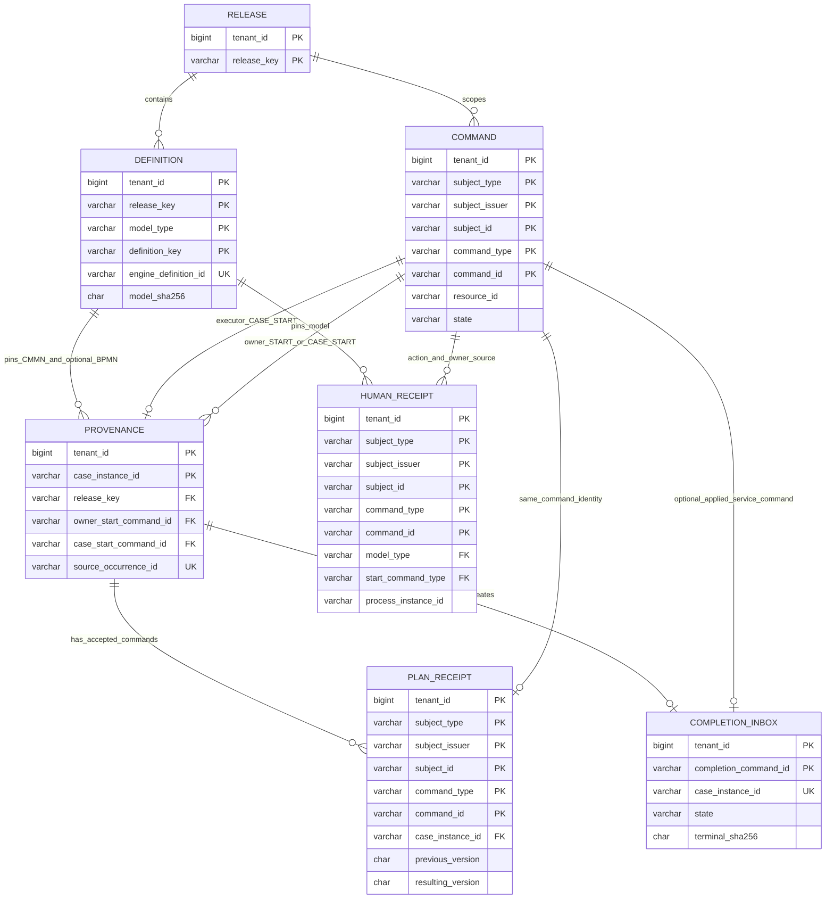

# 正式 CMMN Case 服务端、人工处理与 BPMN 回接

| Field | Value |
| --- | --- |
| Document | `2026-11-04-15-50-formal-cmmn-case-server.md` |
| Template Version | `9` |
| Archetype Cleanup | `Not applicable` |
| Status | `Review` |
| Type | `Feature` |
| Complexity | `Complex` |
| Complexity Drivers | `native CMMN ownership/history/revision、current-user authorization、cross-engine local transaction、immutable provenance/receipts、completion recovery、single-migration compatibility` |
| Created | `2026-11-04 15:50 Asia/Shanghai` |
| Updated | `2026-11-04 15:50 Asia/Shanghai` |
| Owner | `Root source-grounded review；原用户继续整体蓝图范围授权；尚无本 Spec 的 coding GO` |
| Repository | `tianji-service` |
| Scope | `T3-08 全部剩余 backend：C/CL release enum consumers + PS release/native Case/API/CASE HumanTask/linked BPMN/completion + one future ProcessDB V8` |
| Change Surface | `既有 vertical packages 原位扩展；三张技术 companion tables；不引入业务 Case 状态机、框架层或依赖` |
| Affected Chapters | `§7, §8, §9, §10, §11, §13, §14, §15, §16, §17, §18` |
| Source Requirement | `原蓝图 T3-08 / S09；Root reviewed /tmp/case-v8-decisions.md 与 native-8 audit；不是另一个独立 library slice` |
| Baseline Revision | `main@e6aa574de553d20b67f8d483d8a1e876bb48897e；检查时 clean` |
| Amends | `None` |
| Supersedes | `None` |
| Depends On | [Case Java contract](2026-11-01-23-20-case-client-contract.md), [Case HTTP SDK](2026-11-01-23-45-case-http-client.md), [CMMN semantics](2026-11-01-22-55-cmmn-semantic-validation.md), [Agent Framework Upgrade Plan](../../../../docs/plans/agent-framework-upgrade-plan.md) `§10, §14, §17.3; T3-08/S09` SHA-256 `80b18858081681195c9aa25826ad4ed1512283c4a7944669a1e997de04e4c66a` |
| Related Specs | `None` |
| Related Plans | `None` |

## 1. Summary

交付同一 Process Server 内真实固定 CMMN 流程：发布不可变 CMMN release → direct/linked Case start → current-user plan-item / HumanTask 操作 → native sentry/milestone → normal Case completion → 本地 durable Inbox 精确唤醒 BPMN Message。Flowable runtime 与 synchronous AUDIT history 是唯一 Case lifecycle authority；平台只存不可变来源、接受操作的结果与技术 completion delivery。

现有 C Case records、CaseClient、SDK 与 packaged OAS3.1 保持原合同。新增服务端三个固定 POST，扩大既有 release enum 为 BPMN/CMMN/DMN 并穷尽三路分支，原位复用现有 task/security/JDBC/TransactionTemplate/configuration patterns。单一未来 V8 一次冻结三张技术表、全部约束与索引，后续 implementation Steps 不再加 migration。当前不创建或保留 V8 文件、不改源码、不运行 build/DB/application/listener/browser，不把源代码或 Mock 证明冒充 native/production acceptance。

## 2. Background and Current State

### 2.1 Business and user context

Java Case contract 与严格 HTTP SDK 已提交，但 provider routes、release CMMN admission/deploy、Case authorization/lifecycle、CASE HumanTask 与 BPMN回接当前未发现。原目标要求完整 T3-08 backend，不能以新增 port/codec 或静态顺序 BPMN 代替 native CMMN。

### 2.2 Repository evidence

下表路径均相对 PS=`stellar-enclosure-tianji-process-server/src/main/java/top/egon/cola/platform/tianji/process/server/`，C/CL 指各自 Maven module；来源是当前源码或本地 Flowable8 cached binary audit，不是运行结果。

| Evidence ID | Classification | Exact path/symbol/decision | Observed fact | Design significance | Limit |
| --- | --- | --- | --- | --- | --- |
| EVD-401 | Static repository | `ProcessSecurityConfiguration`, `ProcessStorageConfiguration` | bean factories 在此；无 ProcessApiConfiguration class；shared DS/TM/schema/empty beans guards 已有 | 在真实 factories 扩展，不设计平行 wiring | 未启动 context |
| EVD-402 | Static repository | `release/ProcessReleaseService.prepare/deploy`, `ValidatedProcessModel.Type`, `VerifiedProcessModels` | 当前 BPMN/DMN 二路，non-BPMN ternary落DMN；已有fixed definition/hash读取 | 改为穷尽三路，保旧 manifest bytes | CMMN未发布 |
| EVD-403 | Static repository | `release/CmmnModelValidator`, `ValidatedCaseModel`, `SafeModelXml` | package-private immutable policy；固定 primary/supplemental/milestone；ACTION/sole lane/empty form | 复用 whitelist 与数字role parser，只增加必要可见性和入口 | semantic parser不是native proof |
| EVD-404 | Static repository | `execution/ProcessCommandReceiptStore`, `ProcessExecutionService.startInTransaction` | command PK scoped actor/issuer；native START在APPLIED前发生 | Case独立Kinds；linked owner只认已APPLIED parent START，不能借PENDING |
| EVD-405 | Static repository | `task/FlowableHumanTaskService`, `HumanTaskNativeAccess`, `HumanTaskSnapshot`, `HumanTaskReceiptStore` | PROCESS-only、native revision+released source hash、short owned transactions；V7 requester是owner | narrow CASE branches；共享scope lock先于任何native task/PI锁 | 旧writer/read join不能直接套linked Case |
| EVD-406 | Static repository | `security/TianjiProcessAccess`, `TianjiHumanTaskAccess`, `identity/HumanTaskContext` | PDP/identity refresh先于DB；fresh角色+deadline/authVersion/policyVersion；无USER/SERVICE替换 | Case角色投影复用同一规则，TX内仅本地deadline/identity checks | 没有真实IAM验证 |
| EVD-407 | Static repository | `bridge/AgentResultCorrelationService`, `FlowableAgentWaitInspector`, `ProcessAgentBridgeConfiguration` | local Inbox+exact Message、boundedpoller、activeissuer/registeredSERVICE metadata模式已存在 | 复用风格，Case独立来源与锁顺序，不复用Agent payload |
| EVD-408 | Local Flowable8 audit | `DefaultCmmnActivityBehaviorFactory`, `HumanTaskActivityBehavior`, `CmmnParserImpl` | exactfactory hook；late replacement须同时更新cfg/parser并wire依赖；candidateGroups在insert后/history前 | governedCMMN任务可在native creation参与同TX | cached javap，尚未native PG执行 |
| EVD-409 | Local Flowable8 audit | `PlanItemInstanceEntity`, `HistoricPlanItemInstanceEntity`, mapped REV_与history | runtime revision是optimistic fence；historyREV不是；includeEnded避免丢终态runtime rows；AUDIT最低满足task/linkhistory | domain-tagged runtime/history版本，history只读；persistedcase状态优先eventlabel | 不证明实际DB schema |
| EVD-410 | Reviewed Root decision | `/tmp/case-v8-decisions.md` + current task | 单V8、owner/executor分离、same release、source-occurrence唯一、TERMINATED不成功、独立flags | 关闭设计选择，临时note的accepted字样不是用户Accepted |
| EVD-411 | Static repository | C `CaseClient`/6records/4enums；CL `META-INF/tianji/openapi/case-v1.json` | 固定3POST/9errorpairs/Result12/Instant grammar | immutable wire authority，不加springdoc |

### 2.3 Problem statement and gap

当前只验证CMMN XML及值合同；真正发布/执行/来源/事务/权限/完成恢复链尚缺。HumanTask当前硬编码BPMN/START，linked Case owner资源是父BPMN而不是Case，必须有general provenance连接两个receipt。native跨引擎默认case callback会按原生行为推进，不能替代经过发布白名单与normal-completion证明的本地Message协议。

### 2.4 Evidence and current-chain map

| Entry/trigger | Current call chain | Data | External dependency | Consumers | Evidence |
| --- | --- | --- | --- | --- | --- |
| release/API | ProcessController→ProcessReleaseService→Process/DMN repositories/JDBC | immutable release + definition | fixed managed engines | oldclients | EVD-401/402 |
| HumanTask | HumanTaskController→fresh access→FlowableHumanTaskService→native+V7 | owner START/policy/revision/receipt | freshIAM outsideTX | currentUSER | EVD-405/406 |
| completion recovery pattern | AgentInbox/poller→wait inspector→Message | technicalreceipt | sharedPG/Flowable | BPMN | EVD-407 |
| formalCase | C/SDK + semanticmetadata only | noCaseprovenance/nativeadapter | absent | futureCaseAPI/BPMN | EVD-403/408/411 |

### 2.5 Archetype example cleanup

Cleanup disposition: Not applicable

Reason: 已存在技术Process Server与纯JDK合同modules；本任务不生成业务项目或example CRUD。`formal-case.cmmn`/`governed-case.cmmn` 是现有测试资源，保持其原用途；新增linked fixture，不能因技术skill改造为MP/COLA层次。

## 3. Goals and Non-goals

### 3.1 Goals

完整闭合direct/linked native Case、released actions、CASEHumanTask、same-release来源和normal-completion BPMN恢复；单V8冻结所有未来schema需求；交付可编译focused/Fake/MockMvc测试及显式opt-in PG native scenarios源码，运行边界分清。

### 3.2 Non-goals

无新微服务、业务Case状态机、脚本/EL/任意模型、Work/Forms商业依赖、引擎表DDL/直接native row UPDATE、新依赖/框架/generator/MP迁移、C Case字段/SDK协议/OAS变化。无真实角色/clientID/tenant配置、授权登记/激活/grant；无部署、DB操作或自动启动。前端/T3-09..T4保持后续目标，不因本Spec宣称完成。

### 3.3 Change Surface and Design Depth

| Area/layer | Disposition | Exact repository evidence | Changed or preserved behavior/contract | Required Spec treatment | Chapter(s) |
| --- | --- | --- | --- | --- | --- |
| release/type consumers | Affected | EVD-402/411 | additiveCMMN、three-waydispatch、same-release linked validation | exactfiles/contracts | §7, §8, §9, §10, §13, §14, §15, §16, §17, §18 |
| Case/API/security/native task | Affected | EVD-401/403/405/406/408 | direct/get/act + CASEscope/guardednativeassignment | detailedflow/auth/version | §7, §8, §9, §10, §13, §14, §15, §16, §17, §18 |
| technicalstorage/completion | Affected | EVD-404/407/409/410 | singleV8/3tables/receipt/inbox/fences | fullDDL/ER/recovery | §7, §8, §9, §10, §11, §13, §14, §15, §16, §17, §18 |
| CaseC/SDK/OAS | Context-only | EVD-411 | immutablewire/constructors/Instant/errorpairs | reference+providerdriftproof | §9, §10, §14 |
| oldBPMN/DMN/Agent/Worker | Context-only | EVD-402/405/407 | olddigest/permissions/flows preserved | targetedregression | §14, §16 |
| all23existingSQL | Unchanged | currentV1–V7plusothermodules | bytes/checksumsimmutable | baselinehash | §11, §16 |
| frontend/deployment | Not applicable | noUI/runtimeauthority | nochange/execution | explicitboundary | §12 |

## 4. Requirements and Acceptance Criteria

| ID | Atomic requirement | Priority | Observable acceptance | Source |
| --- | --- | --- | --- | --- |
| REQ-401 | 一份未来V8冻结3技术表及release/V7checks；保23旧SQL | Must | schema/checksum/privilege tests；Step2/3无需migration | Root/T3-08 |
| REQ-402 | release enum/validation/deploy/verify穷尽BPMN/CMMN/DMN；CMMN exactid/hash/tenant | Must |3waytests、same-release rejection、legacydigestgolden | T3-08/EVD402 |
| REQ-403 | direct owner=verified executor USER/SERVICE；atomic CASE_START+generalprovenance | Must | directreplay/rollback/executorFK/resourcechecks | Root |
| REQ-404 | linkedregisteredSERVICE执行，同release父START owner/business/correlation继承，不恢复历史USER | Must | rename/duplicate/parentPENDING/inlineprior-waitbarrier/crossrelease/rollback tests | Root |
| REQ-405 | 三Case routes遵守immutableSDK/OAS/security/body/error合同 | Must | MockMvc+packagedOAS+SDKdrift | Step36 |
| REQ-406 | get允许exactowner或freshUSERreleasedoperatorunion，同ownerrealm；SERVICEowneronly含terminal | Must | roleexpiry/tenant/issuer/terminalmatrix | Root |
| REQ-407 | planitemUSERonly，freshresource+role+nativeversion；fixedactions/assigneeprotection | Must | primary/supplemental/milestone/claimed-other denial | Root |
| REQ-408 | nativeCMMN runtimeREV防ABA；includeEnded/historyprojection；historyREV不作mutationfence | Must | enabled-disable-enable staleversion rejects；source/historical versionsdistinct | Root/native8 |
| REQ-409 | CASEHumanTask复用现policy/receipt、ACTION/solelane/emptyform、requester=owner | Must | claim/complete/read/replay+linkedV7joins+PROCESSregression | Root |
| REQ-410 | Caseplan/HumanTask共享scopeadvisory先于任何nativelock；noUPDATEgrantimmutablefacts | Must | lock-orderunit+concurrencyPGsource、privilegeverifier | Root |
| REQ-411 | governedCMMNfactory在native表达式前验证，固定rolegroups，legacyoff不变 | Must | cfg/parseridentity、dependencyhooks、interceptor/migration rejection、nativehistorytests | native8 |
| REQ-412 | linkedstart同TX预建Inbox，只有persistedCOMPLETED+endTime成功Message | Must | ACTIVE不耗budget；TERMINATEDmanual/DEAD；duplicate/late/rollback | Root |
| REQ-413 | BPMNCaseSource只literalCasekey，自定义nativeCaseTaskbehavior exactid启动并leave至releasedMessage/Timerwait | Must | defaultcallback从未调用；exactwait/subscription/occurrenceproof | Root |
| REQ-414 | caseEnabled/newStartsEnabled独立defaultoff；停新start保inflight处理/完成恢复 | Must | off/on/stopnewflagsmatrix、V7/V8newbinarycompat | Root |
| REQ-415 | sourceSERVICE与completion同一固定registration，currentlocalactiveissuer重核、TX无PDP/remoteIO | Must | noUSERcontext/noOAuthHTTPinsideTX/registrationrevocationfake | Root |
| REQ-416 | 保留原S09实际native验收义务，并交付正式fixture/opt-inPGsource覆盖正常/失败/并发/回接 | Must | source与finiteunit/MockMvc只是交付门禁；原S09必须实际native Case完成并让BPMN继续；PG未获授权执行时标RuntimeUnverified，不能宣称T3-08完成 | T3-08/S09 |

### 4.1 Scenario matrix

| Scenario | Actor/trigger | Preconditions | Main path | Failure/recovery | Data/state change | Result | Requirements |
| --- | --- | --- | --- | --- | --- | --- | --- |
| directstart/replay | verifiedUSER/SERVICE | Case+newstartsready | exactrelease→CASE_START→native→provenance | samecommand/hash replay；differenthash409；anyfailurefullrollback | oneCase/provenance | boundDTO | 403/405 |
| linkedsource | registeredSERVICE | parentAPPLIEDSTART+releasedcase/wait | inheritowner+release→CASE_START→Case+Inbox→leave | PENDINGparent/crossrelease/renamecollisionfailsclosed | atomicnative+3technicalfacts | parentwait | 404/412/413/415 |
| getterminal | owner/currentoperator | freshrealm/resource | provenance→runtime→history | hidden404；expiredsnapshot503 | none | terminal/sparseDTO | 406/408 |
| actABA | USERoperator | caseScope→PIlock | versioncheck→nativeaction→immutableResult12 | stale/otherclaimrollback/conflict | native+base+result | stablehistoricalreceipt | 407/408/410 |
| CASEtask | USERcurrentroles | nativegovernedtask | claim/completeunderCaseScope | linkedownerseparatefromexecutor；claimprotection | V7receipt+nativetask | existingtaskDTO | 409/411 |
| caseactive | completionSERVICE | precreatedInbox | inspectparentfirst；stillwaitingthenobserveactive/reschedule | parentTimerwon/consumed/ended→IGNORED_LATE evenchildACTIVE；nofailurebudgetburn | onlytechnicalnextdue/late | pendingorignored | 412 |
| normalcomplete | completionSERVICE | positivehistoricalCOMPLETED/endtime | scope→inbox→command→exactMessage | atomicrollback；duplicatealreadyapplied | terminalfact/inbox/base+parent | BPMNcontinuesonce | 412/413 |
| terminated/latewait | completionSERVICE | persistedTERMINATED/timerwon | noMessage | DEADmanual/IGNORED_LATE；parentTimerrecovery | technicaldecisiononly | neversuccess | 412 |
| stopnewstarts | operator | inflightwork | disableonlynewStarts | get/actions/tasks/completionremain | noCasebusinessstate | gracefulclosure | 414 |

### 4.2 Use-case analysis

#### 4.2.1 Actor inventory

| Actor ID | Actor/role | Goal | Channel | Permission/tenant | Evidence |
| --- | --- | --- | --- | --- | --- |
| ACTOR-401 | releasepublisher | immutableformalmodelpublish | existingreleaseAPI | currentverifiedactor/resource | EVD402 |
| ACTOR-402 | Caseowner | start/readoneCase | CaseREST | USER/SERVICEexacttenant/realm | Root |
| ACTOR-403 | currentoperator | finiteCaseactions/tasks | Case+HumanTaskREST | USERfreshroles+releasedpolicy | EVD405/406 |
| ACTOR-404 | registeredlocalSERVICE | linkedstart/reconcile | nativeadapter/poller | fixedregistration/activeissuer | Root/EVD407 |
| ACTOR-405 | test/operator | S09/nativeacceptance | opt-intestentry | user-controlledDB/runtime | blueprint |

#### 4.2.2 Use-case artifact



| UC | Trigger/preconditions | Success | Alternatives/failures/postconditions | Trace |
| --- | --- | --- | --- | --- |
| UC-401 | publisher submitsfixedsame-releasebundle；Caseenabled+humanTaskpublicationready | CMMNexactbindingACTIVE | invalid/crossrelease/nativefailure→noreleaseorpartialdeploycommit | REQ402/414；TEST-401/409 |
| UC-402 | authorizedstart/get；startsflagonlyforstart | owner-boundactive/terminalDTO | duplicatehashstable；mismatch409；hidden404；noimplicitcalleridentity | REQ403/405/406；TEST-402/405 |
| UC-403 | freshUSERresource+roles；runtimefence | nativeaction/task+durablereceipt | staleABA/assigneeother/deadlinefailrollback；noCaseparallelstatemachine | REQ407–411；TEST-403/406/407 |
| UC-404 | registeredsourceexecutionthenpoll | same-releaseCase→normalCOMPLETED→exactparentMessageonce | ACTIVEresched；TERMINATEDmanual；lateignored；fullTXrollbackonfailure | REQ404/412–415；TEST-404/408/409 |

## 5. Constraints, Assumptions, and Decisions

### 5.1 Confirmed constraints

既有源码使用technical vertical packages、explicit @Bean factories、plain final services、JDBC/TransactionTemplate/Flyway-test scripts。Root明确要求保留，优先于generic skill引入Lombok/MapStruct/MP/DDLrunner/新层的建议；这不是新的依赖或架构选择。单数据库同schema/localtransaction，无remotePDP/credential/IAM请求在DB锁中；所有旧migration immutable。

### 5.2 Small-gap assumptions

| ID | Inference | Repository evidence | Reversible | Impact if wrong |
| --- | --- | --- | --- | --- |
| ASM-401 | newtechnicaltable/classnames如下文冻结 | V5–V7/verticaltechnicalstyle | implementationbeforecodingGO可review | 无业务policy变化 |
| ASM-402 | completiondefaults poll1s、batch32、retry1s、maxFailures10；ACTIVE无绝对短expiry、无自动retention | existingboundedpollerstyle | operatorconfig | latency/ops容量待native验证，不宣称SLA |
| ASM-403 | sourceoccurrence采用当前native ActivityInstanceEntity.id而非executionID，具体API已由本地8.0 audit确认 | recordActivityStart早于behavior；manager先找当前EntityCache；history复制同ID | nativefixture是执行门禁 | missing/mismatch即failclosed；不创建或猜测occurrence |

### 5.3 Resolved decisions

| ID | Decision | Owner/evidence | Consequence |
| --- | --- | --- | --- |
| DEC-401 | nativeCase唯一stateauthority，3技术表足够 | Root/EVD410 | 不建Case状态机或引擎FK |
| DEC-402 | sameimmutableplatformrelease；directowner=executor；linkedowner=parentAPPLIEDSTART/executor=SERVICECASE_START | Root/EVD404 | 两独立receiptFK及resource校验；不恢复USERcontext |
| DEC-403 | sourceoccurrenceunique不含source_id | Rootreview | configrename不可启动第二Case |
| DEC-404 | persistedCOMPLETED+endTime才发Message；TERMINATEDdead/manual | native8historyaudit | nativeeventlabel仅提示不可做事实 |
| DEC-405 | versiondomain+runtimeREV；scope锁先native；immutablefactsSELECT/INSERT | Root/nativeaudit | history仅projection，ABA/死锁明确测试 |
| DEC-406 | V7verifier旧binary不兼容是coordinatedrollout既定边界 | Root | drainoldtasknodes，V8awarebinary先到位，不再请求同一批准 |
| DEC-407 | ConsumerOAS为providerdocumentationauthority | Step36 | noSpringdocdependency/generatedv3docsclaim |

### 5.4 Open major decisions

当前design基线未留下新的policy选择；本Spec仍为Review，Root须全文/strict/hash审阅后另写Plan。真实nativePG/IAM/部署验收尚未执行是验证边界，不伪造accepted事实。nativefixture必须验证ASM-403的当前ai可见性与history同ID；若执行结果冲突则返回本Spec修复，不得编码猜测。

## 6. Project Technology Context

JDK25、SpringBoot managedJackson3外部wire（现有Flowable/Outbox内Jackson2不替换）、Flowable8.0.0 BPMN/CMMN/DMN、PostgreSQL普通JDBC、SpringTransactionTemplate与test-onlyFlyway。生产spring.flyway.enabled=false与engine-schema-update=false保持；所有migration由现有外部预置流程执行。

### 6.1 Java architecture profile and capability baseline

保持项目已有technicalverticalprofile作为本任务用户明确指定的架构合同；不是genericarchetype的业务层生成任务。依赖方向api→security/typedcontext→execution/task/bridge→native+JDBC，releasemetadata被这些组件读取；C保持纯JDK，CL不依赖PS。无newmodule、biz.*或通用DDD/MP接口。

| Need | Existing capability | Gap | Decision/dependency |
| --- | --- | --- | --- |
| identity/resource/freshroles | TianjiProcessAccess/TianjiHumanTaskAccess/TrustedIssuerRegistry | Casepermission/contextprojection | 在security原位扩展；无依赖 |
| SQL/transaction/receipt | JdbcTemplate/ProcessCommandReceiptStore/HumanTaskReceiptStore | Casefacts/result/completion | 最小专用store参与现TM |
| models | CmmnModelValidator/ValidatedCaseModel/VerifiedProcessModels | releaseadmission/publicinternalmetadataaccess | 复用输出、三路dispatch |
| nativeassignment/adapter | existingPinnedDecisionfactory/nativeCMMNhooks | governedCMMNfactory/CaseSource | exactAdapterextension，featureofflegacyunchanged |
| durableMessage | AgentInbox/waitinspectorpattern | CaseprecreatedInbox/positivecompletefact | 平行技术store但不复制Agentpayload/remoteclient |
| docs/tests | packagedOAS/JUnit/MockMvc/PGopt-in | providerdrift/nativeS09sources | 无springdoc/新test依赖 |

### 6.2 User-mandated Java rule compliance

| Literal rule | Affected? | Repository evidence | Exact design decision | Files/types/interfaces | Validation/test evidence | Status/blocker |
| --- | --- | --- | --- | --- | --- | --- |
| Rule 1 | Yes | semantictechnicaltypesexisting | CaseContext、Codec/Store/Service/Behavior/Properties等角色明确，无模糊carrier | §8 | compile/inventory | PASS |
| Rule 2 | Yes | constructor/strictadvice/currentcontext；Root保既有technicalstyle | C构造+strictJSON+freshcontext+TXdeadline/nativeguards；不加validation依赖改写C | API/security/native | TEST-402/403/405/406 | PASS |
| Rule 3 | Yes | immutableinternalrecords/classescopies；Root保留 | CaseContext/immutablefacts用record或既有finalmetadata；无跨模型PO转换 | §10 | copy/reflectiontests | PASS |
| Rule 4 | Yes | existing@Bean factories/manualtechnicalctors/loggerstyle；Root保留 | explicit@Bean方法稳定名；noDIhandwrittenbusinessrefactor；沿邻近logging | configs/serviceboundaries | wiring/static | PASS |
| Rule 5 | Yes | existingJDK/Jackson/JDBC | 仅既有依赖/nativeAPI | all | POMdiff | PASS |
| Rule 6 | Yes | existingJackson3HTTP/Jackson2Flowableinternal | 不混新库；enumname、InstantZ、strictbody、Result12 | API/OAS | TEST-405 | PASS |
| Rule 7 | Yes | PS onlybaseapplication.yml | 新keys只扩该真实base；现有其他profiles不改；empty/defaultoff | §15 | Binder/keyinventory | PASS |
| Rule 9 | Yes | realnativeprotocolvariation | Adapter/nativeBehaviorfactory+existingCommandreceipt pattern | §13 | nativeadapter/failuretests | PASS |
| Rule 10 | Yes | java.time/legacyFlowableDate | 新模型Instant/Duration；nativeDate仅existingboundary.toInstant | §6.3 | TEST-407/408/409 | PASS |
| Rule 11 | Yes | explicitRootarchitectureboundary | preserveexistingverticalJDBC/Flyway；不引入MP/DDLrunner/archetypelayer | all | boundary/static | PASS |

### 6.3 Time semantics and conversion contract

Time contract: Required

| Time ID | Fields/symbols | Semantics | Java/runtime type | Storage policy | Wire policy | Business zone source | Display zone source | Boundary / DST rules | Precision / Clock | Compatibility | Verification |
| --- | --- | --- | --- | --- | --- | --- | --- | --- | --- | --- | --- |
| TIME-401 | provenance.created_at, result.occurred_at, Inbox.created_at/terminal_at/decided_at；DTO.submittedAt/finishedAt/occurredAt | Occurred instant | Instant; native Date.toInstant boundary | UTC instant | UTC Z | Not applicable: no business-calendar computation | Not applicable: frontend out of scope | timestamptz/JDBC Timestamp.from/toInstant；offset inputcanonicalizes；no chronology/freshness rule addedtoCaseDTO | PGtimestamptz(6)微秒；DBclock_timestamp生成platformfact；Flowablemillisecondprecision如实保留，不伪造nanos | C/SDK接受nanos；生成fact先取DBprecision再persist/response/replay，三者exact | TEST-402, TEST-407, TEST-409 |
| TIME-402 | CaseContext.deadlineAt/registrationproofdeadline | Occurred instant | Instant/Clock.systemUTC | Not persisted | Internal | Not applicable: authorization window | Not applicable: no UI | snapshot/identityexpiry与existing30smin；DBclock在TXbefore/aftermutation验证strict > now | clock显式UTC；deadline不截断变长 | 与HumanTaskfreshcontext同语义；不缓存历史roles | TEST-403, TEST-405, TEST-406 |
| TIME-403 | pollInterval/retryDelay/txTimeout | Duration | Duration | Not persisted | Internal | Not applicable: technical elapsed interval | Not applicable: no UI | elapsedtechnicaldelay；无DST/calendar；ACTIVE反复reschedule不耗failurebudget | defaults1s/1s/10s；不使用calendar计算 | existingpollerstyle；longCase不会自然dead | TEST-408, TEST-409 |
| TIME-404 | Inbox.next_attempt_at | Occurred instant | Instant | UTC instant | Internal | Not applicable: technical due instant | Not applicable: no UI | DBclock+Duration生成；nextdue仅technicalschedule，非Case业务deadline | timestamptz(6)微秒，DBclock_timestamp | existingInboxdue语义；no short absolute Case expiry | TEST-408, TEST-409 |

## 7. Architecture Design

### 7.0 Minimum-design baseline and element-necessity audit

| Proposed element | Change | Requirements | Existing/direct alternative | Concrete gap | Added calls/state/coupling/failure/migration/operations | Verdict |
| --- | --- | --- | --- | --- | --- | --- |
| release/nativeCase/API | Expand | 402–409 | CaseSDKalone/oldProcessstart | 无Caseprovider/lifecycle | 3routes+exactnativecalls | Keep/Expand |
| immutableprovenance | New | 403/404/406/409 | STARTreceiptresourcequery | 无法分离Caseexecutor与parentowner | 1row/Case+singleV8；replay/joins | Add |
| immutableplanresult | New | 407/408 | nativehistoryalone | 不含exactacceptedcommand/result/audit且runtime会删除 | 1row/acceptedcommand；noCase/PIunique | Add |
| precreatedcompletionInbox | New | 412/415 | endlistener/defaultcallback | listenergap/TERMINATED推进/无法恢复 | 1row/linkedCase+boundedpoller；sameTX | Add |
| explicitnativeAdapters | New | 411/413 | defaultcasekeylatest/callbackorrawEL | 无pinning/授权/normalcompletionproof | factoryhooks；readinessguards | Add |
| businessCaseSM/newframework/remoteMQ | None | none | nativeCMMN+localTM | directbaseline已足够 | 避免额外state/calls/deps | Remove |

| Path | Network calls | Client states | Server contracts/state | Failures/TOCTOU | Value |
| --- | --- | --- | --- | --- | --- |
| localselected | publicAPI1；内部Case/BPMN0network | immutableCrequests | nativeCase+3technicalcompanions | scopedlocks/atomicreceipts/currentcontext | exactT3-08 |
| remotebus/separateCaseSM | extraI/O | extradelivery/duplicatestate | parallelbusinessstate | crossstoreconsistency | 无当前需求，拒绝 |

### 7.1 System Architecture Design



| Component | Responsibility | Inputs/outputs | Allowed dependencies | Forbidden | REQ |
| --- | --- | --- | --- | --- | --- |
| FlowableCaseService | nativeCaseapplication orchestration/receipt | Ccommands/context→Cresults | release/native/JDBCstores | remotePDP/inventedowner | 403–408 |
| CaseNativeAccess | scopedread/fence/versionfacts | knownCase/PI→nativefacts | exactcfg/JDBC/nativeAPIs | nativeUPDATE/historymutation | 408/410 |
| taskCASEbranch | existingHumanTasklifecycle | existingCcommands→taskDTO/receipt | provenCaseowner/releasedlane/nativeCmmnTaskService | serviceexecutor-as-requester | 409/411 |
| linkedsource/completion | fixedregisteredSERVICE invocation/recovery | nativeparent→Case/Inbox→Message | release/provenance/native/sharedTM | USERimpersonation/defaultCasecallback | 404/412/413/415 |

### 7.2 High-Level Design





#### 7.2.2 High-level decision and quality matrix

| Concern/use case | Required | Mechanism | Failure | Trade-off | Verification | REQ |
| --- | --- | --- | --- | --- | --- | --- |
| ownerrealm | linkedUSERrealm不等于SERVICEexecutorrealm | separateimmutableowner/executorFK | hidden404/inconsistent503 | 两receiptjoin | TEST-402/404/406 | 403/404/406 |
| consistency | native+fact+message不partialcommit | exactDS/TM/schema、shortlocalTX | fullrollback | 无跨processguarantee臆测 | TEST-409 | 401/410/412 |
| recovery | noendlistenergap/falsecomplete | precreatedInbox + positiveAUDIThistory | ACTIVEpending/TERMINATEDmanual | pollcostbounded | TEST-408/409 | 412 |
| compatibility | disabledlegacyunchanged、V7/V8safeupgrade | flags/versionawareverifier | failclosedreadiness | coordinatedoldbinarydrain | TEST-401/410 | 414 |

### 7.3 Detailed Design

#### 7.3.1 Detailed component collaboration

**Release:** `ProcessModelTypeEnum` / `ValidatedProcessModel.Type` 增CMMN，所有分支使用显式switch(BPMN,CMMN,DMN)，禁止`nonBPMN→DMN`。`ProcessReleaseService`保留旧constructors并新增明确CMMNcfg/options overload；nested PreparedModel携带type/key/validatedbytes/hash/inputs及互斥processModel/caseModel，避免把CMMN伪装DMN。既有BPMN/DMNmanifest序列化原字段顺序/排序/bytes不变，CMMNinputs必须empty。`ProcessModelValidator.validateCmmn`委托现validator；`ValidatedCaseModel`仅增加跨verticalpackage所需public只读可见性，原defensivecopy和whitelist不改。CMMNdeployment按exacttenant/key/one-definition且立即核对ID/deployment/version/hash；VerifiedProcessModels新增caseModel读取同bytes/hash并重新验证。linked BPMN metadata每个literalCasekey必须同bundle/same release的CMMNbinding，发布时要求feature/readiness与已配置fixedsource，不接受callerCaseversion。

**Direct start:** pre-DB`TianjiCaseAccess`复用realresource/identityguard，产出currentactor+boundedidentitydeadline的CaseContext（start不要求operatorroles）；owner=executor=currentProcessActor；serviceownsTX并在native操作前后核DBclock<deadline。command scopedlock/checkrequesthash→pinnedreleasebinding→reserveCASE_START→nativebuilder exactcaseDefinitionId/tenant/business→verifyresult→baseAPPLIED+provenanceinsert→snapshot，任何异常全部回滚。replay从executorreceiptunique→provenance安全读取，不重新start；相同command不同requesthash409。newStarts=false只拒freshstart；历史已APPLIEDreplay可读仍须现授权与provenance。

**Safe get/read:** 以tenant+CaseID从provenancePK起，joinexecutorCASE_START/ownercommand/releasedCMMN（linked还parentBPMN），验证APPLIED/hash/release/correlation/resources。direct两resource=CaseID；linkedownerSTARTresource=parentBPMNID/executorCASE_STARTresource=CaseID。允许exactowner(USER/SERVICE)，或USER且currentrealm=ownerrealm、freshroles与releasedoperatorunion相交；SERVICE无operator通道。terminal同规则；不把历史owner重放为当前USER。CaseDTO使用provenancebusiness/correlation/createdAt与native状态；nativeCase state穷尽映射仅 `active→ACTIVE`、`completed→COMPLETED`、`terminated→TERMINATED`（后二者需exactendTime）；suspended/unknown/missing拒绝safe503，禁止默认ACTIVE。nativePI状态仅available/enabled/disabled/active/completed/terminated逐名对应public六值，waitingForRepetition/exit/suspended等一律拒绝该formalprojection，不猜测终态；kind仅releasedhumanTask→HUMAN_TASK、milestone→MILESTONE。milestone native completed+occurredTime映射publicCOMPLETED，不要求其completedTime。runtime缺失才用exacttenant/definition/Casehistoricalstate+endtime，missing/malformedhistory503而非臆造COMPLETED。

**Plan snapshot/version/action:** CaseNativeAccess只接受knownprovenance；runtimePI query使用includeEnded，再补history，按ID去重并核CaseID/definition/tenant/definitionId/elementId。投影仅threeformalplanitems，C DTO.planItemDefinitionKey是`primaryTask/supplementalTask/completionMilestone`；policy map按elementId primary/supplemental/milestone，严禁混淆。版本`SHA256(length-prefixed [TIANJI_CASE_PLAN_ITEM_RUNTIME_V1,tenant,ownerrealm,CaseID,release,caseDefID/modelSHA,PIID,elementID,definitionID,kind,state,REV,nativeDates,...])`；history域`...HISTORY_V1`且只读。时间/状态alone不能防ABA；不以historyREV作为锁。availableActions=releasepolicy∩nativeclosedstate∩currentUSERrole权限，并应用activeSUPP TERMINATE assignee规则；terminalCase/Service/no-role/milestone动作empty。

**Plan mutation:** USERonly resource/freshroles在TX外，TX deadline用DBclock before/after。command advisory/replay→CaseScope advisory→provenance/release/role→nativePIrow fence→runtimefreshentity+REV/expectedVersion→taskassigneefence(若TERMINATE)→reserveCASE_PLAN_ITEM→native `disablePlanItemInstance/enablePlanItemInstance/startPlanItemInstance/terminatePlanItemInstance` 对应有限action→刷新resultstate/version：若runtimePI仍在，includeEnded读取freshRUNTIME-domain REV；若同步TERMINATE已触发milestone/Case cleanup而runtimePI消失，读取exacttenant/Case/definition/PI历史终态并构造只读HISTORY-domain resultingVersion；缺失/不匹配/非预期终态才rollback，不因正常runtime删除本身rollback→exactResult12immutableinsert+baseAPPLIED。DISABLE/ENABLE/START只按release primary配置；supplemental START/TERMINATE；milestone无动作。TERMINATE仅ACTIVE supplemental，若该PI有nativetask，unassigned或self允许，anotherUSERassignee拒绝；不得用planAPI绕开HumanTaskclaim保护。result必须等于publicfourtransitions且versions不同；expectedVersion只与runtimebefore比较，HISTORYtoken永不接受为后续mutation fence。ResultingVersion允许terminalhandoff的HISTORYdomain，但它不是可继续操作的runtime版本。replay先现resource/freshrole/realm检查，再从detailedreceipt返回原12字段，native删除不影响，不复原当前state或重执行。

**CaseScope lock:** `ProcessRequestDigest.hash([TIANJI_CASE_SCOPE_LOCK_V1,tenant,CaseID],emptyMap)`首8bytes big-endian signedlong→`pg_advisory_xact_lock(?)`。commandlock继续既有versionedpattern。碰撞最多serialization，不授权；Case与CASEHumanTask复用同一helper/namespace，先scope再nativeTask/PI，禁止给immutableprovenance UPDATE以便FOR UPDATE。CASE task先无锁读取已验证scope reference用于取scope锁，再underlock重查task；锁前不nativeFORUPDATE。所有ownTX写限10s/JDBCquery5s，禁止环境ambientTX误加入。

**CASE HumanTask:** existingpublicget/query/adminQuery/claim/unclaim/transfer/complete wire不变，scopeType=CASE已在C enum；query和nativeaccess增加显式scope branch，PROCESS SQL完全保留。CASE nativeTask要求scope_type_=`cmmn`、scope_id_=CaseID、scope_definition_id_=exactcaseDefID、sub_scope_id_=PIID、task_def_key_=releasedhumanTaskdefinitionID；无BPMNproc/delegated/foreigntenant污染。调用CmmnTaskService而非BPMNTaskService，CASE policy适配到现ACTION/solelane/emptyform/role groups；当前service可按scope选nativefacade，不能复制另一套HumanTaskAPI/receipt表。Caseorigin用ownerreceipt和Caseprovenance：V7 requester仍owner，Case scope/release/correlation仍Case；linkedSTARTresource永不被强制等CaseID。HumanTaskActionResult/HumanTaskSnapshot携带scope/modeltype/sourcekind而非硬编码PROCESS/BPMN/START；PROCESSgolden不变。CASE HumanTask replay禁止套用当前PROCESS的early-return短路：commandlock/detail初读后从storedreceipt取得Case scope，获取sharedCaseScopeadvisory，重读provenance/release与ownerrealm并重核freshcontext/deadline后才可return。CLAIM/COMPLETE replay先核stored authorized_role_id属于releasedlane，作为历史audit事实；再要求fresh current roles与releasedlane相交，不要求命中当时选中的同一role。role7切换到同lane的role8可replay，全部candidate roles撤销必须拒绝；UNCLAIM保持现self/ownerrealm规则，TRANSFER保持现专用resource+releasedtargetlane规则，不凭旧auditrole替代现权限。nativeTask可能已删除，replay不需要伪造currenttask，但必须有可信storedscope/source/assigneeaudit并且不在scope锁前返回。PROCESS replay保持原行为，不扩无关scope。CASEsolelane transfer只允许已发布solelane，沿现TRANSFER授权/receipt且无任意新增lane；COMPLETE form只能empty，APPROVAL/verification仍BPMN，Case不可伪装approval。

**Governed CMMN native assignment:** nativepolicy lookup只用当前nativeTX中的provenance/release参与者，不能递归调用publicCaseget的own-transaction入口。new`task/PinnedCaseHumanTaskActivityBehavior`继承nativeHumanTaskActivityBehavior(HumanTask)。override三参execute(CommandContext,PlanItemInstanceEntity,MigrationContext)，在super前核exactcurrentcfg/context、migration=null、createHumanTaskInterceptor=null、tenant/Case/model/release/definitionID/hash与closedmetadata；rawassignee/owner/candidateUsers/groups/tasklisteners/taskIdVariableName/blockingExpression无，blocking=true，无unsupportedEL。markedgovernedtask才此Adapter，unmarkedlegacy走supernative。overridehandleCandidateGroups(CommandContext,PlanItemInstanceEntity,ExpressionManager,TaskEntity,CreateHumanTaskBeforeContext,MigrationContext)只加fixed`role:<positiveId>`，不call super/EL；此时nativeinsert已发生，history/listeners尚未发生，错误让同TXtask/identitylinks/history全部rollback。defaultinterceptor为null，不能clearcustominterceptor来伪造ready。

**Factory readiness:** `ProcessStorageConfiguration.caseStorageGuard`当Caseenabled通过现EngineConfigurationConfigurer注册EngineConfigurator；beforeInit不替换；configure-afterInit（EngineConfigurator.getPriority固定Integer.MAX_VALUE，保证installer在普通configurators后验证最终factory；unknowncustominitializer仍failclosed）验证exactcfg、默认factory/parser identity、非空ExpressionManager/ClassDelegateFactory；构造`task/PinnedCaseActivityBehaviorFactory` subclass，显式set二依赖，set到cfg与`CmmnParserImpl`两指针并断言identity。factoryoverride exactcreateHumanTaskActivityBehavior(PlanItem,HumanTask)，其余native方法继承。安装时不eager解析FlowableCaseService等engine依赖bean；需要application collaborator的nativebehavior使用typed Supplier/ObjectProvider，nativeexecute才resolve，缺失failclosed，不访问ApplicationContext/globalstatic/ELbeans。unknowncustomfactory/parser/earlydeploymentinitializer failclosed，不覆盖。caseoff不注册installer/unmarkedlegacy保持。readiness要求cfg同DS/TM/schema/emptybeans、databaseSchemaUpdate=false、synchronousAUDIT（>=AUDIT但无async；formal模型grammar拒historyoverride而不修改unmarkedlegacy策略）、task+case+planhistoryservices可用，不能只看BPMNinstancehistory。

**Linked BPMN native source:** `PinnedDecisionActivityBehaviorFactory#createCaseTaskBehavior(CaseServiceTask)`返回`bridge/PinnedCaseSourceActivityBehavior`（concrete CaseTaskActivityBehavior subclass），保留既有factory no-arg构造兼容，新增typedlazy Supplier/ObjectProvider构造由原ProcessStorageConfiguration factory接入，避免engine构建→applicationservice→engine的eagercycle。execute才解析exactCaseapplicationservice/SourceRegistry；formalCaseSource若flag/readiness缺失则failclosed，不fallbackdefaultkey/latestcallback。execute覆写而不调用defaultCaseTaskexecute/callback：核nativecurrentexecution/sourceelement/modelSHA/tenant/parentCasebinding，获取same-releasemetadata+fixedregisteredSERVICE→同一nativeTX调用FlowableCaseService内部linkedstart（必须已在exactowningnativeCommand/sharedTM中，只参与原事务，绝不调用publicdirect的own-no-ambient入口或另开REQUIRES_NEW）→leave(execution)到经validator证明的Message/Timerwait。只有literalflowable:type=case/caseDefinitionKey；不接受defaultkey/latest/caseversion/inheritvariables/callback、EL、classdelegate或外部JAVA。sourceoccurrence取当前native `ActivityInstanceEntity.id`：要求ExecutionEntity、currentProcessCommandContext，调用`CommandContextUtil.getActivityInstanceEntityManager(commandContext).findUnfinishedActivityInstance(nativeExecution)`；校验nonnull/endTime=null、tenant/PID/definition/activity/execution精确匹配。native recordActivityStart先于behavior且EntityCache可见，history使用相同ID，缺失即reject，不自行create。source_id只routingaudit，unique/commandhash不含可renameconfigID。parentSTART必须已APPLIED；startinline遇PENDINGfailclosed，不能修改旧START顺序或伪认receipt。publication在first-profile acyclicgraph上计算all-path prior-wait barrier：USER_TASK、intermediateMessage/Timercatch或knownexternalWorker必须在所有到达CaseSource路径上提供此前nativewait；无barrier的inline-start可达source拒绝，不能发布永久不可start的模型。允许真实AgentWorker→resultMessage→exclusiveFailure→CaseSource路径，不把限制写成仅immediatepreviousHumanTask。正式fixture先已提交的governed ACTION task，再case source，保证正常source触发时ownerSTART已APPLIED。

**Completion:** linkedstart同TX创建Inbox；deterministiccompletionID=`SHA256([TIANJI_CASE_COMPLETION_V1,tenant,CaseID])`，sourceCASE_STARTcommandID为stableoccurrence域hash，不含sourceconfig名称。poller通过boundedSKIPLOCKEDdiscovery先提交短claim，再每项独立applyTX。apply固定CaseScope→InboxFORUPDATE→CASE_COMPLETION_SERVICEreceipt→exactBPMNwait/nativeMessage；failureTXreschedule同scope→Inbox顺序。当前SERVICE必须与provenanceexecutor精确相等；registrylocalregistration/TrustedIssuerRegistry.ACTIVE tenant/currentkey在每次apply前及commit前重核，不在TX发OAuth/PDPHTTP，不恢复历史SecurityContext。

每次completion apply先由releasedmetadata与same-ID正常结束sourcehistory检查父wait生命周期；**无论子Case是否ACTIVE**，确认TIMER_WON、MESSAGE_CONSUMED或PROCESS_ENDED就立即IGNORED_LATE，不能让父Timer已获胜的ACTIVEchild永久PENDING。WAITING/ADVANCING/SUSPENDED才继续观察child；childACTIVE仅更新nextdue，不增加failure_count、不按短expiry转DEAD。nativeCase结束后只认synchronoushistorystate=COMPLETED且nonnullendtime；保存terminalstatus/time/hash；TERMINATED→DEAD/manual，绝不successMessage（nativeended eventlabel可能误导）。公开DTO的COMPLETED只代表nativeobservedstate，不声称AUTOcause。linkedMessage额外要求sameCase/tenant/CaseDef/release下的positiveclosed-templatefacts：primary PI state=completed 且completedTime非null；supplemental PI completed且completedTime非null，或terminated且terminatedTime非null；milestone PI state=completed、occurredTime/endedTime非null，并有exactHistoricMilestoneInstance elementId=`milestone`的positiveoccurrence/time。Milestone history没有elementId queryfilter，先用exactCase/definition/tenant boundedquery再逐条校elementId；不是definitionId=`completionMilestone`。每个requiredfact只能一个且精确sourcebound，缺失/歧义→DEAD/manual `INCONSISTENT_NATIVE_FACT`、不Message。Inbox terminal_sha256绑定Caseend+这组nativefactID/state/time/modelsource，apply时重读重核；不增加业务状态或表列。nativeforceComplete可让Casehistory=COMPLETED但不会伪造缺失的primarycomplete/milestoneoccurred事实；即便所有traces成立也不宣称证明从未调用adminforceComplete。没有公开wholeCasecomplete/terminate/admin API。每次apply（包括childACTIVE）读取releasedBPMN metadata由source_element_id导出waitactivity/message/timer，先独立校验stored source_occurrence_id对应same-ID synchronous HistoricActivityInstance，tenant/PID/parentdefinition/source_element_id/hash一致，且endTime非null、deleteReason=null，证明source已正常离开；linkedstart时的unfinishedruntime/EntityCache只用于capture，不得作为后来Message eligibility；losing/deletedbranch拒绝。然后另行按tenant/parentdefinition/process/derivedwaitactivity/message查询当前exactsubscription+execution。sourceoccurrence不是waitexecution，绝不比较/推导/预存wait execution ID；仅APPLIEDbaseReceipt记录实际收到Message的executionID。parent已结束/Timer正常完成/message已消费的late决定优先于childACTIVE与terminal分支；ADVANCING/SUSPENDED+eligibleCOMPLETED仍pendingreschedule。真正nativeMessage与APPLIED/Inboxfinish一TX。commandrequesthash绑定provenance、positivehistoryfact、derivedwaitmetadata；APPLIEDresource为实际收到Message的executionID，仅结果存baseReceipt，不在provenance猜存。nativefailure回滚Message/base/result/inbox，另外受同scope锁reschedule并failure_count+1，maxFailures→DEAD/manual。所有terminalinbox状态不可复活；noautoDELETE/retention。

#### 7.3.2 Critical-path Mermaid swimlane

```mermaid
sequenceDiagram
  participant U as Current USER / verified SERVICE
  participant G as Resource and fresh-role guard
  participant A as Case or HumanTask service
  participant D as shared JDBC transaction
  participant C as Flowable CMMN
  participant P as Parent BPMN
  U->>G: fixed operation with C command
  G-->>A: trusted actor/current role context, bounded deadline
  A->>D: command discovery then shared Case scope lock
  D->>D: provenance/release/current role/deadline; replay or native fence
  D->>C: exact definition start / finite action / task mutation
  C-->>D: native result, runtime or terminal history projection
  D->>D: immutable receipt/provenance; linked start precreates Inbox
  D-->>U: one local commit, bound result
  Note over D,C: Completion is a new short transaction; no remote authorization while locked
  D->>D: Case scope advisory -> Inbox lock; current registered SERVICE
  D->>P: read released wait lifecycle and normally ended source history
  alt parent timer won / message consumed / process ended
    D->>D: IGNORED_LATE, including when child stays ACTIVE
  else parent continuation still possible
    D->>C: observe runtime or persisted case history and positive template traces
    alt child ACTIVE
      D->>D: reschedule without consuming failure budget
    else child TERMINATED or required completion facts inconsistent
      D->>D: DEAD/manual, no success Message
    else eligible COMPLETED and exact active wait ready
      D->>D: lock CASE_COMPLETION_SERVICE command receipt
      D->>P: freshly fence exact Message subscription/execution and deliver
      D->>D: base APPLIED and Inbox APPLIED in same commit
    end
  end
```

#### 7.3.3 Failure semantics

本地数据库/native失败全部rollback；不把异常cause/body泄露HTTP。已APPLIED同hashreplay返回stored结果，冲突hash409；没有无条件重试nativeaction。角色过期/状态来源不完整失败503或hidden404，nativeoptimisticrace/staleversion409；当前角色检查不以advisorylock或历史authorized_role替代。completionACTIVE无failurebudget，TERMINATED从不APPLIED；nativeevent仅作可选唤醒信号，预建Inbox/poll是durable authority。

#### 7.3.6 Conclusion evidence chain

| Conclusion | Evidence | Constraint | Decision | Consequence | Verification |
| --- | --- | --- | --- | --- | --- |
| 保留现技术结构 | EVD401/402/405与Root明确要求 | 不改businessframework | existingvertical/JDBC/beanfactories | 无新dependency/layer | TEST-410/static |
| provenance与双receipt不可合并 | EVD404/405/Rootowner规则 | parentresource!=CaseID | generalimmutableprovenance | direct/linkeduniformlookup | TEST-402/404/406 |
| nativeendcallback不能当完成 | native8state/event差异与RootMessage规则 | TERMINATED不得success | precreatedInbox+persistedCOMPLETED | localrecovery闭合 | TEST-408/409 |
| runtimeREV必须纳入version | EVD409 | state/time可ABA、history无fence | domain-taggedversion+runtimefence | stale循环版本拒绝 | TEST-403/407 |

## 8. Package Structure and Code File Tree

所有新增生产类均在当前真实verticalpackages；下表为设计库存，后续Plan确定test-first文件顺序。只列需要变化的路径，PS/C/CL缩写定义于§2；没有ProcessApiConfiguration新类。

| Operation | Exact path under module | Symbols/responsibility | Requirement |
| --- | --- | --- | --- |
| MODIFY | C `src/main/java/top/egon/cola/platform/tianji/contract/orchestration/ProcessModelTypeEnum.java` | additive CMMN only；Case11types不变 | 402 |
| MODIFY | CL `src/main/java/top/egon/cola/platform/tianji/client/HttpProcessClient.java` | release publish enum三路check，旧BPMN/DMNchecks不变；Caseprotocol不变 | 402 |
| MODIFY | PS `release/ProcessModelValidator.java`, `CmmnModelValidator.java`, `ValidatedCaseModel.java`, `ValidatedProcessModel.java`, `ProcessReleaseService.java`, `VerifiedProcessModels.java` | exactCMMNadmission/publicinternalmetadata/CaseSource/waitmetadata；explicit3way | 402/413 |
| MODIFY | PS `ProcessStorageConfiguration.java`, `ProcessSecurityConfiguration.java`, `ProcessApiSchemaVerifier.java` | existingfactories/flagguards/sharednativecfg/V7-V8readiness | 401/411/414 |
| MODIFY | PS `security/TianjiProcessPermissions.java` | Casepermissions/resource/scopes+PaCannotations/localizedmessages | 405/415 |
| CREATE | PS `security/TianjiCaseAccess.java`, `identity/CaseContext.java` | realresourceguard+freshUSERprojection/serviceownercontext | 405/406/407 |
| CREATE | PS `api/CaseController.java`, `api/CaseRequestBodyAdvice.java` | 3routes/strictboundedbody/provider-specificsafeerrors | 405 |
| MODIFY | PS `api/ProcessApiErrors.java` | CaseRequestBodyAdvice.TooLarge mapping复用413；CaseController目标unexpected503，旧endpoint500保持 | 405 |
| CREATE | PS `execution/FlowableCaseService.java`, `CaseNativeAccess.java`, `CaseSnapshot.java`, `CaseStartProvenanceStore.java`, `CasePlanItemReceiptStore.java` | localnativeorchestration/projection/version/storeparticipants；nestedimmutablefacts不生成额外layer | 403–410 |
| MODIFY | PS `execution/ProcessCommandReceiptStore.java` | Kind CASE_START/CASE_PLAN_ITEM/CASE_COMPLETION_SERVICE；existingSTARThelpersemantics不改 | 403/404/412 |
| MODIFY | PS `task/FlowableHumanTaskService.java`, `HumanTaskNativeAccess.java`, `HumanTaskSnapshot.java`, `HumanTaskActionResult.java`, `HumanTaskReceiptStore.java`, `HumanTaskStorageVerifier.java` | CASEbranch/ownerseparatefromexecutor/sharedscopefence/V7V8versionaware | 409/410 |
| CREATE | PS `task/PinnedCaseActivityBehaviorFactory.java`, `task/PinnedCaseHumanTaskActivityBehavior.java` | exactnativeCMMNfactory/three-argprevalidate/fixedrolegroups | 411 |
| MODIFY | PS `decision/PinnedDecisionActivityBehaviorFactory.java` | overridecasefactoryhook only，oldDMN/Userbehavior不变 | 413 |
| CREATE | PS `bridge/PinnedCaseSourceActivityBehavior.java`, `CaseSourceProperties.java`, `CaseSourceRegistry.java`, `FlowableCaseWaitInspector.java`, `CaseCompletionInbox.java`, `CaseCompletionCorrelationService.java`, `CaseCompletionPoller.java` | localSERVICEsource/positivecompletion/exactwait/durablerecovery；无remoteclient | 404/412/413/415 |
| MODIFY | PS `src/main/resources/application.yml` | cases.enabled/new-starts-enabled/defaultemptySources+boundedmaintenance；user-scopepolicy新增Casepermissions | 414/415 |
| CREATE LATER | PS `src/main/resources/db/tianji-process/V8__add_formal_cmmn_case_support.sql` | 全部三表+threeexistingcheckwidenings，exact一次；当前不创建/预留 | 401 |
| CREATE/MODIFY | C/CL/PS `src/test/java/...` 对应上表每组件Test；PS `CaseFlowableScenarios.java`, `FormalCasePostgresTest.java` | focusedunit/MockMvc/providerdrift/nativeopt-insource | 416 |
| CREATE | PS `src/test/resources/fixtures/formal-case-linked.bpmn20.xml` | ACTION前置→literalCaseSource→exactMessage/Timerwait→outcomes | 413/416 |
| MODIFY | PS `src/test/java/.../ProcessServerPostgresTest.java`, `src/test/java/.../HumanTaskFlowableScenarios.java` | sharedtestfixtures/versionmigrations/PROCESSregressionreference | 401/409/416 |
| CREATE LATER | `docs/egon/spec/2026-11-04-15-50-formal-cmmn-case-server.md`, matchingPlan + perlogicalStepEvidence | actualevidence/boundaries/onecommitperlogicaltask；notnowcode | all |

现有PSbean方法返回plaintechnical对象，新增bean按同style命名`flowableCaseService`、`caseSourceRegistry`、`caseCompletionInbox`、`caseCompletionCorrelationService`、`caseCompletionPoller`，现有ProcessStorageConfiguration返回guard，nestedCaseConfiguration位于ProcessSecurityConfiguration。构造依赖明确typed+nonnull，保持现project显式factory/ctor规范；不因skill改全仓注解。

## 9. Interface Definitions

### 9.0 API protocol and documentation governance

| Concern | Decision/evidence |
| --- | --- |
| Protocol selection | fixed private REST3POST；复用现HumanTask/Releasewire；无GraphQL |
| CQE application level | Commands=start/act；Query=get；既有Ctypes，noextrabus |
| REST source of truth | immutableCL`META-INF/tianji/openapi/case-v1.json`+CaseCrecords；providerdriftMockMvc |
| GraphQL source of truth | N/A：无GraphQL |
| Springdoc/OpenAPI compatibility | 无springdocdependency；不伪造`/v3/api-docs`；staticOAS3.1authority |
| Legacy Swagger/Springfox status | affectedclient/provider无legacyannotationstack，不引入 |
| Security and documentation exposure | existingBearerfilters+PaC；docs仅JARresource；无自动exposedUI/endpoints |
| Contract publication and drift gate | actualMockMvcJSON/headers/errors对应packagedOAS；required/enums/time/status/security/localrefs |

Case路径资源建议固定为`TIANJI_CASE_START/READ/PLAN_ITEM_ACT`与`tianji.api.process.case.start/get/actPlanItem`，OAuth scopes为`tianji:case:start/read/act`；这是本Spec待review的必要permissiondesign，不是已注册或授予权限。start/get allowedUSER+SERVICE，act仅USER；existinguser-scopepolicy增映射，endpointauthenticationpolicy把Casepaths纳入相应受保护区，methodPaC仍最终限定principal。freshroles在TX外；readowner/SERVICEowner规则见§7。无tenant/actor/roles请求字段，X-Egon-Tianji-Tenant既有consistencyheader仅检测变化，不能建立身份。

现有API改动是原wire的boundedscope扩展：`ProcessController.publish POST /process-releases`与`release GET /process-releases/{releaseVersion}`新增枚举CMMN，原body/response/auth/status/manifest序列化保持；HumanTaskController原7POST `/human-tasks/get|query|admin/query|claim|unclaim|transfer|complete`继续原C字段/PaC/errors/pagination，只把已存在scopeType=CASE落到§7的Case来源/nativepolicy路径，其他PROCESS语义不变。CASEquery仍limit1..50、afterTaskId UTF8/C排序，currentrole/assignee规则与现接口保持；adminQuery不越ownerrealm，任务权限不等于Caseplan权限。没有新增facadeAPI来预取身份/角色/版本供机械转发。

### 9.1 Interface Inventory

| ID | Change/necessity verdict | Name/purpose | Kind | API style/CQE role | Consumer | Owner | Method + URL / GraphQL field / symbol / topic | Operation ID/schema source | Input | Output | Auth/tenant | Error model | Idempotency/version | Requirements |
| --- | --- | --- | --- | --- | --- | --- | --- | --- | --- | --- | --- | --- | --- | --- |
| API-401 | Add requiredprovider | startCase | HTTP | REST Command | existingCaseSDK | CaseController/FlowableCaseService | POST /api/tianji/v1/cases/start | startCase/immutablecase-v1.json | StartCaseCommand | CaseInstanceDTO | USER/SERVICEverified |9pairs | CASE_STARTcommand | 403/405 |
| API-402 | Add independentread | getCase | HTTP | REST Query | existingCaseSDK | same | POST /api/tianji/v1/cases/get | getCase/immutablecase-v1.json | CaseInstanceQuery | CaseInstanceDTO | owner/currentoperator |9pairs | nomutation | 405/406 |
| API-403 | Add finitecommand | actOnCasePlanItem | HTTP | REST Command | existingCaseSDK | same | POST /api/tianji/v1/cases/act-plan-item | actOnCasePlanItem/immutablecase-v1.json | ActOnPlanItemCommand | CaseOperationResult | USERfreshrole |9pairs | version+immutablecommandreplay | 405/407/408 |

### 9.2 Per-interface Detailed Contracts

#### 9.2.1 API-401 — Start Case

##### Necessity and interaction-cost decision

| Concern | Decision |
| --- | --- |
| Change classification | New provider for existing immutable consumer operation |
| Independent consumer goal | Start Case using fixed Case contract |
| Parameter ownership and derivation | C body references are caller intent; identity/tenant/current roles/native state derived by provider |
| Direct/no-new-interface alternative | Existing Process/HumanTask operations do not provide this distinct Case goal |
| Caller use of result | Direct DTO/result consumption; no fetch-then-forward preflight |
| Round trips and failure points | One POST; no extra role/version-preflight API; local atomic native/facts |
| Verdict | Add provider to close REQ-405 and relevant Case requirements |

##### API style and CQE semantics

| Concern | Decision/evidence |
| --- | --- |
| Protocol style | REST Command |
| CQE role | Command: explicit finite business intent |
| Resource/task semantics | Fixed v1 private operation agreed by existing SDK/OAS |
| Read/write and side effects | Native Case mutation plus local receipt/provenance; one shared transaction |
| Consistency and idempotency | CASE_START command scoped by tenant/type/issuer/subject/id；samehashsnapshotreplay，differenthash409 |
| Why this style | Preserve delivered wire authority and current repository POST convention |

##### Identity and purpose

| Concern | Definition |
| --- | --- |
| Purpose/owner/consumer | Start Case; CaseController/FlowableCaseService provider; existing Java SDK consumer |
| Protocol and endpoint | `POST /api/tianji/v1/cases/start` |
| Content type/version | request/response application/json; v1; direct body, no envelope; canonical UTC Z timestamps |
| Auth/permission/tenant | owner=executor=current verified USER/SERVICE；new-starts gate only on new intent |
| Timeout/retry/rate limit | owned TX10s/query5s; no retries of native mutation; bounded admission may429; Retry-After only if actual metadata exists |
| Idempotency/concurrency | CASE_START command scoped by tenant/type/issuer/subject/id；samehashsnapshotreplay，differenthash409 |

##### Request parameters

| Name | Location | Type/format | Required/null | Default | Validation/range/enum | Meaning | Example | Source |
| --- | --- | --- | --- | --- | --- | --- | --- | --- |
| Authorization | Header/security | Bearer | required | None | existing real identity+permission chain | credential | Bearer synthetic | verified token |
| Accept | Header | media type | SDK sends | application/json | provider JSON response | accepted media | application/json | SDK |
| Content-Type | Header | media type | required | None | application/json | body format | application/json | SDK |
| Cache-Control | Header | string | SDK sends | no-store | fixed consumer header; provider always returnsno-store | cache policy | no-store | SDK |
| definitionKey | JSON body | string | required/non-null | None | `^[A-Za-z_][A-Za-z0-9_.-]{0,127}$` | exact StartCaseCommand field | `formalCase` | caller; never identity authority |
| releaseVersion | JSON body | string | required/non-null | None | `^[A-Za-z0-9][A-Za-z0-9_.-]{0,127}$` | exact StartCaseCommand field | `release-1` | caller; never identity authority |
| businessKey | JSON body | string | required/non-null | None | `safe trimmed max255` | exact StartCaseCommand field | `business-1` | caller; never identity authority |
| commandId | JSON body | string | required/non-null | None | `^[A-Za-z0-9][A-Za-z0-9_.:-]{0,127}$` | exact StartCaseCommand field | `start-command` | caller; never identity authority |
| correlationId | JSON body | string | required/non-null | None | `^[A-Za-z0-9][A-Za-z0-9_.:-]{0,127}$` | exact StartCaseCommand field | `correlation-1` | caller; never identity authority |

CaseRequestBodyAdvice定义同package static TooLarge并加入现ProcessApiErrors.tooLarge exception集合；不改旧advice的bound。No path/query/cookie fields. Case advice uses at most64KiB streamed/fixed-body cap (requests are far smaller), exact member sets, strict duplicate/unknown/trailing/scalar/enum checks and boundeddepth8/string4096/token256. Reuse existingJSON/readNBytes patterns; C constructor validation is final semantic boundary. Content mismatch415 remains standard framework behavior for unsupported media, outside the successfulconsumerprotocol; SDK statusfallback remainssafe.

```jsonc
{
  "definitionKey": "formalCase", // Required member; exact contract field.
  "releaseVersion": "release-1", // Required member; exact contract field.
  "businessKey": "business-1", // Required member; exact contract field.
  "commandId": "start-command", // Required member; exact contract field.
  "correlationId": "correlation-1" // Required member; exact contract field.
}
```

##### Success response

HTTP200, application/json, Cache-Control:no-store；all required fields `caseInstanceId, definitionKey, releaseVersion, businessKey, correlationId, status, submittedAt, finishedAt, planItems`；no sensitive authority/native fields beyond existing C contract. Field names/constraints/enums/nullability equal immutable OAS and C constructors. CaseInstanceDTO的`finishedAt`为requiredmember：ACTIVE显式null，COMPLETED/TERMINATED为nonnullInstant；terminalplanItems无actions，sparsehistory允许。nanosecondsaccepted/UTCZoutput；PGfacts保留实际microseconds/nativeDate实际milliseconds，不增chronology/freshness规则。

```jsonc
{
  "caseInstanceId": "case-1", // Required member; exact contract field.
  "definitionKey": "formalCase", // Required member; exact contract field.
  "releaseVersion": "release-1", // Required member; exact contract field.
  "businessKey": "business-1", // Required member; exact contract field.
  "correlationId": "correlation-1", // Required member; exact contract field.
  "status": "ACTIVE", // Required member; exact contract field.
  "submittedAt": "2026-11-01T10:00:00.123456789Z", // Required member; exact contract field.
  "finishedAt": null, // Required member; explicit nullable finishedAt.
  "planItems": [ // Required member; exact contract field.
    {
      "planItemInstanceId": "primary-1", // Required member; exact contract field.
      "planItemDefinitionKey": "primaryTask", // Required member; exact contract field.
      "kind": "HUMAN_TASK", // Required member; exact contract field.
      "state": "ENABLED", // Required member; exact contract field.
      "version": "aaaaaaaaaaaaaaaaaaaaaaaaaaaaaaaaaaaaaaaaaaaaaaaaaaaaaaaaaaaaaaaa", // Required member; exact contract field.
      "availableActions": [ // Required member; exact contract field.
        "DISABLE",
        "START"
      ]
    }
  ]
}
```

##### Error responses

| Condition | Status | Code | Shape | Retryable | Consumer handling |
| --- | --- | --- | --- | --- | --- |
| invalid body/contract | 400 | TIANJI_INVALID_COMMAND | closed OrchestrationErrorDTO | correct input | no automatic retry |
| missing/expired identity | 401 | TIANJI_UNAUTHENTICATED | same | external credential refresh | no body/cause leak |
| resource/principal denied | 403 | TIANJI_PERMISSION_DENIED | same | no | no mutation |
| missing/hidden tenant/realm/role resource | 404 | TIANJI_RESOURCE_NOT_FOUND | same | no | no cross-tenant existence disclosure |
| command/native version conflict | 409 | TIANJI_IDEMPOTENCY_CONFLICT | same | no blind retry | replay only same intent |
| verified tenant changed | 409 | TIANJI_TENANT_CONTEXT_CHANGED | same | no | abort |
| bounded body too large | 413 | TIANJI_REQUEST_TOO_LARGE | same | reduce body | no read amplification |
| bounded admission capacity | 429 | TIANJI_CAPACITY_EXCEEDED | same | Retry-After metadata if available | no implicit retry |
| disabled/unready/dependency/fresh context unavailable | 503 | TIANJI_DEPENDENCY_UNAVAILABLE | same | operator/caller decides | no unsafe detail |

```jsonc
{
  "code": "TIANJI_DEPENDENCY_UNAVAILABLE", // Required; frozen code/status pair, no arbitrary internal error.
  "correlationId": null // Optional on wire; provider returns null; SDK never exposes correlation/body/cause.
}
```

All Case-controlled RuntimeException boundaries map safe503 rather than leaking old general500code; preserve old endpoints' existing error behavior. Existing ProcessApiErrors.unexpected可读取Spring HandlerMapping.BEST_MATCHING_HANDLER_ATTRIBUTE的HandlerMethod beanType，仅CaseController目标映射503/TIANJI_DEPENDENCY_UNAVAILABLE，其他controller保持旧500；不能按untrustedbody选择分支，也不能新增localRuntimeExceptionhandler把既有404/409/401/403吞为503。 Framework-invalidrequests use400/413 etc; unsupported protocolmethod/media maystandard405/415 and are not falsely listed as trusted applicationcodes. No fabricatedRetry-After/rate-limitcounter introduced.

##### Interface logic for frontend and consumers

1. TianjiCaseAccess requires realresource/currentUSERorSERVICE before opening a transaction; no caller tenant/actor fields.
2. Strict bounded body advice requires exactly the StartCaseCommand fields and C constructor constraints.
3. newStartsEnabled rejects new intent when off; applied replay remains authorized readable.
4. Own short local transaction locks CASE_START command, compares canonical request SHA and resolves exact active release/CMMN binding.
5. Start native Case by caseDefinitionId; validate tenant/business/native ID; write APPLIED and immutable direct provenance atomically.
6. Project runtime/includeEnded/history through safe provenance and released policy; terminal replay is accepted.
7. Return HTTP200 no-store direct CaseInstanceDTO; any failure rolls back native/facts and maps safe error.

##### Documentation contract

| Concern | Decision/evidence |
| --- | --- |
| Documentation authority | Contract-first immutable client `META-INF/tianji/openapi/case-v1.json` |
| REST OpenAPI operation / GraphQL SDL operation | Explicit operationId `startCase` for `POST /api/tianji/v1/cases/start` |
| Annotation/mapping ownership | CaseController owns actual Spring mappings/PaC; no new springdoc annotations/dependency; C remains JDK-only |
| Generated schema elements | Generated OAS effect: N/A provider generation; static3.1 resource preserves request/success/error/security schemas and sibling error code enums |
| Compatibility and drift proof | MockMvc serializes actual provider payload/headers/errors; compare operation/reflection/required/enums/time against packaged artifact and existing SDK codec |

##### Compatibility and verification

Additive provider implements shipped SDK protocol without editing Case C/SDK/OAS. Focused tests cover positive/negativeauth, request shape, status/media/no-store, resultbinding, UTCZ/errorpair/no-privatecause, replay/rollback and scopednativebehavior. MockMvc is no-listener proof; nativePG/IAM remain opt-in/user-controlled validation.

#### 9.2.2 API-402 — Get Case

##### Necessity and interaction-cost decision

| Concern | Decision |
| --- | --- |
| Change classification | New provider for existing immutable consumer operation |
| Independent consumer goal | Get Case using fixed Case contract |
| Parameter ownership and derivation | C body references are caller intent; identity/tenant/current roles/native state derived by provider |
| Direct/no-new-interface alternative | Existing Process/HumanTask operations do not provide this distinct Case goal |
| Caller use of result | Direct DTO/result consumption; no fetch-then-forward preflight |
| Round trips and failure points | One POST; no extra role/version-preflight API; local atomic native/facts |
| Verdict | Add provider to close REQ-405 and relevant Case requirements |

##### API style and CQE semantics

| Concern | Decision/evidence |
| --- | --- |
| Protocol style | REST Query |
| CQE role | Query: read-only snapshot |
| Resource/task semantics | Fixed v1 private operation agreed by existing SDK/OAS |
| Read/write and side effects | No business state mutation |
| Consistency and idempotency | read-only；no mutation/idempotency receipt；historicalread allowed |
| Why this style | Preserve delivered wire authority and current repository POST convention |

##### Identity and purpose

| Concern | Definition |
| --- | --- |
| Purpose/owner/consumer | Get Case; CaseController/FlowableCaseService provider; existing Java SDK consumer |
| Protocol and endpoint | `POST /api/tianji/v1/cases/get` |
| Content type/version | request/response application/json; v1; direct body, no envelope; canonical UTC Z timestamps |
| Auth/permission/tenant | exactowner or freshUSER releasedoperatorunion，sameownerrealm；SERVICE owner-only |
| Timeout/retry/rate limit | owned TX10s/query5s; no retries of native mutation; bounded admission may429; Retry-After only if actual metadata exists |
| Idempotency/concurrency | read-only；no mutation/idempotency receipt；historicalread allowed |

##### Request parameters

| Name | Location | Type/format | Required/null | Default | Validation/range/enum | Meaning | Example | Source |
| --- | --- | --- | --- | --- | --- | --- | --- | --- |
| Authorization | Header/security | Bearer | required | None | existing real identity+permission chain | credential | Bearer synthetic | verified token |
| Accept | Header | media type | SDK sends | application/json | provider JSON response | accepted media | application/json | SDK |
| Content-Type | Header | media type | required | None | application/json | body format | application/json | SDK |
| Cache-Control | Header | string | SDK sends | no-store | fixed consumer header; provider always returnsno-store | cache policy | no-store | SDK |
| caseInstanceId | JSON body | string | required/non-null | None | `safe trimmed max255` | exact CaseInstanceQuery field | `case-1` | caller; never identity authority |

CaseRequestBodyAdvice定义同package static TooLarge并加入现ProcessApiErrors.tooLarge exception集合；不改旧advice的bound。No path/query/cookie fields. Case advice uses at most64KiB streamed/fixed-body cap (requests are far smaller), exact member sets, strict duplicate/unknown/trailing/scalar/enum checks and boundeddepth8/string4096/token256. Reuse existingJSON/readNBytes patterns; C constructor validation is final semantic boundary. Content mismatch415 remains standard framework behavior for unsupported media, outside the successfulconsumerprotocol; SDK statusfallback remainssafe.

```jsonc
{
  "caseInstanceId": "case-1" // Required member; exact contract field.
}
```

##### Success response

HTTP200, application/json, Cache-Control:no-store；all required fields `caseInstanceId, definitionKey, releaseVersion, businessKey, correlationId, status, submittedAt, finishedAt, planItems`；no sensitive authority/native fields beyond existing C contract. Field names/constraints/enums/nullability equal immutable OAS and C constructors. CaseInstanceDTO的`finishedAt`为requiredmember：ACTIVE显式null，COMPLETED/TERMINATED为nonnullInstant；terminalplanItems无actions，sparsehistory允许。nanosecondsaccepted/UTCZoutput；PGfacts保留实际microseconds/nativeDate实际milliseconds，不增chronology/freshness规则。

```jsonc
{
  "caseInstanceId": "case-1", // Required member; exact contract field.
  "definitionKey": "formalCase", // Required member; exact contract field.
  "releaseVersion": "release-1", // Required member; exact contract field.
  "businessKey": "business-1", // Required member; exact contract field.
  "correlationId": "correlation-1", // Required member; exact contract field.
  "status": "ACTIVE", // Required member; exact contract field.
  "submittedAt": "2026-11-01T10:00:00.123456789Z", // Required member; exact contract field.
  "finishedAt": null, // Required member; explicit nullable finishedAt.
  "planItems": [ // Required member; exact contract field.
    {
      "planItemInstanceId": "primary-1", // Required member; exact contract field.
      "planItemDefinitionKey": "primaryTask", // Required member; exact contract field.
      "kind": "HUMAN_TASK", // Required member; exact contract field.
      "state": "ENABLED", // Required member; exact contract field.
      "version": "aaaaaaaaaaaaaaaaaaaaaaaaaaaaaaaaaaaaaaaaaaaaaaaaaaaaaaaaaaaaaaaa", // Required member; exact contract field.
      "availableActions": [ // Required member; exact contract field.
        "DISABLE",
        "START"
      ]
    }
  ]
}
```

##### Error responses

| Condition | Status | Code | Shape | Retryable | Consumer handling |
| --- | --- | --- | --- | --- | --- |
| invalid body/contract | 400 | TIANJI_INVALID_COMMAND | closed OrchestrationErrorDTO | correct input | no automatic retry |
| missing/expired identity | 401 | TIANJI_UNAUTHENTICATED | same | external credential refresh | no body/cause leak |
| resource/principal denied | 403 | TIANJI_PERMISSION_DENIED | same | no | no mutation |
| missing/hidden tenant/realm/role resource | 404 | TIANJI_RESOURCE_NOT_FOUND | same | no | no cross-tenant existence disclosure |
| command/native version conflict | 409 | TIANJI_IDEMPOTENCY_CONFLICT | same | no blind retry | replay only same intent |
| verified tenant changed | 409 | TIANJI_TENANT_CONTEXT_CHANGED | same | no | abort |
| bounded body too large | 413 | TIANJI_REQUEST_TOO_LARGE | same | reduce body | no read amplification |
| bounded admission capacity | 429 | TIANJI_CAPACITY_EXCEEDED | same | Retry-After metadata if available | no implicit retry |
| disabled/unready/dependency/fresh context unavailable | 503 | TIANJI_DEPENDENCY_UNAVAILABLE | same | operator/caller decides | no unsafe detail |

```jsonc
{
  "code": "TIANJI_DEPENDENCY_UNAVAILABLE", // Required; frozen code/status pair, no arbitrary internal error.
  "correlationId": null // Optional on wire; provider returns null; SDK never exposes correlation/body/cause.
}
```

All Case-controlled RuntimeException boundaries map safe503 rather than leaking old general500code; preserve old endpoints' existing error behavior. Existing ProcessApiErrors.unexpected可读取Spring HandlerMapping.BEST_MATCHING_HANDLER_ATTRIBUTE的HandlerMethod beanType，仅CaseController目标映射503/TIANJI_DEPENDENCY_UNAVAILABLE，其他controller保持旧500；不能按untrustedbody选择分支，也不能新增localRuntimeExceptionhandler把既有404/409/401/403吞为503。 Framework-invalidrequests use400/413 etc; unsupported protocolmethod/media maystandard405/415 and are not falsely listed as trusted applicationcodes. No fabricatedRetry-After/rate-limitcounter introduced.

##### Interface logic for frontend and consumers

1. Resource guard and fresh USER roles or SERVICE owner identity are obtained outside transaction.
2. Strict body accepts only caseInstanceId; no client-supplied owner/roles/tenant.
3. Open owned repeatable-read transaction, validate context deadline and exact provenance/owner+executor receipt/bindings.
4. Allow exact owner or same-owner-realm current USER whose roles intersect released operator union; SERVICE owner-only.
5. Read runtime first and includeEnded plan items, then exact synchronous history as needed; terminal needs confirmed state/endtime.
6. Build bounded DTO with no actions for terminal/service/unqualified users; no client-controlled cache or freshness promise.
7. Recheck deadline and return200/no-store; missing or hidden404, inconsistent native source503.

##### Documentation contract

| Concern | Decision/evidence |
| --- | --- |
| Documentation authority | Contract-first immutable client `META-INF/tianji/openapi/case-v1.json` |
| REST OpenAPI operation / GraphQL SDL operation | Explicit operationId `getCase` for `POST /api/tianji/v1/cases/get` |
| Annotation/mapping ownership | CaseController owns actual Spring mappings/PaC; no new springdoc annotations/dependency; C remains JDK-only |
| Generated schema elements | Generated OAS effect: N/A provider generation; static3.1 resource preserves request/success/error/security schemas and sibling error code enums |
| Compatibility and drift proof | MockMvc serializes actual provider payload/headers/errors; compare operation/reflection/required/enums/time against packaged artifact and existing SDK codec |

##### Compatibility and verification

Additive provider implements shipped SDK protocol without editing Case C/SDK/OAS. Focused tests cover positive/negativeauth, request shape, status/media/no-store, resultbinding, UTCZ/errorpair/no-privatecause, replay/rollback and scopednativebehavior. MockMvc is no-listener proof; nativePG/IAM remain opt-in/user-controlled validation.

#### 9.2.3 API-403 — Act on Case plan item

##### Necessity and interaction-cost decision

| Concern | Decision |
| --- | --- |
| Change classification | New provider for existing immutable consumer operation |
| Independent consumer goal | Act on Case plan item using fixed Case contract |
| Parameter ownership and derivation | C body references are caller intent; identity/tenant/current roles/native state derived by provider |
| Direct/no-new-interface alternative | Existing Process/HumanTask operations do not provide this distinct Case goal |
| Caller use of result | Direct DTO/result consumption; no fetch-then-forward preflight |
| Round trips and failure points | One POST; no extra role/version-preflight API; local atomic native/facts |
| Verdict | Add provider to close REQ-405 and relevant Case requirements |

##### API style and CQE semantics

| Concern | Decision/evidence |
| --- | --- |
| Protocol style | REST Command |
| CQE role | Command: explicit finite business intent |
| Resource/task semantics | Fixed v1 private operation agreed by existing SDK/OAS |
| Read/write and side effects | Native Case mutation plus local receipt/provenance; one shared transaction |
| Consistency and idempotency | CASE_PLAN_ITEM command replay；runtime beforeVersion must equal expectedVersion；no automatic retry |
| Why this style | Preserve delivered wire authority and current repository POST convention |

##### Identity and purpose

| Concern | Definition |
| --- | --- |
| Purpose/owner/consumer | Act on Case plan item; CaseController/FlowableCaseService provider; existing Java SDK consumer |
| Protocol and endpoint | `POST /api/tianji/v1/cases/act-plan-item` |
| Content type/version | request/response application/json; v1; direct body, no envelope; canonical UTC Z timestamps |
| Auth/permission/tenant | USER only，freshresource+releaseditemroles+runtimeexpectedVersion；anotherUSERclaim protected |
| Timeout/retry/rate limit | owned TX10s/query5s; no retries of native mutation; bounded admission may429; Retry-After only if actual metadata exists |
| Idempotency/concurrency | CASE_PLAN_ITEM command replay；runtime beforeVersion must equal expectedVersion；no automatic retry |

##### Request parameters

| Name | Location | Type/format | Required/null | Default | Validation/range/enum | Meaning | Example | Source |
| --- | --- | --- | --- | --- | --- | --- | --- | --- |
| Authorization | Header/security | Bearer | required | None | existing real identity+permission chain | credential | Bearer synthetic | verified token |
| Accept | Header | media type | SDK sends | application/json | provider JSON response | accepted media | application/json | SDK |
| Content-Type | Header | media type | required | None | application/json | body format | application/json | SDK |
| Cache-Control | Header | string | SDK sends | no-store | fixed consumer header; provider always returnsno-store | cache policy | no-store | SDK |
| commandId | JSON body | string | required/non-null | None | `^[A-Za-z0-9][A-Za-z0-9_.:-]{0,127}$` | exact ActOnPlanItemCommand field | `action-command` | caller; never identity authority |
| caseInstanceId | JSON body | string | required/non-null | None | `safe trimmed max255` | exact ActOnPlanItemCommand field | `case-1` | caller; never identity authority |
| planItemInstanceId | JSON body | string | required/non-null | None | `safe trimmed max255` | exact ActOnPlanItemCommand field | `primary-1` | caller; never identity authority |
| expectedVersion | JSON body | string | required/non-null | None | `^[0-9a-f]{64}$` | exact ActOnPlanItemCommand field | `aaaaaaaaaaaaaaaaaaaaaaaaaaaaaaaaaaaaaaaaaaaaaaaaaaaaaaaaaaaaaaaa` | caller; never identity authority |
| action | JSON body | CasePlanItemActionEnum | required/non-null | None | `#/components/schemas/CasePlanItemActionEnum` | exact ActOnPlanItemCommand field | `START` | caller; never identity authority |

CaseRequestBodyAdvice定义同package static TooLarge并加入现ProcessApiErrors.tooLarge exception集合；不改旧advice的bound。No path/query/cookie fields. Case advice uses at most64KiB streamed/fixed-body cap (requests are far smaller), exact member sets, strict duplicate/unknown/trailing/scalar/enum checks and boundeddepth8/string4096/token256. Reuse existingJSON/readNBytes patterns; C constructor validation is final semantic boundary. Content mismatch415 remains standard framework behavior for unsupported media, outside the successfulconsumerprotocol; SDK statusfallback remainssafe.

```jsonc
{
  "commandId": "action-command", // Required member; exact contract field.
  "caseInstanceId": "case-1", // Required member; exact contract field.
  "planItemInstanceId": "primary-1", // Required member; exact contract field.
  "expectedVersion": "aaaaaaaaaaaaaaaaaaaaaaaaaaaaaaaaaaaaaaaaaaaaaaaaaaaaaaaaaaaaaaaa", // Required member; exact contract field.
  "action": "START" // Required member; exact contract field.
}
```

##### Success response

HTTP200, application/json, Cache-Control:no-store；all required fields `commandId, caseInstanceId, planItemInstanceId, planItemDefinitionKey, action, releaseVersion, definitionKey, previousState, previousVersion, resultingState, resultingVersion, occurredAt`；no sensitive authority/native fields beyond existing C contract. Field names/constraints/enums/nullability equal immutable OAS and C constructors. CaseOperationResult精确12字段，不含finishedAt/status/planItems。previous/resultingVersion为不同lowercaseSHA256；action/state组合只四个合法transition；previousVersion绑定expectedVersion，resultingVersion允许exactterminalHISTORYhandoff。occurredAt为requiredInstant、UTCZ输出，PGprecision如实保留。

```jsonc
{
  "commandId": "action-command", // Required member; exact contract field.
  "caseInstanceId": "case-1", // Required member; exact contract field.
  "planItemInstanceId": "primary-1", // Required member; exact contract field.
  "planItemDefinitionKey": "primaryTask", // Required member; exact contract field.
  "action": "START", // Required member; exact contract field.
  "releaseVersion": "release-1", // Required member; exact contract field.
  "definitionKey": "formalCase", // Required member; exact contract field.
  "previousState": "ENABLED", // Required member; exact contract field.
  "previousVersion": "aaaaaaaaaaaaaaaaaaaaaaaaaaaaaaaaaaaaaaaaaaaaaaaaaaaaaaaaaaaaaaaa", // Required member; exact contract field.
  "resultingState": "ACTIVE", // Required member; exact contract field.
  "resultingVersion": "bbbbbbbbbbbbbbbbbbbbbbbbbbbbbbbbbbbbbbbbbbbbbbbbbbbbbbbbbbbbbbbb", // Required member; exact contract field.
  "occurredAt": "2026-11-01T11:00:00.987654321Z" // Required member; exact contract field.
}
```

##### Error responses

| Condition | Status | Code | Shape | Retryable | Consumer handling |
| --- | --- | --- | --- | --- | --- |
| invalid body/contract | 400 | TIANJI_INVALID_COMMAND | closed OrchestrationErrorDTO | correct input | no automatic retry |
| missing/expired identity | 401 | TIANJI_UNAUTHENTICATED | same | external credential refresh | no body/cause leak |
| resource/principal denied | 403 | TIANJI_PERMISSION_DENIED | same | no | no mutation |
| missing/hidden tenant/realm/role resource | 404 | TIANJI_RESOURCE_NOT_FOUND | same | no | no cross-tenant existence disclosure |
| command/native version conflict | 409 | TIANJI_IDEMPOTENCY_CONFLICT | same | no blind retry | replay only same intent |
| verified tenant changed | 409 | TIANJI_TENANT_CONTEXT_CHANGED | same | no | abort |
| bounded body too large | 413 | TIANJI_REQUEST_TOO_LARGE | same | reduce body | no read amplification |
| bounded admission capacity | 429 | TIANJI_CAPACITY_EXCEEDED | same | Retry-After metadata if available | no implicit retry |
| disabled/unready/dependency/fresh context unavailable | 503 | TIANJI_DEPENDENCY_UNAVAILABLE | same | operator/caller decides | no unsafe detail |

```jsonc
{
  "code": "TIANJI_DEPENDENCY_UNAVAILABLE", // Required; frozen code/status pair, no arbitrary internal error.
  "correlationId": null // Optional on wire; provider returns null; SDK never exposes correlation/body/cause.
}
```

All Case-controlled RuntimeException boundaries map safe503 rather than leaking old general500code; preserve old endpoints' existing error behavior. Existing ProcessApiErrors.unexpected可读取Spring HandlerMapping.BEST_MATCHING_HANDLER_ATTRIBUTE的HandlerMethod beanType，仅CaseController目标映射503/TIANJI_DEPENDENCY_UNAVAILABLE，其他controller保持旧500；不能按untrustedbody选择分支，也不能新增localRuntimeExceptionhandler把既有404/409/401/403吞为503。 Framework-invalidrequests use400/413 etc; unsupported protocolmethod/media maystandard405/415 and are not falsely listed as trusted applicationcodes. No fabricatedRetry-After/rate-limitcounter introduced.

##### Interface logic for frontend and consumers

1. Require USER principal/resource and fresh bounded roles outside transaction; SERVICE rejected before mutation.
2. Strict body requires exact commandId/Case/item/expectedVersion/action and finite C contract constraints.
3. Own transaction obtains command advisory/replay then shared Case scope lock before all native Task/PI fences.
4. Validate immutable provenance, owner realm, exact released plan policy, current role/deadline and native runtime version.
5. For TERMINATE require active supplemental; preserve anotherUSER assignee; reserve CASE_PLAN_ITEM only after all checks.
6. Invoke exactly mapped native action, refresh revision/result state, require four-transition result and changed version; write immutable Result12 + APPLIED in same transaction.
7. Recheck context; return200/no-store stored receipt; samehashreplay does not depend on existing runtime, differenthash/stale409.

##### Documentation contract

| Concern | Decision/evidence |
| --- | --- |
| Documentation authority | Contract-first immutable client `META-INF/tianji/openapi/case-v1.json` |
| REST OpenAPI operation / GraphQL SDL operation | Explicit operationId `actOnCasePlanItem` for `POST /api/tianji/v1/cases/act-plan-item` |
| Annotation/mapping ownership | CaseController owns actual Spring mappings/PaC; no new springdoc annotations/dependency; C remains JDK-only |
| Generated schema elements | Generated OAS effect: N/A provider generation; static3.1 resource preserves request/success/error/security schemas and sibling error code enums |
| Compatibility and drift proof | MockMvc serializes actual provider payload/headers/errors; compare operation/reflection/required/enums/time against packaged artifact and existing SDK codec |

##### Compatibility and verification

Additive provider implements shipped SDK protocol without editing Case C/SDK/OAS. Focused tests cover positive/negativeauth, request shape, status/media/no-store, resultbinding, UTCZ/errorpair/no-privatecause, replay/rollback and scopednativebehavior. MockMvc is no-listener proof; nativePG/IAM remain opt-in/user-controlled validation.

### 9.3 OpenAPI 3 and springdoc annotation plan

| Target | Required annotation/configuration | Exact values/source | Generated OAS effect | Verification |
| --- | --- | --- | --- | --- |
| CaseController mappings | Spring PostMapping + PermissionResource/RequiresPermissions | three immutable operation paths and explicit new PaC constants | Contract-first staticOAS3.1authority, no generatedv3docs | MockMvc+resource/Creflectiondrift |
| C DTOs/enums | no OpenAPI/Jacksondependency added | existingJDKrecords/plainenumnames | same11schemas/required/nullabletimes | existingcodec+providerJSON |
| serverdocumentation | no springdoc/Springfox/configendpoint | no newUI/docsroute | no claimedgeneratedproviderdocument | POM/pathscopecheck |

### 9.4 API contract generation and blocking gate

| Gate ID | Applicability | Status | Evidence | Finding | Required action/exception |
| --- | --- | --- | --- | --- | --- |
| API-GATE-001 | Applicable | PASS | §4UC/§9atomic3goals | necessary/no extra preflight | None |
| API-GATE-002 | Applicable | PASS | per-operationREST/CQE | fixedCommand/Query/minimalprotocol | None |
| API-GATE-003 | Applicable | PASS | fullfields/status/header/idempotency/§7 | existingwirepreserved/nativeTXexplicit | None |
| API-GATE-004 | Not applicable | N/A | noGraphQL | absentprotocol | None |
| API-GATE-005 | Applicable | PASS | C/OAS/strictadvice/MockMvcdesign | required/enums/Instant/nullclosed | Execute TEST-405 |
| API-GATE-006 | Applicable | PASS | actor/freshroles/provenance/ownerrealm/Caseerrors | noidentityclaims/noI/OinTX/noerrorleak | Execute authmatrix |
| API-GATE-007 | Applicable | PASS | contract-firstauthority/POMunchanged | no springdocdependency/legacyannotationmix | None |
| API-GATE-008 | Applicable | PASS | TEST-405 resource+actualMockMvc+SDKdrift | feasibleexistingtools; no fakev3docs | Execute afterPlanGO |
| API-GATE-009 | Applicable | PASS | §4/7/9/10/11/14/16crosscheck | wire/role/state/time/storagealigned | Rootfullread |

## 10. POJO and Data Model Design

C Case records/4enums remainexact，Result12用releaseVersion映射SQLrelease_key。C仅ProcessModelTypeEnum增加CMMN，pureJDK不引入validation/Jackson/Lombok依赖。新CaseContext是immutable internalvalue：ProcessActor actor、String resourceKey、Set<String> roleIds、Instant deadlineAt、long authVersion/policyVersion，复制set；USERfreshrolebounded256/positiveIDs；SERVICE只能get/start且rolesempty，不伪造USERauthVersion。Constructingcontext不是身份验证，必须TianjiCaseAccess产生并在DBdeadline重核。

CaseSnapshot是nativeprojectionvalue：exactprovenance、nativecaseState/endTime、boundedPI facts/runtime-vs-historydomain、releasedpolicy，toC直接同义映射；noPO/BOduplication、noJSONround-tripmapper。CaseStartProvenanceStore/CasePlanItemReceiptStore/Inbox内部rowvalues为immutable technicalrecords，字段与§11一一对应，toString统一redacted，不含command/business/opaquehash/identityclaims。ValidatedCaseModel保持defensivebytes/maps/sets，humanTasks只ACTION/solelane/emptyfields；新增跨package可见性不放开validatorgrammar。

## 11. Database Design

Relational model change: Yes。本节是单一未来V8的完整设计，不产生任何SQL文件/版本占位或DB操作。真实schema为validated ProcessDB schema（默认tianji_process），普通JDBC singlephysicalDB/sharedTM；没有ShardingSphere/MP/soft-delete模型。技术immutablefact不引入deleted_at/ORM；已有SQL与nativeengineDDL不可改。

### 11.1 Table Inventory

| Table | Change | Owner/lifecycle | Read/write path | Migration | Requirement |
| --- | --- | --- | --- | --- | --- |
| tianji_process_release_definition | alteronecheck BPMN/CMMN/DMN | existingimmutablebinding | release/modelverifier | samefutureV8 | 401/402 |
| tianji_human_task_receipt | altertwoexistingchecks only | V7immutabletaskfacts/requester=owner | existingstoreCASEbranch | samefutureV8 | 401/409 |
| tianji_case_start_provenance | newimmutableallCasestartfact | CaseStartProvenanceStore; noUPDATE/DELETE | Caseget/task/completion | samefutureV8 | 403/404/406 |
| tianji_case_plan_item_receipt | newimmutableacceptedresult | CasePlanItemReceiptStore; noUPDATE/DELETE | replay/audit | samefutureV8 | 407/408 |
| tianji_case_completion_inbox | newtechnicaldeliveryrowlinkedonly | completionstore/poller | claim/apply/reschedule | samefutureV8 | 412 |
| tianji_process_release / tianji_process_command_receipt | unchangedneighbors | existingRelease/Receipt owners | referencedPK/APPLIEDverification | nooldDDLedit | all |


### 11.2 Per-table Detailed Design

现有表只改变下列checks，未涉及的既有字段保持原migration原样；新增三表随后完整展开。

`release_definition`原V1model_type varchar(8) nonnull/check(BPMN,DMN) widened为(BPMN,CMMN,DMN)，其余columns/PK/unique/FKs/engine IDs保持。`human_task_receipt.model_type` varchar(8) notnull/defaultBPMN，check widened(BPMN,CMMN)；`start_command_type` varchar(32)notnull/defaultSTART，check为 `(model_type='BPMN' AND start_command_type='START') OR (model_type='CMMN' AND start_command_type IN ('START','CASE_START'))`。CMMNtaskkind必须ACTION由同V8新conditionalcheck限定，APPROVALcase禁；existingrequester_issuer=subject_issuer保留OWNERrealm语义。

三个旧窄checks的确切约束名从当前pgcatalog/既有verifier读取并在Plan冻结；V8先添加命名宽check NOT VALID→VALIDATE，再drop旧窄check，全部一transaction。V7namedmodel/startchecks升级后名字可保原名但verifier版本识别exact表达式；不能修改V7文件。无backfill、rename或default改变；V7 CMMN rows原不存在。Caseoffnewbinary支持V7或V8，Caseon必须V8。原BPMNSTARTpartialuniqueindex不变；provenancePK已有CaseIDlookup，拒绝额外CASE_STARTresourceindex。

#### 11.2.1 tianji_process_release_definition

##### Purpose, ownership, and lifecycle
Existing immutable native-definition binding owned by ProcessReleaseService；V1完整字段/PK/FKs继续有效，只扩model_type允许集合，CMMN同一发布事务和tenant/release归属，不引入软删除或新业务owner。

##### Complete column design
| Column | Native type | Null/default | Constraint/change | Meaning/source |
| --- | --- | --- | --- | --- |
| model_type | varchar(8) COLLATE C | NOT NULL / no default | widen CHECK BPMN,CMMN,DMN；PK/UNIQUE/FK unchanged | Definition.type/C enum; existingothercolumns按V1原样 |

##### Keys, relationships, and constraints
ExistingPK `(tenant_id,release_key,model_type,definition_key)` 与engineID/deploymentIDunique及releaseFK不变；新Case provenance/result FK引用此PK，同一release包含父BPMN和子CMMN，无engineFK。

##### Index inventory and per-index justification
| Index | Type/unique | Query | Decision |
| --- | --- | --- | --- |
| existing PK / model-engine-ID / model-deployment-ID uniques | existing unique btree | exactreleasedmodel lookup | unchanged；不加重复index |

##### Access patterns and SQL shape
| Operation | Caller | Predicate | Rows/lock |
| --- | --- | --- | --- |
| publish/load | ProcessReleaseService/VerifiedProcessModels | tenant/release/type/key或exactenginebinding | onebinding；existingreleaseTX/locks preserved |

##### Migration and historical-data handling
单V8宽check先NOT VALID/VALIDATE再去窄check，existingBPMN/DMNsubset全部仍合法，无backfill、oldSQLedit或version重排；actualmigrationchecksum在编写后生成并verifier核验。

##### Transaction, consistency, and recovery
NativeCMMNdeployment+binding+releaseACTIVE与现BPMN/DMN部署保持同一sharedlocalTM，failurefullrollback；Caseflagoff拒新CMMNadmission，已有BPMN/DMN语义与manifestdigest保持。

#### 11.2.2 tianji_human_task_receipt

##### Purpose, ownership, and lifecycle
V7既有immutabletask-result技术表；维持当前列名、ownerrequester、PK、audit、approval约束和receipt生命周期；CASE支路只解释existingprocess_instance_id为Case scope，不重命名、不引入Caseapproval。

##### Complete column design
| Column | Native type | Null/default | Constraint/change | Meaning/source |
| --- | --- | --- | --- | --- |
| model_type | varchar(8) COLLATE C | NOT NULL/defaultBPMN | widened BPMN,CMMN | CASEresult绑定CMMN；othercolumns保持V7 |
| start_command_type | varchar(32) COLLATE C | NOT NULL/defaultSTART | BPMN→START；CMMN→START/CASE_START | requester OWNER receipt，不是executor |
| task_kind | varchar(16) COLLATE C | NOT NULL/no default | originalACTION/APPROVAL；CMMNconditionalACTION | CASEsole-laneemptyform；PROCESSapproval不变 |

##### Keys, relationships, and constraints
V7fullactioncommandFK/ownercommandFK/definitionFK/PK保留；CMMNlinkedrequesterSTARTresource=parentPID，独立provenanceexecutorCASE_STARTresource=CaseID，不能继续unconditionalownerresource=scope。requester_issuer=actionsubjectissuer仍是OWNERrealm，绝不拿SERVICEexecutorissuer顶替。

##### Index inventory and per-index justification
| Index | Type/unique | Query | Decision |
| --- | --- | --- | --- |
| original PK / approval partial unique / task-completed partial unique | existing btree unique | commandreplay / approval / onecompletion | keeporiginal；CASEACTION不生成approval，无新index |

##### Access patterns and SQL shape
| Operation | Caller | Predicate/join | Rows/lock |
| --- | --- | --- | --- |
| write/replay | HumanTaskReceiptStore | PROCESS原join；CASE→provenance+owner+executor+definition分支 | command0..1；command→CaseScope→nativeTask；noimmutableUPDATE |

##### Migration and historical-data handling
唯一V8宽check；V7文件/hash不变；无Case历史回填。新版verifier必须区分successfulV8前后，旧binary在宽check后不能继续运行，coordinateddrain已settled。

##### Transaction, consistency, and recovery
CaseTaskmutation/baseAPPLIED/V7result同TX且freshrole/deadline重核；requester始终owner。replaysourcejoins保持exactCase release/correlation，原PROCESS输出/digest/审批验证行为保持。

#### 11.2.3 tianji_case_start_provenance

##### Purpose, ownership, and lifecycle

所有direct/linkedCase一行，CaseStartProvenanceStore在nativeCASE_START同TX写一次；只SELECT/INSERT，永不UPDATE/DELETE/FORUPDATE。读者Caseget、CASEtask来源、planreceipt/replay与completion；没有业务Case状态字段。每条query强制tenant与owner/actorrealm或executorregistration，CaseScope advisory负责serialization。物理单ProcessDB/同schema，同TM；容量/增长/retention未测，不臆造行数，无自动清理。

##### Complete column design

下列`varchar/char`均COLLATE "C"。`NN`为NOT NULL、`Y`为nullable；所有列默认None、无sequence/generated ID；ID/actor来自verifiedcontext/native，hash来自versionedlength-prefixedSHA256。linked group必须全部null或全部nonnull，不允许partial-null绕FK。

| Column | Native type | Null | Default/generated | Constraint/key | Meaning / source mapping | Example |
| --- | --- | --- | --- | --- | --- | --- |
| tenant_id | bigint | NN | None; trusted application/DBclock | positive; PK/FKs | verifiedtenant | 2001 |
| case_instance_id | varchar(255) | NN | None; trusted application/DBclock | PK; safe nativeID | exactcreatedCMMNinstance | case-1 |
| start_kind | varchar(16) | NN | None; trusted application/DBclock | DIRECT/LINKED_BPMN | entrykind | DIRECT |
| business_key | varchar(255) | NN | None; trusted application/DBclock | safe trimmed nonblank | directcommand or parentexactbusinesskey | business-1 |
| correlation_id | varchar(128) | NN | None; trusted application/DBclock | command-pattern | directcommand or parentSTARTcorrelation | correlation-1 |
| release_key | varchar(128) | NN | None; trusted application/DBclock | FKrelease/definitions | singleimmutableplatformrelease | release-1 |
| case_model_type | varchar(8) | NN | None; trusted application/DBclock | ='CMMN'; FKdefinition | Casebindingkind | CMMN |
| case_definition_key | varchar(128) | NN | None; trusted application/DBclock | definition-pattern; FK | releasedCMMNkey | governedCase |
| case_engine_definition_id | varchar(255) | NN | None; trusted application/DBclock | safe; app exactbinding | pinnedengineID | case-def-1 |
| case_model_sha256 | char(64) | NN | None; trusted application/DBclock | lowercasehex | releasedexactCMMNbytes | a×64 |
| owner_type | varchar(16) | NN | None; trusted application/DBclock | USER/SERVICE; FKowner | businessownerfromcurrentorparent | USER |
| owner_issuer | varchar(64) | NN | None; trusted application/DBclock | lowercasehex nonLEGACY | ownerrealm fingerprint, not linkedexecutorrealm | b×64 |
| owner_subject | varchar(256) | NN | None; trusted application/DBclock | nonblank; FK | ownerverifiedsubject | owner-1 |
| owner_start_command_type | varchar(32) | NN | None; trusted application/DBclock | START/CASE_START; FK | linkedparentSTART or directCASE_START | CASE_START |
| owner_start_command_id | varchar(128) | NN | None; trusted application/DBclock | command-pattern; FK | exactownerreceiptid | owner-start-1 |
| owner_start_request_sha256 | char(64) | NN | None; trusted application/DBclock | lowercasehex | copiedexactownerrequesthash | c×64 |
| executor_type | varchar(16) | NN | None; trusted application/DBclock | USER/SERVICE; FK | actualCaseexecutor | SERVICE |
| executor_issuer | varchar(64) | NN | None; trusted application/DBclock | lowercasehex nonLEGACY | actualexecutorrealm | d×64 |
| executor_subject | varchar(256) | NN | None; trusted application/DBclock | nonblank; FK | actualexecutorverified/registeredsubject | executor-1 |
| case_start_command_type | varchar(32) | NN | None; trusted application/DBclock | ='CASE_START'; FK | executorreceiptkind | CASE_START |
| case_start_command_id | varchar(128) | NN | None; trusted application/DBclock | command-pattern; uniqueexecutorref/FK | directcommand or stableoccurrencehash | e×64 |
| case_start_request_sha256 | char(64) | NN | None; trusted application/DBclock | lowercasehex | executorcanonicalrequesthash | f×64 |
| source_id | varchar(128) | Y | None; trusted application/DBclock | all-linked-or-none; safe/hexasapplicable | fixedsourceaudit ID | source-1 |
| parent_process_instance_id | varchar(255) | Y | None; trusted application/DBclock | all-linked-or-none; safe/hexasapplicable | parentnativeBPMNID; linkedunique | process-1 |
| source_occurrence_id | varchar(255) | Y | None; trusted application/DBclock | all-linked-or-none; safe/hexasapplicable | actualnativeactivityinstanceID; linkedunique | activity-1 |
| source_element_id | varchar(128) | Y | None; trusted application/DBclock | all-linked-or-none; safe/hexasapplicable | exactreleasedCaseSourceXMLID | caseSource |
| parent_model_type | varchar(8) | Y | None; trusted application/DBclock | all-linked-or-none; safe/hexasapplicable | ='BPMN'; FKparentdefinition | BPMN |
| parent_definition_key | varchar(128) | Y | None; trusted application/DBclock | all-linked-or-none; safe/hexasapplicable | same-releaseBPMNkey/FK | linkedProcess |
| parent_engine_definition_id | varchar(255) | Y | None; trusted application/DBclock | all-linked-or-none; safe/hexasapplicable | pinnedparentnativeID | process-def-1 |
| parent_model_sha256 | char(64) | Y | None; trusted application/DBclock | all-linked-or-none; safe/hexasapplicable | exactBPMNbyteslowercaseSHA | a×64 |
| created_at | timestamptz(6) | NN | None; trusted application/DBclock | DBclock_timestamp | startfact/DTOsubmittedinstant; UTC | 2026-11-04T08:00:00.123456Z |

##### Keys, relationships, and constraints

- PK `(tenant_id,case_instance_id)`；UNIQUE `(tenant_id,executor_type,executor_issuer,executor_subject,case_start_command_type,case_start_command_id)`，一executorCASE_START只对应一Case。
- Partial UNIQUE `(tenant_id,parent_process_instance_id,source_occurrence_id) WHERE start_kind='LINKED_BPMN'`；**不含source_id**，configrename不能启动第二Case；nullablelinkedgroupguard防绕过。
- CMMN FK `(tenant_id,release_key,case_model_type,case_definition_key)`→release_definition PK；optionalparentBPMN FK `(tenant_id,release_key,parent_model_type,parent_definition_key)`→同PK。只有一个release_key，不存在跨release可选列。
- owner/executor command FKs分别以 `(tenant_id,type,issuer,subject,command_type,command_id)`引用command_receipt完整PK；无CASCADE，更新/删除RESTRICT/NO ACTION，保facts与release历史。
- DIRECT：linkedgroup全部null；owner与executor四元完全相同；owner_start_type=CASE_START，owner/executorcommandID/hash相同。LINKED_BPMN：linkedgroup全部nonnull，executorSERVICE、parenttypeBPMN、owner_start_type=START。
- SQL不能FK到APPLIED/hash/resource状态组合；store读写必须join分别核APPLIED、requesthash/release/correlation、directowner/resource=CaseID、linkedowner/resource=parentPID、executor/resource=CaseID。二表FK不替代这些逻辑验证。

##### Index inventory and per-index justification

| Index | Type/unique | Ordered columns/predicate | Exact query | Selectivity/order | Cost/decision |
| --- | --- | --- | --- | --- | --- |
| provenance_pkey | btreeunique | tenant,CaseID | get/task/completionPKlookup | 0..1，无sort | mandatoryoneinsert |
| case_provenance_executor_idx | unique | full executorcommandtuple | CASE_STARTreplay→provenance | 0..1，复用commandPK | mandatoryidempotency，不加CASE_STARTresourceindex |
| case_provenance_occurrence_idx | partialunique | tenant,parentPID,nativeoccurrence WHERE LINKED_BPMN | sourceinvocationduplicate/rename | 0..1；source_id不参与 | mandatoryuniqueness；noauditindexspeculation |

##### Access patterns and SQL shape

| Operation | Caller | Predicate/order | Expected rows | Lock/failure |
| --- | --- | --- | --- | --- |
| Case lookup/replay | CaseStartProvenanceStore | tenant+CaseID or full executorcommandtuple | 0..1 | localTX/§7lockorder；rowcountinvariantfailclosed |

Safequery=`p WHERE tenant_id=? AND case_instance_id=? JOIN executor e by fullref JOIN owner o by fullref JOIN CMMNdef d by same release/key`，linked再joinparentdef；在mapper核copiedhash/nativeID、states/resources、ownerrealm。startreplay=`executor fullcommandtuple` unique；sourceadvisorykey以actualoccurrence组合序列化firstinsert，不以configID。无FORUPDATE；CaseScopeadvisory先于native锁。出现0行404，事实不一致503；唯一冲突rollback新nativeCase，按stableoccurrence重新读取并验证sameintent，不能返回别人Case或承认新sourceownership。

##### Migration and historical-data handling

V8新表，无历史Casebackfill、不从enginevariables推断owner。不存在provenance的legacyCMMN不是formalCaseAPI资源，不擅自纳管。migration与oldV7verifier协调见§16，所有oldSQLchecksum保留。

##### Transaction, consistency, and recovery

DIRECT/LINKED start APPLIED+provenance与nativeCase同一localcommit；linkedInbox同时insert。来源事实不可重写，CaseScope锁不要求UPDATE权限；runtime/historycleanup不删除facts。newStartsflag关闭不阻断已接受Case的get/tasks/completion。

#### 11.2.4 tianji_case_plan_item_receipt

##### Purpose, ownership, and lifecycle

每个接受USERCASE_PLAN_ITEMcommand一条immutableResult12+fresh-roleaudit，nativeaction/baseAPPLIED同TX写入。只SELECT/INSERT，无UPDATE/DELETE，无`(Case,planItem)`唯一（enable/disable循环合法）。replay不用native当前state，仍要求现resource/freshrole/realm；普通JDBC/同ProcessDB，无soft-delete或第二状态机。

##### Complete column design

所有字符列COLLATE C；默认None；所有列NN；Result.commandId复用command_id，Result.releaseVersion映射release_key，其余publicfields逐列保存。

| Column | Native type | Null | Default/generated | Constraint/key | Meaning / source mapping | Example |
| --- | --- | --- | --- | --- | --- | --- |
| tenant_id | bigint | NN | None; trusted input/native/DBclock | positive; PK/FKs | verifiedtenant | 2001 |
| subject_type | varchar(16) | NN | None; trusted input/native/DBclock | ='USER'; PK/FK | actualcurrentoperator | USER |
| subject_issuer | varchar(64) | NN | None; trusted input/native/DBclock | lowerhex; PK/FK | actualUSERrealm must equalownerrealm | b×64 |
| subject_id | varchar(256) | NN | None; trusted input/native/DBclock | PK/FK | actualUSERsubject | operator-1 |
| command_type | varchar(32) | NN | None; trusted input/native/DBclock | ='CASE_PLAN_ITEM'; PK/FK | basecommandkind | CASE_PLAN_ITEM |
| command_id | varchar(128) | NN | None; trusted input/native/DBclock | command-pattern; PK/FK | Result.commandId / actualrequest | action-1 |
| request_sha256 | char(64) | NN | None; trusted input/native/DBclock | lowerhex | domain canonical commandhash | a×64 |
| case_instance_id | varchar(255) | NN | None; trusted input/native/DBclock | FKprovenance | Result.CaseID | case-1 |
| plan_item_instance_id | varchar(255) | NN | None; trusted input/native/DBclock | safe | Result.PIID/baseAPPLIEDresource | pi-1 |
| plan_item_definition_key | varchar(128) | NN | None; trusted input/native/DBclock | definitionpattern | Result.definitionkey; XMLdefinitionID | primaryTask |
| action | varchar(16) | NN | None; trusted input/native/DBclock | fourfiniteactions | Result.action | START |
| release_key | varchar(128) | NN | None; trusted input/native/DBclock | FKdefinition | Result.releaseVersion / provenance | release-1 |
| definition_key | varchar(128) | NN | None; trusted input/native/DBclock | FKdefinition | Result.CaseDefinitionKey | governedCase |
| previous_state | varchar(16) | NN | None; trusted input/native/DBclock | closed6states; transitioncheck | Result.previousState | ENABLED |
| previous_version | char(64) | NN | None; trusted input/native/DBclock | lowerhex; !=resulting | Result.before runtimeversion | a×64 |
| resulting_state | varchar(16) | NN | None; trusted input/native/DBclock | closed6states; transitioncheck | Result.resultingState | ACTIVE |
| resulting_version | char(64) | NN | None; trusted input/native/DBclock | lowerhex; !=previous | Result.fresh RUNTIME-domain or exact terminal HISTORY-domain handoff | b×64 |
| occurred_at | timestamptz(6) | NN | None; trusted input/native/DBclock | UTC | Result.occurredAt from DBprecision | 2026-11-04T08:01:00.123456Z |
| model_type | varchar(8) | NN | None; trusted input/native/DBclock | ='CMMN'; FKdefinition | immutablebindingtype | CMMN |
| definition_sha256 | char(64) | NN | None; trusted input/native/DBclock | lowerhex | verifiedCaseexactmodelbytes | c×64 |
| engine_definition_id | varchar(255) | NN | None; trusted input/native/DBclock | safe/exactbinding | pinnednativeCaseDefID | case-def-1 |
| authorized_role_id | bigint | NN | None; trusted input/native/DBclock | >0 | selectedpositivefreshUSER∩releasedrole; deterministicminimum numericID | 7 |
| auth_version | bigint | NN | None; trusted input/native/DBclock | >=0 | currentrefreshedsnapshot | 1 |
| policy_version | bigint | NN | None; trusted input/native/DBclock | >=0 | currentrefreshedsnapshot | 1 |

##### Keys, relationships, and constraints

PK/full FK `(tenant_id,subject_type,subject_issuer,subject_id,command_type,command_id)`→basecommand；FK `(tenant_id,case_instance_id)`→provenance；FK `(tenant_id,release_key,model_type,definition_key)`→release_definition。所有NO ACTION，不得engineFK/cascade。named`case_plan_transition` CHECK只四pair：DISABLE ENABLED→DISABLED；ENABLE DISABLED→ENABLED；START ENABLED→ACTIVE；TERMINATE ACTIVE→TERMINATED。两个versions各lowerhex并不同；USERonly、positiveauthorizedrole、nonnegativeauth/policy、safeIDs。store核baseAPPLIEDresource=PIID及Caseprovenance/binding/ownerrealm；不能仅因FK存在即接受伪result。

##### Index inventory and per-index justification

| Index | Type/unique | Ordered keys/predicate | Exact query | Cost/decision |
| --- | --- | --- | --- | --- |
| case_plan_receipt_pkey | unique btree | fullcommandidentity | immutablecommandreplay | mandatoryPK，noextraauditindex |

唯一PK是commandreplayquery fullidentity，无额外audit/index；CaseFK与releaseFK是writeproof，无当前listing需求，不臆造secondaryindexes或EXPLAIN结果。无Case+PIunique以允许合法循环；futureauditquery需实际测量再评估。

##### Access patterns and SQL shape

| Operation | Caller | Predicate/order | Expected rows | Lock/failure |
| --- | --- | --- | --- | --- |
| Accepted command replay | CasePlanItemReceiptStore | fullcommandtuple tenant/type/issuer/subject/kind/id | 0..1 | localTX/§7lockorder；rowcountinvariantfailclosed |

`SELECT r.* FROM receipt r JOIN base b on fullcommandPK JOIN provenance p on tenant/CaseID JOIN definition d on exactbinding WHERE fullcommandPK=?`，0/1；比较requesthash/action/expectedVersion/CaseID/itemID且baseAPPLIED，返回原Result12。newmutationcurrentrole通过后reservebase→nativeaction→insertresult→applybase同TX；任何rowcount!=1或optimisticrace回滚。CaseScopeadvisory先native，commandadvisory先replay；nohistoricalmutationfence。

##### Migration and historical-data handling

未来V8创建，无历史backfill，无原HumanTaskresult复制；existingCasecontracts不改。每条newresult由当前nativeaction证明，不从历史猜测过去command。

##### Transaction, consistency, and recovery

result不可变且与base/nativemutation同commit；重试相同command+hash返回原result，即使native行已清理；不同hash409；失败不留PENDINGpartialreceipt。freshcontext过期后不能借旧authorized_role重放越权。

#### 11.2.5 tianji_case_completion_inbox

##### Purpose, ownership, and lifecycle

linkedstart预创建一行durabledeliveryintent，completionSERVICE同fixedexecutor；只technicaldeliveryState，非Case状态机。可SELECT/INSERT/UPDATE，不DELETE；terminalfacts仅从persistedCMMNhistory确证。无短Case寿命expiry，无自动retention，ACTIVE不耗failures。poller停止不丢intent；恢复扫描duerows。

##### Complete column design

字符COLLATE C，全部默认None，nullable标Y其余NN；`failure_count`明确只累计technicalapply失败，不累计ACTIVE/pendingwait观察。

| Column | Native type | Null | Default/generated | Constraint/key | Meaning / source mapping | Example |
| --- | --- | --- | --- | --- | --- | --- |
| tenant_id | bigint | NN | None; trusted app/DBclock | >0; PK/FKs | provenancetenant | 2001 |
| completion_command_id | varchar(128) COLLATE C | NN | None; trusted app/DBclock | lowerhex; PK | deterministicdomain+tenant+CaseID; no sourceconfigrename | a×64 |
| case_instance_id | varchar(255) | NN | None; trusted app/DBclock | UNIQUEtenantCase; FKprovenance | exactlinkedCase | case-1 |
| service_type | varchar(16) | NN | None; trusted app/DBclock | ='SERVICE'; optionalcommandFK | sameexecutorprincipaltype | SERVICE |
| service_issuer | varchar(64) | NN | None; trusted app/DBclock | lowerhex; optionalFK | sameexecutorrealm | b×64 |
| service_subject | varchar(256) | NN | None; trusted app/DBclock | nonblank; optionalFK | sameexecutorregisteredsubject | executor-1 |
| source_id | varchar(128) | NN | None; trusted app/DBclock | safe/currentregistrationequalsprovenance | immutableaudit/routingonly | source-1 |
| state | varchar(16) | NN | None; trusted app/DBclock | PENDING/APPLIED/IGNORED_LATE/DEAD | technicaldeliverydecision | PENDING |
| terminal_status | varchar(16) | Y | None; trusted app/DBclock | COMPLETED/TERMINATED; allterminalgroupornone | verifiedpersistednativeCasehistory | COMPLETED |
| terminal_sha256 | char(64) | Y | None; trusted app/DBclock | lowerhex; allterminalgroupornone | hash Case/provenance/end+primary/supp/milestonepositivehistoryfacts | c×64 |
| terminal_at | timestamptz(6) | Y | None; trusted app/DBclock | allterminalgroupornone | verifiednativecaseendtime.toInstant | 2026-11-04T08:10:00Z |
| created_at | timestamptz(6) | NN | None; trusted app/DBclock | UTC | linkedstartDBclock | 2026-11-04T08:00:00Z |
| next_attempt_at | timestamptz(6) | NN | None; trusted app/DBclock | UTC | initialDBnow/nextdue | 2026-11-04T08:00:01Z |
| failure_count | integer | NN | None; trusted app/DBclock | >=0 | technicalfailuresonly; initial0 | 0 |
| decided_at | timestamptz(6) | Y | None; trusted app/DBclock | nulliffPENDING | terminaldeliverydecisionDBclock | 2026-11-04T08:10:01Z |
| decision_code | varchar(64) | Y | None; trusted app/DBclock | nulliffPENDING; closedcodes | technicalreason; neverrawmessage | MESSAGE_APPLIED |
| applied_command_type | varchar(32) | Y | None; trusted app/DBclock | nullunlessAPPLIED;='CASE_COMPLETION_SERVICE' | enablesoptionalbasecommandFKonlyafterapply | CASE_COMPLETION_SERVICE |

##### Keys, relationships, and constraints

PK `(tenant_id,completion_command_id)`，UNIQUE `(tenant_id,case_instance_id)`，FKtenant/CaseID→provenance。optionalfullcommandFK `(tenant_id,service_type,service_issuer,service_subject,applied_command_type,completion_command_id)`→basePK；nulltype在preapply跳过，CHECK保证仅APPLIED时有type，且那时terminal_status=COMPLETED/terminalgroupnonnull/decidedAt/code非null。TERMINATED永不APPLIED，只DEAD/manual；PENDING可暂存COMPLETEDfact等待parentwaitready。closeddecisioncodes=`MESSAGE_APPLIED,WAIT_ENDED,MESSAGE_CONSUMED,CASE_TERMINATED,RETRY_EXHAUSTED,SOURCE_UNAVAILABLE,INCONSISTENT_NATIVE_FACT`，终态不复活；ACTIVE不是terminal_status。terminalgroup全null或全nonnull，hashhex/statepositive；store验证service/source/provenance=start_kindLINKED_BPMN/executorexact，不能插directInbox。

##### Index inventory and per-index justification

| Index | Type/unique | Ordered keys/predicate | Exact query | Reason/cost |
| --- | --- | --- | --- | --- |
| completion_inbox_pkey | btreeunique | tenant,completion_command_id | oneitemapply/find | 0/1，mandatory |
| case_completion_case_idx | unique | tenant,case_instance_id | linkedstart/replaymatching | oneInbox/Case，preventsduplicate |
| case_completion_due_idx | partialbtree | tenant,service_issuer,service_subject,source_id,next_attempt_at,completion_command_id WHERE state='PENDING' | fixedregistrationduescan | equalitykeysfirst，due/order+stabletie；onlypendingupdates，actualselectivity/EXPLAIN未验 |
| case_completion_orphan_due_idx | partialbtree | next_attempt_at,tenant_id,completion_command_id WHERE state='PENDING' | globalbounded orphan anti-join scan | activebindinganti-join，dueorder首列；第二index有额外update/storage成本，为保证withdrawnsource可发现所必需 |

##### Access patterns and SQL shape

| Operation | Caller | Predicate/order | Expected rows | Lock/failure |
| --- | --- | --- | --- | --- |
| Due/apply/reschedule | CaseCompletionInbox | exacttenant+key or fixedregistration+duetime | 0..1 or bounded32 | localTX/§7lockorder；rowcountinvariantfailclosed |

Discovery短TX：registrationexacttenant/issuer/subject/source、PENDING、next_attempt_at<=DBnow，ORDER BY next_attempt_at,completion_command_id LIMIT≤32 FOR UPDATE SKIP LOCKED；更新next_attempt_at至now+retryDelay并RETURNINGids后commit，不保有Inbox锁去等待CaseScope。apply新TX按CaseScope→InboxFORUPDATE→command→BPMNexactwait锁；failure-reschedule仍CaseScope→Inbox。重核PENDING与registry/currentissuer，其他终态returnstoreddecision。registry/source撤销或rename后不能仅按currentregistrations扫描，否则旧PENDING永远不可见。Caseenabledpoller（即使sources=[]）每轮另作bounded orphan-due discovery：对所有到期PENDING按 `(next_attempt_at,tenant_id,completion_command_id)` 扫描，SQL anti-join本轮已验证ACTIVE的有限current `(tenant,serviceIssuer,serviceSubject,sourceId)` tuples（≤256，以boundparameters/VALUES，不拼不可信SQL），LIMIT32/SKIPLOCKED，仅短TXclaim nextdue后commit。每个候选随后CaseScope→Inbox重新核currentregistry/issuer：若绑定已恢复则交normalapply/reschedule；明确absent/withdrawn/renamed/revoked才DEAD/SOURCE_UNAVAILABLE/manual，不执行nativeMessage、不创建completioncommand、不借新SERVICE身份。临时registry读取异常按technicalfailure有budget，非明确撤销。该globaltechnicalorphan路径只处理durabledelivery，不给任何publiccaller跨tenant读权限；所有nativebusinessapply仍exactfixedSERVICE。ACTIVEreschedule不增加failure_count；technicalerrorrollback后独立retryTX incrementfailure_count，阈值10→DEAD。未ready/SUSPENDED/ADVANCING不计technicalfailure；没有对外JSONerror存表。

##### Migration and historical-data handling

V8一次预留所有terminal/delivery/audit列；无nativeendlistener扫描回补，不把legacyCases偷偷纳管。linkedstart创建的futureCases保证Inbox存在，缺row是invariantfail，不在末尾临时补INSERT掩盖丢失来源。

##### Transaction, consistency, and recovery

正常completehistoryfact+exactMessage+CASE_COMPLETION_SERVICEAPPLIED+InboxAPPLIED一TX；parentwait被timer消费或closed→IGNORED_LATE不补造APPLIED。CasewholeTERMINATED→DEAD/manual，parentvalidatedTimer承担恢复，不取消/跳过已发布Timer。SERVICEactiveissuer/registration失效不借ownerUSER授权完成；按SOURCE_UNAVAILABLEmanual或可恢复pending策略：临时unavailable按technicalfailure，明确revoked/mismatch直接DEAD；不自动改service/source绑定。

### 11.3 Entity-relationship diagram



ERrenderer-safe实体依次映射上表physicalnames；PROVENANCE的ownercommand可被多个linkedCases复用，executorreceipt只一Case；linked父definitionFK可null但all-or-noneguard；Inbox一linkedCase一行、其commandFK只APPLIED时nonnull。没有engine runtime/history FK，enginecleanup不能破坏facts。

| ER entity | Exact physical table |
| --- | --- |
| RELEASE | tianji_process_release |
| DEFINITION | tianji_process_release_definition |
| COMMAND | tianji_process_command_receipt |
| PROVENANCE | tianji_case_start_provenance |
| PLAN_RECEIPT | tianji_case_plan_item_receipt |
| COMPLETION_INBOX | tianji_case_completion_inbox |
| HUMAN_RECEIPT | tianji_human_task_receipt |

### 11.4 Single V8 migration, schema verifier, privileges and recovery

未来唯一path为`classpath:db/tianji-process/V8__add_formal_cmmn_case_support.sql`；当前最高V7，未创建/保留V8。Plan实施前再次核版本与全部23SQLhash；若别人已有V8则返回Spec调整，不覆盖或抢号。V8摘要按实际bytes生成，`verifyCase`引用同resource计算checksum并核successfulFlywayhistory；现在没有可声称的V8checksum或执行结果。

V8按同transaction：确认宽checks→创建三表及命名checks/FKs/mandatoryindexes→widenexistingchecks/validate→drop窄checks；既有数据满足宽subset，无数据回填。现有data量/lockduration未测；DDLALTER短ACCESS EXCLUSIVE与VALIDATE/索引成本在user-controlled部署窗口评估，不编造零阻塞。不要为了runtime角色便于rowlock给immutabletables UPDATE。

`ProcessApiSchemaVerifier.verifyCase()`先baseverify，再核V8history/checksum、所有三表column/native type/null/collation/default/check/PK/FK/index定义、existingwidenedchecks、无unexpectedenabledusertrigger/RLS、currentDBUTF8/primary/origin与exactschema、runtimeprivilege：provenance/planreceipt仅SELECT+INSERT、InboxSELECT+INSERT+UPDATE、全部noDELETE，runtime不能是owner/superuser绕过。现有baseverify/BPMNSTARTindex check保持。newCaseStorageVerifier可作为schemaVerifier内部helper而非新framework；只在确有方法复杂度才提取，不新增重复verifier类型。

`HumanTaskStorageVerifier`version-aware：无successfulV8时严格V7checksum/oldcheck；successfulV8时V7checksum仍原值，检查V8resource/checksum与宽checks；Caseoff两者可，Caseon只V8。runtimegrant由既有operatorprovisioning针对实际role配置，不在SQL硬编码生产rolename或授权账户。rollback详§16；不repair、不编辑旧checksum、不降级旧binary连接postV8schema。

## 12. Frontend Page Design

Not applicable：本Scope仅backend/nativefixture/testsource；前端T3-11后续复用Case/HumanTask固定合同，不在本任务设计/实现页面，也无浏览器验收。

## 13. Design Patterns and Architecture Principles

采用Adapter：C/REST→FlowableCaseService/nativeCMMN；nativeBPMNCaseTaskActivityBehavior与governedCMMNHumanTaskActivityBehavior将native生命周期回调约束到releasedpolicy/currentcontext。Factory Method仅复用既有PinnedDecisionfactory与nativeCMMNfactory钩子，variationpoint是markedgovernedtask/CaseSource与legacyunmarked；失败failclosed，featureoff不安装，不创造全局handlerregistry。Command/idempotency receipt沿既有store/transactionpattern，result不可变，不能用runtimecurrentstate重建历史接受结果。

nativeCMMN本身拥有State语义，平台没有第二个State类层次。简单closedprotocol3waydispatch使用穷尽switch即可，不发明Strategy接口来封装三个分支；Complex控制由Adapter/Factory与明确transaction/owner/fence边界承担。所有新增class/store均在§7necessity审计，避免与已有HumanTask/release/bridge平行业务层。

## 14. Test Design

当前只设计测试，不运行build、PG、引擎或应用。实现必须test-first按后续Plan执行，actualcounts记录Evidence，不能把下面expected当通过。

| ID | Level | Target | Scenario | Expected | Requirements |
| --- | --- | --- | --- | --- | --- |
| TEST-401 | unit/static/verifier | singleV8/schemaVersion | allcols/checks/FKs/index/privilege/history；V7off/V8off/on；oldSQLhash | exactdescriptor；noUPDATEgrant/noengineFK/noextraMigration | 401/414 |
| TEST-402 | Fake/unit | directCase/provenance | USER/SERVICEowner/executor/replay/hashconflict/terminal/transactionrollback | oneCase/allfactsatomic；safeprovenancejoins | 403/406 |
| TEST-403 | Fake/unit | Caseplan service | resource/role/realm/deadline/finitepolicy/expectedVersion/claimed-other | deniedbeforemutation；Result12exact；sharedscopebeforePI/task | 407/408/410 |
| TEST-404 | Fake/unit/nativeAdapter | linkedsource | same-release/APPLIEDowner/prior-waitall-pathdominance/inline-rejection/uniqueelementregistration/renameoccurrence/aiID/noUSERrestore/noDefaultCallback | exactsource/inheritedbusiness/correlation；oneCase/Inbox | 404/413/415 |
| TEST-405 | MockMvc/contract/security | threeCase routes+strictbody+OAS | everyfield/required/unknown/duplicate/trailing/numeric/oversize/enum/null；USER/SERVICE/resource/expiredroles；no-store/errors/InstantZ | immutableSDK/OASagreement；no-listener；ninepairs only | 405/406 |
| TEST-406 | unit/Fake | existingHumanTaskCASEbranch | direct/linkedrequesterowner；claim/unclaim/transfer/emptycomplete/roleexpiry/assignee/PROCESSregression | CASEscope/model/startjoinscorrect；nocancelanotherclaim | 409/410 |
| TEST-407 | nativeAPI-Fake/unit | factory/snapshot/version | cfg+parserpointers/dependencies/nullinterceptor/migrationrawELrejection/unmarkedlegacy；runtime/histdomain/ABA | exactnativehookcontract；runtimeREVfence，historynotfence | 408/411 |
| TEST-408 | Fake/unit | Inbox/poller/waitinspector | precreatedintent/ACTIVEresched/parentTimer-won-while-childACTIVE→late/positiveCOMPLETED+requiredprimary/supp/milestonetraces/forceComplete-missingtrace/TERMINATED/timer/late/duplicates/registryrevocation/rename-removal-orphanscan/failurebudget | oneexactMessageorNoMessage；scope→Inbox→command→BPMN | 412/415 |
| TEST-409 | opt-in PostgreSQL/native source | FormalCasePostgresTest/CaseFlowableScenarios | deploy3engines/sharedTM；sourceai/currenthistoryID；primarydisable-enable-start/claimcomplete/sentry/suppstart-completeorterminate/milestone/Casecomplete/linkedparentMessage；wholeTERMINATED/rollback/duplicate/tenants/ABA/competingtasklocks | actualnativefacts/history/identitylinks and exactparentcontinuation once；notmockacceptance | all/S09 |
| TEST-410 | source-reactor regression/static | existingrelease/tasks/config/boundary | legacyBPMN/DMNmanifest/requestdigest、securityoff/flags、C/CLCaseprotocolimmutability、23SQLhash | noexistingbehavior/dependency drift | 402/409/414/416 |

S09 happyprofile：releasedBPMN`start→governed ACTION pre-wait→CaseSource→eventBasedGateway→messageCatch or timerCatch→namedend`，same release含governedCase。synthetic测试roles如7/8/9只fixture，绝不写生产role/clientbindings。NativeCase：primaryENABLED→DISABLED→ENABLED，stalefirstversion拒绝；START后nativeCMMNtaskfixedcandidate groups/history；USERclaim/complete触发primarysentry→supplementalENABLED；STARTsupp→complete或authorizedTERMINATE触发milestone，Case正常COMPLETED后exactMessage继续BPMN。wholeCaseTERMINATED另scenario只DEAD/manual+parentTimer，不当normalcomplete。正常结束需以history.getState/endTime证明，不能通过taskabsence/eventlabel推断。

PostgreSQL源码使用现`@EnabledIfSystemProperty(named="tianji.process.postgres.test.url",matches=".+")`风格与有限@Timeout，现有DriverManagerDataSource/Flywaytest-only依赖；复用现loopback `jdbc:postgresql://127.0.0.1:<port>/tianji_it_<suffix>` freshDB校验及explicit runtime-user guard，不能误启用。普通focusedselector明确排除所有PG/整应用test，不启listener；nativefixture/helper只编译不执行。用户之后明确给DB/runtime环境才能运行opt-in；无skip计数冒充pass。并发nativePGsource包含两个threads同Caseplan-vsHumanTask无反序死锁、同occurrenceduplicate、samecommandduplicate、injectedfailureafterMessage/nativeaction的全rollback、runtimecleanup→historyprojection、TERMINATE同步cleanup后的HISTORY-domain resultingVersion与拒绝HISTORYexpectedVersion、CASEHumanTask replay同lane角色切换允许、全部candidate roles撤销/过期拒绝且不early-return、post-commandfreshrevision与roledeadlineexpire。

可复用finiteoffline验证命令（后续Plan冻结具体新Testselectors；以下不是已执行）：

```bash
ADK_CAPTURE_MESSAGE_CONTENT_IN_SPANS=false \
JAVA_HOME=/opt/homebrew/opt/openjdk@25/libexec/openjdk.jdk/Contents/Home \
./scripts/verify-source-reactor.sh \
  -gs /tmp/tianji-compat-fix/settings.xml -s /tmp/tianji-compat-fix/settings.xml \
  -o -B -ntp -DskipTests=false -Dtest=CaseControllerTest,FlowableCaseServiceTest,CaseNativeAccessTest,CaseSnapshotTest,CaseStartProvenanceStoreTest,CasePlanItemReceiptStoreTest,CaseCompletionInboxTest,CaseCompletionCorrelationServiceTest,CaseCompletionPollerTest,CaseSourceRegistryTest,PinnedCaseSourceActivityBehaviorTest,PinnedCaseHumanTaskActivityBehaviorTest,CaseStorageConfigurationTest \
  -Dsurefire.failIfNoSpecifiedTests=false \
  -Dotel.traces.exporter=none -Dotel.metrics.exporter=none -Dotel.logs.exporter=none
```

selectors为本Spec计划创建的focused tests，后续Plan须逐项映射真实文件与已有regressionselectors，不能声称当前已存在。源码/MockMvc/Fake证据不证明JDBC锁、nativehistory/assignment或真实IAM；这些runtimegaps留给显式PG环境验收。无需新增dependency或仓库scratchharness；schemaSQLdescriptor检查可写对应持久unitTest，PGsource由opt-inTest拥有，不留未归属scripts/work文件。

## 15. Non-functional and Cross-cutting Design

- **Flags/config:** 仅现PS`application.yml`扩`stellar.tianji.process.cases.enabled=false`、`new-starts-enabled=false`、`sources=[]`、`poll-interval=1s`、`retry-delay=1s`、`batch-size=32`、`max-failures=10`；CaseSourceProperties严格binding/copybounded列表≤256，enabled且需要linkedadmission时sources不能为空；纯directfeature可无source。参数上限沿现bridge：poll/retry100ms..1h、batch1..100、failure1..1000，非法failstartup。没有其他PSenvironmentprofiles，Plan搜索若发现须同步keyparity。生产base不放真实tenant/role/clientIDs，不启动polling或登记权限。
- **Registration:** sourceentry固定sourceId、tenantId、releaseKey、parentDefinitionKey/parentModelSha256、sourceElementId、caseDefinitionKey/caseModelSha256，以及issuerURI（fingerprint由ProcessActor.verified派生重核）、registrationId、serviceSubject/clientId、app/audience/resourceURI。模型只能提供literalCasekey，sourceElementId从真实nativeactivity读取，不携sourceId。registry以 `(tenant,releaseKey,parentDefinitionKey,parentModelSha256,sourceElementId,caseDefinitionKey,caseModelSha256)` 唯一选exactregistration，duplicatebinding或同tenant重复sourceId一律拒；因此同BPMN多个CaseSource节点不会歧义。publication用同bundlevalidatedbytes/hash匹配，runtime再核immutableengineID/releasedhash。只接受现IdpStarter配置中实际registeredSERVICE localkey与ACTIVE TENANT TrustedIssuer（tenant一致）；不自行造client/grants。源模型只literalCasekey，不能选择executor、owner、releaseversion或OAuthscope。Linkedstart与completion使用同registration/currentlocalmetadata，显式revoked/mismatchdead/manual，临时不可用boundedretry；所有network/PDP/credentials调用若将来需要只能先于TX，此Spec当前不用remoteclient。
- **Readiness:** cases.enabled要求apiServletboundary、sharedProcess/CMMN/DMNDS/TM/schema/emptybeans、synchronousCMMNAUDIT/BPMN≥ACTIVITY、factorycfg+parseridentity、V8verifier。human-tasks.enabled启用后CASEtask需CMMNreadiness，现PROCESS功能不被caseoff破坏。newStartsEnabled impliescasesEnabled且existinghuman-tasks.enabled，确保固定两ACTION任务可操作；CMMNpublication还要求human-tasks.publish-enabled与对应nativeassignmentreadiness，避免发布不可处理模型；linked新start/releaseadmission还需completionpollerisRunning与fixedsourcesready。defaultoff不把开关false误当禁inflight处理。
- **Security/errors:** owner与executor分离、freshUSERroles先于DB、deadline/activeissuer本地复核；不存在历史USERcontext恢复。已有logstyle仅记operation/stage/safetype/count，不记录token/body/businesskey/opaquehash/identitypayload。publicCaseunexpectederror安全503及nullcorrelation，旧endpoints不改；auth/filter缺失failclosed。
- **Capacity/failure:** responseCbounded16PI/4actions、request64KiB、native查询0..2探测歧义、taskpage≤50；Inboxboundedbatch/no-unboundexecutor，singlepollerregistration内并发默认1、shutdown关闭自有scheduler不关闭callerengines；实际吞吐/latency未测。SQLquery5s/ownedTX10s，threadinterruptfailclosed。
- **Observability:** 复用safe structured logs区分start/action/complete/inboxpending/applied/dead/late；ACTIVEpoll不高频info；不能将technicaldeliveryDEAD当Casebusinessstatus。noautomateddataretention/repair；长Case及pendingIntent要保留，operator调查需exactimmutableprovenance+commandrefs。

## 16. Compatibility, Migration, Rollout, and Rollback

推荐后续Plan三个logicalimplementationSteps，均test-first且每logicaltask最多一commit：

1. **Schema/store foundation:** 一次完成最终V8、provenance/planresult/completionInbox全部stores/verifiers与其真实CaseContext类型前置；不提前修改public/internal CMMNenum或releaseadmission consumers，不提交reject-all/false-readiness占位。Caseoff旧BPMN/DMN/HumanTask在V7/V8继续工作。先冻结所有列/FKs/index/privilege，后续两个Step不得再新增migration。
2. **Release + Direct Case and CASE tasks:** 原子引入全部CMMNenum/validation/deploy/load/clientpublish correlation及wiring，与complete governedCMMNfactory/nativeCase/三publicroutes/currentactor+freshroles/CASEHumanTask一同交付；不能让新enum先落入旧nonBPMN→DMN分支或让已接受模型使用不安全native行为。singleunitoutcome闭合directnativeflow，providerOASdrift和默认off保持。
3. **Linked BPMN and completion:** CaseSourcewhitelist/barrierdominance/nativeAdapter+actualoccurrence、registeredSERVICEconfig、precreatedInboxcompletionpoller/exactMessage/Timer与formalS09/opt-inPGsource。threeSteps作为同一whole-backend源码交付，不能以storecommit或Mock/编译结果声称T3-08完成；原S09实际native验收仍Required，当前未执行时保留RuntimeUnverified，整体目标继续。

代码就绪不等部署授权。既定coordinatedV7→V8：operatordrain旧tasknodes→部署V8-awarebinary且Case/newstarts均off→按现外部Flyway预置方式apply唯一V8（all23oldchecksumsverify）→schema/nativefactory/history/DS/TM readiness→Caseenabled→用户安排nativePG/IAM/S09acceptance→分别enable direct/linkednewstarts（sourcebindings真实登记/资源激活由独立授权流程）。旧binary的exactV7verifier在宽check后不兼容，不能滚回旧binary继续读V8；不重新询问这个已定rollout选择。

停入口只`new-starts-enabled=false`，保`cases.enabled=true`、get、plan/task处理与completionmaintenance直到inflight结束/人工接管。cases.enabled=false是整体backend停用/回滚前动作，不承诺保inflightservice。有CMMNfacts后schema不可reverse/delete表；回滚新startflag、保compatiblebinary与receipts/Inbox，必要futurecorrectivemigration，经review后才实施；永不编辑V1–V8或Flywayrepair。当前无DB/部署/权限/grant操作。

## 17. Alternatives and Decisions

| Option | Advantage | Cost/risk | Fit | Decision |
| --- | --- | --- | --- | --- |
| existinglocalAdapter+nativeCMMN+3technicaltables | sameTX/currentstyle/recoverable | exactnativehooks与verifier维护 | meetswholeT3-08 | Selected |
| defaultFlowableCaseTaskcallback | littlecode | latest/key/EL/terminatedalsoadvancesparent | breaksrelease/completionpolicy | Rejected |
| eventlisteneronlyInboxcreation | fewerstartwrites | crash/endlistenergap，TERMINATEDlabelmisread | losesrecoveryproof | Rejected |
| storeowner=executorSERVICEforlinked | simplerjoin | losesUSERrealm/applicantownership | wrongsecurity | Rejected |
| parallelbusinessCaseSM/remoteMQ/newMPframework | theoreticalgenericreuse | duplicateauthority/crosstransaction/dependency/architecturechange | outsideuserconventions | Rejected |
| multiplemigrationsbyStep | easyincremental | laterfeaturesdiscovermissingFK/columns，violatesoneTaskoneVersion | unnecessary | Rejected |

## 18. Risks and Open Questions

| ID | Risk | Probability | Impact | Mitigation/owner | Status |
| --- | --- | --- | --- | --- | --- |
| RISK-401 | native8internalhook/AIentityAPI drift | Medium | wrongsource/assignment/version | exactcachedbinaryevidence+unitshape+nativePGfixture | constrained；runtimeunverified |
| RISK-402 | postV8oldbinaryverifierincompatible | Certain bysource | oldnodebootfails | coordinateddrain/V8-awarebinaryandflags | settledrollout，notnewapproval |
| RISK-403 | lockorderingdeadlock/ABA | Medium | mutationconflict/deadlock | sharedscopebeforeallnativefences/runtimeREV/boundedTX | designclosed；nativePGpending |
| RISK-404 | falseCOMPLETED/nativeeventlabel | Medium | wronglyresumeparent | persistedhistoryexactstate/endtime，TERMINATEDdead/manual | designclosed；PGpending |
| RISK-405 | registration/ownerrealmconflated | Medium | unauthorizedread/task/source | separatetuples/FKs/readjoins/currentissuerchecks | designclosed；IAMpending |
| RISK-406 | SQLschema/privileges/runtimeconfigurationdrift | Medium | unsafeownership/history | exactversion-awareverifier/factory/readinessbeforeflags | executiongatesrequired |

当前没有可伪称完成的native/runtime验收；源证据支持设计可实现性。数据库实际volume/locktime/EXPLAIN、真实role/clientactivation、nativeS09/生产操作均未执行，必须在Evidence分别报告。未解决的实际runtime失败返回相应Spec设计，不能以Mockpass宣布完成T3-08。

## 19. Traceability Matrix

| Requirement | UC/API | Design | Boundary | Tests | Evidence |
| --- | --- | --- | --- | --- | --- |
| REQ-401 | UC-401 | §11/16 | singlefutureV8;23immutableSQL | TEST-401/410 | schema/static |
| REQ-402 | UC-401 | §7release/8 | pureJDKenum+3way | TEST-401/410 | source/golden |
| REQ-403 | UC-402/API401 | §7direct/11.3 | verifiedowner=executor | TEST-402/405/409 | atomicprovenance |
| REQ-404 | UC-404 | §7linked/11.3 | parentAPPLIEDowner/samerelease | TEST-404/409 | nativeactualoccurrence |
| REQ-405 | UC-402/403/API401–403 | §9 | immutableSDK/OAS | TEST-405 | MockMvcdrift |
| REQ-406 | UC-402/API402 | §7read | ownerrealm/freshUSER/SERVICEowneronly | TEST-402/405/406 | role/tenantmatrix |
| REQ-407 | UC-403/API403 | §7action | releasedrole/runtime/claimprotection | TEST-403/406 | negativecases |
| REQ-408 | UC-403/API403 | §7versions | runtimeREVnotstate/time/historyfence | TEST-403/407/409 | ABA/nativehistory |
| REQ-409 | UC-403 | §7CASEtask/11.2 | V7requester=owner | TEST-406/409/410 | join/regression |
| REQ-410 | UC-403 | §7scope/11 | scopebeforenative/noUPDATEfact | TEST-403/406/409 | locks/privileges |
| REQ-411 | UC-403 | §7factory | exactcfg/parser/execute3/candidates | TEST-407/409 | native8audit |
| REQ-412 | UC-404 | §7completion/11.5 | positivehistorynormalcomplete | TEST-408/409 | duplicate/rollback/late |
| REQ-413 | UC-404 | §7CaseSource | literalkey/actualai/priorwaitbarrier | TEST-404/409 | nativebehavior/Message |
| REQ-414 | UC-401/402/403/404 | §15/16 | defaultoff/newstartstopretainsinflight | TEST-401/410 | flags/versionmatrix |
| REQ-415 | UC-404 | §7registry/15 | sameSERVICE/noUSERrestore/noTXnetwork | TEST-404/408 | registrationfake |
| REQ-416 | UC-405 | §14 | nativePGsourceisnotexecutedproof | TEST-409/410 | finitevsopt-inboundary |

## 20. Review and Acceptance

### 20.1–20.4 Fidelity and consistency

全文围绕原T3-08剩余backend，未把工作缩为另一个port/store独立库。source文件/namespace/configfactories在当前baseline核对，Rootcachedexact8audit与provenance决策参与设计；temporarynote不是用户Accepted。Review Spec只表示设计完成待Root审阅；没有Plan coding GO、V8文件、build/test/DB/runtime结果。API/fields/states/time/ownerroles/receipt/FK/lock/recovery/flags与原immutableCaseC/SDK/OAS一致，其他wire保持。

### 20.5 Blocking Manual Check

| Check ID | Applicability | Status | Evidence | Finding | Required action/exception |
| --- | --- | --- | --- | --- | --- |
| MC-ARCH-001 | Applicable | PASS | actualverticaltree/Rootpreserveinstruction/§6.1 | noinventedlayer/MP/COLAconversion | None |
| MC-REUSE-001 | Applicable | PASS | §6ledger/nativehooks/security/store/task/bridge | exactexistingcapabilityreuse | None |
| MC-DEP-001 | Applicable | PASS | currentPSPOMnative/Jackson/JDBC/MockMvc/Flywaytest | zeroadditionaldependency | None |
| MC-NAME-001 | Applicable | PASS | §8exactsemanticinventory | noambiguousnewcarrier | None |
| MC-VALID-001 | Applicable | PASS | strictbody/Cconstructor/freshcontext/DBdeadline/nativeguard | allaffectedtechnicalboundariesexplicit | Followcurrentstyle;noaddedvalidationdependencyperRoot |
| MC-MODEL-001 | Applicable | PASS | §10immutablefacts/copies/existingC | immutablevalueobjects/noPOexplosion | None |
| MC-CONVERT-001 | Not applicable | N/A | sameC/nativeprojection/noPO/BOconversion | noMapStructdependencyneeded | None |
| MC-LOG-001 | Applicable | PASS | §15existingloggerstyle/safeoperationtype | nosecret/body/tokenlogging | None |
| MC-BEAN-001 | Applicable | PASS | realProcessSecurity/Storagefactories/§8names | explicitexisting@Beanownership, noimaginaryconfiguration | Rootmandatedexistingtechnicalstyle |
| MC-UTIL-001 | Applicable | PASS | JDK/Jackson/JDBCexisting | nonewutilityframework | None |
| MC-JSON-001 | Applicable | PASS | §9immutableOAS/advice/MockMvc/ninepairs | strictwire/UTCZ/enumagreement | TEST405afterPlanGO |
| MC-TIME-001 | Applicable | PASS | §6.3allfields/DBprecision/nativeboundary | UTCinstant/Duration/noimplicitzone/chronology | NativePGactualproofpending |
| MC-CONFIG-001 | Applicable | PASS | §15actualbaseyaml/emptylist/defaultoff | explicitparity/registration/noactivation | Planrecheckprofiles |
| MC-PATTERN-001 | Applicable | PASS | §13Adapter/Factory/Command/nativeStateownership | complexvariationisolatedwithoutparallelSM | None |
| MC-SCOPE-001 | Applicable | PASS | wholeT3-08/§8/oneV8/immutableCasewire | nopartiallibraryclaim/nooutsidewrites | None |
| MC-TEST-001 | Applicable | PASS | §14TEST401–410/finiteoffline/opt-inPGsource | designvalidationcoveragecomplete, runtimeunexecuted | ExecuteonlyafterPlanGO |
| MC-BLOCKER-001 | Applicable | PASS | nineAPIgates/§5/§18checksclosedbydesign | noopennewpolicychoice；realruntimeacceptancefuture | Rootfullread/strict/hashbeforePlan |

### 20.6 Final verdict

`PASS — Ready for user review`

## Java / CQE contract review

POJO/valueobject/enum：新增immutabletechnicalfacts/CaseContext，无CaseC字段变化；仅additiveCMMNreleaseenum。现有components/nativeframework充分，Root要求JDBC/Flyway与technicalbeanfactories保持，禁止为genericbusinessskill引入MP/DDLrunner/Lombok/MapStruct层。input边界是现strictJSON/Cconstructor/currentsecurity/nativefence；freshrole与资源校验不是annotation占位。没有soft-deletebusinessuniqueness、Event/outbox投递变化；Command/Query保持C角色，completionlocalInbox是technicaldelivery而非新增businessEventbus。所有genericrule适用差异已在§6.2逐项由explicitRootscope解释，不冒充新archetype合规。

## Backend generation and dependency evidence

本Spec一份futureFlywayV8设计，非nativeCRUD/DDLcatalogscaffolding；实际PS排除MPstarter且生产Flywaydisabled，按用户明确既有预置流程，不运行generator/DDL/DB。已读backend-code-generation依赖门禁，现POM已有Flowable8/JDBC/Jackson/PG/MockMvc/Flywaytests足够；无新dependency、manifestversion、SQLjournal或代码生成输出。本次只写`/tmp/formal-cmmn-server-spec.md`；后续Plan/执行须以reviewedSpec为准，并分三个logicalStep每步最多一commit。
