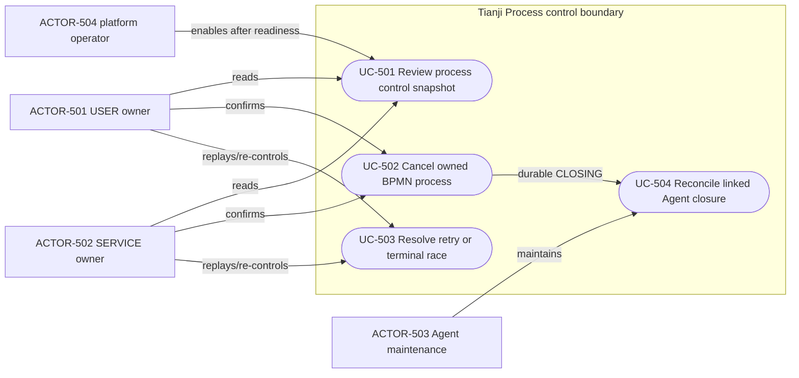
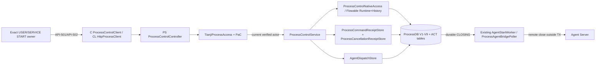
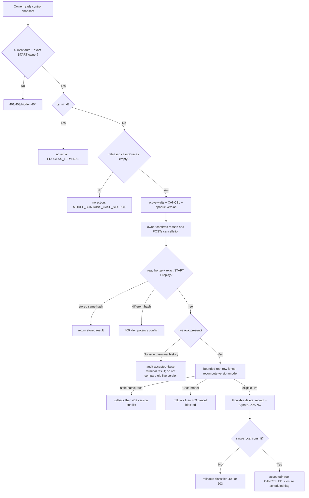
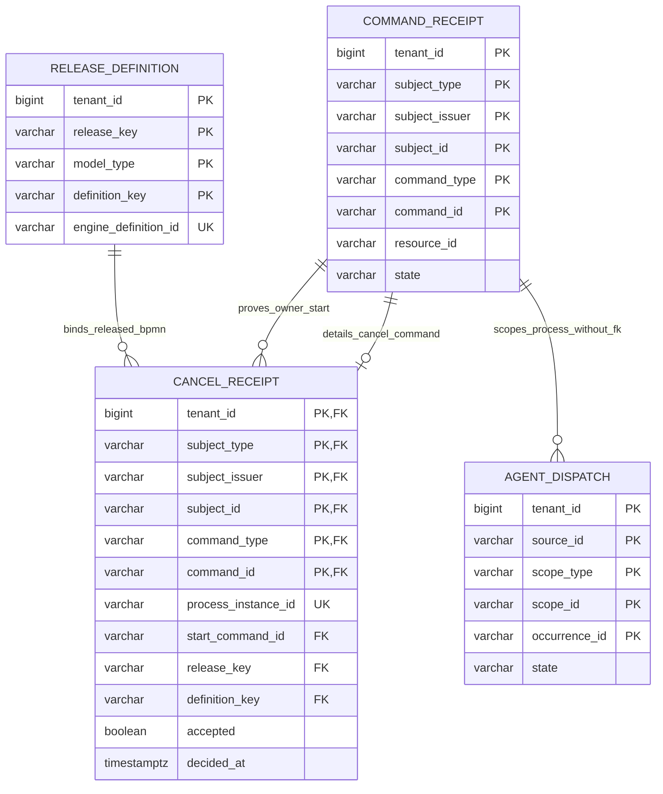

# BPMN Process control snapshot and bounded cancellation

| Field | Value |
| --- | --- |
| Document | `2026-11-04-23-22-process-control-cancellation.md` |
| Template Version | `9` |
| Archetype Cleanup | `Not applicable` |
| Status | `Review` |
| Type | `Feature` |
| Complexity | `Complex` |
| Complexity Drivers | `new private REST/Java contracts, exact-owner authorization, one additive audit migration, native Flowable concurrency, idempotent replay, and asynchronous linked-Agent closure` |
| Created | `2026-11-04 23:22 Asia/Shanghai` |
| Updated | `2026-11-05 01:40 Asia/Shanghai` |
| Owner | `Root source-grounded review; original roadmap authority continues; no coding GO is implied` |
| Repository | `tianji-service` |
| Scope | `T3-10 first bounded slice only: owner-visible BPMN control snapshot and controlled BPMN cancellation` |
| Change Surface | `C/CL process-control contract and strict HTTP SDK; PS control/cancel REST, permission, native-root fence, cancellation receipts, Agent-dispatch close scheduling, default-off wiring, and one future ProcessDB V9` |
| Affected Chapters | `§7, §8, §9, §10, §11, §13, §14, §15, §16, §17, §18` |
| Source Requirement | `Root-reviewed cancellation decisions under the original Agent Framework Upgrade Plan T3-10; design-only temporary draft at /tmp/process-cancel-spec.md` |
| Baseline Revision | `main@cfffb7649af7a1cb429ac935f2bc2c1f88ac3d8d; clean worktree at inspection` |
| Amends | `None` |
| Supersedes | `None` |
| Depends On | [Formal CMMN Case server](2026-11-04-15-50-formal-cmmn-case-server.md) `§5.1, §7.3, §11.4, §16`; [Agent Framework Upgrade Plan](../../../../docs/plans/agent-framework-upgrade-plan.md) `§10, §11.2, §14.4, §17.3 T3-10/S10/S11`, current SHA-256 `b6aebf5e5059bb94da801ba29ccdfa39ecacf095fe7af67425d844b634cb5b39`; T3-10 normative content unchanged |
| Related Specs | [Case Java contract](2026-11-01-23-20-case-client-contract.md) `§5-§10`; [Case HTTP SDK](2026-11-01-23-45-case-http-client.md) `§7-§16` |
| Related Plans | [Process control cancellation implementation](../plan/2026-11-05-00-25-process-control-cancellation-implementation.md) `four reviewed implementation Steps; Draft Plan pending Root full GO` |

## 1. Summary

The current Process Server can start and read an exactly owned BPMN instance and already projects native history with a non-null delete reason as `CANCELLED`, but it has no control view, cancellation command, cancel permission, durable cancel audit, or cancel-safe Agent-dispatch fence. This Spec adds one default-off, exact-owner vertical slice: a user-useful control snapshot and an idempotent bounded cancellation command. The snapshot shows the existing process identity, released active-wait summary, permitted control action, explicit block reason, and an opaque version. It is independently useful for a human or service deciding whether to cancel and is not a mechanical version-fetch endpoint.

Cancellation reauthorizes the live USER or SERVICE before every attempt and replay, proves exact APPLIED `START` ownership, locks only the native BPMN root execution, revalidates the snapshot version and released model, and blocks every model containing a formal Case source. Flowable alone deletes native runtime state. In the same local JDBC transaction, Process Server records a generic `PROCESS_CANCEL` command, inserts one immutable V9 audit result, and advances every non-closed Agent dispatch owned by that BPMN instance to `CLOSING`; the existing maintenance poller performs remote Agent close outside the transaction. Native task/job/timer optimistic or deadlock races roll the whole transaction back and are classified outside `TransactionTemplate.execute` by exact exception/SQLSTATE.

This is only the first bounded T3-10 slice. Business compensation, original-action receipts, failed/dead-letter job inspection and recovery, manual recovery queues, arbitrary node movement, and Case cancellation remain Required in the roadmap and are neither implemented nor weakened here. This Review document creates no source, test, configuration, migration, database, listener, browser, or runtime change.

## 2. Background and Current State

### 2.1 Business and user context

An exact process owner needs to understand what a running orchestration is currently waiting for and whether cancellation is permitted before issuing a destructive command. A bare `status + version` preflight would add a fetch-then-forward round trip without decision value. The control snapshot therefore carries only the released and current facts needed to make that decision. Cancellation stops the BPMN instance; it does not claim that external business effects, completed tasks, formal Cases, or Agent work have been rolled back.

### 2.2 Repository evidence

Paths are relative to the `tianji-service` repository. `PS` means `stellar-enclosure-tianji-process-server`, `C` the contract module, and `CL` the HTTP client module. All evidence below is static source/user decision unless explicitly labeled otherwise.

| Evidence ID | Classification | Exact path/symbol/decision/command | Observed fact | Design significance | Verification limit/freshness |
| --- | --- | --- | --- | --- | --- |
| `EVD-501` | Static repository | `C/.../orchestration/ProcessClient.java:3-8`; `ProcessInstanceDTO.java:6-19` | Public Java contract has only `start/get`; the existing eight-field process DTO and terminal invariant are published | Preserve both interfaces and their JSON/constructors; use a separate capability | Does not enumerate external binary consumers |
| `EVD-502` | Static repository | `PS/.../api/ProcessController.java:85-107`; `security/TianjiProcessPermissions.java:11-14,134-155` | Start/read have distinct resources, permissions and scopes; no cancel permission or route exists | Add separate control/cancel resources and one cancel permission; no implicit grant | Registration/activation/grants are not runtime-verified |
| `EVD-503` | Static repository | `PS/.../security/TianjiProcessAccess.java:31-64`; `identity/ProcessActor.java:9-38` | Tenant, subject type, issuer fingerprint and subject come only from current verified identity; expiry and request issuer are rechecked | Authorization must run before both new execution and receipt replay | No real IAM call was made |
| `EVD-504` | Static repository | `PS/.../execution/ProcessExecutionService.java:55-112` | `get` resolves exact START ownership and maps history delete reason to `CANCELLED`; service requires synchronous instance history and shared JDBC TM | Reuse ownership/history semantics and one local transaction; do not copy lifecycle state | No delete path currently exists |
| `EVD-505` | Static repository | `PS/.../execution/ProcessCommandReceiptStore.java:11-90`; ProcessDB V1-V3 | Generic command PK is tenant/type/issuer/subject/kind/command; non-DECISION commands require null decision JSON; exact START lookup is actor-scoped | Add `Kind.PROCESS_CANCEL`; reuse generic PENDING/APPLIED idempotency and add a detailed result table | Current `startByInstance` is not a cancel serialization lock |
| `EVD-506` | Static repository | `PS/.../release/ValidatedProcessModel.java:15-90`; `ProcessModelValidator.java:120-282` | Released metadata bounds nodes to 128 and exposes human tasks, workers, Agent waits, human-task timers and Case sources; standalone timers are validated but not retained as public metadata | Build active-wait summaries only from validated released metadata; retain timer metadata needed for deterministic classification | Native active execution/job observation is not runtime-proven here |
| `EVD-507` | Static repository | `PS/.../execution/FlowableCaseService.java:97-136`; `bridge/PinnedCaseSourceActivityBehavior.java:30-50`; V8 provenance | Linked Case creation occurs inside the actual parent BPMN transaction and immutable provenance is SELECT/INSERT only | Any non-empty `caseSources()` blocks cancellation; provenance remains plain SELECT with no UPDATE/FOR UPDATE privilege | Does not prove PostgreSQL scheduling order under load |
| `EVD-508` | Static repository | `PS/.../bridge/AgentDispatchStore.java:103-165,217-264`; V5 | `refresh(key,false)` durably moves nonterminal dispatch to `CLOSING`; current indexes do not lead with `(tenant_id,scope_type,scope_id)` | Reuse the store state and add one scope-open index for bounded instance-wide close scheduling | Row volume/selectivity is unmeasured |
| `EVD-509` | Static repository | `PS/.../bridge/AgentStartWorker.java:79-105`; `ProcessAgentBridgePoller.java:110-145` | Reconciliation calls remote `LinkedAgentClient.close` only outside DB transactions; maintenance continues separately from new dispatch | Cancel transaction schedules closure only; remote close remains durable maintenance | Poller liveness/remote availability are deployment concerns |
| `EVD-510` | Static repository | `PS/.../task/HumanTaskNativeAccess.java:98-107`; `FlowableHumanTaskService.java:110-164`; `worker/FlowableWorkerService.java:140-200,320-333`; `HumanTaskTimerAvailability.java:5-13` | Human completion locks task then advances execution; worker completion locks external job then advances execution; timers are Flowable-native | Do not pre-lock child ACT rows; let all native races roll back and classify outside TX | Flowable internal delete lock order is not runtime-tested |
| `EVD-511` | Static repository | `PS/.../ProcessApiSchemaVerifier.java:44-95`; `task/HumanTaskStorageVerifier.java:39-49`; V8 SHA `d2ef3198...a44` | Current Case verifier assumes V8 is the sole version after V7; V9 would otherwise make Case/task readiness reject a valid schema | V9-aware history verification must preserve exact V8 checks and update every consumer | No live schema/catalog was inspected |
| `EVD-512` | Static repository | `PS/src/main/resources/application.yml`; `ProcessStorageConfiguration.java:41-92`; `ProcessSecurityConfiguration.java:141-220` | One base configuration file uses default-off capability keys and explicit Bean factories; production Flyway and engine auto-DDL are disabled | Add one default-false cancellation key and existing-style guards/factories; no new config framework | Environment-supplied values are not visible in source |
| `EVD-513` | Static repository | `CL/.../HttpProcessClientTest.java:34-60`; `HttpCaseClientTest.java:426-481` | General Process client test starts a real loopback listener; Case client has a fake `HttpClient` pattern | New cancellation transport test must be separate and listener-free | Fake transport is not network acceptance |
| `EVD-514` | Static repository | root/PS POMs; `flowable.version=8.0.0`; PS WebMVC/Security/JDBC/PostgreSQL dependencies; no springdoc | Current modules already contain every required capability and no generated OpenAPI endpoint | Add no dependency; follow Case's packaged contract-first OAS precedent | Dependency resolution/build not run |
| `EVD-515` | User decision | Root-reviewed decisions in this task | Separate useful control snapshot, exact owner/no admin, model-level Case block, one future V9, default-off, root-only native fence, SQLSTATE classification, no compensation claim | Closes all material contract/security/transaction choices for this slice | Awaiting Root review of this document, not `Accepted` |
| `EVD-516` | Static predecessor | Formal CMMN Case Spec `§5.1, §7.3, §11.4, §16` | Approved project-specific boundary preserves technical vertical packages, plain JDBC/TransactionTemplate, external pre-provisioned Flyway history and explicit factories | Preserve the existing Process framework profile exception; do not introduce MP/DDL-runner/COLA layers | Prior Spec was Review and implementation evidence is source-only/runtime-unverified |

### 2.3 Problem statement and gap

Current `GET /process-instances/{id}` returns only the basic process projection. It neither explains current released waits nor tells an owner whether cancellation is allowed. There is no command, reason, version fence, cancellation audit, permission, feature flag, Agent close scheduling, or cancellation-specific concurrency error. Reusing `ProcessClient` would break or semantically expand an established public interface; extending `ProcessInstanceDTO` would change its constructor and JSON. Reusing only the generic command receipt would omit reason, expected/result versions, accepted/no-op result, native finish time, and Agent-closure scheduling evidence.

### 2.4 Evidence and current-chain map

| Entry/trigger | Current call chain | Data read/written | External dependency | Consumers | Evidence |
| --- | --- | --- | --- | --- | --- |
| Process read | `HttpProcessClient.get -> ProcessController.instance -> TianjiProcessAccess -> ProcessExecutionService.get -> START receipt -> Flowable runtime/history` | command receipt and native lifecycle, read-only | current IAM guard before DB | current Java Process consumers | EVD-501-504 |
| Human/worker/timer transition | task/worker/native executor -> child native row -> Flowable execution | ACT runtime plus task/worker receipt | Flowable async executor for timers | task/worker users | EVD-510 |
| Linked Agent maintenance | `AgentStartWorker -> AgentDispatchStore`; poller `CLOSE -> reconcileOnce -> LinkedAgentClient.close` | V5 dispatch state; remote Agent after TX | Agent Server HTTP | Process Agent bridge | EVD-508/509 |
| Proposed control/cancel | absent | no V9 audit or control contract | absent | Root-approved ProcessControlClient and future Process-owner/recovery UI under T4-04 | EVD-515 |

### 2.5 Archetype example cleanup

Cleanup disposition: Not applicable

Reason: `tianji-service` is an existing technical multi-module Process/Agent platform, not a newly generated business project and not first business work on an archetype. This slice changes no example domain. Existing BPMN/CMMN fixtures are technical verification assets and remain outside cleanup.

## 3. Goals and Non-goals

### 3.1 Goals

- Deliver a standalone owner-visible control snapshot with independently useful identity, released wait, action, block and version information.
- Deliver a default-off exact-owner BPMN cancellation command with stable idempotency, terminal no-op/replay semantics and detailed immutable audit.
- Make native deletion, generic/detailed receipts and Agent `CLOSING` scheduling one local transaction, with no remote I/O while locked.
- Bound root-lock/delete waiting and map exact native optimistic/deadlock races only after rollback.
- Preserve all existing Process/Case/HumanTask/Worker contracts, V1-V8 bytes and the wider unfinished T3-10 roadmap.

### 3.2 Non-goals

No admin/tenant-wide cancellation, Case cancellation, business compensation, failed/dead-letter job query/retry, manual recovery queue, arbitrary execution jump, rollback of external side effects, new Event/Outbox message, new dependency, MP/DDL-runner migration, frontend implementation, database execution, runtime acceptance, listener, browser, deployment, permission activation or grant. T3-10 compensation/dead-letter recovery and S10/S11 remain Required follow-up work.

### 3.3 Change Surface and Design Depth

| Area/layer | Disposition | Exact repository evidence | Changed or preserved behavior/contract | Required Spec treatment | Chapter(s) |
| --- | --- | --- | --- | --- | --- |
| C process-control Java contract | Affected | EVD-501/515 | separate client, control DTOs/enums, cancel command/result; old ProcessClient/DTO unchanged | exact types/invariants | §7, §8, §9, §10, §13, §14, §15, §16, §17, §18 |
| CL HTTP transport and packaged OAS | Affected | EVD-513/514 | two strict operations, safe error allowlist, fake test; no listener/springdoc | full wire/documentation design | §7, §8, §9, §10, §13, §14, §15, §16, §17, §18 |
| PS REST/security/default-off wiring | Affected | EVD-502/503/512 | two resources, one permission/scope, current-auth-first, conditional controller/service | full auth/config design | §7, §8, §9, §13, §14, §15, §16, §17, §18 |
| PS native control/cancel execution | Affected | EVD-504-510/515 | useful snapshot, root fence, Flowable delete, race classifier, terminal replay | detailed transaction/failure design | §7, §8, §10, §13, §14, §15, §16, §17, §18 |
| ProcessDB cancellation audit/history verification | Affected | EVD-505/511 | generic PROCESS_CANCEL rows, one new immutable V9 table, one dispatch index, V8/V9-aware verifiers | full database/ER/rollout design | §7, §8, §10, §11, §13, §14, §15, §16, §17, §18 |
| Agent dispatch close scheduling | Affected | EVD-508/509 | instance-wide nonclosed -> CLOSING in cancel TX; existing poller closes remote | bounded local update and async boundary | §7, §8, §10, §11, §13, §14, §15, §16, §17, §18 |
| Case model/provenance | Context-only | EVD-506/507 | model `caseSources()` blocks; immutable provenance plain SELECT only | boundary/invariant proof | §7, §11, §14 |
| HumanTask/Worker/timer native paths | Context-only | EVD-510 | no new fences or lock-order changes; races map atomically | lock evidence/regression | §7, §14, §15 |
| Existing ProcessClient/ProcessInstanceDTO/start/get | Unchanged | EVD-501/504 | source/binary/JSON behavior preserved | compatibility assertions | §9, §10, §14, §16 |
| ProcessDB V1-V8 | Unchanged | current eight files and hashes; EVD-511 | immutable bytes/checksums/order | hash gate | §11, §14, §16 |
| tianji-web/current T3-11 task-and-Case UI | Unchanged | separate repository; current T3-11 Spec is frozen to task/Case flows | no frontend file/page change and no expansion of current T3-11; Process-owner control belongs to a future T4-04 UI slice | consumer boundary only | §12, §16 |
| Compensation/dead-letter/manual recovery | Unchanged | roadmap T3-10/S10/S11 | remains Required, absent from implementation scope | explicit follow-up risk | §16, §18 |

## 4. Requirements and Acceptance Criteria

| ID | Atomic requirement | Priority | Observable acceptance criteria | Source |
| --- | --- | --- | --- | --- |
| `REQ-501` | Add a separate `ProcessControlClient`; preserve `ProcessClient`, `ProcessInstanceDTO` constructors/accessors and their existing JSON | Must | old contract reflection/golden JSON unchanged; new client compiles independently | Root/EVD-501 |
| `REQ-502` | Control Query returns process/release/definition/business/correlation/status, released active-wait summaries, allowed actions, explicit block reason, opaque version and observed instant | Must | snapshot is useful without cancellation and never exposes raw native IDs/variables | Root |
| `REQ-503` | Control and cancel authorize current verified USER/SERVICE first and require exact APPLIED START owner tuple; no admin/role bypass | Must | cross-tenant/type/issuer/subject is hidden 404; permission alone cannot cancel another owner | Root/EVD-503 |
| `REQ-504` | Cancel command binds path instance, command ID, opaque expected version and exact safe reason; same command/hash replays exact result and different hash conflicts | Must | retry after response loss creates no second cancel/audit; body/path mismatch is 400 | Root |
| `REQ-505` | Terminal-before-cancel is a successful audited no-op with `accepted=false`; live accepted cancellation returns `CANCELLED`; current auth/ownership still run before replay | Must | completed/cancelled races return stored terminal result; no stale authorization replay | Root |
| `REQ-506` | Cancellation locks only the exact native root execution, revalidates the complete control version, and blocks every released model with non-empty Case sources | Must | stale version 409; Case model 409; provenance is plain SELECT and immutable privileges unchanged | Root/EVD-507 |
| `REQ-507` | Native delete, generic PROCESS_CANCEL receipt, immutable V9 result, and all instance Agent dispatches becoming CLOSING commit or roll back together | Must | injected failure leaves no partial receipt/delete/dispatch update | Root |
| `REQ-508` | Remote Agent close remains outside TX and late Agent results cannot reactivate the cancelled process | Must | CLOSING survives outage; existing maintenance closes later; response never claims compensation or remote closure complete | Root/EVD-509 |
| `REQ-509` | Native optimistic/object-not-found and PostgreSQL `40001`, `40P01`, `55P03` races classify after rollback as process-version conflict; `57014`, `08xxx` and unknown failures remain unavailable | Must | exact classifier matrix and transaction rollback tests; no automatic SDK mutation retry | Root |
| `REQ-510` | Add exactly one future V9 containing one cancellation audit table and one Agent scope-open index; preserve V1-V8 bytes | Must | verifier/history/static DDL tests; no V9 file in this design-only task | Root |
| `REQ-511` | V9-aware Case/task/release/storage verifier consumers accept exact V8+V9 while retaining V7/V8 authority checks and runtime privileges | Must | Case-on/off and HumanTask readiness matrices are exact; unknown future versions fail closed | Root/EVD-511 |
| `REQ-512` | Capability is default off; new permission/resource/scope registration does not grant any principal | Must | off has no controller/service; on requires API/servlet/V9 readiness; PaC artifact includes but does not activate/grant | Root |
| `REQ-513` | Server request and SDK response parsing are strict and bounded; tests use a fake HttpClient only | Must | duplicate/unknown/trailing/scalar violations fail; no listener or `HttpProcessClientTest` execution | Root/EVD-513 |
| `REQ-514` | T3-10 compensation, failed-job recovery and S10/S11 remain explicitly Required and unimplemented | Must | final evidence cannot mark T3-10 complete or external effects rolled back | Root/roadmap |
| `REQ-515` | Occurred instants use `Instant`, PostgreSQL microsecond audit storage and UTC `Z` wire output; reason is stored for audit but never logged/delete-reason copied | Must | time/serialization/schema tests and safe-log review | Root/time policy |

### 4.1 Scenario matrix

| Scenario | Actor/trigger | Preconditions | Main path | Alternative/failure path | Data/state change | Observable result | Requirements |
| --- | --- | --- | --- | --- | --- | --- | --- |
| View active control | exact owner GET | current READ+CANCEL permission; feature/V9 ready | owner START -> release/model -> native runtime/waits -> snapshot | hidden owner 404; inconsistent native/released fact 503 | none | active/suspended snapshot and decision data | 501-503,506 |
| Accepted cancellation | exact owner POST | active/suspended, version current, no Case source | START lock -> root fence -> reserve -> native delete -> V9 -> dispatch CLOSING -> commit | native race rolls back and returns version conflict | Flowable history + two receipts + dispatch transition | accepted true/CANCELLED | 504,506-510 |
| Duplicate response-loss replay | same owner/command | prior commit, current authorization still valid | reauthorize -> owner proof -> stored generic/detail result | same key/different request SHA 409 | no new write | byte/field-equivalent result | 503-505 |
| Terminal race/no-op | process completes/cancels before root fence | exact owner and command valid | history proves terminal -> immutable no-op result + generic APPLIED | missing/malformed history 503 | audit only | accepted false with true terminal state/time | 505,510,515 |
| Case-capable model | active/suspended model has caseSources | exact owner | control shows no CANCEL; command rechecks and rejects | provenance/model inconsistency 503 | none | explicit MODEL_CONTAINS_CASE_SOURCE / 409 | 502,506 |
| Human/worker/timer race | concurrent native command | both use shared Process DB | cancellation root/delete meets child-first native work | Flowable optimistic/not-found or SQLSTATE race aborts one TX | winning TX only | 409 after cancel rollback, then re-control | 509 |
| Agent outage | accepted process has nonclosed dispatch | Agent maintenance unavailable | cancel commits CLOSING without remote I/O | close retries only when existing poller resumes | durable CLOSING, no process resurrection | scheduled=true, not “closed” | 507/508 |
| Capability disabled/unready | deployment has flag false or lacks V9 | request path or startup | no endpoint/bean when off; readiness fails closed when enabled | no DDL install/repair | none | no unsafe partial activation | 510-512 |

### 4.2 Use-case analysis

#### 4.2.1 Actor inventory

| Actor ID | Actor/role | Goal and responsibility | Entry/channel | Permission/tenant context | Evidence |
| --- | --- | --- | --- | --- | --- |
| `ACTOR-501` | Exact process owner (USER) | Review current waits and deliberately cancel only its own BPMN process | private REST/Java SDK | verified tenant USER, exact issuer+subject START owner, READ+CANCEL | EVD-503/515 |
| `ACTOR-502` | Exact process owner (SERVICE) | Perform the same bounded owner operation for an explicitly automated process | private REST/Java SDK | verified tenant SERVICE, exact issuer+subject START owner, READ+CANCEL | EVD-503/515 |
| `ACTOR-503` | Process Agent maintenance | Close durable linked Agent submissions after process cancellation | existing local poller/LinkedAgentClient | registered SERVICE binding; no borrowed owner identity | EVD-508/509 |
| `ACTOR-504` | Process platform operator | Roll out V9, register/activate permission resources and enable the capability only after readiness | deployment/config/PaC workflow | deployment authority, not an API admin-cancel identity | EVD-512/514 |

#### 4.2.2 Use-case artifact



| UC | Trigger/preconditions | Main success outcome | Alternatives/failures | Postconditions | Requirements/contracts/tests |
| --- | --- | --- | --- | --- | --- |
| `UC-501` | exact owner requests control; READ+CANCEL and capability ready | deterministic no-store snapshot supports a human/service decision | terminal or Case model returns empty actions+explicit reason; hidden owner 404; inconsistency 503 | no business mutation | REQ-501-503/506; API-501; TEST-501-504 |
| `UC-502` | owner confirms reason and submits command using displayed version | BPMN ends CANCELLED; receipts and CLOSING schedule atomically commit | invalid/stale/Case/race/DB failure returns documented error and no partial commit | accepted audit immutable; external effects not claimed reversed | REQ-503-510/515; API-502; TEST-505-512 |
| `UC-503` | retry after response loss or concurrent terminal transition | exact same committed result replays, or terminal no-op is audited | different request SHA conflicts; live auth revoked denies before replay | no duplicate native delete or accepted audit | REQ-503-505/509; API-502; TEST-507-510 |
| `UC-504` | cancellation committed with nonclosed Agent dispatch | existing maintenance confirms remote close later | Agent unavailable leaves durable CLOSING for later reconciliation | parent process remains terminal; late Agent result ignored | REQ-507/508; INTERNAL-503; TEST-511/512 |

## 5. Constraints, Assumptions, and Decisions

### 5.1 Confirmed constraints

- Preserve the existing Tianji technical vertical, explicit factory methods, plain JDBC/`TransactionTemplate`, shared Process/Flowable DataSource and externally pre-provisioned Flyway history. Root's project-specific exception and the implemented formal-Case predecessor take precedence over generic MP/DDL-runner/archetype recommendations.
- V1-V8 are immutable. Only one future V9 may serve this logical cancellation slice; this Spec does not create it.
- `ProcessClient`, `ProcessInstanceDTO`, existing start/get routes and known callers remain unchanged.
- Identity/tenant/issuer/subject are current security context facts, never request fields. No administrator policy is invented.
- Flowable is the BPMN lifecycle owner. Tianji may read-lock native rows but may not directly update/delete `ACT_*` data.
- No remote I/O, IAM refresh or Agent call may occur while the cancellation transaction holds database locks.

### 5.2 Small-gap assumptions

| ID | Inference | Repository evidence | Why locally reversible | Impact if wrong |
| --- | --- | --- | --- | --- |
| `ASM-501` | New contract-first artifact path is `CL/src/main/resources/META-INF/tianji/openapi/process-control-v1.json` | Case SDK uses the same packaged OAS3.1 location/pattern | File name has no runtime state and can be reviewed before coding | Consumer packaging path would change, not semantics |
| `ASM-502` | Fixed local lock timeout is 5 seconds inside a 10-second write transaction | HumanTask/Case writes use 10-second TX and 5-second JDBC query bounds | Internal constant can change before implementation without wire/schema effect | Conflict latency/availability trade-off changes |
| `ASM-503` | Active waits are grouped by released activity key and kind, sorted by kind/key, under a new explicit observation safety cap of 256 occurrences | Root requires bounded cancellation observation; current validator syntax-walk limits do not prove native runtime multiplicity, so queries fetch row 257 and fail closed instead of inferring a bound | The cap is local to this new control/cancel capability and does not change production model admission | An eligible high-cardinality runtime instance would receive 503 until a separately reviewed bounded profile exists |

### 5.3 Resolved decisions

| ID | Decision | Decision owner | Evidence and rationale | Requirements |
| --- | --- | --- | --- | --- |
| `DEC-501` | Add separate `ProcessControlClient`; do not extend `ProcessClient` or `ProcessInstanceDTO` | Root | preserves source/binary/wire callers | 501 |
| `DEC-502` | Control is a standalone user decision snapshot, not cancellation version preflight | Root | active waits/actions/block reason provide independent value | 502 |
| `DEC-503` | Only exact START owner USER/SERVICE may control/cancel; no admin path | Root | current ownership and IAM seams support exact actor only | 503 |
| `DEC-504` | Any non-empty released `caseSources()` blocks cancellation; provenance is plain-read invariant evidence | Root | prevents implied Case rollback and preserves V8 S/I grants | 506 |
| `DEC-505` | Use one root execution fence; never pre-lock child ACT task/job/timer rows | Root | child-first native paths differ; Flowable owns deletion | 509 |
| `DEC-506` | Accepted delete + generic/detail audit + Agent CLOSING share one transaction; remote close is existing maintenance | Root | smallest durable cross-service boundary | 507/508 |
| `DEC-507` | Add exactly one V9 table and one existing-table index; generic command kind is `PROCESS_CANCEL` | Root | generic receipt lacks detailed replay/audit fields | 504/510/511 |
| `DEC-508` | Current authorization and exact ownership precede replay | Root | stored receipt is audit, never a durable permission grant | 503/505 |

### 5.4 Open major decisions

None. Root review may reject or amend this Review draft, but no unresolved product/security/persistence choice blocks implementation planning once it is explicitly accepted.

## 6. Project Technology Context

| Concern | Current choice | Repository evidence | Constraint on design |
| --- | --- | --- | --- |
| Language/runtime | Java release 25 | platform parent plus current repository plan/evidence | public immutable records and JDK HTTP; no new language/runtime |
| Framework | Spring Boot 4.1.2 / WebMVC / Security; Flowable 8.0.0 | root/PS POM, `flowable.version` | reuse current MVC/security/engine APIs |
| Persistence | PostgreSQL, plain JDBC, shared `DataSourceTransactionManager`, external pre-provisioned ProcessDB history | PS POM/config/storage guards | one local transaction; no MP/DDL-runner conversion |
| JSON | Boot Jackson3 on HTTP; existing CL Jackson3 codec; internal Flowable/Outbox Jackson2 boundary unchanged | POMs/imports/current codecs | strict new transport codec without stack replacement |
| API documentation | packaged contract-first OAS3.1 precedent; no springdoc/Springfox | `case-v1.json`, POM search | new packaged OAS; no runtime docs endpoint/dependency |
| Tests | JUnit5/Mockito/MockMvc and JDK fake HTTP pattern; opt-in PG tests exist but are forbidden here | current tests/EVD-513 | finite unit/MockMvc/static only; no listener/DB/runtime |

### 6.1 Java architecture profile and capability baseline

| Architecture profile | Archetype/template or base package | Exact evidence and verifier | Existing deviations | Design action |
| --- | --- | --- | --- | --- |
| Existing Tianji Process technical vertical under explicit Root exception | `top.egon.cola.platform.tianji.process.server.{api,security,identity,execution,release,bridge,task,worker}` plus C/CL modules | Formal CMMN Spec `§5.1/§6.1`; current POM/tree; explicit `ProcessSecurityConfiguration` factories | It is neither generic `biz.*` three-layer nor an archetype business project; existing plain final services/JDBC/Flyway are intentional | Preserve exactly; no new layer/module/MP/DDL-runner/Lombok conversion |

| Need | Spring/JDK candidate | Spring Boot Starter candidate | Egon-COLA/module candidate | Proven gap | Decision/dependency impact |
| --- | --- | --- | --- | --- | --- |
| HTTP client | JDK `HttpClient` | None needed | existing `HttpProcessClient`/bounded subscriber | no gap | extend existing class and add strict codec; zero dependency |
| Auth/tenant | Spring Security | current Security/Shoubing/Jianshen starters | `TianjiProcessAccess`, PaC annotations | cancel resource absent only | reuse current guard; add metadata only |
| Native lifecycle | Flowable Runtime/HistoryService | existing Flowable starters | `ProcessExecutionService` patterns | cancel use case absent | new focused service/native access; no engine replacement |
| Idempotency | JDBC unique keys/transactions | JDBC through existing engine | `ProcessCommandReceiptStore` | detailed result/reason missing | reuse generic plus one V9 companion table |
| Agent cancellation delivery | JDK/Spring scheduling | existing infrastructure | `AgentDispatchStore`, `AgentStartWorker`, `ProcessAgentBridgePoller` | instance-wide scheduling method/index missing | extend store/index; no new job or Outbox |
| JSON/OAS | existing Jackson | current WebMVC | Case strict codec/OAS precedent | process-control artifact absent | add codec/static OAS; no springdoc |

### 6.2 User-mandated Java rule compliance

| Literal rule | Affected? | Repository evidence | Exact design decision | Files/types/interfaces | Validation/test evidence | Status/blocker |
| --- | --- | --- | --- | --- | --- | --- | --- |
| Rule 1 | Yes | existing C records/enums and vertical behavior suffixes | all new carriers end DTO/Command/Result; enums end Enum; behaviors end Client/Controller/Service/Store/Access/Codec/Exception | §8/§10 inventory | static name inventory | PASS |
| Rule 2 | Yes | current C compact constructors + request advice + service constructors; no validation starter in C/CL | preserve repository-approved immutable constructor validation and strict server/codec boundaries; no phone/group semantics | CancelProcessCommand, control/result DTOs, Controller->Service | contract/advice/codec negative tests | PASS under explicit existing technical-contract exception |
| Rule 3 | Yes | existing orchestration contracts are immutable defensive-copy records; no MapStruct dependency | new public immutable values use records; nested collections defensive-copy; Controller uses direct exact construction consistent with current technical vertical, no duplicate mapper types | §10 | constructor/immutability/JSON tests | PASS under Root-preserved framework exception |
| Rule 4 | Yes | current PS business classes are plain final types wired by explicit named `@Bean` methods; no Lombok config | preserve explicit factory/constructor style and safe SLF4J precedent; do not refactor unrelated Beans or add Lombok | new Controller/Service/Store/Access/Codec plus config methods | wiring/static/log privacy tests | PASS under explicit Root exception |
| Rule 5 | Yes | current code uses JDK/Spring/Jackson/JDBC | use JDK cryptographic/time/collections and existing framework only; no Utils/dependency | all affected | import/POM diff | PASS |
| Rule 6 | Yes | Boot Jackson3 HTTP and existing strict Case codec | Spring-managed server Jackson; CL existing Jackson3; explicit strict members/enums/UTC time; no alternate JSON | DTOs/Command/Result/codec/OAS | serialization/strict codec/OAS fixture | PASS |
| Rule 7 | Yes | only one checked-in `application.yml`; environment values external | add one base key and permission-scope key; absence of profile files recorded; values remain default false | application.yml/guards | key inventory and conditional tests | PASS |
| Rule 9 | Yes | existing Command+receipt pattern and complex native race branches | use Command pattern with durable idempotent receipt and explicit transition table; Flowable remains State authority; no handler hierarchy | ProcessControlClient/Service/receipt store | branch/replay/race tests | PASS |
| Rule 10 | Yes | existing DTOs use Instant; DB uses timestamptz | all new occurred times use Instant/timestamptz(6)/UTC Z; timeouts use Duration/internal SQL literals | observedAt/finishedAt/decidedAt | TEST-503/508/513 | PASS |
| Rule 11 | Yes | formal Case predecessor and current vertical tree | preserve the explicitly approved existing non-business technical vertical; add no third layer/module | all targets | tree/POM/static scope gate | PASS under Root architecture boundary |

### 6.3 Time semantics and conversion contract

Time contract: Required

| Time ID | Fields/symbols | Semantics | Java/runtime type | Storage policy | Wire policy | Business zone source | Display zone source | Boundary / DST rules | Precision / Clock | Compatibility | Verification |
| --- | --- | --- | --- | --- | --- | --- | --- | --- | --- | --- | --- |
| `TIME-501` | `ProcessControlSnapshotDTO.observedAt` | Occurred instant | `Instant` | Not persisted | UTC Z | Not applicable: observation is not calendar business logic | consumer-selected display zone; wire remains UTC | no local input/DST computation | database `clock_timestamp()`, microsecond-effective; JSON may parse accepted Instant precision | new field only | TEST-503/513 |
| `TIME-502` | `CancelProcessResult.finishedAt`, V9 `result_finished_at` | Occurred instant | `Instant` | UTC instant | UTC Z | Not applicable: native lifecycle occurrence | consumer display only | preserve the actual synchronous Flowable history instant; do not synthesize or compare with DB clock | `timestamptz(6)` audit; Flowable engine/JVM clock domain and native source precision preserved | existing Process DTO finishedAt semantics unchanged; no cross-clock chronology promise | TEST-508/513 |
| `TIME-503` | `CancelProcessResult.decidedAt`, V9 `decided_at` | Occurred instant | `Instant` | UTC instant | UTC Z | Not applicable: command audit occurrence | consumer display only | preserve actual database decision instant; no local/DST or native-finish ordering rule | database `clock_timestamp()`, `timestamptz(6)`; independent from Flowable engine/JVM clock | new field only; no cross-clock chronology promise | TEST-507/513 |
| `TIME-504` | cancellation transaction/lock bounds | Duration | `Duration` / PostgreSQL interval setting | Not persisted | Internal | Not applicable: elapsed technical bound | Not applicable: no UI time value | no calendar/DST behavior | 10s transaction, 5s local lock bound; monotonic elapsed measurement only for logs | current write-service bounds preserved | TEST-510 |

## 7. Architecture Design

### 7.0 Minimum-design baseline and element-necessity audit

| Proposed element | Change | Requirements | Existing/direct alternative | Concrete inadequacy of alternative | Added calls/state/coupling/failures/migration/operations | Verdict |
| --- | --- | --- | --- | --- | --- | --- |
| `ProcessControlClient` | New | 501/502/504 | add methods to `ProcessClient` | abstract addition breaks implementers; default unsupported mutation hides capability | one small public interface implemented by existing client | Add |
| `GET .../{id}/control` | New | 502/503 | reuse existing basic GET or make cancel derive everything | basic GET lacks waits/actions/block/version; cancel-only derivation gives no user decision view | one read RTT/state; command still revalidates TOCTOU | Add |
| Separate version-only preflight | Remove | 502 | useful control Query | result would only be forwarded and add no independent value | needless RTT/race/client state | Remove |
| `POST .../{id}/cancellations` | New | 504-509 | DELETE or direct Service call | bodyless DELETE cannot carry reason/command/version; no HTTP capability exists | one command surface, audit and idempotency | Add |
| `ProcessControlService` | New | 502-509 | expand `ProcessExecutionService` | optional destructive dependencies/V9/default-off lifecycle would destabilize existing start/get constructor and bean | one focused service, same module/TM | Add |
| `ProcessControlNativeAccess` | New | 502/506/509 | embed ACT SQL/Flowable queries in Controller/store | native affinity/lock/race rules need one tested technical boundary | one internal collaborator; no new layer | Add |
| `ProcessCancellationReceiptStore` | New | 504/505/510/511 | generic receipt only | cannot store reason/result/version/finish/closure fields | one plain JDBC participant/table | Add |
| V9 detail table | New | 505/510 | encode result in Flowable delete reason or generic decision JSON | delete reason is engine history; generic non-DECISION JSON is constrained null and lacks audit schema | one immutable table/migration/verification/rollout obligation | Add |
| Agent scope-open index | Expand | 507/508 | tenant scan through existing keys | existing indexes do not lead by process scope | one partial btree; extra write/storage cost | Add |
| Child ACT row prelocks/global advisory fence | Remove | 509 | root fence + Flowable delete + rollback classification | child lock orders differ and timers are engine-owned | would duplicate engine internals and create new inversions | Remove |
| Compensation/failed-job recovery | Keep outside | 514 | include full T3-10 now | not required to deliver safe bounded cancellation and materially expands permissions/state | remains Required follow-up | Remove from this slice |
| New dependency/framework/event/job | Remove | all | existing JDK/Spring/Flowable/JDBC/poller | no capability gap | avoids POM/runtime/ops expansion | Remove |

| Path | Network calls | Client states | Server contracts/state | Failure and TOCTOU points | Additional user/business value |
| --- | --- | --- | --- | --- | --- |
| Direct cancel-only baseline | 1 POST | confirmation/pending/result | command only | no informed current-wait decision; stale version must come from elsewhere | stops one owned process |
| Selected control then optional cancel | 1 GET; POST only after user/service decision | snapshot, blocked/allowed, confirmation, command result | two atomic operations; one V9 audit | snapshot can stale; POST reauthoritatively validates version/permission/state | exposes identity, current waits, block reason and allowed action before destructive command |

### 7.1 System Architecture Design



| Module/component | Capability and data owned | Inputs/outputs | Allowed dependencies | Forbidden responsibility | Requirements |
| --- | --- | --- | --- | --- | --- |
| C `ProcessControlClient` | engine-neutral control/cancel protocol | Query/Command -> DTO/Result | JDK/C contract checks | Flowable/JDBC/security implementation | 501/502/504 |
| CL `HttpProcessClient` | bounded authenticated HTTP transport | C types -> REST JSON | JDK HTTP/Jackson3 | automatic mutation retry, business authorization | 501/513 |
| `ProcessControlController` | route/path binding, current resource permission | HTTP -> service | access/service/error advice | DB/native calls or actor construction | 503/512 |
| `TianjiProcessAccess` | current verified identity/issuer/tenant | resource key -> `ProcessActor` | existing IAM guards | durable permission/replay grant | 503 |
| `ProcessControlService` | use-case orchestration, Command pattern, transaction/result | actor+query/command -> snapshot/result | native access/stores/releases | remote I/O or direct ACT writes | 502-509 |
| `ProcessControlNativeAccess` | native root read/fence, active-wait projection inputs, history verification | exact owned source/model -> native facts | Flowable APIs + read-only ACT root SQL | child ACT prelocks or ACT mutations | 502/506/509 |
| cancellation stores | generic idempotency and immutable detailed audit | scoped keys/facts -> stored replay result | JdbcTemplate/shared TM | permission or native state decisions | 504/505/510/511 |
| `AgentDispatchStore` | linked Agent intent/closure lifecycle | process scope -> CLOSING count | own table/shared TM | remote close | 507/508 |
| existing poller/worker | eventual remote close | due CLOSING -> CLOSED | LinkedAgentClient outside TX | BPMN lifecycle authority | 508 |

### 7.2 High-Level Design



#### 7.2.2 High-level decision and quality matrix

| Concern/use case | Required behavior | Selected mechanism | Failure/degradation behavior | Trade-off | Verification | Requirements |
| --- | --- | --- | --- | --- | --- | --- |
| decision value | Query useful independently | identity + released active waits + actions/block/version | inconsistent native/model 503 | one added GET and TOCTOU revalidation | contract/service unit | 502 |
| security | exact current owner only | current PaC/access before every service call; START tuple in DB | hidden 404/401/403; no replay if revoked | no administrator recovery in this slice | MockMvc/access tests | 503 |
| cancellation atomicity | no partial engine/audit/Agent fence | shared `DataSourceTransactionManager`/TransactionTemplate | any exception rolls back all participants | root/native contention can return conflict | transaction participant tests/static source | 507/509 |
| Case safety | never imply Case rollback | model-level block plus plain provenance invariant read | block 409/inconsistency503 | some instances are intentionally uncancellable | model/provenance tests | 506/514 |
| native concurrency | bounded, honest, no copied engine lock graph | root fence; Flowable delete; exact outer classifier | loser rolls back; client re-controls | no race-proof runtime claim | exception/SQLSTATE matrix | 509 |
| Agent closure | cancellation does not wait for remote Agent | durable CLOSING in local TX; existing poller outside | outage retains CLOSING | result says scheduled, not complete | store/poller unit boundaries | 507/508 |
| compatibility | old contracts and V1-V8 remain | separate interface/new static OAS/default-off/V9 expand | old binary cannot operate after V9 Case-history check; coordinated drain | V9-aware binary required after migration | reflection/hash/config tests | 501/510-512 |

### 7.3 Detailed Design

#### 7.3.1 Detailed component collaboration

| Step | Caller -> callee | Contract/symbol | Input/output mapping | State/data effect | Failure behavior | Requirements |
| --- | --- | --- | --- | --- | --- | --- |
| 1 | SDK -> Controller | API-501/502 | path/body C types | none | strict transport/auth errors | 501-504/513 |
| 2 | Controller -> access | `require(CONTROL_API/CANCEL_API)` | current SecurityContext -> exact actor | none | 401/403/tenant conflict before DB or replay | 503 |
| 3 | Service -> START receipt | `lockStartByInstance` for command; scoped read for Query | actor+instance -> source facts | command path locks APPLIED START | 404 exact-owner concealment | 503/505 |
| 4 | Service -> release/model/native Query | exact release/definition/hash + runtime/history | source facts -> process/control snapshot | none | inconsistent facts 503 | 502/506 |
| 5 | cancel -> generic receipt | `Kind.PROCESS_CANCEL` lock/replay | command SHA -> stored detail or new intent | PENDING only inside same TX | mismatch 409; replay current auth already passed | 504/505 |
| 6 | cancel -> native root | root `ACT_RU_EXECUTION` SELECT FOR UPDATE | expected snapshot -> fenced live facts | native root row lock only | timeout/race rollback/classifier | 506/509 |
| 7 | cancel -> model/provenance | `caseSources()` plus plain linked provenance SELECT | release/model/source -> eligibility | no provenance write/lock | model block409; impossible mismatch503 | 506 |
| 8 | cancel -> Flowable | `RuntimeService.deleteProcessInstance` | instance + constant internal delete reason | native runtime/history transition | optimistic/not-found/SQL race escapes TX | 507/509 |
| 9 | cancel -> stores | V9 insert; generic APPLIED; dispatch schedule closure | verified terminal/result/closure count | immutable audit + nonclosed dispatch CLOSING | any failure rolls back native delete too | 505/507/510 |
| 10 | after commit -> client/poller | result now; existing maintenance later | Result; due CLOSING rows | remote Agent eventually CLOSED | outage does not rewrite result/process | 508 |

Control snapshot construction rules:

1. Resolve the exact APPLIED START receipt and immutable release/definition binding; do not accept caller release/definition/tenant fields.
2. Runtime state is `ACTIVE` or `SUSPENDED`; absent runtime requires exact synchronous history and yields `COMPLETED` or `CANCELLED` using the existing delete-reason rule.
3. For live state, discover wait occurrences only from live Flowable wait artifacts: `Task`; `ExternalWorkerJob` (which extends `Job`); timer rows returned as `List<Job>` by `ManagementService.createTimerJobQuery()`; and message `EventSubscription` rows returned by `RuntimeService.createEventSubscriptionQuery().eventType("message")`. Use the exact pinned query chains: `TaskService.createTaskQuery().taskTenantId(tenant).processInstanceId(instance).processDefinitionId(definition).listPage(0,257)` (no active filter, so suspended tasks remain visible); `ManagementService.createExternalWorkerJobQuery().jobTenantId(tenant).processInstanceId(instance).processDefinitionId(definition).listPage(0,257)`; `ManagementService.createTimerJobQuery().timers().jobTenantId(tenant).processInstanceId(instance).processDefinitionId(definition).listPage(0,257)` returning `List<Job>`; and `RuntimeService.createEventSubscriptionQuery().eventType("message").tenantId(tenant).processInstanceId(instance).processDefinitionId(definition).listPage(0,257)` returning `List<EventSubscription>`. A timer query must explicitly call `timers()` rather than including message-type jobs from the same native table. Each artifact must supply a nonblank execution ID and its own activity binding (`Task.getTaskDefinitionKey()`, `Job.getElementId()`, or `EventSubscription.getActivityId()`); normalize only `(executionId, activityId)` into an occurrence key and merge supporting artifact IDs without increasing the occurrence count. There is no `TimerJob` or `MessageSubscription` contract. Extend `ValidatedProcessModel` with immutable timer-wait metadata only where the current validator already owns parsed timer facts.
4. Execution rows provide affinity context only; they never create wait occurrences. After artifact normalization, collect at most 256 unique artifact execution IDs and issue one read-only `JdbcTemplate` query against the quoted configured schema: `SELECT id_,act_id_,proc_inst_id_,proc_def_id_,tenant_id_ FROM "<schema>".act_ru_execution WHERE tenant_id_=? AND proc_inst_id_=? AND proc_def_id_=? AND id_ IN (?,...)`. This query has no `FOR UPDATE`. If there are no artifact execution IDs, skip the query entirely and return empty wait summaries for the otherwise verified live instance; never generate `IN ()`. Require exactly one row for every requested execution ID and require its `act_id_` to equal every artifact-backed key for that ID; a missing row, wrong activity, conflicting artifact binding, wrong affinity or incomplete artifact page is 503. Root, scope, gateway and inactive parallel-join executions that are not referenced by a wait artifact are structural context and are ignored. Do not call nonexistent `ExecutionQuery.active()` or bulk `executionIds(...)`, do not call nonexistent `Execution.isActive()`, and do not replace the single affinity query with up to 256 per-ID `ExecutionQuery` calls.
5. Classify each verified artifact-backed key only through the same validated release model. A 257th unique artifact-backed occurrence, unknown or conflicting artifact activity, or model/native mismatch is 503, never an `OTHER` bucket. Group summaries by `(ProcessActiveWaitKindEnum, released activityKey)`, count unique keys, apply the independent observation safety cap of 256 to those artifact-backed waits rather than structural execution rows, and sort by enum code then activity key. `ProcessModelValidator`'s current node/traversal syntax limits are not runtime-cardinality proof; this Spec neither changes production model admission nor claims a maximum number of native active occurrences. Do not return execution IDs, job IDs, task IDs, subscription IDs, run IDs, variables, assignees or candidate roles.
6. Block priority is terminal first, then non-empty `caseSources()`, otherwise `NONE`; allowed actions are empty or exactly `[CANCEL]`.
7. Version is lower-case SHA-256 over length-prefixed `TIANJI_PROCESS_CONTROL_V1`, exact actor realm, START request identity, instance/release/definition/engine definition/model hash/business/correlation, native root revision/suspension or terminal history facts, normalized active-wait summaries, status and block reason. It explicitly excludes `observedAt`, database/JVM clock-now values and every request-time timestamp so identical authoritative facts produce the same token. It is an opaque concurrency token, not authorization.

Terminal `resultingVersion` and the terminal control snapshot use the same lower-case SHA-256 domain `TIANJI_PROCESS_TERMINAL_V1` over the exact owner START identity, instance/release/definition/engine definition/model hash/business/correlation, terminal status, native `finishedAt`, and normalized native delete-reason category (`NORMAL_COMPLETION`, `TIANJI_PROCESS_CANCELLED`, or verified pre-existing cancellation). They exclude command ID, reason, `decidedAt`, closure scheduling and every clock-now value; two commands observing the same terminal process therefore obtain the same resource version while retaining distinct audit rows/results.

Cancellation rules:

1. Body/path instance IDs must be equal. `reason` is exact nonblank safe UTF-8 text of at most 512 Java characters; leading/trailing whitespace, controls and unpaired surrogates are rejected. It is included in request SHA and V9 audit but never logs or Flowable delete reason.
2. Before the owned transaction, the controller performs current authentication, issuer, expiry, tenant consistency, resource execution and permission checks. Stored receipts never replace those checks.
3. In the transaction, set a 10-second transaction/statement bound and a transaction-local 5-second PostgreSQL lock timeout. Lock exact APPLIED START before cancellation receipt/root so different cancel commands for one owner/process serialize consistently.
4. If a matching generic/detail receipt exists, verify request SHA and exact source/result affinity and return it. Different SHA is idempotency conflict.
5. For a new non-replay command, terminal-before-cancel takes precedence over stale expected version: if root is absent and exact synchronous history proves COMPLETED or CANCELLED, persist/return an audited `accepted=false` terminal result without comparing the former live `expectedVersion` to a fabricated terminal token. Missing or inconsistent history is 503.
6. Only when a live root exists, lock it, recompute the whole control version, and require equality before the model block decision. A live model with any Case source is blocked. Plain-read linked provenance after the root fence must agree with model authority; provenance is never `FOR UPDATE`.
7. Reserve generic `PROCESS_CANCEL`, call `deleteProcessInstance(instanceId,"TIANJI_PROCESS_CANCELLED")`, then require exact synchronous history with non-null matching delete reason/end time.
8. In the same transaction, apply a separate explicit technical safety cap of 256 while selecting/locking matching non-`CLOSED` V5 dispatch rows; validate every existing Seed fingerprint, exact stored SERVICE/source tuple, and equality with trusted owner process release/definition/model/business/correlation facts. Build a bounded immutable list of the validated keys `(tenant, SERVICE issuer, SERVICE subject, sourceId, BPMN, instance, occurrence)` and update only those exact keys, individually or as one VALUES batch; require affected-row count to equal validated-key count. A foreign/inconsistent or 257th candidate is 503 and rolls native deletion back. A row appearing after discovery cannot be touched by the exact-key update; native root deletion prevents a later legitimate dispatch insert but is not authorization for a broad scope write. `linkedAgentClosureScheduled` is true when at least one validated key is scheduled. Insert V9 and mark generic APPLIED.
9. Return only after commit. A committed accepted result is stable even if Agent maintenance subsequently reaches CLOSED. No response says external business actions or Agents were rolled back.

#### 7.3.2 Critical-path Mermaid swimlane

```mermaid
sequenceDiagram
    actor Owner as Exact USER/SERVICE owner
    participant CL as HttpProcessClient
    participant API as ProcessControlController
    participant IAM as TianjiProcessAccess/PaC
    participant S as ProcessControlService
    participant DB as ProcessDB shared TX
    participant F as Flowable Runtime/History
    participant P as Existing Agent maintenance
    Owner->>CL: GET control
    CL->>API: API-501
    API->>IAM: current CONTROL authorization
    IAM-->>API: verified exact actor
    API->>S: control(actor, query)
    S->>DB: exact START + release/model/native snapshot
    DB-->>S: identity/waits/version/block
    S-->>Owner: useful no-store control snapshot
    Owner->>CL: confirmed reason + version
    CL->>API: API-502 once
    API->>IAM: current CANCEL authorization, even for replay
    IAM-->>API: verified exact actor
    API->>S: cancel(actor, command)
    S->>DB: begin bounded local TX; exact START; replay check
    alt stored same command/hash
        DB-->>S: immutable V9 result
        S-->>Owner: same result
    else new command
        S->>DB: root execution FOR UPDATE; recompute model/version
        alt stale or Case model
            S--xDB: throw; rollback
            S-->>Owner: 409 version/blocked
        else terminal race
            S->>DB: generic APPLIED + V9 accepted=false
            DB-->>S: commit
            S-->>Owner: terminal no-op result
        else eligible live
            S->>F: deleteProcessInstance with constant reason
            F->>DB: native delete + synchronous history
            S->>DB: V9 result + generic APPLIED + dispatch CLOSING
            alt optimistic/deadlock/lock timeout
                DB--xS: rollback all participants
                S-->>Owner: classified 409 or 503 after rollback
            else commit
                DB-->>S: committed CANCELLED
                S-->>Owner: accepted result; close scheduled flag
                P->>DB: later claim CLOSING intent
                P->>P: remote Agent close outside TX
            end
        end
    end
```

#### 7.3.3 Transactions, consistency, concurrency, and idempotency

| Concern/state change | Owner and boundary | Mechanism/isolation/lock | Concurrent or duplicate behavior | Commit/visibility point | Failure result | Requirements/tests |
| --- | --- | --- | --- | --- | --- | --- |
| control snapshot | service read TX | repeatable-read/bounded native queries, no row lock | command always revalidates TOCTOU | response observation only | 404/503 | 502/503; TEST-503/504 |
| cancel identity | generic receipt + V9 | actor-scoped command PK + request SHA | same SHA replay; different SHA 409 | shared commit | idempotency conflict | 504/505; TEST-507 |
| one accepted cancel | V9 | partial unique tenant+instance WHERE accepted | concurrent different commands serialize via START/root; at most one accepted | V9 insert commit | losing terminal no-op or conflict | 505/510; TEST-507/508 |
| native lifecycle | Flowable | root execution row fence; native API writes | human/worker/timer may win or lose; no copied child locks | Flowable history in shared commit | rolled-back 409/503 | 506/509; TEST-509/510 |
| audit + delete + dispatch | Process service local TX | same DataSource/TM/schema | no observer sees partial committed platform state | transaction commit | all rollback | 507; TEST-511 |
| remote Agent close | existing maintenance | durable CLOSING then independent network call | idempotent resolve/close/reconcile | later CLOSED commit | remains CLOSING on outage | 508; TEST-512 |

#### 7.3.4 Failure semantics, recovery, and reconciliation

All concurrency classification occurs after `TransactionTemplate.execute` has thrown and rolled back. A bounded cause-chain inspection may read an actual `SQLException.getSQLState()`; it must not parse messages.

| Failure point | Detection | Immediate control flow | Data/transaction state | Retry and idempotency | Caller result | Recovery owner | Verification |
| --- | --- | --- | --- | --- | --- | --- | --- |
| stale snapshot | recomputed version differs | throw typed version conflict | no cancel receipt/delete | re-control; changed request uses new command ID | 409 `TIANJI_PROCESS_VERSION_CONFLICT` | caller | TEST-506 |
| Case model | non-empty `caseSources()` | throw typed blocked exception | unchanged | not retryable under same release/model | 409 `TIANJI_PROCESS_CANCEL_BLOCKED` | later scoped design only | TEST-505 |
| Flowable optimistic or delete-stage object-not-found | `FlowableOptimisticLockingException` or delete-stage marker wrapping `FlowableObjectNotFoundException` | escape TX, rollback, classify outside | unchanged by cancel | re-control; no SDK auto retry | 409 version conflict | caller | TEST-509 |
| serialization/deadlock/lock unavailable | exact SQLSTATE `40001`/`40P01`/`55P03` in bounded cause chain | rollback then typed version conflict | no partial V9/native/dispatch | same unchanged request ID may be retried only after re-control | 409 version conflict | caller | TEST-509/510 |
| query/statement cancelled | SQLSTATE `57014` | rollback then dependency unavailable | unchanged by cancel | no automatic retry | 503 | operator/caller | TEST-510 |
| connection/failover | SQLSTATE class `08` or recognized connection exception | rollback/unavailable | commit outcome checked only by same command replay after recovery; never assumed | retry same command after dependency recovery | 503 | operator/caller | TEST-510 |
| unknown DataAccess/Concurrency/Flowable failure | no allowlisted exact classification | rollback/unavailable; do not relabel as race | unchanged or unknown to caller, resolved by command replay | no blind automatic retry | 503/500 existing safe boundary | operator | TEST-510 |
| response lost after commit | transport timeout | client sees unknown | committed generic+V9/native state | replay same command/hash after current auth | stored 200 result | caller | TEST-507 |
| Agent unavailable | CLOSING due row remains | log bounded maintenance failure | process/audit committed, Agent closure pending | existing poller retries its observation/close protocol | accepted result still truthful | existing bridge operator | TEST-512 |

#### 7.3.5 Observability and operational boundaries

| Signal/runbook | Emitting owner and point | Fields/dimensions | Sensitive-data rule | Success/failure threshold | Alert/dashboard/operator action | Verification boundary |
| --- | --- | --- | --- | --- | --- | --- |
| cancellation decision log | Controller/service after outcome/outer failure | resource key, tenant, hashed instance/command, accepted/status/block/error class, allowlisted SQLSTATE | omit reason, bearer, subject ID, SQL, body and exception cause text | no invented SLO | operator correlates repeated 503/409 patterns | static/unit only |
| V9 audit | ProcessDB commit | exact actor realm, source START, request SHA, reason, result/version/times, closure flag | DB permission controlled; reason never logs or Flowable delete reason | one row per command; at most one accepted per process | audit/support query designed later, no public admin API | schema/static tests; live retention unverified |
| Agent CLOSING maintenance | existing poller | operation kind, failure class, durable state | existing payload/token masking | existing behavior only | restart/repair existing bridge | source/unit boundary only |
| readiness | startup verifier and feature guard | V9 history/checksum/schema/role plus flag/API/servlet | no credentials/schema SQL in logs | enabled must fail closed | deploy V9-aware binary/schema/PaC before enabling | config/verifier unit only |

#### 7.3.6 Conclusion evidence chain

| Conclusion | Repository/user evidence | Constraint or requirement | Design decision | Consequence and trade-off | Verification and acceptance evidence |
| --- | --- | --- | --- | --- | --- |
| separate control capability is necessary | EVD-501/515 and independent UC-501 | preserve public API while giving decision value | new ProcessControlClient + useful snapshot | one extra optional GET/contract; no mechanical preflight | TEST-501-504/API-GATE-001 |
| one local cancellation transaction is authoritative | EVD-504/505/508 and Root | no partial delete/audit/Agent fence | root-native Flowable delete + generic/V9 + CLOSING same TM | contention can reject; no remote call inside | TEST-507-512 |
| native child locks must remain Flowable-owned | EVD-510 | task/job/timer lock orders differ and runtime is unverified | root fence only; classify exact races after rollback | does not claim race-proof runtime; simpler and less coupled | TEST-509/510 and explicit runtime gap |
| Case-capable models are blocked | EVD-506/507 and no-compensation boundary | parent cancel cannot imply Case reversal | model-level block + immutable provenance plain read | conservative availability loss for those models | TEST-505; V8 grant/hash checks |

## 8. Package Structure and Code File Tree

### 8.1 Current relevant tree

```text
stellar-enclosure-tianji-contract/.../orchestration/
  ProcessClient.java
  ProcessInstanceDTO.java
  GetProcessInstanceQuery.java
stellar-enclosure-tianji-client/
  src/main/java/.../HttpProcessClient.java
  src/test/java/.../HttpProcessClientTest.java        # real listener; unchanged/not selected
  src/test/java/.../HttpCaseClientTest.java           # fake transport precedent
stellar-enclosure-tianji-process-server/
  src/main/java/.../api/ProcessController.java
  src/main/java/.../execution/ProcessExecutionService.java
  src/main/java/.../execution/ProcessCommandReceiptStore.java
  src/main/java/.../bridge/AgentDispatchStore.java
  src/main/java/.../security/TianjiProcessPermissions.java
  src/main/java/.../ProcessApiSchemaVerifier.java
  src/main/resources/application.yml
  src/main/resources/db/tianji-process/V1...V8.sql
```

### 8.2 Target tree

```text
C .../contract/orchestration/
  ProcessControlClient.java                         CREATE
  ProcessControlSnapshotDTO.java                   CREATE
  ProcessActiveWaitDTO.java                        CREATE
  ProcessActiveWaitKindEnum.java                   CREATE
  ProcessControlActionEnum.java                    CREATE
  ProcessControlBlockReasonEnum.java               CREATE
  CancelProcessCommand.java                        CREATE
  CancelProcessResult.java                         CREATE
CL .../client/
  HttpProcessClient.java                           MODIFY
  ProcessControlResponseCodec.java                 CREATE
  src/main/resources/META-INF/tianji/openapi/process-control-v1.json CREATE
PS .../process/server/
  api/ProcessControlController.java                CREATE
  api/ProcessRequestBodyAdvice.java                MODIFY
  api/ProcessApiErrors.java                        MODIFY
  security/TianjiProcessPermissions.java           MODIFY
  execution/ProcessControlService.java             CREATE
  execution/ProcessControlNativeAccess.java        CREATE
  execution/ProcessCancellationReceiptStore.java   CREATE
  execution/ProcessCommandReceiptStore.java        MODIFY
  release/ValidatedProcessModel.java               MODIFY (timer-wait metadata only)
  release/ProcessModelValidator.java               MODIFY (retain parsed timer metadata)
  bridge/AgentDispatchStore.java                   MODIFY
  ProcessSecurityConfiguration.java                MODIFY
  ProcessStorageConfiguration.java                 MODIFY
  ProcessApiSchemaVerifier.java                    MODIFY
  task/HumanTaskStorageVerifier.java               MODIFY only if its V8/V9 selection method changes
  src/main/resources/application.yml               MODIFY
  src/main/resources/db/tianji-process/V9__add_process_cancellation_receipts.sql CREATE LATER
focused C/CL/PS tests listed in §14                  CREATE/MODIFY LATER
```

### 8.3 Package and file responsibilities

| Operation | Path/package | Symbols | Responsibility | Dependencies | Requirements |
| --- | --- | --- | --- | --- | --- |
| CREATE | C orchestration files above | immutable Java capability/types | public field/invariant authority | JDK/OrchestrationChecks | 501/502/504/505/515 |
| MODIFY/CREATE | CL Http client/codec/OAS | strict once-only transport and contract-first documentation | C/JDK/Jackson3 | 501/513 |
| CREATE | PS api Controller | two mappings, path affinity, security annotations, no-store | access/service | 503/512/513 |
| CREATE | PS execution service/native access/store | Query/Command orchestration, root/native facts, V9 replay | current Flowable/JDBC/release/stores | 502-511 |
| MODIFY | command/dispatch stores | new command kind/start lock/scope closure | existing JdbcTemplate/TM | 504/507/508 |
| MODIFY | model validator/model | immutable standalone timer metadata for control projection | existing parser | 502 |
| MODIFY | permissions/config/errors/verifiers | capability gates, codes, readiness, exact history | existing framework | 509-513 |
| CREATE LATER | future V9 SQL | table/index only; no existing SQL rewrite | external pre-provisioning | 510/511 |

No target file is generated by the backend CRUD generator: this is later additive technical DDL in an existing unsupported technical profile, not initial native Light/Web/Service catalog scaffolding. No code-generation journal is created.

## 9. Interface Definitions

### 9.0 API protocol and documentation governance

| Concern | Decision/evidence |
| --- | --- |
| Protocol selection | Private REST Query + task Command used by the new Java SDK capability; no GraphQL |
| CQE application level | L1 boundary objects with shared ProcessDB; Query is read-only, Command owns mutation/idempotency; no bus/read store/event sourcing |
| REST source of truth | Contract-first packaged OAS3.1 plus C immutable records and provider drift tests, matching current Case precedent |
| GraphQL source of truth | N/A: no GraphQL dependency/schema/consumer in affected scope |
| Springdoc/OpenAPI compatibility | No springdoc dependency or runtime docs endpoint; static `process-control-v1.json` is authoritative |
| Legacy Swagger/Springfox status | Absent from affected modules; none introduced |
| Security and documentation exposure | bearer identity + PaC resources/scopes; OAS is a JAR resource, not public UI/runtime endpoint |
| Contract publication and drift gate | CL JAR resource; strict codec/MockMvc/reflection/static OAS assertions compare routes, fields, required/null/enums/time/status/security/errors |

Exact security vocabulary:

- new permission code `TIANJI_PROCESS_CANCEL`;
- control resource `tianji.api.process.instance.control`;
- cancel resource `tianji.api.process.instance.cancel`;
- new OAuth scope `tianji:process:cancel`, combined with existing `tianji:process:read` on both operations;
- both operations allow only `PermissionManifest.PrincipalType.USER` and `SERVICE` and require existing `TIANJI_PROCESS_READ` plus new cancel permission;
- `stellar.tianji.process.cancellation.enabled=false` is the sole new capability key; it requires `stellar.tianji.process.api.enabled=true`, servlet Process API and exact V9 readiness when enabled.

PaC compilation/registration does not activate resources or grant roles/clients. The existing endpoint authentication wildcard already covers `/api/tianji/v1/process-instances/**`; it is verified but not changed.

### 9.1 Interface Inventory

| ID | Change/necessity verdict | Name/purpose | Kind | API style/CQE role | Consumer | Owner | Method + URL / GraphQL field / symbol / topic | Operation ID/schema source | Input | Output | Auth/tenant | Error model | Idempotency/version | Requirements |
| --- | --- | --- | --- | --- | --- | --- | --- | --- | --- | --- | --- | --- | --- | --- |
| `API-501` | New/Add: independent decision snapshot | Get process control | HTTP | REST Query | ProcessControlClient/future T4-04 Process-owner UI | PS | `GET /api/tianji/v1/process-instances/{instanceId}/control` | `getProcessControl`; packaged OAS | path/header/context | ProcessControlSnapshotDTO | current USER/SERVICE exact owner; READ+CANCEL | OrchestrationErrorDTO | opaque snapshot version; no mutation | 501-503/506/513 |
| `API-502` | New/Add: bounded destructive command | Cancel process | HTTP | REST Command | ProcessControlClient/future T4-04 Process-owner UI | PS | `POST /api/tianji/v1/process-instances/{instanceId}/cancellations` | `cancelProcessInstance`; packaged OAS | CancelProcessCommand | CancelProcessResult | current USER/SERVICE exact owner; READ+CANCEL | stable cancel codes | actor-scoped command SHA + expected version | 503-513/515 |
| `INTERNAL-501` | New/Add: separate Java Query capability | Control Query | Java interface | Query | Java consumers | C/CL | `ProcessControlClient.control(GetProcessInstanceQuery)` | C source | GetProcessInstanceQuery | ProcessControlSnapshotDTO | transport obtains bearer; server authoritative | ProcessClientException | snapshot version | 501/502/513 |
| `INTERNAL-502` | New/Add: separate Java Command capability | Cancel Command | Java interface | Command | Java consumers | C/CL | `ProcessControlClient.cancel(CancelProcessCommand)` | C source | CancelProcessCommand | CancelProcessResult | transport obtains bearer; server authoritative | ProcessClientException | commandId/request SHA/version | 501/504/505/513 |
| `INTERNAL-503` | Existing/Expand: schedule process-owned Agent closure | Local store method | Internal service | Command | ProcessControlService | PS bridge store | `AgentDispatchStore.scheduleProcessClosure(ProcessClosureScope scope)` | PS source/V5/V9 | trusted server-derived owner/release/source affinity | count/boolean | no public principal; caller already proved owner | runtime/storage exception | repeated CLOSING is idempotent | 507/508 |

### 9.2 Per-interface Detailed Contracts

#### 9.2.1 API-501 — Get process control

##### Necessity and interaction-cost decision

| Concern | Decision |
| --- | --- |
| Change classification | New REST Query |
| Independent consumer goal | An exact owner reviews process identity, current released waits, cancellation availability and explicit block reason before choosing an action |
| Parameter ownership and derivation | Caller owns only route instance ID; tenant/actor/release/model/native state/actions/version are server-derived |
| Direct/no-new-interface alternative | Existing process GET lacks decision facts; a version-only endpoint is rejected; embedding all facts only in the destructive command removes the review goal |
| Caller use of result | Displays/branches on identity, waits, actions and block reason; only version is later submitted if CANCEL is chosen |
| Round trips and failure points | One no-store Query; cancellation remains optional; command revalidates all mutable/current facts and stale version |
| Verdict | Add for REQ-502/UC-501; this is not fetch-then-forward |

##### API style and CQE semantics

| Concern | Decision/evidence |
| --- | --- |
| Protocol style | REST Query |
| CQE role | Read-only Query; metrics/logs are incidental, no durable business mutation |
| Resource/task semantics | `/process-instances/{id}/control` is an owner control representation subordinate to the existing process resource |
| Read/write and side effects | Reads exact START/release/model/native runtime/history only; no receipt or lock retained |
| Consistency and idempotency | Point-in-time no-store snapshot; version binds returned decision facts; command revalidates TOCTOU |
| Why this style | Current REST/SDK consumers and resource identity already exist; no GraphQL/new infrastructure is needed |

##### Identity and purpose

| Concern | Definition |
| --- | --- |
| Purpose/owner/consumer | Owner decision view; PS ProcessControlController/Service; ProcessControlClient and a future Process-owner UI under T4-04, not the frozen task/Case-only T3-11 scope |
| Protocol and endpoint | `HTTP GET /api/tianji/v1/process-instances/{instanceId}/control` |
| Content type/version | response `application/json`; v1 path; no request body; `Cache-Control: no-store` |
| Auth/permission/tenant | bearer; USER/SERVICE; CONTROL_API; permissions READ+CANCEL; scopes read+cancel; tenant/issuer/subject current context only |
| Timeout/retry/rate limit | bounded service read; safe GET may be retried by consumer after transport failure; no server retry/rate claim |
| Idempotency/concurrency | read-only; version is opaque current observation, not lease/authorization |

##### Request parameters

| Name | Location | Type/format | Required/null | Default | Validation/range/enum | Meaning | Example | Source |
| --- | --- | --- | --- | --- | --- | --- | --- | --- |
| `Authorization` | Header/security | Bearer token | required | none | existing verified token rules | current actor | `Bearer synthetic` | security filter |
| `Accept` | Header | media type | optional | `application/json` | JSON/+json response | representation | `application/json` | client |
| `X-Egon-Tianji-Tenant` | Header | positive decimal tenant | optional assertion | verified identity tenant | at most one; equal if present | detects context drift, never establishes tenant | `20` | existing access guard |
| `instanceId` | Path | safe UTF-8 identifier | required/non-null | none | exact trimmed 1-255, no controls/surrogate errors, not `.`/`..` | existing BPMN instance | `proc-123` | caller route state |
| Body | Body | none | absent | none | GET body unsupported | none | none | none |

##### Success response

HTTP `200 OK`, `Content-Type: application/json`, `Cache-Control: no-store`.

```jsonc
{
  "process": { // Required. Existing ProcessInstanceDTO nested unchanged.
    "instanceId": "proc-123", // Required. Exact owned BPMN instance ID.
    "definitionKey": "invoiceReview", // Required. Immutable released BPMN definition key.
    "releaseVersion": "release-7", // Required. Immutable platform release key.
    "businessKey": "invoice-4711", // Required. Existing business reference; not authorization.
    "correlationId": "corr-4711", // Required. Existing correlation; not idempotency.
    "status": "ACTIVE", // Required. ACTIVE, SUSPENDED, COMPLETED, or CANCELLED.
    "submittedAt": "2026-11-04T14:00:00.123456Z", // Required. Existing UTC process submission instant.
    "finishedAt": null // Required member; null for ACTIVE/SUSPENDED, UTC instant for terminal.
  },
  "activeWaits": [ // Required. Deterministically sorted released wait summaries; empty for terminal.
    {
      "activityKey": "review", // Required. Released activity key, never native execution/task/job ID.
      "kind": "HUMAN_TASK", // Required. HUMAN_TASK, EXTERNAL_WORKER, AGENT_RESULT_WAIT, CASE_COMPLETION_WAIT, or TIMER.
      "occurrences": 1 // Required. Positive grouped count of unique artifact-backed waits; the 256-occurrence cap excludes structural execution rows.
    }
  ],
  "allowedActions": [ // Required. Empty or exactly CANCEL.
    "CANCEL"
  ],
  "cancellationBlockReason": "NONE", // Required. NONE, PROCESS_TERMINAL, or MODEL_CONTAINS_CASE_SOURCE.
  "version": "aaaaaaaaaaaaaaaaaaaaaaaaaaaaaaaaaaaaaaaaaaaaaaaaaaaaaaaaaaaaaaaa", // Required. Opaque lower-case SHA-256 over the control observation.
  "observedAt": "2026-11-04T14:05:00.123456Z" // Required. Database-clock UTC observation instant; not a lease expiry.
}
```

| Field path | Type/format | Required/null/default | Validation/enum/precision | Meaning and source | Consumer use |
| --- | --- | --- | --- | --- | --- |
| `process` | ProcessInstanceDTO JSON | required/non-null | exact existing contract | START receipt + Flowable runtime/history | identity/status display |
| `activeWaits[]` | array DTO | required/non-null/may empty | unique kind+key, positive counts, deterministic; native projection rejects a 257th unique artifact-backed occurrence | live wait artifacts mapped through verified execution affinity and release metadata; unrelated structural executions ignored | explain current wait |
| `allowedActions` | enum array | required | empty or `[CANCEL]` | lifecycle+model after permission gate | enable control |
| `cancellationBlockReason` | enum | required | three values | terminal/model decision | explain disabled action |
| `version` | 64 lower hex | required | opaque | authoritative hash | optimistic fence |
| `observedAt` | ISO Instant | required | UTC Z/effective microseconds | DB clock | staleness/support only |

##### Error responses

| Condition | HTTP status | Business code | Response shape | Retryable | Consumer handling |
| --- | --- | --- | --- | --- | --- |
| invalid path | 400 | `TIANJI_INVALID_COMMAND` | OrchestrationErrorDTO | after correction | reject input |
| missing/expired identity | 401 | `TIANJI_UNAUTHENTICATED` | same | after credential recovery | reauthenticate |
| missing READ/CANCEL permission | 403 | `TIANJI_PERMISSION_DENIED` | same | no automatic retry | denied state |
| absent/non-owned/cross realm | 404 | `TIANJI_RESOURCE_NOT_FOUND` | same | no | conceal existence |
| tenant context changed | 409 | `TIANJI_TENANT_CONTEXT_CHANGED` | same | no | abort/refresh identity |
| schema/native/model dependency inconsistent | 503 | `TIANJI_DEPENDENCY_UNAVAILABLE` | same | controlled refresh/operator | no guessed action/version |
| unexpected masked failure | 500 | `TIANJI_INTERNAL_ERROR` | same | no automatic retry | generic support path |

```jsonc
{
  "code": "TIANJI_RESOURCE_NOT_FOUND", // Required. Stable safe code; absence and concealment share it.
  "correlationId": null // Optional. Existing safe correlation; no token/reason/internal cause.
}
```

##### Interface logic for frontend and consumers

1. Authenticate and require CONTROL resource with READ+CANCEL before owner/resource lookup.
2. Validate path and derive tenant/type/issuer/subject exclusively from the verified actor.
3. Load exact APPLIED START and release/model; non-owner is hidden 404.
4. Read runtime or synchronous history and bounded current native wait facts in the owned read transaction.
5. Map waits only through released metadata; derive actions/block/version/observedAt without durable mutation.
6. Return no-store snapshot; missing/mismatched facts are 503, never guessed state/action.
7. Consumer displays waits/block, enables confirmation only with CANCEL, and refreshes after later version conflict.

##### Documentation contract

| Concern | Decision/evidence |
| --- | --- |
| Documentation authority | Contract-first `META-INF/tianji/openapi/process-control-v1.json`, C records and this contract |
| REST OpenAPI operation / GraphQL SDL operation | explicit operationId `getProcessControl`, GET exact route |
| Annotation/mapping ownership | Controller owns Spring mapping/PaC only; no springdoc |
| Generated schema elements | N/A generated endpoint; packaged OAS defines parameters/200/errors/bearer/scopes/schemas |
| Compatibility and drift proof | static OAS/ref checks plus MockMvc/codec/record fixtures; no live `/v3/api-docs` |

| Target | Required annotation/configuration | Exact values/source | Generated OAS effect | Verification |
| --- | --- | --- | --- | --- |
| `ProcessControlController#control` | Spring mapping and PaC; no OpenAPI annotations | route/security above | N/A runtime generation | MockMvc + OAS comparison |
| C DTO/enums | compact constructor/Jackson defaults | JSON/field tables | packaged schemas | record/serialization/codec tests |

##### Compatibility and verification

Additive/default-off. Existing GET remains identical. SDK verifies instance identity, required members, enum/list invariants, version/time grammar, size/media/status and redaction. Tests TEST-501-504/513.

#### 9.2.2 API-502 — Cancel process instance

##### Necessity and interaction-cost decision

| Concern | Decision |
| --- | --- |
| Change classification | New REST task Command |
| Independent consumer goal | Stop one exact-owned eligible BPMN instance with reason, stable audit and safe retry |
| Parameter ownership and derivation | caller chooses instance/command/version/reason; server derives actor/tenant/release/model/native/time/Agent rows |
| Direct/no-new-interface alternative | bodyless DELETE cannot carry command/reason/version; no existing lifecycle mutation; generic recovery endpoint is unsafe |
| Caller use of result | confirms accepted/no-op terminal state and whether Agent closure was scheduled |
| Round trips and failure points | one once-only POST after optional review; same-command replay resolves unknown response; no auto retry |
| Verdict | Add for UC-502/503; compensation/recovery remain outside |

##### API style and CQE semantics

| Concern | Decision/evidence |
| --- | --- |
| Protocol style | REST Command using subordinate plural `cancellations` |
| CQE role | Command: BPMN lifecycle transition plus audit/technical closure intent |
| Resource/task semantics | stable result of one cancellation intent; no arbitrary engine mutation |
| Read/write and side effects | Flowable delete, generic/V9 receipts, dispatch CLOSING; remote Agent excluded |
| Consistency and idempotency | one local transaction; actor-scoped command SHA; exact replay; expected control version |
| Why this style | required body/audit/idempotency and existing POST command conventions; DELETE/PATCH are less honest |

##### Identity and purpose

| Concern | Definition |
| --- | --- |
| Purpose/owner/consumer | Cancel eligible owned BPMN; PS service; SDK and a future Process-owner UI under T4-04, not the frozen task/Case-only T3-11 scope |
| Protocol and endpoint | `HTTP POST /api/tianji/v1/process-instances/{instanceId}/cancellations` |
| Content type/version | request/response JSON; v1; 200 synchronous platform result; no-store |
| Auth/permission/tenant | current verified USER/SERVICE exact owner; READ+CANCEL; no admin override |
| Timeout/retry/rate limit | 10s local TX/5s lock; transport sends once; caller re-controls/replays manually |
| Idempotency/concurrency | command ID scoped tenant/type/issuer/subject; SHA includes all fields; expected version fences snapshot |

##### Request parameters

| Name | Location | Type/format | Required/null | Default | Validation/range/enum | Meaning | Example | Source |
| --- | --- | --- | --- | --- | --- | --- | --- | --- |
| `Authorization` | Header/security | Bearer | required | none | existing verified rules | current actor | synthetic | security filter |
| `Accept` | Header | media type | optional | JSON | JSON/+json | response media | application/json | client |
| `Content-Type` | Header | media type | required | none | application/json | body media | application/json | client |
| `X-Egon-Tianji-Tenant` | Header | positive decimal | optional assertion | identity tenant | at most one/equal | drift guard | `20` | existing access |
| `instanceId` | Path | safe ID | required | none | existing max255 | route target | `proc-123` | caller |
| `instanceId` | Body | string | required/non-null | none | equal path exactly | binds Java command | `proc-123` | caller |
| `commandId` | Body | string | required/non-null | none | command regex max128 | same-intent identity | `cancel-proc-123-v1` | caller |
| `expectedVersion` | Body | lower hex SHA-256 | required/non-null | none | exactly 64 `[0-9a-f]` | control version | `aaaa...` | API-501 |
| `reason` | Body | safe UTF-8 | required/non-null | none | exact nonblank 1-512; no trim/control/unpaired surrogate | audit reason, not compensation | `Invoice was withdrawn` | user/service |

```jsonc
{
  "instanceId": "proc-123", // Required. Must exactly equal path instanceId.
  "commandId": "cancel-proc-123-v1", // Required. Stable for unchanged-intent retries.
  "expectedVersion": "aaaaaaaaaaaaaaaaaaaaaaaaaaaaaaaaaaaaaaaaaaaaaaaaaaaaaaaaaaaaaaaa", // Required. Opaque control version.
  "reason": "Invoice was withdrawn" // Required. Exact safe audit text; never logged/native-delete copied.
}
```

Body advice enforces 4 KiB, bounded depth/name/string/token limits, duplicate/unknown/trailing/scalar rejection and exact four members before the compact constructor. Missing/null fields are invalid.

##### Success response

HTTP `200 OK`, JSON, no-store for accepted, replayed and terminal no-op results.

```jsonc
{
  "instanceId": "proc-123", // Required. Exact command target.
  "commandId": "cancel-proc-123-v1", // Required. Exact idempotent command identity.
  "accepted": true, // Required. True only when this command committed native cancellation.
  "status": "CANCELLED", // Required. COMPLETED or CANCELLED; accepted=true requires CANCELLED.
  "resultingVersion": "bbbbbbbbbbbbbbbbbbbbbbbbbbbbbbbbbbbbbbbbbbbbbbbbbbbbbbbbbbbbbbbb", // Required. Opaque terminal result version.
  "finishedAt": "2026-11-04T14:06:00.123456Z", // Required. Exact native terminal history instant.
  "decidedAt": "2026-11-04T14:05:59.999999Z", // Required. Actual database-clock decision instant; it may sort before or after finishedAt because clocks are independent.
  "linkedAgentClosureScheduled": true // Required. Durable CLOSING exists; remote close may still be pending.
}
```

| Field path | Type/format | Required/null/default | Validation/enum/precision | Meaning/source | Consumer use |
| --- | --- | --- | --- | --- | --- |
| `accepted` | boolean | required | true only this command deleted | V9 | applied vs no-op |
| `status` | enum | required | COMPLETED/CANCELLED | native history | terminal display |
| `resultingVersion` | lower hex64 | required | terminal-domain token | service/V9 | replay/result identity |
| `finishedAt` | Instant | required | valid UTC Z; no cross-field ordering | actual native Flowable history clock | lifecycle finish display |
| `decidedAt` | Instant | required | valid UTC Z/microseconds; no cross-field ordering | actual V9 database clock | command decision display/audit; not a total-order substitute for native time |
| `linkedAgentClosureScheduled` | boolean | required | false if accepted=false | dispatch update/V9 | explain eventual cleanup |

`CancelProcessResult` requires both instants to be non-null and individually valid, but its compact constructor, strict codec and OAS schema define no `finishedAt`/`decidedAt` ordering. V9 likewise has no chronology CHECK between them. The service copies the native history instant and database decision instant exactly; it must not synthesize, clamp or replace either value to manufacture ordering.

##### Error responses

| Condition | HTTP status | Business code | Response shape | Retryable | Consumer handling |
| --- | --- | --- | --- | --- | --- |
| invalid/body-path mismatch | 400 | `TIANJI_INVALID_COMMAND` | OrchestrationErrorDTO | after correction/new intent | preserve form |
| missing/expired identity | 401 | `TIANJI_UNAUTHENTICATED` | same | after auth | reauthenticate/re-control |
| missing permission | 403 | `TIANJI_PERMISSION_DENIED` | same | no auto retry | denied state |
| absent/non-owner | 404 | `TIANJI_RESOURCE_NOT_FOUND` | same | no | conceal existence |
| command ID/different SHA | 409 | `TIANJI_IDEMPOTENCY_CONFLICT` | same | no same ID | new ID only for new intent |
| stale/native transient race | 409 | `TIANJI_PROCESS_VERSION_CONFLICT` | same | re-control then decide | no auto POST retry |
| model contains Case source | 409 | `TIANJI_PROCESS_CANCEL_BLOCKED` | same | not same release | show block |
| tenant changed | 409 | `TIANJI_TENANT_CONTEXT_CHANGED` | same | no | abort |
| too large | 413 | `TIANJI_REQUEST_TOO_LARGE` | same | reduce input | correct reason |
| SQL `57014`/`08xxx`, schema/history inconsistency | 503 | `TIANJI_DEPENDENCY_UNAVAILABLE` | same | controlled replay after recovery | do not assume commit |
| unexpected masked | 500 | `TIANJI_INTERNAL_ERROR` | same | no auto retry | support only |

```jsonc
{
  "code": "TIANJI_PROCESS_VERSION_CONFLICT", // Required. Stable code only after cancellation TX rollback.
  "correlationId": null // Optional safe field; SQLSTATE/reason/internal IDs are not exposed.
}
```

##### Interface logic for frontend and consumers

1. Send once after explicit confirmation; retain command/version/reason for unknown replay.
2. Server authenticates and requires CANCEL with READ+CANCEL before lookup/replay.
3. Strict body/path validation; identity/release/model/time remain server-derived.
4. TX proves START owner, resolves replay, bounds waits, fences root, revalidates version/model/provenance.
5. Eligible live state uses Flowable delete; terminal race becomes accepted=false; Case/stale fails without receipt.
6. Generic/V9/dispatch CLOSING commit atomically; failures classify only after rollback; no remote call/auto retry.
7. Consumer refreshes control after 409 and labels Agent closure as scheduled, never compensation/complete remote close.

##### Documentation contract

| Concern | Decision/evidence |
| --- | --- |
| Documentation authority | Contract-first packaged OAS3.1 + C command/result |
| REST OpenAPI operation / GraphQL SDL operation | explicit operationId `cancelProcessInstance`, POST exact route |
| Annotation/mapping ownership | Controller Spring/PaC mappings; no springdoc |
| Generated schema elements | N/A runtime generation; packaged OAS defines body/200/errors/security/scopes |
| Compatibility and drift proof | fake client, MockMvc, reflection, status/code and static OAS assertions |

| Target | Required annotation/configuration | Exact values/source | Generated OAS effect | Verification |
| --- | --- | --- | --- | --- |
| `ProcessControlController#cancel` | Spring mapping/PaC/body/path | this Spec/C constants | N/A runtime generation | MockMvc/OAS comparison |
| command/result/enums | compact constructor/Jackson defaults | field tables/JSON | static components | serialization/codec tests |

##### Compatibility and verification

Additive/default-off. Existing envelope stays. Client adds only the two cancellation codes plus standard codes and never retries POST. Tests TEST-505-513.

#### 9.2.3 INTERNAL-501 — `ProcessControlClient.control`

##### Necessity and interaction-cost decision

| Concern | Decision |
| --- | --- |
| Change classification | New Java Query method on a separate capability interface |
| Independent consumer goal | Java consumer obtains the independently useful owner control representation |
| Parameter ownership and derivation | caller supplies existing instance Query; transport/server own bearer/tenant/current facts |
| Direct/no-new-interface alternative | extending ProcessClient breaks capability/implementer compatibility |
| Caller use of result | display/branch/confirm; version is only one part of the result |
| Round trips and failure points | one bounded GET; no cache promise; command revalidates TOCTOU |
| Verdict | Add for REQ-501/502 |

##### Identity and purpose

`ProcessControlSnapshotDTO control(GetProcessInstanceQuery query)`, owned by C and implemented by CL. Constants own control/cancel paths, resources and scopes without changing `ProcessClient` constants.

##### Request parameters

Non-null existing query with current instance validation. Identity/token/tenant are transport/server context, not method fields.

##### Success response

Exact immutable API-501 DTO; client requires returned process instance to equal the query and checks all cross-field invariants.

##### Error responses

Safe `ProcessClientException`; no raw body/cause/token. Standard auth/not-found/tenant/dependency and invalid-response mapping.

##### Interface logic for frontend and consumers

Validate query, encode path, obtain bearer once, send one bounded GET, require exact 200 JSON, decode strictly, bind identity/invariants, return immutable snapshot.

##### Compatibility and verification

Separate interface avoids old implementer impact. Listener-free fake tests prove path, headers, bounds, identity and codec; old ProcessClient reflection/JSON stay unchanged.

#### 9.2.4 INTERNAL-502 — `ProcessControlClient.cancel`

##### Necessity and interaction-cost decision

| Concern | Decision |
| --- | --- |
| Change classification | New Java Command method on the separate capability interface |
| Independent consumer goal | issue and safely replay one owned cancellation intent |
| Parameter ownership and derivation | caller owns command/version/reason; server owns security/native/result facts |
| Direct/no-new-interface alternative | ProcessClient default/generic execute obscures unsupported destructive capability |
| Caller use of result | terminal outcome and scheduled linked cleanup; not forwarded to another command |
| Round trips and failure points | one once-only POST; unknown outcome uses explicit same-command replay |
| Verdict | Add for REQ-501/504/505 |

##### Identity and purpose

`CancelProcessResult cancel(CancelProcessCommand command)`, owned by C/implemented by CL. Result is platform cancellation, not remote Agent-close completion.

##### Request parameters

Non-null immutable command with exact instance/command/version/reason validation. Changing a field is a new request and normally requires a new command ID.

##### Success response

Exact API-502 result; client binds instance/command and accepted/status/version/time/closure invariants.

##### Error responses

Safe `ProcessClientException`. POST is sent once; stable codes are allowlisted; invalid/unknown bodies become safe errors.

##### Interface logic for frontend and consumers

Validate before credentials, encode path, serialize once, require 200 JSON, strict decode and command/result affinity, never retry internally.

##### Compatibility and verification

No ProcessClient change. Separate fake tests cover one send, timeout/unknown result, redaction, error codes and strict response; listener-based `HttpProcessClientTest` is excluded.

#### 9.2.5 INTERNAL-503 — `AgentDispatchStore.scheduleProcessClosure`

##### Necessity and interaction-cost decision

| Concern | Decision |
| --- | --- |
| Change classification | Existing internal store expanded with one bounded process-scope command |
| Independent consumer goal | cancellation atomically schedules every verified linked dispatch for eventual close |
| Parameter ownership and derivation | ProcessControlService derives trusted owner/release/source scope; no public caller fields |
| Direct/no-new-interface alternative | direct service SQL duplicates store fingerprints; per-intent refresh cannot enumerate safely |
| Caller use of result | persists closureScheduled in the cancellation result; no unchanged forwarding |
| Round trips and failure points | no network; one bounded select/validate/update inside existing transaction |
| Verdict | Keep/Expand for REQ-507/508 |

##### Identity and purpose

Internal method accepts a nested immutable `ProcessClosureScope` containing exact START owner tuple, instance, release, native definition ID/model SHA, business key and correlation ID. Caller already holds the owning transaction and owner/root authority. It returns the count/presence scheduled.

##### Request parameters

No public actor/body. Require exact store DataSource and active transaction. Select at most 257 nonclosed rows by tenant + BPMN scope + scope ID `FOR UPDATE`; reject overflow. Parse each row through existing Seed fingerprint/idempotency checks and require release/definition/model/business/correlation equality with the trusted closure scope before any UPDATE. Stored dispatch SERVICE subject/source remains its own tuple and is never replaced with the START owner.

##### Success response

Only after every locked row passes full stored-key/Seed/source affinity does the method update the exact validated key list `(tenant,issuer,subject,sourceId,BPMN,instance,occurrence)` to CLOSING with `next_check_at=clock_timestamp()`. Individual or VALUES-batch execution is allowed, but a scope-only UPDATE is prohibited and affected-row count must equal the validated-key count. State/run/closed invariants remain; return scheduled presence.

##### Error responses

Storage failures escape and roll back cancellation. Outer exact SQLSTATE classification decides 409 versus 503.

##### Interface logic for frontend and consumers

One bounded scope-indexed select/validate followed by exact validated-key updates after native history verification and before receipt finalization. Native deletion prevents a later valid dispatch insert; it does not authorize closing a phantom/foreign row outside the validated keys. Any concurrent inverse lock race rolls the whole cancellation transaction back. No network and no dispatch SERVICE actor borrowing.

##### Compatibility and verification

Existing refresh/due/record/state remain. Unit tests cover no rows, mixed states, repeated schedule, rollback and exact predicate/index; poller test proves remote close outside TX.

### 9.3 OpenAPI 3 and springdoc annotation plan

| Target | Required annotation/configuration | Exact values/source | Generated OAS effect | Verification |
| --- | --- | --- | --- | --- |
| packaged `process-control-v1.json` | OpenAPI 3.1 Contract-first resource | complete API-501/502, bearer/OAuth scopes, components/errors | authoritative static two-operation document | parse/ref/path/operationId/schema/security assertions |
| Controller methods | Spring mapping/PaC; no swagger annotations | exact routes/resources/scopes | N/A runtime generation | MockMvc/static OAS drift comparison |
| DTO/Command/Result | compact constructors/Jackson; static schemas | §9/§10 | static components | reflection/serialization/codec |
| springdoc/UI/security paths | N/A: no dependency/runtime endpoint | POM/config | none | dependency/config search |

### 9.4 API contract generation and blocking gate

| Gate ID | Applicability | Status | Evidence | Finding | Required action/exception |
| --- | --- | --- | --- | --- | --- |
| `API-GATE-001` | Applicable | PASS | §7.0, UC-501-503, API necessity | independent control value; atomic command; version-only preflight removed | None |
| `API-GATE-002` | Applicable | PASS | §9.0/per-API CQE | REST Query + task Command at L1 is smallest fit | None |
| `API-GATE-003` | Applicable | PASS | API-501/502 details | method/status/header/idempotency/version/compatibility explicit | None |
| `API-GATE-004` | Not applicable | N/A | no GraphQL POM/schema/resolver | REST-only scope | None |
| `API-GATE-005` | Applicable | PASS | §9 JSON/validation, §10, codec/advice | wire/runtime constraints agree | None |
| `API-GATE-006` | Applicable | PASS | exact owner/PaC/errors/redaction | security/tenant/disclosure/reason/docs explicit | None |
| `API-GATE-007` | Applicable | PASS | contract-first precedent; no springdoc/Springfox | packaged OAS owns docs | None |
| `API-GATE-008` | Applicable | PASS | §14 fake/MockMvc/static OAS | exact feasible no-listener proof | None |
| `API-GATE-009` | Applicable | PASS | §19 | API/model/V9/frontend boundary/tests/rollout agree | None |

## 10. POJO and Data Model Design

### 10.1 POJO role classification and class necessity

| Object/path | Selected role | Owner/boundary and consumers | Why distinct or reuse safe | Mapping owner | Requirements |
| --- | --- | --- | --- | --- | --- |
| `ProcessControlClient` | behavior interface | C/Java consumers | separate optional capability preserves ProcessClient | None | 501 |
| `ProcessControlSnapshotDTO` | immutable transfer value | REST/SDK Query | independent representation; cannot alter current DTO | direct exact mapping under exception | 502 |
| `ProcessActiveWaitDTO` | immutable nested transfer | control snapshot | released grouped wait has distinct invariants | same | 502 |
| three `*Enum` types | closed protocol values | REST/SDK | explicit wait/action/block codes | Jackson names frozen by OAS | 502 |
| `CancelProcessCommand` | immutable write intent | REST/SDK/service | version/reason/idempotency absent elsewhere | direct | 504 |
| `CancelProcessResult` | immutable protocol result | REST/SDK/V9 replay | accepted/no-op/closure result | direct/store row | 505/508 |
| service nested Snapshot/NativeFacts records | internal immutable values | execution package | avoids public/persistence leakage and class explosion | service/native access | 502/506 |
| store nested row record | persistence transfer | store only | exact immutable SQL replay | store | 505/510 |

### 10.2 Persistence objects, ORM entities, and business data objects

No ORM/PO/BO is added. Current Process persistence is plain JDBC. V9 is owned by `ProcessCancellationReceiptStore`; its nested immutable row is not a public entity. No soft delete, EgonModel, Mapper, Repository or generated CRUD applies under the preserved framework boundary.

### 10.3 Field design

| Model.field | Type | Required/null/default | Validation and semantics | Source/mapping | Requirements |
| --- | --- | --- | --- | --- | --- |
| Snapshot.process | ProcessInstanceDTO | required | exact existing invariant | START/native | 501/502 |
| Snapshot.activeWaits | `List<ProcessActiveWaitDTO>` | required immutable, may empty | unique/sorted; new observation cap 256, native row 257 rejected; not a model multiplicity claim | released/native | 502 |
| Snapshot.allowedActions | `Set<ProcessControlActionEnum>` | required immutable | empty or CANCEL | service | 502/506 |
| Snapshot.cancellationBlockReason | ProcessControlBlockReasonEnum | required | agrees with status/actions and exact API/OAS field name | service | 502/506 |
| Snapshot.version | String | required | lower hex64 opaque | hash | 502/504 |
| Snapshot.observedAt | Instant | required | UTC occurrence | DB clock | 515 |
| ActiveWait.activityKey | String | required | definition regex max128 | release | 502 |
| ActiveWait.kind | ProcessActiveWaitKindEnum | required | five closed values | release | 502 |
| ActiveWait.occurrences | int | required | positive and within the Query's 256 aggregate observation cap | grouping from a native query that rejects row 257; runtime cardinality otherwise unverified | 502 |
| Command.instanceId | String | required | exact ID max255/path equal | caller | 504 |
| Command.commandId | String | required | command regex max128 | caller | 504 |
| Command.expectedVersion | String | required | lower hex64 | snapshot | 504/509 |
| Command.reason | String | required | exact safe 1..512 | caller -> V9 | 504/515 |
| Result.accepted | boolean | required | true only committed delete | V9 | 505 |
| Result.status | ProcessInstanceStatusEnum | required | COMPLETED/CANCELLED; true=>CANCELLED | history/V9 | 505 |
| Result.resultingVersion | String | required | lower hex64 terminal domain | service/V9 | 505 |
| Result.finishedAt/decidedAt | Instant | each required | each is a valid UTC Z instant; no ordering invariant because native Flowable engine/JVM and DB clocks are unverified independent domains | preserve actual history/DB values without synthesis | 505/515 |
| Result.linkedAgentClosureScheduled | boolean | required | false if accepted=false | dispatch/V9 | 508 |

### 10.3.1 Representation, construction, and validation

| Type | Representation | Construction/invariants | Validation annotations/groups | Normalization | Framework reason | Tests |
| --- | --- | --- | --- | --- | --- | --- |
| public DTO/Command/Result | immutable records | compact constructors, defensive copies, cross-field checks | current C constructor validation; no Jakarta dependency | reject, never trim reason/IDs | JDK-only C convention | TEST-501/502/505/513 |
| protocol enums | enum | closed names | strict codec/constructor | none | current convention | TEST-502/513 |
| internal facts/rows | nested records | package/private exact-source validation | service/store boundary | none | prevents class explosion | TEST-503-511 |

### 10.4 Object flow and mapping relationships

```text
HTTP JSON <-> C immutable records <-> ProcessControlController
             -> ProcessControlService nested facts
             -> ProcessCancellationReceiptStore nested row <-> V9 columns
```

No MapStruct converter is added: the explicit preserved Process technical-vertical exception constructs exact immutable records directly. Adding MapStruct/common-core only for identity mapping would violate the approved dependency/profile boundary. Field-level contract/store tests own drift proof.

### 10.5 Reuse, inheritance, and composition decisions

All types compose current services/stores. `HttpProcessClient` implements one additional interface. No base service, inheritance hierarchy, factory, generic recovery model or persistence entity is introduced.

### 10.6 State transitions and lifecycle

| Current fact | Command outcome | Result | Persisted effect |
| --- | --- | --- | --- |
| ACTIVE/SUSPENDED + eligible version | accepted | CANCELLED | Flowable history + accepted V9 + generic APPLIED + dispatch CLOSING |
| COMPLETED before fence | no-op | accepted=false/COMPLETED | generic APPLIED + no-op V9 |
| CANCELLED before fence | no-op | accepted=false/CANCELLED | generic APPLIED + no-op V9 |
| same command/hash | replay | exact stored | none |
| same command/different hash | reject | 409 | none |
| stale/native transient race | reject | 409 | full rollback |
| model has Case source | reject | 409 | none |

### 10.7 Relational model consistency

Public result fields map to §11 V9 columns. Existing process identity/status/start time remains START/native projection. Active waits/observedAt are current derived facts and not persisted. No persistence object is exposed.

## 11. Database Design

Current persistence is one PostgreSQL ProcessDB schema (`flowable.database-schema`, default `tianji_process`) shared by Flowable and plain JDBC under one local `DataSourceTransactionManager`. Runtime never runs Flyway or engine auto-DDL. The user-controlled external provisioning flow applies immutable `classpath:db/tianji-process/V*.sql`; `ProcessApiSchemaVerifier` pins packaged resources/history/catalog/roles. No MP-SDJ manifest, shard topology, soft delete or ORM applies under the explicit project exception.

### 11.1 Table Inventory

| Table | Existing/new | Purpose and owner | Read/write paths | Change | DDL script | Requirements |
| --- | --- | --- | --- | --- | --- | --- |
| `tianji_process_command_receipt` | Existing | generic actor-scoped command idempotency; Process Server | ProcessCommandReceiptStore | new `PROCESS_CANCEL` semantic rows; no schema alteration | None | 504/505/507 |
| `tianji_process_cancel_receipt` | New | immutable detailed cancel/no-op audit and replay; Process Server | ProcessCancellationReceiptStore | create table, constraints, FKs, partial unique index | future V9 | 505/510/511/515 |
| `tianji_process_agent_dispatch` | Existing | linked Agent dispatch/closure intents; bridge | AgentDispatchStore/poller | add scope-open partial index for bounded discovery and exact validated-key CLOSING batch | same future V9 | 507/508/510 |

Read-only/context dependencies: `tianji_process_release_definition` supplies exact BPMN binding; `tianji_case_start_provenance` is plain-read via existing `(tenant_id,parent_process_instance_id,source_occurrence_id)` index prefix and remains SELECT/INSERT only; `act_ru_execution` is root-read/fenced and all ACT writes remain Flowable-owned. They are not schema inventory changes.

### 11.2 Per-table Detailed Design

#### 11.2.1 `tianji_process_command_receipt`

##### Purpose, ownership, and lifecycle

Existing generic technical receipt. Cancellation reuses actor-scoped PENDING -> APPLIED lifecycle with `Kind.PROCESS_CANCEL`; V9 detail is inserted in the same transaction. It is single-ProcessDB technical storage, tenant-scoped, no soft delete/automatic retention. Volume/retention are unmeasured and no cleanup policy is invented.

##### Complete column design

| Column | Native type | Length/precision | Null | Default | Generated | PK/FK/unique/check | Meaning | Source/mapping | Example |
| --- | --- | --- | --- | --- | --- | --- | --- | --- | --- |
| tenant_id | bigint | 64-bit | No | none | verified actor | PK part/>0 existing | tenant | ProcessActor | 20 |
| subject_type | varchar | 16 | No | none | verified actor | PK part USER/SERVICE by application/current source | exact owner type | ProcessActor | USER |
| subject_issuer | varchar C | 64 | No | LEGACY existing migration default | verified issuer hash | PK part/check existing | issuer realm | ProcessActor | 64hex |
| subject_id | varchar C | 256 | No | none | verified actor | PK part | exact subject | ProcessActor | user-1 |
| command_type | varchar C | 32 | No | none | service | PK part; V2 non-DECISION JSON check already permits it | `PROCESS_CANCEL` | Kind enum | PROCESS_CANCEL |
| command_id | varchar C | 128 | No | none | caller validated | PK part | cancellation retry identity | command | cancel-1 |
| request_sha256 | char | 64 | No | none | service | lowerhex check existing | canonical command digest | service | 64hex |
| release_key | varchar C | 128 | No | none | exact START | FK existing | release affinity | START receipt | release-7 |
| correlation_id | varchar C | 128 | No | none | exact START | none existing | source correlation | START receipt | corr-1 |
| state | varchar | 16 | No | none | service | PENDING/APPLIED check existing | receipt lifecycle | store | APPLIED |
| resource_id | varchar C | 255 | Yes until APPLIED | none | exact target | existing state/resource check | process instance | command | proc-123 |
| decision_result | jsonb | Yes | none | none for cancel | V2 check requires NULL for non-DECISION | not used | null | null |
| created_at | timestamptz | DB precision | No | none | DB clock | existing | reservation instant | store | UTC instant |

No existing column, constraint or index changes. In particular, V9 does **not** widen `tianji_human_task_receipt.start_command_type`: cancellation is not a HumanTask source command. The V8 BPMN/CMMN START/CASE_START authority checks remain byte/expression identical. “Widening” for V9 applies only to version-aware history acceptance in verifier code.

##### Keys, relationships, and constraints

Existing PK `(tenant_id,subject_type,subject_issuer,subject_id,command_type,command_id)` scopes idempotency. Existing release FK and V2 decision-result check remain. A PROCESS_CANCEL APPLIED row must have resource_id=target instance and decision_result NULL; the detail table FK plus store join validates request/release/correlation/resource equality.

##### Index inventory and per-index justification

| Index | Type/unique | Ordered columns/expressions | Predicate/include | Query and operation | Cardinality/selectivity | Sort/coverage role | Write/storage cost | Decision |
| --- | --- | --- | --- | --- | --- | --- | --- | --- |
| `tianji_process_command_receipt_pkey` | btree unique/primary | tenant,type,issuer,subject,command_type,command_id | none | cancel reserve/replay by exact actor command | exact one row | full lookup | existing per-command write | Retain |
| `tianji_process_start_receipt_instance_idx` | btree unique | tenant_id,resource_id | `command_type='START' AND state='APPLIED'` | exact owner/source instance discovery with actor predicates rechecked | max one START per tenant/instance | narrows source row; ownership still checked | existing only | Retain |

No new generic-receipt index is required.

##### Access patterns and SQL shape

| Operation | Caller | Predicate/join/order | Expected rows | Index/constraint | Lock/isolation | Failure/idempotency |
| --- | --- | --- | --- | --- | --- | --- |
| lock exact START | control service | exact actor + START + APPLIED + resource | 1 | START partial unique plus predicate | `FOR UPDATE` only for cancellation command; read-only for control | non-owner 404; serializes owner cancel attempts |
| reserve/replay cancel | receipt store | exact actor + PROCESS_CANCEL + command ID | 0/1 | PK | `FOR UPDATE` after insert conflict | same SHA replay; mismatch 409 |
| apply cancel | receipt store | exact PK + PENDING | exactly 1 | PK | shared write TX | 0/other state invariant failure |

##### Migration and historical-data handling

No schema change/backfill. V9 introduces new semantic rows only after the V9-aware application is enabled. V1-V8 bytes/hashes remain unchanged.

##### Transaction, consistency, and recovery

PENDING and detailed result are never separately committed: reserve, Flowable delete/no-op decision, V9 insert, dispatch transition and APPLIED occur in one TX. Unknown HTTP outcome is resolved by exact same command replay.

#### 11.2.2 `tianji_process_cancel_receipt`

##### Purpose, ownership, and lifecycle

New immutable one-row-per-processed cancellation command audit/replay table. Authoritative writer is `ProcessCancellationReceiptStore`; readers are replay/verifier/support database access only. Rows are INSERT/SELECT, never UPDATE/DELETE. No automatic retention/backfill; reason is audit-sensitive. Single physical ProcessDB/local tenant partitioning; row count/growth not measured.

##### Complete column design

| Column | Native type | Length/precision | Null | Default | Generated | PK/FK/unique/check | Meaning | Source/mapping | Example |
| --- | --- | --- | --- | --- | --- | --- | --- | --- | --- |
| tenant_id | bigint | 64-bit | No | none | actor | PK/FKs/check >0 | tenant | ProcessActor | 20 |
| subject_type | varchar C | 16 | No | none | actor | PK; USER/SERVICE check | owner type | actor | USER |
| subject_issuer | varchar C | 64 | No | none | actor | PK; lowerhex check | owner issuer hash | actor | 64hex |
| subject_id | varchar C | 256 | No | none | actor | PK; safe text | owner subject | actor | user-1 |
| command_type | varchar C | 32 | No | none | constant | PK/check `PROCESS_CANCEL` | generic receipt kind | store | PROCESS_CANCEL |
| command_id | varchar C | 128 | No | none | command | PK/command regex | retry identity | command | cancel-1 |
| request_sha256 | char C | 64 | No | none | service | lowerhex; validated against generic | request digest | store | 64hex |
| process_instance_id | varchar C | 255 | No | none | command/source | safe text; accepted partial UK | target | command | proc-123 |
| start_command_type | varchar C | 32 | No | none | constant | check `START`; source FK part | owner source kind | store | START |
| start_command_id | varchar C | 128 | No | none | START | source FK part/regex | original start identity | START receipt | start-1 |
| start_request_sha256 | char C | 64 | No | none | START | lowerhex; store join | source request | START receipt | 64hex |
| release_key | varchar C | 128 | No | none | START/release | definition FK part/regex | release | source | release-7 |
| model_type | varchar C | 8 | No | none | constant | check BPMN; definition FK part | model kind | store | BPMN |
| definition_key | varchar C | 128 | No | none | release | definition FK part/regex | public definition | release | invoiceReview |
| engine_definition_id | varchar C | 255 | No | none | release | safe text, store verifies current binding | native definition | release | def:7:1 |
| definition_sha256 | char C | 64 | No | none | release | lowerhex | released bytes hash | release | 64hex |
| business_key | varchar C | 255 | No | none | native/source | safe exact text | business reference | START/native | invoice-1 |
| correlation_id | varchar C | 128 | No | none | START | command regex | source correlation | START | corr-1 |
| expected_version | char C | 64 | No | none | command | lowerhex | requested control version | command | 64hex |
| reason | varchar C | 512 | No | none | command | nonblank/exact/no control/max 2048 octets | audit reason | command | withdrawn |
| accepted | boolean | 1 | No | none | service | result-state check | this command deleted | result | true |
| result_status | varchar C | 16 | No | none | history | COMPLETED/CANCELLED; accepted=>CANCELLED | terminal status | history | CANCELLED |
| result_version | char C | 64 | No | none | service | lowerhex | terminal version | result | 64hex |
| result_finished_at | timestamptz(6) | microsecond | No | none | history | valid non-null instant; no chronology CHECK | actual native finish instant | history | UTC |
| decided_at | timestamptz(6) | microsecond | No | none | DB clock | valid non-null instant; no chronology CHECK | actual command decision instant | DB | UTC |
| agent_closure_scheduled | boolean | 1 | No | none | dispatch update | true implies accepted | durable CLOSING exists | service | true |

##### Keys, relationships, and constraints

- PK is exact actor cancellation command tuple.
- FK 1 maps the PK command tuple to generic `tianji_process_command_receipt`.
- FK 2 maps `(tenant,subject_type,issuer,subject,start_command_type,start_command_id)` to the exact owner START receipt; store verifies request SHA/APPLIED/resource/release/correlation.
- FK 3 maps `(tenant,release_key,model_type,definition_key)` to immutable BPMN release definition; store verifies engine ID/hash.
- Partial unique index `(tenant_id,process_instance_id) WHERE accepted` permits many audited no-op commands but at most one command that actually cancelled a process.
- No FK to ACT tables, no cascade, no update/delete. Missing native history is an application invariant failure, not orphan repair.

##### Index inventory and per-index justification

| Index | Type/unique | Ordered columns/expressions | Predicate/include | Query and operation | Cardinality/selectivity | Sort/coverage role | Write/storage cost | Decision |
| --- | --- | --- | --- | --- | --- | --- | --- | --- |
| `tianji_process_cancel_receipt_pkey` | btree unique/primary | tenant,type,issuer,subject,command_type,command_id | none | exact replay | command unique | full lookup | one insert | Add |
| `tianji_process_cancel_accepted_idx` | btree unique | tenant_id,process_instance_id | `accepted` | accepted-cancel affinity/control audit and race guard | max one accepted | exact lookup | one predicate check for accepted rows | Add |

##### Access patterns and SQL shape

| Operation | Caller | Predicate/join/order | Expected rows | Index/constraint | Lock/isolation | Failure/idempotency |
| --- | --- | --- | --- | --- | --- | --- |
| insert final result | cancellation service | all exact final fields | 1 | PK/FKs/checks/partial UK | shared write TX, no separate lock | constraint/invariant rolls all back |
| replay command | receipt store | exact actor+PROCESS_CANCEL+command | 1 | PK | generic command locked; detail plain SELECT | exact request/source/result validation |
| find accepted audit | control/internal support | tenant+instance+accepted | 0/1 | partial UK | read only | absence allowed for natural/external terminal |

##### Migration and historical-data handling

Created by the sole future `V9__add_process_cancellation_receipts.sql`. No historical cancel backfill and no inference from existing Flowable delete reasons. Existing cancelled processes without V9 audit remain valid terminal control snapshots but cannot be claimed as API-accepted cancellations.

##### Transaction, consistency, and recovery

Insert happens only after terminal history is verified and before generic receipt APPLIED in the same transaction. Replay reauthorizes first, locks exact START/generic command, and then reads this immutable result. No repair/upsert fills a missing row; APPLIED generic without detail is 503 invariant failure.

#### 11.2.3 `tianji_process_agent_dispatch`

##### Purpose, ownership, and lifecycle

Existing V5 technical intent table. Cancellation adds an instance-wide CLOSING transition; existing worker/poller remains lifecycle owner. No row/content model change, retention or remote call. Single ProcessDB, tenant-scoped; volume/skew unverified.

##### Complete column design

| Column | Native type | Length/precision | Null | Default | Generated | PK/FK/unique/check | Meaning | Source/mapping | Example |
| --- | --- | --- | --- | --- | --- | --- | --- | --- | --- |
| tenant_id | bigint | 64 | No | none | binding | PK/UK/FK/check existing | tenant | dispatch | 20 |
| scope_type | varchar | 8 | No | none | constant | PK/check BPMN | scope kind | dispatch | BPMN |
| scope_id | varchar C | 255 | No | none | native job | PK | process instance | dispatch | proc-123 |
| occurrence_id | varchar C | 255 | No | none | native occurrence | PK/UK | exact activity occurrence | dispatch | occ-1 |
| state | varchar | 16 | No | none | store | existing five-state checks | closure lifecycle | store | CLOSING |
| next_check_at | timestamptz | DB precision | No | none | DB clock | existing | maintenance due time | store | UTC |
| run_id/closed_at | existing | existing | state-dependent | none | existing | existing state check | preserved close facts | store | unchanged |

All other V5 columns/constraints remain byte/semantic unchanged.

##### Keys, relationships, and constraints

Existing PK/unique/FK/state checks remain. Application relationship to START/process is exact `(tenant_id,scope_type='BPMN',scope_id)`; no new DB FK to Flowable or command receipts. PENDING/SUBMITTED/ACKNOWLEDGED/CLOSING all may transition to or remain CLOSING; CLOSED is never reopened.

##### Index inventory and per-index justification

| Index | Type/unique | Ordered columns/expressions | Predicate/include | Query and operation | Cardinality/selectivity | Sort/coverage role | Write/storage cost | Decision |
| --- | --- | --- | --- | --- | --- | --- | --- | --- |
| existing PK/UK/due indexes | existing | V5 definitions | existing | per-intent/due worker | source evidence | preserved | preserved | Retain |
| `tianji_agent_dispatch_scope_open_idx` | btree nonunique | tenant_id,scope_type,scope_id,occurrence_id | `state <> 'CLOSED'` | cancellation bounded candidate SELECT/FOR UPDATE; writes use exact validated keys | bounded discovery by tenant/process; actual count unknown | avoids tenant-wide discovery scan and provides deterministic occurrence order | partial index maintenance on open rows | Add |

##### Access patterns and SQL shape

| Operation | Caller | Predicate/join/order | Expected rows | Index/constraint | Lock/isolation | Failure/idempotency |
| --- | --- | --- | --- | --- | --- | --- |
| schedule closure | ProcessControlService -> AgentDispatchStore | scope-indexed candidate discovery; full Seed/source/release affinity; exact validated key list | explicit technical cap 256; row 257 fails closed, not a model-bound inference | new partial index for SELECT; full stored key for writes | candidate rows locked, then individual/VALUES exact-key batch; affected count must match | phantom/foreign row is never updated; mismatch/failure rolls back; repeated valid keys remain CLOSING |
| remote close | existing maintenance | current due/binding predicates | bounded batches | existing due index | separate short DB/network protocol | outage retains CLOSING |

Documentation-only exact-key batch shape after bounded scope discovery and validation; the VALUES rows contain only previously locked/validated keys:

```sql
UPDATE tianji_process_agent_dispatch AS d
SET state = 'CLOSING', next_check_at = clock_timestamp()
FROM (VALUES
  (:tenant, :serviceIssuer, :serviceSubject, :sourceId, 'BPMN', :instance, :occurrence)
) AS v(tenant_id, subject_issuer, subject_id, source_id, scope_type, scope_id, occurrence_id)
WHERE d.tenant_id = v.tenant_id
  AND d.subject_issuer = v.subject_issuer
  AND d.subject_id = v.subject_id
  AND d.source_id = v.source_id
  AND d.scope_type = v.scope_type
  AND d.scope_id = v.scope_id
  AND d.occurrence_id = v.occurrence_id
  AND d.state <> 'CLOSED';
```

##### Migration and historical-data handling

V9 adds only the partial index. No backfill. Existing open rows become immediately discoverable by the new access path. Build/lock duration cannot be estimated without live volume; rollout uses an operator window and fails rather than claiming zero-lock deployment.

##### Transaction, consistency, and recovery

The validated exact-key batch shares native delete/V9 receipt TX. Existing poller processes CLOSING after commit; it cannot observe an uncommitted cancellation. Native deletion prevents a later legitimate external-worker dispatch from committing for the deleted process, but this fact is only race reasoning and never authorizes a scope-only UPDATE. A concurrent prepare/complete/record inverse-lock race may abort cancellation; exact native/deadlock classification then applies after full rollback. The design does not claim race-free runtime scheduling.

### 11.3 Entity-relationship diagram

Relational model change: Yes — one new detailed receipt and three new database FKs (cancel command, owner START, released BPMN definition).

| ER entity | Physical table | Scope/change | Authoritative owner | Notes |
| --- | --- | --- | --- | --- |
| `COMMAND_RECEIPT` | `tianji_process.tianji_process_command_receipt` | Existing/semantic expand | ProcessCommandReceiptStore | generic START and PROCESS_CANCEL rows |
| `CANCEL_RECEIPT` | `tianji_process.tianji_process_cancel_receipt` | New | ProcessCancellationReceiptStore | immutable detailed result |
| `RELEASE_DEFINITION` | `tianji_process.tianji_process_release_definition` | Existing read-only neighbor | ProcessReleaseService | exact BPMN binding FK |
| `AGENT_DISPATCH` | `tianji_process.tianji_process_agent_dispatch` | Existing/index/access expand | AgentDispatchStore | application scope relationship, no FK |



The first three relationships are database FKs except the accepted partial uniqueness, as specified above. `COMMAND_RECEIPT -> AGENT_DISPATCH` is application-enforced through exact tenant/process scope; there is intentionally no engine/receipt FK or cascade.

### 11.4 Single future V9, verifier consumers, privileges and recovery

- Exact future path: `PS/src/main/resources/db/tianji-process/V9__add_process_cancellation_receipts.sql`. This Spec does not create/reserve it or claim its checksum. Before implementation, recheck V8 remains latest and byte hash `d2ef3198b53e681835239ed374e126d226cd40afef658819dbfbdd6372d82a44`; if another V9 exists, return to Spec review rather than overwrite/renumber silently.
- One SQL transaction creates the detail table/checks/FKs/indexes and the Agent partial index. No ALTER of V1-V8 tables/constraints is needed: generic `command_type` is not whitelisted and V2 already requires decision_result NULL for non-DECISION. HumanTask V7/V8 command-source constraints remain unchanged.
- `ProcessApiSchemaVerifier.verifyCancellation()` pins V9 resource SHA/CRC history, exact table columns/types/null/collation/defaults/checks/PK/FKs/indexes, Agent index and runtime role. Cancellation enablement requires this verifier. It must not call full `verifyCase()` or construct `CaseStartProvenanceStore`: those paths require Case INSERT/inbox UPDATE grants unrelated to cancellation. A private cancellation provenance-read path reuses byte-pinned V8 history and `caseContracts(caseMigration())` structural descriptors for `tianji_case_start_provenance`, including columns/checks/keys/indexes and release model-authority checks. It requires schema USAGE and provenance SELECT, preserves non-owner/non-superuser/no-bypass-RLS/no-RLS/no-trigger/no UPDATE/DELETE/TRUNCATE/TRIGGER/REFERENCES checks, and permits but does not require provenance INSERT so a standard Case-enabled S/I role remains compatible. It does not inspect or require plan-item receipt or completion-inbox privileges. Existing `verifyCase()` activation semantics stay unchanged; exact V9 audit S/I and existing Agent dispatch S/U/index checks remain separately mandatory.
- `hasCaseMigration()` becomes exact-history aware: absent >V7 means false; exact successful V8 means Case present; exact successful V8+V9 verifies both resources and remains Case present; any other/missing/failed/duplicate/future version fails closed. `verifyCase`, `HumanTaskStorageVerifier`, `CaseStartProvenanceStore`, release admission, worker/Agent verifiers and new cancellation readiness retain their existing authority and must not reject valid V8+V9 merely because V9 exists.
- Runtime role: new table SELECT+INSERT only, no UPDATE/DELETE/TRUNCATE/TRIGGER/REFERENCES, no owner/superuser/bypass-RLS; Agent dispatch retains current UPDATE needed by its existing lifecycle. No SQL hardcodes production role names/grants; external provisioning supplies exact grants and verifier proves them.
- No historical backfill. No Flyway repair, old checksum edit, automatic table creation/drop, adopted history or ACT DDL. Schema rollback is forward-only; after V9 retain a V9-aware binary even with feature off.

## 12. Frontend Page Design

Scope disposition: Unchanged.

Evidence: `tianji-web` is separate; the current T3-11 Spec is already frozen to task/Case flows. Preserved invariant: this backend Spec does not expand T3-11 or change any route/page/component/store. A future Process-owner/recovery UI belongs to T4-04 and requires its own reviewed scope. Verification: packaged OAS/Java client contracts are a future handoff only; no GUI/browser/manual UI claim is made.

## 13. Design Patterns and Architecture Principles

### 13.1 Selected patterns

| Pattern/principle | Concrete variation point/problem | Placement | Why direct code is insufficient | Repository alignment |
| --- | --- | --- | --- | --- |
| Command + durable idempotent receipt | first request, response-loss replay, key conflict, terminal no-op, accepted cancel | CancelProcessCommand, ProcessControlService, generic/V9 stores | direct delete cannot resolve unknown outcome or audit reason/result | existing Process command receipts/Agent cancel pattern |
| Query projection | independently useful current owner control view | ProcessControlSnapshotDTO/service | existing Process DTO lacks waits/actions/block/version and cannot change compatibly | existing Query/DTO contract style |
| Adapter | engine-neutral SDK/server around Flowable/JDBC | HttpProcessClient, Controller, NativeAccess | engine/native types must not leak into C | current Client/Controller/native access patterns |

### 13.2 Rejected patterns and simpler alternative

- State pattern classes are rejected: Flowable is the lifecycle State authority; an explicit finite transition/result table avoids a parallel state machine.
- Strategy/Factory/Chain are rejected: there is one cancellation profile and no current variation implementation. SQLSTATE classification is a direct closed mapping.
- Global advisory/process lock shared by all task/worker/timer code is rejected as invasive; root fence plus atomic rollback is the approved smallest boundary.
- Event/Outbox cancellation message is rejected for this slice; existing durable dispatch state/poller already owns linked Agent closure.

### 13.3 Architecture principles

The design keeps high cohesion in one control service and isolates native SQL/API and receipt persistence behind technical collaborators. Information hiding prevents ACT rows, roles, variables and Agent run IDs from entering the public contract. Interface segregation preserves ProcessClient. YAGNI removes admin/compensation/recovery/general engine controls. Composition preserves the existing technical vertical and avoids a third architecture layer or dependency.

## 14. Test Design

No test is run by this Spec task. Future implementation validation is finite unit, MockMvc, source/native API introspection and static contract/schema verification only. It must not start an application, listener, PostgreSQL, Flyway, browser or GUI. `HttpProcessClientTest` is explicitly excluded because it creates a real loopback `HttpServer`; the new transport test uses a fake `HttpClient` in a separate class.

### 14.1 Unit tests

- Contract compact constructors: field grammar, defensive copies, deterministic ordering, enum/status/action/block and accepted/result invariants.
- Native/control projection: exact owner and runtime/terminal facts; artifact-only released wait grouping; valid parallel fork/join fixture with one live human `Task` plus an unrelated inactive join execution yields only one human wait and no 503; missing artifact execution or wrong `act_id_` yields 503; a 257th unique artifact-backed occurrence fails; structural executions never consume the wait cap; no unknown fallback; model Case block and version determinism exclude every clock-now field.
- Cancellation service/store: owner/current auth handoff, replay, SHA conflict, terminal-before-version precedence, stale live version, native delete/history, detailed audit and full rollback.
- Race classifier: exact Flowable classes and SQLSTATE cause-chain allowlist; unknown states/classes stay unavailable.
- Agent store: full candidate Seed/source/release/model/business/correlation validation before all-or-nothing CLOSING; no foreign row touched.

- Native observation unit fixtures include a valid parallel fork/join with one live human task and one inactive structural join (one HUMAN_TASK summary, no false 503), a live instance with zero stable artifacts (empty summaries and no affinity SQL), and missing/wrong artifact execution affinity (503).

### 14.2 Integration, contract, persistence, component, and end-to-end tests

- MockMvc slice with mocked current security/service: both routes, USER/SERVICE principal policy, READ+CANCEL, hidden owner, body/path, no-store, status/error pairs; no listener.
- Fake HTTP client test: exact routes, bearer timing, single POST, bounds, strict codecs, error allowlist/redaction, no redirect/credential request on invalid local command.
- Static packaged OAS parse/ref/golden assertions.
- Schema verifier unit/static tests against packaged V1-V9 descriptors and mocked catalog/history/privilege rows. No real database.
- Native API introspection/source compile checks for Flowable 8 `deleteProcessInstance`, runtime/history query types and root revision access. These are not runtime acceptance.

### 14.3 Test cases and data

| ID | Level | Target | Scenario/input | Expected assertion | Test double/data | Tool/path | Requirements |
| --- | --- | --- | --- | --- | --- | --- | --- |
| `TEST-501` | Unit/static | ProcessClient/ProcessInstanceDTO | compare baseline methods/constructors/JSON/constants | byte/shape behavior unchanged; separate client only | reflection/golden | C OrchestrationContractTest | 501 |
| `TEST-502` | Unit | new C values | all valid/invalid/null/unknown/cross-field combinations | immutable defensive values and exact rejection | synthetic | new ProcessControlContractTest | 501/502/504/505 |
| `TEST-503` | Unit | ProcessControlService | same authoritative facts with different DB clock now; waits grouped/sorted | same version, different observedAt; version excludes time-now | mocked native/store/Clock | new service test | 502/515 |
| `TEST-504` | Unit/MockMvc | native projection/control Query/security | USER/SERVICE owner, cross tuple, terminal, Case model; valid parallel fork/join with one human Task and an unrelated inactive join execution; missing artifact execution, wrong artifact activity and 257th unique artifact-backed wait | only the human wait is projected for the valid parallel fixture without 503; correct snapshot/actions/block or 404/503 for the remaining cases | security/Flowable/JdbcTemplate mocks | native-access/Controller/service tests | 502/503/506 |
| `TEST-505` | Unit/MockMvc | cancel input/API | duplicate/unknown/trailing/null/path mismatch/oversize; Case model | 400/413/409 exact; zero service mutation on invalid | strict body fixtures | controller/advice tests | 504/506/513 |
| `TEST-506` | Unit | cancel precedence | terminal history with stale live expectedVersion; live stale version | terminal audited no-op wins; live returns version conflict | mocked root/history | service test | 505/509 |
| `TEST-507` | Unit | command/detail stores | first commit, response loss replay, same key different SHA, concurrent commands | one stable result/one accepted; mismatch 409 | transaction/store mocks | service/store tests | 504/505/510 |
| `TEST-508` | Unit/native API | delete/history/result | active/suspended delete, natural/external terminal, and both relative orderings of native finishedAt versus DB decidedAt | accepted true only exact delete; false terminal; both actual instants preserved; no chronology rejection/synthesis; version excludes decidedAt | Flowable mocks/introspection | native/service tests | 505/507/515 |
| `TEST-509` | Unit | native race classifier | optimistic/delete-stage not-found, nested 40001/40P01/55P03 | cancel TX thrown/rolled back then typed 409 | injected exceptions | service test | 509 |
| `TEST-510` | Unit | timeout/dependency classifier | 57014, 08xxx, unknown SQLState, generic concurrency/data failure | 503/not mislabeled race; lock/tx bounds configured | cause chains | service/config test | 509 |
| `TEST-511` | Unit | atomic participants | fail after delete, after V9 insert, during dispatch validation/update | native/receipts/dispatch all rollback; no accepted result | transaction participant fakes | service test | 507 |
| `TEST-512` | Unit | AgentDispatchStore/poller boundary | 0/mixed/foreign/257 rows, phantom inserted after candidate SELECT, exact-batch count mismatch, repeated schedule, poller outage | only prevalidated full keys CLOSING; foreign/phantom untouched; overflow/count mismatch rollback; remote close outside TX | store/poller fakes | bridge tests | 507/508 |
| `TEST-513` | Contract | HttpProcessClient/codec/OAS | exact success/error/media/size/time/enum/unknown fields/one-send | strict result, redaction, no listener/auto retry | FakeHttpClient | new HttpProcessControlClientTest + OAS test | 501/502/504/513/515 |
| `TEST-514` | Static/verifier | V9/history/catalog | V7, exact V8, exact V8+V9, failed/unknown future; old SQL hashes; cancellation with provenance SELECT but no Case INSERT/inbox UPDATE; missing provenance SELECT/structural drift | correct Case/task/cancel readiness; V1-V8 unchanged; cancellation never invokes full verifyCase or requires unrelated Case grants while full Case activation retains its existing grant checks | packaged SQL/mock JDBC | ProcessApiSchemaVerifier tests | 510/511 |
| `TEST-515` | Config/permission | flag/PaC | off/on without API/servlet/V9; manifest constants/principals/scopes | default off, fail-closed readiness, registration no grant | context runner/processor output inspection | config/security tests | 503/512 |

## 15. Non-functional and Cross-cutting Design

| Concern | Required behavior | Design | Failure/degradation | Verification limit |
| --- | --- | --- | --- | --- |
| Security/tenancy | exact current actor and hidden cross-owner | PaC/access first, START tuple, no request tenant/actor/admin | 401/403/404/tenant conflict | source/MockMvc only; real IAM unverified |
| Correctness/atomicity | no partial native/audit/Agent fence | shared TM/root fence/outer classification | rollback and 409/503 | no live deadlock/PG proof |
| Privacy | reason retained only in controlled audit | omit logs/delete reason/error; DB grants verified | DB compromise/retention remains operator concern | static/schema design |
| Performance/capacity | bounded reads/locks/bodies | 257th occurrence/dispatch overflow, 4KiB body, 5s lock/10s TX, new partial index | fail 503/409 rather than unbounded work | no row count/plan/latency/SLO claim |
| Availability | cancellation never depends on remote Agent online | durable CLOSING, existing maintenance | closure remains pending | poller runtime unverified |
| Audit | exact actor/source/reason/request/result/time | immutable V9 + generic receipt | missing detail is invariant failure | no support UI/query in scope |
| Observability | actionable low-cardinality safe outcome | hashed references, outcome/error class/allowlisted state | no reason/body/SQL/token | no dashboard/alert threshold invented |
| Maintainability | no engine schema duplication beyond root read/indexed own tables | native access boundary, Flowable delete, exact verifier | Flowable upgrade requires introspection regression | source compatibility only |

Caching is not applicable: all control/cancel responses are no-store and current authorization/state must be revalidated. Accessibility is a frontend concern and remains unchanged in this backend-only Spec.

## 16. Compatibility, Migration, Rollout, and Rollback

### 16.1 Compatibility matrix

| Surface/version | Old binary + V8 | New binary + V8 flag off | New binary + V9 flag off | New binary + V9 flag on |
| --- | --- | --- | --- | --- |
| old ProcessClient/start/get/DTO JSON | unchanged | unchanged | unchanged | unchanged |
| new ProcessControlClient | absent | present but server route off | present/route off | present/authorized route |
| Case/HumanTask verifier | V8 accepted | V8 accepted | V8+V9 accepted | V8+V9 accepted |
| old binary after V9 | not supported: current exact `hasCaseMigration()` rejects extra version | N/A | drain before V9 | never roll back to old binary |
| cancellation data | none | none | table/index available but unused | generic+V9 rows/dispatch CLOSING |

### 16.2 Rollout

1. Root explicitly accepts this Spec; a separate implementation Plan is required.
2. Implement contract/client/server/V9-aware verifiers and default-off wiring with focused tests; do not enable.
3. Reconfirm V8 latest and all V1-V8 SHA-256 values; generate V9 bytes/checksum once. Any competing V9 returns to design review.
4. Drain old Process nodes because their current version-exact Case verifier cannot accept V9.
5. Deploy V9-aware binary with cancellation disabled and existing capabilities unchanged.
6. Under separate operator/database authority, externally apply the single V9 and verify history/catalog/privileges; application never installs/repairs it.
7. Build/register/activate the two resources and new permission through the existing PaC lifecycle, then explicitly grant intended USER/SERVICE roles/clients; registration alone grants nothing.
8. Enable `stellar.tianji.process.cancellation.enabled=true` only after API servlet, V9 verifier and permission readiness pass. Runtime/native/IAM acceptance remains separate evidence.

### 16.3 Rollback and forward fix

- Before V9: disable/revert the new binary paths safely; no data exists.
- After V9: set cancellation false; keep the V9-aware binary and data/index. Do not drop the table/index, edit V9/V1-V8, Flyway repair, or restart old binaries against the V9 schema.
- A schema or verifier defect uses one separately reviewed future corrective migration. Accepted cancellation/history/audit rows are immutable and never deleted by rollback.
- Existing inflight Agent CLOSING maintenance must remain operable; disabling cancellation stops new commands, not existing poller responsibility.

## 17. Alternatives and Decisions

| Option | New elements/interactions | Advantages | Disadvantages/risks | Repository fit | Decision/rationale |
| --- | --- | --- | --- | --- | --- |
| A — selected useful control + bounded cancel | separate client, two REST ops, one service/native/store, one V9 | informed decision, compatible, atomic/replayable, honest async close | extra GET/contract/migration; conservative Case block | highest: reuses current vertical/stores/poller | Selected by Root |
| B — cancel-only command deriving all context | one REST command/table | fewer calls/types | no independent user decision view; expected version source unresolved or blind cancel | insufficient REQ-502 | Rejected |
| C — extend ProcessClient/ProcessInstanceDTO | fewer named capabilities | apparent reuse | breaks/changes existing public Java/JSON consumers | conflicts EVD-501/REQ-501 | Rejected |
| D — pre-lock every ACT child/global process fence | many native table queries/all path modifications | might reduce selected races | duplicates Flowable internals, timer path unknown, invasive lock graph | conflicts smallest/source boundary | Rejected |
| E — full Saga/failed-job/admin recovery now | many APIs/tables/permissions/workers | addresses complete T3-10 | materially larger unresolved business semantics | roadmap follow-up, not this slice | Deferred Required |

## 18. Risks and Open Questions

| ID | Risk/question | Probability | Impact | Mitigation or decision owner | Status |
| --- | --- | --- | --- | --- | --- |
| `RISK-501` | Real Flowable/PostgreSQL task/worker/timer cancellation races differ from static analysis | Medium | conflict/deadlock/latency | root-only fence, bounded timeout, full rollback, exact classifier; runtime acceptance later | Open runtime validation, not Spec blocker |
| `RISK-502` | Native active-wait or dispatch cardinality exceeds the new 256 observation/operation safety cap | Unknown; runtime multiplicity is unverified | control/cancel unavailable for that instance | fetch row 257 and fail 503; never truncate/guess or widen production model admission silently | Closed by conservative contract; future profile requires review |
| `RISK-503` | V9 makes old exact-version binary incompatible | Certain | old node startup/readiness failure | coordinated drain/new binary first; no rollback to old | Settled rollout |
| `RISK-504` | Cancellation reason contains sensitive data | Medium | audit/privacy exposure | 512/control bound, DB privilege, no log/error/delete-reason copy; retention future operator policy | Open operational policy, bounded in design |
| `RISK-505` | Agent maintenance unavailable after accepted cancellation | Medium | remote Agent continues temporarily | durable validated CLOSING, scheduled flag, existing reconciliation; no rollback claim | Accepted eventual boundary |
| `RISK-506` | Model-level Case block reduces cancellation availability even before source reached | Certain for such models | owner cannot cancel via this API | explicit block reason; later separately designed Case-aware policy/compensation | Accepted conservative profile |
| `RISK-507` | Static/fake/MockMvc evidence is mistaken for runtime acceptance | High communication risk | false T3-10 claim | explicit no-runtime boundary and remaining roadmap Required | Closed by wording |
| `RISK-508` | Full compensation/dead-letter/manual recovery remains absent | Certain | T3-10/S10/S11 incomplete | retain as Required follow-up; never mark roadmap complete | Open follow-up |

No open question requires a user decision for this first slice. Root review remains the acceptance gate.

## 19. Traceability Matrix

| Requirement | Use case | Affected area/chapter | Context-only or unchanged boundary | Interface/model/database/frontend | Tests | Acceptance evidence |
| --- | --- | --- | --- | --- | --- | --- |
| REQ-501 | UC-501, UC-502 | C/CL §7-10/16 | ProcessClient/DTO unchanged | ProcessControlClient/OAS | TEST-501, TEST-513 | separate capability + golden preservation |
| REQ-502 | UC-501 | control Query §7/9/10 | native model context | API-501/Snapshot/Wait | TEST-502-504, TEST-513 | useful deterministic snapshot |
| REQ-503 | UC-501, UC-502, UC-503 | security/API §7/9/15 | existing access reused | PaC/resources/START owner | TEST-504/505/515 | current exact owner matrix |
| REQ-504 | UC-502, UC-503 | command/API/store §7/9/10/11 | existing receipt pattern | API-502/Command/generic receipt | TEST-505/507 | stable retry/conflict |
| REQ-505 | UC-502, UC-503 | result/audit §7/10/11 | native history authority | Result/V9 | TEST-506-508 | accepted/no-op/replay precedence |
| REQ-506 | UC-501, UC-502 | model/native §7 | Case/provenance context only | block enum/root fence | TEST-504-506 | Case block/no provenance mutation |
| REQ-507 | UC-502 | transaction/storage §7/11 | ACT writes Flowable-owned | generic/V9/dispatch | TEST-508/511 | atomic rollback/commit |
| REQ-508 | UC-504 | bridge §7/11/15 | poller network behavior preserved | closure flag/CLOSING | TEST-512 | durable eventual close/no claim |
| REQ-509 | UC-502, UC-503 | concurrency/errors §7/9/15 | task/worker/timer unchanged | typed conflict/SQLSTATE mapping | TEST-509/510 | classification after rollback |
| REQ-510 | UC-502, UC-504 | V9 §11/16 | V1-V8 immutable | table/index/migration | TEST-514 | single future migration/hash gate |
| REQ-511 | UC-504 | verifiers §8/11/16 | V7/V8 checks unchanged | verifyCancellation/history | TEST-514 | exact V8+V9 matrix |
| REQ-512 | UC-501, UC-502 | config/permissions §8/9/16 | auth path wildcard reused | flag/PaC | TEST-515 | default-off/readiness/no grant |
| REQ-513 | UC-501, UC-502 | transport/docs/tests §9/14 | listener test excluded | advice/codec/OAS/fake | TEST-505/513 | strict bounded no listener |
| REQ-514 | UC-501, UC-502, UC-503, UC-504 | non-goal/risk §3/16/18 | roadmap remains Required | unchanged | static review | no T3-10 completion claim |
| REQ-515 | UC-501, UC-502, UC-503 | time/privacy §6/9-11/15 | existing times unchanged | Instant/V9/reason | TEST-503/508/513 | UTC/privacy agreement |

## 20. Review and Acceptance

### 20.1 Original-request fidelity

Every Root requirement maps to REQ-501 through REQ-515 or the non-goals. The design is CANCEL-only, useful rather than mechanical, exact-owner/no-admin, default-off, one-future-V9, immutable-Case-safe, Agent-CLOSING atomic, root-only native-fenced, exact-race-classified and explicitly non-compensating. No source or database execution is implied.

### 20.2 Repository and technical fidelity

Baseline revision/tree/POM/config/contracts/controllers/services/stores/V1-V8/verifiers/tests were inspected at `cfffb764...`; worktree was clean. Current roadmap SHA and V8 SHA are recorded. Paths follow actual vertical packages. No AGENTS.md exists on disk; the user-supplied AGENTS instructions govern. No browser/network/runtime/build was used.

Archetype cleanup is correctly Not applicable. Backend generation is not used for this later technical migration/profile. Existing public and SQL history remain protected.

### 20.3 Cross-section consistency

The two API/Java operations, C fields, V9 columns, permission model, transaction order, SQLSTATE errors, Agent closure, time semantics, tests and rollout agree. Control version excludes observedAt/clock-now; native/dispatch occurrence queries observe and reject row 257. Terminal no-op precedes live-version comparison. Dispatch rows require full stored Seed plus trusted source affinity before update. No context-only area is converted into an unauthorized implementation change.

### 20.4 Relationship and effective-design review

This Spec depends on, but does not amend, formal Case V8/immutability/architecture decisions and the original roadmap. Case contract/SDK are contextual. T3-10 compensation/recovery remains effective and Required. Status is Review only; Root must explicitly accept before Plan/coding.

### 20.5 Blocking Manual Check

| Check ID | Applicability | Status | Evidence | Finding | Required action/exception |
| --- | --- | --- | --- | --- | --- |
| `MC-ARCH-001` | Applicable | PASS | §6.1, predecessor Spec, current tree/Root | existing technical vertical exception preserved; no hybrid/new layer | None |
| `MC-REUSE-001` | Applicable | PASS | §6.1 ledger/EVD-503-514 | JDK/Spring/Flowable/JDBC/receipts/dispatch/poller/Jackson reused | None |
| `MC-DEP-001` | Applicable | PASS | POM search/§6.1/§8 | zero new dependency or replacement | None |
| `MC-NAME-001` | Applicable | PASS | §8/§10.1 | all types have semantic role suffix; no Data/Info/Param/Bean | None |
| `MC-VALID-001` | Applicable | PASS | §9 inputs/advice/constructors/service source checks | every affected boundary/invariant/error has exact validation under approved technical exception | None |
| `MC-MODEL-001` | Applicable | PASS | §10.1-10.3 | public immutable value records/defensive copies; no ordinary entity/POJO | None |
| `MC-CONVERT-001` | Not applicable | N/A | §10.4 and Root exception | no semantically distinct cross-layer converter; exact immutable construction follows current PS style | None |
| `MC-LOG-001` | Applicable | PASS | §7.3.5/§15 | safe actionable hashed outcome/class/state; reason/token/body/SQL excluded | None |
| `MC-BEAN-001` | Applicable | PASS | explicit named factories current config/§6.2/§8 | preserve Root-approved explicit constructor/Bean framework exception; no injection refactor | None |
| `MC-UTIL-001` | Applicable | PASS | §6.1/§8/POM | JDK/current Spring/Jackson/JDBC only; no Utils/library | None |
| `MC-JSON-001` | Applicable | PASS | §9 JSON/OAS/strict codec; API-GATE-005 | Jackson-only, exact fields/enums/time/unknown behavior | None |
| `MC-TIME-001` | Applicable | PASS | §6.3/§9-11/TEST-503/508/513 | occurred instants UTC Z/timestamptz(6); technical Duration; no calendar zone | None |
| `MC-CONFIG-001` | Applicable | PASS | one application.yml/EVD-512/TEST-515 | one base default-off key and scope mapping; no profile files to diverge | None |
| `MC-PATTERN-001` | Applicable | PASS | §13 | Command + durable receipt handles real replay/state/race complexity; no ceremonial hierarchy | None |
| `MC-SCOPE-001` | Applicable | PASS | §3.2/3.3/8/18 | bounded first slice; no compensation/admin/frontend/old SQL rewrite | None |
| `MC-TEST-001` | Applicable | PASS | §14/API-GATE-008 | finite unit/MockMvc/fake/static/OAS/verifier design; no listener/DB/runtime | None |
| `MC-BLOCKER-001` | Applicable | PASS | §5.4/§9.4/§18/this table | all design/API gates closed; runtime gaps honest and nonblocking for review | None |

### 20.6 Final verdict

PASS — Ready for user review

## Java / CQE contract review

- POJO/value/enum: public types are immutable contract values with defensive copies and explicit enum/invariant rules; no entity/PO is added.
- Component/MP reuse: current Process Server explicitly excludes MP persistence and uses approved plain JDBC/Flowable technical vertical; this exception is preserved, not generalized.
- Validation: strict JSON/compact constructors/current security/native/store checks cover all entries; no utility-only or annotation-only authority.
- Business uniqueness/DDL: not a soft-delete business table; technical PK/partial accepted uniqueness and exact NULL rules are defined; one immutable future Flyway V9 only.
- CQE: API-501 is Query, API-502 is Command; no Event is published. Durable Agent closure reuses existing technical state/poller, not a newly claimed business Event bus.
- Exact architecture: current technical vertical and explicit factory/JDBC boundaries remain; no archetype/business-layer migration.

## Backend generation and dependency evidence

This is later additive technical DDL in an existing unsupported technical profile, not initial native Light/Web/Service CRUD scaffolding. The CREATE-only generator must not be run. No dependency, generator plan/apply, manifest, SQL journal or generated catalog type is introduced. Future V9 is handwritten only under the accepted Spec/Plan because it changes a technical companion schema and existing-table index; it is not created by this design-only task.
