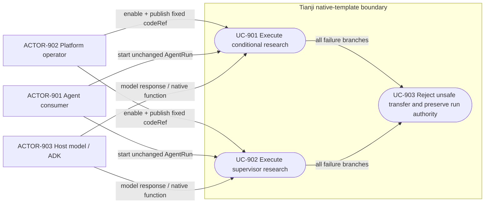
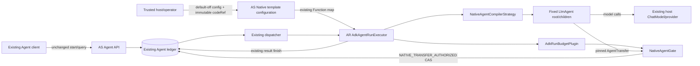
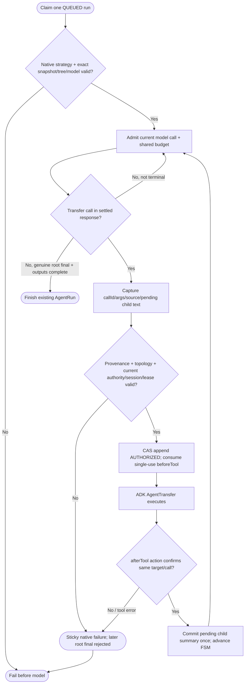

# Native Agentic transfer templates and governed branch collection

| Field | Value |
| --- | --- |
| Document | `2026-11-05-04-45-native-agentic-transfer-templates.md` |
| Template Version | `9` |
| Archetype Cleanup | `Not applicable` |
| Status | `Review` |
| Type | `Feature` |
| Complexity | `Complex` |
| Complexity Drivers | `model-directed native Agent transfer, current authorization and lease fencing, durable CAS audit, callback ordering, two-phase branch collection, fixed topology state machines, shared model budgets, and legacy Code-First compatibility` |
| Created | `2026-11-05 04:45 Asia/Shanghai` |
| Updated | `2026-11-05 07:42 Asia/Shanghai` |
| Owner | `Root design authority; T3-09 roadmap authority continues; no coding GO is implied` |
| Repository | `tianji-service` |
| Scope | `T3-09 first bounded slice only: two default-off native transfer templates and their runtime governance` |
| Change Surface | `AR native compiler metadata, transfer gate, ADK plugin/executor completion, CODE_FIRST budget binding and tests; AS fixed template factories, host-only model configuration, default-off wiring and tests` |
| Affected Chapters | `§7, §8, §9, §10, §13, §14, §15, §16, §17, §18` |
| Source Requirement | `Root-approved T3-09 first-slice decisions in this task; design-only draft at /tmp/tianji-native-agentic-spec.md` |
| Baseline Revision | `main@b0cf55c8d4696fac5bea30875c24f169503957a5; clean at Root inspection; native AR/AS capability-surface digest unchanged from c731f3f` |
| Amends | `None` |
| Supersedes | `None` |
| Depends On | [Agent Framework Upgrade Plan](../../../../docs/plans/agent-framework-upgrade-plan.md) `§15.1, §17.3 T3-09, §17.4 S03`; T3-09 normative remainder unchanged` |
| Related Specs | `None` |
| Related Plans | [Native Agentic transfer templates implementation Plan](../plan/2026-11-05-05-22-native-agentic-transfer-templates.md) `Draft; no source execution GO` |
## 1. Summary

The current Agent Runtime has a durable single-run ledger, explicit model budgets, a native ADK plugin boundary, immutable execution snapshots, and an additive `Map<String, Function<Scheduler, ? extends BaseAgent>>` Code-First registry. It deliberately fails closed for ungoverned tool entry, but it has no reviewed way to distinguish ADK's native `transfer_to_agent` function from a spoofed same-name tool, no topology-bound transfer state, and no safe way to treat a child handoff response as branch output without confusing it with a final Agent response.

This Review Spec adds the first bounded T3-09 slice: two versioned, default-off Code-First templates—conditional research and supervisor research—compiled by a new `NativeAgentCompilerStrategy` that remains assignment-compatible with the existing Function map. A `NativeAgentGate` binds the exact execution snapshot, actual Agent object tree, host model metadata, current authorization, session/run fence and durable ledger revision. It authorizes only the pinned ADK 1.13 `AgentTransfer.transferToAgent` `FunctionTool`, records an immutable `NATIVE_TRANSFER_AUTHORIZED` audit before native execution, and uses a two-phase response/tool collector to commit child summaries only after the actual `EventActions.transferToAgent` action confirms the same call.

HTTP/SDK routes, DTO fields and event/result envelopes remain unchanged; the existing Agent event channel gains the additive `NATIVE_TRANSFER_AUTHORIZED` type and exact payload. Database schema, AgentRun identity, queued claim lifecycle and ordinary governed-tool path remain unchanged. No new AgentRun, graph DSL, `AgentTool`, nested Runner, provider credential, migration or dynamic task-decomposition language is introduced. Full free-form task decomposition, checkpoint/resume rehydration and the remaining T3-09 roadmap remain Required follow-up work.
## 2. Background and Current State
### 2.1 Business and user context

An existing Agent client should be able to select one published definition and receive a governed result through the same AgentRun API while trusted host code chooses one of two fixed native collaboration templates. Model-directed delegation is useful only if it cannot expand tools, agents, tasks or budgets beyond the immutable template and current run authority. Child research text must contribute to the final result without being mislabeled as an ADK final response or allowing a denied handoff to be followed by a plausible root answer.
### 2.2 Repository evidence

Paths are relative to `tianji-service` unless prefixed `Components`. `AR` means `stellar-enclosure-tianji-agent-runtime`; `AS` means `stellar-enclosure-tianji-agent-server`.

| Evidence ID | Classification | Exact path/symbol/decision/command | Observed fact | Design significance | Verification limit/freshness |
| --- | --- | --- | --- | --- | --- |
| `EVD-901` | Static repository | root `pom.xml` properties | Google ADK `1.13.0`, Spring AI `2.0.2`, Java/Spring platform inherited from current parent | Pin implementation and tests to the shipped SDK; no dependency change | Source version, not provider runtime proof |
| `EVD-902` | Static repository | AR `AdkAgentRunExecutor#buildRoot`; `TianjiAgentRuntimeAutoConfiguration#tianjiAgentCodeFirstFactories` | Code-First uses `Map<String, Function<Scheduler, ? extends BaseAgent>>`; unknown codeRef fails; existing functions remain valid | New strategy must extend Function and preserve the map ABI | Does not prove any current factory uses native transfer |
| `EVD-903` | Static repository | AR `AdkRunBudgetPlugin#beforeModelCallback/afterModelCallback/beforeToolCallback` | MODEL authorization, session fence, ledger budget CAS and admitted `InvocationContext` identities exist; tracking currently depends only on governed `toolScope` | Extend the existing plugin rather than add another Runner/plugin pipeline | Current plugin has no native transfer policy |
| `EVD-904` | Static repository | AR `AdkAgentRunExecutor#executeScoped`; `AdkEventProjector#project` | Any nonblank `Event.finalResponse()` can become `AGENT_OUTPUT`; executor completes when any agent output exists and maps final root text only when present | Native templates require a stricter root-completion marker and confirmed branch collector | Existing legacy projection must stay unchanged |
| `EVD-905` | Static repository | AR `AgentLedgerService#appendEvent`; `RunEventSink#append` | Event append is a lease/revision-fenced local transaction and advances run revision | Reuse it for authorization audit; no table or tool journal | Event proves authorization, not actual transfer completion |
| `EVD-906` | Static repository | AR `AgentJsonCodec.MAX_RESULT_BYTES`; existing safe-text validators | Final result is bounded to 2,097,152 bytes; current boundaries reject malformed UTF-16/control text rather than normalize it | Use a much smaller 8,192-char/32,768-byte branch-summary bound and retain aggregate result validation | Source-only; no production-size distribution claim |
| `EVD-907` | Static repository | AR `JTokkitChatModelBudgetEstimator`; `AgentModelBudgetEstimator` | Reviewed profiles bind model bean/name, route, policy, tokenizer, model object and current defaults; current `require` is deliberately CONFIG-only | Native CODE_FIRST needs an explicitly bound per-execution estimator view, not a relaxed/global lookup | Old custom estimators remain ABI-compatible but fail closed for native binding by default |
| `EVD-908` | Static repository | AS `application.yml`; AR `TianjiAgentRuntimeAutoConfiguration` | AS has one base profile; runtime supplies an empty named Code-First map when host does not; model/tool/context features are default off | Add one default-off AS host configuration with no profile drift or provider creation | Deployment flags remain operator-controlled |
| `EVD-909` | Static repository | Components `SpringAiModelAdapterFactory#create/createTools`; executor `requireGovernedTools` | Existing adapter creates ADK model/tools; configured ChatModel callbacks and ADK Agent callbacks are already rejected in governed paths | Reuse the adapter and reject preconfigured raw callbacks/options | Does not validate a real supplier call |
| `EVD-910` | Local primary artifact | packaged `BOOT-INF/lib/google-adk-1.13.0.jar`, SHA-256 `36f13af457b1657e1ef67cf5361f4eb59009a2b911bc5b0de61019f3cbea4e32`; `javap` | Public `Plugin` methods are exactly `afterModelCallback`, `beforeToolCallback`, `afterToolCallback`, `onToolErrorCallback`; `FunctionTool.func()` exposes Method provenance; `ToolContext.functionCallId()` is Optional | The two-phase gate is feasible without private SDK access | Static public API proof only |
| `EVD-911` | Local primary artifact | ADK `AgentTransfer` bytecode/annotations | Public static `transferToAgent(String, ToolContext)` is annotated tool name `transfer_to_agent`; first parameter is required `agent_name`; it writes `EventActions.transferToAgent` | Pin exact class, Method, tool name, argument and post-action proof; reject name-only tools | Valid only for pinned 1.13 JAR hash |
| `EVD-912` | Local primary artifact + finite Runner | ADK `LlmAgent#maybeSaveOutputToState`, `runAsyncImpl` and `BaseLlmFlow#followTransfer` bytecode; controlled Runner scripts | The text-plus-transfer Event is non-final and its own stateDelta does not write the child outputKey; `maybeSaveOutputToState` has no author check, so the later root-final Event propagated through the child wrapper writes root-final text under the child outputKey | Child outputKey is not branch authority; current two-phase collector remains authoritative | Pinned bytecode and finite local Runner, not provider/live runtime proof |
| `EVD-913` | User decision | Root decisions in this task | Fixed codeRefs/topologies/caps, current MODEL authority, CAS audit, strict single-use beforeTool, idempotent identical afterTool confirmation, fatal sticky failure and no resume were explicitly chosen | Closes material behavior/security choices for this slice | Awaiting review of this document, not Accepted |
| `EVD-914` | Local primary artifact | packaged `google-genai-1.77.0.jar`, SHA-256 `454ecb0de8009da6191599a198df93e1e669c5937b9b0b4873c622bc8490f8a5`; `FunctionCall` public API plus ADK `Functions.populateClientFunctionCallId` bytecode | Provider FunctionCall ID is `Optional<String>`; afterModel sees the original value, then ADK replaces absent or empty IDs before constructing ToolContext | Capture treats absent/empty as unbound; beforeTool binds the actual nonblank SDK ID once; a present safe nonempty ID must match | Static public API/bytecode proof; Runner ordering still needs tests |
| `EVD-915` | Static repository | C `AgentInputDTO`, `AgentExecutionResult`; AR `AdkAgentRunExecutorPostgresTest#codeSpec` | Current Code-First fixtures and result path use input/output schema version `"1"`; output is the existing bounded JSON-compatible Map | Pin both v1 templates to existing schema versions without changing C | Fixture/source convention, not a formal schema registry |
| `EVD-916` | Local primary artifact | packaged ADK 1.13 JAR `javap`: `LlmAgent.model(): Optional<Model>`, `LlmAgent.resolvedModel(): Model`, `Model.model(): Optional<BaseLlm>`, `Model.modelName(): Optional<String>`, `BaseLlm.model(): String` | `resolvedModel()` returns a lazy Model wrapper and distinct wrappers may contain the same explicit BaseLlm; wrapper identity and Optional/string cross-comparison are invalid binding proofs | Unwrap only the explicitly configured `LlmAgent.model().flatMap(Model::model)`; compare BaseLlm object identity and then its `model()` string | Valid only for pinned JAR hash; name-only/absent/implicit inheritance fails closed |
| `EVD-917` | Root baseline revalidation | `main@b0cf55c8d4696fac5bea30875c24f169503957a5`; ordered AR/AS capability-surface digest `10acddda5e6a4a63d1008f7f9d7f99d78ba158b500df4fac3f8aa18cbff03209` | Worker Error Step4 commit changed no native AR/AS input in the planned digest | Native execution may use the new clean baseline after the exact digest preflight; HEAD equality is not substituted for path proof | Read-only file digest, not Maven/runtime acceptance |
### 2.3 Problem statement and gap

Current Code-First factories are trusted only by map membership. They have no immutable topology/model descriptor and no distinction between legacy single/composite factories and native-transfer-enabled factories. The budget plugin denies ungoverned tool calls, but its context admission is activated only by an ordinary governed tool scope; blindly allowing a function named `transfer_to_agent` would bypass current identity, authorization, lease, budget and tool governance. The event projector also cannot distinguish a child branch handoff response from a legitimate root terminal response.

The target must enable exactly two known native trees while preserving the current AgentRun, definition, tool and result contracts. A transfer may execute only after current authority and durable CAS audit. A child summary becomes result data only after the exact native call completes with the expected transfer action. Any callback denial, mismatch or error becomes a sticky fatal governance signal so a later root-looking response cannot complete the run.
### 2.4 Evidence and current-chain map

| Entry/trigger | Current call chain | Data read/written | External dependency | Consumers | Evidence |
| --- | --- | --- | --- | --- | --- |
| Queued Code-First run | dispatcher -> `AdkAgentRunExecutor.executeQueued` -> ledger claim -> `buildRoot` Function -> Runner -> plugin -> projector -> ledger finish | Existing Agent run, budget, session and events | ADK 1.13 and host ChatModel | Existing Agent API/SDK/result readers | `EVD-902`-`EVD-905` |
| Native model transfer call | ADK AutoFlow injects `FunctionTool(AgentTransfer.transferToAgent)` -> Plugin `beforeTool` -> FunctionTool -> Plugin `afterTool` | Today: no Tianji native-transfer state/audit | ADK native tool and EventActions | Root/child LlmAgents | `EVD-910`-`EVD-912` |
| Host template activation | AS configuration supplies or omits named Code-First map -> AR auto-config injects map -> executor resolves codeRef | Existing immutable definition snapshot and host Bean graph | Spring AI ChatModel and adapter | Platform operator and Agent dispatcher | `EVD-902`, `EVD-908`, `EVD-909` |
### 2.5 Archetype example cleanup

Cleanup disposition: `Not applicable`

Reason: this slice modifies an established Tianji technical Agent runtime and host configuration. It does not create a generated business project, introduce first business code into an archetype output, or touch sample-domain chains. Exact current AR/AS packages and Root's technical-vertical exception are preserved.
## 3. Goals and Non-goals
### 3.1 Goals

- Enable one fixed conditional-research and one fixed supervisor-research native ADK template under the unchanged AgentRun API.
- Bind codeRef, topology, actual Agent object tree, model bean identity, model name and model route to the immutable execution snapshot.
- Authorize each native transfer with current MODEL authority, session/run context, active lease/revision/deadline and a durable CAS audit before native execution.
- Collect child handoff text only after exact call/action confirmation and require a genuine root final plus all required child outputs.
- Preserve shared model-call/token/cost limits and keep ordinary tool allowance at zero for these templates.
- Keep all existing plain Code-First factories and non-native CONFIG/tool behavior unchanged.
### 3.2 Non-goals

- No public HTTP/SDK/C/CL field, route or error change.
- No database table, column, migration, graph state store, new event store or tool-journal reservation.
- No arbitrary Agent class name, graph, topology, model, route, tool, prompt or task plan supplied by a client.
- No `AgentTool`, nested Runner, Graph API, custom graph scheduler, dynamic DSL or cross-process A2A mesh.
- No free-form task decomposition, repeated/parallel dynamic child creation, same-run resume or checkpoint recovery.
- No provider credentials, ChatModel or network client created by Tianji.
- No claim that these codeRefs are signed artifacts or immutable factory binaries under future T4 release governance; immutability here means fixed reviewed host code plus a new codeRef/definition version for semantic change.
- No claim that authorization audit proves the transfer actually completed.
- No change from the existing CODE_FIRST `sideEffectOutcome=UNKNOWN`; this slice does not assert `NONE`.
### 3.3 Change Surface and Design Depth

| Area/layer | Disposition | Exact repository evidence | Changed or preserved behavior/contract | Required Spec treatment | Chapter(s) |
| --- | --- | --- | --- | --- | --- |
| AR Code-First compilation and native gate | `Affected` | `AdkAgentRunExecutor`, new strategy/gate | Add metadata-bound strategies, topology validation and native transfer gate | Full collaboration/contracts/types/failures/tests | `§7, §8, §9, §10, §13, §14, §15, §16, §17, §18` |
| AR plugin, budget and completion | `Affected` | `AdkRunBudgetPlugin`, `AgentModelBudgetEstimator`, `JTokkitChatModelBudgetEstimator`, executor/projector boundary | Track native contexts, two-phase collection, sticky failure, root completion, CODE_FIRST model settlement | Full design and compatibility tests | `§7, §8, §9, §10, §13, §14, §15, §16, §17, §18` |
| AS fixed templates and host config | `Affected` | current empty named factory map; `application.yml`; Spring AI adapter | Add two default-off host factories and validated model binding | Full file/config/security/test design | `§7, §8, §9, §10, §13, §14, §15, §16, §17, §18` |
| Agent authorization event contract | `Affected` | existing `AgentEventDTO` envelope/codec/list/SSE; `AgentLedgerService#appendEvent` | Add consumer-visible `NATIVE_TRANSFER_AUTHORIZED` type with exact safe payload; no envelope/schema field change | Full event/security/compatibility/test design | `§7, §8, §9, §10, §14, §15, §16, §17, §18` |
| Existing Agent ledger/event tables | `Context-only` | `AgentLedgerService#appendEvent/finish`; current schema | Reuse CAS append and final result; no schema/ownership change | Transaction boundary and regression only | `§7, §11, §14` |
| Existing HTTP/SDK transport/contracts | `Context-only` | Agent controllers, C/CL AgentClient/result/event envelope | Same routes/fields/errors; existing event list/SSE transports additive EVENT-901 unchanged | Boundary and unknown-event compatibility regression | `§9, §16` |
| Ordinary governed tools/PDP/journal | `Unchanged` | `AdkGovernedToolBridge`, current `toolScope` path | Native transfer bypasses none of its contracts and does not consume tool grants | Regression boundary | `§7, §14, §16` |
| AgentRun claim/reconciliation/resume | `Unchanged` | executor single QUEUED claim and current ledger lifecycle | No same-run resume; future checkpoint must rehydrate native counters first | Explicit stopping boundary | `§7, §16, §18` |
| Frontend | `Unchanged` | Tianji web consumes existing Agent result | No route/component/client change | No page design | `§12, §16` |
## 4. Requirements and Acceptance Criteria

| ID | Atomic requirement | Priority | Observable acceptance criteria | Source |
| --- | --- | --- | --- | --- |
| `REQ-901` | Add `NativeAgentCompilerStrategy extends Function<Scheduler, BaseAgent>` without changing the existing factory-map ABI | Must | Old plain Function fixtures compile and execute unchanged; only strategy instances can enable native transfer | Root decision 1 |
| `REQ-902` | Bind strategy metadata to exact codeRef, canonical semantic topology hash, actual Agent object identities/output keys, explicit prebound BaseLlm identity/model name, model bean/ChatModel identity, definition route/policy refs, and existing input/output schema version `"1"` | Must | Root and every child explicitly unwrap `LlmAgent.model().flatMap(Model::model)` to the same BaseLlm object whose `model()` equals the pinned name; absent/name-only/implicit model bindings or same-name different BaseLlm fail before first model call; distinct Model wrappers around that same BaseLlm pass; hash never uses Java object identity/stringification | Root decisions 1-2 + EVD-916 + current DTO fixtures |
| `REQ-903` | Feature is AS-hosted and default off; enabling selects an existing named ChatModel and adapter only | Must | Off contributes no native strategies; on rejects missing/mismatched/callback-bearing models; no credentials/client created | Root decision 2 |
| `REQ-904` | Native definitions use fixed codeRefs, `CODE_FIRST`, empty configuration/tools/allowed tools and `maxToolCalls=0` | Must | Violating definition is rejected before Runner/model; clients cannot send topology/model/class data | Root decision 2 |
| `REQ-905` | Conditional topology is root -> exactly one of quick/deep -> root, depth 2, max two authorized transfers and exactly one completed child | Must | Both branches pass; unknown/self/peer/second branch/repeat/out-of-order fail | Root decision 3 |
| `REQ-906` | Supervisor topology is root -> researcher -> root -> critic -> root, depth 2, max four transfers and two ordered unique children | Must | Required order/output pass; skip/repeat/peer/out-of-order fail | Root decision 3 |
| `REQ-907` | Every logical output key and LlmAgent outputKey is unique/nonreserved; the child handoff Event is non-final and its own stateDelta does not write the handoff summary to the child outputKey | Must | Compiler rejects overlap; finite Runner proves the final child outputKey equals root-final text, which Tianji ignores as non-authoritative while current confirmed collector text remains the branch summary | Root decisions 3/6 + EVD-912 correction |
| `REQ-908` | Recognize only pinned public static `AgentTransfer.transferToAgent` FunctionTool named `transfer_to_agent` with exact `{agent_name:string}` args | Must | Spoofed BaseTool/FunctionTool/method/name/schema/extra/missing/null args fail before mutation | Root decisions 4/6; EVD-911 |
| `REQ-909` | Native beforeTool reauthorizes MODEL, checks session and actual bound context/agent identity, then durably CAS-appends authorization before returning empty | Must | Missing/expired/cancelled/foreign context or append failure prevents native action and changes no gate counter | Root decisions 4-5 |
| `REQ-910` | Final transfer identity is `(actual admitted InvocationContext identity, actual nonblank ToolContext functionCallId)` and beforeTool is strictly single-use | Must | Provider ID absent or exactly empty is treated as unbound and beforeTool binds the SDK-assigned ID once; a present nonempty ID rejects whitespace/control characters and must match the actual ID; repeated beforeTool fails before a second audit/action | Root clarification + EVD-914 |
| `REQ-911` | Audit payload is exactly safe `{to, ordinal, topologyHash, state: AUTHORIZED}` and counts authorization, not completed handoff | Must | Ledger event contains no text/args/identity/model prompt; maxTransfers equals durable authorization count | Root decisions 4/8 |
| `REQ-912` | Tracking predicate is `toolScope != null || nativeGate != null` across model admission and callback context checks; native beforeModel additionally requires the actual bound Agent object to equal the Gate FSM's current expected role | Must | Native definitions with no ordinary tools still bind and verify actual context/tree; a known but out-of-order child or stale child session state fails before budget reservation; legacy tracking is unchanged | Root decision 5 + current-role clarification |
| `REQ-913` | Capture one semantic transfer envelope and bounded non-thought child text from the current admitted complete nonpartial response after budget settlement | Must | Text is nonblank, <=8,192 Java chars then <=32,768 UTF-8 bytes, rejects NUL/unpaired surrogate/unsafe controls, permits ordinary tab/LF/CR, and is never normalized/truncated; absent/exact-empty provider ID is unbound and unsafe present ID rejects | Root decision 6 + correction; EVD-906/914 |
| `REQ-914` | beforeTool must match the captured source/target/args/call/context; afterTool must confirm actual `EventActions.transferToAgent` for the same call | Must | Mismatch discards pending and fails; identical duplicate afterTool is idempotent with no counter/output duplication | Root decision 6 + clarification |
| `REQ-915` | onToolError or any native governance mismatch creates a sticky fatal marker whose control signal preserves the original safe terminal classification | Must | Authorization DENY/UNAVAILABLE remains the existing SUSPENDED path; ledger revision/lease conflicts remain the existing resolver; known timeout remains TIMED_OUT; native policy/unknown failure remains safe FAILED; either the callback error or Gate signal may win without changing disposition, retaining raw Throwable/provider text, or allowing a later root final | Root clarification + failure-disposition correction |
| `REQ-916` | Completion requires a genuine current root final and current-invocation confirmed child outputs; existing output uses known agent names and root-only `text` | Must | Conditional result has root+selected child; supervisor root+researcher+critic; stale outputKey/session/history state cannot satisfy a branch; missing child/root fails | Root decision 7 + clarification |
| `REQ-917` | Native model calls use one per-execution estimator view bound to the exact trusted snapshot object, model identity/profile/defaults and share existing maxModelCalls/token/cost accounting while ordinary tool calls remain zero | Must | Default custom SPI fails closed unless it implements native binding; every view method rejects any snapshot object other than the exact object supplied to bindNative, even if semantically equal; alias bean/model identity drift and forged CONFIG snapshots fail; native transfer does not use ordinary tool count/PDP/journal | Root decisions 4/9 + budget/snapshot-identity correction |
| `REQ-918` | Preserve single QUEUED claim and no same-run resume; future resume must rehydrate authorization/task counters before admission | Must | Current executor creates fresh state only for one claim; no checkpoint API/table added | Root decision 8 |
| `REQ-919` | No C/CL/HTTP/schema/dependency change; old functions, CONFIG flows and tool paths remain compatible | Must | Target path audit and focused regressions remain green | Root decisions 1/7/9 |
| `REQ-920` | Full dynamic task decomposition remains Required and unimplemented | Must | Final evidence labels this first fixed-template slice only; T3-09 not complete | Root decision 9 / roadmap |
### 4.1 Scenario matrix

| Scenario | Actor/trigger | Preconditions | Main path | Alternative/failure path | Data/state change | Observable result | Requirements |
| --- | --- | --- | --- | --- | --- | --- | --- |
| Conditional quick | client starts fixed definition | flag/model/snapshot valid; current run lease | root authorizes quick; quick returns text+root transfer; root final | deep/repeated/unknown target rejected | two AUTHORIZED audits; one confirmed branch in result | root+quick output, root text | 901-917 |
| Conditional deep | model selects deep | same | symmetric deep path | quick cannot also execute | same bounded state | root+deep only | 905/913-916 |
| Supervisor | client starts supervisor definition | fixed tree and budgets valid | researcher round trip then critic round trip then root final | critic-before-research, repeated child/task or missing output fails | four authorization audits; two confirmed summaries | root/researcher/critic | 906/910-917 |
| Spoofed transfer | model/tool callback presents same name or wrong args | native context admitted | provenance/args rejected before audit/state | ADK may convert error to FunctionResponse; sticky fatal still blocks root completion | no authorization event for rejected call | FAILED/safe error | 908-915 |
| Ledger/lease race | current authorization passes but append CAS loses lease/revision/deadline | live run | append fails; gate state unchanged; native call not executed | existing cancel/deadline/conflict resolver decides terminal state | no duplicate transfer/action | existing bounded terminal/error | 909-911/915 |
| Duplicate callbacks | SDK invokes before twice or after twice | one captured call | first before single-use; first after confirms | second before rejects; identical second after no-ops; changed second after fails | at most one audit/output/state transition | deterministic run result/failure | 910/914 |
| Legacy factory | plain Function Code-First run | existing definition/factory | existing build/plugin/projector path | native transfer remains denied by no gate | existing events/result only | byte/behavior-compatible result | 901/919 |
| Budget/cancel/timeout | any native Agent model boundary | shared run policy | existing reservation/settlement/heartbeat applies | exhaustion/cancel/deadline stops gate and runner | existing durable state; authorized audits remain audit only | existing status/error/UNKNOWN side effect | 915/917/918 |
### 4.2 Use-case analysis
#### 4.2.1 Actor inventory

| Actor ID | Actor/role | Goal and responsibility | Entry/channel | Permission/tenant context | Evidence |
| --- | --- | --- | --- | --- | --- |
| `ACTOR-901` | Authenticated Agent consumer | Run one published fixed collaboration definition and read its governed result | Existing Agent API/SDK | Existing tenant/issuer/subject start/read authority | Existing controllers/C/CL; Root decision |
| `ACTOR-902` | Platform operator/host | Select trusted model binding, enable templates and publish immutable definitions | AS configuration + existing publication path | Deployment/config and existing definition authority | `EVD-902`, `EVD-908` |
| `ACTOR-903` | Host model/ADK runtime | Produce bounded model responses and execute the pinned native transfer function | Existing ChatModel + ADK Runner | No independent platform identity; always fenced by current run | `EVD-903`, `EVD-910`-`EVD-912` |
#### 4.2.2 Use-case artifact



| ID | Use case/goal | Trigger/preconditions | Main success outcome | Alternatives/failures | Postconditions | Requirements/contracts/tests |
| --- | --- | --- | --- | --- | --- | --- |
| `UC-901` | Execute conditional research | Existing start selects `conditional-research-v1`; feature/model/current authority valid | Exactly one child summary and genuine root final are returned | quick/deep choice, unknown/repeat/cap/budget/cancel failures | One AgentRun; no new task/run; known outputs only | REQ-901-919; INTERNAL-901-906; TEST-901-910 |
| `UC-902` | Execute supervisor research | Existing start selects `supervisor-research-v1` | Researcher then critic summaries plus root final | out-of-order/duplicate/missing result/failure | Four or fewer authorized transfers, two returned child tasks | REQ-901-919; INTERNAL/EVENT; TEST-901-913 |
| `UC-903` | Reject unsafe transfer | Any provenance/context/auth/CAS/action mismatch | Native action does not execute or run cannot complete after fatal callback | cancellation/deadline/authorization decision uses existing resolver | No false child output or successful root completion | REQ-908-919; TEST-904-915 |
## 5. Constraints, Assumptions, and Decisions
### 5.1 Confirmed constraints

- ADK Java remains pinned at `1.13.0`; the local packaged JAR public API and annotations in `EVD-910`-`EVD-912` are implementation authority.
- Existing AgentRun claim, lease, revision, deadline, cancellation, budget, session fence, event and final-result owners remain authoritative.
- Definitions and clients supply only existing fields. Native topology/model metadata is trusted host code, not definition configuration or request data.
- Native definitions have empty `configuration`, `dependencies.tools`, `allowedToolVersions`, and `maxToolCalls=0`.
- `conditional-research-v1` and `supervisor-research-v1` are fixed reviewed codeRefs; a semantic change uses a new codeRef/definition version. This is not a signed-artifact or factory-binary immutability claim.
- Both v1 definitions require existing `inputSchemaVersion="1"` (`AgentInputDTO`) and `outputSchemaVersion="1"` (existing `AgentExecutionResult.output` convention); no C change is implied.
- No real application, listener, provider, database, browser or GUI is started by design validation.
### 5.2 Small-gap assumptions

| ID | Inference | Repository evidence | Why locally reversible | Impact if wrong |
| --- | --- | --- | --- | --- |
| `ASM-901` | Config prefix is `stellar.tianji.agent.native-templates` with `enabled/model-bean-name/model-name/model-route-ref` | Existing AS feature naming and one base profile | Server-owned property naming is local before implementation | Operator keys and metadata file would change |
### 5.3 Resolved decisions

| ID | Decision | Decision owner | Evidence and rationale | Requirements |
| --- | --- | --- | --- | --- |
| `DEC-901` | Add strategy subtype in the existing Function map; no second registry | Root | Preserves ABI and legacy factories | 901/919 |
| `DEC-902` | Use fixed LlmAgent trees and native transfer, not AgentTool/Graph/nested Runner | Root | Pinned public ADK path already supplies transfer semantics | 905-908/919 |
| `DEC-903` | Use current MODEL authority plus durable run-event CAS, not ToolDescriptor/PDP/tool journal | Root | Transfer changes agent control, not an external business tool; ordinary tool path remains separate | 909-917 |
| `DEC-904` | Capture the current complete response envelope before native action, bind its actual call ID at beforeTool, and commit branch only after matching action | Root | ADK outputKey writes final Events without author filtering and may contain later root-final text; provider call ID is optional; ToolContext ID/action APIs are public | 907/910/913-916 |
| `DEC-905` | Strict single-use beforeTool; identical duplicate afterTool confirmation is idempotent | Root | Prevents executing one authorized handoff twice while tolerating confirmation replay | 910/914 |
| `DEC-906` | Sticky native failure always dominates later root-looking output | Root | ADK may surface callback errors to the model | 915/916 |
| `DEC-907` | No resume in this slice; authorization events are audit, not completion checkpoint | Root | Current executor claims QUEUED once and has no native rehydration contract | 918/920 |
### 5.4 Open major decisions

None. The implementation remains gated on Root review/acceptance of this Review Spec and a separate Plan.
## 6. Project Technology Context

| Concern | Current choice | Repository evidence | Constraint on design |
| --- | --- | --- | --- |
| Runtime | Java 25 platform; Spring Boot 4.1.2 family | parent/current POMs and prior platform baseline | Use current language/runtime; no dependency upgrade |
| Agent SDK | Google ADK Java 1.13.0 + GenAI 1.77.0 | root POM and packaged JAR hashes | Only verified public callbacks/tool/context/actions APIs |
| Model bridge | Spring AI 2.0.2; existing `SpringAiModelAdapterFactory` | POM/Components source | Reuse host ChatModel; reject raw callbacks/options |
| Reactive/control | RxJava Scheduler, existing Runner/plugin/control executor | executor/plugin source | No nested Runner or new executor |
| State | Existing PostgreSQL Agent ledger/session/budget/event/result | ledger/repository source | Reuse append CAS and result; no DDL |
| Tests | JUnit 5, Mockito, ApplicationContextRunner, real ADK Runner + scripted BaseLlm | existing AR/AS tests | Finite offline selectors; optional PG source never selected here |
### 6.1 Java architecture profile and capability baseline

| Architecture profile | Archetype/template or base package | Exact evidence and verifier | Existing deviations | Design action |
| --- | --- | --- | --- | --- |
| Existing Tianji Agent technical vertical under explicit Root exception | `top.egon.cola.platform.tianji.agent.{domain,application,infrastructure,autoconfigure}` plus AS host packages | current module/POM/tree; implemented ledger/plugin/executor/config tests; Root decision | Neither generic `biz.*` nor a new generated business project; explicit factories/final technical classes are established | Preserve exactly; no module/layer/generator/MP/DDL change |

| Need | Spring/JDK candidate | Spring Boot Starter candidate | Egon-COLA/module candidate | Proven gap | Decision/dependency impact |
| --- | --- | --- | --- | --- | --- |
| Native model adapter | Existing Spring AI model + JDK identity checks | Existing Agent Flow auto-config | `SpringAiModelAdapterFactory` | None | Reuse; no dependency |
| Transfer provenance/action | Reflection Method equality + identity maps | None | Pinned ADK FunctionTool/AgentTransfer/EventActions | Existing Tianji gate absent | New internal gate only |
| Durable authorization audit | Existing synchronized callback + Map payload | Existing Spring JDBC already present | `AgentLedgerService.appendEvent`/RunEventSink | No new store needed | Reuse; no DDL |
| Budget | Existing maps/overload defaults | Existing model-budget config | `AgentModelBudgetEstimator`/JTokkit implementation | CODE_FIRST settlement lacks model name | Add backward-compatible overload/branch |
| Template selection | Existing Function map | Existing conditional config | New Function subtype and two host factories | No metadata/topology contract | Add strategy; preserve map |
### 6.2 User-mandated Java rule compliance

| Literal rule | Affected? | Repository evidence | Exact design decision | Files/types/interfaces | Validation/test evidence | Status/blocker |
| --- | --- | --- | --- | --- | --- | --- |
| Rule 1 | Yes | Existing `*Executor/*Plugin/*Factory/*Configuration/*Properties` roles | New top-level types end `Strategy`, `Gate`, `Factory`, `Configuration`, `Properties`; immutable nested `TemplateSpec/Transition` have explicit local role | §8 inventory | type/reflection tests | PASS |
| Rule 2 | Yes | ADK callback types are third-party direct internal entry; existing code validates manually | Validate every compiler/plugin/gate/config handoff before state mutation; no duplicate DTO or Controller group | INTERNAL-901-906 | positive/negative callback/config matrices | PASS under preserved technical boundary |
| Rule 3 | Yes | Current immutable snapshots/records and direct same-module facts | Nested immutable specs/pending facts use compact constructors/defensive copies; no cross-layer conversion or Converter | strategy/gate nested values | constructor/immutability tests | PASS |
| Rule 4 | No | New types are technical factories/gates, not Spring business services; AS uses existing explicit `@Bean` configuration style | No new stereotype business Bean or injected business class; safe logging stays existing executor/plugin owner | Configuration/factories | wiring/log privacy review | N/A — no affected business Bean |
| Rule 5 | Yes | JDK collections/reflection/UTF-8 APIs suffice | No utility/dependency/helper library | all targets | import/POM diff | PASS |
| Rule 6 | Yes | Existing `AgentEventDTO`/codec envelope and unknown event-type tolerance | Add one explicit event type/payload over the unchanged envelope; use existing Jackson codec; fields/privacy/state codes are exact | EVENT-901, existing result | event codec/unknown-consumer/privacy tests | PASS |
| Rule 7 | Yes | AS has one base `application.yml` only | Add complete default-off key set in the sole profile; typed strict properties | properties/config/yml | ApplicationContextRunner + key scan | PASS |
| Rule 9 | Yes | Two topology variants and multi-phase transfer states are complex | Strategy (`NativeAgentCompilerStrategy`) plus Gate-owned state/transition policy; no string branch sprawl | compiler strategies/gate | topology/state/failure tests | PASS |
| Rule 10 | Yes | Existing deadline/lease/budget use `Instant`/`Duration` | Reuse current types/clocks; no new `Date`; transfer counters have no time field | plugin/gate/executor | deadline/cancel tests; forbidden imports | PASS |
| Rule 11 | Yes | Current Agent technical vertical and Root boundary | Preserve modules/packages and Function registry; no new architectural layer | §8 tree | module/path/static gate | PASS under Root architecture boundary |
### 6.3 Time semantics and conversion contract

Time contract: `Required`

| Time ID | Fields/symbols | Semantics | Java/runtime type | Storage policy | Wire policy | Business zone source | Display zone source | Boundary / DST rules | Precision / Clock | Compatibility | Verification |
| --- | --- | --- | --- | --- | --- | --- | --- | --- | --- | --- | --- |
| `TIME-901` | existing run `deadlineAt`, `leaseExpiresAt`, Agent event `occurredAt` | Occurred instant | `Instant` | UTC instant | UTC Z | Not applicable: run fencing uses elapsed instants | Not applicable: no new UI | Every authorization rechecks current deadline/lease; no local/DST calculation | Existing database clock and PostgreSQL precision; no new Clock | Existing AgentRun/Event contracts unchanged | TEST-907/910/914 |
## 7. Architecture Design
### 7.0 Minimum-design baseline and element-necessity audit

| Proposed element | Change | Requirements | Existing/direct alternative | Concrete inadequacy of alternative | Added calls/state/coupling/failures/migration/operations | Verdict |
| --- | --- | --- | --- | --- | --- | --- |
| `NativeAgentCompilerStrategy` | Add | 901-907 | Plain Function | No immutable topology/model metadata or native enable marker | One subtype; no extra registry/call | Add |
| `NativeAgentGate` | Add | 908-918 | Let ADK transfer by name | Cannot prove Method/args/context/authority/action or branch completion | Per-run in-memory state + existing audit call | Add |
| Two AS factories | Add | 903-907 | Generic topology DSL | Client/config-controlled graph violates fixed scope | Two fixed reviewed trees | Add |
| Existing Function map | Keep | 901/919 | Second native registry | Extra ABI/wiring and failure point | Runtime type check only | Keep |
| Existing ledger event/result | Keep | 909-919 | New table/checkpoint | Unneeded for one-claim slice | One CAS event per authorization | Keep |
| Tool PDP/journal | Remove from candidate design | 908/917 | Treat transfer as ordinary tool | Requires descriptors/grants/reservations and consumes tool budget despite native control role | Would add authority/state incorrectly | Remove |
| Graph/AgentTool/nested Runner | Remove | 919/920 | More general collaboration | Adds unrequested topology/state/resume/tool authority | None selected | Remove |

| Path | Network calls | Client states | Server contracts/state | Failure and TOCTOU points | Additional user/business value |
| --- | --- | --- | --- | --- | --- |
| Current plain Code-First | Existing model/provider calls | Existing AgentRun states | Function map, model budgets, result | No governed transfer | Single/composite fixed execution only |
| Selected native templates | Same client/API; bounded extra model turns | Same AgentRun states | Strategy metadata + per-run gate + auth events | Callback/CAS/action confirmation can fail closed | Fixed conditional/supervisor collaboration |
### 7.1 System Architecture Design
#### 7.1.1 Architecture Mermaid view


#### 7.1.2 Boundary and responsibility table

| Module/component | Capability and data owned | Inputs/outputs | Allowed dependencies | Forbidden responsibility | Requirements |
| --- | --- | --- | --- | --- | --- |
| AS template config/factories | Host-selected model identity and two fixed trees | Properties/map -> strategies | Existing model map/adapter | Credentials, definitions, client topology, runtime state | 901-907/919 |
| Strategy metadata | Immutable expected topology/model/output contract | Scheduler -> BaseAgent; TemplateSpec | ADK/ChatModel identity | Authorization, ledger, dynamic task creation | 901-907 |
| Executor | Snapshot/factory selection, one Runner, completion/result | Existing execution material -> existing result | Strategy/plugin/gate/ledger | Transfer policy mutation inside event projector | 902-919 |
| Budget plugin | Model settlement, context admission, callback routing | ADK callbacks -> empty/failed callbacks | Gate/authorization/ledger budget | Name-only transfer permission | 908-917 |
| Native gate | Transfer FSM, call binding, pending/confirmed branch summaries, fatal marker | Response/tool callbacks -> authorization/confirmation | Actual tree, current auth, CAS sink | Tool PDP, DB ownership, provider call | 905-918 |
| Agent ledger | Run/lease/revision/deadline/event/result authority | Existing append/finish contracts | Existing DB/repository | Interpreting audit as applied transfer | 909-919 |
### 7.2 High-Level Design
#### 7.2.1 Critical business/control flowchart


#### 7.2.2 High-level decision and quality matrix

| Concern/use case | Required behavior | Selected mechanism | Failure/degradation behavior | Trade-off | Verification | Requirements |
| --- | --- | --- | --- | --- | --- | --- |
| Transfer authority | No model/name grants authority | Exact FunctionTool Method + actual context/tree + MODEL auth + CAS | Reject before native action | One ledger write per authorized transfer | Gate/provenance tests | 908-912 |
| Branch correctness | Text only after actual transfer | Response capture then afterTool confirmation | Discard + sticky fatal | In-memory pending state; no checkpoint | Runner/callback tests | 913-916/918 |
| Bounded topology | Fixed counts/order/depth | Two policy state machines and immutable spec | Unknown/repeat/order/cap reject | Only two templates | topology matrices | 905-906 |
| Budget | Shared current accounting | `bindNative(snapshot,binding)` returns per-execution bound estimator view; plugin otherwise unchanged | Default/custom/identity/profile drift fails pre-model | One additive default SPI method/private view | binding/math/legacy tests | 902/917 |
| Compatibility | Old factories/API/tools unchanged | Function subtype and nullable gate | Native disabled for plain functions | Runtime type branch | regressions/path audit | 901/919 |
### 7.3 Detailed Design
#### 7.3.1 Detailed component collaboration

| Step | Caller -> callee | Contract/symbol | Input/output mapping | State/data effect | Failure behavior | Requirements |
| --- | --- | --- | --- | --- | --- | --- |
| 1 | executor -> factory map | `codeRef -> Function` | snapshot codeRef -> function | none | absent factory unchanged error | 901/919 |
| 2 | executor -> native strategy | INTERNAL-901 | TemplateSpec + scheduler -> actual root tree | gate created only after exact validation | any metadata/tree/model drift fails pre-model | 902-907 |
| 3 | executor -> plugin/gate | bound root/snapshot/current sink | actual Agent identities and immutable topology -> per-run FSM | in-memory counters NEW | no same-run rehydrate | 908-918 |
| 4 | plugin beforeModel | existing MODEL boundary | CallbackContext/request -> budget admission | reservation/current context identity | existing auth/session/budget errors | 912/917 |
| 5 | plugin afterModel -> gate | INTERNAL-902 | settled response -> one captured FunctionCall and optional child text | pending keyed identity+callId | malformed/multiple/oversize sets fatal | 913/915 |
| 6 | plugin beforeTool -> gate | INTERNAL-903 | exact FunctionTool/args/context -> transition preview | ledger CAS then DISPATCHED/single-use | denial/CAS/repeat prevents action | 908-911/914 |
| 7 | ADK -> plugin afterTool | INTERNAL-904 | actual EventActions target + same call -> confirmation | child task RETURNED; summary committed once | mismatch fatal; identical duplicate no-op | 914-915 |
| 8 | executor event loop -> gate | INTERNAL-905 | native Event + projector result -> root marker | confirmed outputs assembled | fatal/missing outputs reject completion | 915-916 |
| 9 | executor -> ledger finish | existing contract | known agent summaries + root text | existing result transaction | existing revision/lease/cancel/deadline resolver | 916-919 |

Fixed template contracts:

| codeRef | Agent tree/output keys | Allowed transfer state | Completion invariant |
| --- | --- | --- | --- |
| `conditional-research-v1` | `conditional_root/conditional_root_output`; children `quick_research/quick_research_output`, `deep_research/deep_research_output` | NEW: root -> quick or deep; DISPATCHED: selected child -> root | maxTransfers=2; exactly selected child RETURNED once; root final |
| `supervisor-research-v1` | `supervisor/supervisor_root_output`; `researcher/researcher_output`; `critic/critic_output` | root -> researcher -> root -> critic -> root | maxTransfers=4; researcher then critic RETURNED once; root final |

Both rows pin existing input/output schema versions to `"1"`. Every output key must be unique and must not start with ADK reserved `app:`, `user:` or `temp:` state prefixes.

Compiler/admission rules:

1. The selected map value must be `NativeAgentCompilerStrategy`; plain Function uses the unchanged legacy path and receives no native gate.
2. Template codeRef equals map key and snapshot codeRef. Snapshot mode is `CODE_FIRST`; input/output schema versions are exactly `"1"`; configuration, declared tools and allowed tool versions are empty; `maxToolCalls=0`.
3. Template model bean exists by identity in `agentFlowChatModels`; model name and route equal TemplateSpec and immutable dependencies; policy ref remains existing budget authority.
4. The actual tree contains only the named LlmAgents, depth 2, unique names and outputKeys, no root/child overlap, no raw tools/toolsets/code executor/callbacks, children disallow peers and can return only to parent. Model binding never calls `resolvedModel()`: unwrap the root only through `rootLlm.model().flatMap(Model::model).orElseThrow(safeFailure)`, unwrap every child the same way, require every unwrapped BaseLlm object `== rootModel`, and require `rootModel.model().equals(TemplateSpec.modelName())`. Different Model wrapper objects around that same explicit BaseLlm are valid; absent, name-only, implicit-parent, or same-name different-BaseLlm bindings fail before any model resolution/provider call.
5. The executor validates the fixed metadata/tree, then calls `TemplateSpec.topologyHash(validatedSnapshotPolicyVersionRef)`. The method length-frames only canonical semantic fields: codeRef, model bean/name, route and supplied policy refs, Agent names, parent edges, transfer flags, output keys, caps and fixed order. Actual Java object identity is checked separately at runtime; `identityHashCode`, object hash and `toString` never enter the hash.
6. Executor constructs `NativeModelBinding(codeRef,modelBeanName,modelName,actual ChatModel identity)` and calls additive `budgetEstimator.bindNative(snapshot,binding)`. The returned per-execution estimator view closes over that exact `AgentExecutionSnapshot` object and rejects every different snapshot object on all five methods; semantic equality/hash is never an identity substitute. The bound view, not the global estimator, is passed to the existing plugin.

Callback/gate rules:

0. Every beforeModel and afterModel path uses `tracking = toolScope != null || nativeGate != null`; registration after budget admission and every later lookup use the same actual `InvocationContext` identity. Before authorization or budget reservation, the native gate additionally requires the exact bound Agent object from the compiled tree to be the FSM's current expected role/node (initially root, then only the target confirmed by the preceding handoff), never merely a known name or any known tree member. A known critic/other child entered first, stale persisted child state at a new invocation, or unsupported mid-child session continuation fails closed before budget spend; an ordinary same-session continuation after a completed child-to-root handoff expects root and remains valid. Legacy tracking is unchanged.
1. `afterModelCallback` settles budget first, then `observeResponse`. Partial/error/interrupted responses follow existing behavior. Only a complete nonpartial response is an envelope. If it contains functions, it has exactly one semantic `transfer_to_agent` call and exact `{agent_name: string}`; no extra function/arg is accepted. Provider FunctionCall ID absent or exactly empty is stored as unbound; a present nonempty ID must be untrimmed, nonblank and free of ISO control characters.
2. Child-to-root transfer envelopes additionally require nonblank non-thought text. Validate Java length <=8,192 first, reject every ISO control character (C0, DEL and C1) except tab/LF/CR and all unpaired surrogates, then encode UTF-8 and require <=32,768 bytes. Do not trim, normalize or truncate. Root-to-child envelopes carry no branch output. Pending data is keyed first by actual admitted `InvocationContext` identity plus one unconsumed response envelope; it never trusts prior session state, outputKey or event history.
3. `beforeToolCallback` accepts only `FunctionTool` whose `func()` equals the pinned public static Method, whose tool/declaration name is `transfer_to_agent`, and whose schema/arguments are exact. It requires the actual `ToolContext.functionCallId` to be nonblank, untrimmed and free of ISO control characters, binds it once to the pending envelope, and, if capture retained a provider ID, requires exact equality. It then verifies current actual Agent object identity, source/target/args/context, session fence and MODEL authorization.
4. The gate previews without mutation, calls the synchronized event sink to append `NATIVE_TRANSFER_AUTHORIZED` with exact payload, and only after CAS success consumes the single-use beforeTool and advances NEW -> DISPATCHED. It returns `Maybe.empty()` so ADK executes the native Method. A repeated beforeTool always fails before another event/action.
5. `afterToolCallback` requires the same identity/call and actual `context.eventActions().transferToAgent()==target`. It advances child task DISPATCHED -> RETURNED and commits pending text under the known logical key. An identical duplicate confirmation returns empty without new state/output/event; any changed duplicate is fatal.
6. `onToolErrorCallback`, provenance/action mismatch or denied transfer discards pending state and sets a sticky fatal token. The token stores only a private failure kind plus either authorization DENY/UNAVAILABLE or an `AgentErrorCodeEnum`; it never retains the original Throwable, cause, message or provider text. `safeBoundaryFailure(token)` reconstructs `AgentExecutionAuthorization.Failure(decision)` for authorization, an `AgentLedgerException` with the same ledger code and constant message for revision/lease/budget/other known ledger failures, a constant-message wrapper with `TimeoutException` cause for known timeout, and safe dependency failure for unknown/policy failure. The callback channel and replayed Gate signal use the same token/classification, so their race cannot replace SUSPENDED/revision/lease/timeout resolution with generic FAILED. The gate exposes that replayed control error through the executor's existing deadline/heartbeat/model-idle Flowable and control executor; it creates no Scheduler/thread. `onToolError` returns empty when the incoming error already has the token's safe classification so pinned ADK rethrows it, or `Maybe.error(safeBoundaryFailure(token))` only when boundary sanitization is required. Even if a future SDK/other callback exposes an error FunctionResponse and the model later emits a root final, executor completion checks the fatal token first and fails with the same safe disposition.
7. Authorization audit records a reservation, not application. `maxTransfers` counts durable AUTHORIZED events. Current one-claim execution starts counters at zero; future resume/checkpoint work must rehydrate authorization ordinals and NEW/DISPATCHED/RETURNED task states before any model admission.

Result rules:

- Confirmed summaries come only from current admitted response envelopes and stay gate-internal until successful run completion; no persisted outputKey, session state, event history author or stale prior-run value is branch proof. The child handoff Event itself is non-final, but a later root-final Event may cause ADK's author-agnostic wrapper to write root-final text under the child outputKey; Tianji ignores it. No synthetic `Event.finalResponse`, Tianji-authored outputKey write or fake `AGENT_OUTPUT` event is created.
- The existing projector handles deltas and the genuine root final. Native completion requires root author, `finalResponse`, no transfer call, no fatal signal and exact required branch outputs.
- Existing `output.agents` is a deterministic map keyed by known Agent names. Existing `output.text` is only the genuine root text. No unknown name or logical key is exposed.
- CODE_FIRST side-effect outcome remains existing `UNKNOWN` on success/failure paths; native transfer does not justify `NONE`.
#### 7.3.2 Critical-path Mermaid swimlane

```mermaid
sequenceDiagram
    actor Client as Existing Agent client
    participant EX as AdkAgentRunExecutor
    participant ST as NativeAgentCompilerStrategy
    participant PL as AdkRunBudgetPlugin
    participant NG as NativeAgentGate
    participant DB as Existing Agent ledger
    participant ADK as ADK Runner/AgentTransfer
    participant M as Host ChatModel
    Client->>EX: unchanged start then queued execution
    EX->>ST: compile fixed root/tree
    ST-->>EX: root + immutable TemplateSpec
    EX->>NG: bind snapshot/tree/current event sink
    EX->>ADK: one Runner invocation
    ADK->>PL: beforeModel(actual context)
    PL->>DB: existing budget reserve
    ADK->>M: model call
    M-->>PL: response text + transfer call
    PL->>DB: settle model budget
    PL->>NG: observeResponse(context,response)
    ADK->>PL: beforeTool(exact FunctionTool/callId/args)
    PL->>NG: authorize current transfer
    NG->>DB: append NATIVE_TRANSFER_AUTHORIZED CAS
    DB-->>NG: new run revision
    NG-->>ADK: Maybe.empty; execute native transfer
    ADK->>PL: afterTool(actual EventActions)
    PL->>NG: confirm transfer and child text
    alt mismatch or callback error
        NG-->>EX: sticky fatal
        EX->>DB: existing failed/suspended/cancel/timeout path
    else required children and genuine root final
        EX->>DB: existing finish with agents map/root text
        DB-->>Client: unchanged result contract
    end
```
#### 7.3.3 Transactions, consistency, concurrency, and idempotency

| Concern/state change | Owner and boundary | Mechanism/isolation/lock | Concurrent or duplicate behavior | Commit/visibility point | Failure result | Requirements/tests |
| --- | --- | --- | --- | --- | --- | --- |
| Authorization audit | Agent ledger local transaction | existing lease+revision CAS append | beforeTool key strictly single-use | append commit before native action | no action on CAS failure | 909-911/TEST-906 |
| Gate FSM/control | one executor invocation | synchronized identity maps/counters + replayed sanitized failure token | repeated before rejected; identical after idempotent; first fatal classification wins | in-memory transition after audit/action proof; no raw Throwable retained | same safe auth/ledger/timeout/policy disposition on callback and signal channels | 905-906/910/914-915 |
| Branch summary | gate memory then final result | pending capture -> afterTool confirm -> final finish | one logical child output | existing result finish | discarded on failure | 913-916 |
| Budget | existing budget transactions | current reservation/settlement and run counters | model call duplicate still conflicts | existing settlement | existing budget error | 917 |
| Run lifecycle | existing ledger | one QUEUED claim/current lease | no resume in scope | existing finish/cancel/expire | current resolver | 918-919 |
#### 7.3.4 Failure semantics, recovery, and reconciliation

| Failure point | Detection | Immediate control flow | Data/transaction state | Retry and idempotency | Caller result | Recovery owner | Verification |
| --- | --- | --- | --- | --- | --- | --- | --- |
| Snapshot/tree/model drift | compiler validation | reject pre-model | no audit/model action | publish corrected new definition/config | existing safe failure | operator | TEST-901-903 |
| Unknown/self/peer/order/cap | policy preview | reject pre-audit | gate unchanged | no callback replay | FAILED safe code | definition/template owner | TEST-904-906 |
| Authorization DENY/UNAVAILABLE during native callback | current MODEL check | no native action; Gate stores only decision token | no audit/state mutation | no callback replay | existing SUSPENDED path regardless callback/signal race | executor authorization resolver | TEST-910/914 |
| Ledger revision/lease/cancel/deadline race | authorization append CAS/session fence | no native action; Gate stores exact safe code/kind | existing durable state remains authoritative | existing resolver only | revision/lease current-run resolver, CANCELLED or TIMED_OUT as current state dictates | ledger/executor | TEST-906/910/914 |
| Known callback timeout | bounded cause classification | no native action; replay constant timeout wrapper | no false output/state | no retry | existing TIMED_OUT path | executor | TEST-910/914 |
| Repeated beforeTool | consumed key | reject | first authorization remains audit; no second | never replay public callback | FAILED | executor | TEST-908 |
| afterTool/action mismatch | call/action comparison | discard pending; fatal | authorization audit remains, no child output | no retry | FAILED | executor | TEST-909 |
| Native policy/unknown callback failure | policy guard/onToolError + sticky token | safe dependency failure; future conversion still cannot complete | no false completion; no raw error retained | no model recovery to success | FAILED | executor | TEST-910 |
| Missing child/root output | completion marker | reject finish success | no successful result | no same-run resume | FAILED | template owner | TEST-911-912 |
| Budget/model/provider failure | existing plugin/executor | existing settle/fail | existing durable facts | existing policy | existing error/status | current owner | TEST-913 |
#### 7.3.5 Observability and operational boundaries

| Signal/runbook | Emitting owner and point | Fields/dimensions | Sensitive-data rule | Success/failure threshold | Alert/dashboard/operator action | Verification boundary |
| --- | --- | --- | --- | --- | --- | --- |
| `NATIVE_TRANSFER_AUTHORIZED` event | gate before native action | `to`, `ordinal`, `topologyHash`, `state` | omit text/args/callId/actor/prompt/model body | one per authorized transfer, bounded by template | correlate failed runs with authorization sequence; never call it completed | ledger unit/component; runtime unverified |
| safe native failure log | executor/plugin fatal boundary | codeRef hash/topologyHash/ordinal/error class/outcome | no child text, args, subject, token, provider message | no SLO invented | operator inspects run/events | static/log capture |
| existing budget/run metrics | current owners | existing run/model/result dimensions | existing policy | unchanged | existing runbook | regressions only |
#### 7.3.6 Conclusion evidence chain

| Conclusion | Repository/user evidence | Constraint or requirement | Design decision | Consequence and trade-off | Verification and acceptance evidence |
| --- | --- | --- | --- | --- | --- |
| Native transfer is a gated model control action, not an ordinary business tool | EVD-903/905/910/911; Root | 908-917 | Exact Method/context/MODEL auth + CAS event; no PDP/tool journal | Smaller authority surface; authorization event is not completion | TEST-904-910; event payload assertions |
| Branch text requires two-phase confirmation | EVD-904/912; Root | 907/913-916 | Capture after settled model; commit only after matching EventActions | In-memory pending state; no resume; ADK child outputKey may later contain root-final text and is ignored | real Runner non-final handoff/current-summary/outputKey-nonauthority tests |
| Strategy subtype preserves compatibility | EVD-902/908; Root | 901-903/919 | Function subtype in same named map, default-off host beans | No second registry/dependency; runtime type branch | old Function/CONFIG regressions + context tests |
## 8. Package Structure and Code File Tree
### 8.1 Current relevant tree

```text
stellar-enclosure-tianji-agent-runtime/
  src/main/java/top/egon/cola/platform/tianji/agent/infrastructure/adk/
    {AdkAgentRunExecutor,AdkRunBudgetPlugin,AdkEventProjector,
     AgentModelBudgetEstimator,JTokkitChatModelBudgetEstimator}.java
  src/main/java/top/egon/cola/platform/tianji/agent/autoconfigure/TianjiAgentRuntimeAutoConfiguration.java
  src/main/java/top/egon/cola/platform/tianji/agent/infrastructure/persistence/
    {AgentLedgerService,AgentJsonCodec}.java
stellar-enclosure-tianji-agent-server/
  src/main/resources/application.yml
Components/stellar-enclosure-component-agent-flow-starter/src/main/java/
  top/egon/cola/component/agentflow/runtime/SpringAiModelAdapterFactory.java [context-only]
```
### 8.2 Target tree

```text
stellar-enclosure-tianji-agent-runtime/src/main/java/top/egon/cola/platform/tianji/agent/
  infrastructure/adk/
    NativeAgentCompilerStrategy.java                           CREATE
    NativeAgentGate.java                                       CREATE
    AdkRunBudgetPlugin.java                                    MODIFY
    AdkAgentRunExecutor.java                                   MODIFY
    AgentModelBudgetEstimator.java                             MODIFY
    JTokkitChatModelBudgetEstimator.java                       MODIFY
  src/test/java/top/egon/cola/platform/tianji/agent/infrastructure/adk/
    NativeAgentCompilerStrategyTest.java                       CREATE
    NativeAgentGateTest.java                                   CREATE
    NativeAgentTransferRunnerTest.java                         CREATE
    AdkNativeAgentCompletionTest.java                          CREATE
    AdkRunContextTest.java                                     MODIFY
    JTokkitChatModelBudgetEstimatorTest.java                   MODIFY
  src/test/java/top/egon/cola/platform/tianji/agent/infrastructure/persistence/AgentJsonCodecTest.java MODIFY
stellar-enclosure-tianji-agent-server/src/main/java/top/egon/cola/platform/tianji/agent/server/
  agenttemplate/
    NativeAgentTemplateProperties.java                         CREATE
    TianjiNativeAgentTemplateConfiguration.java                CREATE
    ConditionalResearchAgentFactory.java                       CREATE
    SupervisorResearchAgentFactory.java                        CREATE
  src/test/java/top/egon/cola/platform/tianji/agent/server/agenttemplate/
    ConditionalResearchAgentFactoryTest.java                   CREATE
    SupervisorResearchAgentFactoryTest.java                    CREATE
    TianjiNativeAgentTemplateConfigurationTest.java            CREATE
stellar-enclosure-tianji-agent-server/src/main/resources/application.yml MODIFY
```

No POM, C, CL, SQL, database manifest, API Controller, security resource, frontend or Components source is modified.
### 8.3 Package and file responsibilities

| Operation | Path/package | Symbols | Responsibility | Dependencies | Requirements |
| --- | --- | --- | --- | --- | --- |
| Create | AR `NativeAgentCompilerStrategy.java` | strategy, topology/template spec | Additive Function ABI and immutable metadata | ADK/Spring AI identity | 901-907 |
| Create | AR `NativeAgentGate.java` | gate, FSM/pending/fatal facts | Provenance/auth/audit/confirmation/completion | plugin/event sink/ADK public API | 905-918 |
| Modify | AR plugin | native gate callbacks/context predicate/model binding | Route exact lifecycle without changing ordinary tool branch | existing budgets/auth/session | 909-917 |
| Modify | AR executor | compile/bind/completion/output | Select strategy, construct gate, require outputs/fatal-free root | existing ledger/Runner/projector | 901-919 |
| Modify | AR estimator interface/JTokkit | additive `bindNative` and private per-execution bound view | Reuse exact profile/model/default math; keep CONFIG require unchanged | existing model-budget config | 902/917/919 |
| Create | AS properties/config | default-off named map | Validate host model metadata and contribute strategies | existing model map/adapter | 902-904/919 |
| Create | AS two factories | exact fixed LlmAgent trees | Build reviewed topology/output keys/instructions | strategy/adapter/host model | 905-907 |
| Modify | AS application.yml | four default-off keys | Operator-owned activation metadata | existing profile | 903/919 |
| Create/modify | AR/AS tests | unit/Runner/context/config regressions | Prove all affected contracts and preserved boundaries | JUnit/Mockito/scripted BaseLlm | 901-920 |
## 9. Interface Definitions

No external HTTP operation shape is added or modified. Existing Agent start/get/result/event-list/SSE routes, DTO fields, errors and permissions remain unchanged. `EVENT-901` is nevertheless an additive consumer-visible event type/payload delivered through the existing event envelope and transports, so its JSON/privacy/unknown-type compatibility is affected and fully specified below.
### 9.1 Interface Inventory

| ID | Change/necessity verdict | Name/purpose | Kind | Consumer | Owner | Symbol/topic | Input | Output | Auth/tenant | Error/idempotency | Requirements |
| --- | --- | --- | --- | --- | --- | --- | --- | --- | --- | --- | --- |
| `INTERNAL-901` | New/Add | Compile metadata-bound native tree | Internal strategy | executor/AS factories | AR | `NativeAgentCompilerStrategy#apply/templateSpec/usesChatModel` | Scheduler/host metadata | BaseAgent/TemplateSpec | host trusted; snapshot revalidated | pre-model failure; fixed versioned codeRef | 901-907 |
| `INTERNAL-902` | New/Add | Observe settled model response | Internal method | plugin | gate | `NativeAgentGate#observeResponse` | CallbackContext/LlmResponse | pending envelope/fatal state | actual admitted context | one envelope; provider ID absent/empty/safe-present rules | 912-915 |
| `INTERNAL-903` | New/Add | Authorize native beforeTool | Plugin method delegation | ADK/plugin | gate/ledger | `NativeAgentGate#beforeTool` | FunctionTool/args/ToolContext | `Maybe.empty` | MODEL auth/session/lease CAS | strictly single-use | 908-911/914 |
| `INTERNAL-904` | New/Add | Confirm native afterTool/error | Plugin method delegation | ADK/plugin | gate | `afterTool/onToolError` | same call/result/actions/error | empty/idempotent/fatal | actual context/action | identical after replay only | 914-915 |
| `INTERNAL-905` | New/Add | Native completion projection | Internal method | executor | gate | `completeRoot/confirmedOutputs/requireHealthy` | native event/projection | known outputs/completion | bound tree | fatal/missing outputs reject | 915-916 |
| `INTERNAL-906` | Modify/Keep | Bind native model budget authority | Internal SPI | executor/JTokkit/custom estimators | AR | `bindNative(AgentExecutionSnapshot,NativeModelBinding)` | snapshot/trusted binding | per-execution estimator view | host trusted + immutable snapshot | default fail-closed; non-native never calls | 902/917/919 |
| `EVENT-901` | New over existing channel | Native transfer authorization audit | Existing Agent event | support/executor | Agent ledger | type `NATIVE_TRANSFER_AUTHORIZED` | exact safe payload | stored event/revision | existing run owner/lease | CAS; not completion/replay API | 909-911/918 |
### 9.2 Per-interface Detailed Contracts
#### 9.2.1 INTERNAL-901 — Native compiler strategy
##### Necessity and interaction-cost decision
| Concern | Decision |
| --- | --- |
| Change classification | New internal Strategy subtype |
| Independent consumer goal | Executor must distinguish reviewed native templates from legacy functions before model execution |
| Parameter ownership and derivation | Host owns metadata; executor derives snapshot/tree facts; client supplies none |
| Direct/no-new-interface alternative | Plain Function remains, but cannot prove topology/model/native enablement |
| Caller use of result | Executor validates and creates the per-run gate; no forwarding call |
| Round trips and failure points | No new call; one local type/metadata validation branch |
| Verdict | Add for REQ-901-907; keep existing map ABI |
##### Identity and purpose
AR public internal SPI, implemented only by trusted AS factories; exact symbols are `apply`, `templateSpec`, and `usesChatModel`.
##### Request parameters
One nonnull context-aware Scheduler; metadata is host-owned and accepts no request/definition topology input.
##### Success response
One nonnull fixed BaseAgent tree plus immutable TemplateSpec; host ChatModel identity is provable.
##### Error responses
Invalid/mismatched metadata, model, schema version or actual tree fails before Runner/model with the existing safe run error.
##### Interface logic for frontend and consumers
Executor validates codeRef/mode/config/dependencies/policy/model/tree/hash, then creates a gate; plain Function keeps the legacy path with native transfer disabled.
##### Compatibility and verification
Function assignability/reflection, old constructor/map tests, two tree golden tests and drift matrices.
#### 9.2.2 INTERNAL-902 — Observe response
##### Necessity and interaction-cost decision
| Concern | Decision |
| --- | --- |
| Change classification | New internal response-observation method |
| Independent consumer goal | Gate must bind current child text and semantic transfer before native execution |
| Parameter ownership and derivation | Current CallbackContext/LlmResponse own envelope; no persisted source is authoritative |
| Direct/no-new-interface alternative | outputKey/session/event scan is stale or final-only |
| Caller use of result | Gate correlates one pending envelope to before/after tool callbacks |
| Round trips and failure points | No network/DB call; bounded in-memory pending/fatal state |
| Verdict | Add for REQ-912-915 |
##### Identity and purpose
Package-internal gate method called only after successful nonpartial model settlement.
##### Request parameters
Exact CallbackContext/LlmResponse; actual admitted context/Agent identity; one semantic transfer call; provider call ID normalized only by mapping absent/exact-empty to unbound while rejecting unsafe present values.
##### Success response
No SDK override; one pending envelope or validated root/ordinary response marker.
##### Error responses
Duplicate envelope, multiple/other functions, wrong args/source, invalid child text or pending collision sets sticky fatal and throws a safe failure.
##### Interface logic for frontend and consumers
Ignore thought text; concatenate current response non-thought text; apply exact 8,192-char then 32,768-byte safe-text rules with no normalization/truncation; never scan session state, outputKey or events.
##### Compatibility and verification
Partial/model-error behavior stays existing; direct callback plus real Runner present/absent-provider-ID tests.
#### 9.2.3 INTERNAL-903 — Native beforeTool
##### Necessity and interaction-cost decision
| Concern | Decision |
| --- | --- |
| Change classification | New internal beforeTool authorization method |
| Independent consumer goal | Plugin must decide whether ADK may execute one native transfer now |
| Parameter ownership and derivation | SDK Method/context/call ID plus host topology and current run authority |
| Direct/no-new-interface alternative | Name-only allow is spoofable; ordinary tool path has wrong authority/state |
| Caller use of result | Empty means execute original native tool; failure stops it |
| Round trips and failure points | One existing ledger CAS; callback/CAS may fail closed |
| Verdict | Add for REQ-908-911/914 |
##### Identity and purpose
Plugin delegates only an exact pinned transfer FunctionTool; ordinary tools remain on unchanged toolScope.
##### Request parameters
Exact Method/name/declaration, `{agent_name:string}`, actual ToolContext ID, admitted InvocationContext/Agent and captured envelope.
##### Success response
`Maybe.empty()` after MODEL authorization, session fence and durable CAS audit; native ADK executes the original function.
##### Error responses
Repeated before, spoof, topology, auth, context or CAS failure is fatal before second event/action or gate mutation.
##### Interface logic for frontend and consumers
Bind the safe actual nonblank ID; require exact equality only when capture retained a safe present provider ID; preview transition, append exact audit, consume single-use key, mark DISPATCHED, return empty.
##### Compatibility and verification
Spoof/args/order/cap/auth/session/lease/deadline/CAS/repeated-before tests; no external retry contract.
#### 9.2.4 INTERNAL-904 — Native afterTool/onToolError
##### Necessity and interaction-cost decision
| Concern | Decision |
| --- | --- |
| Change classification | New internal afterTool/error confirmation methods |
| Independent consumer goal | Gate must prove native action before accepting child output/state |
| Parameter ownership and derivation | SDK EventActions owns actual target; captured envelope owns expected call |
| Direct/no-new-interface alternative | beforeTool/model intent proves authorization only, not application |
| Caller use of result | Gate commits one known output or sets fatal; no forwarding |
| Round trips and failure points | No new call; action mismatch/error fails bounded run |
| Verdict | Add for REQ-914-915 |
##### Identity and purpose
Plugin delegates the same actual tool/call/context after native execution or error.
##### Request parameters
Original args, ToolContext, result Map or Throwable; actual target comes only from EventActions.transferToAgent.
##### Success response
Empty preserves ADK result; matching confirmation commits one child summary/state transition.
##### Error responses
Mismatch discards pending and sets fatal. Identical confirmed replay no-ops; changed replay or onToolError is fatal.
##### Interface logic for frontend and consumers
Confirm same context/call/target/action, commit known logical output once, advance RETURNED/next state; never fabricate final output.
##### Compatibility and verification
Action mismatch, duplicate after and tool-error-then-root-final tests.
#### 9.2.5 INTERNAL-905 — Completion projection
##### Necessity and interaction-cost decision
| Concern | Decision |
| --- | --- |
| Change classification | New native-only completion method |
| Independent consumer goal | Executor needs a truthful root terminal marker and exact branch summaries |
| Parameter ownership and derivation | Current event/projector plus gate-confirmed current outputs |
| Direct/no-new-interface alternative | Existing any-agent-output rule can accept child/stale output |
| Caller use of result | Executor builds existing result and finishes run |
| Round trips and failure points | No new call; missing/fatal output rejects completion |
| Verdict | Add for REQ-915-916; legacy path unchanged |
##### Identity and purpose
Executor/gate jointly decide native completion; existing projector remains authority for non-native runs.
##### Request parameters
Current invocation ADK events/projections plus gate state; no persisted outputKey/session/history branch proof.
##### Success response
Deterministic known-agent summary Map and genuine current root text in existing AgentExecutionResult.
##### Error responses
Fatal, child final, missing/extra branch, unknown author/key or root transfer-at-terminal rejects success.
##### Interface logic for frontend and consumers
Gate supplies confirmed current child summaries; projector supplies genuine root final; executor calls existing finish and keeps sideEffectOutcome UNKNOWN.
##### Compatibility and verification
Conditional/supervisor output, stale-state and populated/absent outputKey nonauthority, missing root/branch, fatal dominance and legacy regression tests.
#### 9.2.6 INTERNAL-906 — Native model budget binding
##### Necessity and interaction-cost decision
| Concern | Decision |
| --- | --- |
| Change classification | Add one default native-binding method to existing estimator SPI |
| Independent consumer goal | Executor/plugin must use the exact reviewed profile and actual trusted ChatModel for native runs |
| Parameter ownership and derivation | Strategy supplies codeRef/bean/name/model identity; snapshot supplies route/policy/currency/config |
| Direct/no-new-interface alternative | Global CODE_FIRST relaxation, mutable registry/thread-local or forged CONFIG snapshot can mis-account a same-name model |
| Caller use of result | Executor passes the returned per-execution estimator view to the unchanged plugin |
| Round trips and failure points | No external call/global state; unsupported custom estimator or identity/profile drift fails pre-model |
| Verdict | Add `bindNative` default fail-closed for REQ-902/917/919 |
##### Identity and purpose
`AgentModelBudgetEstimator#bindNative` is an additive default SPI method. Existing non-native paths never call it.
##### Request parameters
Exact immutable CODE_FIRST snapshot object and `NativeModelBinding(codeRef,modelBeanName,modelName,actual ChatModel identity)` with redacted string form.
##### Success response
One private per-execution estimator view implementing the same five estimate/usage/window/fingerprint/context-policy methods and accepting only the exact snapshot object captured at binding.
##### Error responses
Default custom implementation fails closed. Builtin rejects nonempty CODE_FIRST config, codeRef/bean/name/route/policy/currency/model-identity/default drift, every distinct snapshot object including a semantically equal copy, and any forged CONFIG snapshot.
##### Interface logic for frontend and consumers
JTokkit resolves the exact `(modelName,snapshot.modelRouteRef,snapshot.policyVersionRef)` profile, checks profile bean and `Bound.model == trusted ChatModel`, currency/current defaults, and returns a view closed over both that Bound and the exact snapshot reference. Every view method starts with `if (candidateSnapshot != boundSnapshot) throw unavailable()`. It reuses existing math and checks; no semantic-hash fallback, forged CONFIG snapshot, mutable global binding or thread-local is allowed; CONFIG `require()` and legacy plain CODE_FIRST unsupported behavior remain byte/behavior unchanged.
##### Compatibility and verification
CONFIG/plain-CODE_FIRST/custom-port compatibility; native exact profile and exact snapshot reference; semantically equal different snapshot rejection; bean-A versus bean-B same-name/different-identity, route/default/currency drift; shared counter and zero-tool tests.
#### 9.2.7 EVENT-901 — Native transfer authorization
##### Necessity and interaction-cost decision
| Concern | Decision |
| --- | --- |
| Change classification | New event type on existing durable channel |
| Independent consumer goal | Support/operator needs durable proof that one transfer was authorized under current fence |
| Parameter ownership and derivation | Gate derives target/ordinal/hash; ledger derives actor/run/revision/time |
| Direct/no-new-interface alternative | Existing append is reused; new table/tool journal is unnecessary |
| Caller use of result | Gate consumes updated revision before native execution |
| Round trips and failure points | One local DB transaction; CAS may reject action |
| Verdict | Add event type for REQ-909-911/918 |
##### Identity and purpose
Type `NATIVE_TRANSFER_AUTHORIZED` in the existing Agent run event stream; owner is Agent ledger.
##### Request parameters
Exactly `to`, positive bounded `ordinal`, lower-hex64 `topologyHash`, and `state="AUTHORIZED"`.
##### Success response
Updated run revision returns to synchronized sink before native action; the event states authorization only.
##### Error responses
Lease/revision/deadline/cancel conflict follows current executor resolver; no external retry/callback replay.
##### Interface logic for frontend and consumers
Append once after preview/current checks; omit callId/text/args/actor/prompt/token/model/error details; advance gate only after commit.
##### Compatibility and verification
Existing DTO/schema/table and string `type` field remain unchanged; event-list/SSE consumers must tolerate or explicitly render an unknown additive type. Append/CAS/payload/order/unknown-type tests and no-DDL audit apply.
## 10. POJO and Data Model Design
### 10.1 POJO role classification and class necessity

| Object/path | Selected role | Owner/boundary and consumers | Necessity/reuse | Mapping owner | Requirements |
| --- | --- | --- | --- | --- | --- |
| `NativeAgentCompilerStrategy` | behavior Strategy | AS host -> AR executor | New marker+metadata while preserving Function ABI | None | 901-907 |
| nested `TemplateSpec/TransferTopologyEnum/AgentSpec` | immutable internal value | strategy/executor/gate | Exact fixed topology/model/output validation | direct same-module construction | 902-907 |
| `NativeAgentGate` | behavior Gate/State owner | plugin/executor | Owns transfer security and two-phase state | None | 905-918 |
| nested pending/authorization/task facts | immutable private values | gate only | Prevent partial mutation and bind call/context | direct | 909-915 |
| `NativeAgentTemplateProperties` | immutable configuration properties | AS host config | Typed strict server-owned model metadata | Spring binding | 903 |
| `AgentExecutionResult` | existing immutable result | executor/client | Reuse existing Map output; no new DTO | existing codec | 916/919 |
### 10.2 Persistence objects, ORM entities, and business data objects

N/A for new models: no persistence object, ORM entity or business table is added. Existing AgentRun/Event/Result persistence remains unchanged and is referenced only through existing ledger methods.
### 10.3 Field design

| Model.field | Type | Required/null/default | Validation and semantics | Source/mapping | Requirements |
| --- | --- | --- | --- | --- | --- |
| `TemplateSpec.codeRef` | String | required | exactly one fixed v1 codeRef | AS factory/map key/snapshot | 901-904 |
| `TemplateSpec#topologyHash(snapshotPolicyVersionRef)` | lower hex64 result | required per execution | TemplateSpec holds fixed semantic metadata; method adds the validated snapshot policy ref to canonical hashing; never Java object identity/stringification | strategy + executor | 902 |
| `modelBeanName/modelName/modelRouteRef` | String | required when enabled | exact host map/options/budget/snapshot match | typed AS properties | 902-904/917 |
| `NativeModelBinding` | immutable internal value | required for native strategy only | codeRef/bean/name exact; actual ChatModel by identity; redacted string; route/policy stay snapshot-owned | executor -> estimator | 902/917 |
| `maxDepth/maxTransfers/requiredChildren` | int | required fixed | conditional 2/2/1; supervisor 2/4/2 | immutable factory metadata | 905-906 |
| `PendingTransfer.context` | identity reference | required/internal | actual admitted InvocationContext identity, not equals/global ID | plugin callback | 910/912-914 |
| `PendingTransfer.providerCallId` | Optional String | optional at capture | absent or exact empty maps to empty; a present value is untrimmed, nonblank, ISO-control-free and must equal the later actual ID | LlmResponse | 910/913 |
| `PendingTransfer.functionCallId` | String | absent until beforeTool, then required | actual nonblank, untrimmed, ISO-control-free ToolContext ID, identity-namespaced and strictly single-use | ToolContext | 910/914 |
| `PendingTransfer.childText` | String nullable by transition | child->root required | nonblank; <=8,192 Java chars then <=32,768 UTF-8 bytes; reject all ISO controls (C0/DEL/C1) except tab/LF/CR and reject unpaired surrogates; no normalization/truncation | settled response | 913-916 |
| output keys | String | required unique/nonreserved | fixed values; reject `app:`, `user:`, `temp:` prefixes and root/child overlap; ADK may later place root-final text in a child key, so values are never branch evidence | strategy tree/ADK session state | 902/907 |
| task state | enum | required | `NEW -> DISPATCHED -> RETURNED`; no reverse/repeat | gate policy | 906/914/918 |
| fatal token | private failure-kind enum + optional authorization decision or Agent error code | absent initially; first token wins | stores no Throwable/message/cause/provider text; reconstructs the same safe disposition on callback/control channels; checked before completion | gate callbacks/control Flowable | 915-916 |
### 10.3.1 Representation, construction, and validation

| Type | Representation | Construction/validation | Normalization | Framework reason | Tests |
| --- | --- | --- | --- | --- | --- |
| Strategy metadata | nested immutable records/enums | compact constructors, copies, exact caps/hash/name/output uniqueness | none | internal value semantics | TEST-901-903 |
| Native model binding | nested immutable value + private bound view | exact trusted metadata, ChatModel identity and exact snapshot object reference; redacted `toString` | none | per-execution estimator authority without global/thread-local state | TEST-902/914 |
| Gate pending/state facts | private records/enums | actual object identity retained; safe bounded strings | non-thought text concatenation only | callback correlation | TEST-904-910 |
| Properties | `@ConfigurationProperties` record | strict enable-time model metadata; blank values allowed only while off through conditional non-instantiation | none | existing AS pattern | TEST-914 |
### 10.4 Object flow and mapping relationships

No cross-layer Converter is added. Existing immutable snapshot -> executor validation -> strategy TemplateSpec and existing ADK callback -> private gate facts are direct technical control-flow values with different owners but no transport/persistence projection. Existing `AgentExecutionResult` is assembled directly as today.
### 10.5 Reuse, inheritance, and composition decisions

The strategy interface inherits only Java `Function<Scheduler, BaseAgent>` to preserve the established registry. Factories compose the existing adapter and ChatModel. Gate/plugin/executor use composition; no base Service, mapper, reflection copier or JSON round-trip is introduced.
### 10.6 State transitions and lifecycle

| State | Allowed transition | Guard | Side effect | Invalid transition |
| --- | --- | --- | --- | --- |
| Template gate NEW | preview -> authorized DISPATCHED | exact topology/current authority/CAS | AUTHORIZED audit | unknown/self/peer/order/repeat fatal |
| Transfer DISPATCHED | native afterTool -> confirmed | same context/call/target/action | child output if child->root; task RETURNED | mismatch/error fatal |
| Child task RETURNED | next fixed root transfer or root completion | required order/uniqueness | none | second dispatch fatal |
| Gate FATAL | none | first sanitized failure token is sticky | replay same safe SUSPENDED/resolver/TIMED_OUT/FAILED classification | root final cannot clear or replace classification |
| Gate COMPLETE | none | genuine root + required outputs | existing ledger finish | further transfer/final fatal |
### 10.7 Relational model consistency

N/A: all new state is bounded to one invocation; existing event/result writes use existing schema and contracts. No relational model changes.
## 11. Database Design

Scope disposition: `Unchanged`.

Evidence: existing `AgentLedgerService.appendEvent/finish`, Agent event/result tables and `AgentJsonCodec` ceilings already own durable audit and terminal output. Preserved invariant: no new table/column/index/migration; authorization append remains the existing lease/revision-fenced local transaction. Verification: exact path/SQL manifest audit plus ledger unit/component regression. Relational model change: `No — no schema or relationship changes`.
## 12. Frontend Page Design

Scope disposition: `Unchanged`.

Evidence: existing Tianji web/SDK consumes AgentRun and `AgentExecutionResult`; no new route, field, permission, component or state is introduced. Preserved invariant: clients select definition key/version only and render the existing result shape. Verification: C/CL/frontend contract regressions; no browser claim.
## 13. Design Patterns and Architecture Principles
### 13.1 Selected patterns

| Pattern/principle | Concrete variation point/problem | Placement | Why direct code is insufficient | Repository alignment |
| --- | --- | --- | --- | --- |
| Strategy | Plain vs native compiler and two fixed template builders | compiler SPI + AS factories | Function alone cannot expose metadata/enable marker; templates vary tree | Extends existing Function registry |
| State/Policy | Conditional and supervisor transfer order/task state | private gate policies | Branching counters/order/replay/fatal rules are nontrivial | One per-run gate, no dynamic DSL |
| Two-phase confirmation | Child text before native action vs actual transfer action | gate pending/afterTool | Model response alone does not prove native transfer | Uses public ADK callbacks/action |
| Command/audit | Authorization intent before native transfer | existing ledger append | Must fence current run before action | Reuses synchronized event sink/CAS |
### 13.2 Rejected patterns and simpler alternative

- Graph scheduler/state machine framework: rejected; fixed policy state inside Gate is smaller and T3-09 Graph remains later experimental work.
- AgentTool/nested Runner: rejected; native transfer already preserves one session/invocation/budget.
- New tool Strategy/PDP/journal: rejected because transfer is not an external business tool and current MODEL authority is the owner.
- Event-sourced resume: rejected for this first one-claim slice; authorization events remain audit only.
- Generic factory/DSL: rejected; exactly two immutable host strategies are required.
### 13.3 Architecture principles

High cohesion keeps topology metadata in compiler strategy and transfer security/state in Gate. Information hiding keeps call IDs, args, child text and native identities out of audit and public contracts. Interface segregation preserves plain Function consumers. YAGNI excludes dynamic task graphs/resume/storage. Composition preserves the current technical vertical and one Runner. The fixed policies satisfy Rule 9 without inventing a general workflow language.
## 14. Test Design

No test is executed by this Spec task. Future implementation validation is finite JUnit/static build only. It must not start the application, HTTP listener, provider network, database, browser or GUI. An optional PostgreSQL source test may compile but is never selected by this slice's finite command.
### 14.1 Unit tests

- Strategy metadata/tree: exact names, parents, depth, output keys, model identity/route, codeRef, hash and fixed caps; explicit `LlmAgent.model().flatMap(Model::model)` unwrapping; absent/name-only/implicit model rejection; distinct Model wrappers sharing one BaseLlm acceptance; same-name different BaseLlm rejection; plain Function compatibility.
- Gate state matrix: all allowed conditional/supervisor transitions; unknown/self/peer/order/repeat/caps; NEW/DISPATCHED/RETURNED/fatal/complete; first sanitized failure token and callback-versus-signal disposition races.
- Pinned tool proof: BaseTool spoof, FunctionTool wrong Method/class/modifier/name/declaration/schema/args, exact AgentTransfer success.
- Context: actual InvocationContext and actual Agent identity, callId namespace, session/invocation/user/app fence, native tracking without toolScope.
- Two-phase collector: partial/thought/blank/oversize/multiple/duplicate envelope, provider ID absent/exact-empty/safe-present/whitespace/control cases, SDK-assigned ID binding, present-ID exact match, before single-use, matching/mismatching after, idempotent identical after, onToolError fatal.
- Executor completion: root final and required outputs; child final/missing/unknown/fatal; authorization DENY/UNAVAILABLE suspension, ledger revision/lease resolver, timeout and policy-failure classifications regardless callback/signal winner; agents map and root-only text; UNKNOWN side effect.
- Budget: default `bindNative` fail-closed; exact codeRef/bean/name/route/policy/currency/model identity/defaults and exact bound snapshot object; semantically equal different snapshot and forged CONFIG snapshot rejection; per-execution view math, max model budget, zero ordinary tool budget; CONFIG/plain-Code-First regressions.
- AS config: default off, exact on, missing model/adapter metadata, callbacks/options, map codeRefs, no credentials.
### 14.2 Integration, contract, persistence, component, and end-to-end tests

- Real ADK Runner with scripted `BaseLlm`, not `App`: conditional quick/deep and supervisor scripts cover provider call ID safe-present, absent and exact-empty, actual native AgentTransfer and root finals in one session/invocation.
- Assert complete SSE response preserves full non-thought text plus function call; the child handoff Event is non-final and its own stateDelta does not write the child outputKey; final child outputKey equals root-final text and is explicitly ignored; confirmed current summary appears only from the two-phase collector in the existing final result, and root later final is required. No generic stream parser is added.
- Mock ledger append failures/revision/lease/deadline/cancel and prove no native action/counter mutation.
- ApplicationContextRunner proves AS off/on wiring and existing runtime map ABI.
- Existing executor/plugin/tool/session/context tests remain selected as focused regressions.
### 14.3 Test cases and data

| ID | Level | Target | Scenario/input | Expected assertion | Test double/data | Tool/path | Requirements |
| --- | --- | --- | --- | --- | --- | --- | --- |
| `TEST-901` | Unit | compiler SPI | plain Function vs native strategy | old unchanged; gate only native | synthetic roots | AR strategy test | 901/919 |
| `TEST-902` | Unit | template metadata | codeRef/tree/model/route/output drift; absent/name-only/implicit model; distinct wrappers same BaseLlm; same-name different BaseLlm | only explicit shared BaseLlm identity with exact `BaseLlm.model()` passes; all drift rejects pre-model | fixed metadata/tree/model mutations | AR/AS tests | 902-907 |
| `TEST-903` | Context | AS config | off/exact on/missing/callback model | zero/two factories or fail | ApplicationContextRunner | AS config test | 903-904 |
| `TEST-904` | Unit | provenance | exact AgentTransfer and all spoofs | only exact Method/tool/schema accepted | FunctionTool fixtures | Gate test | 908 |
| `TEST-905` | Unit | context | foreign/equal-not-identical context/agent/callId; known critic/other child before its handoff; stale child state on a new invocation; normal confirmed return-to-root continuation | invalid or out-of-order roles reject before budget/mutation; expected root continues | identity/FSM/session fixtures | Gate/plugin tests | 909-912 |
| `TEST-906` | Unit | audit | auth allow/deny, append CAS success/failure | event before action; exact payload; no mutation on failure | mock ledger/sink | Gate test | 909-911 |
| `TEST-907` | Unit | before callback | repeated identical before | second rejected; one event/action | same call fixture | Gate test | 910-911 |
| `TEST-908` | Unit | collector | child text+call, provider ID absent/exact-empty/safe-present/whitespace/control, 8,192-char/32,768-byte boundaries, controls/surrogates/newline-tab-CR, duplicate envelopes | absent/empty binds generated actual ID; safe present matches exactly; unsafe present/actual ID is fatal; no normalization/truncation | LlmResponse parts | Gate test | 910/913 |
| `TEST-909` | Unit | after callback | matching/mismatch/duplicate action | one returned output; exact duplicate no-op | EventActions fixtures | Gate test | 914 |
| `TEST-910` | Unit | error/fatal disposition | native beforeTool authorization DENY/UNAVAILABLE, ledger CAS revision/lease, known timeout, policy/unknown error, then simulated plausible root final | both callback and Gate signal yield the same existing SUSPENDED/resolver/TIMED_OUT/FAILED classification; no raw message retained; root cannot complete | callback/signal race chain | Gate/executor test | 915-916 |
| `TEST-911` | Runner | conditional | quick/deep complete SSE scripts, provider ID safe-present/absent/exact-empty, stale/populated session outputKey fixtures | one current child+root, generated ID for absent/empty, exact match for present, max2; handoff Event non-final with no child-key stateDelta; final child outputKey equals root final and is ignored; collector keeps current child summary | scripted BaseLlm/Runner | Native runner test | 905/907/910/916 |
| `TEST-912` | Runner | supervisor | ordered researcher/critic | exact two outputs+root, max4 | scripted BaseLlm/Runner | Native runner test | 906/916 |
| `TEST-913` | Unit | completion | missing/extra/child-final/root-final | only exact genuine completion | Event fixtures | executor test | 915-916 |
| `TEST-914` | Unit | budget/control | default custom-port denial, exact builtin binding, exact snapshot object versus semantically equal copy/forged CONFIG, alias bean A/route bean B same name but different identity, drift/exhaustion/cancel/deadline/lease | only exact bound snapshot gets per-execution view math; every other object fails pre-model; existing bounded outcomes; toolcalls zero | fake estimator/model + mocked ledger | estimator/plugin/executor tests | 902/917-918 |
| `TEST-915` | Regression/static | scope | old factories/CONFIG/tools/C/CL/POM/SQL | unchanged | existing suites/path audit | source reactor | 919-920 |
## 15. Non-functional and Cross-cutting Design

| Concern | Required behavior | Mechanism | Failure/degradation | Verification boundary |
| --- | --- | --- | --- | --- |
| Security/tenancy | Model cannot select unbound Agent/tool/identity | host-only strategy, actual object identity, current MODEL auth, session/lease CAS | fail before action/fatal | unit/component; IAM runtime unverified |
| Correctness | No false handoff/output/completion | two-phase call/action proof, fixed FSM, fatal dominance | bounded FAILED/SUSPENDED/cancel/timeout | Runner/unit |
| Capacity | Fixed depth/agents/transfers/tasks/text/model budgets | 2/3 Agents, 2/4 transfers, 1/2 children, 8,192-char and 32,768-byte child text, existing 2MiB aggregate result/maxModelCalls | reject, never normalize/truncate/expand | boundary tests; no throughput claim |
| Privacy | No text/args/identity in audit/log | exact payload and safe logs | generic safe error | log/event assertions |
| Availability | No callback retry or second execution | strict before single-use; after confirmation duplicate only | caller starts a new run only through existing API | unit |
| Audit | Authorization is durable but not mislabeled completed | NATIVE_TRANSFER_AUTHORIZED | operator correlates with terminal result | ledger tests/runtime unverified |
| Compatibility | Legacy Function/CONFIG/tool/API paths unchanged | subtype/default-off/null gate | disable flag removes native factories | regressions |
| Maintainability | No DSL/graph/store; pinned API drift visible | two strategies/gate/JAR hash tests | ADK upgrade blocks until introspection/Runner tests | static/JUnit |
## 16. Compatibility, Migration, Rollout, and Rollback

1. Source compatibility: the existing Function map type and every executor constructor remain; strategy is a subtype. Plain Function receives no gate and native transfer stays denied.
2. Wire compatibility: C/CL/HTTP/SSE/result schemas and permissions are unchanged. New definitions use existing fields with fixed codeRef and empty configuration.
3. Data compatibility: no DDL/backfill. Existing events/results remain readable. New authorization event type uses existing payload envelope.
4. Rollout: ship compatible AR/AS binary; keep `native-templates.enabled=false`; configure existing model-budget profile and exact host model metadata; publish new immutable definitions; enable only after finite tests. Enabling creates no credentials/provider.
5. Rollback: disable flag to stop contributing the two factories/new runs. Existing terminal runs remain readable. In-flight native runs may fail safely if factory disappears and require operator handling; do not claim resume.
6. ADK upgrade: any JAR hash/public Method/annotation/callback/outputKey drift returns to Spec review before enabling.
7. No rollback promises for a future checkpoint format exist because none is introduced.
## 17. Alternatives and Decisions

| Option | New elements/interactions | Advantages | Disadvantages/risks | Repository fit | Decision |
| --- | --- | --- | --- | --- | --- |
| A — Function subtype + native gate + existing ledger | Strategy, gate, two factories, callback integration | Smallest; one Runner/run/budget; exact audit/security | In-memory branch state; no resume | Direct fit | Selected |
| B — Name-only allow native transfer | Tiny branch in beforeTool | Minimal code | Spoofable, no call/action proof, no durable current fence | Violates security decisions | Rejected |
| C — Ordinary governed tool/PDP/journal | Descriptors/grants/reservations/transports | Reuses tool machinery | Wrong authority/budget semantics; more state/failures | Poor fit | Rejected |
| D — AgentTool/nested Runner/Graph/DSL | New execution/topology/resume model | More dynamic | Breaks one-run/session/budget boundary and expands T3-09 | Explicit non-goal | Rejected |
| E — Persist native checkpoint now | New table/event replay contract | Future resume | Requires rehydration, migration and recovery design not needed for fixed slice | Premature | Deferred |
## 18. Risks and Open Questions

| ID | Risk/question | Probability | Impact | Mitigation/owner | Status |
| --- | --- | --- | --- | --- | --- |
| `RISK-901` | A real provider emits absent/empty/unsafe or changed call IDs despite pinned ADK ordering | Medium | false pending/fatal | Pinned bytecode proves absent/empty SDK ID population order; Gate rejects unsafe present/actual IDs and requires exact match; Runner covers absent/empty/present; authorized provider verification remains later | Open provider verification, SDK design closed |
| `RISK-902` | ChatModel/provider emits malformed/multiple transfer calls | Medium | run failure | strict capture/provenance/FSM; no retry | Closed by design |
| `RISK-903` | Ledger audit commits but native action fails | Low/Medium | authorization without completion | event explicitly says AUTHORIZED only; run fails; operator correlates result | Closed by semantics |
| `RISK-904` | Child/root summaries exceed final 2MiB result | Low | run finish fails | per-child 8,192-char/32,768-byte cap plus unchanged aggregate codec; no truncation | Closed by fail-safe bounds; runtime distribution unknown |
| `RISK-905` | Future resume miscounts transfers/tasks | Certain if resume added naively | cap/order bypass | block resume until event/task rehydration Spec | Open follow-up / T3-09 remainder |
| `RISK-906` | Fixed templates are mistaken for full dynamic task decomposition | Medium | roadmap overclaim | explicit REQ-920/non-goal/evidence | Closed by scope |
| `RISK-907` | Fixed codeRef wording is mistaken for T4 signed artifact/factory-binary governance | Medium | false supply-chain guarantee | §3/§5/§16 explicitly limit immutability to reviewed codeRef+definition version | Closed by scope |
## 19. Traceability Matrix

| Requirement | Use case | Affected area/chapter | Unchanged boundary | Interface/model | Tests | Acceptance evidence |
| --- | --- | --- | --- | --- | --- | --- |
| `REQ-901`, `REQ-902`, `REQ-903`, `REQ-904` | `UC-901`, `UC-902` | compiler/config §7-10/13-18 | Function map/API/schema | INTERNAL-901/TemplateSpec/properties | TEST-901-903/915 | additive/default-off exact binding |
| `REQ-905`, `REQ-906`, `REQ-907` | `UC-901`, `UC-902` | fixed topology/output §7/10/13/14 | one AgentRun | policy state/output keys | TEST-902/911-913 | exact paths/caps; non-final handoff and outputKey nonauthority |
| `REQ-908`, `REQ-909`, `REQ-910`, `REQ-911`, `REQ-912` | `UC-903` | provenance/context/audit §7/9/14/15 | ordinary tool path | INTERNAL-902/903/EVENT-901 | TEST-904-907 | exact Method/current CAS/single use |
| `REQ-913`, `REQ-914`, `REQ-915`, `REQ-916` | `UC-901`, `UC-902`, `UC-903` | collector/completion §7/9/10/14 | ADK outputKey/projector legacy | INTERNAL-902/904/905 | TEST-908-913 | confirmed children + genuine root/fatal dominance |
| `REQ-917`, `REQ-918` | `UC-901`, `UC-902`, `UC-903` | budget/lifecycle §7/9/14-18 | existing budgets/claim/reconcile | INTERNAL-906 | TEST-914/915 | shared budgets/no resume |
| `REQ-919`, `REQ-920` | `UC-901`, `UC-902`, `UC-903` | scope/compatibility §3/8/14/16/18 | C/CL/API/DB/frontend/tools | None new | TEST-915 | no drift/overclaim |
## 20. Review and Acceptance
### 20.1 Original-request fidelity

All Root decisions are represented by REQ-901 through REQ-920 or explicit non-goals: additive strategy ABI, two fixed topologies, exact pinned transfer proof, current authorization/CAS, actual context identity, two-phase collection, strict callback replay, sticky fatal completion, existing output/budget/lifecycle, default-off host binding, no schema/API/provider and residual T3-09.
### 20.2 Repository and technical fidelity

Paths and symbols were inspected at clean `c731f3f`, then the exact native AR/AS capability surface was rehashed unchanged at clean `b0cf55c8d4696fac5bea30875c24f169503957a5`. POMs pin ADK 1.13/Spring AI 2.0.2. Public SDK facts were read from packaged ADK/GenAI JAR hashes, including exact Plugin callbacks, FunctionTool Method provenance, call-ID population order, AgentTransfer action, author-agnostic final-Event outputKey writes, and the explicit `LlmAgent.model()->Model.model()->BaseLlm` getter chain. Finite Runner evidence confirms a later root final may populate a child outputKey; Tianji does not consume it as branch evidence. Lazy `resolvedModel()` wrappers are never identity authority. No provider/database/live-runtime evidence is claimed.
### 20.3 Cross-section consistency

The requirements, three architecture views, internal contracts, types, fixed state transitions, file tree, tests and rollout use the same two codeRefs, tree names, output keys, caps, current authority, audit payload and completion rules. No target file requires a new route, DTO, table, dependency or dynamic DSL. Context-only ledger and unchanged boundaries remain outside target design.
### 20.4 Relationship and effective-design review

This Spec implements only the first fixed-template slice of Agent Framework Upgrade Plan T3-09. It neither amends nor supersedes the broader roadmap. T3-09 free-form bounded task decomposition and later Graph experiment remain effective and unfinished.
### 20.5 Blocking Manual Check

| Check ID | Applicability | Status | Evidence | Finding | Required action/exception |
| --- | --- | --- | --- | --- | --- |
| `MC-ARCH-001` | Applicable | PASS | §6.1/§8 current AR/AS tree; Root exception | existing technical vertical preserved | None |
| `MC-REUSE-001` | Applicable | PASS | §6.1 reuse ledger | existing Function map, adapter, plugin, ledger, budgets reused | None |
| `MC-DEP-001` | Applicable | PASS | POM/path inventory | no dependency/POM change | None |
| `MC-NAME-001` | Applicable | PASS | §8/§10 type inventory | semantic Strategy/Gate/Factory/Configuration/Properties names | None |
| `MC-VALID-001` | Applicable | PASS | §7.3/§9 callback/config/snapshot handoffs | exact pre-mutation validation and negative tests | None |
| `MC-MODEL-001` | Applicable | PASS | §10 immutable nested values | records are immutable values; no ordinary POJO/entity | None |
| `MC-CONVERT-001` | Not applicable | N/A | §10.4 | no cross-layer mapping/new Converter | None |
| `MC-LOG-001` | Not applicable | N/A | new types are technical; existing executor/plugin own safe logs | no new business logging class | None |
| `MC-BEAN-001` | Applicable | PASS | AS existing explicit configuration pattern; strategy values in named map | stable bean/map/property ownership; no field injection | None under Root technical boundary |
| `MC-UTIL-001` | Applicable | PASS | §6.1/POM | JDK/current SDK only | None |
| `MC-JSON-001` | Applicable | PASS | EVENT-901/§9/§16; existing AgentEventDTO/codec | additive exact type/payload uses unchanged envelope/Jackson; safe fields/state and unknown-event compatibility explicit | None |
| `MC-TIME-001` | Applicable | PASS | TIME-901/REQ-909/915/918 | existing UTC run deadline/lease semantics preserved | None; runtime unverified stated |
| `MC-CONFIG-001` | Applicable | PASS | sole AS application.yml + typed properties | complete default-off key set, no profile drift | None |
| `MC-PATTERN-001` | Applicable | PASS | §13 | Strategy + state/policy + two-phase confirmation | None |
| `MC-SCOPE-001` | Applicable | PASS | §3.3/§8/§16 | no API/DB/POM/frontend/tool expansion | None |
| `MC-TEST-001` | Applicable | PASS | §14 TEST-901-915 | finite unit/context/Runner/regression design; runtime limits explicit | None |
| `MC-BLOCKER-001` | Applicable | PASS | §5.4/§18/all rows | no unresolved design decision; runtime risks not claimed closed | None |
### 20.6 Final verdict

`PASS — Ready for user review`
## Java / CQE contract review

- POJO/value/enum: only immutable internal/config values and one internal enum are new; defensive construction and state invariants are explicit.
- Component reuse: existing Agent Flow adapter, Function registry, ADK plugin, ledger CAS, model estimator and result codec are reused; no MP/DDL capability applies.
- Validation: every third-party callback and host configuration boundary validates exact provenance/context/shape before mutation.
- Business uniqueness/DDL: not applicable; no persistence model or schema changes.
- CQE: existing start/result Commands/Queries and event envelope remain. `NATIVE_TRANSFER_AUTHORIZED` is an occurred authorization fact written through the existing durable ledger; no local ApplicationEvent or new bus.
- Exact architecture: current Root-approved Tianji technical vertical remains; no third layer/module/archetype migration.
## Backend generation and dependency evidence

The backend generator is not used. This slice adds no module, CRUD catalog, DDL, manifest entry, dependency or generated source. Every target is an agent-runtime technical class, host configuration/factory, test or base configuration entry under the established repository structure.
