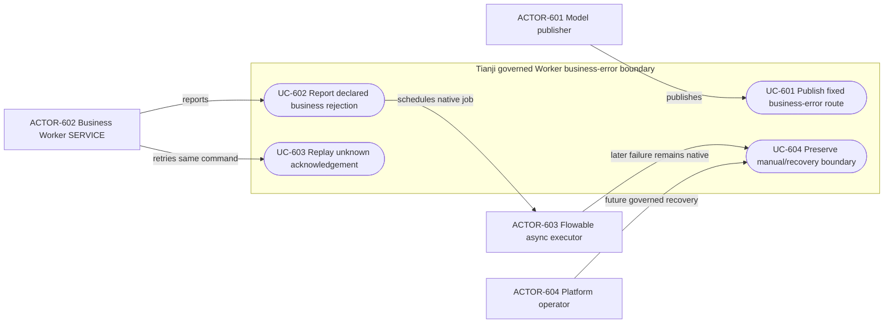
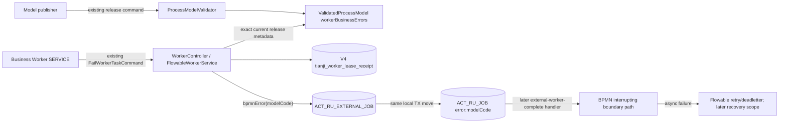
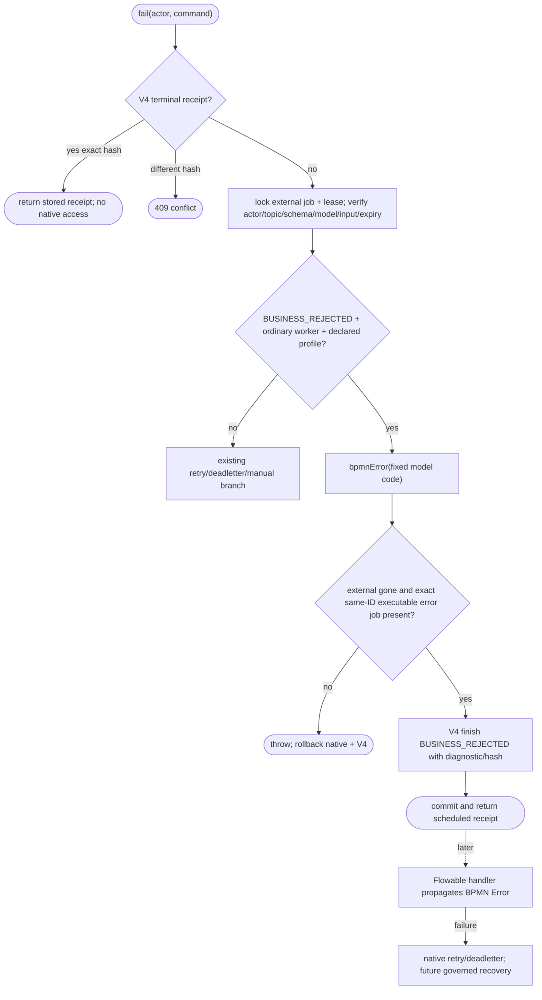

# Governed Worker business-error routing to BPMN Error

| Field | Value |
| --- | --- |
| Document | `2026-11-05-04-48-worker-business-error-routing.md` |
| Template Version | `9` |
| Archetype Cleanup | `Not applicable` |
| Status | `Review` |
| Type | `Feature` |
| Complexity | `Complex` |
| Complexity Drivers | `released BPMN graph validation, existing public Worker compatibility, one local transaction spanning Flowable native job conversion and V4 receipt, idempotent replay, asynchronous error propagation, and fail-closed native postconditions` |
| Created | `2026-11-05 04:48 Asia/Shanghai` |
| Updated | `2026-11-05 06:06 Asia/Shanghai` |
| Owner | `Root source-grounded review; original T3-10 authority continues; no source GO is implied` |
| Repository | `tianji-service` |
| Scope | `T3-10 bounded source slice: fixed released business-error routing for ordinary BPMN External Workers` |
| Change Surface | `Exactly three Process Server production files—ValidatedProcessModel, ProcessModelValidator, FlowableWorkerService—plus focused parser/converter/service/consumer tests, one BPMN fixture, and an optional compile-only PostgreSQL scenario; no contract value, route, DDL, permission, or configuration change` |
| Affected Chapters | `§7, §8, §9, §10, §13, §14, §15, §16, §17, §18` |
| Source Requirement | `Root-approved next bounded T3-10 source design: model-fixed business rejection -> native Flowable BPMN Error; temporary draft at /tmp/tianji-worker-business-error-spec.md` |
| Baseline Revision | `main@c731f3fda692d24115c6aaff36f19192500e537a; clean worktree at inspection` |
| Amends | `None` |
| Supersedes | `None` |
| Depends On | [Agent Framework Upgrade Plan](../../../../docs/plans/agent-framework-upgrade-plan.md) `§11.2, §12.2, §17.3 T3-10/S10/S11`, SHA-256 `3cbb9a6a8850c074f4048f4e7093793876f9c5ea2b3df0f2af9d0a0fdd26ca59`; T3-10 recovery/compensation requirements remain effective |
| Related Specs | [Process control and bounded cancellation](2026-11-04-23-22-process-control-cancellation.md) `§5.1, §6.1, §16` for the approved Process technical-vertical exception and unfinished T3-10 boundary |
| Related Plans | `None` |

## 1. Summary

The current Worker contract already distinguishes `RETRYABLE`, `BUSINESS_REJECTED`, and `UNKNOWN`, and V4 already permits a terminal `BUSINESS_REJECTED` receipt. The Process Server nevertheless sends every non-retryable failure through `ExternalWorkerJobFailureBuilder` with zero retries, producing `NEEDS_MANUAL` and a dead-letter job. It never invokes Flowable's BPMN Error path, so a model author cannot express one finite, released, business-rejection route for an ordinary External Worker.

This Spec adds the smallest coherent slice: a BPMN release may declare at most one fixed business error for each ordinary External Worker using one `definitions.error` and one interrupting attached `boundaryEvent`. The validator emits immutable worker-to-error metadata. When the same verified worker reports `BUSINESS_REJECTED`, `FlowableWorkerService` selects only the released model code—not the caller's diagnostic code—calls Flowable 8.0.0 `ExternalWorkerCompletionBuilder.bpmnError(modelCode)`, proves the external row was replaced by the exact same-ID executable job, and finishes the existing V4 receipt as `BUSINESS_REJECTED` in the same local transaction.

The committed receipt means only that the platform durably accepted and scheduled the fixed native business-error transition. Actual `ErrorPropagation`, boundary advancement, downstream task creation, process completion, compensation, dead-letter recovery, and business-side undo remain asynchronous or out of scope. This Draft changes no source, DDL, configuration, permission, listener, database, or runtime and must receive Root review before a Plan exists.

## 2. Background and Current State

### 2.1 Business and user context

A business Worker can deterministically reject a task—for example, a fixed eligibility or credit policy rejects the requested action. Treating this as a technical failure causes needless retry/dead-letter behavior and prevents the released BPMN from choosing a reviewed business branch. Conversely, trusting a caller-supplied `errorCode` as a routing selector lets a Worker choose arbitrary model paths. The platform therefore needs a fixed release-owned code while retaining the caller code only as bounded diagnostic and idempotency input.

### 2.2 Repository evidence

Paths are relative to `tianji-service`. `PS` means `stellar-enclosure-tianji-process-server`, `C` the contract module, `CL` the HTTP client, and `W` the Worker starter. Evidence is static unless labeled otherwise.

| Evidence ID | Classification | Exact path/symbol/decision/command | Observed fact | Design significance | Verification limit/freshness |
| --- | --- | --- | --- | --- | --- |
| `EVD-601` | Static repository | `PS/.../release/ProcessModelValidator.java:33-72,86-284` | BPMN uses a closed element/attribute whitelist, a bounded DAG, at most 16 workers, and only timer boundary events; `error` and `errorEventDefinition` are rejected | Extend the same parser and graph proof; do not add a generic BPMN surface | Source inspection does not prove Flowable deployment/runtime behavior |
| `EVD-602` | Static repository | `PS/.../release/ValidatedProcessModel.java:7-116` | Release output is immutable, defensive-copy metadata; no business-error metadata exists | Add one nested immutable metadata value and one copied map, preserving old constructors | Does not itself authorize native execution |
| `EVD-603` | Static repository | `PS/.../worker/FlowableWorkerService.java:227-318` | `fail` rechecks lease/job/release/model/schema/input, replays terminal V4 first, then uses `ExternalWorkerJobFailureBuilder`; only retryable with remaining retries becomes `RETRY_SCHEDULED`, all others become `NEEDS_MANUAL` | Preserve order/fences/replay; add one declared ordinary-worker branch only | No real transaction was run for this Draft |
| `EVD-604` | Static repository | `PS/.../worker/WorkerLeaseStore.java:123-143,220-234`; `PS/.../db/tianji-process/V4__add_worker_lease_receipts.sql` | V4 and `Finish` already support `BUSINESS_REJECTED`, exact result hash/failure kind/code replay, DB-clock `decided_at`, and live lease expiry | No enum, store, table, constraint, index, migration, or V10 is needed | Live V4 schema was not inspected |
| `EVD-605` | Static repository | `C/.../FailWorkerTaskCommand.java`; `WorkerFailureKindEnum.java`; `WorkerReceiptOutcomeEnum.java`; `WorkerReceiptDTO.java` | Command/result wire already carries fixed enums; diagnostic `errorCode` is `[A-Z][A-Z0-9_]{0,63}` and lease token is redacted | Preserve C types and JSON exactly; model code uses the same closed grammar | External consumers beyond repository search are unknown |
| `EVD-606` | Static repository | `CL/.../HttpProcessClient.java:221-231`; `W/.../RemoteWorkerPoller.java:222-258` | CL accepts `BUSINESS_REJECTED` or `NEEDS_MANUAL` for a business rejection; W regards both as valid receipts | Server can begin emitting the already-compatible outcome; no client/starter main change | Existing tests do not explicitly cover the business-rejected positive receipt |
| `EVD-606A` | Static repository | `PS/.../release/ProcessReleaseService#prepare`; `WorkerTopicRegistry#acceptsModel/#isInternalAgentDispatch` | Publication first requires every worker to match a registered schema, then requires every message-wait worker to be registered internal and every registered-internal worker to have an enabled matching message wait | Parser exclusion is only graph evidence; keep the bidirectional registry/publication gate and add a separate runtime `agentDispatch` defense | Source proof does not replace live registry/IAM acceptance |
| `EVD-607` | Static local pinned artifact | `javap` on Flowable 8.0.0 `ManagementService` and `ExternalWorkerCompletionBuilder` | Correct public API is `createExternalWorkerCompletionBuilder(jobId, workerId).bpmnError(String): void`; failure builder has no BPMN Error method | Use the completion builder; do not invent or reflect a nonexistent API | Local bytecode is source/static evidence, not engine acceptance |
| `EVD-608` | Static local pinned artifact | `ExternalWorkerJobBpmnErrorCmd`, `AbstractExternalWorkerJobCmd`, `DefaultJobManager` bytecode | Command checks the external job and lock owner, sets `error:<code>`, copies the same ID/affinity into an executable job, inserts it, and only then deletes the external row; `insertJobEntity=false` returns `null` without throwing | Preserve live-expiry fences and require an explicit same-TX postcondition because the public method is void and can quietly no-op | Internal bytecode is version-pinned to 8.0.0 only |
| `EVD-608A` | Static local pinned artifact | Flowable 8.0.0 `BoundaryEventXMLConverter`, `ErrorEventDefinitionParseHandler`, `DefaultActivityBehaviorFactory`, `BoundaryEventActivityBehavior` bytecode; converter JAR SHA `b3af6e161f2ed5153acf5cff3d2e29c2741dd1edc1baed21a72aa2408a8d6826`, engine JAR SHA `e81615c4c2f7332c184f31d362e34a807c6c745e6b9da745e73b2d3adb4f5850` | Converter deliberately normalizes an ErrorEventDefinition boundary's model getter to `cancelActivity=false`, while the engine parse handler hardcodes `interrupting=true` into the runtime behavior | Tests must assert the pinned converter normalization without weakening the source XML `cancelActivity="true"` validator gate; runtime remains interrupting | `javap` static evidence only; no engine run |
| `EVD-609` | Static local pinned artifact | `ExternalWorkerTaskCompleteJobHandler#execute` bytecode | `ErrorPropagation.propagateError` occurs later when the executable job runs | Receipt means durable scheduling, not boundary advancement or process completion | Async execution/retry/deadletter is runtime-unverified |
| `EVD-610` | Static repository | `ManagementService#createJobQuery/createExternalWorkerJobQuery`; Flowable `Job`/`BaseJobQuery` 8.0.0 | Both queries support trusted job-ID lookup and bounded paging; returned `Job` exposes tenant, instance, definition, execution, element, handler type/config | Query actual old/new ID presence first, then validate new affinity independently; no direct ACT write or `executeJob` | Same-TX visibility still needs focused transaction/PG proof |
| `EVD-611` | Static repository | `PS/.../ProcessServerPostgresTest.java:933-1071`; `WorkerLeaseStorePostgresTest.java`; Worker business-store tests | Existing opt-in tests cover lease replay, expiry, retry/manual outcomes, receipt rollback, and lost acknowledgements | Extend narrowly; do not claim DB/native runtime from compile-only/default-skipped evidence | No opt-in property or DB is supplied in this task |
| `EVD-612` | User decision | Root-approved requirements for this Draft | Fixed model code, exact three PS main files, no DDL/API/config/dependency, honest async receipt, and later compensation/recovery are decided | Closes the material scope/contract/transaction choices | Status remains Draft pending Root full review |
| `EVD-613` | Static predecessor | Cancellation Spec `§5.1/§6.1/§16` | Root-approved exception preserves the existing final-class/plain-JDBC/explicit-factory Process technical vertical | No `biz.*`, MP, DDL runner, new module, Lombok conversion, or generator use | Exception applies only to this established technical platform |

### 2.3 Problem statement and gap

`FailWorkerTaskCommand.kind=BUSINESS_REJECTED` currently reaches the same zero-retry failure builder as `UNKNOWN`. The native job becomes dead-letter and the V4 receipt becomes `NEEDS_MANUAL`. No released model can declare the one business route, the caller's diagnostic code is not separated from model routing authority, and the void Flowable API has no postcondition check. Merely changing the receipt outcome would lie: it would say business rejection was scheduled while no executable BPMN Error job exists.

### 2.4 Evidence and current-chain map

| Entry/trigger | Current call chain | Data read/written | External dependency | Consumers | Evidence |
| --- | --- | --- | --- | --- | --- |
| Release publication | `ProcessReleaseService -> ProcessModelValidator.validateBpmn -> ValidatedProcessModel -> Flowable deployment/binding` | validated XML and release definition | Flowable BPMN converter/deployer | Worker acquisition/execution | EVD-601/602 |
| Worker failure HTTP/Java | `WorkerController/WorkerClient -> FlowableWorkerService.fail -> WorkerLeaseStore + Flowable ManagementService` | native external job and V4 lease receipt | Flowable job service | Worker host via CL/W | EVD-603-606 |
| Proposed declared business rejection | same entry -> exact release metadata -> `bpmnError` -> same-TX native postcheck -> V4 finish | external row replaced by executable job; V4 terminal receipt | Flowable 8 async executor later | Worker host immediately; BPMN later | EVD-607-610 |
| Lost acknowledgement replay | W repeats the same `FailWorkerTaskCommand`; service reads terminal V4 before native access | no second native operation | none after terminal receipt | W acknowledgement loop | EVD-603/604/611 |

### 2.5 Archetype example cleanup

Cleanup disposition: Not applicable

Reason: `tianji-service` is an established technical multi-module Process/Agent platform under an explicit Root architecture exception, not first business work in a generated archetype project. The new BPMN file is a test fixture with direct test ownership, not an unused example domain.

## 3. Goals and Non-goals

### 3.1 Goals

- Permit a released BPMN to declare one fixed business error for an ordinary External Worker and one interrupting error path.
- Make the released model—not the Worker diagnostic—authoritative for the native BPMN Error code.
- Preserve all current actor, topic/schema, job, owner, lease-expiry, model, input-hash, and replay fences in their existing order.
- Commit the verified native external-to-executable conversion and V4 `BUSINESS_REJECTED` receipt atomically.
- Detect Flowable's possible quiet no-op using exact public read-only postconditions.
- Preserve retryable, unknown, undeclared business rejection, and internal Agent-dispatch behavior.
- Describe receipt and asynchronous propagation honestly and keep T3-10 compensation/recovery Required.

### 3.2 Non-goals

No new contract enum/field/route, OpenAPI artifact, permission, configuration key, dependency, migration, V10, table, listener, executor, Activity abstraction, message/event, direct ACT write, `executeJob`, generic BPMN Error API, caller-selected route, subprocess, compensation event, multiple error catches, DMN error, HumanTask/Case-source error, Agent-message error, UNKNOWN forcing, recovery/reconcile endpoint, original-business compensation receipt, or completed-compensation claim. Existing Worker business-store V1/V2 and business repositories remain unchanged and own their original-action/future compensation facts.

### 3.3 Change Surface and Design Depth

| Area/layer | Disposition | Exact repository evidence | Changed or preserved behavior/contract | Required Spec treatment | Chapter(s) |
| --- | --- | --- | --- | --- | --- |
| PS validated release metadata | Affected | EVD-601/602 | add immutable worker -> fixed error metadata; old constructors/models remain empty | full graph/model design | §7, §8, §10, §13, §14, §15, §16, §17, §18 |
| PS BPMN validator | Affected | EVD-601 | admit one closed error declaration/boundary shape and reject every wider construct | exact grammar, graph and test design | §7, §8, §10, §13, §14, §15, §16, §17, §18 |
| PS Worker failure orchestration | Affected | EVD-603/607-610 | declared ordinary business rejection uses model code, native postcheck and V4 atomic receipt | full internal contract/transaction/failure design | §7, §8, §9, §10, §13, §14, §15, §16, §17, §18 |
| Focused tests and BPMN fixture | Affected | EVD-611/612 | parser/converter, mocked transaction, consumer compatibility and optional PG source cases | exact cases and boundaries | §8, §14, §16, §18 |
| Release/registry internal-worker classification | Context-only | EVD-606A | preserve `prepare` bidirectional `acceptsModel/isInternalAgentDispatch` gate; parser metadata alone never grants ordinary-worker status | exact boundary evidence and regression | §7, §14, §16 |
| Existing Worker HTTP/Java wire | Context-only | EVD-605/606; `WorkerController#fail` | same route/body/status/receipt enums; previously specified `BUSINESS_REJECTED` outcome becomes reachable | concise compatibility record only | §9, §14, §16 |
| C/CL/W production code | Unchanged | EVD-605/606 | no enum/DTO/client/poller behavior change | static/source and finite consumer regression | §9, §14, §16 |
| V4 lease schema/verifier/store | Context-only | EVD-604 | existing `BUSINESS_REJECTED` state/fields/update/replay reused byte-for-byte | transaction/access evidence only | §10, §11, §14, §16 |
| Flowable ACT job tables/async handler | Context-only | EVD-607-610 | engine owns row conversion and later propagation; Tianji only public API/read queries | exact native boundary and runtime limit | §7, §9, §11, §14, §15, §16, §18 |
| Database schema/migrations | Unchanged | V1-V9/current hashes; EVD-604/612 | no SQL or relation change; no V10 | immutable-byte/static gate | §11, §14, §16 |
| Frontend | Not applicable | no page consumes Worker failure routing | no UI work | evidence-backed N/A | §12 |
| Compensation/deadletter/recovery | Unchanged | Agent Plan T3-10/S10/S11 | remains Required; not implemented by this slice | non-goal/risk/compatibility record | §16, §18 |

## 4. Requirements and Acceptance Criteria

| ID | Atomic requirement | Priority | Observable acceptance criteria | Source |
| --- | --- | --- | --- | --- |
| `REQ-601` | Admit at most one fixed business error per ordinary External Worker through `definitions.error{id,errorCode}` and one interrupting attached error boundary | Must | valid fixture yields exactly one immutable metadata entry; duplicates, missing/unknown refs, noninterrupting or multi-definition boundaries fail publication | Root |
| `REQ-602` | Preserve the existing closed BPMN grammar and graph bounds while proving the error boundary is dominated by its attached worker and has exactly one legal outgoing path | Must | implicit worker->boundary edge participates in the existing DAG/path caps; disconnected, cyclic, zero/multiple outgoing, or explicit-incoming boundaries fail | Root/EVD-601 |
| `REQ-603` | Restrict profiles to ordinary external workers; forbid internal Agent-dispatch workers, DMN tasks, HumanTasks, Case sources, subprocesses, compensation and arbitrary error constructs | Must | parser rejects message-wait workers and every prohibited attachment/element; existing `ProcessReleaseService#prepare` bidirectionally proves registry internal classification; runtime internal entry remains manual even with controlled inconsistent metadata | Root/EVD-606A |
| `REQ-604` | Route only `BUSINESS_REJECTED` with declared metadata using the released model code; caller `errorCode` remains diagnostic/hash/audit only | Must | `bpmnError` receives model code even when diagnostic differs; diagnostic remains in V4/hash and never selects a path | Root |
| `REQ-605` | Preserve actor/source/job/native-owner/live-expiry/lease/model/schema/input-hash fences and terminal V4 replay before native access | Must | stale/foreign/expired/drifted cases never call `bpmnError`; identical terminal replay performs no native query or mutation | Root/EVD-603 |
| `REQ-606` | Prove exact same-ID external-to-executable conversion after the void native call without filtering away drift counterexamples | Must | ID-only bounded query proves no external row; separate ID-only bounded query returns exactly one executable job, then tenant/instance/definition/execution/element, handler type `external-worker-complete` and config `error:<modelCode>` all match | Root/EVD-608-610 |
| `REQ-607` | Treat missing/wrong postcondition, including Flowable quiet no-op, as dependency failure after verified ownership | Must | a fixed-message cause-free `IllegalStateException` maps through the existing advice to 503 `TIANJI_DEPENDENCY_UNAVAILABLE`; no V4 terminal receipt commits and native state rolls back; old 404 fences remain unchanged | Root/EVD-608 |
| `REQ-608` | Commit native conversion and `leases.finish(BUSINESS_REJECTED)` in the same existing local transaction | Must | receipt failure restores the external job and leaves lease `LEASED`; success commits both | Root |
| `REQ-609` | Preserve idempotent failure semantics | Must | same task/occurrence/token/kind/diagnostic replays original receipt; changed diagnostic conflicts; no second native call | Root/EVD-604 |
| `REQ-610` | Preserve old behavior for RETRYABLE, UNKNOWN, undeclared BUSINESS_REJECTED and internal Agent dispatch | Must | retry counts/delay unchanged; all nondeclared/manual cases remain `NEEDS_MANUAL`; no business route is invoked | Root |
| `REQ-611` | Keep C/CL/W wire, Worker business-store V1/V2, V4, model digest inputs, old grammar/boundary timers/graph caps, configuration, permissions, and dependency graph unchanged | Must | exact source/JSON enum shapes, prior fixture metadata/hashes and old SQL bytes remain; only three PS main files change | Root/EVD-604-606 |
| `REQ-612` | Define receipt semantics as durable acceptance/scheduling only | Must | source/docs/tests never claim boundary advancement, downstream task creation, process finish or compensation completion at `fail` return | Root/EVD-609 |
| `REQ-613` | Keep model/diagnostic codes bounded and private payloads out of native config/logs | Must | both codes use closed regex; native config contains only model code; no raw body, token, exception detail or business payload is logged | Root |
| `REQ-614` | Provide finite static/unit/converter/mock-transaction proof and only an opt-in PG source extension | Must | no DB/app/engine/listener/browser starts during this Spec/Plan gate; PG/native async acceptance remains explicit Unverified | Root |
| `REQ-615` | Retain business compensation, failed/dead-letter recovery, original-action receipts, S10/S11 and T3-12 as Required later work | Must | no completion claim or substitute receipt/recovery API appears | Root/Agent Plan T3-10 |

### 4.1 Scenario matrix

| Scenario | Actor/trigger | Preconditions | Main path | Alternative/failure path | Data/state change | Observable result | Requirements |
| --- | --- | --- | --- | --- | --- | --- | --- |
| Valid model publication | model publisher | one ordinary worker, fixed error, interrupting boundary, legal DAG | validate grammar/graph -> immutable metadata -> existing deployment | any widened/dynamic/ambiguous construct rejects before deployment | release metadata only | publication accepted | 601-603 |
| Declared business rejection | Worker SERVICE reports fixed kind + diagnostic | exact live lease/job/release/model/input | native `bpmnError(modelCode)` -> exact postcheck -> V4 finish -> commit | native/postcheck/receipt failure rolls back | external row replaced; executable job + V4 receipt commit | `BUSINESS_REJECTED` receipt | 604-608 |
| Same failure replay | acknowledgement response lost | terminal V4 fields/hash identical | replay from lease receipt before native access | changed diagnostic/result hash conflicts | none | same receipt/time | 605/609 |
| Flowable quiet no-op | executable insert returns false | all fences valid | void call returns; postcheck detects external remains/new job absent | throw -> rollback | none committed | dependency failure; no receipt lie | 606-608 |
| Undeclared business rejection | model has no fixed profile | valid ordinary lease | existing failure builder retries=0 -> V4 manual | builder/receipt failure rolls back | deadletter + `NEEDS_MANUAL` | existing receipt | 610 |
| Retryable technical failure | `RETRYABLE` | valid lease, retries known | existing retry/deadletter branch unchanged | exhausted retries -> manual | existing native/V4 transition | retry/manual receipt | 610 |
| Unknown or Agent failure | `UNKNOWN` or internal Agent dispatch | valid lease | existing zero-retry/manual branch | failure rolls back | existing deadletter/V4 semantics | `NEEDS_MANUAL` | 603/610 |
| Async propagation later fails | committed executable error job | native async executor runs later | Flowable handler propagates fixed error | handler retry/deadletter remains Flowable-owned | V4 stays `BUSINESS_REJECTED`; native job may retry/deadletter | no false compensation/finish claim | 612/615 |

### 4.2 Use-case analysis

#### 4.2.1 Actor inventory

| Actor ID | Actor/role | Goal and responsibility | Entry/channel | Permission/tenant context | Evidence |
| --- | --- | --- | --- | --- | --- |
| `ACTOR-601` | Process model publisher | Publish one reviewed fixed business-rejection route | existing release publication | existing publisher identity/tenant/release binding | EVD-601/602 |
| `ACTOR-602` | Ordinary business Worker SERVICE | Report a deterministic business rejection and receive a stable receipt | existing Worker `/fail` / `WorkerClient.fail` | current SERVICE, topic/schema resource, tenant and lease | EVD-603-606 |
| `ACTOR-603` | Flowable async executor | Execute the already-scheduled same-ID error job and propagate the BPMN Error | native executable job | engine-owned internal context | EVD-608/609 |
| `ACTOR-604` | Platform operator | Observe/recover later failed/dead-letter jobs under future governed recovery | Flowable operations/runbook, not this API | future recovery authority | Agent Plan T3-10 |

#### 4.2.2 Use-case artifact



| UC | Trigger/preconditions | Main success outcome | Alternatives/failures | Postconditions | Requirements/contracts/tests |
| --- | --- | --- | --- | --- | --- |
| `UC-601` | fixed model submitted; ordinary worker only | validated bytes contain one immutable worker/error profile | invalid graph/profile rejected; old model accepted empty | no runtime state | REQ-601-603; TEST-601/602 |
| `UC-602` | exact live lease reports declared business rejection | native error job and V4 receipt commit atomically | expiry/drift/no-op/update failure leaves no partial state | durable scheduled rejection, not propagated guarantee | REQ-604-608/612/613; INTERNAL-601/602, JOB-601; TEST-603-608 |
| `UC-603` | response lost; same failure repeated | original receipt returned before native access | changed diagnostic conflicts | no second job transition | REQ-605/609; INTERNAL-601; TEST-609 |
| `UC-604` | undeclared/unknown/Agent/async propagation failure | existing manual/deadletter semantics remain visible | future operator recovery absent | no false rollback/compensation claim | REQ-610/612/615; TEST-610/611 |

## 5. Constraints, Assumptions, and Decisions

### 5.1 Confirmed constraints

- Flowable version is pinned to 8.0.0; public API and inspected bytecode are version-specific authority for this slice.
- `FailWorkerTaskCommand` remains unchanged. Its `errorCode` is diagnostic and participates in the existing result hash; it is never a routing selector.
- `WorkerLeaseStore`, V4 and `WorkerReceiptOutcomeEnum.BUSINESS_REJECTED` already own durable receipt/replay semantics and cannot be duplicated.
- Flowable owns ACT state and asynchronous propagation. Tianji may call public API and read public query results but may not write ACT tables or force `executeJob`.
- One existing `DataSourceTransactionManager` owns native conversion and V4 finish; no remote I/O occurs in the transaction.
- The existing Process technical vertical and explicit Root exception remain authoritative; no generic archetype/MP/DDL redesign is allowed.

### 5.2 Small-gap assumptions

None. Model grammar, runtime outcome, postcheck shape, compatibility and async semantics are explicit Root decisions or pinned repository/API evidence.

### 5.3 Resolved decisions

| ID | Decision | Decision owner | Evidence and rationale | Requirements |
| --- | --- | --- | --- | --- |
| `DEC-601` | Model-owned fixed code; caller code diagnostic only | Root | prevents Worker-controlled path selection | 604/613 |
| `DEC-602` | At most one interrupting error boundary per ordinary worker; no wider BPMN Error surface | Root | smallest closed model profile | 601-603 |
| `DEC-603` | Reuse `ExternalWorkerCompletionBuilder.bpmnError`; do not use failure builder or direct ACT write | Root | only correct Flowable 8 public API | 604/611 |
| `DEC-604` | Require exact public-query postcondition after void native call | Root | pinned implementation can quietly no-op | 606/607 |
| `DEC-605` | Receipt means accepted/scheduled; propagation is later async work | Root | handler performs `ErrorPropagation` later | 612/615 |
| `DEC-606` | No schema, config, permission, Event, recovery API or Activity layer | Root | existing contracts/storage suffice | 611/615 |

### 5.4 Open major decisions

None in this bounded Draft. Root may amend or reject it during full review; that review is the gate before planning.

## 6. Project Technology Context

| Concern | Current choice | Repository evidence | Constraint on design |
| --- | --- | --- | --- |
| Language/runtime | Java release 25 | parent build/current implementation evidence | use current JDK collections/records; no dependency |
| Framework | Spring Boot 4.1.2; Flowable 8.0.0 | root/PS POM; `flowable.version` | use exact public Management API and same Spring TX |
| Persistence | PostgreSQL; plain JDBC/Flowable; external pre-provisioned immutable V1-V9 | storage guards, V4, predecessor exception | no DDL/V10/direct ACT write |
| API/JSON | existing Worker REST/Java contracts and Boot Jackson | WorkerController/C/CL/W | no wire change or new docs artifact |
| Tests | JUnit5, Mockito, Flowable converter, opt-in PG | current test tree | finite source tests; PG compiles/default-skips |
| Generator | current technical vertical unsupported by native CRUD generator | backend-generation reference/current tree | no generator action or SQL journal |

### 6.1 Java architecture profile and capability baseline

| Architecture profile | Archetype/template or base package | Exact evidence and verifier | Existing deviations | Design action |
| --- | --- | --- | --- | --- |
| Existing Tianji Process technical vertical under explicit Root exception | `top.egon.cola.platform.tianji.process.server.{release,worker}` | cancellation Spec `§5.1/§6.1`; current POM/tree; explicit factories | neither `biz.*` nor an archetype business project; final classes/plain JDBC are approved | preserve exact packages and three production files; no new layer/module |

| Need | Spring/JDK candidate | Spring Boot Starter candidate | Egon-COLA/module candidate | Proven gap | Decision/dependency impact |
| --- | --- | --- | --- | --- | --- |
| fixed model metadata | JDK immutable map/record | None | `ValidatedProcessModel` | map absent only | extend current value, zero dependency |
| closed XML/graph validation | DOM/JDK regex | None | `ProcessModelValidator` whitelist/DAG | error profile absent | extend current parser, not generic BPMN |
| native business error | None | current Flowable starter | `ManagementService` completion builder | service branch absent | reuse pinned API |
| durable receipt/replay | current JDBC/TX | None | `WorkerLeaseStore`/V4 | no gap | reuse unchanged |
| postcondition | Flowable public Job queries | current starter | current ManagementService | void call/no-op ambiguity | read exact public queries; no SQL writer |

### 6.2 User-mandated Java rule compliance

| Literal rule | Affected? | Repository evidence | Exact design decision | Files/types/interfaces | Validation/test evidence | Status/blocker |
| --- | --- | --- | --- | --- | --- | --- |
| Rule 1 | Yes | current behavior/value names | nested immutable `WorkerBusinessError` and existing `*Validator/*Service/*Model` roles; no ambiguous carrier | three PS main files | naming/static review | PASS under technical-vertical exception |
| Rule 2 | Yes | C compact constructor, validator, service fences | reuse closed command validation; validate model at publication and revalidate released/job/lease facts at service | validator/service | positive/negative grammar and fence tests | PASS under established boundary |
| Rule 3 | Yes | current immutable nested records/maps | add one immutable nested value record and `Map.copyOf`; no duplicate DTO/mapper/converter | ValidatedProcessModel | immutability/old-constructor tests | PASS under Root exception |
| Rule 4 | Yes | final classes and explicit factories are approved predecessor style | preserve constructors/Bean wiring; add no logger; never log code/body/token/details | three main files | static privacy/wiring regression | PASS under explicit Root technical exception |
| Rule 5 | Yes | JDK/Spring/Flowable only | use JDK regex/collections and current Flowable API | all affected | import/POM gate | PASS |
| Rule 6 | No | external JSON types unchanged | no Jackson/enum/wire modification | C/Controller/CL unchanged | compatibility regression/static source | N/A — no JSON contract change |
| Rule 7 | No | no configuration key changes | application/profile files untouched | none | path/config diff gate | N/A — configuration absent from scope |
| Rule 9 | Yes | existing fail Command + receipt and Flowable job state | extend existing Command pattern and Flowable State authority; no one-off strategy hierarchy | FlowableWorkerService | branch/state/replay tests | PASS |
| Rule 10 | Yes | existing `Instant` lease/receipt times | preserve DB-clock expiry/decision semantics; no new time field | WorkerLeaseStore context only | expiry/replay/time tests | PASS |
| Rule 11 | Yes | predecessor exception/current packages | preserve exact technical vertical; no `biz.*`, COLA layer, MP or module | all targets | exact path/POM scope gate | PASS under Root architecture boundary |

### 6.3 Time semantics and conversion contract

Time contract: Required

| Time ID | Fields/symbols | Semantics | Java/runtime type | Storage policy | Wire policy | Business zone source | Display zone source | Boundary / DST rules | Precision / Clock | Compatibility | Verification |
| --- | --- | --- | --- | --- | --- | --- | --- | --- | --- | --- | --- |
| `TIME-601` | `NativeJob.expiresAt`, V4 `lease_expires_at`, `WorkerTaskDTO.leaseExpiresAt` | Occurred instant | `Instant` | UTC instant | UTC Z | Not applicable: technical lease | Not applicable: not a business display rule | DB-clock strict `>` expiry fence; no calendar/DST | existing PostgreSQL/Flowable precision; no new clock | unchanged Worker DTO emits UTC Z; live-expiry order unchanged because native API checks owner only | TEST-605/610 |
| `TIME-602` | V4 `decided_at`, `WorkerReceiptDTO.decidedAt` | Occurred instant | `Instant` | UTC instant | UTC Z | Not applicable: receipt occurrence | consumer display only; wire remains UTC | no cross-clock comparison | existing `clock_timestamp()` and `timestamptz`; replay preserves stored value | new outcome already supported by same field | TEST-603/609 |

## 7. Architecture Design

### 7.0 Minimum-design baseline and element-necessity audit

| Proposed element | Change | Requirements | Existing/direct alternative | Concrete inadequacy of alternative | Added calls/state/coupling/failures/migration/operations | Verdict |
| --- | --- | --- | --- | --- | --- | --- |
| `ValidatedProcessModel.WorkerBusinessError` + map | Add nested value | 601-604 | infer from XML during every fail | reparsing bypasses published metadata/hash authority | one immutable map, no call/state | Add |
| closed validator grammar | Expand | 601-603 | allow arbitrary Flowable BPMN Error | exposes dynamic/multiple paths and unsupported constructs | bounded parser branches/tests | Add |
| service declared-business branch | Expand | 604-610 | keep zero-retry deadletter | cannot realize reviewed BPMN business branch | one native call + two read checks | Add |
| exact postcheck | Add | 606/607 | trust void `bpmnError` return | pinned insert may quietly return false | bounded same-TX queries; fails closed | Add |
| new API/enum/DTO/table/config | Remove | 611 | reuse current contracts/V4 | no capability gap | would create compatibility/migration/ops cost | Remove |
| custom dispatcher/Strategy class | Remove | 604/610 | direct branch inside existing Command handler | only one fixed variation and current state owner exists | needless type/registration | Remove |
| force `executeJob` | Remove | 612 | let Flowable async executor run | would conflate scheduling with propagation and lengthen TX | new lock/failure semantics | Remove |
| compensation/recovery now | Keep outside | 615 | widen to full T3-10 | needs business receipt/permission/audit decisions | major additional state/APIs | Remove from slice |

| Path | Network calls | Client states | Server contracts/state | Failure and TOCTOU points | Additional user/business value |
| --- | --- | --- | --- | --- | --- |
| Current undeclared/manual baseline | existing fail POST | existing pending/receipt | V4 + deadletter | no business route | explicit manual outcome only |
| Selected fixed-error design | same one fail POST | unchanged | one immutable model entry; same V4; native executable job | postcheck + async later failure | reviewed business rejection follows a fixed BPMN path without caller route choice |

### 7.1 System Architecture Design



### 7.1.2 Boundary and responsibility table

| Module/component | Capability and data owned | Inputs/outputs | Allowed dependencies | Forbidden responsibility | Requirements |
| --- | --- | --- | --- | --- | --- |
| `ProcessModelValidator` | closed XML/graph acceptance | bytes/key -> validated metadata | JDK DOM/current model | generic BPMN, runtime job mutation | 601-603 |
| `ValidatedProcessModel` | immutable release facts | worker ID -> fixed error metadata | JDK values | authorization or runtime state | 601-604 |
| `FlowableWorkerService` | Worker Command orchestration/TX | actor+command -> receipt | current registry/release/model/lease/Flowable | caller route choice, remote I/O, recovery | 604-610/612 |
| `WorkerLeaseStore` | V4 receipt/replay/expiry | exact Finish -> Lease | existing JDBC/TM | model routing | 605/608/609 |
| Flowable job service | external/executable job state and later propagation | fixed code/job owner -> native state | engine internals | Tianji receipt meaning/compensation claim | 606-608/612 |

### 7.2 High-Level Design

The existing Worker failure Command remains the only entry. Publication turns the bounded BPMN grammar into immutable metadata. Runtime reuses the exact model already bound by `model_sha256`; it does not parse XML or accept a new parameter. A declared ordinary business rejection uses the model code, a same-transaction native postcheck, and the existing V4 terminal state. All other failure branches remain byte/semantic compatible.

#### 7.2.1 Critical business/control flowchart



#### 7.2.2 High-level decision and quality matrix

| Concern/use case | Required behavior | Selected mechanism | Failure/degradation behavior | Trade-off | Verification | Requirements |
| --- | --- | --- | --- | --- | --- | --- |
| route authority | model fixed, caller diagnostic | immutable release metadata | missing metadata -> manual | less flexibility, safer | parser/service tests | 601-604 |
| atomic acceptance | native schedule + receipt together | existing local TM | any failure rollback | transaction includes bounded queries | mock TX/opt-in PG | 606-608 |
| unknown outcome | stable replay | existing V4 result hash/terminal read first | changed diagnostic conflicts | no new receipt schema | replay tests | 605/609 |
| async honesty | no premature business claim | receipt wording + Flowable job ownership | later failure remains native | caller lacks immediate branch completion proof | state/PG evidence | 612/615 |
| privacy | no arbitrary text/native details | fixed/diagnostic regex; no variables/logs | safe fixed errors only | reduced diagnostics | static/test capture | 613 |

### 7.3 Detailed Design

#### 7.3.1 Model grammar and graph proof

1. `definitions` additionally permits up to 16 BPMN `error` elements. Each has exactly `id` plus `errorCode`; `id` uses existing `IDENTIFIER`, code uses `[A-Z][A-Z0-9_]{0,63}`. Every declaration is referenced exactly once; duplicate IDs remain rejected by the existing global ID set. Equal codes on different workers are allowed because scope/attachment—not global code uniqueness—determines the catch.
2. `boundaryEvent` continues to require literal source XML `cancelActivity="true"`, zero explicit incoming sequence flows and exactly one outgoing sequence flow. Its single child is either the existing `timerEventDefinition` or one `errorEventDefinition`; mixed/multiple definitions fail. Error definition requires one `errorRef` resolving to a declared error and permits only the current optional BPMN `id`; Flowable error-variable extensions remain rejected. Pinned Flowable 8 converter output is intentionally different: after reading one ErrorEventDefinition it forces `BoundaryEvent.isCancelActivity()` to `false`, but `ErrorEventDefinitionParseHandler` independently hardcodes an interrupting runtime behavior. The converter test therefore asserts `false` as normalization plus the bytecode authority; this must never be used to accept source XML `cancelActivity="false"`.
3. An error boundary attaches only to an element present in `workerTasks()`. One worker has at most one such boundary and one declaration. Attachment to user task, DMN service task, Case source, missing node, or a worker later identified by `messageWaits().workerElementId()` fails. This is only the model-graph half of ordinary-worker proof; it does not infer operator registry kind.
4. After ordinary sequence-flow shape validation, add one implicit graph edge from the attached worker to its error boundary, as the existing human timer does. The boundary then has exactly one incoming authority—the worker—and one explicit outgoing error path. The existing topological traversal proves worker reachability/dominance, rejects cycles/disconnected nodes, counts normal+error paths under 128/256 caps, and requires every finite path to exit through existing legal nodes/end events. No new graph algorithm or copied dominance assumption is introduced.
5. `subProcess`, `compensateEventDefinition`, `association`, additional catch types and arbitrary Flowable attributes remain absent from the whitelist and therefore fail closed.
6. Output `Map<String, WorkerBusinessError>` is keyed by worker element ID and defensively copied. The nested immutable value contains `errorId`, `errorCode`, `boundaryEventId`, and the one `targetElementId`; old constructors delegate `Map.of()` so all old BPMN/DMN/CMMN fixtures keep empty metadata. Release/model hashes continue to derive from the exact validated XML bytes; the metadata is a projection, not a second digest input, while the existing lease `model_sha256` binds runtime use to those bytes.

`ProcessReleaseService#prepare` and `WorkerTopicRegistry` remain unchanged and authoritative for the other half: all workers must satisfy `acceptsModel`; each message wait must resolve `isInternalAgentDispatch=true`; and the reverse loop rejects any registered-internal worker without `agentMessageWaitsEnabled` plus a matching `messageWait.workerElementId`. Existing `ProcessReleaseServiceTest` must remain GREEN. Runtime still treats metadata as insufficient: `fail(..., boolean agentDispatch)` calls `requireMode(registration, agentDispatch)`, `verifyJob` preserves `linkedWait == registration.internalAgentDispatch()` plus `registry.acceptsModel`, and the new branch explicitly requires an ordinary (`!agentDispatch` and non-internal registration) call.

##### Runtime order and native proof

| Fact/decision | Authoritative source | Runtime use | Caller control | Failure rule |
| --- | --- | --- | --- | --- |
| model route code | immutable validated release XML/metadata | argument to `bpmnError` | none | absent/mismatch uses manual or fails closed |
| diagnostic code | FailWorkerTaskCommand | result hash and V4 failure_code | bounded Worker diagnostic | never selects native route |
| tenant/actor/topic/schema | current security + registry | lease/job/release lookup | not body-derived tenant | exact mismatch rejects |
| job/owner/expiry/affinity | locked native external row + V4 lease | native call and postcheck | opaque task/token only | stale/expired/foreign rejects |
| terminal outcome/time | WorkerLeaseStore/V4 DB clock | stable replay/receipt | none | finish failure rolls native state back |

| Step | Caller -> callee | Contract/symbol | Input/output mapping | State/data effect | Failure behavior | Requirements |
| --- | --- | --- | --- | --- | --- | --- |
| 1 | service -> V4 | `leases.find` | actor/task/token -> current lease | read | missing/foreign safe error | 605 |
| 2 | service -> registry | `registry.require`, `requireMode` | lease topic/schema + actor -> registration | read | wrong actor/mode stops | 605/610 |
| 3 | service -> replay | occurrence + state/hash | identical terminal -> receipt | no native access | changed diagnostic conflicts | 605/609 |
| 4 | service -> native/V4 | `lockNative`, `leases.lock` | exact tenant/job/owner/expiry | row locks | lost/expired stops | 605 |
| 5 | service -> release/model/registry | `verifyLease/verifyJob`, `registry.acceptsModel`, linked-wait/internal equality | definition/model/input/entry mode -> `WorkerBusinessError?` | read only | any drift or internal entry stops business route | 603-605 |
| 6 | service -> Flowable | `createExternalWorkerCompletionBuilder(id,owner).bpmnError(modelCode)` | fixed model code only | move native row in current TX | throw or quiet no-op not success | 604/607 |
| 7 | service -> Flowable queries | exact external/job queries | expected full affinity -> proof | read only | missing/extra/wrong row stops | 606/607 |
| 8 | service -> V4 | `leases.finish(BUSINESS_REJECTED, resultHash, diagnostic)` | existing Finish | terminal receipt | failure rolls all back | 608/609 |
| 9 | Flowable executor -> handler | `external-worker-complete`, `error:<code>` | executable job -> ErrorPropagation | later native change | retry/deadletter engine-owned | 612/615 |

The postcheck uses only public 8.0.0 queries and the already trusted, locked job ID. `createExternalWorkerJobQuery().jobId(id).listPage(0,2)` must return an empty list. It deliberately has no tenant/instance/definition/execution/element filter: an old same-ID row with drifted affinity is still presence and must fail rather than be filtered into a false absence. `createJobQuery().jobId(id).listPage(0,2)` must return exactly one executable job. The service then independently compares its ID, tenant, process instance, process definition, execution, element, handler type `external-worker-complete`, and handler configuration exactly `error:` plus the released code against the pre-call trusted facts. The configured DataSource/schema and globally unique Flowable ID already scope both reads. A failed proof throws one new private fixed-message, cause-free `IllegalStateException`; existing `ProcessApiErrors` already maps `IllegalStateException` to 503 `TIANJI_DEPENDENCY_UNAVAILABLE`. It must not reuse `FlowableWorkerService#unavailable()`, which intentionally returns the old masked `ProcessResourceNotFoundException`/404 for preexisting ownership/source paths. No new exception class/error code/wire shape is added. No query returns a row to an external caller, contains exception text/variables, uses `FOR UPDATE`, or calls `executeJob`.

#### 7.3.2 Critical-path Mermaid swimlane

```mermaid
sequenceDiagram
    participant W as Worker SERVICE
    participant S as FlowableWorkerService
    participant L as WorkerLeaseStore V4
    participant F as Flowable ManagementService
    participant DB as ProcessDB / ACT tables
    participant X as Flowable async executor
    W->>S: existing FailWorkerTaskCommand(BUSINESS_REJECTED, diagnostic)
    S->>L: find exact lease / terminal replay
    alt stored exact receipt
        L-->>S: BUSINESS_REJECTED receipt
        S-->>W: same receipt
    else live lease
        S->>DB: lock external job then V4 lease; verify expiry/affinity
        S->>S: verify release/model/input; select fixed model code
        S->>F: bpmnError(modelCode)
        F->>DB: insert same-ID executable error job; remove external row
        S->>F: exact public-query postcheck
        alt postcheck and V4 finish valid
            S->>L: finish BUSINESS_REJECTED with diagnostic/result hash
            DB-->>S: commit both
            S-->>W: accepted/scheduled receipt
        else no-op/drift/receipt failure
            DB-->>S: rollback native and V4
            S-->>W: existing safe failure
        end
    end
    X->>DB: later claim executable job
    X->>X: ErrorPropagation to reviewed boundary
```

#### 7.3.3 Transactions, consistency, concurrency, and idempotency

| Concern/state change | Owner and boundary | Mechanism/isolation/lock | Concurrent or duplicate behavior | Commit/visibility point | Failure result | Requirements/tests |
| --- | --- | --- | --- | --- | --- | --- |
| lease authority | V4/WorkerLeaseStore | existing token/actor/job lock and DB-clock expiry | old token lost; terminal exact replay | existing row TX | lost/conflict | 605/609; TEST-604/609 |
| external->executable job | Flowable command in same Spring TM | existing external row lock; same ID | one owner/job; postcheck rejects ambiguity | outer local TX commit | rollback/unavailable | 606-608; TEST-605-608 |
| failure identity | existing result hash | task+occurrence+kind+diagnostic | same replays; changed diagnostic conflicts | V4 terminal update | conflict | 609; TEST-609 |
| asynchronous propagation | Flowable executable job | native async executor after commit | engine retries/deadletters | later engine TX | not reflected as receipt rollback | 612/615; TEST-611 |

#### 7.3.4 Failure semantics, recovery, and reconciliation

| Failure point | Detection | Immediate control flow | Data/transaction state | Retry and idempotency | Caller result | Recovery owner | Verification |
| --- | --- | --- | --- | --- | --- | --- | --- |
| invalid/unsupported model | validator | reject publication | no release | correct model/new release | existing validation error | publisher | TEST-601/602 |
| expired/foreign/drifted lease/job | existing fences | stop before native call | unchanged | reacquire/current contract | existing lost/conflict/not-found | Worker caller | TEST-604/610 |
| void native quiet no-op | exact postcheck | fixed cause-free IllegalStateException | outer rollback | same command only after state correction | existing 503 `TIANJI_DEPENDENCY_UNAVAILABLE` | platform/engine | TEST-606 |
| wrong executable affinity/config | postcheck mismatch | fixed cause-free IllegalStateException | rollback | no blind native replay | existing 503 `TIANJI_DEPENDENCY_UNAVAILABLE` | platform/engine | TEST-607 |
| V4 finish failure | update/constraint/injected error | throw | native conversion rolls back | same command after dependency recovery | safe unavailable | platform/DB | TEST-608/PG-601 |
| acknowledgement response loss | same command | V4 replay | committed state preserved | bounded existing W ack retry | stored receipt | Worker client | TEST-609 |
| async ErrorPropagation failure | Flowable job retry/deadletter | no receipt rewrite | V4 stays accepted; native job governed by engine | future failed-job recovery | no synchronous completion claim | Flowable/operator | TEST-611/PG-601 |

#### 7.3.5 Observability and operational boundaries

| Signal/runbook | Emitting owner and point | Fields/dimensions | Sensitive-data rule | Success/failure threshold | Alert/dashboard/operator action | Verification boundary |
| --- | --- | --- | --- | --- | --- | --- | --- |
| V4 receipt | WorkerLeaseStore commit | tenant/job/outcome/failure kind/diagnostic code/time | token hash protected; no payload | one terminal result per lease command | existing support query | static/mock; live PG unverified |
| native executable job | Flowable | ID/tenant/definition/execution/element/handler/config | config has fixed model code only | exactly one postcheck row | existing native failed/deadletter operations | bytecode/unit; runtime unverified |
| service logs | none added | N/A | never log diagnostic/model code/body/token/exception details | N/A | rely on durable state/current existing safe errors | static import/source review |
| future recovery | outside this slice | failed/deadletter identity + future reason/audit | no raw stacktrace public | not designed here | T3-10 operator flow | Required/Unverified |

#### 7.3.6 Conclusion evidence chain

| Conclusion | Repository/user evidence | Constraint or requirement | Design decision | Consequence and trade-off | Verification and acceptance evidence |
| --- | --- | --- | --- | --- | --- |
| routing authority stays in release | EVD-601-606/612 | 601-604/611 | fixed immutable worker error metadata; diagnostic never routes | model change required for route changes; caller less flexible | parser/converter/service tests |
| receipt and native scheduling are atomic but propagation is later | EVD-604/607-610 | 606-609/612 | same local TX + exact postcheck + honest receipt | bounded extra reads; later failure not reconciled here | mock TX + optional PG, explicit runtime gap |
| no new API/schema/framework | EVD-604-606/613 | 611/615 | reuse current Command/V4/Flowable State patterns | cannot solve compensation/recovery in this slice | path/hash/compatibility gates |

## 8. Package Structure and Code File Tree

### 8.1 Current relevant tree

```text
stellar-enclosure-tianji-process-server
├── src/main/java/top/egon/cola/platform/tianji/process/server
│   ├── release/{ValidatedProcessModel,ProcessModelValidator}.java
│   └── worker/{FlowableWorkerService,WorkerLeaseStore}.java
├── src/main/resources/db/tianji-process/V4__add_worker_lease_receipts.sql
└── src/test
    ├── java/.../{release/ProcessModelValidatorTest,worker/FlowableWorkerServiceTest}.java
    ├── java/.../ProcessServerPostgresTest.java
    └── resources/fixtures/worker-mapping.bpmn20.xml
```

### 8.2 Target tree

```text
stellar-enclosure-tianji-process-server
├── src/main/java/top/egon/cola/platform/tianji/process/server
│   ├── release/ValidatedProcessModel.java          MODIFY
│   ├── release/ProcessModelValidator.java          MODIFY
│   └── worker/FlowableWorkerService.java           MODIFY
├── src/test/java/top/egon/cola/platform/tianji/process/server
│   ├── release/ProcessModelValidatorTest.java      MODIFY
│   ├── worker/FlowableWorkerServiceTest.java       MODIFY
│   ├── api/WorkerControllerTest.java               MODIFY (finite unchanged-wire regression)
│   └── ProcessServerPostgresTest.java              MODIFY (optional source; default skip/compile only here)
└── src/test/resources/fixtures
    └── worker-business-error.bpmn20.xml            CREATE

stellar-enclosure-tianji-worker-starter
└── src/test/java/.../RemoteWorkerPollerTest.java    MODIFY (finite receipt-consumer regression)
```

No C/CL/W production file, POM, configuration, SQL, manifest, migration, permission or generated file changes.

### 8.3 Package and file responsibilities

| Operation | Path/package | Symbols | Responsibility | Dependencies | Requirements |
| --- | --- | --- | --- | --- | --- |
| Modify | `PS/.../release/ValidatedProcessModel.java` | `WorkerBusinessError`, `workerBusinessErrors()` | immutable release metadata and old-constructor compatibility | JDK only | 601-604/611 |
| Modify | `PS/.../release/ProcessModelValidator.java` | BPMN whitelist/graph/error collection | closed model authority | existing DOM helpers | 601-603 |
| Modify | `PS/.../worker/FlowableWorkerService.java` | `fail`, `verifyJob`, native postcheck | route declared rejection atomically | existing Flowable/V4/release | 604-610/612/613 |
| Modify | focused tests above | named TEST cases | parser/native/TX/consumer proof | existing test stack | 614 |
| Create | `PS/src/test/resources/fixtures/worker-business-error.bpmn20.xml` | one fixed error route | canonical positive fixture | none | 601-603 |

## 9. Interface Definitions

The external `POST /api/tianji/v1/worker-tasks/fail`, `WorkerClient#fail`, `FailWorkerTaskCommand`, `WorkerReceiptDTO`, auth resource, statuses and JSON are Context-only and unchanged. `BUSINESS_REJECTED` is already a declared request kind and permitted response outcome in C, validated by CL and W. Therefore no new external operation, OpenAPI/springdoc contract or `API-GATE-*` surface is created. The affected contracts are internal/native only.

### 9.1 Interface Inventory

| ID | Change/necessity verdict | Name/purpose | Kind | Consumer | Owner | Symbol | Input | Output | Error/idempotency | Requirements |
| --- | --- | --- | --- | --- | --- | --- | --- | --- | --- | --- |
| `INTERNAL-601` | Existing/Keep+expand declared branch | Worker failure Command | internal Service | WorkerController/internal Agent seam | PS Worker service | `FlowableWorkerService#fail(ProcessActor,FailWorkerTaskCommand)` | current actor/command | existing WorkerReceiptDTO | V4 hash/replay/conflict | 604-610 |
| `INTERNAL-602` | Existing/Keep | Native business-error scheduling | Flowable public Java API | INTERNAL-601 | Flowable | `createExternalWorkerCompletionBuilder(id,owner).bpmnError(code)` | verified job + model code | void; state proven separately | throws or quiet no-op | 604/606-608 |
| `JOB-601` | Existing/Keep | Later BPMN Error propagation | native async job | Flowable executor | Flowable | handler `external-worker-complete`, config `error:<code>` | same-ID executable job | later native boundary/error path | engine retry/deadletter | 612/615 |

### 9.2 Per-interface Detailed Contracts

#### 9.2.1 INTERNAL-601 — Worker failure Command

##### Necessity and interaction-cost decision

| Concern | Decision |
| --- | --- |
| Change classification | Existing internal Command; expand one already-declared outcome path |
| Independent consumer goal | Ordinary Worker reports one deterministic business rejection and receives its stable receipt |
| Parameter ownership and derivation | Worker owns diagnostic kind/code; server derives tenant/actor/lease and released model route |
| Direct/no-new-interface alternative | Keep `fail`; a new business-error API would duplicate auth/lease/idempotency and widen trust |
| Caller use of result | W acknowledges the terminal receipt; it does not forward model routing data |
| Round trips and failure points | Same one POST/Java call; only bounded same-TX native proof is added |
| Verdict | Keep/expand for REQ-604-610; add no interface |

##### Identity and purpose

Exact symbol and current consumers remain unchanged. It is the existing worker failure Command and owns the durable result/replay boundary.

##### Request parameters

Actor is a verified SERVICE from `TianjiProcessAccess`; tenant is never in the command. The command carries task ID, occurrence ID, redacted lease token, kind and diagnostic code. Existing compact-constructor rules remain authoritative.

##### Success response

Returns the existing receipt. `BUSINESS_REJECTED` means model-fixed native error work is durably scheduled with the receipt; `NEEDS_MANUAL` remains valid for undeclared/Agent business rejection and UNKNOWN. `decidedAt` is the existing DB occurrence instant.

##### Error responses

Existing invalid/unauthenticated/denied/not-found/lease-lost/conflict/dependency mappings remain. Client/W repeat only the identical command under current lease/ack bounds; terminal replay never invokes native state again.

##### Interface logic for frontend and consumers

Run current identity, registry, occurrence, replay, external lock, lease lock, lease/release/model/schema/input fences. Only then select the fixed profile. Declared ordinary rejection calls INTERNAL-602 and exact postcheck before V4 finish; all other branches execute current logic.

##### Compatibility and verification

No signature/wire/error/permission version changes. TEST-603-610 prove positive, replay, drift, no-op and unchanged branches; WorkerController/W tests prove existing consumers accept the outcome.

#### 9.2.2 INTERNAL-602 — Flowable native business-error scheduling

##### Necessity and interaction-cost decision

| Concern | Decision |
| --- | --- |
| Change classification | Existing Flowable public operation; newly used by PS |
| Independent consumer goal | INTERNAL-601 must schedule the reviewed BPMN business-error route |
| Parameter ownership and derivation | Job/owner come from locked native facts; code comes only from immutable released metadata |
| Direct/no-new-interface alternative | Failure builder cannot propagate BPMN Error; direct ACT writes are prohibited |
| Caller use of result | Void return is not forwarded; service independently proves state before receipt |
| Round trips and failure points | One local native command plus two bounded public queries; no network call |
| Verdict | Keep/use for REQ-604/606-608 |

##### Identity and purpose

This is the existing Flowable public native scheduling operation owned by the Process engine and called only from INTERNAL-601.

##### Request parameters

Inputs are exact locked job ID/native owner and released model code. No caller diagnostic, variables, exception text or business payload is passed.

##### Success response

The API returns void, so it is not proof. Success requires INTERNAL-601's exact external-absent/executable-present postcondition.

##### Error responses

Thrown exceptions or failed postconditions roll back. Service does not call the method twice within one command and does not auto-retry after unknown state; V4 replay governs committed outcomes.

##### Interface logic for frontend and consumers

Call under the existing local transaction after all fences; query exact old/new native views; only then finish V4.

##### Compatibility and verification

Pinned to Flowable 8.0.0. Bytecode/API static proof plus mocked query/postcheck tests and optional PG rollback scenario are required; no internal class is imported in production.

#### 9.2.3 JOB-601 — Later external-worker-complete error job

##### Necessity and interaction-cost decision

| Concern | Decision |
| --- | --- |
| Change classification | Existing Flowable job contract; no new Tianji scheduler/job |
| Independent consumer goal | Flowable executor later propagates the already-scheduled fixed business error |
| Parameter ownership and derivation | All affinity/config is produced by Flowable from INTERNAL-602 |
| Direct/no-new-interface alternative | Synchronous `executeJob` would lengthen locks and misstate receipt semantics |
| Caller use of result | No direct caller result; native process state observes propagation later |
| Round trips and failure points | No new network/client state; existing async retry/deadletter remains |
| Verdict | Keep as engine-owned JOB-601 for REQ-612/615 |

##### Identity and purpose

This is the existing Flowable executable job contract owned and consumed by the async executor; Tianji does not expose or execute it directly.

##### Request parameters

The job retains the same ID, tenant, process instance, definition, execution and element; handler type is `external-worker-complete`, handler configuration is `error:<releasedCode>`. Later output is native BPMN Error propagation, not a Tianji response.

##### Success response

Successful later execution propagates the fixed BPMN Error to the reviewed interrupting boundary and lets Flowable continue the model; there is no synchronous Tianji response.

##### Error responses

Flowable owns async retry/deadletter. V4 is not rewritten on later failure. Governed failed-job query/recovery remains future T3-10 work; no public exception details are added.

##### Interface logic for frontend and consumers

After the outer transaction commits, the existing async executor claims the job, reads `error:<code>`, invokes `ErrorPropagation`, and either advances the boundary path or retains native retry/deadletter state. No caller polls through a new contract.

##### Compatibility and verification

Converter tests prove the boundary catches the declared error. Native runtime propagation is Unverified unless the optional PG scenario is explicitly enabled and run later.

## 10. POJO and Data Model Design

### 10.1 Role/class necessity

| Object/path | Selected role | Owner/boundary and consumers | Why distinct/reuse safe | Mapping owner | Requirements |
| --- | --- | --- | --- | --- | --- |
| `ValidatedProcessModel.WorkerBusinessError` | immutable internal value record | validator -> Worker service | one closed release fact; avoids XML reparsing and public DTO | direct validator construction; no cross-layer converter | 601-604 |
| `Map<String,WorkerBusinessError>` | immutable metadata projection | keyed by worker element ID | current model already owns parallel worker/wait/case maps | `Map.copyOf` | 601-604 |
| `FailWorkerTaskCommand` | existing immutable Command | C -> PS | exact wire/diagnostic semantics already fit | unchanged Jackson | 604/609/611 |
| `WorkerReceiptDTO` | existing immutable DTO | PS -> CL/W | `BUSINESS_REJECTED` already present | unchanged | 608/611/612 |

### 10.2 Field design

| Model.field | Type | Required/null/default | Validation and semantics | Source/mapping | Requirements |
| --- | --- | --- | --- | --- | --- |
| `workerBusinessErrors` key | `String` | unique worker ID; empty map default | existing identifier; ordinary worker only | `serviceTask@id` | 601-603 |
| `errorId` | `String` | non-null | existing identifier; referenced once | `definitions.error@id` | 601 |
| `errorCode` | `String` | non-null | `[A-Z][A-Z0-9_]{0,63}`; native route authority | `definitions.error@errorCode` | 601/604/613 |
| `boundaryEventId` | `String` | non-null | existing identifier; interrupting boundary | `boundaryEvent@id` | 601/602 |
| `targetElementId` | `String` | non-null | sole outgoing flow target, graph-validated | `sequenceFlow@targetRef` | 602 |

Representation is a nested record because it is an immutable validator-produced value with no identity/update lifecycle; the containing class defensively copies the map. Old constructor overloads supply an empty map. No persistence/JSON annotations or MapStruct converter apply.

### 10.3 State transitions

| Input/authority | Native pre-state | Native committed state | V4 committed state | Immediate meaning | Later state owner |
| --- | --- | --- | --- | --- | --- |
| declared ordinary `BUSINESS_REJECTED` | live locked external job + LEASED | same-ID executable `error:modelCode`; external absent | BUSINESS_REJECTED | accepted/scheduled | Flowable async handler |
| undeclared/Agent `BUSINESS_REJECTED` | live external + LEASED | existing zero-retry/deadletter | NEEDS_MANUAL | manual recovery required | future T3-10 |
| RETRYABLE | existing | existing retry/deadletter | RETRY_SCHEDULED/NEEDS_MANUAL | unchanged | Flowable/operator |
| UNKNOWN | existing | existing deadletter | NEEDS_MANUAL | unknown side effect; no route | operator |
| terminal exact replay | already terminal | unchanged | unchanged | same receipt | none |

## 11. Database Design

Relational model change: No — V4 already contains `BUSINESS_REJECTED`, the Flowable schema already owns both job tables, and no table/key/relationship/index/DDL changes. The affected concern is transaction/locking and exact native access only; no ER diagram is added.

Scope disposition: Context-only for existing persistence structures; the affected orchestration in §7 reuses their transaction behavior without changing schema, relationships or authoritative ownership.

**Existing transaction participants**

| Table/state | Owner | Affected access | Relevant fields | Index/access evidence | Schema decision |
| --- | --- | --- | --- | --- | --- |
| `tianji_process.tianji_worker_lease_receipt` | WorkerLeaseStore | exact lock/replay/update | token, tenant/actor/job, state, result hash, failure kind/code, decided_at, expiry | PK token; active-job unique index | retain V4 byte-for-byte |
| configured Flowable `ACT_RU_EXTERNAL_JOB` | Flowable | existing exact row lock; native command removes | ID, tenant, instance, definition, execution, element, owner, expiry | engine PK/public exact query | no direct write/DDL |
| configured Flowable `ACT_RU_JOB` | Flowable | public exact postcheck; async executor later claims | same affinity, handler type/config | engine PK/query filters | no direct write/DDL |

**Access and transaction shape**

| Operation | Caller | Predicate/order | Expected rows | Lock/isolation | Failure/idempotency |
| --- | --- | --- | --- | --- | --- |
| external fence | existing `lockNative` | ID + tenant; then exact owner/expiry/affinity | 1 | `FOR UPDATE`, existing local TX | missing/expired -> lost/conflict |
| native conversion | Flowable public command | ID + owner | one row moved | same Spring TM | throw/no-op -> postcheck failure |
| old-row proof | ExternalWorkerJobQuery | trusted job ID only; `listPage(0,2)` | 0 | read in same TX | any same-ID row, including wrong affinity, -> rollback |
| executable proof | JobQuery | trusted job ID only; `listPage(0,2)`, then independent full-field comparison | 1 | read in same TX | missing/multiple/affinity/type/config mismatch -> rollback |
| V4 finish | WorkerLeaseStore | token+tenant+actor+job+LEASED+unexpired | 1 | existing lock/update, DB clock | 0 -> lease lost; error rolls native back |

No native exception message, stacktrace or arbitrary variable is written. `handler_cfg_` contains only `error:<releasedCode>`. V4 `failure_code` retains the caller diagnostic for audit/replay. The Flowable command may insert and delete internally, but Tianji neither names SQL write statements nor bypasses engine ownership.

**Recovery boundary**

Before commit, any failure rolls back both participants. After commit, V4 is stable and the executable job is Flowable-owned. Async failure may create failed/deadletter state; this slice neither rewrites V4 nor creates a reconcile API. Existing operator/native data is context only, and a future recovery Spec must add permission/reason/audit rather than direct ACT mutation.

## 12. Frontend Page Design

N/A. No frontend route, component, cache, form, permission or display consumes this Worker protocol change. The Worker host is a backend starter and its existing receipt handling remains unchanged.

## 13. Design Patterns and Architecture Principles

### 13.1 Selected patterns

| Pattern/principle | Concrete variation point/problem | Placement | Why direct alternative is insufficient | Repository alignment |
| --- | --- | --- | --- | --- |
| Command + durable receipt | first failure, replay, changed diagnostic and unknown response | existing FailWorkerTaskCommand/FlowableWorkerService/V4 | native call alone cannot make retry safe | current worker completion/failure pattern |
| State authority | external -> executable -> propagated/deadletter plus V4 terminal outcome | Flowable native job state + WorkerLeaseStore | local flags would duplicate engine scheduling | existing Flowable/V4 ownership |
| Specification | closed XML grammar/graph and model-owned route | ProcessModelValidator/ValidatedProcessModel | caller string or runtime XML parsing is unsafe | current whitelist/DAG validator |

### 13.2 Rejected patterns and simpler alternative

No Strategy/Factory/handler registry is added: there is one approved fixed business-error variant and the existing Command/State owners already isolate it. No Event/Observer is added because no new cross-process fact is required. No Activity SPI is created because the roadmap requires evidence from two reusable business executions first. Direct branching is limited to the current fail Command's evidenced state classification.

### 13.3 Principles

High cohesion keeps model syntax in release validation and runtime mutation in Worker service. Information hiding keeps native config/job IDs out of public contracts. YAGNI excludes compensation/recovery/general BPMN. Composition and current packages preserve the approved technical vertical. Flowable remains lifecycle state authority; V4 remains receipt authority.

## 14. Test Design

### 14.1 Finite test inventory

| ID | Level | Target | Scenario/input | Expected assertion | Test double/data | Tool/path | Requirements |
| --- | --- | --- | --- | --- | --- | --- | --- |
| `TEST-601` | Unit | ProcessModelValidator | positive fixed-error fixture | exact immutable metadata; old maps unchanged | new XML | ProcessModelValidatorTest | 601-603 |
| `TEST-602` | Unit matrix | validator graph/grammar + existing release gate regression | missing/dynamic/invalid code/ref; duplicate/unused/multi boundary; wrong attachment; noninterrupting; zero/two outgoing; explicit incoming; cycle; subprocess/compensation; message-wait worker | all reject; old fixtures and `ProcessReleaseService#prepare` bidirectional internal-worker tests remain GREEN | XML mutations/current release fixtures | same + existing ProcessReleaseServiceTest | 601-603/611 |
| `TEST-603` | Converter/static bytecode | Flowable BpmnXMLConverter + pinned parse handler | fixed fixture | errors map has ID->model code; boundary has errorRef/one outgoing; converter getter is normalized false while source XML false remains rejected and runtime handler is statically interrupting | byte fixture + pinned JAR hashes/javap | same/static evidence | 601-604 |
| `TEST-604` | Unit | FlowableWorkerService | declared ordinary rejection, diagnostic differs | builder receives model code only; Finish stores diagnostic/hash and BUSINESS_REJECTED | Mockito construction/TX fixture | FlowableWorkerServiceTest | 604/605/608/613 |
| `TEST-605` | Unit | fences | wrong actor/topic/schema/job owner/model/input, expired native or V4 lease | no `bpmnError`, no Finish | mocks | same | 605 |
| `TEST-606` | Unit | native postcheck | builder returns but old external remains with correct or deliberately wrong tenant/instance/definition/execution/element; new absent | ID-only old query still sees it; `assertThrowsExactly(IllegalStateException)` with fixed safe message/null cause; rollback/no Finish | bounded public query mocks | same | 606/607 |
| `TEST-607` | Unit | postcheck affinity | new ID-only query returns wrong ID/tenant/instance/definition/execution/element/type/config or duplicate | independent comparison yields the same exact cause-free ISE/503 path and rollback, never old 404 helper | bounded public Job mocks | same | 606/607 |
| `TEST-608` | Mock transaction | native + receipt | V4 Finish injected failure after valid conversion | rollback; no committed receipt; native conversion not claimed | controlled TM/mocks | same | 608 |
| `TEST-609` | Unit | replay | exact terminal receipt, then changed diagnostic | exact receipt/no native; changed hash conflicts | V4 mocks | same | 605/609 |
| `TEST-610` | Regression | existing fail matrix | retryable with/exhausted retries; UNKNOWN; undeclared business; Agent business including controlled inconsistent internal metadata profile | old builder/retry/manual outcomes exact; internal entry calls legacy failure builder and returns NEEDS_MANUAL, never bpmnError | mocks | same | 603/610/611 |
| `TEST-611` | MVC/consumer | WorkerController + W poller | BUSINESS_REJECTED receipt | unchanged JSON/outcome accepted; no listener | MockMvc/Mockito | WorkerControllerTest/RemoteWorkerPollerTest | 611/612 |
| `PG-601` | Opt-in source | ProcessServerPostgresTest | real model/acquire/business reject; injected V4 update failure | success receipt schedules native error then later branch separately; injected failure restores external/V4 | explicit empty loopback PG only | default skipped; compile only now | 606-608/612/614 |

### 14.2 Test boundaries

Focused unit/converter/mock tests may run later under an approved Plan without starting an application or listener. `HttpProcessClientTest` is excluded because its current harness opens a loopback listener and no CL behavior changes. `PG-601` may be added as source under the existing explicit loopback guard, but this Draft/Plan gate only compiles it; no property, database, application, native engine, async executor or listener is started. Passing mocks/converter checks cannot be reported as PostgreSQL/native async acceptance.

## 15. Non-functional and Cross-cutting Design

| Concern | Required behavior | Mechanism | Failure/degradation | Verification boundary |
| --- | --- | --- | --- | --- |
| security/tenancy | current SERVICE/resource/tenant and exact lease/job | unchanged access/registry/tenant filters and full affinity postcheck | fail closed, no cross-tenant disclosure | unit/security regressions; live IAM unverified |
| privacy | no raw payload/token/exception/detail | fixed codes, no variables, no new log | safe existing error only | static capture/tests |
| consistency | native scheduling and receipt atomic | same DataSourceTransactionManager | rollback all before commit | mock TX; PG optional unrun |
| latency/locks | bounded extra reads inside current short Worker TX | exact PK/query filters, no remote I/O/executeJob | dependency failure rather than broad scan | static/query shape; live p95 unmeasured |
| capacity | no new poller/queue; one executable job per rejection | Flowable existing executor | later backlog/deadletter engine-owned | runtime metrics unverified |
| compatibility | same route/DTO/enums/V4 | additive release profile and empty default metadata | old models retain old manual behavior | contract/regression tests |
| operability | distinguish scheduled receipt from propagated result | V4 + native job states; explicit future recovery | later job failure remains visible natively | runbook/recovery later T3-10 |

No throughput, latency, retry success rate, deadletter rate or SLO is invented. Model/node/path caps remain current constants.

## 16. Compatibility, Migration, Rollout, and Rollback

- **Source/wire**: C, CL, W production, WorkerController, routes, permissions, JSON and error mapping remain unchanged. Existing clients already accept `BUSINESS_REJECTED` and `NEEDS_MANUAL` for the same kind.
- **Models**: old releases have an empty metadata map and keep old manual/deadletter behavior. Existing XML hashes and graph/timer metadata are unchanged. Only a newly published release whose XML contains the closed profile can route a business rejection.
- **Database**: V1-V9 and Flowable schema remain unchanged. V4 already accepts the state; no backfill or migration order exists.
- **Deployment**: deploy one V9-aware current PS binary as usual; no feature flag/config activation is added. Model publication is the per-release opt-in.
- **Rollback**: revert the exact source/test paths and stop publishing new error-profile releases. Instances already bound to such a release require a binary that understands the metadata/behavior; do not silently treat their later business rejections as the same semantic outcome without operator review. Native jobs already scheduled remain Flowable-owned.
- **Roadmap**: this does not finish compensation, deadletter query/recovery, original business receipt verification, S10/S11 or T3-12.

## 17. Alternatives and Decisions

| Option | New elements/interactions | Advantages | Disadvantages/risks | Repository fit | Decision |
| --- | --- | --- | --- | --- | --- |
| A — fixed released BPMN Error via completion builder | one metadata map, validator branch, native call/postcheck | correct business route, no new wire/schema | async later, bounded extra reads | exact Flowable/current Worker fit | Selected |
| B — keep failure builder/deadletter for all business rejection | none | current behavior | cannot follow reviewed business path; CL/W BUSINESS_REJECTED remains unreachable | incomplete T3-10 classification | Rejected for declared profile; retained as fallback |
| C — caller diagnostic chooses BPMN Error code | none | flexible | expands Worker authority and model path injection | violates trust boundary | Rejected |
| D — execute native job synchronously before receipt | executeJob and longer TX | immediate path observation | new locks/failures; receipt conflates propagation; executor ownership bypass | poor fit | Rejected |
| E — new event/API/table/recovery framework | many contracts/state | could address larger roadmap | unapproved scope, migration and operations | future T3-10 only | Rejected/deferred |

## 18. Risks and Open Questions

| ID | Risk/question | Probability | Impact | Mitigation/owner | Status |
| --- | --- | --- | --- | --- | --- |
| `RISK-601` | public void call quietly no-ops | pinned implementation path exists | false receipt | exact same-TX postcheck/rollback | Closed by design |
| `RISK-602` | model author defines ambiguous/wide error graph | Medium without guard | unintended branch | closed grammar, one boundary, DAG/path proof | Closed by design |
| `RISK-603` | executable job later fails/deadletters | Runtime-dependent | process does not advance | honest receipt; future governed recovery | Open Required follow-up |
| `RISK-604` | mock/converter evidence mistaken for native acceptance | High communication risk | false platform claim | explicit Unverified and optional PG boundary | Closed by wording |
| `RISK-605` | old binary handles a newly published error-profile release | Deployment/version risk | rejection falls back to manual | publish profiles only after compatible PS; rollback warning | Open rollout consideration |
| `RISK-606` | full compensation/original receipt/recovery remains absent | Certain | T3-10 incomplete | retain REQ-615 and roadmap | Open Required follow-up |

No open product/security/schema choice blocks Root review of this bounded design.

## 19. Traceability Matrix

| Requirement | Use case | Affected area/chapter | Preserved boundary | Interface/model/database | Tests | Acceptance evidence |
| --- | --- | --- | --- | --- | --- | --- |
| `REQ-601` | UC-601 | validator/model §7/8/10/13 | old models/grammar limits | WorkerBusinessError map | TEST-601/602 | one fixed immutable profile |
| `REQ-602` | UC-601 | graph proof §7/10 | current DAG/path caps | implicit boundary edge | TEST-602 | dominated single legal error path |
| `REQ-603` | UC-601/604 | scope guard §7/10/16 | internal Agent/DMN/Human/Case unchanged | profile eligibility | TEST-602/610 | prohibited attachments reject/manual |
| `REQ-604` | UC-602 | service/model §7/9/10 | command wire unchanged | INTERNAL-601/602 | TEST-604 | released code routes; diagnostic does not |
| `REQ-605` | UC-602/603 | fences/replay §7/9 | actor/lease/model/input order | INTERNAL-601 | TEST-605/609 | terminal replay before native access |
| `REQ-606` | UC-602 | native proof §7/9 | public Flowable queries | INTERNAL-602/JOB-601 | TEST-606/607 | exact same-ID executable job |
| `REQ-607` | UC-602 | fail-closed proof §7/9 | void API no-op risk | postcheck | TEST-606/607 | no receipt on missing proof |
| `REQ-608` | UC-602 | atomic TX §7/11 | existing local TM/V4 | native+V4 state | TEST-608/PG-601 | both commit or roll back |
| `REQ-609` | UC-603 | replay §7/9/11 | existing result hash | V4 unchanged | TEST-609 | same receipt; changed diagnostic conflict |
| `REQ-610` | UC-604 | preserved branches §7/16 | old failure builder semantics | current states | TEST-610 | retry/manual/Agent unchanged |
| `REQ-611` | all | compatibility §8/9/11/16 | C/CL/W/V4/config/POM unchanged | no new external/schema element | TEST-611/static | exact three PS main files |
| `REQ-612` | UC-602/604 | async semantics §7/9/15 | Flowable handler runs later | JOB-601 | TEST-611/PG-601 | receipt says scheduled only |
| `REQ-613` | UC-602 | privacy §7/15 | safe closed code grammar | no new public field | TEST-604/607/static | no diagnostic route/log/payload |
| `REQ-614` | all | tests §14/18 | no runtime auto-start | optional PG source only | TEST-601-611 | finite evidence + Unverified runtime |
| `REQ-615` | UC-604 | scope/rollout/risk §3/16/18 | roadmap T3-10/S10/S11 | no recovery/compensation element | static review | no completion claim |

## 20. Review and Acceptance

### 20.1 Original-request fidelity

All Root decisions map to REQ-601 through REQ-615 or explicit non-goals: fixed single model error, ordinary worker only, diagnostic separation, exact Flowable 8 API/state, postcheck, local atomicity, unchanged contracts/V4, async honesty, exact three PS main files, finite tests, and later roadmap work.

### 20.2 Repository and technical fidelity

The Draft uses current symbols/paths at `c731f3f...`, local pinned Flowable 8.0.0 public APIs/bytecode, V4 constraints, current Worker controller/client/starter behavior, and the approved technical-vertical exception. No source/build/runtime claim is made.

### 20.3 Cross-section consistency

Model metadata, service branch, native postcondition, V4 state, receipt meaning, test fixture, transaction tables and compatibility all use the same fixed model code versus diagnostic-code distinction. Every state owner has one transaction/visibility rule. No diagram introduces a new API, store, listener or synchronous propagation shortcut.

### 20.4 Relationship and effective-design review

This Draft depends on the roadmap's Worker and T3-10 rules and does not amend the completed cancellation contract. Compensation/recovery requirements remain effective. No predecessor normative text is rewritten.

### 20.5 Blocking Manual Check

| Check ID | Applicability | Status | Evidence | Finding | Required action/exception |
| --- | --- | --- | --- | --- | --- |
| `MC-ARCH-001` | Applicable | PASS | §6.1, EVD-613 | approved existing technical vertical preserved | None |
| `MC-REUSE-001` | Applicable | PASS | §6.1/7.0, EVD-603-610 | existing validator/model/service/V4/public Flowable APIs reused | None |
| `MC-DEP-001` | Applicable | PASS | POM/EVD-607 | no dependency/POM/tool addition | None |
| `MC-NAME-001` | Applicable | PASS | §8/10 | nested WorkerBusinessError has semantic role; no ambiguous carrier | None |
| `MC-VALID-001` | Applicable | PASS | §7.3.1/7.3.2 | model and runtime boundaries/fences exact; C validation unchanged | None |
| `MC-MODEL-001` | Applicable | PASS | §10 | immutable nested value + Map.copyOf; old constructors safe | Root technical-value exception already effective |
| `MC-CONVERT-001` | Not applicable | N/A | §10 | no cross-layer conversion or new Converter | None |
| `MC-LOG-001` | Applicable | PASS | §7.3.6/15 | no new log; model/diagnostic/body/token/details omitted | Root technical-class exception already effective |
| `MC-BEAN-001` | Not applicable | N/A | exact three main files/current constructor/factory | no Bean/wiring/injection change | None |
| `MC-UTIL-001` | Applicable | PASS | imports/design | JDK/current Spring/Flowable only; no Utils | None |
| `MC-JSON-001` | Not applicable | N/A | EVD-605/606, §9/16 | external JSON contract unchanged | None |
| `MC-TIME-001` | Applicable | PASS | §6.3/11/14 | existing Instant/DB-clock expiry and decidedAt preserved; no chronology claim | runtime precision remains Unverified |
| `MC-CONFIG-001` | Not applicable | N/A | §3.3/16 | no configuration/profile key changes | None |
| `MC-PATTERN-001` | Applicable | PASS | §13 | existing Command + durable receipt, Flowable State, validator Specification | None |
| `MC-SCOPE-001` | Applicable | PASS | §3.3/8 | exactly three PS production files; bounded tests/fixture only | None |
| `MC-TEST-001` | Applicable | PASS | §14 | finite parser/converter/mock/TX/consumer design; optional PG source explicit | None |
| `MC-BLOCKER-001` | Applicable | PASS | §5.4/18/all rows | no unresolved design decision or UNKNOWN manual check | None |

### 20.6 Final verdict

PASS — Ready for user review

This verdict means the temporary Spec is internally coherent and ready for Root full review. `Review` is not `Accepted`, is not source GO, and proves no PostgreSQL, Flowable engine, async propagation, application, listener, IAM, browser or production behavior.
