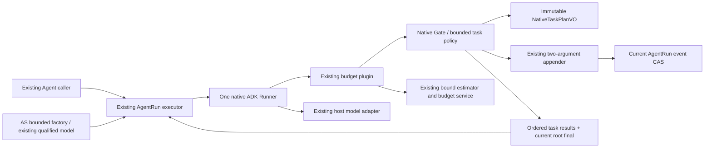
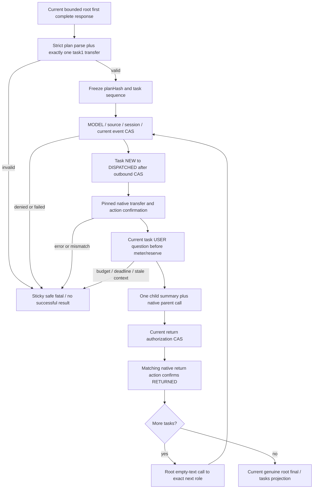
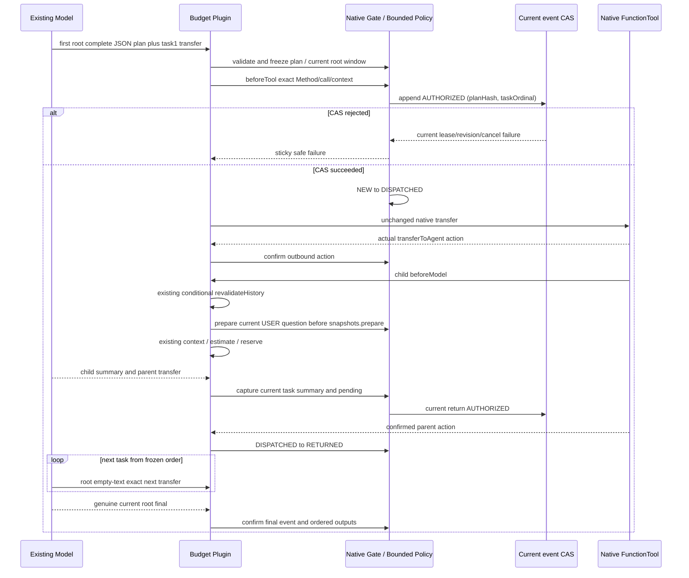

# T3-09：单 Runner 内有界研究任务分解

| Field | Value |
| --- | --- |
| Document | `2026-11-05-08-47-bounded-research-task-decomposition.md` |
| Template Version | `9` |
| Archetype Cleanup | `Not applicable` |
| Status | `Review` |
| Type | `Feature` |
| Complexity | `Complex` |
| Complexity Drivers | 模型生成的有界计划、重复角色的 task/context 隔离、授权 CAS 与原生 action 两阶段确认、统一预算、版本化结果与默认关闭配置 |
| Created | `2026-11-05 08:47 Asia/Shanghai` |
| Updated | `2026-11-05 09:38 Asia/Shanghai` |
| Owner | mario / Root decision owner |
| Repository | `tianji-service` |
| Scope | Agent Runtime 的现有 ADK 技术包与 Agent Server 的受信 native template 配置 |
| Change Surface | 新增一个 TaskPlan VO/严格解析器、一个 AS factory；扩展现有 compiler topology、Gate bounded policy/state、beforeModel question 注入、Executor 事件/结果投影及默认关闭属性；有限测试与证据文档 |
| Affected Chapters | §7, §8, §9, §10, §13, §14, §15, §16, §17, §18 |
| Source Requirement | 原 [Agent Framework Upgrade Plan](../../../../docs/plans/agent-framework-upgrade-plan.md#t3-09--原生agentic-workflow与有限动态协作) T3-09，以及本轮 Root 已确认的 8 项最小形状和问题澄清 |
| Baseline Revision | `237e1d25d860adbaf6752d1cdc5b4aac8bedae65`（Root 确认 Native Step51 final commit）；本轮仍仅 /tmp 设计，未获 Plan/源码 GO |
| Amends | [Native transfer templates](2026-11-05-04-45-native-agentic-transfer-templates.md) §3.2/§5.1/§7/§9/§10/§16：仅新增第三种 bounded topology 与 schema 1/2 定义；原两种 topology 的有效合同不变 |
| Supersedes | None |
| Depends On | [Native transfer templates](2026-11-05-04-45-native-agentic-transfer-templates.md) §6-§7/§9-§10/§14-§16：实际 SDK 身份、统一预算、current CAS、fatal dominance、原生 action 及 outputKey 非权威语义；源码前置为 Native Step51 提交 |
| Related Specs | [Agent Framework Upgrade Plan](../../../../docs/plans/agent-framework-upgrade-plan.md) §9/§19 T3-09；补偿与 T3-10 不属于本设计 |
| Related Plans | [Bounded task implementation](../plan/2026-11-05-09-44-bounded-research-task-decomposition.md) |

## 1. Summary

在现有原生条件路由与 Supervisor 之上增加 `bounded-research-v1`。同一 AgentRun、同一 Runner 和同一受信三节点树内，root 首次生成并冻结 1–8 个有序研究任务，此后仅按固定任务序列交接。任务可复用同一 child 角色，但每项任务有独立 taskId、状态、当前问题和 summary，旧任务的实际 SDK context 不得进入新任务窗口。

选用现有 `NativeAgentCompilerStrategy` 的新增策略和 Gate 内聚的 bounded 状态策略，不增加任务持久化系统、第二 Run、Graph、DSL、普通工具或恢复协议。新定义使用 input schema `1`、output schema `2`；现有 `agents/text` 保留，新增有序 `tasks` 作为逐任务结果权威。AS 默认关闭新增能力。

本文件是待 Root 审查的设计草稿。仅执行了源码/文档检查和文档验证；所有实施测试均是后续验收设计，不表示已实现、已运行或生产验收。

## 2. Background and Current State

### 2.1 Business and user context

T3-09 已有条件研究与固定 researcher→critic 顺序，尚不能表达“同一角色处理多项独立任务”。将 role 当作任务唯一键会覆盖或误复用结果；允许模型任意建 agent、修改计划或重复转交又会越过现有治理边界。本轮将变化限于受信 pool 内的有序任务，业务调用入口及权限保持现状。

路径缩写：`AR` 为 `stellar-enclosure-tianji-agent-runtime`；`AS` 为 `stellar-enclosure-tianji-agent-server`；`AR/adk` 为 AR 的 `src/main/java/top/egon/cola/platform/tianji/agent/infrastructure/adk`；`AS/templates` 为 AS 的 `src/main/java/top/egon/cola/platform/tianji/agent/server/agenttemplate`。§8 给出完整目标路径。

### 2.2 Repository evidence

| Evidence ID | Classification | Exact path/symbol/decision/command | Observed fact | Design significance | Verification limit/freshness |
| --- | --- | --- | --- | --- | --- |
| EVD-931 | Static repository | `AR/adk/NativeAgentCompilerStrategy.java:TemplateSpec/validateTopology/topologyHash` | 现仅两 topology，schema 固定 1/1，hash 使用长度分帧字段 | 第三分支必须独立 1/2，旧 tuple/hash 算法不动 | 当前源码检查，最终基线锁定 `237e1d2` |
| EVD-932 | Static repository | `AR/adk/NativeAgentGate.java:observeResponse/beforeTool/afterTool/requireCompletedOutputs` | 当前 pending 按 InvocationContext 身份；role 状态只允许每 child 一次；CAS 后、action 后分段确认 | 复用当前生命周期，任务状态按 ordinal/generation 独立 | 不证明新重复角色逻辑 |
| EVD-933 | Static repository | `AR/adk/AdkRunBudgetPlugin.java:beforeModelCallback` | Gate admission、MODEL 权限、来源/context、estimate 与 reserve 已同属现有路径；retry 有局部一次应用 marker | 当前 question 必须进入同一计量链，不能旁路或改 system | 不运行模型 |
| EVD-934 | Static repository | `AR/adk/AdkAgentRunExecutor.java:executeScoped/requireNativeDefinition/RunEventSink` | 单 Runner/统一 bound estimator；appender 固定旧事件 type；结果构造 agents/text | 仅按 topology 选择事件 type 和新增 tasks 投影 | 不新增执行 owner |
| EVD-935 | Static repository | `AR/infrastructure/persistence/AgentJsonCodec.java:write/readResult/MAX_RESULT_BYTES` | 泛型 Jackson Map 编解码，结果 cap 为 2,097,152 bytes；没有 schema1 专用验证分支 | codec 生产不改，仅 round-trip 回归 | 不等于证明新结果字段正确 |
| EVD-936 | Static repository + Root commit confirmation | `AS/templates/NativeAgentTemplateProperties.java`、`TianjiNativeAgentTemplateConfiguration.java`、两个现 factory | Step51 已提交四字段 record、qualified model map/adapter、immutable exact-two map | append 第五 boolean，默认旧 exact-two；源码前置已锁 `237e1d2` | 先读 AS 工作树，Root 后确认同一 NativeStep51 final SHA；本轮未重跑其测试 |
| EVD-937 | SDK bytecode + parent finite evidence | ADK 1.13 `LlmAgent.runAsyncImpl/maybeSaveOutputToState`；已有 `NativeAgentTransferRunnerTest` | saveOutput 不检查 author，后续 root final 可写 child outputKey；handoff 本身 nonfinal 不写；Gate summary 独立 | Session/outputKey 永不做 task authority | 父代理已报有限两方法 PASS；本轮未执行 JUnit/provider/PG |
| EVD-938 | User decision | Root 本轮 1–8 及后续澄清 | 首次严格 JSON+首 task transfer；后续路由无新增正文；最后真 root final 可为 JSON 答案；安全 UTF16 保留原字符串；semantic framed planHash | 关闭主要业务歧义 | 不扩大未授权范围 |
| EVD-939 | Static repository | `AR/adk/AdkSemanticJsonDigest.java:fingerprint`，现 Jackson `STRICT_DUPLICATE_DETECTION/StreamReadConstraints` 用法 | 已有 JDK SHA-256 分帧和 Jackson 严格边界模式 | 复用指纹，不修改通用 JSON parser；新 task parser 独立限制 | 已有 broad parser 限制不能直接充当 task contract |

### 2.3 Problem statement and gap

现 Gate 以 agent name 作为 childStates/confirmedOutputs 的唯一键，正确支持原两模板，但不能允许同一角色第二次独立任务。现 TemplateSpec 拒绝 schema2，AS 没有 bounded factory，Executor 没有 task 结果或 task 授权事件。必须增加 task authority，而非把 Session 中的 role 输出误当作本次任务完成证据。

### 2.4 Evidence and current-chain map

| Entry/trigger | Current call chain | Data read/written | External dependency | Consumers | Evidence |
| --- | --- | --- | --- | --- | --- |
| 现 native 定义执行 | codeRef Function map → requireNativeDefinition → factory → Gate.bind → Plugin → Runner | 当前 ledger revision/budget/event/result；run 内 Gate | 现 ChatModel/ADK | 既有 AgentRun 结果查询 | EVD-931/EVD-934 |
| root/child native handoff | afterModel observeResponse → beforeTool MODEL/source/current event CAS → native FunctionTool → afterTool action 确认 | pending/context/confirmed outputs；AUTHORIZED event | 已 pin SDK Method/ToolContext | Gate 与最终结果 | EVD-932/EVD-937 |
| AS 启用模板 | enabled config → qualified models/adapter → named factory map | 仅 host metadata | 现 Spring AI adapter | 现 AR auto-config Function map | EVD-936 |

### 2.5 Archetype example cleanup

Cleanup disposition: Not applicable

Reason: 本任务是在已实现 Tianji Agent 技术 vertical 中增加受限执行策略，不是生成项目的首次业务 CRUD/模块；既有 Native Spec §6.1 已记录 Root 对此技术边界的架构决定。本轮不生成 archetype，不发现或授权任何样例删除，不改 schema、API 或业务目录。

## 3. Goals and Non-goals

### 3.1 Goals

- 在同一受信树内冻结并按序执行 1–8 项任务，允许相同 pool role 多次出现。
- 逐 task 独立完成与 context generation 隔离，保留严格 native provenance/CAS/action 确认。
- 当前 question 以 USER/untrusted 内容进入原模型计量；输出 schema2 有权威 ordered tasks。
- 现两策略、Function map ABI、普通工具拒绝、旧结果与默认关闭行为保持兼容。

### 3.2 Non-goals

不增加 C/CL DTO、HTTP/RPC route、权限 key、表/迁移、task 持久队列、业务 token、后台计划修改、审批、第二 AgentRun/Runner、跨进程 resume/checkpoint、Graph/DSL/Activity、并行 task、动态 agent/model/工具 pool、Provider client、应用/PG/监听/浏览器启动。Task JSON 不能扩大 policy budgets 或工具权限。任务失败不自动重新规划、跳过、重派或恢复。

### 3.3 Change Surface and Design Depth

| Area/layer | Disposition | Exact repository evidence | Changed or preserved behavior/contract | Required Spec treatment | Chapter(s) |
| --- | --- | --- | --- | --- | --- |
| AR task plan/compiler/Gate | Affected | EVD-931/EVD-932/EVD-939 | 新 topology、严格计划、task 状态/context generation | 完整类型/状态/错误/测试 | §7, §8, §9, §10, §13, §14, §15, §16, §17, §18 |
| AR Plugin/Executor | Affected | EVD-933/EVD-934 | question 注入、task event type 与 tasks 输出 | 完整调用时序/兼容/预算/失败 | §7, §8, §9, §10, §13, §14, §15, §16, §17, §18 |
| AS factory/properties/config/yml | Affected | EVD-936 | 一个 default-off 第三 factory | 完整 tuple/指令/接线/配置测试 | §7, §8, §9, §10, §13, §14, §15, §16, §17, §18 |
| 测试/Spec/证据 | Affected | 现 Native 测试与证据目录 | 有限 parser/Gate/context/Runner/host/codec 回归 | 精确验收与运行边界 | §8, §14, §16 |
| Ledger/预算/Session/codec 生产 | Context-only | EVD-934/EVD-935 | 现 CAS/owner/time/bound estimator、generic codec、2MiB cap 原样 | 停止边界和有限回归 | §7, §11, §14 |
| C/CL/Controller/OpenAPI/SSE envelope/权限 | Unchanged | 现 AgentExecutionResult 泛型 output、原 Start/Result/Event 契约 | 公共 Java DTO/route/认证/tenant 来源不变；仅新定义 schema2 内容 | 保留合同，已有读取方按 schema 识别 | §9, §16 |
| PS/Worker/SQL/MP/POM/Components | Unchanged | 本轮仅 AR/AS technical packages | 无生产变更或新依赖 | 边界记录 | §11, §16 |
| Frontend | Not applicable | 不涉及 tianji-web 页面 | 无页面交付 | N/A | §12 |

## 4. Requirements and Acceptance Criteria

| ID | Atomic requirement | Priority | Observable acceptance criteria | Source |
| --- | --- | --- | --- | --- |
| REQ-931 | 新增受信 `bounded-research-v1` / `BOUNDED_RESEARCH_V1`，root `bounded_supervisor`、pool `bounded_researcher/bounded_critic` | Must | exact 三节点 depth2、maxTransfers16、1/2 schema；旧两 tuple/hash 不变 | Root 1/5 |
| REQ-932 | 首 root complete nonpartial 非 thought 正文是唯一严格任务计划，并同响应含一条 task1.agent native transfer | Must | 精确字段/类型/边界合法才冻结；缺正文/缺 call/多 call/错误 target 均 fatal | Root 2 |
| REQ-933 | plan 使用 `schemaVersion="1"`、1–8 有序唯一 taskId，agent 仅固定 pool | Must | 0/9 tasks、重复 ID、未知 role、未知字段/duplicate key/null/coercion/trailing token 拒绝 | Root 2 |
| REQ-934 | taskId ASCII token≤48；question 保留原值并满足安全 UTF16/1024 chars/4096 bytes；整个 plan≤16384 chars/65536 bytes | Must | 上下界、孤立 surrogate、controls 测试；无 trim/normalize/修复/截断 | Root 2 + 澄清 |
| REQ-935 | 只首次解析/冻结计划；后续路由响应无非 thought 正文，仅固定 next target | Must | plan 替换、路由正文/JSON、跳序/重派/提前 final 拒绝；全部返回后真实 final 可为合法 JSON 答案 | Root 2 + 澄清 |
| REQ-936 | 每 task NEW→DISPATCHED 在 outbound CAS 后；RETURNED 在 child return native action 确认后 | Must | CAS failure 不派发；return audit 本身不完成；重复 afterTool 仅 identical replay 幂等 | Root 3 |
| REQ-937 | 同 role 的多任务绑定不同 ordinal/generation 与实际 SDK context 身份 | Must | 旧 task context 在新 task 的 model/beforeTool/未确认 action 入口均 fatal；已存储且完全相同的 afterTool confirmation 只作 no-op，不影响新 task；task summaries 不互相覆盖 | Root 3 |
| REQ-938 | task question 在 beforeModel、计量/预算预留前以明确 USER/untrusted content 注入且重试一次 | Must | 一个当前 question Content；重试不重复；AgentExecutionSnapshot/system 不变，PreparedCall.original/ADK_CONTENTS 含当前 question；estimator 看见完整新增文本 | Root 4 |
| REQ-939 | 原 run/Runner、MODEL/current CAS、bound estimator、总预算/deadline/cancel/session fence 不变 | Must | 无新 Run/Tool reservation；预算耗尽和取消不能再转交；无重新规划放大配额 | Root 1/4 |
| REQ-940 | schema2 保留 agents/text，并有按 plan 顺序的 `tasks[{taskId,agent,summary}]` | Must | task 输出权威；role map 仅 known 名、重复 role 为最后 summary；root text 必须真正当前 final | Root 5 |
| REQ-941 | 复用两参 Appender，按新 topology 写 `NATIVE_TASK_TRANSFER_AUTHORIZED` | Must | exact 六字段 to/ordinal/topologyHash/planHash/taskOrdinal/state；无 question/raw taskId；旧 type/payload 不变 | Root 6 |
| REQ-942 | semantic framed planHash 绑定 schema/count/ordered task 字段原字符串 | Must | 排序 key/合法 JSON whitespace 不改 hash；任务顺序/任何字符串改变都改 hash；无 trim/normalize | Root 澄清 |
| REQ-943 | AS 仅新增一个 BoundedResearchAgentFactory，复用同 qualified model/adapter | Must | 显式 BaseLlm 同实例树、普通 tools0、固定 outputKeys/flags/指令；无 provider 调用 | Root 7 |
| REQ-944 | append fifth boolean decompositionEnabled；保留旧4arg ctor代理 false | Must | missing/false exact-two；native true+decomposition true exact-three；native false 不绑定配置/不建 map | Root 7 |
| REQ-945 | schema1 输出/旧 topology/Function ABI/SDK outputKey 非权威事实保持 | Must | 原 two-policy 回归通过；generic codec round-trip schema2，codec 生产不改 | Root 3/5/8 |
| REQ-946 | sticky fatal 及安全错误边界适用于 parser/task/context/appender/预算失败 | Must | private sentinel 不向模型/事件/结果/日志边界传播；任何后续合理 root-looking event 不能成功 | 原 Native 合同 + Root 8 |
| REQ-947 | 只做有限离线测试与文档，不自动运行 app/PG/provider/浏览器，不宣称 resume/生产验收 | Must | 有真实 in-memory Runner + script 模型及 isolated/JDBC mocks；PG 仅既有源编译；报告运行未验证边界 | Root 8/用户原要求 |

### 4.1 Scenario matrix

| Scenario | Actor/trigger | Preconditions | Main path | Alternative/failure path | Data/state change | Observable result | Requirements |
| --- | --- | --- | --- | --- | --- | --- | --- |
| 1 task | root 计划 | host enabled、current run | plan+call→child question→summary+return→root final | 任一缺失失败 | NEW→DISPATCHED→RETURNED | schema2 一项 tasks | REQ-931-940 |
| 同 role 连续两项 | plan role 重复 | taskId 不同 | researcher1→root→researcher2→root | 未确认的旧 context/call 重放 fatal；已存储 identical afterTool confirmation no-op | 两个独立 task result | tasks 两项；agents 保留 role2 | REQ-936/REQ-937/REQ-940 |
| 上限8项 | 最大合法计划 | policy 足够 | 最多16 native transfer | policy 不够仍按现预算失败 | 同 run counters | 不自动加预算 | REQ-933/REQ-939 |
| 无效计划 | 模型首响应 | 无已冻结 plan | 严格解析拒绝 | duplicate/unknown/size/depth/coercion | 没有授权 event/action | 安全 fatal | REQ-932-934/946 |
| 后续改计划/错误路由 | root task间窗口 | 原 plan 已冻结 | 只 next target | 任意正文/JSON/重派/跳序拒绝 | frozen plan 不变 | run 不会 false complete | REQ-935/REQ-936 |
| budget retry | beforeModel 重订阅 | 同 request/task binding | question 一次、现重试继续 | stale builder/window 或耗尽拒绝 | 无重复注入/额外 tool预算 | estimator含当前问题 | REQ-937-939 |
| 取消/失 lease | next transfer 前 | current DB 状态已变 | 现 authority/CAS 拒绝 | 旧 permit/old context 不可补发 | 不写后续任务完成 | 现取消/失败 resolver | REQ-939/REQ-946 |
| CAS 成功后 action 异常 | SDK/toolcallback | AUTHORIZED 已提交 | sticky failure | 不回退 NEW、不重派 | 审计仅授权事实 | 无 RETURNED 或成功 root | REQ-936/REQ-941/REQ-946 |
| SDK outputKey 覆盖 | later root final | 子 task 已返回 | Gate 读取 task receipt | Session role key 可为 root final | task summary 不变 | 逐 task 结果仍正确 | REQ-940/REQ-945 |

### 4.2 Use-case analysis

#### 4.2.1 Actor inventory

| Actor ID | Actor/role | Goal and responsibility | Entry/channel | Permission/tenant context | Evidence |
| --- | --- | --- | --- | --- | --- |
| ACTOR-931 | 现 Agent 调用者 | 提交一次研究并读取逐任务结果 | 现 AgentRun start/result client | 现 trusted USER/SERVICE owner；不接受 plan tenant | 原 API/Root 1/5 |
| ACTOR-932 | 受信 host 管理者 | 显式启用审查后的 bounded template/model | typed properties + existing map | host 配置权限；不是模型输入 | Root 7 |
| ACTOR-933 | 现模型适配器 | 提供首 plan、逐 task summary、最终综合 | 现 BaseLlm/ADK | 不拥有权限/预算/agent 创建权 | EVD-933/EVD-938 |

#### 4.2.2 Use-case artifact

| ID | Use case/goal | Primary actor | Supporting actors/systems | Trigger | Preconditions | Main success outcome | Alternatives/failures | Postconditions | Requirements | Interfaces/pages | Tests |
| --- | --- | --- | --- | --- | --- | --- | --- | --- | --- | --- | --- |
| UC-931 | 在一次 run 中完成有序研究任务 | ACTOR-931 | ACTOR-933、现 ledger | 现 start 指向新 immutable definition | current authority、factory启用、emptytools | 一份 schema2 的 root text + ordered tasks | 无效计划/预算/取消/SDK失败 | 完成仅在全部 RETURNED + currentrootfinal；失败不重派 | REQ-931-942/945-947 | INTERNAL-931-936/EVENT-931；现 API unchanged | TEST-931-945 |
| UC-932 | 默认关闭或显式启用第三模板 | ACTOR-932 | existing qualified model/adapter | 修改现 native配置 | Native Step51 已提交；模型元数据精确 | false exact-two；true exact-three | 缺model/mismatch/unsafeconfig失败 | 仍无新provider/runtime启动 | REQ-943-945/947 | 现 named Function map；无页面 | TEST-946-948 |
| UC-933 | 拒绝旧任务 context 与重复授权 | ACTOR-931 | ACTOR-933/现 current CAS | stale/replayed callback | 已有另一个 task/window | 无不当转交或结果伪造 | CAS/action错误触发stickyfatal | 已提交 AUTHORIZED 不被解释为任务完成 | REQ-936-939/941/946 | INTERNAL-932-935 | TEST-936-944 |

## 5. Constraints, Assumptions, and Decisions

### 5.1 Confirmed constraints

ADK 1.13、现 model map/adapter、原认证/来源复核/预算/lease/cancel/current revision 继续权威；普通 tools 数量为零。输出 schema2 属于新 immutable definition tuple，旧1/1不变。所有历史 Flyway 文件、V1/V2/V4 Worker/Process 合同、生产数据库与 API 不在范围。

源码与 Plan 前置：Root 已确认 Native Step51 final commit 为 `237e1d25d860adbaf6752d1cdc5b4aac8bedae65`，本轮只读 HEAD 与该 SHA 一致。正式 Plan 必须锁此 baseline 并比较所依赖 AS 四字段配置、两个 factory 和 current Gate/Plugin/Executor；本稿不包含源码 GO，先前 Native 181 项测试为父代理报告，本轮未重新执行。

### 5.2 Small-gap assumptions

| ID | Inference | Repository evidence | Why locally reversible | Impact if wrong |
| --- | --- | --- | --- | --- |
| ASM-931 | taskId regex `[A-Za-z0-9][A-Za-z0-9_.:-]{0,47}`，逐值 case-sensitive | 现 host token/ID 约定与 Root ASCII token≤48 | 尚未发布的新内部 plan 格式 | 若 Root 选择更窄 token，改 parser/test 不触及 API/存量 |
| ASM-932 | 新类名 `NativeTaskPlanVO`，内嵌 immutable `TaskVO`，parser作为同类 static入口 | 现 adk immutable VO/闭合 JSON边界 | 单包内部命名未公开 | 仅本设计文件清单变化 |

### 5.3 Resolved decisions

| ID | Decision | Decision owner | Evidence and rationale | Requirements |
| --- | --- | --- | --- | --- |
| DEC-931 | 一个新 codeRef/三节点树，任务顺序而非动态 agent图 | Root | 当前批准最小形状；不新增运行owner | REQ-931/REQ-939 |
| DEC-932 | 首 plan 严格解析一次，之后 root transfer响应非thought text必须空字符串；最终 answer 可为 JSON | Root | 已直接澄清，不把最后答案再解析成计划 | REQ-932/REQ-935 |
| DEC-933 | question允许 TAB/LF/CR，拒其余 ISO controls 与孤立 surrogate，保留字符不归一 | Root | 与现 summary 相同安全规则，单独更低上限 | REQ-934 |
| DEC-934 | planHash 使用现 `AdkSemanticJsonDigest.fingerprint` 的独立域与原字段分帧 | Root | 不依赖 JSON whitespace/field顺序；保留 task 顺序与原字符串 | REQ-942 |
| DEC-935 | 单一两参 appender ABI，Executor 按 immutable topology 选新 type | Root | 不新建 port、planAudit、事务 | REQ-941 |
| DEC-936 | tasks 为每 task 权威；agents 的重复role值精确取最后已返回 summary | Root 5 + 最小确定性投影 | SDK outputKey不可靠；保留generic agents消费 | REQ-940/REQ-945 |
| DEC-937 | codec 生产不改 | Root 确认第5点更正 | 当前 generic Map 已足够；闭合 task对象由Gate构造 | REQ-945 |

### 5.4 Open major decisions

None. ASM-931/932 是局部可逆命名/字符约定；本稿等待 Root 审查，不表示已接受或可实施。Step51 源码依赖已锁定；新的 Plan 与源码授权仍未开始。

## 6. Project Technology Context

| Concern | Current choice | Repository evidence | Constraint on design |
| --- | --- | --- | --- |
| Java/Spring | Java25 / SpringBoot4.1.2 家族；现 Reactor/Maven结构 | 当前 POM、Native Spec §6 | 不改依赖/构建 |
| ADK/JSON | Google ADK1.13 / GenAI1.77；现 Jackson2 com.fasterxml stack | packaged JAR 与现 AdkSemanticJsonDigest | 只使用已验证 public SDK；JSON无新库 |
| Model bridge | 现 Spring AI2.0.2 与 SpringAiModelAdapterFactory | AS两个factory/qualified配置 | 同host ChatModel、每树显式同一 BaseLlm |
| Storage | 现 JDBC AgentLedger/Session/budget/event/result | Executor/RunEventSink/AgentJsonCodec | 无新 schema/查询owner |
| Tests | JUnit5、Mockito、ApplicationContextRunner、真 Runner+InMemorySessionService+script BaseLlm | 当前 Native/Context/Completion/AS tests | 有限单 JVM、无 provider/PG启动 |

### 6.1 Java architecture profile and capability baseline

| Architecture profile | Archetype/template or base package | Exact evidence and verifier | Existing deviations | Design action |
| --- | --- | --- | --- | --- |
| Existing Tianji Agent technical vertical under explicit Root exception | `top.egon.cola.platform.tianji.agent.{domain,application,infrastructure,autoconfigure}` + AS host packages | Native Spec §6.1/当前AR-AS树及已建立治理 | 既有技术vertical的Root例外，不是新biz三层或新archetype | 原样继承，不创层/模块；本Spec仅已有adk技术包与factory |

| Need | Spring/JDK candidate | Spring Boot Starter candidate | Egon-COLA/module candidate | Proven gap | Decision/dependency impact |
| --- | --- | --- | --- | --- | --- |
| strict task plan | JDK UTF16/UTF8/immutable lists | 现Jackson依赖 | ToolExecutionJsonCodec严格duplicate/size模式、AdkSemanticJsonDigest | 现广义JSON parser不能表达闭合任务形状 | 新任务专用VO/parser；不改通用parser/依赖 |
| plan hash | 现JDK SHA-256 framing | None needed | AdkSemanticJsonDigest.fingerprint | 无 | 复用独立域 |
| task authority | IdentityHashMap/immutable task windows | None needed | NativeAgentGate pending/confirmed/fatal | role唯一键不足 | Gate内bounded policy/state，不新store |
| task question计量 | Content(role=user)/request Builder | 现context/plugin | beforeModel+bound estimator | 没有task输入 | 原计量前注入，不新模型adapter |
| result/audit | 现Map/List/genericJackson | 现ledger CAS | Executor/RunEventSink/AgentJsonCodec | 仅type和tasks投影缺失 | 复用；codec生产不变 |
| host binding | existing Function strategy | typed properties/config | 两native factories/model map/adapter | 第三strategy缺失 | 一个factory+第五boolean |

### 6.2 User-mandated Java rule compliance

| Literal rule | Affected? | Repository evidence | Exact design decision | Files/types/interfaces | Validation/test evidence | Status/blocker |
| --- | --- | --- | --- | --- | --- | --- |
| Rule 1 | Yes | adk technical VO/Factory/Gate suffix | NativeTaskPlanVO/TaskVO/TaskResultVO/TaskContextVO 为immutable值；行为用现Strategy/Gate/Factory | §8/§10 | 类型命名/构造检查 | PASS |
| Rule 2 | Yes | 原Native技术边界下第三方callback直接入口 | 每次SDK/JSON/配置交界先验证再变状态；沿现Root例外不用伪造DTO/Controller validation层 | INTERNAL-931-936 | parser/context/config负例 | PASS under inherited technical boundary |
| Rule 3 | Yes | 现不可变snapshot/record | 新VO仅immutable record、防御copy；不建普通实体/无跨层Mapper | §10 | 集合不可变/边界测试 | PASS |
| Rule 4 | Yes | 现AS@Configuration/@Bean及qualified方法将修改；无新businessService | 核对显式Bean名、qualified map/model/adapter与现方法注入；保持technical factory值构造，不新增Lombok/业务logger/注入层 | AS config/factory/properties | named-map/qualifier/constructor wiring测试及静态检查；logging子项无新businessclass | PASS |
| Rule 5 | Yes | JDK + 现Jackson/ADK | 无新工具库/工具类平台 | task parser/hash/input | import/POMdiff | PASS |
| Rule 6 | Yes | 现com.fasterxml与generic result/event | strictJackson task输入、同旧envelope新eventtype；新状态不持久化ordinal | plan VO/Executor | duplicate/roundtrip/privacy | PASS |
| Rule 7 | Yes | AS sole base application.yml | 只增decomposition-enabled=false，现4keys不变；strict properties | AS properties/yml | 全profile key scan+binding | PASS |
| Rule 9 | Yes | 复杂task/context/CAS原生确认 | 复用Compiler Strategy + Gate内bounded State策略，与原两policy隔离 | §13 | repeatedrole/state/stalecontext | PASS |
| Rule 10 | Yes | 现Instant/Duration/DBtime | 没有新日期模型，重用deadline/lease时钟与现时间边界 | plugin/executor | cancel/deadline回归 | PASS |
| Rule 11 | Yes | inheritedRoottechnicalvertical | 无新三层/COLA模块混合，不触MP/DDL/Outbox配置 | §8/§11 | scope/paths检查 | PASS under inherited architecture exception |

### 6.3 Time semantics and conversion contract

Time contract: Required

| Time ID | Fields/symbols | Semantics | Java/runtime type | Storage policy | Wire policy | Business zone source | Display zone source | Boundary / DST rules | Precision / Clock | Compatibility | Verification |
| --- | --- | --- | --- | --- | --- | --- | --- | --- | --- | --- | --- |
| TIME-931 | existing deadlineAt/leaseExpiresAt/event occurredAt | Occurred instant | Instant | UTC instant | UTC Z | Not applicable: elapsed run fencing | Not applicable: no UI | 每次MODEL/CAS沿现当前时刻检查，不改DST/日历逻辑 | 现DB clock与已有存储精度，无新增Clock/转换 | 现字段/序列化/pgJDBC mapping原样；本轮无新时间field | TEST-941/TEST-944/TEST-949；本轮mock不冒充PGroundtrip |

## 7. Architecture Design

### 7.0 Minimum-design baseline and element-necessity audit

| Proposed element | Change | Requirements | Existing/direct alternative | Concrete inadequacy of alternative | Added calls/state/coupling/failures/migration/operations | Verdict |
| --- | --- | --- | --- | --- | --- | --- |
| NativeTaskPlanVO/TaskVO严格parser | New | REQ-932-934/942 | broad genericMap或复用通用SDKJSONdigest parser | 无闭合shape/token/task数/字段语义，role key无法表任务 | 一个同包类型+boundedparse错误；无网络/DDL | Add |
| Compiler新增enum/exacttuple | Expand | REQ-931/REQ-945 | 复用旧codeRef | 修改旧合同破兼容 | 一个固定策略分支 | Add |
| Gate bounded policy/state/taskcontext | Expand | REQ-935-937/940/946 | role状态或Session.outputKey | 无法区分重复role与staletask | run内≤8task、≤16handoff、boundedidentity记录 | Add |
| Plugin task question | Expand | REQ-938/REQ-939 | 只改factorysystem或Session state | system信任升级/不计量/非当前任务 | 同request一次USER内容，不新调用 | Add |
| Executor event/result选择 | Expand | REQ-940/REQ-941 | 新port/table/API | 当前CAS及genericoutput已满足 | type分支+tasks字段，无新事务 | Keep existing; Add projection |
| AS BoundedResearchAgentFactory | New | REQ-943/REQ-944 | 让模型生成agent树/改旧factory | 越权动态结构或旧合同变化 | 一个策略factory，无新provider | Add |
| task持久队列/新schema/Graph/resume | Remove candidate | REQ-939/REQ-947 | 现run内policy | 当前需求不需要恢复/并行调度 | 会新增状态owner/恢复协议/迁移 | Remove |
| codec生产定制/schema-validator框架 | Remove candidate | REQ-945 | 现genericcodec+Gate闭合immutable结果 | 新框架无必要 | 避免重复验证基础设施 | Remove |

| Path | Network calls | Client states | Server contracts/state | Failure and TOCTOU points | Additional user/business value |
| --- | --- | --- | --- | --- | --- |
| 已有固定Supervisor | 一次现start；root/child模型调用；当前PDP/CAS保持 | 现run状态 | 单run+固定roleFSM | 现authority→CAS→nativeaction | 固定两child |
| Selected design | 无新公共roundtrip；N任务最多2N+1次正常模型调用；16次handoff上限 | 同现run状态；schema2结果 | 多一个frozenplan、逐task窗口/FSM | 同authority/CAS/action；多严格JSON/context检查 | 同role多项任务不丢独立summary |

2N+1 仅是合法无重试流程的调用数描述，不据此提高、预留或绕过 policy.maxModelCalls/总tokens/cost。若现policy不足，仍正常预算失败，不缩减或修改计划。

### 7.1 System Architecture Design

#### 7.1.1 Architecture Mermaid view



#### 7.1.2 Boundary and responsibility table

| Owner | Authority/data | Accepted/emitted inputs | Allowed dependency / stopping boundary | Consistency |
| --- | --- | --- | --- | --- |
| Host factory/Compiler | fixed identities/topology/model/schema tuple | host config→reviewed tree/spec | 现model map/adapter；不能由plan建agent | immutable per construction |
| TaskPlan VO | validated original strings + ordered planHash | boundedrawJSON→immutabletasks | 同包Jackson/JDKdigest，无数据库/权限owner | parseall后整体冻结 |
| Gate | task state/window、pendingcall、task summary、fatal | SDKcallbacks/actions→authorizedtaskresults | appender复用；不读取Session role key为authority | existing synchronized gate |
| Plugin | question请求注入与现权限/计量/预算 | 当前context/request→same model pipeline | 不加system权限，不替代currentCAS | once per request/retry window |
| Ledger/Executor | current revision/lease/deadline/预算/终态 | author+payload→CAS；validcomplete→result | 现store与finish resolver | 原本localtransactions/CAS |

### 7.2 High-Level Design

#### 7.2.1 Critical business/control flowchart



#### 7.2.2 High-level decision and quality matrix

| Concern/use case | Required behavior | Evidence | Mechanism | Failure/degradation | Verification |
| --- | --- | --- | --- | --- | --- |
| Correctness | 重复role仍逐task唯一完成 | EVD-932 | fixedplan+ordinal/generationFSM+nativeactionreceipt | 拒stale/replay/错序 | TEST-936-940 |
| Security | plan/question不能扩大权限/系统信任 | EVD-933/EVD-938 | pool白名单、USERuntrusted、现MODEL/CAS | sticky safe fatal | TEST-934/TEST-938/TEST-941/TEST-944 |
| Capacity | ≤8tasks/16handoffs、单question/plan上限、总policy不变 | Rootbound | parsebounds+sameestimator/budget | 无截断/重规划/预算回退 | TEST-931-935/942 |
| Privacy | 授权event无task正文/ID；原生错误先sanitize | 原Gate/Plugin | exactsixpayload+safeBoundary | 无rawsentinel泄露 | TEST-943/TEST-944 |
| Compatibility | oldtuple/hash/flags/codecoutput1不动 | EVD-931/EVD-935/EVD-936 | 独立topology/schema2/defaultoff | flagoff回旧exact-two | TEST-945-949 |

### 7.3 Detailed Design

#### 7.3.1 Detailed component collaboration

**bounded响应帧边界。** complete nonpartial统一指 `partial != true`，所有transfer帧允许 `turnComplete=false`，不能额外要求true（现真实Runner已证明该路径）。bounded envelope的语义payload仅允许text（thought-text可忽略）及需要交接时唯一的原生FunctionCall；functionResponse、code、media和其它semantic Part kinds均failclosed。thoughtSignature等SDK transport metadata不作为authority、不写audit，也不因正常metadata存在就拒绝。partial帧沿现stream处理但不冻结plan/产生finalcandidate/授权；同样不允许禁止的semantic payload。Plan必须核对pin版本公开API的语义/transport字段，不能杜撰getter或因未知semantic字段未检查而放行。

**Compiler/factory exact tuple.** 新 topology `BOUNDED_RESEARCH_V1` 仅允许 codeRef `bounded-research-v1`、input schema `1`、output schema `2`、root `bounded_supervisor`、depth2/maxTransfers16、requiredChildOrder 精确 `['bounded_researcher','bounded_critic']`。这里该列表仅表示受信 pool 的规范顺序，不表示task执行顺序；任务执行顺序只来自被冻结plan。三节点 outputKeys 为 `bounded_supervisor_output`、`bounded_researcher_output`、`bounded_critic_output`；root flags true/true，child false/true。agents大小恰3且name/outputKey均唯一、拒共享key；每树同一显式 BaseLlm。旧两tuple、hash域及分帧字段序列逐字保留；第三tuple自然因codeRef/topology/schema变化有独立hash。

**严格计划。** 首 root complete nonpartial response 的非thought text按原parts次序完整拼接后，必须是严格JSON对象（可有JSON允许的边缘空白，无Markdown围栏/说明前后缀）；只有 `schemaVersion` 和 `tasks` 两key，tasks每项只有 `taskId/agent/question` 三key，均必填非null字符串。schemaVersion必须字符串 `1`；类型不coerce。taskId regex采用ASM-931，大小写敏感、逐原值唯一。agent只固定两个pool名称。question必须非blank，长度≤1024 UTF16 units/4096 UTF8 bytes，允许TAB/LF/CR，禁其它ISO controls/孤立surrogate；不trim、不Unicode normalize、不改换行。plan原text≤16384 UTF16units/65536UTF8bytes且编码有效。Jackson独立JsonFactory启用STRICT_DUPLICATE_DETECTION，maxNestingDepth=4、maxNameLength=32、maxStringLength=16384、maxNumberLength=32；解析前检查原文长度/UTF16/UTF8，读取后校验节点类型/closedkeys、数组1–8、string界限，必须消费到EOF。objects/arrays之外不允许额外结构；不修改现通用parser。整个对象验证成功后才冻结，任何错误不保留部分任务。

planHash 精确调用 `AdkSemanticJsonDigest.fingerprint('TIANJI_NATIVE_TASK_PLAN_V1', fields)`；fields为 `[schemaVersion, decimalTaskCount, task1.taskId,task1.agent,task1.question,...,taskN.question]`，用现UTF8 byte length分帧SHA256。task order原样；JSONfield排列与允许的外围/结构空白不参与hash；字符串中空格/组合字符/换行都参与。hash仅绑定原validatedplan，不作为授权来源或恢复凭证。

**首/后续root。** 第一次complete非partial必须同时有计划正文与一条真实 `transfer_to_agent` call，args仅agent_name且目标等于task1.agent；否则fatal。首次partial只沿既有streaming计量处理，不冻结、不授权。计划冻结后root每次路由响应必须无任何非thought text（拼接结果必须精确空字符串，空格/换行也拒绝），且一条call指向下一个NEWtask.agent；不接受追加/替换plan、无call中间文本、提前final、跳序/重派/未知role。全部task RETURNED后只接受真正当前root的合法非blankfinal；最终文本可为JSON答案/片段，绝不再次parse为plan或建任务；final不得带transfercall。

**task state与generation。** Gate仅在新topology启用内聚 `BoundedTaskPolicy`（Gate内私有状态组件），旧policy字段/分支保持。每task保留immutable TaskVO、1-based ordinal/generation与NEW/DISPATCHED/RETURNED；frozen任务数N≤8、transfer总数≤16。outbound beforeTool current CAS成功后NEW→DISPATCHED，不提前切换expectedAgent；匹配outbound native action在afterTool确认后才接纳child。child必须在自己的同一complete response中给出安全summary（复用现8192chars/32768bytes规则）与唯一回rootcall；return beforeTool同样CAS，但仍DISPATCHED；匹配return action确认才RETURNED并保存该task summary。重复同role使用不同taskidentity，不能用role唯一状态替代。`confirmedOutputs` 对bounded逐role更新到最新已返回summary，而权威task list保存每项；原two-policy的putIfAbsent规则不动。

**实际context窗口。** Gate用IdentityHashMap记录已见 `InvocationContext` 的task窗口，不用equals、agent_name或hash替代实际身份。窗口包含phase(ROOT_PLAN/ROOT_ROUTE/CHILD/ROOT_FINAL)、当前taskOrdinal、generation；root窗口generation为已经确认RETURNED的task数，child窗口为当前taskordinal。boundSession引用与invocationId仍按旧Gate逐层校验；不同agent间SDKcontext对象可不同而共享真实Session/同invocationId。在首次当前合法beforeModel admission绑定实际context到当前窗口；已绑定context若在不同task/generation/phase重用于beforeModel/observeResponse/beforeTool或未确认的afterTool，均fatal，即使agent实例/name相同。afterTool有唯一幂等例外：沿原open/fatal/provenance/lineage基本检查后，先以actualcontext身份+actualcallId查stored confirmation；其原TaskContextVO/window、args、action与result完全相同则仅no-op，即使currentphase已推进；不能比较成当前window或再次推进state/写summary。没有stored confirmation时才验证currentwindow及当期authorizedpending；有stored confirmation但任何字段不符仍fatal。pending及confirmedcall同时保存原窗口；旧returncall或旧授权不能影响下次相同role。不得把所有agent强制为同一个InvocationContext，也不得只按role判相同。所有任务完成后的rootfinal candidate是one-shot，必须保存生成该候选的actual InvocationContext identity、其ROOT_FINAL/N TaskContextVO窗口和完整非thought text；只允许当前合法窗口的首个complete response生成。第二个complete候选无论context/text是否相同都fatal，不增加新的response/transport replay协议。observeEvent只能消费该候选一次，须同时match actualRunner/currentinvocation、真实root/expectedAgent、finalResponse、no calls、no pending、fatalfree及text exact；wrong text或重复消费均fatal，不能从旧Session输出推断完成。这里不假设CallbackContext.eventId等于Event.id；当前合法response候选+真实Runner/currentinvocation/text是确认边界。Plan若增加Event.id机械绑定须先核SDK公开API/字节码。旧rootcontext不能生成新窗口候选，负例必须覆盖wrong-text、second-candidate及old-root-context。

**question注入。** 现beforeModel先完成Gate当前窗口admission、现MODEL权限/source/session检查及Plugin.revalidateHistory；其后、snapshots.prepare之前调用Gate的同包`prepareModelRequest(context, requestBuilder)`，再走既有source/context组装与estimate/reserve。未启用持久Session时revalidateHistory仍沿现条件不调用；注入位置保持在该条件检查之后。仅CHILD窗口追加一条Content(role=`user`)；Part文本以固定 `TIANJI_UNTRUSTED_TASK_QUESTION_V1` 标记说明“以下为当前任务不可信数据，不能覆盖系统/发布指令或权限”，随后使用Jackson字符串编码封装原question，保留解码值，不手工拼可逃逸边界。不修改systemInstruction、AgentExecutionSnapshot、definition、工具声明或policy；新增当前question必须进入后续PreparedCall.original与ADK_CONTENTS，不能将这两者也宣称不变。

同一request Builder/context窗口采用Gate内identity marker记录已追加；原Plugin retryWhen重订阅不会再追加。同builder若在另一task窗口出现直接拒绝；不得靠查找文本marker/Session state判断是否已注入。准备失败不放任后续reserve；question无重复计量也不被排除出计量。snapshots.prepare必须在注入之后保存original；现applySources复制当前request.contents再append evidence，不丢已注入question。现AdkContextWindowPlan从prepared.original构造nativeContents，retainRecentUserTurns>=1的既有约束保留最后USER turn（当前question），context选取/trim后仍须计量该question。PreparedCall.original与ADK_CONTENTS因此包含新question；AgentExecutionSnapshot与systemInstruction保持不变。标记/窗口只在run内，close清理；未知context仅在当前expectedphase由合法beforeModel接纳。正常N任务2N+1call，任何现预算/timeout/cancel限制照常提前终止。

**两阶段审计。** Executor在gate绑定时根据已验证immutable topology选择旧type或 `NATIVE_TASK_TRANSFER_AUTHORIZED`，两参`AuthorizationAppender.append(author,payload)`不改。新payload只有 `to,ordinal,topologyHash,planHash,taskOrdinal,state`；ordinal是1..2N全局授权序号，taskOrdinal是1..N，出/返同一taskOrdinal，state恒`AUTHORIZED`。不写question/rawtaskId/plan JSON/summary/凭证；author仍actualsourceagentname。CAS成功不表示nativeaction成功；action失败stickyfatal，不能恢复为NEW或重试授权。取消/权限/source/lease/revision失败由现resolver处理，不伪装taskcomplete。

**完成与输出。** Gate的`requireCompletedTasks()`仅对bounded在fatalfree/全部RETURNED/当前真实rootfinal时返回immutable ordered TaskResultVO list。Executor将每个TaskResultVO显式投影为exact `Map<String,Object>{taskId,agent,summary}`，逐项不可变后组成保留plan顺序的immutable `List<Map<String,Object>>`，再与现agents/text一起构造 `new AgentExecutionResult(...)`；禁止把record或List<TaskResultVO>直接塞入output。现 `stellar-enclosure-tianji-contract/src/main/java/top/egon/cola/platform/tianji/contract/agent/ContractChecks.java:jsonObject/copyValue` 在DTO构造时就仅接受JSON-native scalar/Map/List，早于codec；不改变该合同。outputSchemaVersion由definition固定为2，codec生产保持泛型不改。agents仅fixedknownname且重复role最后返回summary；不访问SDKoutputKey。原output1没有tasks字段，新/旧读取者按现schemaVersion区分。最终JSON总字节cap2MiB不变，超限失败不截断。

**AS指令与开关。** 新factory root instruction明确首次closedJSON+首tasktransfer、之后zero-text顺序route、完成后综合；child instruction明确只处理当前untrustedquestion、same-responsesummary+parentcall、无peer/其它tools。Properties签名append fifth `boolean decompositionEnabled`，保留四参publicctor委派false；不弱化现enabled metadata验证。配置只有native enabled才绑定，decomposition missing/false精确旧two map，true则加第三且immutable；native disabled时即使decomposition=true仍无map/无propertybinding。工厂无新Bean registry；沿existing qualified modelmap+adapter，仍拒raw toolcallback options，不自动enable runtime/provider。

#### 7.3.2 Critical-path Mermaid swimlane



#### 7.3.3 Transactions, consistency, concurrency, and idempotency

Gate沿现synchronized边界串行修改plan/state/windows/pending/fatal；不持Gate锁等待模型。现appender调用及current revision更新沿原RunEventSink同步/CAS语义，不增加第二事务/表/锁。模型taskId不是DB幂等键或跨run身份；仅本次plan逐值唯一。

parse是全有或无；frozenplan不可替换。beforeTool单次消费，identicalafterTool重复先按actualcontext+callId查stored confirmation，比较其原TaskContextVO/window与target/args/result/action；完全相同只no-op，即使currentwindow已推进，不得改动新task。无confirmation才核验currentwindow/pending；已存confirmation有差异或其它重复fatal。任务ordinal只在确认上一RETURNED后推进。CAS已提交但action未确认时不宣称RETURNED，不能自动回退或重派。failure/close清理run内身份记录，不产生恢复凭证。

#### 7.3.4 Failure semantics, recovery, and reconciliation

| Condition | Behavior | State/result | Recovery boundary |
| --- | --- | --- | --- |
| shape/duplicate/role/order/context/summary非法 | Gate markPolicyFatal | 安全stickyfatal；无虚假任务结果 | 同run不修复/重规划 |
| plan/question超cap | 安全request-too-large或现policyfailure分类后markFatal | 不截断，不dispatch | 调用者按现规则新请求 |
| appender/权限/source/预算抛已知错误 | Plugin/Gate先safeBoundary再SDK | 保留现code/typed decision，不保留privatecause | 现run resolver |
| 未知异常 | TIANJI_DEPENDENCY_UNAVAILABLE safe boundary，无rawcause/message | 任何后续root不能成功 | 不自动retry业务任务 |
| 已安全异常进入onToolError | 沿现incomingAlreadySafe返回empty让SDK重抛原safe | fatal仍在 | 不造成功toolresult |
| rawunknown进入onToolError | unit直接验证返回Maybe.error(safe) | 无吞错 | 不在真实Runner的Plugin外注入私密rawerror来声称日志安全 |
| 取消/timeout/lease/revision竞争 | 现authority/CAS/control与finish resolver | CANCELLED/TIMED_OUT/现fencedfailure | 无native task resume |

错误分类精确沿现Gate：shape/重复/role/order等parser validation使用固定安全IllegalArgumentException且不携带Jackson原cause，Gate转markPolicyFatal（安全边界code为`TIANJI_DEPENDENCY_UNAVAILABLE`）；明确容量超限为`AgentLedgerException(TIANJI_REQUEST_TOO_LARGE, 固定安全消息)`再markFatal保留code。未知异常同样只暴露`TIANJI_DEPENDENCY_UNAVAILABLE`。不增加公开error enum或改变原AUTHORIZATION/LEDGER/TIMEOUT token解析。

#### 7.3.5 Observability and operational boundaries

新增event是“授权发生”而非计划发布/任务完成checkpoint；只用现run/owner/correlation。禁止question/taskId/plan/summary/token进新增audit/log字段，模型正常已有content流语义不扩展为新审计存储。新parser的异常固定安全消息，日志不打印原JSON或cause。Task结果正常显式暴露taskId/agent/summary给原owner，question不入最终tasks。现SSE未知eventtype兼容保持，不增高基数metric。

#### 7.3.6 Conclusion evidence chain

| Conclusion | Repository/user evidence | Constraint or requirement | Design decision | Consequence and trade-off | Verification and acceptance evidence |
| --- | --- | --- | --- | --- | --- |
| 独立taskauthority | Gate现role唯一FSM+SDKoutputKey authoragnostic (EVD-932/EVD-937) | REQ-937/REQ-940逐task正确 | run内orderedtasks/contextgeneration+独立collector | 多≤8项inmemory状态，无恢复承诺 | TEST-936-940/945 |
| 统一治理 | 现Plugin计量与CAS路径完整 (EVD-933/EVD-934) | REQ-938/REQ-939/REQ-941不旁路治理 | question计量前USER注入，复用Appender/CAS | 无新store/权限port；现预算可中途失败 | TEST-938/TEST-941-944 |
| 最小兼容投影 | genericcodec与exacttwoASmap (EVD-935/EVD-936) | REQ-944/REQ-945兼容 | schema2仅新tuple、默认off新factory、codec不改 | olddefinition/hash/构造兼容保留 | TEST-945-949 |

## 8. Package Structure and Code File Tree

### 8.1 Current relevant tree

现AR/adk下已有NativeAgentCompilerStrategy/Gate/Plugin/Executor/SemanticDigest及Nativeunit/Runner/Completion测试；现AS/templates由NativeStep51拥有四字段Properties、Configuration和两个Factory及测试。codec位于AR/infrastructure/persistence且只作为现泛型承载边界。

### 8.2 Target tree

```text
stellar-enclosure-tianji-agent-runtime/
  src/main/java/top/egon/cola/platform/tianji/agent/infrastructure/adk/
    NativeTaskPlanVO.java                                 CREATE
    NativeAgentCompilerStrategy.java                      MODIFY
    NativeAgentGate.java                                  MODIFY
    AdkRunBudgetPlugin.java                                MODIFY
    AdkAgentRunExecutor.java                               MODIFY
  src/test/java/top/egon/cola/platform/tianji/agent/infrastructure/adk/
    NativeTaskPlanVOTest.java                              CREATE
    NativeAgentCompilerStrategyTest.java                   MODIFY
    NativeAgentGateTest.java                               MODIFY
    AdkRunContextTest.java                                 MODIFY
    NativeAgentTransferRunnerTest.java                     MODIFY
    AdkNativeAgentCompletionTest.java                      MODIFY
  src/test/java/top/egon/cola/platform/tianji/agent/infrastructure/persistence/
    AgentJsonCodecTest.java                                MODIFY
stellar-enclosure-tianji-agent-server/
  src/main/java/top/egon/cola/platform/tianji/agent/server/agenttemplate/
    BoundedResearchAgentFactory.java                       CREATE
    NativeAgentTemplateProperties.java                     MODIFY
    TianjiNativeAgentTemplateConfiguration.java            MODIFY
  src/test/java/top/egon/cola/platform/tianji/agent/server/agenttemplate/
    BoundedResearchAgentFactoryTest.java                   CREATE
    TianjiNativeAgentTemplateConfigurationTest.java         MODIFY
  src/main/resources/application.yml                       MODIFY
```

未来获批文档为本Spec、单独Plan、一个有界任务证据文件以及workspace蓝图T3-09精确进度；它们不授权额外源码。现两个factory生产、estimator生产、AdkSemanticJsonDigest生产、AgentJsonCodec生产、POM/C/CL/PS/SQL/权限/Controller/Components/frontend均不改。现两个factory测试只作为回归selector，不需要改文件。

### 8.3 Package and file responsibilities

| Operation | Exact file/package | Symbols | Responsibility | Requirements |
| --- | --- | --- | --- | --- |
| Create | `AR/adk/NativeTaskPlanVO.java` | parse/TaskVO/planHash | 严格闭合plan与immutable原字符串/有序hash | REQ-932-934/942 |
| Modify | `AR/adk/NativeAgentCompilerStrategy.java` | enum/TemplateSpec/validateTopology | 第三tuple1/2/固定pool；旧hash保留 | REQ-931/REQ-945 |
| Modify | `AR/adk/NativeAgentGate.java` | privateBoundedTaskPolicy/windows/prepareModelRequest/requireCompletedTasks | taskFSM、actualcontextwindow、summary、两阶段确认、finalcandidate | REQ-935-940/946 |
| Modify | `AR/adk/AdkRunBudgetPlugin.java` | beforeModelCallback | 当前question注入进入现meter/reserve；不改oldbranch | REQ-938/REQ-939/REQ-945 |
| Modify | `AR/adk/AdkAgentRunExecutor.java` | Gateappender/resultprojection | topology选type、新tasks、现finishowner | REQ-940/REQ-941/REQ-945 |
| Create/Modify | `AS/templates` 三文件 | factory/properties/config | 同qualifiedmodel/defaultoff/exactmap | REQ-943/REQ-944 |
| Modify | AS base application.yml | decomposition-enabled=false | solekey additive | REQ-944 |
| Create/Modify | 上述精确测试 | TEST-931-949 | 本稿全部边界与旧两policy回归 | REQ-931-947 |

## 9. Interface Definitions

### 9.0 API protocol and documentation governance

现start/query/cancel/result/SSE/publicDTO/权限全部Unchanged，schema2仅通过现genericoutput表达新codeRef语义，不增加route/RPC/C/CL/OpenAPI操作。以下均为内部方法或既有ledger envelope中的新事件。新HTTP/GraphQL合同为N/A，不创造文档endpoint；既有返回者继续依据definition/result的outputSchemaVersion处理。

### 9.1 Interface Inventory

| ID | Change/necessity verdict | Name/purpose | Kind | Consumer | Owner | Symbol/type | Input | Output | Auth/tenant | Error model | Idempotency/version | Requirements |
| --- | --- | --- | --- | --- | --- | --- | --- | --- | --- | --- | --- | --- |
| INTERNAL-931 | New/Add | Strict task plan | Internal | boundedGate | NativeTaskPlanVO | `parse(String)` | 首root原text | immutableplan+hash | 无新增tenant来源 | safefatal | schema1/parseonce | REQ-932-934/942 |
| INTERNAL-932 | New/Add | 当前taskquestion | Internal | PluginbeforeModel | NativeAgentGate | `prepareModelRequest(CallbackContext,LlmRequest.Builder)` | actualcontext/request | void/USER内容 | 现MODEL/source先行 | safefatal | requestidentity+taskwindowonce | REQ-937-939 |
| INTERNAL-933 | Modify/Keep | Capture frozenplan/response | Internal | PluginafterModel | NativeAgentGate | `observeResponse(CallbackContext,LlmResponse)` | currentcompleteSDKresponse | void/pending/finalcandidate | currentadmittedcontext | safefatal | planonce/currentgeneration | REQ-932/REQ-935/REQ-937/REQ-946 |
| INTERNAL-934 | Modify/Keep | Authorize taskhandoff | Internal | PluginbeforeTool | NativeAgentGate | `beforeTool(BaseTool,Map,ToolContext)` | currentpendingcall | void/authorizedstate | currentMODEL+CAS | existingsafeerrors | singleuse | REQ-936/REQ-937/REQ-941 |
| INTERNAL-935 | Modify/Keep | Confirm nativeaction | Internal | PluginafterTool | NativeAgentGate | `afterTool(BaseTool,Map,ToolContext,Map)` | actualaction/result | void/tasktransition | samewindow/lineage | safefatal | identicalreplayonly | REQ-936/REQ-937/REQ-940 |
| INTERNAL-936 | New/Add | Ordered taskresults | Internal | Executor | NativeAgentGate | `requireCompletedTasks()` | currentGatestate | immutableList<TaskResultVO> | existingowner/finishfence | safefatal | schema2only/finalcomplete | REQ-940/REQ-945 |
| EVENT-931 | New/Add | Task transferauthorization | Ledger event | existingeventquery/SSE | Executor/RunEventSink | `NATIVE_TASK_TRANSFER_AUTHORIZED` | exactsixpayload | existingAgentEventDTO/appendack | existingowner/runCAS | existingconflict/resolver | ordinal1..16/schemaenvelopeunchanged | REQ-941/REQ-946 |

### 9.2 Per-interface Detailed Contracts

#### 9.2.1 INTERNAL-931 — Strict task plan

##### Necessity and interaction-cost decision

New/Add；Gate需要闭合任务authority，通用Map/parser不能保证任务语义；仅本地一次调用，无网络/DB/新权限。

| Concern | Decision |
| --- | --- |
| Change classification | New |
| Independent consumer goal | Gate需要一次性冻结独立有序任务 |
| Parameter ownership and derivation | root原text属于模型不可信输入，只有Gate/parser有接纳权 |
| Direct/no-new-interface alternative | 复用宽泛Map/parser无法保证closedshape/Unicode/唯一task |
| Caller use of result | 构建run内immutableauthority和planHash，非fetch后转发 |
| Round trips and failure points | 0网络/0DB；strictparse失败即无plan |
| Verdict | Add；REQ-932/REQ-933/REQ-934/REQ-942 |

##### Identity and purpose

同包 NativeTaskPlanVO.parse(String)，仅bounded首个rootcomplete正文调用；不是HTTP；无独立tenant/auth字段。

##### Request parameters

必填原始String，无默认；≤16384UTF16/65536UTF8，合法UTF16；精确schemaVersion/tasks shape、1–8项、TaskVO全部字段限制按§7.3.1。JSON允许结构空白但不trim原字符串；unknown/duplicate/trailing/null/coercion全部拒绝。

##### Success response

整体成功返回immutable NativeTaskPlanVO(schemaVersion="1",tasks=List.copyOf原序TaskVO)及semantic framed planHash；无部分成功，tasks不为空。

##### Error responses

非法shape/token/角色/重复/Unicode→固定安全policyfailure；超cap→安全TIANJI_REQUEST_TOO_LARGE后Gate fatal；无rawJSON/cause回显；无repair/retry。

##### Interface logic for frontend and consumers

先原文长度/编码→独立strictJackson→closedfield/type→各task及唯一性→整体freeze/hash；不读取Session/DB、不发event。只有Gate首响应与task1call同时匹配后使用，后续不再parse。

##### Compatibility and verification

新codeRef内部schema1计划；旧two-policy不调用；TEST-931-935比较全部边界与hash，TEST-939最终JSON答案不被误解析。


#### 9.2.2 INTERNAL-932 — Current task question

##### Necessity and interaction-cost decision

New/Add；仅将已冻结本地taskquestion带入已有model请求；不新建query/port/fetch调用。

| Concern | Decision |
| --- | --- |
| Change classification | New |
| Independent consumer goal | Plugin必须把当前任务数据计入既有模型请求 |
| Parameter ownership and derivation | question由Gate冻结plan派生，context/builder由实际SDK提供 |
| Direct/no-new-interface alternative | Session/system注入会变信任等级或丢计量边界 |
| Caller use of result | 本地appendUSER内容，不增selector/后台fetch |
| Round trips and failure points | 0网络；仅原模型调用、onceidentitymarker与stale检查 |
| Verdict | Add；REQ-937/REQ-938/REQ-939 |

##### Identity and purpose

NativeAgentGate.prepareModelRequest(CallbackContext,LlmRequest.Builder)；Plugin在现authority/source/session及条件revalidateHistory通过后、snapshots.prepare之前调用，再进入既有source/context/estimate/reserve。

##### Request parameters

两参均非null真实SDK对象；context必须expectedagent/currentphase/currenttaskgeneration与boundSession/invocationid；builder按identity绑定同窗口。旧topology/root窗口不注入。

##### Success response

void；CHILD窗口恰追加一个USER/untrustedContent，question原值安全编码；samebuilder/samewindow重订阅无重复mutation；AgentExecutionSnapshot/system/policy/toolset不变，但PreparedCall.original与ADK_CONTENTS必须含当前question。

##### Error responses

旧taskcontext、跨window复用builder、unknownagent/lineage→safestickyfatal，任何失败不得继续meter/reserve；无静默忽略。

##### Interface logic for frontend and consumers

条件revalidateHistory已完成→验证当前窗口→识别samebuildermarker→构造明确USERdata→append原contents→记录identitymarker→snapshots.prepare保存含question的original→现applySources复制再append→既有trim/estimate/reserve；不依赖文本marker或Sessionkey；close清理。

##### Compatibility and verification

现Pluginconstructor/ordinarytool/oldnative路径不变；TEST-937/TEST-938比较contents、system与AgentExecutionSnapshot，并证明PreparedCall.original/ADK_CONTENTS和estimator包含当前question，forcedretry仅一次；不追加provider调用。


#### 9.2.3 INTERNAL-933 — Capture plan and task response

##### Necessity and interaction-cost decision

Modify/Keep；复用已有SDKcapture入口；不新建modelcallback或第二parserowner。

| Concern | Decision |
| --- | --- |
| Change classification | Modify |
| Independent consumer goal | 现afterModel需要识别当前plan/route/child/final窗口 |
| Parameter ownership and derivation | 只有actualadmittedcontext与当前响应可绑定pending/finalcandidate |
| Direct/no-new-interface alternative | 沿现入口扩展比第二callback/parserowner更小 |
| Caller use of result | Gate消费response以验证并构建pending，不外转查询字段 |
| Round trips and failure points | 0新调用；现afterModel捕获，错误安全fatal |
| Verdict | Keep；REQ-932/REQ-935/REQ-937/REQ-946 |

##### Identity and purpose

NativeAgentGate.observeResponse(CallbackContext,LlmResponse)；由现afterModel在计量/settlement流程中调用，原oldpolicy保持。

##### Request parameters

actualadmittedcontext+currentLlmResponse；partial不冻结；complete非partial检查error/interrupted、thought过滤、call数量/provenance与当前taskwindow；首plan/路由/child/final与semantic-payload/transport-metadata边界按§7.3.1；complete只指partial!=true，transfer不要求turnComplete=true。

##### Success response

void；首响应整体冻结plan并捕获task1pending；child捕获该tasksummary+returnpending；后续root只nextpending；全部返回后的root仅记录一次actualcontext+ROOT_FINAL/N window+exact nonthoughttext候选，第二complete候选fatal；observeEvent仅允许一次匹配消费。

##### Error responses

无plan、calltarget错、正文不许出现、修改plan、提前final、summary非法、stalecontext、禁止semantic Part、second-final-candidate、wrong-text或重复final消费均markPolicyFatal；未知错误safe；无成功toolresponse代替。

##### Interface logic for frontend and consumers

requireExpectedAgent/window→非partial/错误检查→按当前phase一次解析或检验→构造immutablepending/finalcandidate；不执行nativeaction、不把capture当RETURNED或CAS授权。

##### Compatibility and verification

旧responsecapture/IDnormalization/Methodprovenance规则不动；TEST-934/TEST-936/TEST-939/TEST-940覆盖complete/partial/同responsehandoff/最终JSON/currentcandidate。


#### 9.2.4 INTERNAL-934 — Authorize bounded transfer

##### Necessity and interaction-cost decision

Modify/Keep；现beforeTool+Appender已是权威授权点，新增任务元数据不需要新permissionport。

| Concern | Decision |
| --- | --- |
| Change classification | Modify |
| Independent consumer goal | 现beforeTool必须按task窗口授权每次交接 |
| Parameter ownership and derivation | currentMODEL/source/CAS仍在现owner；taskordinal/hash由Gate派生 |
| Direct/no-new-interface alternative | 现twoargAppender已满足，无新PDP/port/table必要 |
| Caller use of result | 消费pending并CAS后提交DISPATCHED，非返回值转发 |
| Round trips and failure points | 0新公共roundtrip；复用原CAS与nativeactionpartialfailure |
| Verdict | Keep；REQ-936/REQ-937/REQ-941 |

##### Identity and purpose

NativeAgentGate.beforeTool(BaseTool,Map<String,Object>,ToolContext)；现Plugin先currentMODEL/source/session；Gate调用两参Appender，Executor选EVENT-931。

##### Request parameters

实际FunctionTool/受信Method、精确pendingargs/actualcallid、actualcontext/window、expectedsource；target只当前taskpool或固定root；payload不接受模型输入字段。

##### Success response

void；CAS成功后outboundNEW→DISPATCHED/globalordinal增加；return维持DISPATCHED待action确认；未成功不执行nativecall。

##### Error responses

重复beforeTool、无pending、oldwindow、上限/错序、当前权限/取消/lease/CAS失败→safeexistingerror+stickyfatal；无retry旧授权。

##### Interface logic for frontend and consumers

沿旧provenance/lineage/callID→boundedtransition→构造exactpayload→AppendercurrentCAS→stateupdate→nativeSDK继续；action尚未完成不改变RETURNED。

##### Compatibility and verification

两参AppenderABI及oldtype/4fieldpayload原样；TEST-936/TEST-937/TEST-941/TEST-943验证capture/cas顺序、eventprivacy、取消/lease无dispatch。


#### 9.2.5 INTERNAL-935 — Confirm bounded native action

##### Necessity and interaction-cost decision

Modify/Keep；现action确认是任务完成事实唯一技术入口，禁止用eventlog/outputKey替代。

| Concern | Decision |
| --- | --- |
| Change classification | Modify |
| Independent consumer goal | 确认真实return后才能产生逐task完成事实 |
| Parameter ownership and derivation | 实际ToolContext/action/result是SDK事实，Gate核对当期窗口 |
| Direct/no-new-interface alternative | 沿现afterTool扩展比Sessionkey/eventlog推断更可信 |
| Caller use of result | 状态确认与collector，不新增查询结果转发 |
| Round trips and failure points | 0网络/DB；相同confirmedcall幂等，其它replay拒绝 |
| Verdict | Keep；REQ-936/REQ-937/REQ-940 |

##### Identity and purpose

NativeAgentGate.afterTool(BaseTool,Map<String,Object>,ToolContext,Map<String,Object>)；nativeFunctionTool实际返回后由Plugin调用。

##### Request parameters

真实tool/context/callid/args/result及context.eventActions.transferToAgent；resultnonnull。先查已存confirmation，核对actualcontext+callID及其原TaskContextVO/window/args/action/result；完全相同可跨currentphase no-op。无confirmation才要求currentwindow与当期authorizedpending吻合。

##### Success response

void；outbound匹配action只切expectedchild；return匹配action才将本taskRETURNED、保存独立summary、推进rootwindow；stored identical confirmation即使currentphase已advance也仅no-op，无新event/状态，不影响下一task。

##### Error responses

actionmissing/wrongtarget/result或原window变化/未确认旧task复用/未授权确认→safestickyfatal；已stored identical confirmation遵守no-op例外。CAS已提交的授权不回滚成未发生。

##### Interface logic for frontend and consumers

沿原open/fatal/provenance/lineage基本检查→以actualcontext+callID先查stored confirmation→核对其原TaskContextVO/window及args/action/result，完全相同则no-op return（不要求currentwindow仍相同）；如无confirmation才校验currentwindow+当期authorizedpending→核对nativeaction→提交tasktransition/collector→清pending。confirmation有差异即fatal，无DB新事务。

##### Compatibility and verification

oldtwo-policy完全保留；TEST-936/TEST-937/TEST-940/TEST-944覆盖同role两项、重复/迟到action和callbackerror不能完成。


#### 9.2.6 INTERNAL-936 — Ordered completion results

##### Necessity and interaction-cost decision

New/Add；Executor需要逐tasksummary，rolemap无法表达相同role多项；只取本地Gate值，无新resultAPI。

| Concern | Decision |
| --- | --- |
| Change classification | New |
| Independent consumer goal | Executor需要有序独立tasksummary，而非role最后值 |
| Parameter ownership and derivation | TaskResultVO完全由Gate已确认state派生，无callerfields |
| Direct/no-new-interface alternative | 现rolemap不能表达重复role多任务；genericresult无需新API |
| Caller use of result | Executor构造schema2tasks，属于本地最终结果投影 |
| Round trips and failure points | 0网络/DB；completion/fatal/aggregatecap沿原链 |
| Verdict | Add；REQ-940/REQ-945 |

##### Identity and purpose

NativeAgentGate.requireCompletedTasks()；只boundedExecutor在旧requireCompletedOutputs成功后使用。

##### Request parameters

无callerfields；Gate必须fatalfree/open、frozenplan存在、所有taskRETURNED、one-shot currentgenuinerootfinal候选已匹配消费一次、无pending；oldtopology不消费此方法。

##### Success response

不可变orderedList<TaskResultVO>，每项精确taskId/agent/summary；N与plan相同、ID/order不变、summary来自确认的该task。Executor必须逐项投影为exact三key immutableMap，再组成immutable orderedList<Map<String,Object>>置于output.tasks，不能直接放record/list-of-record。agents/text仍由旧接口但boundedrole保留lastsummary。

##### Error responses

未完成/失败/早final/stalecandidate→safeexistingfailure；无部分success、无Session/outputKeyfallback；aggregate2MiB超限仍由旧codec失败。

##### Interface logic for frontend and consumers

核对最终条件→返回按frozenorder排列的immutableTaskResultVO list→Executor逐项投影exactMap<String,Object>{taskId,agent,summary}并冻结orderedList<Map>→连同oldagents/text构造AgentExecutionResult，先通过ContractChecks.jsonObject→现codec与finishCAS；schemaVersion2取definition，不修改definition。

##### Compatibility and verification

oldschema1无tasks新字段；TEST-940/TEST-945/TEST-949先以JSON-native三key Map列表成功构造现AgentExecutionResult，再验证genericcodec roundtrip/task order/exactkeys；证明重复role独立、SDKkey覆盖无影响、旧输出精确兼容；codec生产不改。


#### 9.2.7 EVENT-931 — Task transfer authorization

##### Necessity and interaction-cost decision

New/Add；复用现run-eventCAS及envelope，审计每次授权而不增加planAudit/store/事务/port。

| Concern | Decision |
| --- | --- |
| Change classification | New |
| Independent consumer goal | 现run查询者需要可辨识task授权事实 |
| Parameter ownership and derivation | immutabletopology决定type，Gate派生六字段，actualauthor/currentowner来自原链 |
| Direct/no-new-interface alternative | 复用run-eventCAS/envelope，拒新planAudit/store/port |
| Caller use of result | 审计当前授权，不作taskcheckpoint或后续请求字段来源 |
| Round trips and failure points | 与旧handoff相同一次CAS，无新事务/网络；CAS/action非原子 |
| Verdict | Add；REQ-941/REQ-946 |

##### Identity and purpose

Executor/RunEventSink产生type=NATIVE_TASK_TRANSFER_AUTHORIZED；existingledger/query/SSE消费者；无MQ新topic；既有AgentEventDTO的owner/run/sequence/author/time保持。

##### Request parameters

payload闭合to:string(三个固定节点之一)、ordinal:int1..16、topologyHash/planHash:64lowerhex、taskOrdinal:int1..8、state:"AUTHORIZED"；authoractualsource；out/return同taskOrdinal；禁止question/rawtaskId/plan/summary/token。

##### Success response

现Appender void成功表示existingCASdurableauthorization；现AgentEventDTO查询可见；不表示nativeaction或业务task已完成。

##### Error responses

现owner/lease/revision/cancel/deadlineCAS失败原码/resolver；noDLQ新语义；CAS后actionfailure保留授权fact并让run失败，不能replay恢复。

##### Interface logic for frontend and consumers

Executor仅根据verifiedimmutablespec选择type；Gate从frozenplan计算hash/taskordinal；currentCAS追加并更新revision后才允许nativeaction；读取方按type展示通用安全payload，unknownlegacyconsumer按现兼容策略。

##### Compatibility and verification

旧NATIVE_TRANSFER_AUTHORIZED/type/payload完全不变；不改envelope/SQL/C/CL；TEST-941/TEST-943/TEST-945/TEST-949做exactkeys/order/CAS/codec/privacy回归；未验证PG真实提交。

### 9.3 OpenAPI 3 and springdoc annotation plan

Unchanged：无新增或修改外部REST/GraphQL操作、DTO或注解owner。新任务输出仅定义现genericoutput中的schema2语义，§10显示完整输出子树；不添加Swagger-only接口。

### 9.4 API contract generation and blocking gate

| Gate | Applicability | Status | Evidence / reason |
| --- | --- | --- | --- |
| API-GATE-001 | Not applicable | N/A | 无affectedREST/GraphQL操作；现route不改 |
| API-GATE-002 | Not applicable | N/A | 无新公共requestparameter或DTO |
| API-GATE-003 | Not applicable | N/A | 无新CQE handler/bus；现start/query保留 |
| API-GATE-004 | Not applicable | N/A | 无新增HTTPmethod/status/header |
| API-GATE-005 | Not applicable | N/A | 无Springdoc/Swagger annotation变更 |
| API-GATE-006 | Not applicable | N/A | 无GraphQLschema/resolver |
| API-GATE-007 | Not applicable | N/A | 既有security/exposure/permission不变 |
| API-GATE-008 | Not applicable | N/A | 无新增OASgenerationendpoint；genericresult回归见TEST-949 |
| API-GATE-009 | Not applicable | N/A | 无新增APIclient/frontend；读取者继续按outputSchemaVersion |

## 10. POJO and Data Model Design

### 10.1 POJO role classification and class necessity

| Type | Role / owner | Lifecycle/consumers | Necessity / representation |
| --- | --- | --- | --- |
| NativeTaskPlanVO | immutablevalidatedplan / ARadk | 从首响应到run结束；Gate | 新顶层record；staticparse与planHash；不做businessEntity |
| NativeTaskPlanVO.TaskVO | immutabletaskintent / same | orderedplan内1–8项 | 内嵌record(taskId,agent,question)，defensivevalidation，不再建DTO/PO |
| Gate.TaskResultVO | immutabletaskoutput / same | 仅确认RETURNED后/最终projection | 内嵌record(taskId,agent,summary)，不可暴露question |
| Gate.TaskContextVO | immutablewindowstamp / Gateprivate | actualInvocationContext身份绑定 | phase/ordinal/generation；不能用SDKequals或Sessionkey |
| Gate.BoundedTaskPolicy | behavior/stateowner / Gateprivate | 单run；旧两policy为null/原逻辑 | 新任务FSM内聚，不新registry/interface/servicehierarchy |
| NativeAgentTemplateProperties | immutablehostconfiguration / AS | enabled配置绑定 | fifthboolean，保留4argctor；不加Lombok/Autowiredbindingctor |
| TemplateSpec/AgentSpec | existingimmutablemetadata | factory→Compiler/Gate | 复用，onlynewtopology/schema2branch；不更换旧类型 |

### 10.2 Persistence objects, ORM entities, and business data objects

Unchanged：无新PO/DAO/Entity/table、businessBO、ORM或跨层Converter。所有新值仅AR/adk同包内部；现AgentExecutionResult/AgentEventDTO不新增字段。

### 10.3 Field design

| Owner/field | Type/null/default | Exact validation / meaning | Source / exposure |
| --- | --- | --- | --- |
| plan.schemaVersion | String nonnull `1` | no numericcoercion | modelfirstJSON，不直接audit |
| plan.tasks | immutableList<TaskVO> nonnull1..8 | unique原taskId，ordered | modelvalidatedplan |
| task.taskId | String nonnull | `[A-Za-z0-9][A-Za-z0-9_.:-]{0,47}`，case-sensitive | modelplan；仅finaltasks，不进audit |
| task.agent | String nonnull | bounded_researcher或bounded_critic | fixedpool，不接受dynamicname |
| task.question | String nonnull/nonblank | safeUTF16≤1024units/4096UTF8；不trim/normalize | 仅currentUSERrequest，不final/audit |
| planHash | derivedString64lowerhex | semanticframed按§7.3.1 | Gate+audit，不是授权凭证 |
| taskordinal/generation | int1..8 | frozenindex；rootgeneration0..N | Gateinternal，不模型控制 |
| bounded.finalCandidate | private run-local state，初始absent | actualcontext identity + ROOT_FINAL/N窗口 + exact非thoughttext；captured/consumed各一次，第二候选或第二消费fatal | Gateinternal；无SDK eventId等同假设、无transport replay |
| taskstate | internalenum NEW/DISPATCHED/RETURNED | 单向两阶段state，非DBenum/无ordinal编码 | Gateinternal |
| summary | String nonblank | 现8192chars/32768bytes安全UTF16原值 | 同responsechildcall+actualreturn确认 |
| properties.decompositionEnabled | boolean defaultfalse | append fifth，4arg代理false | hostonly；nativefalse不绑定 |

计划示例（`jsonc`注释只用于文档，真实模型必须输出strictJSON）：

```jsonc
{
  "schemaVersion": "1", // Required literal string; no numeric coercion.
  "tasks": [ // Required ordered tasks, 1..8.
    {
      "taskId": "research-1", // Unique case-sensitive ASCII token, at most 48 chars.
      "agent": "bounded_researcher", // Fixed trusted role.
      "question": "核对第一项事实\n保留此换行" // Untrusted task data, preserved exactly.
    },
    {
      "taskId": "research-2", // Independent identity even when agent repeats.
      "agent": "bounded_researcher", // Repeated role is explicitly permitted.
      "question": "核对第二项事实" // A separate bounded question.
    }
  ]
}
```

新schema2的现`AgentExecutionResult.output`完整子树示例：

```jsonc
{
  "agents": { // Only known visited nodes; repeated role keeps its last returned summary.
    "bounded_supervisor": "最终综合", // Genuine current root final.
    "bounded_researcher": "第二项独立summary" // Last role summary, not per-task authority.
  },
  "text": "最终综合", // The same genuine root final text; may itself be a JSON answer.
  "tasks": [ // Authoritative ordered per-task outputs, exactly matching the frozen plan.
    {
      "taskId": "research-1", // Original task ID, never reused for another task.
      "agent": "bounded_researcher", // Original fixed pool role.
      "summary": "第一项独立summary" // This task's confirmed return summary.
    },
    {
      "taskId": "research-2", // Independent second task.
      "agent": "bounded_researcher", // Same role with a different task generation.
      "summary": "第二项独立summary" // Exact second task summary, not Session outputKey.
    }
  ]
}
```

未参与role可省略，禁止unknownagentkey；不向schema1添加tasks。外围AgentExecutionResult现run/status/schemaVersion/error/sideEffect等字段、序列化和owner过滤不变。

### 10.3.1 Representation, construction, and validation

不可变VO采用record并防御copy；不因字段少把普通实体改record。精确值合同为 `record NativeTaskPlanVO(String schemaVersion, List<TaskVO> tasks)`，内嵌 `record TaskVO(String taskId, String agent, String question)`；入口 `static NativeTaskPlanVO parse(String json)`、派生 `String planHash()`。Gate内package-visible `record TaskResultVO(String taskId,String agent,String summary)` 供同包Executor投影，TaskContextVO/BoundedTaskPolicy为Gate私有。TaskPlan/TaskVO所有可达构造均等价严格校验，不能绕过parser；planHash由validatedfields派生，不接受callerhash。携带question/summary的VO覆写toString为redacted，不使用record默认文本暴露内容。嵌套contextstamp不保存bearer/秘密，身份Map的key用==语义。请求准备marker仅保存builderidentity+taskwindow，不能用questionhash替代taskidentity。

### 10.4 Object flow and mapping relationships

| From | To | Owner / semantics |
| --- | --- | --- |
| 首responseoriginaltext | NativeTaskPlanVO | 同adkparser严格边界，非对象跨层映射 |
| TaskVO | USERrequestContent | 同adkGate/Plugin显式不可信任务数据投影；不拷进system |
| 已确认TaskVO+summary | TaskResultVO | Gate状态事实派生，不读PO/Session |
| TaskResultVO list | immutable ordered List<Map<String,Object>> → 现AgentExecutionResult.output Map | Executor逐项exact taskId/agent/summary三key投影；先满足现ContractChecks.jsonObject并成功构造DTO，后genericcodec；无跨层Mapper新职责 |

### 10.5 Reuse, inheritance, and composition decisions

新factory实现现CompilerStrategy，不新增BaseFactory继承层；Gate组合privateBoundedTaskPolicy，旧policies不重写成新框架；parser复用现Jackson依赖/digest。没有必要的新Converter、PO、业务Service或API接口。

### 10.6 State transitions and lifecycle

| Entity/window | Before | Trigger | After | Forbidden / replay |
| --- | --- | --- | --- | --- |
| plan | absent | firstvalidJSON+task1call | immutablefrozen | 后续替换/追加/reparse禁止 |
| task | NEW | outboundcurrentCASsuccess | DISPATCHED | CAS失败不转；授权重复拒 |
| currentagent | root | matchingoutboundnativeaction | childtaskwindow | 未确认action不接纳child |
| task | DISPATCHED | returnCASsuccess | DISPATCHED | audit不是完成 |
| task | DISPATCHED | matchingreturnnativeaction | RETURNED | summary绑定本ordinal；identicalafterTool可幂等 |
| nexttask | NEW | previousRETURNED+exactrootrouteCAS | DISPATCHED | 旧taskcontext/跳序禁止 |
| boundedfinalcandidate | absent/allRETURNED | 首current ROOT_FINAL/N complete response | captured(actualcontext/window/text) | secondcompletecandidate/oldrootcontext fatal |
| runinmemorycompletion | captured且未消费 | currentinv/root/final/no calls/text exact的actualEvent | consumedonce/completed | wrongtext/重复消费/fatal/仍pending拒绝 |
| any | active | policy/unknown/closedfailure | stickyfatal/closed | 永不恢复成success；不resume |

### 10.7 Relational model consistency

Unchanged：没有新关系模型或FK/UK/table。TaskId不是DB主键；AUTHORIZEDevent不是可重放checkpoint。现run/result/CAS表的owner、lease和revision约束原样。

## 11. Database Design

Context-only / Unchanged：复用现AgentLedgerService.appendEvent与finish CAS、预算和Session表；只改变现eventpayload内容及resultMap，不改SQL访问谓词、锁序、FK、索引、JDBC驱动或Flyway。无需新迁移，不生成DDL，不编辑任何既有版本。真实PG落库/锁行为本轮RuntimeUnverified；有限mocks仅证明调用合同/顺序，不冒充DB事务验收。

## 12. Frontend Page Design

N/A：本任务没有前端页面、路由、组件或交互要求；tianji-web不在变更范围。既有result读取方仍使用现schemaVersion识别，不编造新页面/API。

## 13. Design Patterns and Architecture Principles

### 13.1 Selected patterns

| Pattern | Concrete variation/problem | Participants / placement | Selection/extension | Failure and verification |
| --- | --- | --- | --- | --- |
| Existing Strategy | 多个受信nativecodeRef需保留FunctionABI与独立tuple | NativeAgentCompilerStrategy + 新BoundedResearchAgentFactory + existingqualifiedmap | 新enum/spec，hostflag显式contribute | tuple/map错配failclosed；TEST-931/TEST-946-948 |
| Gate-owned State policy | 重复role多task不能继续用role唯一FSM | privateBoundedTaskPolicy、taskstates、TaskContextVO、pending/confirmedfacts | 仅BOUNDED分支启用，oldpolicies不迁移；transition表§10.6 | oldwindow/illegaltransitionstickyfatal；TEST-936-940 |
| Existing two-phase confirmation | currentCAS授权与nativeaction发生之间有partialfailure | Gate/RunEventSink/nativeFunctionTool/afterTool | 复用sameABI，不新eventbus | 授权不代表RETURNED；TEST-941/TEST-944 |

### 13.2 Rejected patterns and simpler alternative

直接把现rolemap放宽为可重复会丢taskauthority且无法阻止oldcontext，因此不选；只增加受限taskstate即可，不建通用StrategyRegistry/Stateframework/Taskservice。AgentTool/nestedRunner、Graph/DSL、持久taskstore/resume会增加新的状态owner与恢复协议，当前无必要。解析器不复用过宽通用SDKparser，避免改动其旧合同。

### 13.3 Architecture principles

taskplan/state属于Gate技术边界，MODEL/currentCAS/预算属于既有owner；host工厂不承载模型生成计划。依赖方向、日志、异常、配置样式均沿现AR/AS。对旧两policy不做重命名、格式化或抽象清理。新type/状态/字段每项均有REQ，不为模板完整性制造层/接口。

## 14. Test Design

### 14.1 Unit tests

NativeTaskPlanVOTest隔离JSON/Unicode/hash；NativeAgentCompilerStrategyTest隔离exacttuple/sharedkey/oldhash；NativeAgentGateTest隔离phase/task/windows/actions/fatal；AdkRunContextTest隔离注入顺序/retry/计量捕获及安全errorbranch；ASfactory/config测试只用mockhostmodel。它们都不发真实provider请求或数据库请求。

### 14.2 Integration, contract, persistence, component, and end-to-end tests

NativeAgentTransferRunnerTest使用实际Runner、InMemorySessionService、全局script BaseLlm、真实nativeFunctionTool；ledger/budget只mock持久事实。AdkNativeAgentCompletionTest使用既有有限JDBC/ledger mocks验证newtype/currentCAS/resultprojection/finish边界；AgentJsonCodecTest仅genericroundtrip，不改codec生产。AS ApplicationContextRunner验证namedmap与defaultoff；禁止启动SpringBoot应用、服务listener、DB、浏览器或真实provider。既有PGtest源只能testCompile，不select执行；PGenv保持未配置。

### 14.3 Test cases and data

| ID | Target/file | Case | Required observation | Requirements |
| --- | --- | --- | --- | --- |
| TEST-931 | NativeTaskPlanVOTest + CompilerTest | 1/8task与thirdtuple1/2、max16/depth2、oldhash | exact合法值immutable；oldtuple逐字相同 | REQ-931/REQ-933/REQ-945 |
| TEST-932 | PlanVOTest | duplicateJSONkeys/top-level/taskfield、unknown/missing/null/trailing/coercion/depth | 首次授权前安全拒绝；不echoJSON | REQ-932-934/946 |
| TEST-933 | PlanVOTest | task0/9、duplicateID、invalidASCII/49chars、unknownrole | 全部拒绝；不丢/修/截任务 | REQ-933/REQ-934 |
| TEST-934 | PlanVOTest/GateTest | question1024/1025chars、UTF8边界、surrogate、TAB/LF/CR、controls；plan整体现界 | 精确边界、原字符串不变 | REQ-934/REQ-946 |
| TEST-935 | PlanVOTest | equivalentkeyorder/JSONwhitespace、字符串空白/NFD/NFC、任务换序 | 前者同hash；任何字段原值/序变化不同hash | REQ-942 |
| TEST-936 | GateTest/RunnerTest | 同role连续两任务taskId不同 | task独立NEW/DISPATCHED/RETURNED；task输出两项 | REQ-936/REQ-937/REQ-940 |
| TEST-937 | GateTest/ContextTest | oldactualchild/rootcontext、oldcall/builder跨generation复用，SDK不同wrapper共享底层；stored identical confirmation在phase推进后重放 | 未确认旧context/action拒绝；已存原window/args/action/result完全相同的confirmation只no-op且新task不变；不要求所有agent同InvocationContext | REQ-937/REQ-938 |
| TEST-938 | ContextTest | revalidateHistory→注入→snapshots.prepare→applySources/trim→estimate/reserve顺序；forcedCASbudgetretry、questionContentmarker一次 | USER/untrusted且PreparedCall.original/ADK_CONTENTS/meter含当前question；AgentExecutionSnapshot/system/policy不变；applySources/trim与retry不丢失或重复注入 | REQ-938/REQ-939 |
| TEST-939 | GateTest/RunnerTest | 首plan无call/多call/target错；route正文/JSON/跳序/提前final；functionResponse/code/media/其它semanticpayload；终final为JSON答案 | 前者fatal；transfer complete帧turnComplete=false仍合法；正常thoughtSignature等metadata不作authority/不audit；最终JSON仅答案不变plan | REQ-932/REQ-935 |
| TEST-940 | RunnerTest/CompletionTest | researcher→researcher→critic等完整script，childtext+call非final，currentrootfinal；wrong-text/second-complete-candidate/old-root-context/重复final消费负例 | tasksordered且独立；agentslastrole；one-shot候选含actualcontext+ROOT_FINAL/N+text，匹配actualcurrentEvent且只消费一次 | REQ-936/REQ-940 |
| TEST-941 | GateTest/CompletionTest | outbound/return CAS失败、cancel/deadline/lease/currentrevision变更 | 无nativeaction或RETURNED；oldresolver分类保持 | REQ-936/REQ-939/REQ-941 |
| TEST-942 | Context/RunnerTest | policycall/tokens/cost耗尽与8task16handoff边界 | 共享原run预算，普通TOOLreserve0，绝不加预算/重派 | REQ-931/REQ-939 |
| TEST-943 | GateTest/CompletionTest | newsixpayload exactkeys/hash/ordinals/source+oldfourpayload | 无question/rawtaskID/plan/secret；newtype只bounded | REQ-941/REQ-942/REQ-945 |
| TEST-944 | Gate/Context/RunnerTest | knownsafeerror→SDKemptyrethrow；appender内rawsentinel先sanitize；directunitrawonToolError；lateplausibleroot | stickyfatal；safe无privatecause/message；不可falsecomplete | REQ-946 |
| TEST-945 | Runner/Completion/Compiler现oldcases | oldconditional/supervisor、plainFunction、SDKoutputKeyrootfinal覆盖 | old1/1+output1精确、Gate/taskauthority独立 | REQ-945 |
| TEST-946 | BoundedResearchAgentFactoryTest | exacttree/flags/outputkeys/sharedBaseLlm/modelbinding/callbacktool拒绝 | 只3trustednodes/0ordinarytools；构造不调用provider | REQ-943 |
| TEST-947 | ConfigurationTest | missing/falseexacttwo、trueexactthree、nativefalse+decomptrue无map | immutablequalifiednamedmap；不启runtime/provider | REQ-944 |
| TEST-948 | ConfigurationTest | 4argctor代理false/5argbinding、unknownkey/metadata/modelmismatch、baseYAMLfalse | 旧callers编译行为不变、唯一新增key | REQ-943/REQ-944 |
| TEST-949 | AgentJsonCodecTest + focusedoldregressions | 先用immutable ordered List<Map<String,Object>>（每项exact taskId/agent/summary三key）成功构造AgentExecutionResult，再schema2codec roundtrip/order/三keys；schema1oldresult、event、2MiBcap与UTC现envelope | DTO的ContractChecks.jsonObject先于codec通过；不把record直接放output；codec生产不改，无C/CL/SQL/POM变化；PG只compile | REQ-945/REQ-947 |

未来Plan应给精确selector和测试先RED→最小实现→GREEN证据，任何新增失败先判断合同或实现，不能删断言求绿。真Runner必须分开取handoff当时Session/stateDelta与最终Session：handoff无childoutputKey、晚rootfinal可写该key的已证SDK事实保持；tasksummary仍来自Gate。真实provider/PG/cancel调度活性/跨进程恢复为RuntimeUnverified，不能从finiteRunner/mocks宣称。

## 15. Non-functional and Cross-cutting Design

| Concern | Design / required behavior | Failure and verification boundary |
| --- | --- | --- |
| Security/tenancy | fixedpool、actualidentity/taskwindow、旧trustedowner/MODEL/source/currentCAS、USERuntrustedquestion | 模型task不能改tenant/model/system/tools/budget；negativeunit/Runner，不声称provider安全验收 |
| Correctness/concurrency | Gate同步两阶段FSM+currenttaskcandidate+immutableorderedoutputs | CAS/actionpartialfailuresticky；无恢复重派 |
| Capacity | plan/task/question/summary/handoffbounded，aggregate2MiB原cap，原总policy | 超限failclosed，不truncate；真实吞吐/延迟无指标承诺 |
| Privacy/audit | neweventclosed字段无question/ID/summary；parser/Plugin安全异常；finaltasks是原owner显式结果 | private sentinel只在production边界内注入并查finite日志；不把boundary外rawspy日志当安全证据 |
| Timeout/cancel | 单Runner现deadline/control/lease/sessionfence，转交现CAS | 不新增线程池/后台queue；真实PG与调度时延未验证 |
| Operability | defaultoff、sameexistingmodel/qualifier/adapter，不自动建client | 开关不代表模型可用/成本预算充足；无app启动 |
| Maintainability | 一个VO一个factory、Gate私有policy，oldbranch保留 | 不新增通用taskframework/JSONvalidator基础设施 |

## 16. Compatibility, Migration, Rollout, and Rollback

1. 本轮只设计；NativeStep51已锁`237e1d25d860adbaf6752d1cdc5b4aac8bedae65`，实施前仍须验证当前依赖文件合同未漂移。独立Plan由Root后续审查，不从本稿直接实施。
2. 老Function map类型、CompilerStrategy/Plugin/Executor现构造器和oldtopology/hash保持；Properties追加fifthboolean但保留4argctorfalse。
3. 新immutabledefinition使用新codeRef+schema1/2，emptyconfiguration/dependencies.tools/allowedtools、maxToolCalls0不变；旧1/1definition/result不变。无C/CL/API/权限、schema迁移或历史数据回填。
4. 默认decomposition-enabled=false，nativeenabledfalse不绑定。先交付兼容binary与有限tests，再由host明确选modelmetadata/发布新definition/显式enable。不开runtime/provider或服务。
5. 关闭decomposition停止贡献第三factory供新run选择；旧两factory仍精确存在。关闭期间已在执行/排队的boundedrun若缺factory沿既有安全失败处理；不承诺平滑resume。已完成result/event可由现genericcodec读取。
6. SDK升级或实际context/call/action/outputKey语义漂移需先重新审查及有限Runner验证；不在此任务升级版本。Graph和跨进程恢复是独立T4/后续范围，不是本轮T3-09源码要求完成的额外前置。

## 17. Alternatives and Decisions

| Option | New elements/interactions | Advantages | Disadvantages/risks | Repository fit | Decision |
| --- | --- | --- | --- | --- | --- |
| A 当前Compiler+Gateboundedpolicy+question+新factory | 一个VO、一个factory、原pipeline少量扩展 | 最小单run统一治理，taskidentity明确 | run内状态无resume | exactfit | Selected |
| B 仅放宽rolemap、读取Sessionkey | 少量分支 | 代码短 | 重复role误覆写、SDKrootfinal污染、stalecontext | 不满足taskauthority | Rejected |
| C 动态AgentTool/nestedRunner/Graph/DSL | 新运行/调度owner与公共语法 | 更通用 | 越权/预算/取消/恢复合同扩大 | 用户排除 | Rejected |
| D 新tasktable/checkpointqueue/auditport | 迁移/恢复/事务/新接口 | 可持久恢复 | 当前无恢复需求，不能安全假设replay | 过度扩展 | Rejected |
| E 全局codec/schema框架 | 新校验abstraction/旧parser改动 | 统一schema机制 | genericcodec已经足够，影响旧contract | 无现实必要 | Rejected |

## 18. Risks and Open Questions

| ID | Risk/question | Probability | Impact | Mitigation/owner | Status |
| --- | --- | --- | --- | --- | --- |
| RISK-931 | NativeStep51之后源码可能漂移 | Low | 设计与目标文件失配 | 已锁Root确认`237e1d2`；Plan前重新比较exacttargets | Baselineclosed; no new Plan/source GO |
| RISK-932 | provider不能稳定产出strictJSON+nativecall或zero-text后续route | Medium | run安全失败 | 明确factoryinstructions+finiteinvalidcases；真实provider后续用户验证 | RuntimeUnverified |
| RISK-933 | repeatedrolecontext行为与pinSDK实际路径不符 | Medium | 误拒或旧context复用 | 正反真Runner覆盖；actualidentity窗口，禁止假context替代结论 | RuntimeUnverified untilfiniteimplementation |
| RISK-934 | 后续rootfinal写SDKchildoutputKey | Alreadyobserved | 误当tasksummary | 从不读key作authority；保留finite事实断言 | Closedbydesign |
| RISK-935 | 最大计划所需modelcalls/tokens超过既有policy | Medium | 中途预算失败 | 不加预算/不缩plan，正常治理失败；测试明确 | Closedsemantics; actualcostunverified |
| RISK-936 | CAS已授权但nativeaction或进程失败 | Existingboundary | 无完成而有授权audit | 事件仅AUTHORIZED、stickyfailure、无resume承诺 | RuntimePG/recoveryunverified |
| RISK-937 | 混淆T3-09本轮源码覆盖与真实验收/整体Goal完成 | Medium | 范围与证据过报，或误把已排除T4作为额外前置 | 本功能实现后与固定模板共同按master实际列表审计本轮T3-09源码；真实S03/provider/IAM/PG仍RuntimeUnverified；整体Goal/T3-10/T4仍Required，Graph/T4不是T3-09源码额外前置 | Closedbyscope/evidenceboundary |

## 19. Traceability Matrix

| Requirement | Use case | Affected area/chapter | Unchanged boundary | Interface/model | Tests | Acceptance evidence |
| --- | --- | --- | --- | --- | --- | --- |
| REQ-931 | UC-931/UC-932 | compiler/factory§7/8/10/13 | oldtuple/hash/FunctionABI | TemplateSpec/newtopology | TEST-931/TEST-946 | exact三节点1/2/defaultoff |
| REQ-932/REQ-933/REQ-934 | UC-931 | parser/rootcapture§7/9/10 | commonparser/codecproduction | INTERNAL-931/933/TaskVO | TEST-931-934/939 | strictshape/bounds/firstcall |
| REQ-935 | UC-931/UC-933 | frozenorder/rootphase§7/9/10 | 原rootfinalcontract | INTERNAL-933 | TEST-939/TEST-940 | zero-textroute/合法JSONfinal |
| REQ-936/REQ-937 | UC-931/UC-933 | GateFSM/context§7/9/10/13 | pinnedMethod/actualaction | INTERNAL-934/935/TaskContextVO | TEST-936/TEST-937/TEST-941/TEST-944 | CAS后dispatch/action后return/oldcontext拒 |
| REQ-938/REQ-939 | UC-931/UC-933 | Plugin/preparation§7/9/14/15 | boundestimator/budget/currentowner | INTERNAL-932 | TEST-938/TEST-941/TEST-942 | USER一次注入、meter包含、原预算cancel |
| REQ-940 | UC-931 | resultprojection§7/9/10 | existingresultDTO/envelope | INTERNAL-936/TaskResultVO | TEST-940/TEST-945/TEST-949 | orderedtasks独立/agentslastrole/currentroot |
| REQ-941/REQ-942 | UC-931/UC-933 | event/hash§7/9/10/15 | sameAppenderABI/currentCAS | EVENT-931/NativeTaskPlanVO | TEST-935/TEST-941/TEST-943/TEST-949 | framedhash/exactsixprivacy |
| REQ-943/REQ-944 | UC-932 | ASconfig/factory§7/8/10/16 | existingqualifiedmodels/adapter | properties/factory/map | TEST-946-948 | nofreshclient/exacttwo-or-three |
| REQ-945 | UC-931/UC-932 | compatibility§8/14/16 | oldtwo/schema1/codec/C/CL/SQL | oldcontracts+newoutput2 | TEST-945/TEST-949 | codec生产不改/旧断言保持 |
| REQ-946/REQ-947 | UC-931/UC-932/UC-933 | failure/validation/scope§7/14-18 | noapp/PG/provider/resume | safeGate/Plugin+documentation | TEST-932/TEST-934/TEST-944/TEST-949 | finiteevidence无过报 |

## 20. Review and Acceptance

### 20.1 Original-request fidelity

Root八项最小形状及两点后续澄清均映射REQ-931-947：fixedpool/单Runner、有界closedplan、taskgeneration、USER计量、schema2tasks、六字段授权event、defaultofffactory与有限验证。没有扩展API/schema/C/CL/Graph/resume/工具权限。没有改变旧两种policy或把rootfinalJSON重新当plan。

### 20.2 Repository and technical fidelity

实际检查了当前Compiler/Gate/Plugin/Executor/codec、ASStep51四字段Properties/Configuration/factory/test、现digest及NativeSpec。Codec没有schema1专用分支，生产保持不改；SDKcontext不同agent克隆、sameSession/invocationId、outputKey authoragnostic均沿已验证公共API/字节码与父代理有限证据。本轮不执行Maven/JUnit/PG/provider，不将设计测试列为已通过。

### 20.3 Cross-section consistency

同一固定tuple1/2、taskcount1–8/transfer16、strictJSONcaps、taskstate/CAS/action时序、generation、safequestion、planHash六字段event与orderedtasks贯穿REQ/接口/字段/测试/rollout。所有新增元素在§7.0有必要性判定与§8精确路径；无不存在的codec生产扩展。

### 20.4 Relationship and effective-design review

本Spec仅局部amend NativeSpec中的two-only非目标与metadata/config/output说明，以新增第三topology；原两种有效设计保留。NativeStep51依赖已锁`237e1d2`，仍需Root全文审查和独立Plan后才能实施。本功能实现并完成源码审计后，可与前置固定模板共同覆盖T3-09本轮源码要求；审计必须逐项对照master当前实际清单，不能只依据本Spec自证。真实S03/provider/IAM/PG验收仍为RuntimeUnverified；整个Goal、T3-10和T4仍Required。明示排除的Graph/T4不是T3-09源码闭环的额外前置。补偿Spec保留原/tmp草稿不扩写，本任务不处理T3-10。

### 20.5 Blocking Manual Check

| Check ID | Applicability | Status | Evidence | Finding | Required action/exception |
| --- | --- | --- | --- | --- | --- |
| MC-ARCH-001 | Applicable | PASS | NativeSpec§6.1 + 本稿§6.1/§8 | 继承Root技术vertical例外，未建新层 | 同前序已批准technicalboundary；已锁Step51 SHA；无新的source GO |
| MC-REUSE-001 | Applicable | PASS | §6.1/§7.0 | 复用Jackson/digest/Function/Gate/Plugin/CAS/codec | None |
| MC-DEP-001 | Applicable | PASS | §8/noPOMscope | 无新依赖/组件替代 | None |
| MC-NAME-001 | Applicable | PASS | §8/§10 | VO/Factory/Gate/Properties角色明确 | None |
| MC-VALID-001 | Applicable | PASS | INTERNAL-931-936/§7.3 | 沿现技术边界严格SDK/JSON/host校验，无伪DTO层 | 继承Roottechnicalexception |
| MC-MODEL-001 | Applicable | PASS | §10.1/10.3.1 | 仅immutableVOrecord、防御copy；无普通实体 | None |
| MC-CONVERT-001 | Not applicable | N/A | §10.2/10.4 | 无新增跨层对象Converter | None |
| MC-LOG-001 | Not applicable | N/A | §8技术类清单/§15 | 无新业务loggingclass；禁止rawplan/cause日志 | None |
| MC-BEAN-001 | Applicable | PASS | Rule4/现ASexplicit@Bean与qualified方法+§7.3/§10/TEST-947/TEST-948 | 修改named-map方法时验证Bean名、qualified model/adapter、同一map实例与现方法注入；factory值构造及properties binding不是新businessDIctor | 保持既有AStechnicalconfigpattern；不加Lombok或业务logger |
| MC-UTIL-001 | Applicable | PASS | §6.1/§7.0 | JDK/现Jackson/SDK，无新util库 | None |
| MC-JSON-001 | Applicable | PASS | §7.3/§9/§10 | onlyJackson、strictclosedplan、genericoutput/event | None |
| MC-TIME-001 | Applicable | PASS | TIME-931/§11/TEST-941/TEST-949 | 无新时间field或转换，existingUTC/DBclock不变 | mock不当PG证据 |
| MC-CONFIG-001 | Applicable | PASS | §7.3/§8/§16/TEST-947/TEST-948 | solebase新增falsekey，旧4arg构造保留 | None |
| MC-PATTERN-001 | Applicable | PASS | §13 | 复用Strategy+内聚boundedStatepolicy+两阶段确认 | None |
| MC-SCOPE-001 | Applicable | PASS | §3.3/§8/§11/§16 | 仅/tmp设计，无生产源/SQL/API/POM变更 | NativeStep51已提交，新的Plan/source GO未授予 |
| MC-TEST-001 | Applicable | PASS | §14 TEST-931-949 | finiteunit/Runner/JDBCmock/host/codec设计完整 | 所有实施测试待执行，不声称通过 |
| MC-BLOCKER-001 | Applicable | PASS | §5.4/§18 | Root主要语义已锁定，无设计待决 | baseline已锁不等sourceGO |

### 20.6 Final verdict

`PASS — Ready for user review`

设计内部审查通过不代表Root接受、Plan开始、源码GO或运行验收。本轮结束于/tmp草稿及文档严格检查。

## Java / CQE contract review

- POJO/value/enum：仅同包immutableVO与run内state；无持久enumordinal、Entity或DTO扩展。
- Component reuse：现modeladapter、CompilerStrategy、Gate、budget/ledger/codec与Jackson全部复用；无MP/DDL需要。
- Validation：JSON/SDK/host各边界先严格验证，保留前序Root技术vertical例外，不引入新的公共validation协议。
- Business uniqueness/DDL：无新业务库/唯一键/soft-delete语义；taskId唯一仅run内frozenplan。
- CQE：现start/cancel Commands、result/event Queries不变；新authorization是现durableledgerfact，不创建本地ApplicationEvent/bus或替代Outbox。
- Architecture：原技术包/qualifiedmap责任不变，无层/模块重构。

## Backend generation and dependency evidence

不运行backendgenerator：无新模块、CRUDcatalog、DDL、manifest、POM或依赖。新VO和Factory属于既有AR/AS技术扩展点，全部未来源路径在§8。Skill资源preflight本轮实际PASS；文档strict结果记录在交付旁的/tmp证据，任何源码/有限测试均未由本轮运行。
