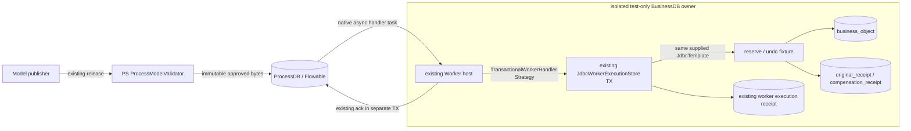
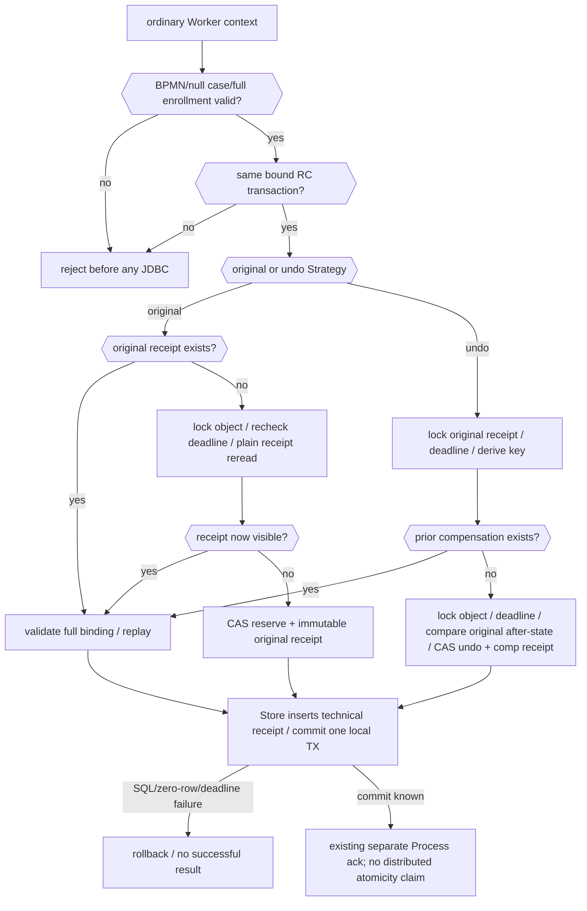
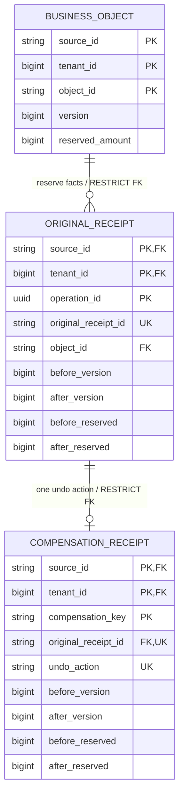

# 普通 Worker 补偿模型与业务收据夹具

| Field | Value |
| --- | --- |
| Document | `2026-11-05-12-09-worker-compensation-fixture.md` |
| Template Version | `9` |
| Archetype Cleanup | `Not applicable` |
| Status | `Review` |
| Type | `Feature` |
| Complexity | `Complex` |
| Complexity Drivers | 原生异步补偿、正常成功边支配证明、Process/Business 双事实所有者、跨技术 task 的业务幂等、并发锁序与失败原子性 |
| Created | `2026-11-05 12:09 Asia/Shanghai` |
| Updated | `2026-11-05 13:12 Asia/Shanghai` |
| Owner | Root decision owner; reconstruction for review, no implementation GO |
| Repository | `tianji-service` |
| Scope | T3-10 一个 ordinary original/undo pair 的发布校验与 test-only BusinessDB receipt 示例 |
| Change Surface | PS 两个 main release 类；模型单测/XML；test-only business fixture、单测与现 opt-in PG 源接点/README；无生产表、API、配置、依赖或 Worker main 变更 |
| Affected Chapters | §7, §8, §9, §10, §11, §13, §14, §15, §16, §17, §18 |
| Source Requirement | 用户继续执行 [master Plan](../../../../docs/plans/agent-framework-upgrade-plan.md) T3-10；Root 本轮指定的补偿切片边界 |
| Baseline Revision | `b63fc8a8b1e20733127bc1516d8799ca262997ee`；当前 PS/W 六个取证路径与 `b0cf55c8d4696fac5bea30875c24f169503957a5` 逐字相同 |
| Amends | [固定业务错误路由 Spec](2026-11-05-04-48-worker-business-error-routing.md) §3.2、§4 第603项、§7/§14 中“compensation 拒绝”仅放开本文件 exact-one profile；其余错误路由、安全、调度收据语义不变 |
| Supersedes | `None` |
| Depends On | [master Plan](../../../../docs/plans/agent-framework-upgrade-plan.md) T3-03/T3-10、S10/S11；[错误路由 Spec](2026-11-05-04-48-worker-business-error-routing.md) §6.1、§7、§9、§11；[取消 Spec](2026-11-04-23-22-process-control-cancellation.md) §5.1/§6.1 的现有技术纵向例外 |
| Related Specs | `None` |
| Related Plans | [Worker compensation implementation Plan](../plan/2026-11-05-12-44-worker-compensation-fixture.md) |

本文件是暂停后丢失临时草案的**重新取证版本**。它不声称等同任何旧 `/tmp` SHA，不修改旧 Spec 的正文。唯一正文文件在持久审阅镜像；未来规范路径为 `docs/egon/spec/2026-11-05-12-09-worker-compensation-fixture.md`。设计审阅阶段只读取源码/JAR并运行文档校验；源码阶段的有限测试另见执行证据，未运行应用、Flowable engine、数据库、监听器或浏览器。

## 1. Summary

现有平台能把普通 Worker 的固定业务拒绝交给原生 BPMN Error，但尚不接受补偿语法，也没有体现“原动作业务收据→一次 undo 业务收据”的测试夹具。错误路由收据只证明后续原生工作已接受调度，不能证明原动作正常离开、补偿 subscription 已建立或 undo 已完成。

此切片只扩展当前有界 DOM/图验证器与不可变模型，接受一个 ordinary original/undo pair。业务示例只在测试中运行，复用 `TransactionalWorkerHandler` 和 `JdbcWorkerExecutionStore` 的本地事务：原动作 reserve、原动作业务 receipt、技术 Worker receipt 同事务；undo 从已保存的原动作 receipt 派生稳定 compensation key，先重放既有 undo，再检查对象版本并一次回补。ProcessDB 与 BusinessDB 保持两个独立事实所有者。

成功标准是发布语法和正常成功边证明正确、原有模型/构造器保持、finite converter/mock 测试与 opt-in PG 源可编译。真实异步推进、重启、并发和本地 ACID 验收仍交用户单独启动的环境；本 Spec 不把它们标为通过。

## 2. Background and Current State

### 2.1 Business and user context

T3-10 要求幂等业务 Worker 示例、原动作 receipt 与 compensation key、原生补偿及失败人工恢复。取消、固定业务错误路由已经有独立源码提交。此设计处理补偿模型与一次可回补 reserve 示例；死信/人工恢复 API 仍为 Required 后续工作。

### 2.2 Repository evidence

本节路径相对 `tianji-service`。PS=`stellar-enclosure-tianji-process-server`，W=`stellar-enclosure-tianji-worker-starter`，C=`stellar-enclosure-tianji-contract`。`...` 仅用于包名前缀定位，§8 给出完整目标路径。当前六路径与 25 SQL SHA 在持久 `compensation/current-source-evidence.json`；SDK 字节码、JAR SHA 与行号在 `compensation/sdk-evidence/`。

| Evidence ID | Classification | Exact path/symbol/decision/command | Observed fact | Design significance | Verification limit/freshness |
| --- | --- | --- | --- | --- | --- |
| EVD-701 | Static repository | `PS/src/main/java/top/egon/cola/platform/tianji/process/server/release/ProcessModelValidator.java:48-78,90-322,584-630` | 封闭 BPMN children/attributes；只支持 Error/Timer boundary；128 nodes/256 flows、worker≤16、DAG paths/traversals cap；walk 全局唯一 ID | 扩同一验证器，绝不开放任意 BPMN | 当前补偿元素未发现；未部署 |
| EVD-702 | Static repository | `PS/.../release/ValidatedProcessModel.java:17-128` | 不可变 metadata、Map.copyOf/xml clone、递进构造器；当前无 workerCompensations | 只加一个嵌套值与 map，保留旧 descriptor | 构造值本身不授发布/执行权 |
| EVD-703 | Static repository | `PS/.../release/ProcessReleaseService.java:305-341` | 校验全部 workerTasks schema/registry；internal Agent dispatch 必须双向匹配 messageWait | detached handler 仍留 workerTasks，从而复用普通/内部准入 | 不改 release service main |
| EVD-704 | Static repository | `W/.../JdbcWorkerExecutionStore.java:72-104,205-244` | Store 拥有 TransactionTemplate，传同 JdbcTemplate；技术 receipt 与 handler 在一个 TX；无显式 isolation 设置 | 不借第二连接、不改 Store；fixture 自证 READ_COMMITTED | 未运行数据库；默认隔离不能假定 |
| EVD-705 | Static repository | `W/.../TransactionalWorkerHandler.java`、`WorkerExecutionContext.java`、C `WorkerScopeTypeEnum` | execute(context,JdbcOperations)；context 有 source/tenant/BPMN/case/process/business/correlation；scope 枚举为 BPMN/CMMN | SQL 前证明完整 enrollment，必须 BPMN 且 caseId null | 不存在 PROCESS 枚举 |
| EVD-706 | Static repository | `PS/.../execution/ProcessRequestDigest.java`；Common `ValidationUtils` | public static hash(List<String>,Map) 委托既有 framing；ValidationUtils 是实例、validate 返回目标且激活 Default | 复用 digest/注解元数据，无新 Utils/依赖 | 不是新业务规则引擎 |
| EVD-707 | Static local pinned SDK | Flowable engine/model/converter `8.0.0`；报告 FACT-SDK-701..704 | Java 类型 ThrowEvent、方向 ONE/XML One；converter 入口 InputStreamProvider；wait true 默认且 throw 不读取 wait，调用 ScopeUtil 后 leave | DOM 独验显式 true；getter/end 不是 undo 完成证据 | 仅 SHA-校验 JAR/javap，不是 engine 运行 |
| EVD-708 | Static local pinned SDK | `AbstractBpmnActivityBehavior.leave`、`BoundaryCompensateEventActivityBehavior.execute`、ordinary external-worker trigger | 原动作 normal leave 建立 subscription；completion command 先转 executable job，后续 job 才触发 normal leave/error | 分开业务 receipt、native subscription、handler dispatch 和 undo receipt | 实际 liveness/restart 未验证 |
| EVD-709 | Static repository | `PS/src/test/java/top/egon/cola/platform/tianji/process/server/ProcessServerPostgresTest.java:153,1074,1159-1186,2127-2148` | 现 opt-in process/business loopback DB 与专用角色 guard；当前无补偿 scenario | 增 test-only helper 接点，编译但不选择/不设置 opt-in | 不能自动启动/操作数据库 |
| EVD-710 | Static repository | `PS/pom.xml`、根 POM、25 个 main db SQL | Flowable8/Java25/现测试 JDBC/Validation/Worker 已有；不需新依赖；旧 SQL 全部与基线字节相同 | 零 POM、零生产 DDL、零新 migration | 未验证 live schema |
| EVD-711 | User decision | Root 此轮 NEW_TASK/后续确认 | exact-one profile、三 test-only 业务表、source/case/tenant 先验、稳定 key、录入时间非 commit time；空 receipt/object 锁后 plain 重读被明确接受 | 设计边界已定；不生成 Plan/source | Status Review，等待 Root 完整审阅 |
| EVD-712 | Static predecessor | 错误路由 Spec §6.1/§6.2、取消 Spec §5.1/§6.1 | Root 已批准技术平台 final classes/plain JDBC/explicit factories 例外 | 不插入 biz.*、MP/DDL runner/生成器/新模块 | 只适用于现技术纵向和 test fixture |
| EVD-713 | Static local pinned SDK | 当前 Surefire classpath 的 Spring JDBC/TX `7.0.10`，ConnectionHolder/TransactionSynchronizationManager javap | 当前绑定资源可用 public ConnectionHolder.getConnection()；Store 允许平台默认 isolation | fixture 读取同已绑定 connection 的 isolation，非 RC 拒绝 | 未执行连接或 SQL |
| EVD-714 | Static repository / Root decision | PS POM、platform-parent annotationProcessorPaths、当前PS日志用例扫描 | PS无Lombok compile dependency，processor path不等compile依赖，当前PS无Slf4j用例 | 新fixture是test-only技术helper，无新日志；保零POM/依赖与两main技术风格 | 不是对未来生产业务类日志规则的豁免 |
| EVD-715 | Official PostgreSQL documentation / Root correction | [SELECT locking privileges](https://www.postgresql.org/docs/current/sql-select.html), [CREATE TRIGGER](https://www.postgresql.org/docs/current/sql-createtrigger.html) | Row-locking SELECT needs UPDATE on at least one selected-table column; SELECT is not an UPDATE trigger event | Test-only one-column privilege plus rejecting statement trigger preserves both original receipt lock and immutability | Documentation verified; no PG privilege/runtime probe executed |

### 2.3 Problem statement and gap

当前 compensation profile、正常成功边事实、业务 original/undo receipt 示例和相应测试均“当前未发现”。现有 Worker 技术 receipt 由 task/idempotencyKey 约束，不能替代独立业务 operationId/compensationKey。两个不同技术任务可对应同一个原始业务操作，必须在业务 DB 自己重放。

### 2.4 Evidence and current-chain map

| Entry/trigger | Current call chain | Data read/written | External dependency | Consumers | Evidence |
| --- | --- | --- | --- | --- | --- |
| 发布 BPMN | release.publish→prepare→validateBpmn→validateWorkerBindings/registry→native deployment | immutable XML/bindings | pinned Flowable | current Worker acquisition | EVD-701..703 |
| 原动作执行 | RemoteWorkerPoller→Store.execute→handler(context,jdbc)→technical receipt→complete ack | BusinessDB 技术 receipt | HTTP ack 后独立 ProcessDB TX | ordinary business Worker | EVD-704/705 |
| 业务错误 | FlowableWorkerService.fail→fixed bpmnError→same-ID executable job→later ErrorPropagation | ProcessDB 原生 job/V4 receipt | Flowable async executor | process path | EVD-707/708 |
| 补偿与 undo | 当前没有平台准入/fixture；SDK 提供 native throw/handler | 当前没有业务 original/comp receipt | 原生调度后再次 Worker 协议 | new test-only ordinary handler | EVD-707..711 |

### 2.5 Archetype example cleanup

Cleanup disposition: Not applicable

Reason: 当前是既有 Tianji 技术平台的定点 release 验证扩展与 test-only fixture；不是新建/首次业务 archetype 工程。旧 BPMN 是被实际测试消费的技术资产，不是可删除示例域。无删除/移动范围。

## 3. Goals and Non-goals

### 3.1 Goals

- 只放开一个固定 compensation pair 的封闭 BPMN 语法，且所有通往 throw 的实际路径都经过 original 的显式正常成功边。
- 原动作与 undo 各自只有一次业务变更；跨技术 task 重试依靠 BusinessDB receipt 返回原结果。
- 原动作业务、undo 业务及各自技术 receipt 共享 Store 的同一连接/TX；绝不声称 ProcessDB 与 BusinessDB 全局原子。
- 保留现有 Error/Timer/Human/Agent 等合同和旧 metadata 构造器；新增范围可单独审查/回退。

### 3.2 Non-goals

不开放广播/递归/嵌套/多 pair 补偿、任意跳节点/Process cancel undo、生产业务表、生产恢复 API、新 permission/配置/依赖/Event/Outbox、Worker main 改动、MP/DDL runner 迁移、ACT_* 写 SQL、Flyway repair、容器/数据库/引擎/应用启动。死信和人工恢复、T3-12/T4、真实 S10/S11 仍 Required。

### 3.3 Change Surface and Design Depth

| Area/layer | Disposition | Exact repository evidence | Changed or preserved behavior/contract | Required Spec treatment | Chapter(s) |
| --- | --- | --- | --- | --- | --- |
| PS release validator/model 两 main 类 | Affected | EVD-701..703 | exact-one grammar、immutable metadata、edge dominance | 完整设计 | §7, §8, §9, §10, §13, §14, §15, §16, §17, §18 |
| test-only业务 schema/handler/scenarios | Affected | EVD-704..711 | 三业务表、stable original/undo receipts、既有 opt-in PG 源接点 | 完整事务/字段/测试设计 | §7, §8, §9, §10, §11, §13, §14, §15, §16, §17, §18 |
| W Store/技术 receipt | Context-only | EVD-704/705 | 现有 owner TX、回放和技术 receipt 不变 | 证明边界/有限回归 | §7, §11, §14, §16 |
| Process release/Worker API、C/CL | Unchanged | EVD-703、固定错误路由 Spec | 不增加 endpoint/DTO/permission/outcome | 静态合同/既有回归 | §9, §14, §16 |
| 25 个 main db SQL/运行配置/POM | Unchanged | EVD-710/current-source-evidence.json | 内容、顺序、checksum、默认开关不变 | SHA gate | §11, §14, §16 |
| tianji-web 前端 | Unchanged | master T3-11/现 API | 无新可见操作/路由/字段 | 静态 diff 边界 | §12, §16 |
| 新外部消息/缓存/Graph scheduler | Not applicable | 此 slice 无生产发布动作 | N/A，无新增运行状态所有者 | 不设计 | §15 |

## 4. Requirements and Acceptance Criteria

| ID | Atomic requirement | Priority | Observable acceptance criteria | Source |
| --- | --- | --- | --- | --- |
| REQ-701 | 仅准入一个固定 ordinary original/undo pair | Must | 固定 compensation boundary/association/handler/throw 各一个，immutable metadata；旧模型空 map | Root exact-one |
| REQ-702 | compensation boundary 非打断且只附着原动作 ordinary worker | Must | 必须显式 cancelActivity=false、无 sequence edge；DMN/Human/Case/Agent wait 等拒绝 | Root grammar |
| REQ-703 | detached compensation handler 通过单向 association 关联 | Must | isForCompensation=true、direction=One、非原动作自己、无 normal in/out/其他 boundary；保留 workerTasks | Root grammar |
| REQ-704 | throw 固定指向原动作并通往专用结束节点 | Must | 显式 activityRef/original 与 waitForCompletion=true、exact1in/1out→独占 end；禁止广播/额外 definition | Root grammar |
| REQ-705 | throw 必须被 original 显式 normal-success EDGE 支配 | Must | 所有实际 Error/Timer 隐式边参与 AND；original自 error 与绕过原动作的合流路径拒绝 | Root edge proof |
| REQ-706 | 原动作与 undo 只读 initial operationId 输入映射且无 outputs | Must | operationId→operationId STRING；不读 original output/模型变量推断业务收据 | Root scope |
| REQ-707 | 无补偿语法时保留原验证/构造器/图限制 | Must | 旧 fixtures/descriptor/worker bindings 不变；全局ID、DAG/path/traversal cap继续 | Compatibility |
| REQ-708 | 在任何 JDBC 前验证 BPMN scope 与完整 enrollment | Must | caseId=null，source/tenant/process/business/correlation/input 与 expected 全等；original/undo topic分别固定reserveBusiness/undoReservation、schemaVersion=1、effectSafety=TRANSACTIONAL_RECEIPT；失败 SQL/connection 调用0 | Root fail-closed |
| REQ-709 | fixture 只接受现 Store 同绑定连接的 READ_COMMITTED TX | Must | actual TX/ConnectionHolder/同DataSource；隔离不是 RC 时业务 SQL0，不改Store或借第二连接 | Root RC decision |
| REQ-710 | 原动作 reserve、original receipt 与技术 receipt 同本地 TX | Must | guarded version/reserved更新恰好1，insert immutable receipt，再由Store保存技术receipt；失败无成功返回 | Root atomicity |
| REQ-711 | 原动作跨技术任务并发重放 | Must | 首lookup为空→object锁→plain immutable receipt重读；已存在完整binding返回；不得反向 FOR UPDATE | Root accepted concurrency fix |
| REQ-712 | undo 从持久 original receipt 派生稳定 key | Must | key binds namespace/source/tenant/originalReceiptId/UNDO_RESERVATION_V1，不信 caller receipt或新taskId | Root key |
| REQ-713 | undo replay 先于新对象版本检查 | Must | 锁original、查prior comp；完整binding相同直接原receipt；重复执行/对象后续变更不再undo | Root replay |
| REQ-714 | 首次 undo 受 object CAS 与版本单调约束 | Must | 匹配 original after-state 后 reserved恢复before，version再+1；写compReceipt同TX；0row/overflow回滚 | Root consistency |
| REQ-715 | recorded_at 仅是 BusinessDB 写入时钟 | Must | OffsetDateTime→Instant；UTC/microsecond；不用它推导真正commit时刻或跨库顺序 | Root time semantics |
| REQ-716 | 技术接收/原生leave/subscription/undo业务完成分开取证 | Must | explicit wait/getter/throw终止/ack均不单独证明undo receipt；SDK行为固定SHA证据 | Pinned SDK |
| REQ-717 | 新增业务 DDL 仅 test fixture，旧25SQL不变 | Must | 三业务表只在缺失的loopback专用schema；不生产migration、不自动provision/drop未知schema；原动作列授权仅用于行锁，实际UPDATE由fixture trigger拒绝 | Root scope |
| REQ-718 | 只做有限离线/编译与文档交付 | Must | 明确selectors不选PG/listener；不设optin、不启动环境；源码不伪装真实S10/S11验收 | User runtime constraint |

### 4.1 Scenario matrix

| Scenario | Actor/trigger | Preconditions | Main path | Alternative/failure path | Data/state change | Observable result | Requirements |
| --- | --- | --- | --- | --- | --- | --- | --- |
| 发布 exact-one 模型 | model publisher | 普通worker registry/schema有效 | closed grammar→edge proof→immutable metadata | 多pair/错误引用/绕过路径拒绝 | 仅发布现绑定 | 有效或safe model error | 701-707 |
| original 首次 reserve | business handler | enrollment/RC/live deadline，receipt空 | object锁→重读→CAS→original receipt | 过期/0row/insert失败→异常/TXrollback | reserve+v1+original+技术receipt | 一次receipt | 708-711 |
| original 同op不同技术task并发 | duplicate business task | 技术key不同、operationId相同 | 空lookup等object锁→plain重读已提交receipt | 不同binding冲突；非RC事先拒绝 | 无第二次reserve | 原receipt | 709/711 |
| undo首次 | native compensation worker | real original receipt存在 | receipt锁→deadline→prior查→object锁→deadline→CAS→comp receipt | 缺original/漂移/过期回滚 | reserve还原、v2、comp+技术receipt | 业务undo收据 | 712-715 |
| undo重复或响应丢失 | sameop/newtechnicaltask | comp已存在 | receipt锁→prior全绑定replay | changed source/tenant/operation拒绝 | 无第二次undo | 原comp receipt | 708/712/713 |
| original self-error | BPMN error from original | original未正常leave | edge proof拒绝通往throw | 不把发生过该节点当成功 | 无部署 | safe model error | 705/716 |
| 后续async job失败 | Flowable job | earlier ack已commit | engine retry/deadletter own state | fixture不宣称undo成功 | ProcessDB独立事实 | runtime未验收 | 716/718 |
| 错scope/其他tenant | forged/reused context | CMMN/caseId/affinity/topic/schema/effect错误 | anyJDBC前拒绝 | 无lookup侧信道 | 不变 | safe failure | 708 |

### 4.2 Use-case analysis

#### 4.2.1 Actor inventory

| Actor ID | Actor/role | Goal and responsibility | Entry/channel | Permission/tenant context | Evidence |
| --- | --- | --- | --- | --- | --- |
| ACTOR-701 | Process model publisher | 发布一种受控补偿路径 | 既有release服务 | 现publisher/tenant/registry | EVD-701/703 |
| ACTOR-702 | Ordinary business Worker host | reserve或undo一次并重放业务结果 | 既有Store/handler | server-owned source/tenant与enrollment | EVD-704/705 |
| ACTOR-703 | Flowable async executor | 执行已接受的原生后续工作 | engine job | ProcessDB owner | EVD-707/708 |
| ACTOR-704 | 测试/验收操作者 | 区分源码证明与真实验收 | finite unit/未来显式opt-in | 当前不准启动环境 | EVD-709/711 |

#### 4.2.2 Use-case artifact

| ID | Use case/goal | Primary actor | Supporting actors/systems | Trigger | Preconditions | Main success outcome | Alternatives/failures | Postconditions | Requirements | Interfaces/pages | Tests |
| --- | --- | --- | --- | --- | --- | --- | --- | --- | --- | --- | --- |
| UC-701 | 发布固定补偿路径 | ACTOR-701 | ACTOR-703 | 提交XML | exactone/registry有效 | validated map与native converter一致 | 语法/edge失败拒绝 | 无不完整发布 | 701-707 | INTERNAL-701/702 | TEST-701..705 |
| UC-702 | reserve并重放原动作 | ACTOR-702 | BusinessDB | ordinary task | enrollment、RC、deadline | original业务receipt稳定 | 错scope/并发/SQL失败 | 一次reserve或全回滚 | 708-711/715 | INTERNAL-703 | TEST-706..710/716 |
| UC-703 | undo并重放补偿 | ACTOR-702 | ACTOR-703/BusinessDB | 原生handler task | original已存在、完整binding | 一次回补和稳定compReceipt | 缺original/对象漂移/重复/期限 | v单调，重复无变更 | 712-715 | INTERNAL-704 | TEST-711..716 |
| UC-704 | 审查/手工验收真实补偿 | ACTOR-704 | ACTOR-703 | 用户未来启动隔离环境 | 显式URL/角色/空schema | 分别观察leave、handler、receipt | 未配置只编译；无provider/engine自动启动 | 不伪称runtime通过 | 716-718 | 原PG源接点，无新API | TEST-717/718 |

## 5. Constraints, Assumptions, and Decisions

### 5.1 Confirmed constraints

只在 PS 两个 main release 类增加模型能力；W main、ProcessReleaseService/FlowableWorkerService main、C/CL/API、POM、配置、权限及25个SQL不变。现 final/plain-JDBC/显式构造技术纵向例外沿用前置Spec；三新业务表属于test-onlyfixture，非新持久业务模块。旧Flyway不可修改，当前不新增任何生产migration或generator action。记录完整技术receipt不能替代真实业务receipt。

### 5.2 Small-gap assumptions

| ID | Inference | Repository evidence | Why locally reversible | Impact if wrong |
| --- | --- | --- | --- | --- |
| ASM-701 | 测试schema名 compensation_fixture；topic为reserveBusiness/undoReservation/downstreamRejectable，schema1 | 既有 fixtures/topic命名和initialinput规则 | 仅新fixture，无生产契约 | fixture与测试同改，不碰旧模型 |
| ASM-702 | 原动作receiptId用现digest的固定namespace+source/tenant/operationId生成64hex | 现ProcessRequestDigest长度分隔hash与WorkerResult≤255 | 只test fixture；引用持久行仍为authority | 更新新fixture规则/测试，无历史数据迁移 |
| ASM-703 | downstream示例可同样只读取initial operationId | 现validateWorkerBindings只允许初始输入 | 局部示例形状；非补偿authority | 如移除只改fixture绑定，不改核心语法 |

### 5.3 Resolved decisions

| ID | Decision | Decision owner | Evidence and rationale | Requirements |
| --- | --- | --- | --- | --- |
| DEC-701 | exactlyone ordinary pair，拒绝广义补偿语法 | Root | EVD-711，最小可审核profile | 701-706 |
| DEC-702 | 所有通向throw的路径必须穿过original唯一显式normal edge | Root | native subscription在normalleave建立；节点出现不足以证明 | 705/716 |
| DEC-703 | BusinessDB保存original/comp receipt；技术receipt复用Store | Root | EVD-704，跨库不能一个全局TX | 710/712-714 |
| DEC-704 | priorcomp replay早于对象版本检查 | Root | 重试不能被后续对象演进打破或再次undo | 713 |
| DEC-705 | recorded_at仅为写入时间，native wait不是业务完成证明 | Root/SDK facts | EVD-707/708 | 715/716 |
| DEC-706 | 不运行PG/engine，只finiteconverter/mock与源编译 | User/Root | EVD-711 | 718 |
| DEC-707 | 空original lookup→object锁→plain receipt重读；禁止反向FORUPDATE | Root本轮明确接受 | 防并发误冲突，并保持undo receipt→object锁序 | 711 |
| DEC-708 | fixture检查现绑定连接为RC；非RC在业务SQL前拒绝 | Root | Store本身未设isolation，必须证明重读可见性前提 | 709/711 |
| DEC-709 | 模型沿现ordinary effect枚举/registry；仅fixture pair固定TRANSACTIONAL_RECEIPT | Root本轮明确确认 | 不把结构准入误称业务可补偿性或擅自缩窄原模型合同 | 701/703/710/716 |
| DEC-710 | test-only技术fixture无新logger/Slf4j，零POM/依赖；两main保现技术风格 | Root本轮明确确认 | EVD-714；本slice非新增生产业务类/Bean，未来生产业务日志要求不取消 | 717/718 |
| DEC-711 | 原动作receipt行锁仅授`UPDATE(recorded_at)`，测试schema装always启用的拒绝UPDATE trigger | Root | EVD-715；保留锁序与receipt只读/插入事实，不增加业务表或生产迁移 | 717/718 |

### 5.4 Open major decisions

当前在已授权切片内无待用户决策项。Root仍须完整审阅本重建版本，`Review`不表示用户接受或源实施GO。生产补偿规则/真实业务接入/失败人工恢复是明确后续范围，不在本Spec选择。

## 6. Project Technology Context

| Concern | Current choice | Repository evidence | Constraint on design |
| --- | --- | --- | --- |
| Java/Spring | Java25、Boot4.1.2、当前resolved Spring7.0.10 | platform baseline与当前Surefire classpath | 不改版本；只取公开API |
| Flowable | 8.0.0 pinned | root/PS POM及SDK SHA | 正确converter/provider/ThrowEvent，wait边界固定 |
| PS/W persistence | plainJDBC/TransactionTemplate，外部预置schema | EVD-704/710/712 | 不加MP、第二TM或migration |
| Tests | JUnit5/Mockito、真实BpmnXMLConverter、既有opt-in PG源 | 既有ModelValidator/PG测试 | 不启动engine或选PG |
| Dependency | existing Spring JDBC/TX/Jakarta/common ValidationUtils/Worker test dependency | PS POM | 新依赖0 |

### 6.1 Java architecture profile and capability baseline

| Architecture profile | Archetype/template or base package | Exact evidence and verifier | Existing deviations | Design action |
| --- | --- | --- | --- | --- |
| Existing Tianji technical vertical under explicit Root exception | PS `top.egon.cola.platform.tianji.process.server.release`、W现Store、PS test package compensation | 前置错误路由Spec §6.1/取消Spec §5.1；当前POM/tree | 非biz.*且非业务archetype；final/JDBC/explicit factory已批准 | 原位置最小修改，无新层/模块，不冒称新架构 |

| Need | Spring/JDK candidate | Spring Boot Starter candidate | Egon-COLA/module candidate | Proven gap | Decision/dependency impact |
| --- | --- | --- | --- | --- | --- |
| 封闭语法/edge proof | DOM/集合/现toposort | 无需新starter | ProcessModelValidator | compensation profile缺失 | 扩现类，无新validator层 |
| metadata | immutable record/Map.copyOf | 无 | ValidatedProcessModel | 新map缺失 | 新nestedVO+getter，无重复DTO |
| 原子receipt | Spring TX/JdbcTemplate | 现依赖 | JdbcWorkerExecutionStore/TransactionalWorkerHandler | 独立业务receipt fixture缺失 | 新testonlyStrategy，Store不动 |
| input校验 | Jakarta constraints | 现validation | Common ValidationUtils实例 | 无 | 在fixture enrollment Default触发，无新Utils |
| stablekey | JDK immutable list | 无 | ProcessRequestDigest.hash | 无 | 复用现framing |
| RC proof | ConnectionHolder/current bound connection | 现Spring JDBC/TX | Store binding | 未显式隔离 | fixture拒非RC，不更改Store/TM |

### 6.2 User-mandated Java rule compliance

| Literal rule | Affected? | Repository evidence | Exact design decision | Files/types/interfaces | Validation/test evidence | Status/blocker |
| --- | --- | --- | --- | --- | --- | --- |
| Rule 1 | Yes | 现technical types/VO惯例 | WorkerCompensationVO、ExpectedOperationVO/ReceiptVO均语义明确；不造PO/DAO | §8/10 | naming inventory | PASS |
| Rule 2 | Yes | DOM whitelist、Worker DTO、ValidationUtils实例 | XML/发布/handler enrollment/rows各边界明确；注解Default仅纯值，stateful在owner TX | §7/9/10 | TEST-701..716 | PASS under current technical boundary |
| Rule 3 | Yes | Map.copyOf/xml clone、现nested records | 真不可变metadata/快照用record，防御copy；不造entity/Converter | §10 | immutability/ctor tests | PASS under前置值语义例外 |
| Rule 4 | No | PS两main保现technical风格；PS POM无Lombok compile dependency，仅继承processor path，当前PS无Slf4j用例；fixture为test-only技术harness/helper，非新增生产业务类或Bean | 无新logger/Slf4j/LoggerFactory/日志要求；不引依赖、不改POM；未来新增生产业务类仍须重新应用业务日志/DI要求 | 两PS main与test fixture | POM/import/log差异检查；Root本轮明确技术test-helper边界 | N/A — 本slice无新增生产业务类/Bean，既有技术例外保持 |
| Rule 5 | Yes | JDK/Spring/Flowable/common已有 | 仅现工具/collections/hash/validation，无新Utils/依赖 | 全target | imports/POM hash | PASS |
| Rule 6 | No | 外部JSON/enum/DTO原样 | 输出复用WorkerBusinessResultDTO且空Map，无新wire枚举/mapper | C/W unchanged | JSON/DTO现回归 | N/A — new JSON contract absent |
| Rule 7 | No | 不改profile/config | 所有application.yml和keys字节不变 | 配置excluded | SHA gate | N/A — configuration outside scope |
| Rule 9 | Yes | W已有handler Strategy+Store invariant Template | reserve/undo两个具体handler Strategy挂同接口；验证器扩现图算法，不造第二pipeline | fixture/validator | branch/replay/order tests | PASS |
| Rule 10 | Yes | Instant/OffsetDateTime/Duration已有 | DB write-time与deadline分开；PG getObject OffsetDateTime→Instant | §6.3/11 | TEST-716及futurePG | PASS设计，运行映射未验收 |
| Rule 11 | Yes | 前置明确Root技术纵向/现Store/25SQL | 不加MP/业务DDLrunner/新模块；testonlyimmutable receipts非softdelete生命周期 | 全targets | POM/25SQL/profile diff | PASS under既有Root scope |

### 6.3 Time semantics and conversion contract

Time contract: Required

| Time ID | Fields/symbols | Semantics | Java/runtime type | Storage policy | Wire policy | Business zone source | Display zone source | Boundary / DST rules | Precision / Clock | Compatibility | Verification |
| --- | --- | --- | --- | --- | --- | --- | --- | --- | --- | --- | --- |
| TIME-701 | original_receipt.recorded_at / compensation_receipt.recorded_at / ReceiptVO.recordedAt | Occurred instant | OffsetDateTime at JDBC→Instant immutable value | UTC instant | Internal | Not applicable: 写入事实无日历业务区 | Not applicable: 无新UI | 不用本时间推导commit或跨DB先后；无DST计算 | timestamptz(6)/BusinessDB clock_timestamp，微秒保留 | 现Worker committedAt字段原样，不改其命名或语义 | TEST-716/PG-701 |
| TIME-702 | WorkerExecutionContext.deadline、fixture锁后deadline guard | Occurred instant | Instant | Not persisted | Internal | Not applicable: technical deadline | Not applicable: 无UI | 只用BusinessDB当前clock评估传入合同Instant；每required lock后严格now<deadline，不用JVM默认区 | 来源为Store.execute:85-97：min(task.leaseExpiresAt−deadlineSafetyMargin, BusinessDB now+maximumWorkTime)，经WorkerExecutionContext.from原样传入 | Store期限/余量不改；Process lease与BusinessDB时钟有不同所有者；clock skew未实测，不承诺全局硬deadline或用recordedAt证明跨DB顺序/真正commit | TEST-709/713/716/PG-701 |

## 7. Architecture Design

### 7.0 Minimum-design baseline and element-necessity audit

| Proposed element | Change | Requirements | Existing/direct alternative | Concrete inadequacy of alternative | Added calls/state/coupling/failures/migration/operations | Verdict |
| --- | --- | --- | --- | --- | --- | --- |
| 现DOM/graph validator | Expand | 701-707 | 任意Flowable模型直接部署 | 缺封闭语法/正常成功证明 | 局部edge字段与验证分支，无运行状态 | Add |
| nested compensation VO/map | New | 701/707 | 运行时重解析/信caller | 需固定经过校验的结构事实 | 一个immutable值/map，无新authority | Add |
| Business fixture/三表 | New test-only | 708-715 | 只用技术task receipt | 不覆盖不同task同一businessop/undoidentity | 单隔离testschema、局部locks/CAS | Add |
| handler Strategy+Store TX | Keep | 710-714 | 新executor/自建TM | 已有同连接TX适配，不需平行基础设施 | 无新运行调用/连接 | Keep |
| 新compensation REST/任意jump | New candidate | 无本slice requirement | 固定模型+现WorkerAPI | 增权限/路由面而不证明业务 | 新状态/权限/网络成本 | Remove |
| 生产表/DDL/framework | New candidate | 无 | testonlyschema+现Store | 无生产业务owner范围 | 数据迁移/运维成本不必要 | Remove |

| Path | Network calls | Client states | Server contracts/state | Failure and TOCTOU points | Additional user/business value |
| --- | --- | --- | --- | --- | --- |
| 现Worker | acquire/ack既有次数 | 现poller状态 | task receipt | ack丢失→同技术key重放 | 技术任务幂等 |
| 本fixture | 新业务网络0，现Worker次数不变 | 无新UI | 业务original/comp receipt | businessop重复/原undo并发在本地TX证明 | 跨技术任务的一次业务reserve/undo |

### 7.1 System Architecture Design

#### 7.1.1 Architecture Mermaid view



#### 7.1.2 Boundary and responsibility table

| Module/component | Capability and data owned | Inputs/outputs | Allowed dependencies | Forbidden responsibility | Requirements |
| --- | --- | --- | --- | --- | --- |
| PS validator/model | 发布语法/结构事实 | XML→immutableVO/map | JDK DOM/既有图算法 | 业务DB判断、runtime调度 | 701-707 |
| Flowable | native execution/subscription/job | 既有worker完成/throw | 现ProcessDB | 业务receipt、跨库atomic | 716 |
| W Store | 技术receipt与本地TX | task/handler→receipt | 同DSmanager/JDBC | 新业务动作规则、ProcessDB事务 | 709/710 |
| test fixture | BusinessDB reserve/undo事实 | enrollment+context→businessreceipt |  supplied JDBC/ValidationUtils/digest | 新连接、remote I/O、任意数据修复 | 708-715 |

### 7.2 High-Level Design

#### 7.2.1 Critical business/control flowchart



#### 7.2.2 High-level decision and quality matrix

| Concern/use case | Required behavior | Selected mechanism | Failure/degradation behavior | Trade-off | Verification | Requirements |
| --- | --- | --- | --- | --- | --- | --- |
| 路径安全 | throw仅在成功normaledge之后 | 所有真实incoming edge AND事实 | 自error/旁路合流拒绝 | 限制广义BPMN | TEST-704/705 | 705 |
| 一次业务变更 | 跨技术task重试不重复reserve/undo | immutable receipts、object lock/CAS、prior replay | 冲突/异常，本地TXrollback | 三业务表仅fixture | TEST-708/710..714 | 710-714 |
| 并发与锁序 | no stale snapshot假设/反向锁 | 同boundConnection RC检查；锁后plain重读 | 非RC拒绝，无第二连接 | 只支持该fixture隔离前提 | TEST-707/710 | 709/711 |
| 验收诚实 | ack/end不等于业务完成 | 原生leave与receipt分别观察 | 未运行环境明确Unverified | 需要用户后续live proof | TEST-717/718 | 716-718 |

### 7.3 Detailed Design

#### 7.3.1 Detailed component collaboration

模型路径：沿用 SafeModelXml 的有界UTF8/禁外部实体/XSD校验、全局唯一ID和DOM白名单。只为 process 增 association/intermediateThrowEvent、boundary增compensate definition、serviceTask增无命名空间isForCompensation、对应精确属性；不放开其他namespace、表达式、脚本或子流程。

补偿 grammar：一个boundary、association、handler、throw成完整集合才合法；无任何compensation syntax时返回空map并走旧路径。boundary 显式false、只附original普通externalWorker、无normalin/out。association direction必须字面One，source=boundary、target=唯一detached handler。handler 与original不同，显式isForCompensation=true、externalWorker、无normalin/out、无自己的Error/Timer/compboundary、不为messageWait/internalAgent。original 不得标isForCompensation；两者input恰好operationId→operationId STRING且output空。普通既有 worker metadata/registry/effectSafety 合同保留；生产模型不额外强制TRANSACTIONAL_RECEIPT，不增加审批/Agent等handler能力。结构准入本身不证明业务handler真实可补偿或receipt可靠性；本fixture pair固定TRANSACTIONAL_RECEIPT，真实业务接入另由业务owner取证。

throw 显式 activityRef=original、waitForCompletion=true、只有一个空compensateEventDefinition，exact1incoming/1outgoing；target是独占end（仅throw一条incoming、无outgoing）。广播/未知ref/缺wait/多definition、Unused/多pair、递归/嵌套一律拒绝。原Error boundary继续显式true；其converter getter normalization不改验证要求。

图证明：先完整验证pair，才从normalNodes排除detached handler与compensation boundary；workers map保留handler。原node/flow总数cap和现ordinaryflow规则仍适用，normal DAG所有其他节点不得被隐藏。给每个incoming记录 predecessor 与可空显式sequenceFlowId；原有Error/Timer隐式边仍存在，其显式flowId为null。original唯一显式正常outflow是唯一建立成功事实的边。拓扑时 `normalSuccessBefore(node)` 为**每个**incoming都满足“前驱已具事实或该边就是originalNormalFlow”的AND；禁止用OR/仅检查node可达。throw必须具事实，原有decisionBefore/waitBefore/path/traversal/visited检查保持。original自error边不建立事实，downstream error可继承已发生normaledge的事实；旁路合流必须拒绝。

handler路径共同前置：Validate `ExpectedOperationVO` 的Jakarta Default元数据；收到context后，先验证scope==BPMN、caseInstanceId==null及source/tenant/process/business/correlation/input全等；然后按当前Strategy验证context.topic()==RESERVE_TOPIC（reserveBusiness）或UNDO_TOPIC（undoReservation）、context.schemaVersion()==字符串1、context.effectSafety()==TRANSACTIONAL_RECEIPT。固定topic/schema/effect来自fixture常量而非caller；全部在任何SQL/JdbcTemplate/DataSource/Connection调用之前验证，错误零调用。技术taskId/occurrenceId不作为业务去重key。之后只接受传来的JdbcOperations为现JdbcTemplate、actual TX且其DataSource对应绑定ConnectionHolder；用holder.getConnection()读该连接isolation==READ_COMMITTED。无借连接/开TX/setIsolation/手动commit；SQLException保留安全边界上下文后抛异常，不吞掉。读取同BusinessDB `clock_timestamp()`为OffsetDateTime→Instant；每个required lock后严格now<deadline。 deadline不是fixture新算的时限：`JdbcWorkerExecutionStore.execute:85-97`先取BusinessDB now，再计算`min(task.leaseExpiresAt().minus(deadlineSafetyMargin), now.plus(maximumWorkTime))`，由`WorkerExecutionContext.from(task,sourceId,deadline)`传入。fixture仅用同BusinessDB当前clock评估这个合同Instant；Process lease来源时钟与BusinessDB时钟之间skew尚未实测，不能由此声称全局硬deadline。recordedAt也不用于证明真正commit或跨DB先后。

original Strategy：先按(source,tenant,operationId)查original_receipt FOR UPDATE；已有则deadline、fullbinding/arithmetic校验后返回其businessReceiptId。空时锁business_object；deadline后用**plain SELECT**重读immutable original_receipt。RC下，锁等待后新statement可看到先提交的同op receipt；若存在校完整binding直接重放，绝不再反向FOR UPDATE。仍空才比较对象expectedVersion/expectedReserved、checked arithmetic、guarded CAS一次reserve并version+1，写original_receipt RETURNING recorded_at。Store随后写技术receipt，同TX。无同op receipt而对象已漂移则冲突，不推测历史。

undo Strategy：先按source/tenant/operationId锁真实original_receipt，deadline后验证全部scope、object、前后version/reserved/amount关系。stable key为既有ProcessRequestDigest.hash(fields=[worker-compensation-v1,sourceId,tenantId十进制,originalReceiptId,UNDO_RESERVATION_V1],values={{}})。先按key查prior compensation receipt，若有完整binding/arithmetic相同返回原compReceiptId，**在任何新object版本检查之前**。无prior才锁object、再核deadline，要求object恰好original.afterVersion/afterReserved；CAS reserved=original.beforeReserved、version=oldversion+1（不是退回beforeVersion），写immutable compensation_receipt。新technical task重放共享该业务key。

#### 7.3.2 Critical-path Mermaid swimlane

```mermaid
sequenceDiagram
    participant Host as existing Worker host
    participant Store as JdbcWorkerExecutionStore
    participant Fixture as undo Strategy fixture
    participant BDB as isolated BusinessDB
    participant PS as Process API / Flowable
    Host->>Store: execute(task, descriptor, handler)
    Store->>BDB: begin owned local transaction / technical replay lookup
    Store->>Fixture: context + same supplied JdbcTemplate
    Fixture->>Fixture: before-any-JDBC scope/input enrollment guard
    Fixture->>Fixture: bound ConnectionHolder / READ_COMMITTED proof
    Fixture->>BDB: original receipt FOR UPDATE / DB deadline guard
    Fixture->>BDB: prior compensation key lookup
    alt prior exists and full binding matches
        BDB-->>Fixture: original comp receipt
    else first undo
        Fixture->>BDB: object FOR UPDATE / DB deadline guard
        Fixture->>BDB: guarded reserve restore + version increment
        Fixture->>BDB: insert immutable compensation receipt
    end
    Fixture-->>Store: WorkerBusinessResultDTO(persisted receipt, empty output)
    Store->>BDB: insert technical receipt
    alt any failure
        Store->>BDB: rollback all local writes
    else success
        Store->>BDB: commit local transaction
        Store-->>Host: replayable technical result
        Host->>PS: existing completion ack in separate transaction
        Note over BDB,PS: no cross-DB atomic transaction; ack/native end does not prove undo business fact
    end
```

#### 7.3.3 Transactions, consistency, concurrency, and idempotency

| Concern/state change | Owner and boundary | Mechanism/isolation/lock | Concurrent or duplicate behavior | Commit/visibility point | Failure result | Requirements/tests |
| --- | --- | --- | --- | --- | --- | --- |
| reserve+original+technical receipt | Store-owned BusinessDB TX | scope→boundRC→existingreceipt→objectlock→plainreread→CAS | sameop differenttechnicaltask重放，不重复reserve | JDBC本地commit后可见；recordedAt不是commitinstant | 全rollback；无successfulResult | 709-711/TEST-706..710 |
| undo+comp+technical receipt | 同Store/TM/connection | originalreceiptlock→prior→objectlock/CAS | 多undo按originalreceipt行串行，prior重放早于objectversion | 同一BusinessDB commit | 全rollback；不claimProcessDB回滚 | 712-714/TEST-711..714 |
| native subscription/job | Flowable/ProcessDB | normalleave/原生command/job | Engine自己的重试/死信 | 独立ProcessDB TX | 业务DB既有事实保留 | 716/PG-701 |

禁止fixture在持object锁后再锁originalreceipt。RC guard必须检查实际已绑定connection，不能把TransactionSynchronizationManager隔离null当RC。跨task的首original并发窗口须在unit fake行时序中模拟“首次空、锁后重读有值”；真实并发可见性只由未来显式PG验收证明。

#### 7.3.4 Failure semantics, recovery, and reconciliation

| Failure point | Detection | Immediate control flow | Data/transaction state | Retry and idempotency | Caller/frontend result | Recovery/reconciliation owner | Verification |
| --- | --- | --- | --- | --- | --- | --- | --- |
| scope/input/非RC | 先验guard | before业务SQL拒绝 | 无业务写 | 修正配置/上下文；不改key绕过 | safe exception | fixture/test owner | TEST-706/707 |
| missing original/binding mismatch | receipt read/compare | 抛既有WorkerExecutionConflictException | TXrollback | 不依据caller文本补造receipt | 无success | business owner | TEST-712 |
| 0row/overflow/JDBC失败 | rowcount/checkedmath/exception | 立即抛出 | 同TXrollback | 原op/key安全重试；不手工改对象 | 无success | Store/business owner | TEST-709/714 |
| deadline锁后过期 | same DB clock now | WorkerExecutionDeadlineException | rollback | 同业务identity后续合法task可重放 | 无success | Workerhost | TEST-713/716 |
| Businesscommit后ack丢失 | 既有poller重复task | 现technical receipt先重放；新task走businessreceipt | 已commit业务不再执行 | 原taskkey/op/compkey稳定 | 原receipt | W existingack loop | TEST-715/PG-701 |
| 原生异步handler不推进 | job/receipt分开观察 | 当前不提供运维修复API | ProcessDB maypending/deadletter | 后续T3-10 governed recovery | 不把end/ack当undo成功 | 后续ops owner | TEST-717/PG-701 |

#### 7.3.5 Observability and operational boundaries

fixture定位test-only技术harness/helper，不新增logger、@Slf4j、LoggerFactory或phase日志，不记录input/XML/原始异常正文/token/operation业务payload。PS两main类不增加高频日志；现safe model error保持。权威审计是三业务表的受约束行与既有technical receipt；不新增metric、job、Event或后台reconciler。当前无已验证SLO/吞吐/锁等待指标；未来PG验收分别报告行事实、native状态及失败位置，不报“已回滚所有副作用”。

#### 7.3.6 Conclusion evidence chain

| Conclusion | Repository/user evidence | Constraint or requirement | Design decision | Consequence and trade-off | Verification and acceptance evidence |
| --- | --- | --- | --- | --- | --- |
| normal成功不是“访问过原动作” | EVD-701/707/708 | 705/716 | 在现拓扑中按explicitnormaledge+AND证明 | 更窄BPMNprofile，仍不能替代native运行验收 | TEST-704/705/PG-701 |
| 业务幂等与技术幂等分开 | EVD-704/705/711 | 710-714 | 保留Store，加test-only业务receipts/稳定key | 三测试业务表，不加生产DB模块 | TEST-708..715 |
| 原动作并发可重放且不反向锁 | EVD-704/713/RootDEC707/708 | 709/711 | 同boundRC验证、object锁后plainreceipt重读 | 不支持任意isolation，sourcefixture有限 | TEST-707/710/未来PG |
| 调度收据不证明undo完成 | EVD-707/708 | 716/718 | explicitwait仅语法；以BusinessDB compreceipt为完成事实 | 后续真实验收Required | SDK静态证据/TEST-717 |

## 8. Package Structure and Code File Tree

### 8.1 Current relevant tree

现有PS `release/ProcessModelValidator.java`、`ValidatedProcessModel.java`，W `JdbcWorkerExecutionStore.java`/`TransactionalWorkerHandler.java`，PS tests `release/ProcessModelValidatorTest.java` 与 opt-in `ProcessServerPostgresTest.java`。生产结构不移动。

### 8.2 Target tree

这里只列本Spec目标，不表示实施顺序；Plan另行编写。下面12个精确目标包括9个代码/测试/README路径、本Spec和两份执行EVD，不包括任何main SQL。未来Plan属于后续独立编写的治理产物；创建时按实际本地时间确定文件名并加入Related Plans，不在此处预测时间戳。

### 8.3 Package and file responsibilities

| Operation | Path/package | Symbols | Responsibility | Dependencies | Requirements |
| --- | --- | --- | --- | --- | --- |
| Modify | `stellar-enclosure-tianji-process-server/src/main/java/top/egon/cola/platform/tianji/process/server/release/ValidatedProcessModel.java` | WorkerCompensationVO / workerCompensations / preserved constructors | immutable validated structure | JDK | REQ-701/707 |
| Modify | `stellar-enclosure-tianji-process-server/src/main/java/top/egon/cola/platform/tianji/process/server/release/ProcessModelValidator.java` | validateBpmn / private IncomingEdge / originalNormalBefore | closed grammar/normal-success edge proof | 现DOM/graph | REQ-701-707 |
| Create | `stellar-enclosure-tianji-process-server/src/test/java/top/egon/cola/platform/tianji/process/server/release/WorkerCompensationModelTest.java` | presence/typed/converter/negative tests | model/compatibility proof | JUnit/currentconverter | REQ-701-707/716/718 |
| Create | `stellar-enclosure-tianji-process-server/src/test/resources/fixtures/worker-compensation.bpmn20.xml` | workerCompensation/reserve/undoReserve/throwUndo | exactone positivefixture | 现BPMN namespaces | REQ-701-706 |
| Create | `stellar-enclosure-tianji-process-server/src/test/java/top/egon/cola/platform/tianji/process/server/compensation/CompensationBusinessFixture.java` | ExpectedOperationVO/OriginalReceiptVO/CompensationReceiptVO/originalHandler/undoHandler | testonlyschema+twoHandlerStrategies | W/SpringJDBC/CommonValidationUtils | REQ-708-715/717 |
| Create | `stellar-enclosure-tianji-process-server/src/test/java/top/egon/cola/platform/tianji/process/server/compensation/CompensationBusinessFixtureTest.java` | scope/RC/order/replay/CAS/deadline tests | finiteunittransactioncontract | JUnit/Mockito | REQ-708-715/718 |
| Create | `stellar-enclosure-tianji-process-server/src/test/java/top/egon/cola/platform/tianji/process/server/compensation/WorkerCompensationFlowableScenarios.java` | verifyIfConfigured(app,processBootstrap,processRuntimeUser) | futureexplicitPGscenariohelper，no@Test | existingPGharness/services | REQ-716-718 |
| Modify | `stellar-enclosure-tianji-process-server/src/test/java/top/egon/cola/platform/tianji/process/server/ProcessServerPostgresTest.java` | guardedscenariohook | 仅optin双URL已配置时调用helper；本轮只编译 | 现guard | REQ-716-718 |
| Modify | `README.md` | test-onlyfixture/manualacceptanceboundary | 记录新测试selector和未执行live状态 | 文档 | REQ-718 |
| Create | `docs/egon/spec/2026-11-05-12-09-worker-compensation-fixture.md` | 本Spec | effective设计 | 前置Spec | REQ-701-718 |
| Create | `docs/egon/evidence/2026-11-05-worker-compensation-model.md` | 未来actualmodelEVD | 只在执行阶段记录真实结果 | actualcommands | REQ-701-707/718 |
| Create | `docs/egon/evidence/2026-11-05-worker-compensation-fixture.md` | 未来actualfixtureEVD | 只在执行阶段记录真实结果/未执行界限 | actualcommands | REQ-708-718 |

两份EVD是将来执行阶段的确定目标，当前并未创建；未来Plan按其实际创建时间命名。本Spec不指定实现步骤。两个main类之外的生产Java、W、C/CL、依赖与SQL均不在目标表。

## 9. Interface Definitions

外部API/GraphQL/Event/OAS：Unchanged。既有 release/Worker acquire/complete/fail/ProcessClient 全合同/权限/DTO不变；本slice不新建endpoint。以下都是内部Java或test-only Strategy合同，无新网络调用。

### 9.1 Interface Inventory

| ID | Change/necessity verdict | Name/purpose | Kind | API style/CQE role | Consumer | Owner | Method + URL / GraphQL field / symbol / topic | Operation ID/schema source | Input | Output | Auth/tenant | Error model | Idempotency/version | Requirements |
| --- | --- | --- | --- | --- | --- | --- | --- | --- | --- | --- | --- | --- | --- | --- |
| INTERNAL-701 | Modify/Keep | 有界BPMN校验 | internal Java | 现发布Command的pure校验 | ProcessReleaseService | PSvalidator | validateBpmn(byte[],String) | currentmethod | XML/key | immutablemodel | existingreleaseactor/tenant在caller | safeIllegalArgumentException | 原bytes/hash绑定 | 701-707 |
| INTERNAL-702 | New/Add | 读取校验后补偿metadata | internal Java | readonlyvaluegetter | releasevalidation/tests | ValidatedProcessModel | workerCompensations() | nestedWorkerCompensationVO | none | immutablemap | 不自行授予权限 | 构造非法值不等发布批准 | 旧ctor为空map | 701/707 |
| INTERNAL-703 | New/Add test-only | reserveStrategy执行 | internal Java | businessCommand | existingStore | fixture | originalHandler().execute(WorkerExecutionContext,JdbcOperations) | TransactionalWorkerHandler | enrollment/context/suppliedjdbc | existingWorkerBusinessResultDTO | fullserver-ownedenrollment | conflict/deadline/JDBCerrors | operationId稳定 | 708-711/715 |
| INTERNAL-704 | New/Add test-only | undoStrategy执行 | internal Java | businessCommand | existingStore | fixture | undoHandler().execute(WorkerExecutionContext,JdbcOperations) | sameinterface | samecontext/realreceipt | existingWorkerBusinessResultDTO | 同scope先验 | 同上 | originalReceipt-derived key | 712-715 |

### 9.2 Per-interface Detailed Contracts

#### 9.2.1 INTERNAL-701 — 有界BPMN校验

##### Necessity and interaction-cost decision

| Concern | Decision |
| --- | --- |
| Change classification | Modify：现validateBpmn安全校验扩展 |
| Independent consumer goal | publisher发布被限制且可验证的compensation模型 |
| Parameter ownership and derivation | XML由publisher输入；合法关系由validator派生，tenant/security仍由现release caller决定 |
| Direct/no-new-interface alternative | 直接扩现validator；任意native部署不能提供同等封闭模型保证 |
| Caller use of result | approvedbytes/metadata直接用于现release校验与deployment，不新建预取端点 |
| Round trips and failure points | 新网络0；增加局部DOM/graph检查与bounded metadata |
| Verdict | Keep/Expand — REQ-701..707 |

##### Identity and purpose

PS ProcessModelValidator，由现ProcessReleaseService/test调用，byte[]/String签名不变；不是HTTP。

##### Request parameters

source非null/非空≤SafeModelXml.MAX_BYTES；expectedKey现IDENTIFIER；XMLUTF8/XXE保护、namespace/ID/attribute闭合；字面false/true和本Specpair规则。

##### Success response

ValidatedProcessModel保原XML clone与旧maps，新增originalWorkerId→WorkerCompensationVO；无补偿时空map。

##### Error responses

任意非法/未支持模型抛当前常量safeIllegalArgumentException；不echo XML；caller不得部署部分bytes。

##### Interface logic for frontend and consumers

按§7.3.1做语法、结构、绑定、normalgraph/edgeproof；无副作用/网络/TX；保存的bytes只来自validatedcopy。 无新前端状态；失败交现有调用者。

##### Compatibility and verification

原fixture/构造器/registry/internalgate全部保持；TEST-701..705和真实converter，不运行engine。

#### 9.2.2 INTERNAL-702 — 补偿metadata getter

##### Necessity and interaction-cost decision

| Concern | Decision |
| --- | --- |
| Change classification | New：现immutable model的readonly getter |
| Independent consumer goal | release/tests需要读已验证的单pair结构事实 |
| Parameter ownership and derivation | 六ID由同一validatedXML派生；caller不提供authority |
| Direct/no-new-interface alternative | 复用当前模型承载；runtime再解析/外部传metadata不能替代发布结果 |
| Caller use of result | 直接检验结构/兼容性与发布上下文，不是复制参数到新请求 |
| Round trips and failure points | 新网络0、一个immutable map，无新运行状态 |
| Verdict | Add — REQ-701/707 |

##### Identity and purpose

publicMap<String,WorkerCompensationVO> getter；消费者为现release验证/测试；无路由/schema资源。

##### Request parameters

无方法参数；新terminalctor map非null且Map.copyOf；旧constructors委托Map.of；VO仅六个已验证ID。

##### Success response

validator批准输出的immutableMap key=originalWorkerId且最多1entry；内部metadata构造本身不授发布权，不追加所有构造器的领域校验；VO字段originalWorkerId/boundaryEventId/associationId/compensationWorkerId/throwEventId/endEventId。

##### Error responses

mutable输入不泄露；null map/entry按现Map.copyOf拒绝；构造record不授原生运行或source权。

##### Interface logic for frontend and consumers

同一validatedbytes派生；保handler于workerTasks供原registry校验，绝不从caller外部JSON恢复authority。 无新前端状态；失败交现有调用者。

##### Compatibility and verification

所有旧descriptor与xml clone不变；TEST-701/702copy/旧constructors；无Converter/serialization新合同。

#### 9.2.3 INTERNAL-703 — 原动作reserve Strategy

##### Necessity and interaction-cost decision

| Concern | Decision |
| --- | --- |
| Change classification | New test-only Handler Strategy，旧接口不改 |
| Independent consumer goal | ordinary host一次reserve并重放业务receipt |
| Parameter ownership and derivation | operationId来自初始输入；source/tenant/process/业务绑定来自server enrollment/context |
| Direct/no-new-interface alternative | 现Store技术receipt只能按task重放，不能覆盖新task同businessop |
| Caller use of result | 持久businessreceipt成为现technicalreceipt/ack结果；无新HTTP操作 |
| Round trips and failure points | 新网络0；必要的本地receipt/object查询/锁/CAS，RC约束显式 |
| Verdict | Add — REQ-708..711/715 |

##### Identity and purpose

test-only CompensationBusinessFixture#originalHandler 返回既有TransactionalWorkerHandler；Store唯一caller/transactionowner。

##### Request parameters

ExpectedOperationVO经ValidationUtils(Default)；contextBPMN/nullcase/fullaffinity与inputexactoperationId；topic固定RESERVE_TOPIC=reserveBusiness、schemaVersion字符串1、effectSafety=TRANSACTIONAL_RECEIPT，任何JDBC/connection前guard；之后suppliedJdbcTemplate同boundRCconnection。

##### Success response

WorkerBusinessResultDTO.businessReceiptId=持久originalReceiptId；output恰好空Map；不是新响应DTO。

##### Error responses

scope/RC失败在SQL前；receiptbinding/objectstate冲突用既有WorkerExecutionConflictException；期限用既有WorkerExecutionDeadlineException；SQL失败透出使Storerollback，不返回成功。

##### Interface logic for frontend and consumers

existingreceiptFORUPDATE→完整replay；空则objectlock+deadline→plainreread→replay或CASreserve/insert；不得在objectlock后FORUPDATEreceipt；Store最后插技术receipt。 无新前端状态；失败交现有调用者。

##### Compatibility and verification

方法/DTO/技术receipt未变；TEST-706..710/715/716；未来PG验证真实ACID/RC，不在本轮执行。

#### 9.2.4 INTERNAL-704 — undo Strategy

##### Necessity and interaction-cost decision

| Concern | Decision |
| --- | --- |
| Change classification | New test-only undo Handler Strategy，旧接口不改 |
| Independent consumer goal | native派发的普通host一次回补并重放原undo事实 |
| Parameter ownership and derivation | identity与key由真实original receipt派生，caller不选择receipt/action |
| Direct/no-new-interface alternative | 直接用newtaskId或内存标记会重复undo，现Store协议可复用但需独立业务key |
| Caller use of result | 业务undo收据用于现技术receipt/ack，既有API返回方式保持 |
| Round trips and failure points | 新网络0；同DB original/prior/object锁顺序与CAS，无新TM |
| Verdict | Add — REQ-712..715 |

##### Identity and purpose

test-only fixture#undoHandler 返回同TransactionalWorkerHandler；Store拥有同BusinessDBTX。

##### Request parameters

同703的scope/enrollment/RC前置，但当前Strategy固定topic为UNDO_TOPIC=undoReservation（不是RESERVE_TOPIC）、schemaVersion字符串1、effectSafety=TRANSACTIONAL_RECEIPT，错误在任何JDBC/connection前零调用；持久original必须存在且匹配所有scope/初始operation/arithmetic；key原字段由该行生成，caller没有originalReceiptId/action参数，也不用技术taskId去重。

##### Success response

businessReceiptId=持久compReceiptId；output空Map；priorreplay保持完全同result，不随当前objectversion变化。

##### Error responses

缺original/错binding/版本漂移/0row/overflow/期限/SQL均抛并rollback；无remoteundo/自动repair/临时fabricatedreceipt。

##### Interface logic for frontend and consumers

originalFORUPDATE→deadline→derivekey/priorlookup→存在完整replay；无prior才objectFORUPDATE/deadline→guardedundo/v+1→insertcomp；Store插technicalreceipt并commit。 无新前端状态；失败交现有调用者。

##### Compatibility and verification

现Workercontract保持；TEST-711..716；真实concurrent/restart/ackloss由futurePG单独取证。

## 10. POJO and Data Model Design

### 10.1 POJO role classification and class necessity

| Object/path | Selected role | Owner/boundary and consumers | Why a distinct class is necessary or reuse is safe | Mapping owner | Requirements |
| --- | --- | --- | --- | --- | --- |
| ValidatedProcessModel.WorkerCompensationVO | immutable validated structure value | PS release/test；六个ID是结构快照 | 原模型无该关系；不是新entity或externalDTO | validator同包构造，无crosslayerConverter | 701/707 |
| CompensationBusinessFixture.ExpectedOperationVO | immutable enrollment value | testfixture构造边界 | 服务器已知的一次操作，与不可信context区分 | Default校验后保留 | 708-711 |
| OriginalReceiptVO/CompensationReceiptVO | immutable row snapshots | testfixture内部读取结果 | 已持久facts与输入快照生命周期不同 | 同JDBC RowMapper，不是PO跨层投影 | 710-715 |
| WorkerExecutionContext/WorkerBusinessResultDTO | existing immutable contract | 现Store与handler | 语义/字段足够，直接复用 | 无新DTO/Converter | 708-715 |

### 10.2 Persistence objects, ORM entities, and business data objects

不新增生产PO/ORM/entity/DAO。fixture row snapshots不是可变实体，不引入MP/softdelete生命周期；其身份事实由BusinessDB行和约束所有。metadata getter不授authority。

### 10.3 Field design

在validator批准输出中，WorkerCompensationVO六个String字段都来自同一合法XML全局唯一ID：originalWorkerId、boundaryEventId、associationId、compensationWorkerId、throwEventId、endEventId，均非空、现IDENTIFIER、不trim/normalize。map key等于originalWorkerId。这些是validateBpmn批准结果的约束；内部record/map构造器保留既有技术metadata构造及防御copy风格，不附加领域批准/授权语义。

ExpectedOperationVO字段：sourceId(String,NotBlank/Size128，@Pattern的regexp逐字为`[A-Za-z0-9][A-Za-z0-9_.:-]{0,127}`，owner为`W/src/main/java/top/egon/cola/platform/tianji/worker/JdbcWorkerExecutionStore.java:46-49`构造器sourceId规则)、tenantId(long,Positive)、processInstanceId(String,NotBlank/Size255)、businessKey(String,NotBlank/Size255)、correlationId(String,NotBlank/Size128)、operationId(UUID,NotNull)、objectId(String,NotBlank/Size128)、expectedVersion(long,PositiveOrZero)、expectedReserved(long,PositiveOrZero)、amount(long,Positive)。单一enrollment语义使用Jakarta Default，不伪造Create/Update组。注解纯值校验后，stateful全等/arithmetic/rowcount留handlerTX。

OriginalReceiptVO/CompensationReceiptVO字段与§11完整列一一对应；UUID→JDBCUUID，时间OffsetDateTime→Instant；所有集合使用不可变值，record不混mutable@Data。敏感快照toString不输出业务输入/绑定详情。

### 10.3.1 Representation, construction, and validation

| Type | Record / class / immutable class | Lombok annotations or compact constructor | Validation annotations/groups | Normalization | Framework/ORM reason | Tests |
| --- | --- | --- | --- | --- | --- | --- |
| WorkerCompensationVO | record immutablevalue | 六ID；validator批准后构造 | 现closedDOM/完整graph proof | none | 前置technicalvalue例外；noORM | TEST-701/702 |
| ExpectedOperationVO | record immutablevalue | 字段不可变，constructor不借DB | 原生Jakarta annotations；fixture调用ValidationUtils.validate(...Default) | none，UUIDcanonical对比input | testonly enrollment | TEST-706/707 |
| ReceiptVOs | record immutablevalue | 仅rowmapper/readonly事实 | 完整binding/arithmetic/requiredrow数量在TX复核 | 不修复invalidrows | 无ORM/noConverter | TEST-708..716 |
| CompensationBusinessFixture | final test-only technical harness/helper | 无新logger/Slf4j；显式testvalue构造(expected,ValidationUtils) | noSpringproxy；调用相同annotationmetadata | none | 非SpringBean，无DI ctor/Qualifier新增 | TEST-706..716 |

### 10.4 Object flow and mapping relationships

XML→当前ValidatedProcessModel结构值；expected+context→JdbcOperations行→内部immutableReceiptVO→既有WorkerBusinessResultDTO。无三层数据role转换/PO外泄；不新增MapStruct/BeanUtils/JSONroundtrip。RowMapper只读取同包技术行快照，非业务层转换。

### 10.5 Reuse, inheritance, and composition decisions

保留所有旧ValidatedProcessModel构造器descriptor，原terminal委托新terminal并传空map。新map与旧Map.copyOf/xmlclone一致。fixture组合expected/ValidationUtils与现handlerinterface，不继承业务Service或造BaseFixture框架。

### 10.6 State transitions and lifecycle

业务original：ABSENT→RESERVED_RECEIPT，一次reserve且v→v+1。compensation：ABSENT→UNDONE_RECEIPT，一次restore且v+1→v+2；二者行immutable，不DELETE/UPDATEreceipt，不用state枚举代替原行。重复始终replay或bindingconflict；不从对象当前值反推原receipt。

### 10.7 Relational model consistency

字段/约束与§11三表一致；receipt引用持久original而不是taskId。技术Worker表只保其既有business_receipt_id，不增加FK或字段。

## 11. Database Design

当前生产ProcessDB/Worker main schema均Unchanged；25个旧SQL逐pathSHA不变。本章只设计未来test-only隔离BusinessDB fixture。Relational model change: Yes — only test-owned tables, no production schema or migration change.

### 11.1 Table Inventory

| Table | Existing/new | Purpose and owner | Read/write paths | Change | DDL script | Requirements |
| --- | --- | --- | --- | --- | --- | --- |
| compensation_fixture.business_object | New test-only | 单对象reserve/version状态；fixture owns | original/undo handlers | Create in absent isolatedschema only | fixture Java test-onlyprovision；不是classpath mainSQL | 710/714/717 |
| compensation_fixture.original_receipt | New test-only | 一个business operation原动作事实 | original insert/replay、undo锁读 | Create test-only | 同fixture | 710-713/717 |
| compensation_fixture.compensation_receipt | New test-only | 一个originalReceipt/action的undo事实 | undo insert/replay | Create test-only | 同fixture | 712-715/717 |

每表均为单一隔离物理BusinessDB的非分片testschema（SINGLE语义，无新增STRATEGY配置，2n/shard routing不适用）。所有访问精确source/tenant；无soft-delete、生产业务key复用或生命周期删除。只允许全新loopback `tianji_it_*` 数据库和专用临时角色；schema存在即fail，不采用/清空未知schema。未来本次fixture自建且有本地ownership证明的清理才允许；本任务不执行provision/cleanup。

### 11.2 Per-table Detailed Design

#### 11.2.1 compensation_fixture.business_object

##### Purpose, ownership, and lifecycle

fixture唯一writer；scope/source/tenant精确绑定。business_object只通过versionedCAS修改reserve，receipts只insert/read、immutable。保留至用户显式隔离测试结束；不新增归档/softdelete/后台清理。固定有限testdata，不声称生产规模/分布/执行计划。

##### Complete column design

| Column | Native type | Length/precision | Null | Default | Generated | PK/FK/unique/check | Meaning | Source/mapping | Example |
| --- | --- | --- | --- | --- | --- | --- | --- | --- | --- |
| `source_id` | `varchar(128) COLLATE "C"` | 128 | No | None | No auto ID; handler/enrollment value | 见本表keys/checks；required | enrollment source | sourceId | integration-process |
| `tenant_id` | `bigint` | 64-bit >0 | No | None | No auto ID; handler/enrollment value | 见本表keys/checks；required | tenant scope | tenantId | 20 |
| `object_id` | `varchar(128) COLLATE "C"` | 128 | No | None | No auto ID; handler/enrollment value | 见本表keys/checks；required | fixture business object | objectId | reservation-one |
| `version` | `bigint` | 64-bit >=0 | No | None | No auto ID; handler/enrollment value | 见本表keys/checks；required | monotonic CAS version | expectedVersion / row | 10 |
| `reserved_amount` | `bigint` | 64-bit >=0 | No | None | No auto ID; handler/enrollment value | 见本表keys/checks；required | exact integral reserve units, no rounding | expectedReserved / row | 0 |

##### Keys, relationships, and constraints

PK `(source_id,tenant_id,object_id)`；tenant>0、version/reserved≥0 checks。object identity不可变，fixture不删除对象；被original FK引用时restrict。 永久receipt去重键不是soft-deletable业务唯一键；本test生命周期不设计deleted_at，生产业务schema另行独立接入。

##### Index inventory and per-index justification

`pk_comp_business_object` btree unique(source_id,tenant_id,object_id)，服务original/undo精确FORUPDATE和CAS；最多1行，无排序/分页、无需额外index。每mutation维护现PK；规模/锁耗时未测，不加speculativeindex。

| Index | Type/unique | Ordered columns/expressions | Predicate/include | Query and operation | Cardinality/selectivity | Sort/coverage role | Write/storage cost | Decision |
| --- | --- | --- | --- | --- | --- | --- | --- | --- |
| pk_comp_business_object | btree unique | source_id,tenant_id,object_id | None | original/undo exact FOR UPDATE and guardedCAS | source+tenant+object exact1；未实测分布 | 精确lookup，无sort/page | 每对象写维护一次PK；无新增secondary | Add必要identity |

##### Access patterns and SQL shape

original/undo先精确FORUPDATE，CAS predicate含source/tenant/object/version/reserved，期望UPDATE RETURNING恰1行；0行冲突。所有算术Math.addExact/相应减法，无float/rounding。 所有写/锁都在同Store的READ_COMMITTED本地TX，绝不使用第二connection或跨DBSQL。

| Operation | Caller | Predicate/join/order | Expected rows | Index/constraint | Lock/isolation | Failure/idempotency |
| --- | --- | --- | --- | --- | --- | --- |
| lock/update | original/undo Strategy | source_id=?,tenant_id=?,object_id=?；UPDATE再绑定version/reserved | 1 | pk_comp_business_object | FOR UPDATE / guardedCAS / RC同TX | 0row conflict；回补前prior重放 |

##### Migration and historical-data handling

仅在经过fresh-loopback/专用角色/absent-schema guard的testhelper中create本新表；不存在历史/backfill/productionrollout。旧25mainSQL/manifest不动，没有新classpathdb脚本/DDLrunner/generatoraction。schema已存在即拒绝；本轮只编译，不provision/drop/repair/adopt。

##### Transaction, consistency, and recovery

同boundConnection/TM；当前handlerSQL失败或Store后续技术receipt失败必须使本地全部rollback。重复靠持久identity/fullbinding重放；unknownack不再改变businessstate。recorded_at仅写时钟，不证明commit或ProcessDB状态。真实ACID/并发可见性/恢复待用户PG验收。

#### 11.2.2 compensation_fixture.original_receipt

##### Purpose, ownership, and lifecycle

fixture唯一writer；scope/source/tenant精确绑定。business_object只通过versionedCAS修改reserve，receipts只insert/read、immutable。保留至用户显式隔离测试结束；不新增归档/softdelete/后台清理。固定有限testdata，不声称生产规模/分布/执行计划。

##### Complete column design

| Column | Native type | Length/precision | Null | Default | Generated | PK/FK/unique/check | Meaning | Source/mapping | Example |
| --- | --- | --- | --- | --- | --- | --- | --- | --- | --- |
| `source_id` | `varchar(128) COLLATE "C"` | 128 | No | None | No auto ID; handler/enrollment value | 见本表keys/checks；required | source scope | context/sourceId | integration-process |
| `tenant_id` | `bigint` | 64-bit >0 | No | None | No auto ID; handler/enrollment value | 见本表keys/checks；required | tenant scope | context/tenantId | 20 |
| `operation_id` | `uuid` | UUID | No | None | No auto ID; handler/enrollment value | 见本表keys/checks；required | initial business operation identity | expected.operationId/input | canonical UUID |
| `original_receipt_id` | `char(64) COLLATE "C"` | 64 lowercase hex | No | None | No auto ID; handler/enrollment value | 见本表keys/checks；required | persisted original receipt identity | existing framed digest | 64hex |
| `object_id` | `varchar(128) COLLATE "C"` | 128 | No | None | No auto ID; handler/enrollment value | 见本表keys/checks；required | object foreign identity | expected.objectId | reservation-one |
| `process_instance_id` | `varchar(255) COLLATE "C"` | 255 | No | None | No auto ID; handler/enrollment value | 见本表keys/checks；required | immutable process binding | context.processInstanceId | process-one |
| `business_key` | `varchar(255) COLLATE "C"` | 255 | No | None | No auto ID; handler/enrollment value | 见本表keys/checks；required | immutable business binding | context.businessKey | business-one |
| `correlation_id` | `varchar(128) COLLATE "C"` | 128 | No | None | No auto ID; handler/enrollment value | 见本表keys/checks；required | immutable correlation binding | context.correlationId | trace-one |
| `before_version` | `bigint` | 64-bit >=0 | No | None | No auto ID; handler/enrollment value | 见本表keys/checks；required | reserve prior version | locked object.version | 10 |
| `after_version` | `bigint` | checked before+1 | No | None | No auto ID; handler/enrollment value | 见本表keys/checks；required | reserve resulting version | guarded update | 11 |
| `amount` | `bigint` | 64-bit >0 | No | None | No auto ID; handler/enrollment value | 见本表keys/checks；required | reserved integral units | expected.amount | 3 |
| `before_reserved` | `bigint` | 64-bit >=0 | No | None | No auto ID; handler/enrollment value | 见本表keys/checks；required | reserve prior balance | locked object | 0 |
| `after_reserved` | `bigint` | checked before+amount | No | None | No auto ID; handler/enrollment value | 见本表keys/checks；required | reserve resulting balance | guarded update | 3 |
| `recorded_at` | `timestamptz(6)` | microseconds | No | clock_timestamp() | DB clock_timestamp() | 见本表keys/checks；required | DB row write-time, not transaction commit instant | clock_timestamp→OffsetDateTime→Instant | 2026-11-05T04:00:00Z |

##### Keys, relationships, and constraints

PK `(source_id,tenant_id,operation_id)`；UK `(source_id,tenant_id,original_receipt_id)`；FK `(source_id,tenant_id,object_id)`→business_object同三键RESTRICT。after_version=before_version+1、amount>0、after_reserved=before_reserved+amount且非负；hex64格式check；全部NOTNULL。 永久receipt去重键不是soft-deletable业务唯一键；本test生命周期不设计deleted_at，生产业务schema另行独立接入。

##### Index inventory and per-index justification

`pk_comp_original_receipt` btree unique(source_id,tenant_id,operation_id)支持原动作lookup/undo锁；`uk_comp_original_receipt_id` btree unique(source_id,tenant_id,original_receipt_id)支持compFK/持久身份。无时间排序/清理query故无recorded_atindex；两unique写成本是必要identity约束，微型fixture无EXPLAIN/生产capacity声明。

| Index | Type/unique | Ordered columns/expressions | Predicate/include | Query and operation | Cardinality/selectivity | Sort/coverage role | Write/storage cost | Decision |
| --- | --- | --- | --- | --- | --- | --- | --- | --- |
| pk_comp_original_receipt | btree unique | source_id,tenant_id,operation_id | None | original replay/undo original row lock | 精确0/1业务操作；未实测规模 | 精确lookup | 每insert一次PK检查；immutable无update成本 | Add |
| uk_comp_original_receipt_id | btree unique | source_id,tenant_id,original_receipt_id | None | compensation FK/持久receiptidentity | 精确0/1 | 无sort；引用键 | 每insert一次unique检查 | Add |

##### Access patterns and SQL shape

original首次lookup FORUPDATE；空则object锁后plain SELECT再读同三键（禁止FORUPDATE）；undo按三键FORUPDATE。预期0/1，>1为invalidstate；insert1。已有receipt全scope/arithmetic比较，原始immutable行不UPDATE/DELETE。 所有写/锁都在同Store的READ_COMMITTED本地TX，绝不使用第二connection或跨DBSQL。

| Operation | Caller | Predicate/join/order | Expected rows | Index/constraint | Lock/isolation | Failure/idempotency |
| --- | --- | --- | --- | --- | --- | --- |
| lookup/insert | original/undo Strategy | source_id=?,tenant_id=?,operation_id=? | 0/1；insert1 | pk_comp_original_receipt | original首lookup/undo FOR UPDATE；object锁后重读plainSELECT | existing fullbindingreplay；无行才reserve |

##### Fixture runtime permissions and write-once guard

PostgreSQL 的行锁 `SELECT ... FOR UPDATE` 除 SELECT 外还要求该表至少一列 UPDATE 权限（EVD-715）。仅原动作 receipt 需要该锁：对专用非 owner、无继承特权/DDL 权的测试 runtime role 授 `SELECT, INSERT` 和 `UPDATE(recorded_at)`，不授表级 UPDATE、其它列 UPDATE、DELETE、TRUNCATE 或 TRIGGER。补偿 receipt 仍仅 SELECT/INSERT。Business object SELECT/UPDATE 与现技术表所需权限不变。

在授原动作列权限前，由测试 schema owner 创建固定 `reject_original_receipt_update()`（普通 invoker、固定 search_path、不读取数据、只抛 `23514` 安全错误）与 `BEFORE UPDATE FOR EACH STATEMENT` trigger `original_receipt_immutable_update`，设置 `ENABLE ALWAYS`。行锁 SELECT 不执行 UPDATE trigger；实际 UPDATE 即使只触及 recorded_at 也被拒绝。无需 RLS、SECURITY DEFINER、新表或生产迁移；仅新建并由本测试证明拥有的隔离 schema。Business fixture Strategy 不执行 receipt UPDATE/DELETE。

未来 PG-701 在实际专用角色下确认无表级 UPDATE、有 recorded_at 列 UPDATE、无其它 mutation/DDL 权；在已有 original row 后证明锁查询成功并对直接 recorded_at UPDATE 断言特定 23514 trigger 拒绝，不能把无权 42501 当通过。探测事务始终回滚并核原值不变。此角色/锁/trigger 联合行为当前未运行，文档/API 取证不等于真实 PG 验收。

##### Migration and historical-data handling

仅在经过fresh-loopback/专用角色/absent-schema guard的testhelper中create本新表；不存在历史/backfill/productionrollout。旧25mainSQL/manifest不动，没有新classpathdb脚本/DDLrunner/generatoraction。schema已存在即拒绝；本轮只编译，不provision/drop/repair/adopt。

##### Transaction, consistency, and recovery

同boundConnection/TM；当前handlerSQL失败或Store后续技术receipt失败必须使本地全部rollback。重复靠持久identity/fullbinding重放；unknownack不再改变businessstate。recorded_at仅写时钟，不证明commit或ProcessDB状态。真实ACID/并发可见性/恢复待用户PG验收。

#### 11.2.3 compensation_fixture.compensation_receipt

##### Purpose, ownership, and lifecycle

fixture唯一writer；scope/source/tenant精确绑定。business_object只通过versionedCAS修改reserve，receipts只insert/read、immutable。保留至用户显式隔离测试结束；不新增归档/softdelete/后台清理。固定有限testdata，不声称生产规模/分布/执行计划。

##### Complete column design

| Column | Native type | Length/precision | Null | Default | Generated | PK/FK/unique/check | Meaning | Source/mapping | Example |
| --- | --- | --- | --- | --- | --- | --- | --- | --- | --- |
| `source_id` | `varchar(128) COLLATE "C"` | 128 | No | None | No auto ID; handler/enrollment value | 见本表keys/checks；required | source scope | realoriginal.sourceId | integration-process |
| `tenant_id` | `bigint` | 64-bit >0 | No | None | No auto ID; handler/enrollment value | 见本表keys/checks；required | tenant scope | realoriginal.tenantId | 20 |
| `compensation_key` | `char(64) COLLATE "C"` | 64 lowercase hex | No | None | No auto ID; handler/enrollment value | 见本表keys/checks；required | stable original/action key | existing framed digest | 64hex |
| `compensation_receipt_id` | `char(64) COLLATE "C"` | 64 lowercase hex | No | None | No auto ID; handler/enrollment value | 见本表keys/checks；required | stable business undo result ID | compensation_key | 64hex |
| `original_receipt_id` | `char(64) COLLATE "C"` | 64 lowercase hex | No | None | No auto ID; handler/enrollment value | 见本表keys/checks；required | persistent original authority | locked original row | 64hex |
| `operation_id` | `uuid` | UUID | No | None | No auto ID; handler/enrollment value | 见本表keys/checks；required | original business operation | locked original row | canonical UUID |
| `object_id` | `varchar(128) COLLATE "C"` | 128 | No | None | No auto ID; handler/enrollment value | 见本表keys/checks；required | object identity | locked original row | reservation-one |
| `process_instance_id` | `varchar(255) COLLATE "C"` | 255 | No | None | No auto ID; handler/enrollment value | 见本表keys/checks；required | process affinity | locked original row | process-one |
| `business_key` | `varchar(255) COLLATE "C"` | 255 | No | None | No auto ID; handler/enrollment value | 见本表keys/checks；required | business affinity | locked original row | business-one |
| `correlation_id` | `varchar(128) COLLATE "C"` | 128 | No | None | No auto ID; handler/enrollment value | 见本表keys/checks；required | correlation affinity | locked original row | trace-one |
| `undo_action` | `varchar(64) COLLATE "C"` | 64 | No | None | No auto ID; handler/enrollment value | 见本表keys/checks；required | fixed undo action, no caller choice | UNDO_RESERVATION_V1 | UNDO_RESERVATION_V1 |
| `before_version` | `bigint` | 64-bit >=0 | No | None | No auto ID; handler/enrollment value | 见本表keys/checks；required | undo prior = original.afterVersion | lockedobject/original | 11 |
| `after_version` | `bigint` | checked before+1 | No | None | No auto ID; handler/enrollment value | 见本表keys/checks；required | monotonic undo version | guarded update | 12 |
| `before_reserved` | `bigint` | 64-bit >=0 | No | None | No auto ID; handler/enrollment value | 见本表keys/checks；required | undo prior = original.afterReserved | lockedobject/original | 3 |
| `after_reserved` | `bigint` | 64-bit >=0 | No | None | No auto ID; handler/enrollment value | 见本表keys/checks；required | restored original.beforeReserved | guarded update | 0 |
| `recorded_at` | `timestamptz(6)` | microseconds | No | clock_timestamp() | DB clock_timestamp() | 见本表keys/checks；required | DB write-time only | clock_timestamp→OffsetDateTime→Instant | 2026-11-05T04:00:01Z |

##### Keys, relationships, and constraints

PK `(source_id,tenant_id,compensation_key)`；UK `(source_id,tenant_id,original_receipt_id,undo_action)`；FK `(source_id,tenant_id,original_receipt_id)`→original_receipt同键RESTRICT。undo_action恒UNDO_RESERVATION_V1，receiptId=key；after_version=before_version+1且reserve非负、after_reserved为original.before_reserved（跨行在handler校验）；hex64checks。 永久receipt去重键不是soft-deletable业务唯一键；本test生命周期不设计deleted_at，生产业务schema另行独立接入。

##### Index inventory and per-index justification

`pk_comp_compensation_receipt` btree unique(source_id,tenant_id,compensation_key)支持priorreplay；`uk_comp_original_action` unique(source_id,tenant_id,original_receipt_id,undo_action)防语义重复并支撑FK邻接。无secondary查询/排序，不加其它索引；两unique是一次undo事实所需，容量/锁时长未实测。

| Index | Type/unique | Ordered columns/expressions | Predicate/include | Query and operation | Cardinality/selectivity | Sort/coverage role | Write/storage cost | Decision |
| --- | --- | --- | --- | --- | --- | --- | --- | --- |
| pk_comp_compensation_receipt | btree unique | source_id,tenant_id,compensation_key | None | prior compensation replay | 精确0/1 | 精确lookup，无sort | 每insert一次PK检查 | Add |
| uk_comp_original_action | btree unique | source_id,tenant_id,original_receipt_id,undo_action | None | 一次原动作/action语义去重 | 固定action/精确0/1 | 原receipt邻接前缀 | 每insert一次unique检查 | Add |

##### Access patterns and SQL shape

在originalreceiptFORUPDATE之后，以source/tenant/key查prior，必须先于objectlookup；存在完整binding/arithmetic重放；不存在才objectCAS和insert1。不同technicaltask仍共享key，同original行锁串行；不根据newtaskId另算key。 所有写/锁都在同Store的READ_COMMITTED本地TX，绝不使用第二connection或跨DBSQL。

| Operation | Caller | Predicate/join/order | Expected rows | Index/constraint | Lock/isolation | Failure/idempotency |
| --- | --- | --- | --- | --- | --- | --- |
| prior lookup/insert | undo Strategy | source_id=?,tenant_id=?,compensation_key=? | 0/1；insert1 | pk_comp_compensation_receipt/uk_comp_original_action | originalreceipt已锁，prior lookup先于object | 相同key/fullbinding replay；不同事实conflict |

##### Migration and historical-data handling

仅在经过fresh-loopback/专用角色/absent-schema guard的testhelper中create本新表；不存在历史/backfill/productionrollout。旧25mainSQL/manifest不动，没有新classpathdb脚本/DDLrunner/generatoraction。schema已存在即拒绝；本轮只编译，不provision/drop/repair/adopt。

##### Transaction, consistency, and recovery

同boundConnection/TM；当前handlerSQL失败或Store后续技术receipt失败必须使本地全部rollback。重复靠持久identity/fullbinding重放；unknownack不再改变businessstate。recorded_at仅写时钟，不证明commit或ProcessDB状态。真实ACID/并发可见性/恢复待用户PG验收。

### 11.3 Entity-relationship diagram

| ER entity | Physical table | Scope/change | Authoritative owner | Notes |
| --- | --- | --- | --- | --- |
| BUSINESS_OBJECT | compensation_fixture.business_object | New test-only | fixture/BusinessDB | source+tenant+object PK |
| ORIGINAL_RECEIPT | compensation_fixture.original_receipt | New test-only | sameBusinessDBTX | operation PK，originalreceipt UK，object FK |
| COMPENSATION_RECEIPT | compensation_fixture.compensation_receipt | New test-only | sameBusinessDBTX | key PK，original/action UK，original FK |



三关系由同source/tenant复合FK/UK约束，禁cascade/identity更新。原动作对对象是多事实，comp只一个固定action最多一条。现 `tianji_worker_execution_receipt` 无物理FK改动；business_receipt_id是已有应用级opaque引用，仍同BusinessDB本地TX保存，不在图中伪造FK。ProcessDB不跨库引用这三表。

## 12. Frontend Page Design

Unchanged：`tianji-web` 现T3-11页面及现Process/WorkerDTO保持。此slice没有新路由、button、状态、permission或HTTPpayload；不借补偿fixture设计恢复UI。只做文件scope gate，不新增前端测试或浏览器操作。

## 13. Design Patterns and Architecture Principles

### 13.1 Selected patterns

| Pattern/principle | Concrete variation point or problem | Placement | Why direct code is insufficient | Repository alignment |
| --- | --- | --- | --- | --- |
| existing Strategy | reserve/undo是不同业务动作，但共享同Store协议 | testfixture两TransactionalWorkerHandler实例 | 新Store或type-switch会复制TX/技术幂等；已有接口直接表达变化点 | W现TransactionalWorkerHandler/WorkerHandlerRegistration |
| existing Template Method lifecycle | scope/fence/handler/output/technicalreceipt/commit次序 | JdbcWorkerExecutionStore unchanged | 不能让fixture自管TX破坏receiptatomic | 现Store.execute invariant算法 |
| private graph dataflow | 正常成功边事实为所有真实路径共同条件 | ProcessModelValidator现toposort | 单node可达不能表达Error分支非成功 | 现decisionBefore/waitBefore同pass，新增edgeidentity非新框架 |

### 13.2 Rejected patterns and simpler alternative

不新增Factory/Registry/Chain/StateMachine库或通用CompensationService；原nativeFlowable拥有runtimeState。新Specification类或visitor层对一个closedprofile增加结构而无第二变化轴，直接扩当前validator局部私有图更一致。

### 13.3 Architecture principles

保持所有权：PS判结构，Flowable判native状态，BusinessDB判reserve/undo事实，W拥有localTX。复用Spring/JDK/common，不复制Outbox/MP/identity；没有Event就不造消息bus。信息隐藏不把source/lease/业务receiptauthority交caller。无继承或新module；技术profile例外范围与前置Spec一致。

## 14. Test Design

### 14.1 Unit tests

所有新positive setup/validate/apply应使用assertDoesNotThrow并先assertNotNull；缺符号通过反射presence产生JUnitF而不是编译Error。无PG/nativeengine/listener。有限Mock只证明调用/guard/SQLshape，不把它描述成真实ACID。

### 14.2 Integration, contract, persistence, component, and end-to-end tests

真实BpmnXMLConverter是纯模型转换（InputStreamProvider lambda），不是engine启动。现PG测试类与新helper仅编译、不选择、不设URL/role参数。未来用户可在自己的隔离环境显式运行；必须分别证明originalnormalleave/subscription、downstreamError、handlerdispatch、BusinessDBcompReceipt、原Process终态/等待，不用其中一个替代全部。

### 14.3 Test cases and data

| ID | Level | Target | Scenario/input | Expected assertion | Test double/data | Tool/path | Requirements |
| --- | --- | --- | --- | --- | --- | --- | --- |
| TEST-701 | Unit presence/positive | metadata/validator | exactone fixture/newVO/getter | immutablemap/oldctors/clone；missingtype仅assertF | XML/反射 | WorkerCompensationModelTest | REQ-701/707 |
| TEST-702 | Converter | Flowable publicmodel | exactsourceXML | ThrowEvent/ONE/handlerflag/explicitDOMwait，providerlambda API正确 | 真实converter，无engine | same | REQ-701-704/716 |
| TEST-703 | Unit grammar matrix | validator | multi/missingpair/ref/direction/flags/edges/output/input/definition | 所有closedprofile越界safeIAE；原fixture仍GREEN | byte mutations | same | REQ-702-707 |
| TEST-704 | Unit edge proof | normal-successfact | originalselfError→throw；bypassmerge；downstreamError→throw | 前两拒绝/后者合法，allpredecessorAND不是OR | 现拓扑/impliciterror | same | REQ-705 |
| TEST-705 | Unit regression | existingmodels | Error/Timer/Human/Agent/旧workers/DMN | 旧语义/图cap/空map保持；不移除unreachable节点 | existingfixtures | ProcessModelValidatorTest/既有release tests | REQ-707 |
| TEST-706 | Unit guard | fixture | CMMN/non-nullcase/wrongsource/tenant/process/business/corr/input/wrongtopic/schema/effect/invalidExpectedVO | 在任何JDBC/connection前失败，Default注解元数据激活 | mock jdbc/connection | CompensationBusinessFixtureTest | REQ-708 |
| TEST-707 | Unit RC proof | fixtureboundTX | inactive/wrongDS/noholder/isolationnull or NON-RC | 业务SQL0；不get第二connection；RC用holderexactconnection | ConnectionHolder/mockConnection | same | REQ-709 |
| TEST-708 | Unit original/replay | originalhandler | 首次reserve；已有receipt同binding | guardedoneCAS+insert/oldreceipt直接返回，outputempty | JdbcOperationsorderfake | same | REQ-710 |
| TEST-709 | Unit failure | originalhandler | zero-row/overflow/insertthrow/deadline | 抛正确异常无success，不在unit声称真实rollback | orderedmocks | same | REQ-710/715 |
| TEST-710 | Unit concurrency window | originalhandler | 首次lookup空、object锁后plain重读已有receipt | 完整replay，无CAS/insert，无反向FORUPDATE | controlledorderedrowresponses | same | REQ-711 |
| TEST-711 | Unit firstundo | undohandler | realoriginal无prior/object匹配 | key精确framing；receipt→prior→object→CAS→insert，version+1/reserve还原 | orderedmocks | same | REQ-712/714 |
| TEST-712 | Unit replay/conflict | undohandler | prior存在且object现已变；缺original/错binding | priorstableReplay，objectquery0；invalidreject无fabrication | controlledrows | same | REQ-712/713 |
| TEST-713 | Unit deadline | undohandler | 等待original或object锁后期限已过 | 每requiredlock后DBclockguard；无后续businesswrite | fixedOffsetDateTimes | same | REQ-715 |
| TEST-714 | Unit partialfailure | undohandler | 0CAS/insertthrows/overflow | 异常离开handler，不返回新receipt；Store现TX边界保留 | JDBCfailures | same | REQ-714 |
| TEST-715 | Finite compatibility | Store/RemoteWorkerPoller | same technicalreceipt/ackloss | 现retry/receiptDTO/handlerAPI保持，businessresultemptyoutput | existing mocks | selectedexistingtests | REQ-710-714 |
| TEST-716 | Unit time | rowmapper/deadline | OffsetDateTime不同offset同instant/微秒/valueatdeadline | UTCInstant保持；now==deadline拒绝；recordedAt不当commitinstant | mock rows/fixedinstants | fixturetest | REQ-715 |
| TEST-717 | Static SDK/source | pinnedFlowable8 | throwwait/default/subscription/ackchain | 字节码/DOM规则独立，未运行engine；不把end/ack当undo完成 | SHA/javap | sdk-evidence | REQ-716/718 |
| TEST-718 | Scope/compile | alltargets/PGsource | explicitfinite selectors/nooptin | 两main/13target范围；25SQL/POM/config不变；PGclass编译但未选 | source/commands | Root执行阶段门禁 | REQ-717/718 |

PG-701（future/manual only）：现ProcessServerPostgresTest合法显式loopback过程库与runtime role guard之后，再要求BusinessDB URL/runtime role专用值；compensation_fixture缺失；用实际sameDSmanager和fixtureHandlers运行original/undo。分别测试ACK丢失、新technicaltask同op、两个original并发锁后receipt可见、重复comp重放、object漂移拒绝、本地technicalreceipt插入失败原业务rollback、行持久跨连接/重启、专用角色锁查询与实际UPDATE触发拒绝，以及native订阅/handler调度。此任务**不选择该类、不设opt-in、不启动PG/engine**；源可编译不是运行验收。

本轮本Agent只写Spec与取证，不运行Maven。后续Plan必须给精确finiteselectors和每个Step的真实RED/A/typedRED/GREEN，不用wildcard，不选择HttpProcessClientTest或任何PostgresTest，不把compile/fixture/env错误当RED。

## 15. Non-functional and Cross-cutting Design

安全/租户：scope/affinity/input及固定Strategy topic/schema/effect-before-any-JDBC/connection，完整receiptbinding，不信callerreceipt/新taskId作undoauthority。privacy：safeconstantmodelerror，fixture不把raw业务输入/异常正文输出模型、事件、日志。资源：沿用≤128nodes/≤256flows/≤16workers/path128/traversal256、exactonepair；无无限动态任务/递归补偿。可用性：无新backgroundjob/IO，原生Flowable异步liveness不是本slice保证。数据一致性：READ_COMMITTED限定且同boundconnection，receipt/object锁序明确；无分布式原子/ exactly-once transport声明。性能/锁SLO当前未测，不填虚构吞吐；该fixture有限数据不引入cache/index猜测。 Process lease/BusinessDB clock-skew界限同样未测；现安全余量不是经实测的全局时钟保证，不新增时钟同步框架或改Store合同。

## 16. Compatibility, Migration, Rollout, and Rollback

旧模型/构造器/bytehash/registry/internalAgent检查、C/CL/API/OAS、WorkerStore/receipt、配置/权限/POM/25旧SQL字节不变。新增profile只对新发布XML生效；不改运行实例定义/旧配置。生产不新增表、DB迁移或DDLrunner；testschema只在用户未来显式隔离环境创建，不操作现有用户数据。

源码回退可按后续聚焦提交revert，不能重写共享history/修改旧SQL；已发布新profile的实例不能靠回退代码假装业务undo，生产启用/回退需单独真实验收与版本发布策略。当前不部署/激活任何定义或权限。旧三表若用户创建过不得自动adopt/drop，需新隔离DB。全部runtime acceptance保持Unverified。

## 17. Alternatives and Decisions

| Option | New elements and interactions | Advantages | Disadvantages/risks | Repository fit | Decision and rationale |
| --- | --- | --- | --- | --- | --- |
| A 现validator+exactpair+existingStore/testreceipts | 两main局部扩展、testschema3表，新网络0 | 最小范围，职责/authority/TX明确 | 不提供广义Saga/恢复UI | 现技术纵向 | Selected，满足本切片全部requirements |
| B 完全交Flowable自由模型 | 无平台grammar扩展，只deployment | 能表达更多BPMN | 无正常成功/handler授权/业务receipt证明 | 与closedmodel安全边界冲突 | Rejected，不符合本scope |
| C 生产CompensationService/新DB/Event/REST | 新运行层/操作权限/迁移 | 可做未来运维动作 | 本slice无业务owner/真实验收，扩大契约与故障面 | 不是当前需求 | Rejected，后续T3-10独立设计 |
| D object锁后再次receipt FORUPDATE | 新反向rowlock | 可在同op竞争中重放 | 与undo receipt→object形成死锁环；且非RC仍旧snapshot | 无必要 | Rejected，Root接受plainimmutable重读+RCproof |

## 18. Risks and Open Questions

| ID | Risk/question | Probability | Impact | Mitigation or decision owner | Status |
| --- | --- | --- | --- | --- | --- |
| RISK-701 | native throw wait字段不建立业务等待，空subscription也leave | SDK已证明 | end被误作成功 | 独立业务receipt/native事实、未来PG验收 | Design closed; RuntimeUnverified |
| RISK-702 | object锁后重读处于REPEATABLE_READ/Serializable | 环境相关 | 看不到新receipt或retry冲突 | 同boundconnectionRCguard，非RC拒绝 | Design closed; live proof unexecuted |
| RISK-703 | 真实业务undo不可逆/不满足originalafter-state | 业务相关 | 不能自动“回滚” | 本例仅可逆reserve；生产独立业务仓库批准 | Outside slice |
| RISK-704 | ProcessDB调度成功但BusinessDB失败/handler死信 | 分布式常见 | 无comp业务receipt | 保留原事实，后续governeddeadletter/manualrecovery | Required follow-up |
| RISK-705 | 丢失临时草案被错误当成仍存在的规范 | 已发生 | source实施无可审基线 | 新持久Spec与SHA/证据，Root完整审阅后才能Plan | Closed by reconstruction workflow |
| RISK-706 | Process lease与BusinessDB当前时钟skew未测 | 环境相关 | 合同deadline评估不能声称全局硬停止或实际commit顺序 | 复用现Store合同/余量，明确记录时钟所有权和未来真实验收，不改Store/引入新时钟框架 | RuntimeUnverified |

## 19. Traceability Matrix

| Requirement | Use case | Affected area/chapter | Context-only or unchanged boundary | Interface/model/database/frontend | Tests | Acceptance evidence |
| --- | --- | --- | --- | --- | --- | --- |
| REQ-701 | UC-701 | PS model/validator §7/8/9/10/13/14 | currentrelease/registry/oldmetadata | INTERNAL-701/702 | TEST-701..705 | 固定 compensation boundary/association/handler/throw 各一个，immutable metadata；旧模型空 map |
| REQ-702 | UC-701 | PS model/validator §7/8/9/10/13/14 | currentrelease/registry/oldmetadata | INTERNAL-701/702 | TEST-701..705 | 必须显式 cancelActivity=false、无 sequence edge；DMN/Human/Case/Agent wait 等拒绝 |
| REQ-703 | UC-701 | PS model/validator §7/8/9/10/13/14 | currentrelease/registry/oldmetadata | INTERNAL-701/702 | TEST-701..705 | isForCompensation=true、direction=One、非原动作自己、无 normal in/out/其他 boundary；保留 workerTasks |
| REQ-704 | UC-701 | PS model/validator §7/8/9/10/13/14 | currentrelease/registry/oldmetadata | INTERNAL-701/702 | TEST-701..705 | 显式 activityRef/original 与 waitForCompletion=true、exact1in/1out→独占 end；禁止广播/额外 definition |
| REQ-705 | UC-701 | PS model/validator §7/8/9/10/13/14 | currentrelease/registry/oldmetadata | INTERNAL-701/702 | TEST-701..705 | 所有实际 Error/Timer 隐式边参与 AND；original自 error 与绕过原动作的合流路径拒绝 |
| REQ-706 | UC-701 | PS model/validator §7/8/9/10/13/14 | currentrelease/registry/oldmetadata | INTERNAL-701/702 | TEST-701..705 | operationId→operationId STRING；不读 original output/模型变量推断业务收据 |
| REQ-707 | UC-701 | PS model/validator §7/8/9/10/13/14 | currentrelease/registry/oldmetadata | INTERNAL-701/702 | TEST-701..705 | 旧 fixtures/descriptor/worker bindings 不变；全局ID、DAG/path/traversal cap继续 |
| REQ-708 | UC-702 | testoriginal/TX §7/9/10/11/14 | Store main/technicalreceipt/APIunchanged | INTERNAL-703/threefixturetables | TEST-706..710/715/716 | caseId=null，source/tenant/process/business/correlation/input 与 expected 全等；original/undo topic分别固定reserveBusiness/undoReservation、schemaVersion=1、effectSafety=TRANSACTIONAL_RECEIPT；失败 SQL/connection 调用0 |
| REQ-709 | UC-702 | testoriginal/TX §7/9/10/11/14 | Store main/technicalreceipt/APIunchanged | INTERNAL-703/threefixturetables | TEST-706..710/715/716 | actual TX/ConnectionHolder/同DataSource；隔离不是 RC 时业务 SQL0，不改Store或借第二连接 |
| REQ-710 | UC-702 | testoriginal/TX §7/9/10/11/14 | Store main/technicalreceipt/APIunchanged | INTERNAL-703/threefixturetables | TEST-706..710/715/716 | guarded version/reserved更新恰好1，insert immutable receipt，再由Store保存技术receipt；失败无成功返回 |
| REQ-711 | UC-702 | testoriginal/TX §7/9/10/11/14 | Store main/technicalreceipt/APIunchanged | INTERNAL-703/threefixturetables | TEST-706..710/715/716 | 首lookup为空→object锁→plain immutable receipt重读；已存在完整binding返回；不得反向 FOR UPDATE |
| REQ-712 | UC-703 | testundo/TX §7/9/10/11/14 | sameStore/API/noProcessDBatomic | INTERNAL-704/threefixturetables | TEST-711..716 | key binds namespace/source/tenant/originalReceiptId/UNDO_RESERVATION_V1，不信 caller receipt或新taskId |
| REQ-713 | UC-703 | testundo/TX §7/9/10/11/14 | sameStore/API/noProcessDBatomic | INTERNAL-704/threefixturetables | TEST-711..716 | 锁original、查prior comp；完整binding相同直接原receipt；重复执行/对象后续变更不再undo |
| REQ-714 | UC-703 | testundo/TX §7/9/10/11/14 | sameStore/API/noProcessDBatomic | INTERNAL-704/threefixturetables | TEST-711..716 | 匹配 original after-state 后 reserved恢复before，version再+1；写compReceipt同TX；0row/overflow回滚 |
| REQ-715 | UC-703 | testundo/TX §7/9/10/11/14 | sameStore/API/noProcessDBatomic | INTERNAL-704/threefixturetables | TEST-711..716 | OffsetDateTime→Instant；UTC/microsecond；不用它推导真正commit时刻或跨库顺序 |
| REQ-716 | UC-704 | SDK/scope §7/8/14/15/16/18 | noapp/PG/providerstart | SDKfacts/currentPGsource | TEST-717/718/PG-701manual | explicit wait/getter/throw终止/ack均不单独证明undo receipt；SDK行为固定SHA证据 |
| REQ-717 | UC-704 | SDK/scope §7/8/14/15/16/18 | noapp/PG/providerstart | SDKfacts/currentPGsource | TEST-717/718/PG-701manual | 三业务表只在缺失的loopback专用schema；不生产migration、不自动provision/drop未知schema；原动作列授权仅用于行锁，实际UPDATE由fixture trigger拒绝 |
| REQ-718 | UC-704 | SDK/scope §7/8/14/15/16/18 | noapp/PG/providerstart | SDKfacts/currentPGsource | TEST-717/718/PG-701manual | 明确selectors不选PG/listener；不设optin、不启动环境；源码不伪装真实S10/S11验收 |

## 20. Review and Acceptance

### 20.1 Original-request fidelity

master T3-10的compensation/业务receipt子范围与Root边界逐条映射REQ-701..718；未把死信/人工恢复、整个平台或真实S10/S11降格为本slice完成。当前只设计，无source实施或验收声明。

### 20.2 Repository and technical fidelity

已重读当前两PS main、release caller、W Store/context/interface、existingfixtures/PGguards/POM/25SQL、Common ValidationUtils和fixedSDK。六PS/W源与business-error提交逐字相同；真实baseline为本header SHA。SDK publicconverter签名已纠正，不承袭丢失临时草案错误。未改仓库source/docs/SQL/POM/config，无Maven/engine/DB执行。

### 20.3 Cross-section consistency

4requirements→usecases→closedgrammar/edgeproof与sameconnectionRC/receiptidentity→三表PK/FK/CAS/replay→finite与futurePG证据一致。全部proposedelement在Affected面内；外部API/前端/生产schema与Worker main只保边界。recordedAt不是committime、ack/end不是undo业务成功，无跨库原子claim。static验证不证明runtime。

### 20.4 Relationship and effective-design review

此Spec只amend前置错误路由原来拒绝compensation的一处closedgrammar，保留所有固定错误路由/普通Worker安全/调度诚实语义与技术纵向例外。旧Spec本体不改。新文件/镜像关系可验证；旧/tmp SHA不作为新规范身份。RelatedPlans当前None，Root另行审阅再Plan。

### 20.5 Blocking Manual Check

| Check ID | Applicability | Status | Evidence | Finding | Required action/exception |
| --- | --- | --- | --- | --- | --- |
| MC-ARCH-001 | Applicable | PASS | §6.1/EVD-712/currentPOM/tree | 既有Root技术纵向例外保持，未引第三结构 | None |
| MC-REUSE-001 | Applicable | PASS | §6.1/EVD-703..706/713 | 复用validator/model/Store/handler/ValidationUtils/digest，接口无重复 | None |
| MC-DEP-001 | Applicable | PASS | PS/W POM/§6 | 现依赖具备，新增依赖0 | None |
| MC-NAME-001 | Applicable | PASS | §8/§10 | 语义VO/Fixture/Tests/Validator，无ambiguouscarrier | None |
| MC-VALID-001 | Applicable | PASS | §7.3.1/9/10/TEST-701..716 | XML/annotationDefault/scope-before-JDBC/statefulTX边界明确 | None |
| MC-MODEL-001 | Applicable | PASS | §10/§11 | 不可变结构/rowvalues、defensivecopy与旧ctor保留 | 既有technicalvalue例外有效 |
| MC-CONVERT-001 | Not applicable | N/A | §10.4 | 无新跨层DTO/PO转换；同包RowMapper并非转换层 | None |
| MC-LOG-001 | Not applicable | N/A | §6.2/7.3.5/15；PS POM无Lombok compile dependency；Root本轮明确test-helper边界 | 两生产类保现技术风格；test-onlyharness非新生产业务类/Bean，无新logger/日志需求，不以新依赖凑形式 | 此N/A仅本slice；未来生产业务类必须重新应用Rule4 |
| MC-BEAN-001 | Not applicable | N/A | §8/10.3.1 | 新fixture非SpringBean，无DI/Bean注册改动 | None |
| MC-UTIL-001 | Applicable | PASS | §6.1/13 | JDK/现framework/Common，无自建Utils | None |
| MC-JSON-001 | Not applicable | N/A | §9/10 | 既有DTO空output复用，无新JSON/enum/wire | None |
| MC-TIME-001 | Applicable | PASS | §6.3/11/TEST-713/716/PG-701 | OffsetDateTime→Instant/UTC/微秒/写time非commit；真实PG待验收 | None，设计不冒称runtime |
| MC-CONFIG-001 | Not applicable | N/A | §3.3/8/16 | 无application/profilekey新增，配置全保留 | None |
| MC-PATTERN-001 | Applicable | PASS | §13 | existinghandlerStrategy+Storetemplate，复杂幂等变化有明确owner | None |
| MC-SCOPE-001 | Applicable | PASS | §3.3/8/current-source-evidence.json | 两main/三test业务表/12个精确目标；25SQL原样；无运行 | None |
| MC-TEST-001 | Applicable | PASS | §14/EVD-707..709 | finite与runtime职责分开；精确selector由后续Plan指定 | 不把计划测试当已运行 |
| MC-BLOCKER-001 | Applicable | PASS | §5/18/20 | 无切片内待用户决策；Root review与SourceGO尚未给予但不是未决设计事实 | None |

### 20.6 Final verdict

PASS — Ready for user review

这表示当前设计可供Root审阅，不代表用户接受、Plan批准、源码实现、数据库执行或生产验收。后续工作必须从本持久Spec的完整审阅及精确文件/验证Plan开始。
