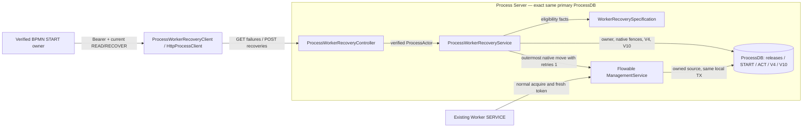
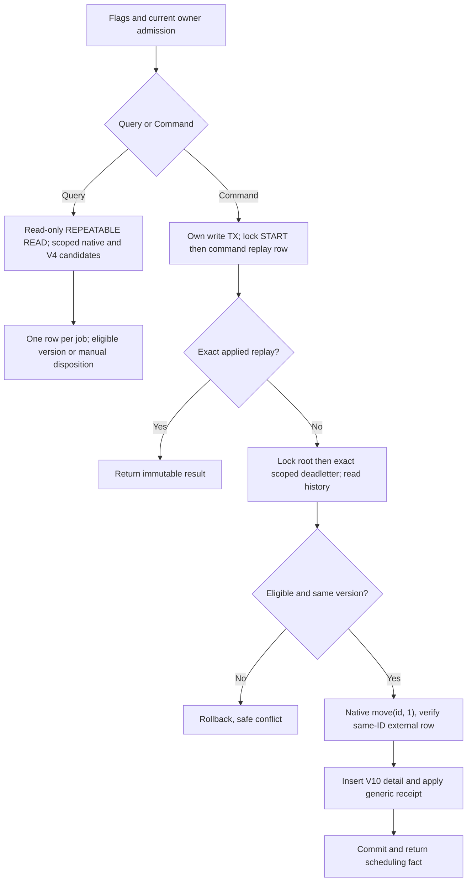
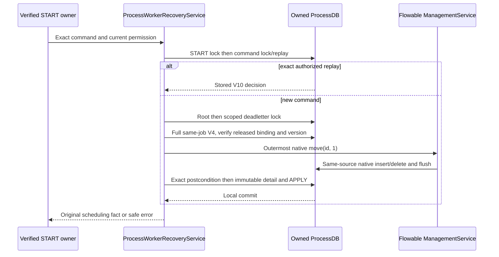
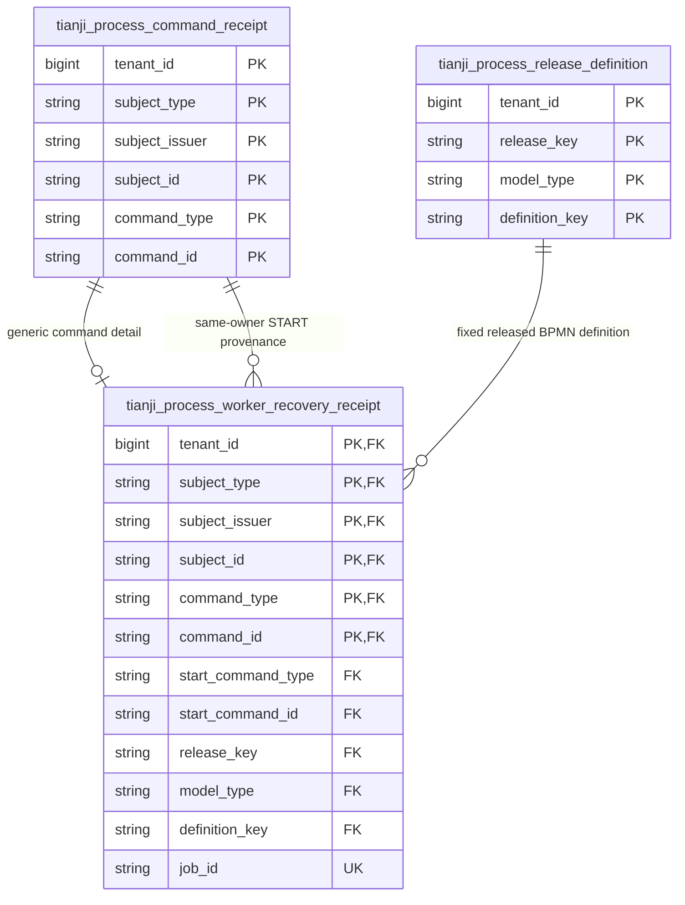

# BPMN Worker failure observation and governed deadletter recovery

| Field | Value |
| --- | --- |
| Document | `2026-11-05-13-41-process-worker-recovery.md` |
| Template Version | `9` |
| Archetype Cleanup | `Not applicable` |
| Status | `Review` |
| Type | `Feature` |
| Complexity | `Complex` |
| Complexity Drivers | `Native state and lease provenance, exact-owner authorization, retry safety, same-source atomic restore, immutable audit and replay` |
| Created | `2026-11-05 13:41 Asia/Shanghai` |
| Updated | `2026-11-05 14:27 Asia/Shanghai` |
| Owner | `Original roadmap owner and Root design review` |
| Repository | `tianji-service` |
| Scope | `T3-10 bounded BPMN failure/deadletter observation and manual retry admission, C/CL/PS` |
| Change Surface | `Separate recovery contract, strict SDK/OpenAPI, exact-owner provider and admission, same-source SQL/native fences, one additive ProcessDB V10 and exact history-prefix verification` |
| Affected Chapters | `§7, §8, §9, §10, §11, §13, §14, §15, §16, §17, §18` |
| Source Requirement | `Master T3-10, S10/S11, and Root recovery decisions on 2026-11-05` |
| Baseline Revision | `415a2814cf4a025bd868543c48b22e32e54e41ff, clean main worktree` |
| Amends | None |
| Supersedes | None |
| Depends On | [Agent Framework Upgrade Plan](../../../../docs/plans/agent-framework-upgrade-plan.md) §17.2 S10/S11 and §19 T3-10/T3-12 |
| Related Specs | [Bounded cancellation](2026-11-04-23-22-process-control-cancellation.md) §7, §9, §11, §16, [Worker business-error routing](2026-11-05-04-48-worker-business-error-routing.md) §7, §9, [Worker compensation fixture](2026-11-05-12-09-worker-compensation-fixture.md) §7, §11, §14 |
| Related Plans | [Worker recovery implementation Plan](../plan/2026-11-05-14-27-process-worker-recovery.md) |

## 1. Summary

Process owners need to distinguish native deadletter work from historical Worker receipts and see why a job needs manual intervention. A separately gated BPMN recovery capability returns a bounded per-instance observation. For one current ordinary external Worker occurrence with proved READ_ONLY contract and an unambiguous exhausted RETRYABLE receipt, the owner can schedule one native retry using a reason, exact command identity and the observation version. The Process Server records the accepted scheduling decision atomically with native movement and returns that same decision on an authorized exact replay.

UNKNOWN, unsupported kinds or effect contracts, inconsistent evidence and second restores have explicit manual dispositions. Durable business effects, receipt reconciliation and real runtime acceptance continue under the governing roadmap. This is a design draft for review.

## 2. Background and Current State

### 2.1 Business and user context

T3-10 couples explanations of failure, durable business receipt and compensation, cancellation and reasoned recovery. Cancellation, model-bound business errors and compensation fixture have committed source evidence on this baseline. Failure/deadletter observation and governed recovery are the next slice. T3-12 still requires the actual four independent-service paths. S10/S11 retain business-receipt loss, restart and native recovery acceptance.

### 2.2 Repository evidence

Path abbreviations in this document are C = `stellar-enclosure-tianji-contract`, CL = `stellar-enclosure-tianji-client`, PS = `stellar-enclosure-tianji-process-server`, W = `stellar-enclosure-tianji-worker-starter`. Java package root for this document is `top.egon.cola.platform.tianji`. SQL paths are under PS `src/main/resources/db/tianji-process`.

| Evidence ID | Classification | Exact path/symbol/decision/command | Observed fact | Design significance | Verification limit/freshness |
| --- | --- | --- | --- | --- | --- |
| EVD-001 | Static repository | C `contract/orchestration/ProcessControlClient.java`, `ProcessControlSnapshotDTO.java`; CL `ProcessControlResponseCodec.java`, `META-INF/tianji/openapi/process-control-v1.json` | Closed cancel/control capability, exact reader/schema, version excludes native deadletter | Add separate client/codec/schema and semantic version | HEAD 415a281, compatibility tests identified |
| EVD-002 | Static repository | PS `execution/ProcessControlService.java#control,cancel`, `ProcessControlNativeAccess.java#readRoot,requireTransaction`, `execution/ProcessCommandReceiptStore.java#lockStartByInstance` | Exact owner, verified source/engine/TM, repeatable read and START-first native write | Reuse authority and source fences | No contention proof |
| EVD-003 | Static repository | PS `worker/FlowableWorkerService.java#fail`, `WorkerLeaseStore.java`, `V4__add_worker_lease_receipts.sql` | LEASED, EXPIRED, COMPLETED, RETRY_SCHEDULED, NEEDS_MANUAL, BUSINESS_REJECTED; result SHA and lease clock facts; no monotonic attempt or durable effect-proof column | Use full bounded history and fail closed | No BusinessDB/provider proof |
| EVD-004 | Static repository | PS `worker/FlowableWorkerService.java` worker-input-v2/occurrence derivation, `WorkerTopicRegistry.java`; `release/VerifiedProcessModels.java#runningProcess` | Exact registry and released model supply current effect safety and mapped input digest | Reuse same binding computation | Registered contract can be violated by a handler |
| EVD-005 | Pinned dependency static | Flowable 8.0.0 `flowable.postgres.create.common.sql` lines 207–233, 253–282, `DeadLetterJob.xml`, `ExternalWorkerJob.xml`, `DefaultJobManager#moveDeadLetterJobToExecutableJob`, `CommandContextInterceptor#execute` | Deadletter has REV but no locks or retries; native move external branch preserves ID, sets requested retries and has separate context flush | Scoped SQL read lock, outermost public move and SQL readback | Pinned SQL/mapper/javap only |
| EVD-006 | Static repository | PS `ProcessApiSchemaVerifier.java#verifyCancellation,laterMigrations,hasCaseMigration`, `ProcessCancellationReceiptStore.java`, V1/V2/V3/V8/V9 | Exact known migration-prefix and role checks; generic receipt DECISION JSON exclusively | Add V10 detail and separate recovery readiness | Live schema and grants pending |
| EVD-007 | Static repository | PS `api/ProcessControlController.java`, `ProcessRequestBodyAdvice.java`, `ProcessApiErrors.java`, `security/TianjiProcessAccess.java`, `TianjiProcessPermissions.java`, `ProcessStorageConfiguration.java`, `application.yml` | Opt-in servlet route, bounded body, fixed safe errors, verified mixed principal and current IAM guard | Separate explicit permission, reuse transport and identity | No IAM registration/grant |
| EVD-008 | Design direction | Master T3-10 and persistent `recovery/root-decisions.md` | Observe failed/deadletter states, admit one READ_ONLY retry with reason and immutable audit | Preserve broader manual and runtime obligations | No user acceptance or source GO |

### 2.3 Problem statement and gap

Current Process control reports live waits and cancelability. A V4 failure can coexist with a live job, remain after its native row disappears or correspond to a native deadletter. There is no owner-facing recovery read or write, and public Flowable Job queries supply neither an authoritative revision nor a deadletter row lock. A native retry call alone cannot establish safe business behavior or provide durable reason and exact replay.

### 2.4 Evidence and current-chain map

| Entry/trigger | Current call chain | Data read/written | External dependency | Consumers | Evidence |
| --- | --- | --- | --- | --- | --- |
| Exact owner control/cancel | Controller → access → service → START/root checks → native command → generic/V9 detail | ProcessDB release, receipt, ACT execution/jobs | Flowable 8, IAM | USER/SERVICE, CL | EVD-001/002/006/007 |
| Worker failure | Worker API → live native external lock → exact lease lock → native failure → lease terminal write | ProcessDB native row and V4 | Flowable 8, exact Worker SERVICE registration | Worker reporter | EVD-003/004 |
| Worker reacquire | topic registration → native acquire → lease expire/claim → mapped inputs | ProcessDB native row and V4 | Native job and supplied Worker principal | W/host | EVD-003/004/005 |
| Business receipt and undo | W handler/Store and tested original/compensation fixture → independent BusinessDB receipt | BusinessDB transaction or external provider target | Independently owned BusinessDB/provider | Real business handler | T3-10 fixture Spec §7/§11; EVD-004 |

### 2.5 Archetype example cleanup

Cleanup disposition: Not applicable

Reason: This established Tianji multi-module repository already implements the live Process API, Worker flows and released BPMN model at 415a281. This slice extends existing native execution/worker adapters and independent C/CL contracts. It creates no project or first business capability from an archetype and depends on no generated example.

## 3. Goals and Non-goals

### 3.1 Goals

Owner-scoped operational observation, explicit manual states, one verified READ_ONLY native restore, complete reason and immutable audit, safe exact replay, additive default-off operation and separately identifiable finite and live evidence.

### 3.2 Non-goals

Scope excludes direct ACT writes, arbitrary execution movement, delete/bulk/retry-all, automatic retry or reconciliation of an UNKNOWN business effect, Case/Agent/native non-Worker restores, provider/BusinessDB probes, cross-instance operational dashboard, new runtime dependencies, publication, role grant and flag activation. Compensation, cancellation, S10/S11, T3-12 and T4 keep their effective scope.

### 3.3 Change Surface and Design Depth

| Area/layer | Disposition | Exact repository evidence | Changed or preserved behavior/contract | Required Spec treatment | Chapter(s) |
| --- | --- | --- | --- | --- | --- |
| C/CL, PS HTTP and authority | Affected | EVD-001/007 | Add separate closed Query/Command and access | Full contracts | §7, §8, §9, §10, §14, §15, §16, §17, §18 |
| Recovery service, native/lease read and immutable audit | Affected | EVD-002/003/004/005/006 | Bound read, eligibility, native restore, one V10 | Full architecture, model, DB and evidence | §7, §8, §10, §11, §13, §14, §15, §16, §17, §18 |
| Existing C/CL Control/cancel, native Worker report/acquire, BPMN models and W handlers | Context-only | EVD-001/003/004 | Preserve API bytes and behavior, verify reused digest and read-only bindings | Focused compatibility regression | §7, §14, §16 |
| Tianji web | Unchanged | Independent `tianji-web` repo and master T3-12/T4-04 | No new page or control affordance in this slice | Contract consumers only | §12 |
| GraphQL/events for recovery | Not applicable | EVD-001/007 servlet and local command | No recovery Event or GraphQL operation | N/A | §9 |

## 4. Requirements and Acceptance Criteria

| ID | Atomic requirement | Priority | Observable acceptance criteria | Source |
| --- | --- | --- | --- | --- |
| REQ-001 | Bound failure/deadletter observation by BPMN START owner, source, instance and per-source limits | Must | One row per scoped job, native presence separate from V4 evidence, meaningful manual statuses, deterministic order and safe rejection on instance overflow | T3-10 failure/deadletter query |
| REQ-002 | Admit both operations only under current exact authority and default-off prerequisites | Must | Enabled-only routes, verified READ + WORKER_RECOVER USER/SERVICE exact owner for request and replay, deny malformed/foreign access and unsafe wiring | Root decisions 1–2 |
| REQ-003 | Recover exactly one proved ordinary READ_ONLY exhausted RETRYABLE occurrence | Must | All §7.3 predicates hold, unsupported or contradictory records stay manual | T3-10 avoid duplicate effects, Root decisions 3–5 |
| REQ-004 | Serialize exact native mutation and recheck semantic version | Must | Same-source lock order and outermost native call with retries 1; native/audit/command data roll back on any failed invariant or blocked request | Root decision 6 |
| REQ-005 | Persist immutable reasoned decision and stable replay atomically | Must | One accepted restore per native job in owning source; exact replay after current authority succeeds without move; changed payload conflicts | T3-10 complete audit, Root decision 7 |
| REQ-006 | Keep old contracts and migrations compatible with additive V10 | Must | Old Control wire, closed DTO/codec/OAS and permission behavior preserved; all 25 old main SQL unchanged; V9 and exact V10 work for old readiness; recovery independently requires V10 | Root decisions 1, 7, 8 |
| REQ-007 | Verify finite outcomes and preserve runtime and wider milestones | Must | Finite contract/native-mock/schema evidence is separate from real PG/engine/identity races, S10/S11, T3-12 and T4 | Master roadmap, Root decision 8 |

### 4.1 Scenario matrix

| Scenario | Actor/trigger | Preconditions | Main path | Alternative/failure path | Data/state change | Observable result | Requirements |
| --- | --- | --- | --- | --- | --- | --- | --- |
| Inspect | Exact owner | Feature ready | Read consistent owner/native/V4 observation | Zero results, unsupported/historical only, or overflow | None | 200 bounded explanatory rows or 503 on overflow | REQ-001/002 |
| Safe scheduling | Exact owner | Current matching version and eligible job | Lock, recheck, native move, read back, persist/apply | State change or move/readback failure | Whole local commit or rollback | Stable scheduling receipt or safe error | REQ-003/004/005 |
| Duplicate and uncertainty | Owner retries same command after response loss | Current authority | Read immutable accepted decision | Changed payload conflicts; current authority fails closed | No new state | Original accepted fact | REQ-002/005 |
| Unsafe/manual | Owner or unsupported job | UNKNOWN, unsupported contract/kind, ambiguous history or prior restore | Report fixed category | Command blocked | No successful receipt | Manual state retained | REQ-001/003/005 |
| Concurrent lifecycle | Recovery versus recovery/cancel/Worker action | Shared owner/source | START/root/native fence | Deadlock/timeout/version drift | Whole transaction rollback on failure | Stable conflict/unavailable, no auto retry | REQ-004/005/007 |

### 4.2 Use-case analysis

#### 4.2.1 Actor inventory

| Actor ID | Actor/role | Goal and responsibility | Entry/channel | Permission/tenant context | Evidence |
| --- | --- | --- | --- | --- | --- |
| ACTOR-001 | Verified USER/SERVICE BPMN START owner | Understand failures and schedule admitted retry | Owner C/CL/REST | READ + WORKER_RECOVER, exact tenant/principal/issuer/subject | EVD-002/007 |
| ACTOR-002 | Current Worker SERVICE reporter | Supply authoritative scoped V4 report and later claim using fresh token | Existing Worker API | Exact registered tenant/issuer/subject/topic/schema | EVD-003/004 |
| ACTOR-003 | Owned Flowable BPMN engine | Move native job inside ProcessDB transaction | Existing ManagementService | Bound internal API | EVD-005 |

#### 4.2.2 Use-case artifact

| ID | Use case/goal | Primary actor | Supporting actors/systems | Trigger | Preconditions | Main success outcome | Alternatives/failures | Postconditions | Requirements | Interfaces/pages | Tests |
| --- | --- | --- | --- | --- | --- | --- | --- | --- | --- | --- | --- |
| UC-001 | Understand current and historical failure | ACTOR-001 | ACTOR-002/003 | Owner requests observation | Current exact owner and flags | Bounded categorized results | Empty, overflow, unsafe, denied | No mutation | REQ-001/002/006 | API-001 | TEST-001/002/005 |
| UC-002 | Schedule one admitted retry with reason | ACTOR-001 | ACTOR-002/003 | Owner selects eligible row | Scope, current version and policy | Fixed retry scheduled | Stale, blocked, conflicting or unavailable | Local native move and durable audit both committed or rolled back | REQ-002/003/004/005/007 | API-002 | TEST-003/004/006/007 |
| UC-003 | Determine accepted outcome after ambiguous response | ACTOR-001 | ACTOR-003 | Exact repeat command | Current authority | Immutable scheduling result returned | Changed request, inconsistent audit, denied | No second move | REQ-002/005/006 | API-002 | TEST-003/006 |

## 5. Constraints, Assumptions, and Decisions

### 5.1 Confirmed constraints

Default-off; same exact owned primary PostgreSQL schema/source and Spring manager; verified Flowable 8.0.0; one V10, all existing SQL immutable; finite tests only before separately authorized real runtime acceptance; no dependency, browser, listener, server startup, external message, deployment or IAM registration.

### 5.2 Small-gap assumptions

| ID | Inference | Repository evidence | Why locally reversible | Impact if wrong |
| --- | --- | --- | --- | --- |
| ASM-001 | Source cap 128 and per-job V4 cap 32 are bounded first-slice admission limits | Existing control cap 256 and native SQL/transaction limits | Tune before exposing v1, no schema or ABI dependency | Large instances may require manual triage; no eligibility from partial data |
| ASM-002 | Use UTC Z DB-clock sampling and existing no-store SDK family with HTTPS-or-loopback | Current CL Case/Task transport policy, PS DB clock | Scoped to new capability | Non-loopback plaintext is rejected |
| ASM-003 | Runtime reader is the exact non-owner role verified on the owned source | Existing V9 role verification | Operational prerequisite, no new DB topology | Enabled provider stays unavailable if role does not satisfy policy |

### 5.3 Resolved decisions

| ID | Decision | Decision owner | Evidence and rationale | Requirements |
| --- | --- | --- | --- | --- |
| DEC-001 | Separate C/CL/PS recovery slice with exact owner authority | Root design direction | EVD-001/007 closed contracts | REQ-001/002/006 |
| DEC-002 | Ordinary BPMN READ_ONLY exact current model/reporter only, one accepted restore with retries 1 | Root design direction | EVD-003/004/005 lack broader effect proof | REQ-003/004/005 |
| DEC-003 | New immutable V10 detail, generic receipt additive kind, exact known prefix | Root design direction | EVD-006 closed decision and cancellation formats | REQ-005/006 |
| DEC-004 | Static/finite evidence now; runtime acceptance is separately governed | Original roadmap and Root | T3-10 S10/S11 and T3-12 independent paths | REQ-007 |

### 5.4 Open major decisions

No open major design decision after Root confirmed the technical-profile treatment in §6.2. User design acceptance and source authorization are separate gates.

## 6. Project Technology Context

| Concern | Current choice | Repository evidence | Constraint on design |
| --- | --- | --- | --- |
| Language/build | Java 25, Maven reactor, Spring Boot MVC/Spring JDBC, Flowable 8.0.0 | root and PS POMs, pin EVD-005 | Preserve POM and exact dependency boundary |
| Persistence | One owned PostgreSQL process schema, Flyway, SpringJdbc, Flowable ACT ownership | `ProcessStorageConfiguration`, `ProcessApiSchemaVerifier`, V1/V4/V9 | Reuse native same-source owner and history |
| Contract/testing | Java immutable records, Jackson, JUnit, MockMvc, static packaged OAS | C/CL/PS existing test classes | No runtime startup to validate new slice |
| Frontend | Separate `tianji-web` | master T3-12/T4-04 | No frontend file or runtime |

### 6.1 Java architecture profile and capability baseline

| Architecture profile | Archetype/template or base package | Exact evidence and verifier | Existing deviations | Design action |
| --- | --- | --- | --- | --- |
| Existing Tianji Process technical vertical under exact Root exception | PS `top.egon.cola.platform.tianji.process.server` | `api/ProcessControlController` → `execution/ProcessControlService` → `execution/ProcessCommandReceiptStore,ProcessControlNativeAccess` | Feature packages, dedicated JDBC/Flyway/native owner | Preserve existing controller/service/persistence dependency direction and packages |

| Need | Spring/JDK candidate | Spring Boot Starter candidate | Egon-COLA/module candidate | Proven gap | Decision/dependency impact |
| --- | --- | --- | --- | --- | --- |
| Strict JSON/HTTP | Jakarta Validation if classpath confirmed, Jackson, HttpClient | Existing MVC/Jackson | C OrchestrationChecks, CL HttpProcessClient, PS ProcessRequestBodyAdvice | Closed operation-specific contract | Add neutral shapes and bounded decoder only |
| Atomic owner-source action | TransactionTemplate/JdbcTemplate | Existing managed source/TM | ProcessStorageConfiguration, ProcessControlNativeAccess, WorkerLeaseStore | Deadletter lock and version absent | Add owner-local methods, use existing source |
| Permission/docs | Existing annotations, OAS 3.1 | Current security, static resource | Jianshen guard and Process producer | No PS springdoc route or dependency found | Reuse packaging, no runtime docs |
| Audit | JDBC and Flyway | Existing process storage | ProcessCommandReceiptStore and V9 detail pattern | Generic and cancel detail cannot encode recovery | One additive V10 detail, no dependency |

### 6.2 User-mandated Java rule compliance

Root confirmed the exact recovery C/CL/PS technical boundary on 2026-11-05. Formal Case Spec §5.1/§6.1 and cancellation Spec §5.1/§6.2 preserve the established technical vertical, immutable values, explicit named factories, strict constructors and plain JDBC/Flyway. The decision covers this technical capability only. User AGENTS applies the immutable next-version Flyway rule. No new business-domain model is introduced.

| Literal rule | Affected? | Repository evidence | Exact design decision | Files/types/interfaces | Validation/test evidence | Status/blocker |
| --- | --- | --- | --- | --- | --- | --- |
| Rule 1 | Yes | C orchestration values, PS feature packages | Semantic Query/Command/DTO/Result/Enum or infrastructure role | §8, §10 | TEST-001/009 | PASS |
| Rule 2 | Yes | Cancellation §6.2, C/CL POM and compact validation | Reuse immutable exact construction and bounded Jackson/constructor validation under Root technical decision; verify store shapes and typed semantic checks | §9, §10 | TEST-001/002/003/005/007 | PASS |
| Rule 3 | Yes | C immutable values and PS receipts, no MapStruct capability in relevant modules | Defensive immutable values, no mutable persistence entity or redundant mapper; exact projection under Root decision | §10 | TEST-001/003/007 | PASS |
| Rule 4 | Yes | Formal Case §5.1 and cancellation §6.2 explicit wiring; no Lombok compile dependency | Technical types reuse stable named factory and qualified owned-source wiring; preserve existing safe log boundary, reason stored in DB audit | §8, §15 | TEST-005/009 | PASS |
| Rule 5 | Yes | Existing JDK/Jackson/JdbcTemplate and digest helpers | Reuse JDK and current framework APIs; no additional utility package | §7, §8 | TEST-009 | PASS |
| Rule 6 | Yes | Existing Boot Jackson and string enum/schema contracts | Exact named wire strings and explicit null; no ordinal | §9, §10 | TEST-001/003/008 | PASS |
| Rule 7 | Yes | Existing PS YAML and flag boundaries | Same key structure/default-off, add permission-scope mapping once to owning config | §8, §15 | TEST-005/008/009 | PASS |
| Rule 9 | Yes | Complex multi-source evidence and existing shared checks | Composed Specification for READ_ONLY admission, one decision reused by Query and Command | §7.3, §13 | TEST-002/004/006 | PASS |
| Rule 10 | Yes | PS database clock and Instant mappings | UTC occurred instants and no time-derived version | §6.3, §9, §11 | TEST-003/007 | PASS |
| Rule 11 | Yes | Formal Case §5.1 and actual JDBC/Flyway/Flowable source | Preserve technical vertical and same-source JDBC/Flyway by Root decision and immutable Flyway by user AGENTS; immutable technical audit has no soft-delete cycle, use physical lifetime unique key; L0 Query/Command, no Event | §7–§11, §16 | TEST-006/007/009 | PASS |

The canonical literal rule block is reproduced from the skill in the appendix.

### 6.3 Time semantics and conversion contract

Time contract: Required

| Time ID | Fields/symbols | Semantics | Java/runtime type | Storage policy | Wire policy | Business zone source | Display zone source | Boundary / DST rules | Precision / Clock | Compatibility | Verification |
| --- | --- | --- | --- | --- | --- | --- | --- | --- | --- | --- | --- |
| TIME-001 | observation `observedAt` | Occurred instant | Instant | Not persisted | UTC Z | Not applicable: operational instant | Not applicable: SDK returns instant | No local time or DST interpretation | PostgreSQL DB clock at snapshot read, microseconds | New field only, excluded from version | TEST-003/007 |
| TIME-002 | recovery audit/result `decidedAt` | Occurred instant | Instant | UTC instant | UTC Z | Not applicable: database decision | Not applicable: SDK returns instant | No local time or DST interpretation | `clock_timestamp()`, timestamptz(6), before detail insert within transaction | Replay retains exact stored value | TEST-003/006/007 |
| TIME-003 | V4 `leased_at,lease_expires_at,decided_at`; V10 `failure_decided_at` is the exact selected V4 decision instant | Occurred instant | Instant | UTC instant | Internal | Not applicable: existing database instants | Not applicable: no lease time projection | Strict order tests; ties/backward evidence make admission fail | Existing DB microseconds, no monotonic generation claim | Existing V4 read-only; V10 copy is private and distinct from restore decidedAt | TEST-002/007 |

## 7. Architecture Design

### 7.0 Minimum-design baseline and element-necessity audit

| Proposed element | Change | Requirements | Existing/direct alternative | Concrete inadequacy of alternative | Added calls/state/coupling/failures/migration/operations | Verdict |
| --- | --- | --- | --- | --- | --- | --- |
| New independent Query and Command, C DTOs/CL codec/OAS | New | REQ-001/002/003/006 | Existing Control DTO/action or native move directly | Closed wire and native API has no owner/proof/replay; a historical receipt list misses native facts | One read and one explicit write, no facade layer | Add |
| Provider controller, authority wiring and strict body/error branches | New/expand | REQ-002/006 | Existing Process route family | Wildcard authentication is insufficient and old controls must keep exact dispatch | Two resource declarations, one permission; existing filter/guard and advice | Add |
| Technical recovery service and eligibility Specification | New | REQ-001/003/004 | Inline in existing cancel or Worker service | Distinct owner, version and receipt; GET/POST could disagree if predicates duplicated | One owner-local service and one policy role, no bus | Add |
| Bounded native/V4 read seams and read-only worker-binding reuse | Expand | REQ-001/003/004 | Public Job query, current token APIs or copied digest | No revision/lock or complete same-job evidence, copied digest may drift | Same source only; no business-store or provider call | Add |
| Recovery audit store/V10 and exact prefix validation | New/expand | REQ-005/006 | Generic or V9 existing row | Generic hash cannot reconstruct original reason/result, V9 is cancellation-specific | One technical audit table, two necessary unique indexes | Add |
| General strategy registry, retry scheduler, new persistence abstraction or events | Keep absent | REQ-003/004/006 | Compose fixed Specification with existing service | Current single policy and transactional native API suffice | Would add dispatch/side-effect boundaries | Remove |

| Path | Network calls | Client states | Server contracts/state | Failure and TOCTOU points | Additional user/business value |
| --- | --- | --- | --- | --- | --- |
| Direct baseline | 0 new; existing Control can GET only | Existing waits | Control snapshot | No native/V4 explanation or safe restore | Existing control |
| Selected design | 1 GET to independently inspect, 1 explicit POST when wanted | Empty/manual/eligible/unknown response/replay | Two closed operations, one audit | Independent snapshot may stale; version recheck under lock; no automatic retry | Explain failure, schedule one admitted retry and replay durable decision |

### 7.1 System Architecture Design



The original Worker reporter supplies immutable technical evidence. The requester proves START ownership independently; PS uses the historical tuple only to resolve its current exact registration. Existing IAM executes before opening a database lock. Flowable alone mutates ACT. W/BusinessDB/provider remain separate.

### 7.2 High-Level Design

#### 7.2.1 Critical flows



#### 7.2.2 High-level decision and quality matrix

| Concern/use case | Constraint | Design | Trade-off | Verification | Requirements |
| --- | --- | --- | --- | --- | --- |
| Visibility/UC-001 | Bounded data and scope, including unsupported failures | Separate native presence from V4 evidence; fixed reasons and safe whole-query overflow | Big jobs/instances can require manual triage | TEST-002/005 | REQ-001/002 |
| Restore/UC-002 | Business safety depends on proven policy | Same exact current model/reporter and READ_ONLY, no independent BusinessDB/provider inference | Narrow admission | TEST-002/004 | REQ-003 |
| Integrity/UC-002 | Native move/audit must agree | Owned local TX, scoped locks and SQL postcondition | Contention can return conflict/unavailable | TEST-006/007, runtime §18 | REQ-004/005 |
| Replay/UC-003 | Current authority and original accepted decision | Exact START plus immutable detail/generic validation before any new native work | New detail table and stable per-target uniqueness | TEST-003/006/007 | REQ-002/005 |
| Deployment | Old readiness must survive V10 when disabled | Exact known migration prefix and independent V10 activation gate | Compatible binary must precede V10 | TEST-007/008 | REQ-006/007 |

### 7.3 Detailed Design

#### 7.3.1 Ownership, bounds and observation

Both operations run `TianjiProcessAccess.require` with the current allowed principal and both permissions before DB admission. Reject LEGACY and compare tenant, principal kind, verified issuer SHA, exact subject, applied START and process instance. A missing or foreign START returns the same safe 404. Reuse complete `TaskOrigin` semantics for a plain owner START query and locked owner START query; no task same-issuer access. An APPLIED START with retained released BPMN identity can still authorize historical observation after process end. Resolve owning source/schema/definition from service configuration and START, never caller strings. Inconsistent retained authority fails closed.

GET owns a read-only REPEATABLE READ snapshot (10-second transaction, 5-second statement bound); reject ambient transactions. Independently select scoped native deadletter rows of all kinds and V4 historical failure job IDs, each ordered by exact job ID under `COLLATE "C"`, each cap 128 plus a sentinel. Native filter is tenant + BPMN `PROCESS_INSTANCE_ID_`; validate known definition and row scope separately so a visible anomalous native kind remains manual. V4 discovery predicates are tenant, `scope_type='BPMN'`, exact `scope_id` and nonnull failure kind, grouped on job ID. If either source produces its sentinel, or the merged distinct set exceeds 128, abort the observation with 503 and no partial result. Otherwise deduplicate and emit all IDs in the same bytewise UTF-8 order. No offset, cursor or arbitrary job endpoint. Database can still scan/sort beyond the return bound; statement/transaction limits fail with 503. All scopes are rechecked on projection; unsafe internal IDs/row shapes fail closed instead of being silently erased.

For each emitted job, collect all same-tenant/job V4 rows, cap 32 plus one, with no state/reporter/release/affinity predicate that can hide contradictions. Existing tenant/job-leading unique key bounds the index access range. Reads may batch bounded IDs using the equivalent per-job limit. A row with over-cap history has manual `HISTORY_INCOMPLETE` and no version. Native/V4 presence uses positive evidence. Non-deadletter history never authorizes a restore. For native collisions check all relevant same-ID runtime job tables (deadletter, external, executable, timer, suspended) via bounded PK probes; history jobs have distinct historical ownership and cannot serve as a live candidate. Use fixed SQL and no copied native payload. For each job require exact authority even if it has a scoped native row but anomalous V4 contents. The observation exposes closed categories and no internal diagnostics. A nullable activityId helps the owner identify the failed step. Use the exact safe scoped native element if verified, otherwise an unambiguous safe V4 element from complete exact-affinity evidence. If provenance is absent, unsafe or contradictory, return null. Never expose native topic, execution ID or raw diagnostic.

#### 7.3.2 Admission Specification

`WorkerRecoverySpecification` evaluates the same canonical facts for both operations and returns a fixed disposition plus a version only for `RETRY_AVAILABLE`. Priority is fixed so a corrupt/degraded row cannot accidentally become eligible.

| Order | Current facts | Disposition |
| --- | --- | --- |
| 1 | No current scoped native deadletter, and there is a valid observed failure | `HISTORICAL_FAILURE`; use `UNKNOWN_OUTCOME` or `BUSINESS_REJECTED` when present in complete history; otherwise `NO_NATIVE_DEADLETTER`; on incomplete evidence use `HISTORY_INCOMPLETE` |
| 2 | Current native deadletter and same job already has accepted V10 audit | `MANUAL_REVIEW / RESTORE_LIMIT_REACHED` |
| 3 | Unsupported kind/handler or nonordinary scope, including Case or Agent worker provenance | `MANUAL_REVIEW / UNSUPPORTED_NATIVE_JOB` |
| 4 | Root absent or suspended, evidence/affinity/clock invalid, collision, live lease, or drift | `MANUAL_REVIEW / PROCESS_INACTIVE`, `EVIDENCE_CONFLICT`, `ACTIVE_LEASE`, or `BINDING_UNVERIFIED` using the order below |
| 5 | Over-cap history or no retained qualifying evidence | `MANUAL_REVIEW / HISTORY_INCOMPLETE` |
| 6 | Complete evidence contains UNKNOWN or BUSINESS_REJECTED | `MANUAL_REVIEW / UNKNOWN_OUTCOME` first, then `BUSINESS_REJECTED` |
| 7 | Both current contracts are verified, yet effect mode is not READ_ONLY | `MANUAL_REVIEW / UNSUPPORTED_EFFECT` |
| 8 | All positive predicates hold | `RETRY_AVAILABLE / NONE`, version present |

On a row with competing issues, apply the first applicable order; within order 4 use `PROCESS_INACTIVE`, then structural collision/affinity/clock `EVIDENCE_CONFLICT`, then `ACTIVE_LEASE`, then `BINDING_UNVERIFIED`. To preserve explanatory UNKNOWN/BUSINESS_REJECTED when well-formed complete history independently proves either fact, expose a separate closed `reportedFailure` field with values `NONE`, `RETRYABLE`, `BUSINESS_REJECTED`, `UNKNOWN`, `UNVERIFIED`, selected by priority UNKNOWN > BUSINESS_REJECTED > RETRYABLE on complete exact-affinity state-valid evidence. Over-cap or contradictory affinity maps to UNVERIFIED, no diagnostics. An inconsistent history shape that does not meet the only permitted positive pattern is never eligible even if a separate closed reportedFailure remains explainable.

Positive predicate set:

1. Source, actor/START, release, running unsuspended root, native type `externalWorker`, handler `external-worker-complete`, exact scoped process, execution, definition, activity and tenant all agree. Use BPMN process/definition/execution fields and reject contradictory Case/scope evidence. BPMN does not require a native SCOPE_TYPE literal. Require actual same tenant execution at that activity. Require ordinary released Worker and no internal Agent dispatch or Case-specific provenance for this occurrence. If the released metadata cannot prove ordinary provenance, fail closed.
2. At most 32 full same-tenant/job V4 rows. Each has same BPMN instance/release/definition/element/topic/schema/model SHA and derived occurrence/business idempotency key. Reject any LEASED row, even expired by clock; reject COMPLETED, UNKNOWN, BUSINESS_REJECTED and ambiguous/malformed state. Exactly one `NEEDS_MANUAL / RETRYABLE`; every other row is an earlier `EXPIRED` or `RETRY_SCHEDULED / RETRYABLE`. Verify required/null state fields and every RETRYABLE result hash `hash(["worker-fail-v1", jobId, occurrenceId, "RETRYABLE", failureCode], {})`. For the admitted row native exception message must equal the safe V4 failure code exactly. Do comparison in the DB as a boolean after exact scoped row selection; use byte length and C equality, never return the native exception field or a byte-array pointer.
3. Use distinct `leased_at` values, sort ascending only after full selection, and require each prior lease and decision strictly before the next leasedAt. Require `leasedAt < decidedAt < leaseExpiresAt` for non-EXPIRED decisions, `decidedAt >= leaseExpiresAt` for EXPIRED, `leaseExpiresAt > leasedAt` for all. Last row must be the sole qualifying NEEDS_MANUAL. Equal cross-row time, missing interval facts or reversed clock relationship fails closed. Clock checks reject observable ambiguity; V4 has no generation or monotonic attempt sequence. No inference of provenance under privileged or out-of-band restore.
4. Resolve exactly one released BPMN definition via START and `getForProcessDefinition` and verify model SHA and exact native activity/topic. Resolve historical reporter registration using exact tenant/issuer/subject/topic/schema through current `WorkerTopicRegistry`. Reuse the existing read-only `FlowableWorkerService.verifyJob` and `inputHash` logic by the narrowest owner-local extraction, including `VerifiedProcessModels.runningProcess`, release model/mapping/DMN checks and `ProcessValues.inputs`, exact native execution variables, registration contract and ordinary-mode proof. Recompute `worker-input-v2` and existing `worker-occurrence-v1` business key derivation. Apply to the selected qualifying row; for prior rows retain exact shared affinity and validated state/hash without falsely treating another reporter's historic digest as current. No acquire/fail/report/execute, network or remote provider in proof. Current model and exact reporter must be READ_ONLY. RETRYABLE alone supplies no evidence of absence of business effects. W READ_ONLY contract remains an operational prerequisite.
5. No V10 accepted row for this native job. Technical retry never authorizes arbitrary scopes or a second manually scheduled attempt.

Version is lower-hex SHA-256 from existing length-delimited `ProcessRequestDigest.hash` using domain `TIANJI_WORKER_RECOVERY_VERSION_V1`, UTF-8 values and explicit presence tags for nullable fields. Canonical order is owner tuple, applied START command/hash/release/instance/correlation, exact released definition/model hash/business key, root ID/revision/suspension and execution affinity, exact native deadletter ID/revision/type/tenant/process/definition/execution/element/scope fields/handler/topic/correlation, and `evidence_sha256`. Evidence digest domain `TIANJI_WORKER_RECOVERY_EVIDENCE_V1` hashes policy literal `READ_ONLY_EXHAUSTED_RETRY_V1`, count and rows ordered by strictly distinct leasedAt, with exact safe affinity, model/input/result digests, state/decision and safe failure facts, reporter tuple and UTC instants, explicit nulls. Neither digest contains raw token, token hash, derived native owner, raw exception, variable values, or observation time. Old nonselected historical row duplicates at the same leasedAt invalidate proof. DB clock sampled for response only. The version is opaque equality, not authorization or a sequence. Command hash domain `TIANJI_WORKER_RECOVERY_COMMAND_V1` binds exact instance/job/command/version/reason in that order. Do not trim, Unicode-normalize, or rerender accepted reason.

#### 7.3.3 Native mutation, replay and failures

POST owns a bounded Spring JDBC write transaction (READ COMMITTED, 10 seconds, no ambient Spring/Flowable context, transaction-local 5-second lock/statement limit). Establish exact source/engine/schema/manager, primary/UTF8/origin prerequisites before business SQL. Lock applied START by exact owner and instance, then lookup/lock generic replay row by exact actor/kind/command. For an existing APPLIED row verify request hash, resource and release/correlation plus exact immutable detail under current START owner. If exact, return stored result before root/deadletter lookups, including after job/instance progresses. A mismatching exact request is 409 idempotency conflict. A committed PENDING or inconsistent APPLIED/detail is 503. Insert a new generic PENDING under the same command lock protocol; if concurrent insertion wins, lock/read winning row and apply same replay/conflict rules. New acceptance never uses a successful no-op.

For a fresh attempt, lock exact owning root via existing source-verified root seam, check unsuspended, then parameterized deadletter PK lock with known tenant/instance/definition/type. A wrong job ID cannot lock another owner's row. Only after this fence, read all same-tenant/job V4 and compare current released binding and canonical version. The selected qualifying proof requires native REV_ > 0. No V4 write or row reopening; admitted V4 rows are terminal and immutable in supported Worker paths, which follow native-before-lease ordering. Existing lock graph is not presumed for privileged writers. Known same-ID conflict blocks. Current ineligible state returns recovery blocked; current eligible with different version returns recovery version conflict. This order also avoids giving information about unrelated job existence. Allow no path from a diagnostic field or owner-provided reason into native routing.

Invoke `ManagementService.moveDeadLetterJobToExecutableJob(jobId, 1)` as the outermost native command inside the existing Spring transaction. No nested reusable Flowable command context around it. A null/mismatching native result aborts. After command context flush returns, plain bound-source SQL must prove exactly no same-ID deadletter, exactly one external row same ID and exact original identity/affinity/handler/topic, retries=1, and null lock owner and expiration; no same-ID runtime collision. A positive native revision can remain unchanged during the move. Native engine create time is allowed to differ, and a null original correlation can be assigned by Flowable; scope and business intent remain exact. Other postcondition mismatches abort. Existing Worker acquisition may later obtain a new token using normal fences, preserving job/occurrence/business key.

Read ProcessDB decision time and insert V10 immutable detail with exact audit predicates. The detail preserves readable attribution to `READ_ONLY_EXHAUSTED_RETRY_V1`, the selected V4 safe failure code and exact selected V4 decision instant alongside the opaque digest. Insert with `ON CONFLICT (job_id) DO NOTHING` against the standalone unique job index. Zero inserted rows throws the typed blocked exception and rolls back the entire local transaction; exactly one permits the generic receipt transition to APPLIED with `resource_id = jobId` and null decision JSON. Validate the APPLY row count. Commit before returning success. Any native, readback, clock, audit, generic apply or commit exception escapes the transaction. Only after rollback classify recognized native optimistic conflict/target disappearance under lock or PostgreSQL 40001/40P01/55P03 as version conflict, while timeout/cancellation (57014), dependency or SQLSTATE class 08 is 503. Unrelated SQL or integrity failures are 503. Classification does not parse exception text or rely on driver-private constraint metadata. Never retry inside the handler or client. Connection-loss after database commit can leave the caller uncertain; use exact replay once current access is available. No externally visible partial result.

#### 7.3.4 Transaction swimlane



#### 7.3.5 Boundary and failure ownership

Observation owns consistent bounded selection only. Current membership, policy and version are decided again in the Command. Owner IAM remains an existing filter and execution guard; the transaction uses only the verified actor. DB/Flowable own atomic state and time, V4 and BusinessDB keep their own business evidence. A rejected operation produces a stable safe error and no successful receipt. The durable audit captures only accepted operations.

#### 7.3.6 Conclusion evidence chain

| Conclusion | Evidence | Constraint | Decision | Consequence | Verification |
| --- | --- | --- | --- | --- | --- |
| Restore cannot be inferred from technical retry alone | EVD-003/004 | V4 has no independently attested business side-effect/commit proof | Admit only ordinary READ_ONLY with positive provenance | UNKNOWN and effects requiring external proof stay manual | TEST-002/004 |
| Native and audit must commit together | EVD-002/005/006 | Native ID-only API gives no owner, revision lock, or result audit | Same-source transaction, scoped lock, outermost native move and exact readback, V10 detail | One atomic accepted scheduling fact, old immutable leases | TEST-006/007 and separately authorized runtime |
| Recovery can ship without activating it | EVD-001/006/007 | Old closed contracts and history verifier have exact semantics | Independent capability and exact V10-compatible prefix | Old readiness remains with recovery off | TEST-005/007/008/009 |

## 8. Package Structure and Code File Tree

### 8.1 Current relevant tree

C and CL hold neutral contracts and the SDK. PS already has `api`, `execution`, `security`, `release`, and `worker` packages within its technical vertical. The following tree uses module abbreviations from §2.2 and package-root-relative Java paths.

### 8.2 Target tree

```text
C/src/main/java/.../contract/orchestration/
  ProcessWorkerRecoveryClient.java                 + neutral two-operation capability
  RecoverProcessWorkerCommand.java                 + strict command
  ProcessWorkerFailuresDTO.java                    + immutable list/observation
  ProcessWorkerFailureDTO.java                     + immutable row and nested closed enums
  RecoverProcessWorkerResult.java                  + immutable accepted scheduling decision
CL/src/main/java/.../client/
  HttpProcessClient.java                           ~ explicit new transport family
  ProcessWorkerRecoveryResponseCodec.java           + closed reply/error decoder
CL/src/main/resources/META-INF/tianji/openapi/
  process-worker-recovery-v1.json                   + closed OpenAPI 3.1 artifact
PS/src/main/java/.../process/server/
  api/ProcessWorkerRecoveryController.java           + two enabled-only methods
  api/ProcessRequestBodyAdvice.java                 ~ exact new target branch
  api/ProcessApiErrors.java                         ~ fixed blocked error handler
  error/ProcessWorkerRecoveryBlockedException.java  + fixed typed blocked exception
  security/TianjiProcessPermissions.java            ~ permission and resource constants
  ProcessSecurityConfiguration.java                 ~ recovery factories beside CancellationConfiguration; security prerequisites
  ProcessStorageConfiguration.java                  ~ servlet/API/Worker flag startup guard
  ProcessApiSchemaVerifier.java                     ~ exact-prefix and independent V10 verification
  execution/ProcessWorkerRecoveryService.java       + two bounded transactions
  execution/WorkerRecoverySpecification.java        + canonical eligibility/disposition
  execution/ProcessWorkerRecoveryReceiptStore.java  + immutable audit/replay verification
  execution/ProcessCommandReceiptStore.java         ~ new Kind; exact plain owner START read
  execution/ProcessControlNativeAccess.java         ~ scoped technical read/lock/readback seams
  worker/WorkerLeaseStore.java                      ~ bounded secret-free read projection
  worker/FlowableWorkerService.java                 ~ reuse current binding and digest in read-only method
  worker/WorkerTopicRegistry.java                    ~ exact historical reporter lookup, shared key logic
PS/src/main/resources/
  application.yml                                  ~ default-off flag and scope mapping
  db/tianji-process/V10__add_process_worker_recovery_receipts.sql  + immutable audit
```

### 8.3 Package and file responsibilities

| Files | Responsibilities and changed symbols | Requirements |
| --- | --- | --- |
| C new types, CL `HttpProcessClient`, recovery codec and OAS | `workerFailures(GetProcessInstanceQuery)` and `recoverWorker(RecoverProcessWorkerCommand)`; retain old capability/method bytes except additive class implements/methods | REQ-001/002/003/006 |
| PS controller/advice/errors/permissions/configuration | New routes, existing access preflight, strict new input, protected error and factory wiring | REQ-002/006 |
| PS service, Specification and native collaborator | Own reads/commands and current fences; reuse `ProcessControlNativeAccess#readRoot` and exact binding of verified source | REQ-001/003/004 |
| PS V4/Worker read seams | `WorkerLeaseStore#findFailureJobIds` and `readRecoveryHistory` project technical metadata only; `FlowableWorkerService#verifyRecoveryBinding` invokes current `verifyJob/inputHash` by same-bound-source read-only technical method; exact registry lookup uses tenant/issuer/subject/topic/schema and never grants Worker authority | REQ-001/003/004 |
| PS audit, generic receipt, verifier and V10 | Add `PROCESS_WORKER_RECOVER` enum and exact full START read, keep existing cancellation V9 and receipt APIs unchanged; exact replay/insert and prefix/readiness | REQ-005/006 |
| C/CL/PS finite test paths | C `ProcessWorkerRecoveryContractTest`; CL `ProcessWorkerRecoveryHttpTest` using fake HttpClient, `ProcessWorkerRecoveryOpenApiContractTest`; PS `api/ProcessWorkerRecoveryControllerTest`, `execution/ProcessWorkerRecoveryServiceTest`, `execution/WorkerRecoverySpecificationTest`, `execution/ProcessWorkerRecoveryReceiptStoreTest`, `ProcessApiSchemaVerifierTest` and existing finite related regressions | REQ-001–007 |

Use existing C `GetProcessInstanceQuery`, `OrchestrationChecks` and `OrchestrationErrorDTO`. Do not create a path/query adapter or alternate C wire model. Factory naming follows existing explicit PS configuration, e.g. `processWorkerRecoveryService` and `processWorkerRecoveryReceiptStore`, with the exact existing verified owned ProcessEngine/source/TM binding. Factories sit beside the actual nested `CancellationConfiguration` in `ProcessSecurityConfiguration.java:426`. The owning source and servlet boundary remain in `ProcessStorageConfiguration`. Recovery verifies its own prerequisites without a cancel audit table or any cancellation-specific grant. Recovery construction can reuse an owner-local `ProcessControlNativeAccess` instance without making cancellation a prerequisite or adding a competing native access Bean. Existing Worker service/registry are mandatory prerequisites. If both features are enabled, verify deterministic wiring and one source, no override-based fallback.

## 9. Interface Definitions

### 9.0 API protocol and documentation governance

| Concern | Decision/evidence |
| --- | --- |
| Protocol selection | Existing authenticated servlet REST, one bounded independent observation and one explicit write |
| CQE application level | L0 Query/Command at PS service, no business Event, queue or bus |
| REST source of truth | C closed constructor contracts, PS actual route/admission and CL packaged OpenAPI 3.1 resource |
| GraphQL source of truth | N/A, recovery uses existing servlet REST only; PS has no affected GraphQL resolver |
| Springdoc/OpenAPI compatibility | Cancellation and Case precedent with no runtime springdoc; static CL artifact and finite semantic conformance |
| Legacy Swagger/Springfox status | PS/CL POMs have no Springfox; no legacy docs to migrate |
| Security and documentation exposure | Same PS IAM boundary, separate scopes/permissions; packaged consumer resource only |
| Contract publication and drift gate | Existing CL resource packaging and finite schema/MockMvc/fake SDK conformance; no publication |

### 9.1 Interface Inventory

| ID | Change/necessity verdict | Name/purpose | Kind | API style/CQE role | Consumer | Owner | Method + URL / GraphQL field / symbol / topic | Operation ID/schema source | Input | Output | Auth/tenant | Error model | Idempotency/version | Requirements |
| --- | --- | --- | --- | --- | --- | --- | --- | --- | --- | --- | --- | --- | --- | --- |
| API-001 | Add | Observe failures | HTTP | REST Query | Exact START owner, CL | PS | GET /api/tianji/v1/process-instances/{instanceId}/worker-failures | `getProcessWorkerFailures`, new packaged OAS | path and optional tenant assertion | `ProcessWorkerFailuresDTO` | current READ + WORKER_RECOVER, exact owner | fixed error DTO | repeatable observation, per-row eligible version | REQ-001/002/006 |
| API-002 | Add | Schedule eligible native retry | HTTP | REST Command | Exact START owner, CL | PS | POST /api/tianji/v1/process-instances/{instanceId}/worker-recoveries | `recoverProcessWorker`, new packaged OAS | exact command | `RecoverProcessWorkerResult` | same current owner checks on replay | fixed error DTO | exact command hash and expected version | REQ-002–006 |

### 9.2 Per-interface Detailed Contracts

#### API-001 — Observe process Worker failures

##### Necessity and interaction-cost decision

| Concern | Decision |
| --- | --- |
| Change classification | New separate closed Query |
| Independent consumer goal | Show native versus historical facts and manual reasons without issuing recovery |
| Parameter ownership and derivation | PS derives actor, owner/release, scoped evidence and version |
| Direct/no-new-interface alternative | Control GET only describes active waits and cancelability, and its exact schema is closed |
| Caller use of result | Display/triage one row per scoped job and optionally select an eligible job |
| Round trips and failure points | One read; later optional write must recheck state |
| Verdict | Add for REQ-001 and REQ-002 |

##### API style and CQE semantics

| Concern | Decision/evidence |
| --- | --- |
| Protocol style | REST Query |
| CQE role | Read-only bounded PS service observation |
| Resource/task semantics | Failure subcollection within exact BPMN instance |
| Read/write and side effects | Plain owner/native/V4/V10 reads only |
| Consistency and idempotency | Single repeatable snapshot, no stored mutation or cached stale data |
| Why this style | Operational owner sees complete bounded evidence without exposing Flowable or widening current control |

##### Identity and purpose

| Concern | Definition |
| --- | --- |
| Purpose/owner/consumer | PS exact-owner failure list for existing C/CL consumer |
| Protocol and endpoint | HTTP GET /api/tianji/v1/process-instances/{instanceId}/worker-failures |
| Content type/version | v1, HTTP 200 JSON with no-store |
| Auth/permission/tenant | §7.3 and §15, verified USER/SERVICE and both permissions |
| Timeout/retry/rate limit | Existing client timeout; §7.3 bounded transaction/statements; one send, no retry |
| Idempotency/concurrency | Safe reads; observation may stale independently of later write |

##### Request parameters

| Name | Location | Type/format | Required/null | Default | Validation/range/enum | Meaning | Example | Source |
| --- | --- | --- | --- | --- | --- | --- | --- | --- |
| instanceId | Path | string | required | none | existing 255 UTF-16 safe ID, no dot segments | BPMN process instance | proc-42 | caller path |
| Authorization | Header | Bearer | required | none | existing verified identity and guard | current actor | Bearer token | trusted authentication |
| X-Egon-Tianji-Tenant | Header | positive decimal long | optional | authenticated tenant | existing exact tenant assertion | check trusted tenant | 42 | caller assertion |

Query, Cookie, Multipart and Body are absent. Exact path segment encoding; no tenant selection in input.

##### Success response

HTTP 200 `Content-Type: application/json`, `Cache-Control: no-store`. All shown fields are required, with explicit null for unproved activityId or ineligible expectedVersion. Rows sorted by UTF-8 byte order with unique job IDs, at most 128, empty list allowed. No partial response on instance overflow. `nativeDeadletter` is positive observation of a scoped current native row. `expectedVersion` is nonnull exactly for RETRY_AVAILABLE, null otherwise.

```jsonc
{
  "instanceId": "proc-42", // Exact requested instance.
  "observedAt": "2026-11-05T05:50:00.000001Z", // ProcessDB snapshot observation sample, UTC.
  "failures": [ // Bounded complete instance candidate list.
    {
      "jobId": "job-18", // Scope-checked technical job ID.
      "activityId": "worker_check", // Safe proved BPMN activity ID, or null.
      "nativeDeadletter": true, // A current native deadletter was observed.
      "status": "RETRY_AVAILABLE", // RETRY_AVAILABLE, MANUAL_REVIEW or HISTORICAL_FAILURE.
      "reason": "NONE", // Fixed disposition from section 7.3.2.
      "reportedFailure": "RETRYABLE", // Closed historical classification independent of native presence.
      "expectedVersion": "0123456789abcdef0123456789abcdef0123456789abcdef0123456789abcdef" // Opaque current version for this eligible job.
    },
    {
      "jobId": "job-19", // Different job within the same instance.
      "activityId": null, // The step is not proved by current scoped evidence.
      "nativeDeadletter": false, // Only historical failure evidence is visible.
      "status": "HISTORICAL_FAILURE", // A V4 failure is not a native deadletter.
      "reason": "UNKNOWN_OUTCOME", // Manual outcome category derived from V4 evidence.
      "reportedFailure": "UNKNOWN", // Preserve explainable unresolved business state.
      "expectedVersion": null // There is no selectable restore version.
    }
  ]
}
```

##### Error responses

```jsonc
{
  "code": "TIANJI_DEPENDENCY_UNAVAILABLE", // Exact safe code for the mapped status.
  "correlationId": null // Current Process API does not expose an internal correlation.
}
```

| Status | Code | Condition |
| --- | --- | --- |
| 400 | TIANJI_INVALID_COMMAND | Invalid path/header format admitted to application validation |
| 401 | TIANJI_UNAUTHENTICATED | Missing or rejected identity |
| 403 | TIANJI_PERMISSION_DENIED | Current RBAC/scope denied |
| 404 | TIANJI_RESOURCE_NOT_FOUND | No exact owned START on requested instance |
| 409 | TIANJI_TENANT_CONTEXT_CHANGED | Trusted tenant assertion mismatch |
| 500 | TIANJI_INTERNAL_ERROR | Unexpected safe failure |
| 503 | TIANJI_DEPENDENCY_UNAVAILABLE | Ownership/storage unavailable, source overflow or bounded query failure |

For mapped errors use current Process safe envelope and no-store. Framework/admission failures outside this allowlist are masked by CL.

##### Interface logic for frontend and consumers

1. Start from an already known BPMN instance ID.
2. Use current bearer and optional tenant assertion for one no-store GET.
3. Verify HTTP/JSON, exact instance and strict fields/status consistency.
4. Render empty list distinctly from 503 unavailable or limit exceeded.
5. Show native presence separately from historical and manual reason.
6. Offer explicit restore only for RETRY_AVAILABLE with its exact version.
7. On denied/unavailable mask internals; refresh only on explicit caller action.

##### Documentation contract

| Concern | Decision/evidence |
| --- | --- |
| Documentation authority | Contract-first CL packaged OpenAPI 3.1 and PS route/finite assertions |
| REST OpenAPI operation / GraphQL SDL operation | operationId `getProcessWorkerFailures` |
| Annotation/mapping ownership | PS Controller Spring MVC/PaC annotations; OpenAPI 3 annotations are N/A under existing contract-first packaging |
| Generated schema elements | Generated OAS effect: local refs, closed DTO/enums, nullable activityId and expectedVersion, both scopes, status and no-store header |
| Compatibility and drift proof | TEST-001/003/005/008 validate Java/route/artifact parity and old bytes |

##### Compatibility and verification

Existing Control GET is independent and retains its exact old DTO/codec/schema. TEST-001/002/003/005/008 cover nullable safe activity ID, UTF-16 and strict decoding, owner exclusion, authority flags, deterministic empty/overflow/manual shape, status/code pairs and published-schema parity at the packaged resource level.

#### API-002 — Schedule one admitted Worker retry

##### Necessity and interaction-cost decision

| Concern | Decision |
| --- | --- |
| Change classification | New separately authorized Command |
| Independent consumer goal | Explicitly schedule a proven safe occurrence with immutable reason |
| Parameter ownership and derivation | PS derives target binding and current version; owner chooses exact job/command/reason |
| Direct/no-new-interface alternative | Existing cancel stops instance; native move lacks owner, state proof and audit |
| Caller use of result | Store/display the accepted scheduling fact or exact replay |
| Round trips and failure points | One write; transport ambiguity recovered by explicit identical command |
| Verdict | Add for REQ-002 through REQ-005 |

##### API style and CQE semantics

| Concern | Decision/evidence |
| --- | --- |
| Protocol style | REST Command |
| CQE role | Explicit local scheduling mutation by PS |
| Resource/task semantics | Governed recovery decisions scoped to a BPMN instance |
| Read/write and side effects | One native move, one detail and generic receipt within same owned transaction |
| Consistency and idempotency | Exact replay under current authorization; distinct commands cannot restore same job |
| Why this style | Stable owner decision and versioned act with a narrow current scope |

##### Identity and purpose

| Concern | Definition |
| --- | --- |
| Purpose/owner/consumer | PS admits one technical native retry for exact START owner |
| Protocol and endpoint | HTTP POST /api/tianji/v1/process-instances/{instanceId}/worker-recoveries |
| Content type/version | v1 JSON request/HTTP 200 JSON with no-store, same status on replay |
| Auth/permission/tenant | Current verified USER/SERVICE with READ and WORKER_RECOVER, tenant assertion and exact START scope |
| Timeout/retry/rate limit | §7.3 bounded transaction/statement locks; CL one send, no retry or redirects |
| Idempotency/concurrency | Actor/kind/command namespace and exact payload hash, job lifetime uniqueness, opaque state version |

##### Request parameters

| Name | Location | Type/format | Required/null | Default | Validation/range/enum | Meaning | Example | Source |
| --- | --- | --- | --- | --- | --- | --- | --- | --- |
| instanceId | Path | safe string | required | none | same as GET | exact selected instance | proc-42 | caller |
| Authorization | Header | Bearer | required | none | same as GET | current authority | Bearer token | authenticated request |
| X-Egon-Tianji-Tenant | Header | positive decimal long | optional | trusted tenant | same as GET | tenant assertion only | 42 | caller |
| instanceId | Body | safe string | required | none | same as GET; equal path | affinity | proc-42 | caller |
| jobId | Body | safe string | required | none | existing 255 UTF-16 ID; exact job matching | selected job | job-18 | observed row |
| commandId | Body | ASCII | required | none | `[A-Za-z0-9][A-Za-z0-9_.:-]{0,127}` | idempotency identity | recovery-18 | caller |
| expectedVersion | Body | lower hex | required | none | `[0-9a-f]{64}` | current-state equality proof | 64 lowercase hex | observed row |
| reason | Body | exact safe Unicode string | required | none | 1–512 UTF-16 units, nonblank, already trimmed, C0/DEL and malformed surrogates rejected | immutable decision context | Read-only check confirmed | caller |

Query, Cookie and Multipart absent. `application/json` required. Existing advice dispatch must select this new class explicitly. Reject Content-Length over 8192 and bound actual read to 8193, reject duplicate/trailing/unknown keys, any non-string/null or malformed scalar, parse one object, require exact five keys and no coercion. No byte-cap change for existing cancel/other operations. Preserve exact accepted text, redact command toString and never echo reason.

```jsonc
{
  "instanceId": "proc-42", // Required exact path/body affinity.
  "jobId": "job-18", // Required exact scoped selection.
  "commandId": "recovery-18", // Required stable caller command ID.
  "expectedVersion": "0123456789abcdef0123456789abcdef0123456789abcdef0123456789abcdef", // Required observation version.
  "reason": "Read-only check confirmed" // Required exact safe reason, retained privately in audit.
}
```

##### Success response

HTTP 200 JSON with no-store for first acceptance and exact replay. Every field is required and nonnull. CL matches instance/job/command and enforces occurrence equals job and the fixed result/retries.

```jsonc
{
  "instanceId": "proc-42", // Exact accepted instance.
  "jobId": "job-18", // Same native job ID.
  "occurrenceId": "job-18", // Original Worker occurrence, unchanged.
  "commandId": "recovery-18", // Exact accepted command.
  "status": "RETRY_SCHEDULED", // Native scheduling accepted; no execution, undo or completion assertion.
  "retries": 1, // Fixed native retry budget.
  "decidedAt": "2026-11-05T05:50:01.000001Z" // Original ProcessDB decision time, identical on replay.
}
```

##### Error responses

```jsonc
{
  "code": "TIANJI_PROCESS_WORKER_RECOVERY_BLOCKED", // Fixed recovery refusal, no target diagnostics.
  "correlationId": null // Existing safe Process envelope.
}
```

| Status | Code | Condition |
| --- | --- | --- |
| 400 | TIANJI_INVALID_COMMAND | Malformed shape/text/path affinity |
| 401 | TIANJI_UNAUTHENTICATED | Missing/rejected authentication |
| 403 | TIANJI_PERMISSION_DENIED | Current RBAC/scope rejected |
| 404 | TIANJI_RESOURCE_NOT_FOUND | No exact owned START |
| 409 | TIANJI_TENANT_CONTEXT_CHANGED | Tenant assertion mismatch |
| 409 | TIANJI_IDEMPOTENCY_CONFLICT | Existing exact command namespace with changed payload |
| 409 | TIANJI_PROCESS_VERSION_CONFLICT | Admitted evidence now has another version, or recognized lock/native race after rollback |
| 409 | TIANJI_PROCESS_WORKER_RECOVERY_BLOCKED | Absent/ineligible candidate, previous restore or admitted job uniqueness collision |
| 413 | TIANJI_REQUEST_TOO_LARGE | Over 8192 request bytes |
| 500 | TIANJI_INTERNAL_ERROR | Unexpected safe failure |
| 503 | TIANJI_DEPENDENCY_UNAVAILABLE | Readback/audit/invariant/dependency failure or bounded unavailable |

Framework 415 for unsupported media is outside the documented JSON application envelope; SDK treats it as a safe protocol failure. Error classification never echoes reason, identifiers from unrelated scope or dependency body.

##### Interface logic for frontend and consumers

1. Independently inspect current failures and pick an eligible exact scoped row.
2. Generate one command ID and supply an explicit bounded reason.
3. Send one exact POST with current bearer and matching instance.
4. Check exact response affinity and report only retry scheduled.
5. Treat 409 as blocked/stale/conflicting according to the fixed code and refresh explicitly.
6. For ambiguous transport retain exact command and reason for a deliberate identical replay after authority is available.
7. Treat denied/unavailable as current state; no automatic resend, success inference or optimistic business transition.

##### Documentation contract

| Concern | Decision/evidence |
| --- | --- |
| Documentation authority | Contract-first CL OpenAPI 3.1 artifact and PS mapping/test contract |
| REST OpenAPI operation / GraphQL SDL operation | operationId `recoverProcessWorker` |
| Annotation/mapping ownership | PS Controller Spring MVC/PaC, contract-first OpenAPI 3 artifact; no springdoc annotation/runtime |
| Generated schema elements | Generated OAS effect: exact five-field closed command, strict bounds extensions, status/headers, fixed retries/enum and both OAuth scopes |
| Compatibility and drift proof | TEST-001/003/005/008 compare DTO, request dispatch, error map, schema and artifact |

##### Compatibility and verification

Recovery has a distinct capability and schema. The old Control/cancel codec, route and response types retain their existing acceptance matrix. TEST-001/003/005/006/008 cover request bytes, body schema, tenant/actor enforcement, exact response affinity, safe status/code pairs, stale and identical replay and packaged parity.

### 9.3 OpenAPI 3 and springdoc annotation plan

| Target | Required annotation/configuration | Exact values/source | Generated OAS effect | Verification |
| --- | --- | --- | --- | --- |
| OAS source | Contract-first, source-controlled packaged OpenAPI 3.1 | `CL/src/main/resources/META-INF/tianji/openapi/process-worker-recovery-v1.json` | Two exact operations and closed local schemas | TEST-008 |
| Annotation ownership | Existing MVC and permission annotations on new controller methods | Current cancel precedent; no springdoc dependency/runtime or annotation-only API | Provider conformance to separate packaged document | TEST-005/008 |
| Operation and security | Exact method/path/operationId and local refs | One OAuth requirement containing both scopes, `x-resource-key`, `x-required-permissions`, `x-allowed-principals` | Security metadata matches actual permission declarations | TEST-005/008 |
| Schema | All properties required, closed objects, conditional row invariants | JSON types/enums/ranges, exact no-store/header; explicit UTF-16 and byte caps where schema length differs | Nullable activity/version and strict command/result shapes | TEST-001/003/008 |
| Verification | Semantic comparison to finite provider/fake SDK and classloader/JAR | Existing OAS bytes checked, no runtime /v3/api-docs or UI | Packaged artifact verified | TEST-008/009 |

### 9.4 API contract generation and blocking gate

| Gate ID | Applicability | Status | Evidence | Finding | Required action/exception |
| --- | --- | --- | --- | --- | --- |
| API-GATE-001 | Applicable | PASS | §7.0 and both necessity tables | Independent observation/selection and explicit mutation | None |
| API-GATE-002 | Applicable | PASS | §9.0 and both style tables | Existing REST, minimum L0 CQE | None |
| API-GATE-003 | Applicable | PASS | Both exact route/request/status/header sections | Bound read and write, exact replay, stale semantics | None |
| API-GATE-004 | Not applicable | N/A | EVD-007, §9.0 | No affected GraphQL operation/resolver | None |
| API-GATE-005 | Applicable | PASS | §9.2 request/DTO examples, §10 | Exact fields, wire bounds, no coercion | None |
| API-GATE-006 | Applicable | PASS | §7.3.1, §9 and §15 | Exact owner, current both scopes and safe errors | None |
| API-GATE-007 | Applicable | PASS | §9.3, old packaged contract and PS/CL POM | Existing contract-first OpenAPI 3.1 path, no springdoc exposure | None |
| API-GATE-008 | Applicable | PASS | §9.3 and TEST-008/009 | Concrete static/packaged and provider/SDK drift checks designed | None |
| API-GATE-009 | Applicable | PASS | §4, §7, §9, §10, §11, §19 | Query/result/outcomes reconcile with state/audit | None |

## 10. POJO and Data Model Design

### 10.1 POJO role classification and class necessity

| Type | Role/construction | Purpose and invariants |
| --- | --- | --- |
| `GetProcessInstanceQuery` | Existing immutable value | Exact validated instance ID; reuse unchanged |
| `RecoverProcessWorkerCommand` | New immutable value record | Exact five strings, strict constructor, redacted toString |
| `ProcessWorkerFailuresDTO` | New immutable value record | Exact instance, Instant and defensive-copied immutable ordered unique list, at most 128 |
| `ProcessWorkerFailureDTO` | New immutable value record | Scoped job ID, nullable safe activity ID (1–128 UTF-16 units if present), native boolean, exact closed status/reason/reportedFailure and nullable version guarded by cross-field invariants |
| `RecoverProcessWorkerResult` | New immutable value record | Exact accepted scheduling identity, nested single-value StatusEnum, retries exactly 1, UTC Instant |
| Recovery-native facts, V4 projection, binding, audit Entry | Minimal PS-internal immutable values | No public schema or ORM identity; DB nullable proof fields validated and bounded; no raw bearer, token hash, variable data or raw exception retained |

### 10.2 Field and state contract

Use signatures `ProcessWorkerFailuresDTO workerFailures(GetProcessInstanceQuery query)` and `RecoverProcessWorkerResult recoverWorker(RecoverProcessWorkerCommand command)` on `ProcessWorkerRecoveryClient`. `HttpProcessClient` explicitly routes new output types to the new strict decoder and HTTPS-or-loopback no-store one-send policy. Reuse request encoder/bearer/timeout/path encoding and 2 MiB response cap. Reject redirects and invalid status/content type, duplicate/trailing/unknown JSON, missing/null required fields, malformed scalars, unknown enums, noncanonical timestamps and over-bound lists. Decode version/reason/status invariants rather than merely parsing DTO fields. No warning text from unexpected response bodies.

Nested enums on the row hold `StatusEnum` = RETRY_AVAILABLE/MANUAL_REVIEW/HISTORICAL_FAILURE, `ReasonEnum` = NONE/NO_NATIVE_DEADLETTER/UNKNOWN_OUTCOME/BUSINESS_REJECTED/RESTORE_LIMIT_REACHED/UNSUPPORTED_NATIVE_JOB/PROCESS_INACTIVE/EVIDENCE_CONFLICT/ACTIVE_LEASE/BINDING_UNVERIFIED/HISTORY_INCOMPLETE/UNSUPPORTED_EFFECT and `ReportedFailureEnum` = NONE/RETRYABLE/BUSINESS_REJECTED/UNKNOWN/UNVERIFIED. Use stable explicit enum names, with Boot Jackson in CL/PS and exact codec/schema parity; under the confirmed technical profile the neutral C module retains its existing annotation-free contract style. No ordinal. Constructor rules: RETRY_AVAILABLE requires native=true, nonnull activityId, NONE, reportedFailure=RETRYABLE and exact nonnull lower-hex version. MANUAL_REVIEW requires native=true, version=null and a listed non-NONE manual reason except NO_NATIVE_DEADLETTER. HISTORICAL_FAILURE requires native=false, version=null and one of NO_NATIVE_DEADLETTER, UNKNOWN_OUTCOME, BUSINESS_REJECTED, HISTORY_INCOMPLETE. UNKNOWN_OUTCOME/BUSINESS_REJECTED reason requires its corresponding reportedFailure. No PERMANENT wire enum. Result requires all seven fields and the §9.2 invariant.

### 10.3 Mapping and relational consistency

PS composes owner/native/V4/read-only binding and audit facts into the exact transport values once. Store audit constructs the same validated Result from explicit columns; no divergent wire JSON, arbitrary values map, raw result JSON or unnecessary converter under the exact technical-profile decision. V10 Entry retains job/occurrence, admitted version, canonical evidence digest, fixed admission policy and the selected V4 safe failure code/decision time. The public Result is a strict projection of one accepted scheduling decision. Historical rows remain terminal and immutable. New Worker token, attempt or business receipt can only come from the existing Worker path.

## 11. Database Design

Single existing schema on the verified primary PostgreSQL ProcessDB. Flyway migration ownership remains external, and native Flowable runtime tables are read/locked only by the Tianji code. This inventory expands the new relational object. Existing read paths and references are context.

### 11.1 Table Inventory

| Table | Change | Purpose | Owner/source | Requirements |
| --- | --- | --- | --- | --- |
| `tianji_process_worker_recovery_receipt` | New | Immutable accepted recovery detail and replay fact | PS owning ProcessDB schema, single physical table | REQ-005/006 |

### 11.2 Per-table Detailed Design

#### tianji_process_worker_recovery_receipt

##### Purpose, ownership, and lifecycle

One row for a successful accepted restore, written within the owning local transaction. No soft-delete or mutation lifecycle and no accepted=false row. The runtime role is dedicated non-owner with SELECT/INSERT only for this detail, and no update/delete/truncate/DDL privilege via membership or PUBLIC. External migrations run under their separately owned role. No new cross-schema data or ownership.

##### Complete column design

All columns are NOT NULL, have no default and use `COLLATE "C"` for char/varchar. Use literal fixed status/kind constraints and DB-native safe-text rules consistent with the current authority shapes. Retain the strict Java semantic UTF-16 rules on bind and readback.

| Column | Native type | Meaning and bound |
| --- | --- | --- |
| tenant_id | bigint | Positive owning tenant |
| subject_type | varchar(16) | USER or SERVICE exact owner type |
| subject_issuer | varchar(64) | Verified lowercase 64-hex issuer, excluding LEGACY |
| subject_id | varchar(256) | Exact safe verified subject |
| command_type | varchar(32) | Fixed PROCESS_WORKER_RECOVER |
| command_id | varchar(128) | Exact existing command ID pattern |
| request_sha256 | char(64) | Exact request digest, lower hex |
| process_instance_id | varchar(255) | Exact owned START resource, safe, excludes dot segments |
| start_command_type | varchar(32) | Fixed START |
| start_command_id | varchar(128) | Exact existing command ID pattern |
| start_request_sha256 | char(64) | Exact applied START request digest, lower hex |
| release_key | varchar(128) | Existing release key pattern |
| model_type | varchar(8) | Fixed BPMN |
| definition_key | varchar(128) | Existing definition key pattern |
| engine_definition_id | varchar(255) | Exact released definition ID |
| definition_sha256 | char(64) | Exact released model SHA, lower hex |
| business_key | varchar(255) | Exact root business key |
| correlation_id | varchar(128) | Exact START correlation, existing pattern |
| job_id | varchar(255) | Same native ID, safe nonempty and no larger than native 64 character bound |
| occurrence_id | varchar(255) | Original occurrence, equal job_id |
| execution_id | varchar(255) | Exact verified native execution, safe nonempty |
| element_id | varchar(128) | Exact released Worker activity ID, safe nonempty |
| deadletter_revision | integer | Positive pre-move REV_ |
| expected_version | char(64) | Exact approved semantic version, lower hex |
| evidence_sha256 | char(64) | Canonical precondition digest, lower hex |
| admission_policy | varchar(32) | Fixed READ_ONLY_EXHAUSTED_RETRY_V1 |
| failure_code | varchar(64) | Exact selected V4 code, `[A-Z][A-Z0-9_]{0,63}` |
| failure_decided_at | timestamptz(6) | Exact selected V4 decision instant, distinct from restore decided_at |
| reason | varchar(512) | Exact accepted nonblank text; 2048-byte SQL ceiling and strict 512 UTF-16 units at service boundary |
| result_status | varchar(24) | Fixed RETRY_SCHEDULED |
| retries | integer | Fixed 1 |
| decided_at | timestamptz(6) | ProcessDB decision time, exact replay |

##### Keys, relationships, and constraints

Primary key `tianji_process_worker_recovery_receipt_pkey` on `(tenant_id,subject_type,subject_issuer,subject_id,command_type,command_id)`. Standalone unique index `tianji_process_worker_recovery_job_uk` on `(job_id)`, matching source-global native PK identity; duplicates cannot consume another attempt even if native revision or tenant assumptions change. FK `tianji_process_worker_recovery_command_fk` on command PK to exact generic row. FK `tianji_process_worker_recovery_start_fk` uses same owner columns plus `start_command_type,start_command_id` to exact generic START PK. FK `tianji_process_worker_recovery_definition_fk` references `tianji_process_release_definition(tenant_id,release_key,model_type,definition_key)`. All FKs use default NO ACTION and no cascades. Same-owner shape enforced by shared key columns. APPLIED START and PENDING→APPLIED command lifecycle, exact process/release/hash/correlation, verified current release and target transition are service/store predicates around the FK. No FK to ACT tables, which are moved by Flowable, or to V4's token hash. Audit immutability depends on absent write privileges and no writer methods, with no privileged out-of-band writer claim.

Checks pin tenant/owner and hashes, fixed BPMN/START/kind/status/retries/admission policy, positive revision, occurrence equality, exact release/definition/command/correlation/failure-code patterns, safe bounded IDs/text and nonempty reason. New reason check uses `translate(reason, <concatenation of chr(1) through chr(31) and chr(127)>, '') = reason` under C collation for exact C0/DEL exclusion, with PostgreSQL text already forbidding NUL. Keep `reason <> ''`, `reason = btrim(reason)` and `octet_length(reason) <= 2048`; Java retains exact Unicode blank/UTF-16 checks. Test C1, supplementary scalar, all-blank, leading/trailing whitespace, NUL, invalid UTF8 and UTF-16 max through actual admission boundaries. Existing V9 checks remain unchanged.

##### Index inventory and per-index justification

| Index | Type/unique | Ordered columns/predicate | Required access | Rationale and cost |
| --- | --- | --- | --- | --- |
| tianji_process_worker_recovery_receipt_pkey | btree unique PK | owner tuple, kind, command ID; no predicate | Exact replay/command row affinity | One immutable append per target, exact narrow replay |
| tianji_process_worker_recovery_job_uk | btree unique | job ID; no predicate | Duplicate suppression and exact observation/command lookup | One accepted decision per native ID per source, indexed direct probe |

No audit listing or filtering endpoint and no extra business/soft-delete or timestamp index. Source-global job uniqueness remains enforced when scoped query returns no local prior row.

##### Access patterns and SQL shape

| Operation | Caller | Shape and bound | Invariant |
| --- | --- | --- | --- |
| Replay | Recovery store | Exact actor/kind/command PK and join/compare to APPLIED generic row and locked START; limit 2 defensive shape check | Return exact validated immutable Result or fail unavailable |
| Prior restore probe | Recovery service/store | Exact job ID plus same scoped owner/instance check; indexed one-row read | No disclosure for other owner |
| Insert detail | Recovery store | Parameterized INSERT ... ON CONFLICT (job_id) DO NOTHING; 1 inserts, 0 blocks and rolls back; current PENDING generic + START/definition proof | Committed only with native move and APPLY |
| Native exact lock | Recovery technical native access | Parameterized SELECT by id_, tenant_id_, process_instance_id_, proc_def_id_, type_; FOR UPDATE; trusted quoted schema only | At most one lock in already verified scope |
| Native exception comparison | Recovery technical native access | Exact already scoped native row; compare `octet_length(exception_msg_)` and `COLLATE "C"` equality with the safe V4 code, return boolean only | Never select raw exception, payload or byte-array reference |
| Native postcondition | Recovery technical native access | Same-ID PK probes in each known runtime job table, return exact external identity/retry/locks from existing schema | No direct ACT write |
| Historical evidence | WorkerLeaseStore | Scoped candidate IDs via bounded group; per-job tenant/job equality with cap+1, no state/affinity filtering; select safe projection only | All V4 rows considered before policy, no tokens |

##### Migration and historical-data handling

One next migration `PS/src/main/resources/db/tianji-process/V10__add_process_worker_recovery_receipts.sql` creates the new empty table and its constraints. No backfill, mutable changes to existing tables, history repair or automatic DDL. Review exact SQL outside repository before creating immutable file. The committed resource is the checksum authority via existing `ProcessApiSchemaVerifier#checksum`. Pin its separate SHA-256 under the existing V8/V9 resource-validation pattern and use external migration tooling. Derive the 32-column V10 catalog descriptor from the byte-pinned SQL under existing `tableContracts`, which understands the standalone unique index form. Existing V8 and V9 resource SHA-256 remain `d2ef3198b53e681835239ed374e126d226cd40afef658819dbfbdd6372d82a44` and `dd07ea808cb19f85e983f99a38950add4229208e66dc3c10a60970c1ffc0711b`. Keep V1–V7 validation and all 25 existing main SQL bytes.

`laterMigrations()` accepts only the known ordered prefix [], [8], [8,9], [8,9,10] by installed_rank, exact version/type/file, success and checksum; reject missing prefix, duplicates, unknown, repeatable, failed, reordered or incorrect digest. Existing Case/task V8 readiness still consumes exact supported prefix and its own catalog checks. Cancellation accepts [8,9] and [8,9,10] while applying its existing V4/V5/V8/V9 checks. These paths validate the history but impose no V10 read/write grant requirement with recovery off. Enabled recovery independently verifies exact V10 history, table shape, role, expected constraints/indexes and selected native schema/roles. Preserve startup defaults under §16.

##### Transaction, consistency, and recovery

Use same source and manager as Flowable and existing Process stores. DB/role readiness checks require audit runtime SELECT/INSERT and prohibit elevated grants on the detail. Verify native row lock rights including PostgreSQL UPDATE privilege on a permitted lock column and native engine privileges from the existing owned Flowable deployment. No new grant in source or this Spec. Runtime role/table verification is a deployment prerequisite, with exact probe and live role behavior unexecuted. The audit insert, generic APPLY and native move roll back together. The DB clock can move, so no fabricated ordering constraint compares the V4 failure decision to the new audit decision; postcondition protects against simulated null/malformed native moves. Preserve all V4 data across the operation and never delete or reopen it.

### 11.3 Entity-relationship diagram



Names match physical tables in the owned schema. V4/native linkage is runtime evidence and the opaque digest, never a foreign key or disclosed hash. The only new relation is immutable V10 detail.

## 12. Frontend Page Design

Unchanged. Existing `tianji-web` is independently scoped by master T3-12/T4-04; there is no page, task UI or browser validation in this slice. §9 covers neutral consumers and preserves existing web contract use.

## 13. Design Patterns and Architecture Principles

### 13.1 Selected pattern

Use a composed **Specification** at `execution/WorkerRecoverySpecification` for the multi-source decision. Named eligibility predicates evaluate native/owner affinity, exact complete history and safe Worker binding, with fixed ordered dispositions and a shared version projection. Query uses the decision to explain and optionally select a job. Command reuses exactly that decision while holding its owner/root/native fence. A second hand-written branch tree would permit Query and Command to disagree on a safety predicate. No Bean discovery or dynamic policy selection. Test complete decision combinations and exact shared call path.

### 13.2 Rejected patterns

A dynamic Strategy registry would introduce additional restore policies without independent proof. A Factory for each status, event bus and deferred command scheduler would add states while the native API and local transaction already perform bounded scheduling.

### 13.3 Architecture principles

Existing technical MVC → service → owned native/storage boundary remains directional. Shared Worker binding retains release mapping, digest and registry ownership. The controller can neither access JDBC nor make native decisions. PS audit roles are composed around native ManagementService, not inherited. No new general repository or domain layer.

## 14. Test Design

### 14.1 Unit tests

Use immutable fixtures, existing mocks and fake HTTP transport. Isolate Specification, command hash, wire codec, bounded SQL shape and role/catalog branches. Confirm exact statement/argument sequences and that failure injection reaches the outer rollback classifier. No fixtures mutate existing migrations or real ACT tables.

### 14.2 Integration, contract, persistence, component, and end-to-end tests

Finite MockMvc, context runner, resource/classloader and dependency/source checks only. Strict package/permission artifact proof can use the existing isolated clean verify selectors and `skipITs=true` in a later approved Plan. A guarded PostgreSQL fixture may only compile for this scope. In-process mocked transactions and schema catalog rows cannot establish live SQL locks, engine flush/rollback, actual IAM or worker reacquisition. Never select listener/PG classes for execution.

### 14.3 Test cases and data

| ID | Level | Target | Scenario/input | Expected assertion | Test double/data | Tool/path | Requirements |
| --- | --- | --- | --- | --- | --- | --- | --- |
| TEST-001 | Unit | C constructors/interface | Closed methods and DTOs; empty/duplicate/unsorted/oversized, invalid enums, unsafe UTF-16, activityId/version/null/status and path rules | Closed shape, validated exact bytes and redaction | Immutable fixtures | C `ProcessWorkerRecoveryContractTest` | REQ-001/002/003/006 |
| TEST-002 | Unit | Specification and read | Native-only/V4-only/unsupported/Case/Agent/UNKNOWN/rejected/completed/LEASED/clock tie/collision/over-cap/binding drift/matching safe row | No eligibility from partial job history, exact closed dispositions and digest sensitivity | Native/V4 fixtures, binding stub | PS `WorkerRecoverySpecificationTest`, service test | REQ-001/003 |
| TEST-003 | Contract | CL fake transport/codec | exact paths/headers/one send, no redirect/retry; duplicate/trailing/unknown/wrong IDs, out-of-matrix status/error, response cap, time and replay | Correct wire or safe protocol failure | Fake HttpClient only | CL `ProcessWorkerRecoveryHttpTest` | REQ-001/002/005/006 |
| TEST-004 | Unit | Worker read-only binding | exact current historical reporter registration, ordinary model/READ_ONLY, input/model/schema/key parity and drift | Reuses existing digest and no acquire/fail/report | Mocked native/release/registry | PS service and finite Worker regressions | REQ-003/004 |
| TEST-005 | Component | PS admission/route | flags absent/on/no prerequisites; mixed principals, missing grants, wrong tenant/issuer/subject, 8192 bound, exact shape and overflow/empty | Routes fail closed, exact 200/error/body/no-store, no old path changes | MockMvc standalone or bounded context runner | PS controller/storage configuration tests | REQ-001/002/006 |
| TEST-006 | Unit | Recovery service | START then replay/root/native/history order, wrong ID does not lock foreign rows, stale/absent, native/readback/write/commit failure, zero-row job conflict after successful native move, same and conflicting replay | One move retry=1, verified rollback requests, exact stored replay and safe codes | Mock transaction/store/native manager | PS `ProcessWorkerRecoveryServiceTest` | REQ-002/003/004/005/007 |
| TEST-007 | Source/SQL/role | V10/store/verifier | exact checks/FK/index/no write grants, zero-row job conflict versus unrelated integrity failure, and selected V4 safe code/decision time plus fixed policy in the detail; old V8/V9 and V10 prefixes; corrupted/reordered/checksum and missing privileges; UTC time; old SQL bytes | Known history only; prior features work with V10 but without recovery grants; enabled recovery independent | Catalog/JDBC fakes and static migration resource | PS receipt store and verifier tests | REQ-004/005/006/007 |
| TEST-008 | Contract/artifact | OAS/permission | Exact IDs, paths, schema and current security pairs, both scopes and principals; additive two API resources/one permission | Packaged resource and actual Process producer metadata match provider; old Control OAS byte-identical | Resource/JAR and processor output | CL OAS tests and PS existing artifact verification | REQ-001/002/006/007 |
| TEST-009 | Static/regression | Existing seams | Exact current Java/PS wiring/dependencies, existing control/cancel and Worker/Case/task class selectors, paths/config and old POM/SQL checks | Scope retained and reusable behavior stays intact | Finite fixture or Git diff | Existing finite test/artifact paths, no runtime selectors | REQ-002/006/007 |

## 15. Non-functional and Cross-cutting Design

Add permission `TIANJI_PROCESS_WORKER_RECOVER` with scope `tianji:process:worker-recover`, resource keys `tianji.api.process.instance.worker-failures` and `tianji.api.process.instance.worker-recoveries`, principal types USER and SERVICE, both this permission and `TIANJI_PROCESS_READ` with scope `tianji:process:read`. Add USER permission-scope mapping alongside current ones. Current verified auth and `PermissionExecutionGuard` evaluate per request, before any local transaction. Replays require current authority. Existing Process route wildcard only handles mixed transport authentication. No live grants, roles, registration or permission activation. No new privileged actor.

Add `stellar.tianji.process.worker-recovery.enabled: false`. Explicitly reject enabled recovery unless servlet context, `stellar.tianji.process.api.enabled=true`, `stellar.tianji.process.worker.enabled=true`, exact owning engine/source/TM, current Worker registry/service, V10 and existing IAM guards are verified. Never fall back to a differently configured source or unauthenticated route. Existing profile keys keep their structure. PaC metadata may be packaged even when runtime disabled, matching existing artifact distinction.

Privacy limits apply to both new data and logs. Return no raw payload, Worker token/hash/native owner, arbitrary native diagnostics, internal hashes beyond opaque version, or manual reason submitted in POST. Existing safe exception handling may record fixed operation/error category or class; no new reason/payload logging. Exact owner reason and approved evidence remain in restricted immutable audit. Caps and no-store bound normal use. No caches, scheduling loop or automatic retry.

## 16. Compatibility, Migration, Rollout, and Rollback

C/CL/PS existing control/cancel wire, DTO, action, codec, OAS and permission contracts remain intact. Existing Worker normal commands and V4 semantics are preserved; read-only helper extraction must leave their output/digest unchanged. No POM/dependency, web or W main changes. This design does not alter the project’s prior compensation routes or obligations.

Deploy a compatible binary accepting the V10 history prefix before externally applying V10. Validate all existing readiness with recovery disabled and no recovery-detail grants. Enabled recovery requires the verified V10 schema and role and separate authorized IAM/feature activation. After V10, an older binary rejects history in old Case/task/cancel verification paths. Rollback of capability is disabling recovery or a compatible forward fix, retaining accepted decisions and native jobs. Preserve immutable SQL and Flyway history. S10/S11 and actual restore admission remain separate gates.

## 17. Alternatives and Decisions

| Option | New elements and interactions | Advantages | Disadvantages/risks | Repository fit | Decision and rationale |
| --- | --- | --- | --- | --- | --- |
| A — reuse old Control/Worker public operations | No new HTTP | Small source delta | No native deadletter proof, closed DTO, unrelated authority, no immutable scheduling audit | Fails requirements | Rejected |
| B — separate governed observation and one exact native move | Two operations, one audit, reused TX/native API | Preserves scope, precise durable decision, manual queue evidence | Requires V10 compatible rollout and bounded admission | Fits existing patterns | Selected |
| C — allow broader transactional/external/Agent/Case retry | More policy/proof sources and remote coordination | Larger recoverable set | Independent evidence/authority unavailable, potential repeated effects | Unproved | Rejected for this slice |

## 18. Risks and Open Questions

| ID | Risk/question | Probability | Impact | Mitigation or decision owner | Status |
| --- | --- | --- | --- | --- | --- |
| RISK-001 | Real native command flush, PostgreSQL locks, engine isolation and concurrent cancel/claim may differ from mock evidence | Medium | High | Separate authorized runtime evidence under exact roles/schema/source, native restore/readback/rollback and reacquisition | Open |
| RISK-002 | Registered READ_ONLY contract does not prove arbitrary Worker host behavior or wall-clock attempt sequence | Medium | High | Exact current trusted registration, complete conservative history and manual disposition; no out-of-band restore | Open |
| RISK-003 | Source scan may hit limit, migration ordering or current IAM may block activation | Medium | Medium | Bounded failure, compatible rollout and separately verified real IAM/roles | Open |
| RISK-004 | Runtime business receipt loss/restart/four paths and T4 remain outstanding | High | High | Master S10/S11, T3-12 and T4 preserve full acceptance | Open |

## 19. Traceability Matrix

| Requirement | Use case | Affected area/chapter | Context-only or unchanged boundary | Interface/model/database/frontend | Tests | Acceptance evidence |
| --- | --- | --- | --- | --- | --- | --- |
| REQ-001 | UC-001 | §7–§10, §14 | Control waits/Worker report | API-001 and DTOs | TEST-001/002/003/005/008 | Complete bounded failure reasons or 503, no mutation |
| REQ-002 | UC-001/UC-002/UC-003 | §7–§9, §14–§16 | Existing verified identity | API-001/002 and flag/permission | TEST-003/005/008/009 | Current exact owner and scope even on replay |
| REQ-003 | UC-002 | §7/§9/§10/§13/§14 | Existing model and Worker digest | Eligibility Specification and exact command | TEST-002/004/006 | Only positively verified ordinary READ_ONLY admitted |
| REQ-004 | UC-002 | §7/§11/§14 | Flowable owns ACT and native lifecycle | Scoped locks and native command | TEST-004/006/007 | Native readback and atomic rollback request |
| REQ-005 | UC-002/UC-003 | §7/§9–§11/§14/§15 | Existing generic kind store | API-002 result, immutable V10 | TEST-003/006/007 | Exact reason and accepted result, readable fixed policy and selected safe failure attribution, one accepted restore |
| REQ-006 | UC-001/UC-003 | §8/§9/§11/§14–§16 | Control contract, existing V1–V9, W/web | New OAS and exact history prefix | TEST-001/005/007/008/009 | Old wire/roles/readiness and SQL preserved |
| REQ-007 | UC-002 | §14/§16/§18 | Master runtime and wider goal | Finite evidence boundaries | TEST-006/007/008/009 | Real native/PG/IAM/S10/S11/T3-12/T4 tracked independently |

## 20. Review and Acceptance

### 20.1 Original-request fidelity

REQ-001 through REQ-007 preserve the independently useful failure/deadletter read, safe reasoned restore, explicit manual outcomes, durable audit and all master acceptance boundaries. T3-12 and T4 remain required.

### 20.2 Repository and technical fidelity

Baseline and exact reusable storage, version, permission, C/CL and pinned SDK paths are catalogued in §2. Technical-profile handling is bounded to the exact Root decision and current Formal Case/cancellation precedents. This document is an out-of-repository review mirror.

### 20.3 Cross-section consistency

The API/provider/codec/DDL share exact actor/target/result fields, closed reasons, time and positive version. Atomicity and permission checks are placed before response acceptance. Over-cap instance observation fails as a whole; per-job over-cap history remains an explicit manual reason with no eligibility. Verification stages distinguish finite evidence and deployment acceptance.

### 20.4 Relationship and effective-design review

This Spec depends on master T3-10/S10/S11 and relates to current cancellation, error-routing and compensation work. It adds a separate capability; it neither amends nor supersedes their contracts. Existing checked-in Specs, Plans and source remain outside this drafting change.

### 20.5 Blocking Manual Check

| Check ID | Applicability | Status | Evidence | Finding | Required action/exception |
| --- | --- | --- | --- | --- | --- |
| MC-ARCH-001 | Applicable | PASS | §6.1/§6.2 Formal Case and cancel profiles | Exact technical vertical and ownership preserved | Root-confirmed technical boundary |
| MC-REUSE-001 | Applicable | PASS | §6.1, §7.0, API-GATE-007 | Exact current Boot/JDBC/Flowable and SDK/OAS reused | None |
| MC-DEP-001 | Applicable | PASS | POM baseline, §6.1 and §9.3 | No dependencies or docs runtime | None |
| MC-NAME-001 | Applicable | PASS | §8/§10 exact semantic names | All new values have specific roles | None |
| MC-VALID-001 | Applicable | PASS | §7/§9/§10, API-GATE-005 | Strict constructors/admission, trusted binding | Root-confirmed technical boundary |
| MC-MODEL-001 | Applicable | PASS | §10 immutable records and defensive list | No mutable business model | None |
| MC-CONVERT-001 | Applicable | PASS | §6.2/§10.3 exact immutable technical projection | Existing mapper-free technical profile preserved | Root-confirmed technical boundary |
| MC-LOG-001 | Applicable | PASS | §8/§15 and current ProcessApiErrors | Existing safe boundary and immutable audit, no new business logger | Root-confirmed technical boundary |
| MC-BEAN-001 | Applicable | PASS | §6.2/§8.3, existing named factories | Stable explicit named technical wiring and verified owning source | Root-confirmed technical boundary |
| MC-UTIL-001 | Applicable | PASS | §6.1/§7.3 | Reuse JDK/approved framework and existing digest | None |
| MC-JSON-001 | Applicable | PASS | §9/§10, API-GATE-005/008 | Closed strings, types and status/code parity designed | None |
| MC-TIME-001 | Applicable | PASS | §6.3/§9/§11, TEST-003/007 | UTC instants, clock ambiguity fails closed | Runtime evidence separate |
| MC-CONFIG-001 | Applicable | PASS | §8/§15, API-GATE-006/007 | Flag defaults and existing config structure preserved | None |
| MC-PATTERN-001 | Applicable | PASS | §7.3/§13 | Shared Specification for current positive predicates | None |
| MC-SCOPE-001 | Applicable | PASS | §3.3/§8/§16 | Only affected C/CL/PS and one migration designed | None |
| MC-TEST-001 | Applicable | PASS | §14 and API-GATE-008 | Finite and live boundaries specified separately | None |
| MC-BLOCKER-001 | Applicable | PASS | §5.4/§18 and API-GATE-001–009 | No unresolved design gate in this draft; runtime separately authorized | User review remains |

### 20.6 Final verdict

PASS — Ready for user review

## Java / CQE contract review

Immutable values/closed enums (§10 and MC-MODEL/JSON), strict validation (§9 and MC-VALID), existing PS ownership and plain JDBC/Flyway (§6 and MC-ARCH/REUSE), and physical lifetime uniqueness for an immutable technical receipt (§11) are distinct reviewed concerns. L0 Query/Command use the current technical vertical. No Event is introduced. The Root profile decision covers this recovery slice.

## Backend generation and dependency evidence

Use no new dependency or generated business catalog scaffolding. V10 is an owner-local technical receipt with externally applied Flyway version and existing checksum mechanism. No generator plan/apply, generator-owned code, SQL journal or source change is part of this draft.

## Literal Java rule source

```text
1 类名规范，必须以 java的pojo规范命名。以dao po bo vo dto query command event等结尾
2 每层之间必须被 springboot-validation 校验，复用对象使用分组校验；基于原生和自定义约束注解、@Valid、@Validated 及 ConstraintValidator 扩展实现。ValidationUtils 只承担通用手工校验，不承载全部业务校验；电话号码复用 libphonenumber。
3 Java POJO 默认使用 class，注解为 @Data @NoArgsConstructor @AllArgsConstructor @Accessors(chain = true)，按构造目标选择 @Builder 或 @SuperBuilder；父类状态参与相等性时使用 @EqualsAndHashCode(callSuper = true)。只有不可变 value object 可以使用 record，并豁免 class 的 Lombok 规范；普通实体不能因简单而使用 record。使用 MapStruct、MapStructPlus 和 egon-cola-component-common-core 的 BaseConverter（双向）或 BaseForwardConverter（不可逆投影）进行转换。
4业务类必须使用@Slf4j注解注入log对象。如果业务类被spring管理，必须指定名称，如果是单例的情况下，参考@Service("userService")。如果需要依赖注入，必须@RequiredArgsConstructor进行修饰，不要代码中写。且属性必须被@qualify修饰。
5 工具类只允许使用jdk原生、Apache Commons(commons-lang3、commons-collections4、commons-io、commons-text、commons-codec、commons-beanutils)、Guava。针对Tika按需引入。
6 JSON 使用 Spring Boot Jackson；持久化枚举值使用 @EnumValue，向前端输出的枚举值使用 @JsonValue，禁止 ordinal 作为业务编码。
7 springboot 多环境配置文件，必须保持配置一致，但值不一定一致。
9 复杂业务必须引入设计模式，不允许硬编码
10 日期相关的必须使用java.time下的实体类，不允许使用java.util下的
11 只允许现有三层结构或当前 egon-cola-archetypes 的 DDD 结构，三层结构保持现状。必须尽量复用 egon-cola-components；持久化模块必须使用 Egon COLA MP Starter，DDL 统一由 egon-mp-sdj-ext-starter 分布式管理。业务唯一键必须组合业务列与 deletedAt（数据库 deleted_at），并验证 NULL、租户及重复软删除语义。采用 CQE（Command Query Event）；Event 必须经 egon-cola-component-transactional-outbox-starter 或 MQ 中间件投递。
```
