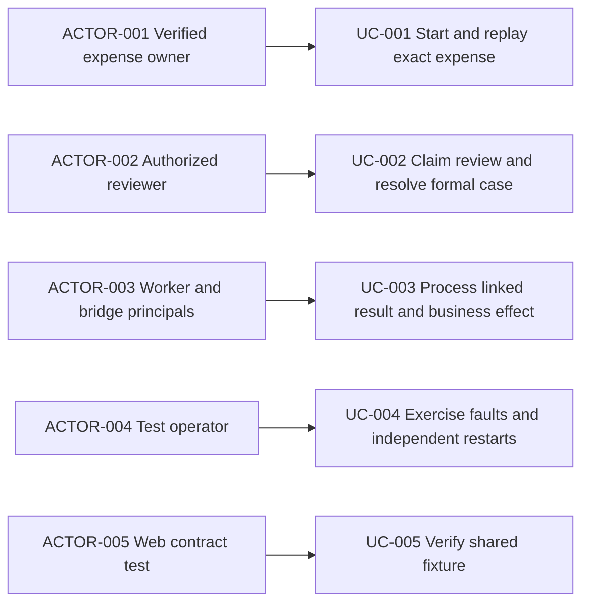
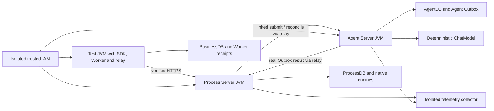
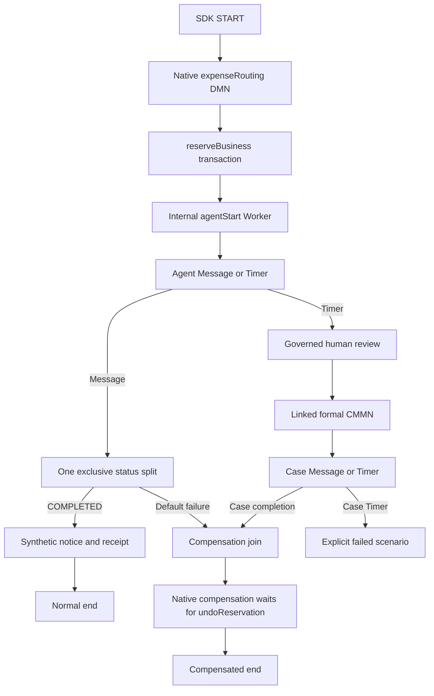
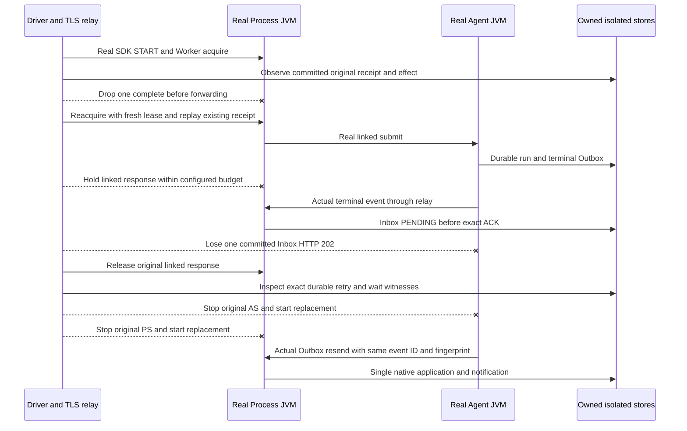
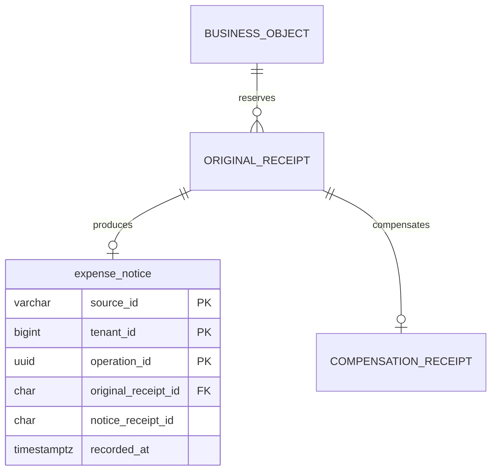

# T3-12 unified expense-review four-path acceptance

| Field | Value |
| --- | --- |
| Document | `2026-11-05-15-13-expense-four-path-acceptance.md` |
| Template Version | 9 |
| Archetype Cleanup | Not applicable |
| Status | Review |
| Type | Feature |
| Complexity | Complex |
| Complexity Drivers | Native workflow, exact tenant and service identity, real BusinessDB effects, early delivery and independent restarts |
| Created | 2026-11-05 15:13 Asia/Shanghai |
| Updated | 2026-11-05 15:27 Asia/Shanghai |
| Owner | Tianji decision owner |
| Repository | tianji-service primary, tianji-web test fixture only |
| Scope | Test-only AS/PS/Worker harness, one expense model pack, four paths, two tenants and separate finite and runtime gates |
| Change Surface | Test resources/classes and documentation, one bounded runtime harness, shared web fixture reference |
| Affected Chapters | §7, §8, §10, §11, §12, §14, §15, §16 |
| Source Requirement | [Master roadmap](../../../../docs/plans/agent-framework-upgrade-plan.md) §17 and §19/T3-12 |
| Baseline Revision | tianji-service c0ff76b66e4f903e640f0cc2cfe661076c495b36 and tianji-web 43c58a1069a50fb71b955540bae2d7e8526794b0, both clean after Recovery Step 5 |
| Amends | None |
| Supersedes | None |
| Depends On | Master §17/S05,S06,S08,S09,S10,S11 and §19/T3-05/06/07/08/10. T3-11 governs separate browser acceptance. The effective [bounded Worker compensation](2026-11-05-12-09-worker-compensation-fixture.md), [Worker recovery](2026-11-05-13-41-process-worker-recovery.md) and [formal Case](2026-11-04-15-50-formal-cmmn-case-server.md) Specs govern their respective production semantics. |
| Related Specs | [Native Agent template governance](2026-11-05-04-45-native-agentic-transfer-templates.md) for runtime context; no template changes |
| Related Plans | [Expense acceptance implementation](../plan/2026-11-05-15-30-expense-four-path-acceptance.md) |

## 1. Summary

Deliver one synthetic expense workflow with pinned BPMN, DMN, CMMN and Agent definition inputs. The explicitly authorized E gate runs actual Process Server and Agent Server in distinct OS JVMs, uses the real business SDK and Worker, verifies two tenants and traces the Process/Agent/native task/Case IDs to the business receipt. Test-only deterministic model outputs, an exact-route TLS fault relay and local synthetic business effects control the scenarios. Keep finite results and runtime acceptance separate.

## 2. Background and Current State

The master §17/§19 requirements and the current repository call chains were checked against the final recovery baseline. Earlier fragmented test evidence was inventoried at `b63fc8a`; later compensation and recovery source was verified in the current tree. Existing component tests use distinct scenario resources and opt-in PostgreSQL classes, manually construct Agent results or substitute HTTP transport, or close/reopen contexts in one JVM. The legacy cross-business lost-ACK scenario uses MockMvc and captured scheduler ticks. A unified test resource and two-process E harness were not found.

| Evidence | Actual source | Design implication |
| --- | --- | --- |
| EVD-01 | PS ProcessServerPostgresTest.verifyAgentDispatchAdapter, verifyAgentInboxApplication and verifyRoutingAfterRestart | Preserve real bridge semantics, use actual AS terminal Outbox in E |
| EVD-02 | PS HumanTaskFlowableScenarios.verifyDmnRoutes, CaseFlowableScenarios.verifyLinkedCompletion, fixtures/formal-case-linked.bpmn20.xml and governed-case.cmmn | Reuse exact native Task/Case roles, topology and correlation |
| EVD-03 | PS ProcessModelValidator.validateBpmn and compensationProfile, fixtures/worker-compensation.bpmn20.xml and CompensationBusinessFixture | Respect single splitting exclusive gateway and bounded compensation grammar, reuse original/undo BusinessDB code |
| EVD-04 | AS TianjiLinkedDispatchConfiguration, TianjiServiceExecutionConfiguration, TianjiServiceExecutionGrantIssuer and AgentTerminalOutboxPostgresTest | Use actual admission, execution grant, dispatcher, terminal publication and delivery. Fake the model provider only. |
| EVD-05 | PS ProcessAgentBridgeConfiguration, CL HttpLinkedAgentDispatchClient/HttpAgentResultClient/HttpProcessClient, W RemoteWorkerPoller and JdbcWorkerExecutionStore | Reuse real token, HTTP, scheduler, lease and receipt code under TLS |
| EVD-06 | AS/PS current executable JARs contain org.springframework.boot.loader.launch.PropertiesLauncher.class. PS POM already carries W, Flyway and Boot test capabilities. | Use the existing exec artifacts plus narrowly selected test classes for child JVMs, and the PS test classpath for the driver. |
| EVD-07 | tianji-web at 43c58a1 already has typed Task/Case consumers, tests and src/test/fixtures.ts | Add one shared expense contract fixture assertion without changing runtime routes or data ownership. |

### 2.4 Evidence and current-chain map

| Entry/trigger | Current exact owner and seam | Current verification limit | Target proof |
| --- | --- | --- | --- |
| SDK start to native DMN/task/Case | CL HttpProcessClient; PS ProcessModelValidator, HumanTaskFlowableScenarios and CaseFlowableScenarios | Separate fixtures; no unified model or independent process proof | One immutable model bundle, real protected SDK and native stage IDs |
| PS dispatch to AS and back | PS AgentDispatchStore; AR DefaultContextAssembler; AS TianjiLinkedDispatchConfiguration and AgentTerminalOutboxPostgresTest | Fixture stages or MockMvc prove local ownership; no actual cross-process restart | Real linked SDK, Outbox/Inbox, safe exact causal witnesses |
| Synthetic business effect | W JdbcWorkerExecutionStore; PS CompensationBusinessFixture | Finite fixture and opt-in caller source | Actual reserve/undo/notice and stored business receipt in disposable BusinessDB |

### 2.5 Archetype example cleanup

Cleanup disposition: Not applicable

Reason: Existing Tianji infrastructure/test modules only; no generated business project or example replacement. Target source is confined to PS/AS test files and TW test fixtures.

Not applicable. This is test-only acceptance work in the existing Tianji test architecture. It creates no new generated business project, relocates no production layer and removes no existing component fixtures or applied SQL.

## 3. Goals and Non-goals

Prove the exact expense sample and expose deterministic repro inputs, causal checkpoints and joined receipt evidence. Make finite source checks possible without credentials, applications or DB. Existing public wire, validation, permissions, production defaults/DDL, deployment, browser paths, real payments/mail/providers and wider T4 work are outside the change. Existing T3-10 business UNKNOWN and governed restore remain governed separately.

### 3.3 Change Surface and Design Depth

| Area/layer | Disposition | Exact repository evidence | Changed or preserved behavior/contract | Required Spec treatment | Chapter(s) |
| --- | --- | --- | --- | --- | --- |
| Workflow and fixture tests | Affected | PS ProcessModelValidator, current model resources and CompensationBusinessFixture | One exact model pack, finite tests and opt-in E | Full fixture/validation design | §7, §8, §14 |
| Cross-process harness | Affected | Current PS/AS Boot exec artifacts and existing auth/bridge | Two independent JVM lifetimes, one safe test driver and bounded transport fault controller | Full operator/failure/evidence design | §7, §8, §14, §15, §16 |
| Disposable business data | Affected | Existing CompensationBusinessFixture and JdbcWorkerExecutionStore | Isolated business proof and notification effect, separate from production | Full fixture schema/boundary | §10, §11, §14 |
| Production API and database | Context-only | HttpProcessClient, Process/Agent owners, immutable current SQL | Reuse current routes/permission/owner/SQL contracts as-is | Exact relied-upon boundaries | §9, §11, §16 |
| Web fixture | Affected | TW current consumer test decoding | Byte-identical shared test-only fixture with hash and decoder evidence | Full finite test boundary | §8, §12, §14 |
| Browser, live models, deployments | Unchanged | Existing user-operated environments | Separate live validation; no scope expansion | Boundary only | §14, §16 |

## 4. Requirements and Acceptance Criteria

| ID | Requirement | Observable acceptance | Source |
| --- | --- | --- | --- |
| REQ-001 | One pinned business sample uses real SDK START, DMN, Agent and notification | Native DMN rule and actual COMPLETED Agent, one BusinessDB notice and normal end | T3-12 normal, S05/S06 |
| REQ-002 | Actual Agent model failure selects a distinct branch | Persisted FAILED and actual Outbox event, one Inbox application and one exact native compensation, no normal notice | T3-12 failure, S06 |
| REQ-003 | Real governed human task and linked formal Case | Native Timer routes to review; authorized claim/complete and Case item/sentry/milestone; exact Case completion resumes BPMN and compensates | T3-12 manual/Case, S08/S09 |
| REQ-004 | Genuine early/duplicate delivery, lost ACK and two independent restarts | Early Inbox pending before binding, real resend with same event, fresh Worker lease/one effect, new AS and PS PIDs and surviving persisted state | T3-12 recovery, S06/S10/S11 |
| REQ-005 | Two trusted IAM tenants with exact owner/source scope | Reuse identical business/operation/command/user subject strings across tenants. Assert disjoint IDs/receipts and denied foreign authority. | T3-12 E, §17.3 |
| REQ-006 | Correlate evidence and reconcile owned work | Link release/process/decision/run/task/Case/job/receipts, distinguish never reached from unproved, account for every owned run/work item | T3-12 E |
| REQ-007 | Runnable fixture and bounded finite gates | Finite tests require no runtime. Explicit E fails incomplete/skipped or non-isolated runs. | §17.1 and T3-12 |
| REQ-008 | Share the test contract with web | Existing web test decoders consume the same pinned neutral fixture with hash parity; browser separate | T3-12 |

### 4.1 Scenario matrix

| Scenario | Trigger and distinctive branch | Durable outcomes |
| --- | --- | --- |
| NORMAL | Same release, real AS model invocation returns fixed success | Reserve 1, notice 1, undo 0, Agent COMPLETED, normal end |
| AGENT_FAILURE | The fixture ChatModel deterministically throws in the real native executor | Agent FAILED, Inbox advances once, reserve 1, undo 1, notice 0, compensated end |
| MANUAL_CASE | Actual Agent-result delivery gated until its competing native Timer wins | Authorized human action, linked CMMN item/sentry/milestone and real completion Inbox. Reserve 1, undo 1, notice 0, compensated end. |
| RECOVERY | Dropped Worker complete and controlled linked response/result, independent JVM replacements at durable witnesses | Same reserve receipt after reacquisition, old lease rejected, early pending and one terminal advance, persisted wait/Outbox recovery, one notice and normal end |

### 4.2 Use-case analysis

#### 4.2.1 Actor inventory

| Actor ID | Actor/role | Goal and responsibility | Entry/channel | Permission/tenant context | Evidence |
| --- | --- | --- | --- | --- | --- |
| ACTOR-001 | Verified expense owner | Start, query and exact replay | Current protected SDK | Exact tenant/issuer/subject owner | PS exact START receipt |
| ACTOR-002 | Authorized reviewer/case operator | Claim/complete review and act in formal Case | Current task and Case SDK | Current role/lane, tenant and version | Current governed task/Case APIs |
| ACTOR-003 | Worker and bridge SERVICE principals | Handle real work and linked delivery | Worker/linked/Outbox SDK | Exact issuer/tenant/audience and scopes | Existing registry and bridge |
| ACTOR-004 | Test operator | Run isolated scenarios and collect evidence | Explicit acceptance manifest | Private isolated inputs and independently authorized runtime | §9/§14 |
| ACTOR-005 | Web test consumer | Parse the shared synthetic contract | Finite fixture tests | No runtime identity | Existing Web task/Case decoders |

#### 4.2.2 Use-case artifact



## 5. Constraints, Assumptions, and Decisions

| ID | Decision or unresolved gate | Evidence and impact |
| --- | --- | --- |
| DEC-001 | One shared BPMN/DMN/CMMN release per tenant, identical model bytes | PS validator admits one splitting exclusive gateway; event-based waits and compensation are already separately supported. Do not change validator grammar. |
| DEC-002 | Real independent PS and AS TLS JVMs. Business SDK/Worker runs in the separate JUnit driver JVM. | Existing executable artifacts and dependencies; no new runtime module |
| DEC-003 | E requires isolated trusted IAM using existing Shoubing/Jianshen production verifier/permission path. | The bridge verifies HTTPS, issuer, app/resource/tenant/subject and scopes. Test harness may not fabricate successful authentication or grants. |
| DEC-004 | Test-only HTTPS fault relay controls actual delivery. | Existing SDK/Outbox generate/resend authentic events. Relay controls timing/drop only, without synthetic event insertion or token logging. |
| DEC-005 | Real native/DB clocks in E, deterministic business input/Fake and fixed Clock in finite fixtures. | Preserve DB lease and Flowable Timer semantics. Causal barriers and bounded deadlines replace delay-only assertions. |
| BLOCK-001 | Fresh isolated PostgreSQL/IAM/TLS/collector manifest and separately authorized E are required. | Missing prerequisites leave E unexecuted. A substitute MockMvc or component test cannot close E. |
| DEC-006 | Composition feasibility resolved for the reviewed bytes | Actual three validators, binding checks and pinned pure converters passed. Actual AS definition seeding and native execution remain E0/runtime. |
| DEC-007 | Retain the existing test-only technical profile | No production class, managed business service, dependency, build module, API/permission, generator or migration. The named Fake test Bean is an explicit adapter for the existing model provider seam. Disposable fixture SQL follows current local BusinessDB helper scope; no production persistence design exception. |

## 6. Project Technology Context

### 6.1 Java architecture profile and capability baseline

JDK 25, existing Spring Boot application classes and source reactor, Flowable 8.0.0, PostgreSQL, existing Shoubing/Jianshen, existing CL/W, transactional Outbox/Inbox, JUnit and Vitest. Preserve the existing technical test vertical demonstrated by AS/PS integration tests. No generated archetype/module, new dependency or framework. Use JDK ProcessBuilder/ProcessHandle/HTTP/HttpsServer, existing Jackson, Spring JDBC, current Flyway and W JDBC Store. Test-only Scenario Orchestration has named causal phases and one driver. Production lifecycle/transactions stay in actual existing services. Existing C commands/DTOs supply validation, and small immutable fixture values capture only test evidence. Use explicit test Bean names, current application factories and UTC Instant/Duration. Existing technical-profile approved constraints remain authoritative.

### 6.2 User-mandated Java rule compliance

| Literal rule | Affected? | Repository evidence | Exact design decision | Files/types/interfaces | Validation/test evidence | Status/blocker |
| --- | --- | --- | --- | --- | --- | --- |
| Rule 1 | Yes | Existing PS/AS test suffixes | Explicit semantic DTO names for immutable test evidence and named test facilities. §8/§10. | §8 test types | §14 finite and scope gates | PASS |
| Rule 2 | Yes | Current C constructors and test manifest boundary | Existing validated C command construction and actual typed runtime guards. Closed manifest, exact bindings and finite negative cases. §9/§14. | §9 immutable input DTO and parser | §14 finite and scope gates | PASS |
| Rule 3 | Yes | Current typed DTOs and immutable test evidence | Existing immutable C records and test-only immutable values. No ORM entity or new production mapper/converter. §10/§11. | §10 private values | §14 finite and scope gates | PASS |
| Rule 4 | Yes | Existing named provider test seam; no managed business service | Explicit named test Fake, actual existing application factories and redacted test reporting. The test-only adapter follows the existing named model fixture; no new business logger or injection policy. §6/§9/§15. | AS test-only model Bean | §14 finite and scope gates | PASS |
| Rule 5 | Yes | JDK, existing Spring/Jackson/JDBC and Worker | Existing JDK, Spring, Jackson and Worker interfaces. No added utility/dependency. §6/§8. | §8 exact test files | §14 finite and scope gates | PASS |
| Rule 6 | Yes | Existing Jackson HTTP/contract tests | Current Boot Jackson and explicit closed fixture JSON/enum strings. No ordinals or new persisted business enums. §9–§12. | Shared fixture and report DTO | §14 finite and scope gates | PASS |
| Rule 7 | Yes | Current checked-in profiles | Existing production profile keys/values untouched. Explicit disposable test inputs only. §8/§9. | Disposable child config; no profiles edited | §14 finite and scope gates | PASS |
| Rule 9 | Yes | Existing finite scenario helper patterns | Test-only Scenario Orchestration with fixed phase predicates, causal witness and explicit result. §7/§13/§14. | Driver and test fixtures | §14 finite and scope gates | PASS |
| Rule 10 | Yes | Existing Instant and DB clocks | java.time Instant/Duration, UTC evidence and monotonic deadline. §6.3/§9. | §6.3 and §14 | §14 finite and scope gates | PASS |
| Rule 11 | Yes | Current PS/AS/Worker test architecture | Existing test architecture, owner-local migrations preserved byte-for-byte, test-only DDL and existing actual CQE/Outbox/Inbox. §6/§11/§16. | §8 exact tree / §11 disposable data | §14 finite and scope gates | PASS |

### 6.3 Time semantics and conversion contract

Time contract: Required

| Time ID | Fields/symbols | Semantics | Java/runtime type | Storage policy | Wire policy | Business zone source | Display zone source | Boundary / DST rules | Precision / Clock | Compatibility | Verification |
| --- | --- | --- | --- | --- | --- | --- | --- | --- | --- | --- | --- |
| TIME-001 | Native due/lease and report observedAt/decision facts | Occurred instant | Instant | UTC instant | UTC Z | Not applicable: technical instant | Not applicable: fixture report | Exact durable identity and before/after witness; no time-only causal inference | Existing DB/native clocks and precision | Preserve current engine/SDK times | TEST-001, TEST-002, TEST-004 |
| TIME-002 | Phase deadlines and shutdown budget | Duration | Duration, System.nanoTime | Not persisted | Internal | Not applicable: elapsed budget | Not applicable: elapsed budget | Absolute monotonic deadline; no wall clock, calendar or DST arithmetic | Monotonic clock, injectable finite supplier | Existing process and DB clocks unchanged | TEST-002, TEST-004 |
| TIME-003 | Finite fixture time | Occurred instant | Instant, Clock | Not persisted | Internal | Not applicable: finite technical fixture | Not applicable: finite fixture | Exact fixed UTC reference; no runtime clock override | Fixed finite clock | No real DB/engine elapsed implication | TEST-002, TEST-003 |

## 7. Architecture Design

### 7.0 Minimum-design baseline and element-necessity audit

| Proposed element | Change | Requirements | Existing/direct alternative | Concrete inadequacy of alternative | Added calls/state/coupling/failures/migration/operations | Verdict |
| --- | --- | --- | --- | --- | --- | --- |
| PS/AS/CL/W, native BPMN/CMMN and Worker/Outbox/Inbox | Keep | REQ-001 through REQ-006 | Existing owners | None | No contract or deployment change | Keep |
| Expense XML pack and common fixture | New | REQ-001/002/003/008 | Separate component fixtures | No common release or portable evidence schema | Three XMLs and one test JSON; no prod resource | Add |
| Two test mains, one driver and narrow TLS relay | New | REQ-004/005/006/007 | MockMvc and recreated context | Cannot prove actual transport commit boundaries and independent OS lifetime | Isolated test processes and bounded relay, closed explicit operator manifest | Add |
| Original/undo fixture and synthetic notice | Expand | REQ-001/002/003/004 | Worker technical receipt alone | Cannot prove business state or no duplicate effect | Reuse existing business fixture, one disposable notification oracle | Add |
| Web fixture copy check | New | REQ-008 | Maintain unrelated mock test payloads | Source and consumer can drift | One exact test fixture copy and current typed decoder test | Add |

| Path | Network calls | Client states | Server contracts/state | Failure and TOCTOU points | Additional user/business value |
| --- | --- | --- | --- | --- | --- |
| Direct baseline | Component-local; no end-to-end proof | Per-fixture states | Existing MockMvc and independently run integration fixtures | Cannot observe cross-process boundaries | Cheap local regression only |
| Selected design | Existing SDK and delivery calls; relay forwards only two causal routes | Four bounded test phases with durable checkpoints | Same existing service contracts and owners | Known delivery/lease/termination windows controlled by assertions | One repeatable correlated expense workflow with real restarts and effects |

### 7.1 System Architecture Design



### 7.2 High-Level Design



Use master fixture resource names expense-review.bpmn20.xml, expense-routing.dmn and expense-exception.cmmn with keys expenseReview, expenseRouting and expenseException. Use the exact existing Flowable/tianji namespaces. The one splitting exclusive gateway follows Agent Message and has the literal agentStatus == 'COMPLETED' branch plus default failure. A two-incoming one-outgoing exclusive merge leads to the single compensation throw. The successful reserve outgoing edge dominates the throw. The noninterrupting compensation boundary has one One association and the compensation handler sits off the normal sequence graph. Both original and undo use only the typed operationId input and have no outputs, as required by compensationProfile. Their topics are reserveBusiness:1 and undoReservation:1 with TRANSACTIONAL_RECEIPT. Internal agentStart:1 remains EXTERNAL_IDEMPOTENT and retains amount -> requestedAmount and runId -> agentRunId.

The START inputs are operationId: STRING, amount: INTEGER. The fixed FIRST-hit DMN decision reads amount and outputs reviewLane: STRING. Rule smallExpense (≤1000) yields standard, and largeExpense (>1000) yields exception, with exact rule reference recorded. Both lanes exist in the governed task even though the sample Timer uses exception. DMN runs for all paths before reserve and Agent. The manual route uses task:laneVariable=reviewLane and configured roles, and one ACTION form field finding (STRING, target reviewFinding) with the fixture always sending a fixed bounded string. ACTION records handling without another splitting gateway. The native Case source uses the literal definition key and an existing-style event gateway. CMMN adapts governed-case primary and supplemental items. The primary starts after its existing manual activation, native completion enables supplemental via sentry, and supplemental completion or its authorized plan-item TERMINATE triggers the existing milestone and native Case completion. Tenant A completes supplemental and tenant B proves its allowed TERMINATE path. Both still require a genuinely COMPLETED Case. Whole-Case termination is a separate existing negative T3-08 scenario, with no new API here. The successful manual route must use actual Case completion delivery and exact native Message correlation. A Case Timer end is an explicit failed acceptance outcome and requires retained-state reconciliation.

#### 7.2.2 High-level decision and quality matrix

| Concern/use case | Quality consequence | Design proof | Later gate |
| --- | --- | --- | --- |
| One shared fixture with one exclusive split | Reproducible release and model acceptance | Existing validators and native converters passed exact bytes | TEST-001 and runtime publish |
| Genuine relay faults with exact checkpoints | Avoids manufactured delivery history | Existing linked and terminal SDK paths | TEST-002 and E4 |
| Separate DB owners and independent JVMs | Actual recovery boundary remains visible | Existing exec launchers and transactional stores | E0–E4 |

### 7.3 Detailed Design



Run RECOVERY as ordered correlated fault windows on the same expense definition. An early terminal may apply immediately after ACK, so use a separate recovery occurrence if necessary to prove a live native Message and Timer survive PS restart. For the PS restart window, withhold terminal delivery until the exact ACKNOWLEDGED wait and both native artifacts are visible, stop and replace PS, confirm both old IDs/deadline, then release delivery. For the AS restart window, prove committed terminal Outbox remains pending after one lost 202 before stopping AS, then observe actual production resend from the replacement. Capture all occurrence ID sets separately. No claim may combine incompatible snapshots. Both windows must pass for the one RECOVERY category.

The relay matches one tenant/phase/operation/exact route and bounds every wait/size. Worker ACK loss happens after actual BusinessDB commit and before PS receives complete. Wait for actual DB lease expiry and observe a new lease for the same job/occurrence/intent. Verify old lease rejection and one business effect. Early results come from actual AS Outbox while the original linked success response is held after AS commit and before PS acknowledgement. Commit witness is read-only against owned test data. Lose the first genuine committed Inbox 202 to force ordinary Outbox retry. Execute exact SDK START and task-complete replays and one changed-payload conflict. Stop only recorded child handles, assert PID/start instant changes, and never update ACT or lease rows to make a test progress.

#### 7.3.6 Conclusion evidence chain

| Conclusion | Decision | Verification |
| --- | --- | --- |
| EVD-01/04 | Actual AS terminal event with real Outbox transport and durable phase gates | E2 and E4 assert PENDING, retry, one native apply and new process PIDs |
| EVD-02/03 | One status split, Timer/manual Case, one native compensation | U1 validates the composed release, E3 verifies native Case and one undo |
| EVD-05/06 | Two actual packaged JVMs and existing IAM | U2 enforces manifest/fault rules, E0 captures actual provenance |

## 8. Package Structure and Code File Tree

Only test sources and related evidence documentation are proposed. Exact preliminary model feasibility hashes:

- BPMN: `5957151c2760507749f0b68763863dde4e42466261e63de10627e1d48ed1c1b6`.
- DMN: `94cbd131a086c5e2a87240e99e0c7c88b267d946c184e5c7c1f3bfd694feba74`.
- CMMN: `c2bc0015fcc709b1bd568b635737b4fc7feff80fe343622a9efdc1c9a02f49c1`.

The isolated pure probe invoked existing `ProcessModelValidator` BPMN/DMN/CMMN and binding checks, current publish DTO and Worker registry, and the pinned BPMN/CMMN native converters. It also rejected the original-action bypass, unconfigured DMN lane, missing Worker input and wrong Case binding. No Flowable engine, server or database ran. Template proof role literals are finite synthetic render slots in exact reviewed lane attributes; only the authorized isolated harness replaces them. Step 1 reproduces finite source evidence. Actual native deployment/routing remains E.

 PS is stellar-enclosure-tianji-process-server and AS is stellar-enclosure-tianji-agent-server.

| Target repository/path | Responsibility |
| --- | --- |
| tianji-service PS/src/test/resources/processes/expense-review.bpmn20.xml | Shared pinned BPMN template |
| tianji-service PS/src/test/resources/decisions/expense-routing.dmn | Fixed rules and lane output |
| tianji-service PS/src/test/resources/cases/expense-exception.cmmn | Existing governed CMMN grammar adapted to the expense case |
| tianji-service PS/src/test/resources/fixtures/expense-four-path-contract.json | Canonical cross-repo fixture |
| tianji-service PS/src/test/java/top/egon/cola/platform/tianji/process/server/acceptance/ExpenseFixtureModelsTest.java | Real existing model validators and graph/fixture oracles |
| tianji-service PS/src/test/java/top/egon/cola/platform/tianji/process/server/acceptance/ExpenseAcceptanceHarness.java | Manifest, bounded child lifetime, phase orchestration and redacted evidence; nest immutable fixture values |
| tianji-service PS/src/test/java/top/egon/cola/platform/tianji/process/server/acceptance/ExpenseAcceptanceHarnessTest.java | Finite manifest/phase/evidence tests with controlled clock and launch/transport doubles |
| tianji-service PS/src/test/java/top/egon/cola/platform/tianji/process/server/acceptance/ExpenseAcceptanceFaultRelay.java | Narrow test HTTPS transport with exact, bounded fault phases |
| tianji-service PS/src/test/java/top/egon/cola/platform/tianji/process/server/acceptance/ExpenseProcessAcceptanceMain.java | Boot launch of existing TianjiProcessServerApplication with explicit disposable configuration |
| tianji-service AS/src/test/java/top/egon/cola/platform/tianji/agent/server/acceptance/ExpenseAgentAcceptanceMain.java | Boot launch of existing TianjiAgentServerApplication with the named deterministic test ChatModel |
| tianji-service AS/src/test/java/top/egon/cola/platform/tianji/agent/server/acceptance/ExpenseAcceptanceModelTest.java | Fixed model outcomes and real finite ADK adapter check |
| tianji-service PS/src/test/java/top/egon/cola/platform/tianji/process/server/compensation/ExpenseBusinessWorkerFixture.java | Same-package reuse of existing CompensationBusinessFixture handlers, actual Worker Store/poller, synthetic notice effect |
| tianji-service PS/src/test/java/top/egon/cola/platform/tianji/process/server/acceptance/BusinessProcessAgentAcceptanceIT.java | Opt-in NORMAL, AGENT_FAILURE, MANUAL_CASE in two tenants |
| tianji-service PS/src/test/java/top/egon/cola/platform/tianji/process/server/acceptance/WorkerRecoveryIT.java | Opt-in RECOVERY on same release/harness |
| tianji-service docs/egon/evidence/<date>-expense-four-path-acceptance.md | Reproducible commands, prerequisites and separately classified results |
| tianji-web src/test/fixtures/expense-four-path-contract.json and src/test/expenseFourPathContract.test.ts | Verified canonical copy and current consumer parsing only |

Two distinct IAM tenants may have globally unique role IDs. A test renderer may substitute only declared role placeholders, producing one sorted bounded union per lane from that lane’s configured role IDs in both tenants. Render one identical BPMN/CMMN model byte set for both tenants. Standard, exception and Case reviewer sets have distinct role ID tuples as required by the existing validator. Actual verified role membership still comes from current tenant authority. Record template and rendered SHA separately. Reject unknown substitutions, unresolved placeholders, missing roles or a union beyond the current lane limit. Finite tests use a fixed synthetic role pair. Both tenants run all four paths using equal textual operation/business/command IDs and separate verified identities.

## 9. Interface Definitions

No production API, OAS or permission changes. Current public SDK contracts remain authoritative. The new contract is the test operator invocation and report.

| Invocation | Owner | Boundary and acceptance |
| --- | --- | --- |
| Existing ProcessReleaseClient.publish and ProcessClient.start/get via HttpProcessClient | PS driver | Exact immutable release, ordinary protected SDK START, exact replay and changed-payload conflict |
| Existing HumanTaskClient.humanTasks/getHumanTask/claimHumanTask/completeHumanTask and CaseClient.get/actOnPlanItem | PS driver | Real authorized USER, current lane/version and exact action. Derive linked Case ID from existing read-only provenance witness, then use current API. |
| Existing linked submit/resolve/close and Agent result delivery | Production AS/PS clients | Exact production token/receive/result contracts through TLS relay, which preserves content and authorization while dropping or holding a bounded connection phase |
| Existing WorkerClient and RemoteWorkerPoller | Business test driver | Actual acquire/complete/fail and transactional Store. Compare the prior lease in memory for stale rejection; never emit token or token hash. |
| System property tianji.expense.e2e.manifest | Explicit E tests only | Absolute owner-private file, strict JSON ≤64 KiB, closed schema and acceptance marker. Missing means unexecuted; invalid fails before side effects. |
| Write-once JSON evidence | Driver | Owner-private output directory, exact run ID, atomic publication and bounded source-verified references. Missing/partial output is not success. |

Manifest fixes schemaVersion=1, unique runId, exact artifact paths/SHA-256, repository commits, exactly two tenant bindings (IDs, trusted issuer/subject, app/resource references and role IDs), credential **file references**, three independently identified disposable DB endpoints/schema/role references, TLS trust/key references, loopback port allocations or isolated ingress, collector endpoint, bounded phase limits and explicit runAuthorized=true. No default connection target or implicit live auth. Resolve paths safely, reject private-file symlinks and secrets on command arguments. Reject malformed/extra fields, arbitrary SQL and relay routes, mismatched versions/checksums and any test endpoint that does not resolve to the approved isolated target.

Seed the fixed CONFIG-mode Agent definition once per tenant with AgentLedgerService.publish(TrustedAgentActor, AgentDefinitionSpecDTO) in the actual isolated AgentDB. Reuse the existing one-agent chatModelBeanName/modelName form in TianjiGrantDispatchPostgresTest. Enable actual runtime, reconciliation, dispatch, linked/service-execution, terminal publication and delivery under existing grant/authority contracts. The Fake model returns bounded fixed streaming success or deterministic failure, with no tools or provider network. AgentDispatchStore puts Worker mapped values into AgentInputDTO.taskData. AdkAgentRunExecutor calls DefaultContextAssembler.assemble, which serializes taskData into a bounded structured JSON input part. The Fake accepts exactly one supported integer requestedAmount marker. NORMAL uses 100, AGENT_FAILURE uses 700, MANUAL_CASE uses 1500, and RECOVERY uses 200. Only 700 emits the declared model failure. Use this input path in finite ADK tests, never call count or injected terminal state. An unverified grant/model budget prerequisite blocks E. Use existing fixed estimator/price metadata only if current model policy requires it, and record it as test-only.

Register the expected instance for the synthetic BusinessDB handlers after authenticated START returns and before allowing that run's ordinary Worker acquisition. Use monotonic absolute phase deadlines, actual PostgreSQL clocks for lease/recorded facts and real native Timer jobs. Provisional budgets are readiness 60 s, straightforward path 90 s, manual 180 s, recovery windows 240 s, linked relay hold ≤10 s, and graceful 10 s plus bounded 5 s escalation on shutdown. Configure Agent/Case native Timer and bridge HTTP/lease only if the current inequalities and causal tests pass. A nominal PT20S Agent wait and PT3M Case wait are fixture values for review, with the bridge HTTP deadline greater than the deliberate linked response hold and Worker lease covering both HTTP budgets and safety reserves. Unexpected expiry or close fails and leaves evidence; the harness does not change engine clocks or rows.

## 10. POJO and Data Model Design

Reuse StartProcessCommand, ProcessInstanceDTO, AgentDefinitionSpecDTO, AgentTerminalEvent, HumanTaskDTO and receipt, CaseInstanceDTO and operation result, Worker DTOs. New test-only immutable ExpenseAcceptanceManifestDTO, ExpensePathResultDTO and ExpenseEvidenceDTO can be nested in the harness. No public business DTO or production mapper.

Each path records fixture/run/scenario/tenant, release and model hashes, exact START command/process, business/correlation refs, native DMN execution/decision/rule, Agent dispatch/run/status, native activity/end, reached task/Case/plan-item/provenance/completion IDs, Worker job/occurrence and business original/notice/undo references. Use explicit PROVED, NOT_REACHED, UNAVAILABLE and phase PENDING. NOT_REACHED requires a scoped negative assertion. UNAVAILABLE does not satisfy a required witness. Record original/replacement AS/PS PID, process start instant and exit result. No bearer, password, full prompt, raw callback, lease token/hash or SQL diagnostics in artifacts. Prove distinct leases by an in-memory comparison and record only a Boolean. Dates are UTC Instant; budgets are Duration/monotonic elapsed.

## 11. Database Design

Use fresh isolated PostgreSQL 18.3 as the repo README's tested Process patch baseline, or a separately reviewed pinned version. Lock actual PostgreSQL and pgvector patch, migration placeholders, engine artifacts and SQL hashes. All existing migration source bytes remain immutable.

- **ProcessDB**: Existing PS classpath:db/tianji-process V1–V10 at recovery baseline; exact Flowable 8.0.0 PostgreSQL BPMN/DMN/CMMN setup from existing test pattern. Read-only witnesses: Release, command receipt, exact native Process/Task/DMN/history, tianji_process_agent_dispatch, tianji_process_agent_result_inbox, tianji_worker_lease_receipt, tianji_case_start_provenance, tianji_case_completion_inbox and tianji_human_task_receipt.
- **AgentDB**: Existing Agent runtime classpath:db/tianji-agent V1–V14. V10 requires preinstalled pinned public.vector and explicit placeholders. Separate JDBC Outbox V1 under Components db/transactional-outbox/postgresql.. Read-only witnesses: tianji_agent.agent_run, event/dispatch and exact Outbox state.
- **BusinessDB**: Existing W classpath:db/tianji-worker V1/V2. Existing CompensationBusinessFixture.createBusinessTables and guarded rows. Read-only witnesses: Exact Worker receipt, original/undo/effect, owner affinity and count.

### 11.1 Table Inventory

| Table | Existing/new | Purpose and owner | Read/write paths | Change | DDL script | Requirements |
| --- | --- | --- | --- | --- | --- | --- |
| compensation_fixture.expense_notice | New | Synthetic BusinessDB notification proof | ExpenseBusinessWorkerFixture via existing Worker Store transaction | Create in disposable schema only | Test helper, no classpath migration | REQ-001/002/003/004 |

### 11.2 Per-table Detailed Design

#### 11.2.1 compensation_fixture.expense_notice

##### Purpose, ownership, and lifecycle

One synthetic notice per successful original reservation. Its owner is the disposable BusinessDB, with no production table, soft-delete or mutation lifecycle. The ordinary fixture role can only read/append this table and verify the existing original receipt through scoped SELECT; the isolated setup owner alone creates it.

##### Complete column design

| Column | Native type | Meaning and bound |
| --- | --- | --- |
| source_id | varchar(128) | Exact current BusinessDB logical source, C collation, nonnull |
| tenant_id | bigint | Verified positive tenant, nonnull |
| operation_id | uuid | Exact fixture operation identity, nonnull |
| original_receipt_id | char(64) | Lowercase hex original receipt ID, C collation, nonnull |
| notice_receipt_id | char(64) | Stable lowercase hex receipt derived from exact original/operation scope, C collation, nonnull |
| recorded_at | timestamptz(6) | BusinessDB write-clock Instant, nonnull, no default |

##### Keys, relationships, and constraints

PK (source_id, tenant_id, operation_id), exact source tenant and original receipt relationship. FK (source_id, tenant_id, original_receipt_id) references the existing original fixture receipt with RESTRICT update/delete. Hashes use exact lowercase hex; tenant positive. No mutable state or additional identity.

##### Index inventory and per-index justification

| Index | Type/unique | Ordered columns/predicate | Required access | Rationale and cost |
| --- | --- | --- | --- | --- |
| Expense notice primary index | Unique btree PK | source_id, tenant_id, operation_id; unconditional | Exact retry/read and bounded one-effect witness | One append/write index only |

##### Access patterns and SQL shape

Verify the exact original receipt through fixed scoped SQL; derive stable notice ID from its persisted owner and identity. Insert once with targeted primary-key conflict handling. On replay verify the exact immutable result or fail closed; no cross-tenant, arbitrary SQL, generic update or new index.

| Operation | Caller | Shape and bound | Invariant |
| --- | --- | --- | --- |
| Inspect existing original and notice | ExpenseBusinessWorkerFixture | Exact source/tenant/operation and one current Worker intent, PK read | Preserve the original receipt and fail closed on affinity mismatch |
| Append notice | Existing transaction-bound Worker handler | INSERT exact six columns, conflict only on the PK, exact replay verified | Same BusinessDB transaction as technical receipt |
| Read evidence | Test-only driver | One tenant/source/operation and exact receipt lookup | No mutation and no cross-owner inference |

##### Migration and historical-data handling

Create only after operator authorization on a verified fresh isolated BusinessDB using the test setup owner, separate from all classpath migrations. No change to existing SQL or historical rows. No runtime environment or grant is created by a finite test. No automatic teardown of user-managed databases.

##### Transaction, consistency, and recovery

The existing Worker Store commits synthetic effect and its technical receipt on the same BusinessDB transaction. Normal paths require one notice and no undo; failure/manual require one undo and no notice. Use the original fixture's scope/receipt checks and a separate read-only evidence role. There is no cross-owner transaction, and write time is not commit order.

### 11.3 Entity-relationship diagram



The native DMN execution witness is the pinned Flowable 8 ACT_DMN_HI_DECISION_EXECUTION row constrained by INSTANCE_ID_, ACTIVITY_ID_=classifyExpense, exact tenant and released decision definition; record ID_ and just the verified matched rule from bounded synthetic audit parsing. Keep native audit payload private. All four renderer names map to exact lowercase compensation_fixture tables. Existing original identity is source + tenant + original receipt ID. Before fixture setup verify native/DDL checksums and role/catalog; a stale or unknown schema is unavailable.

## 12. Frontend Page Design

No page, browser or runtime route work. Use the PS canonical fixture JSON byte-for-byte in tianji-web and assert its SHA and decoded governed Task/Case schema with existing typed consumers. Require both repositories to update together when that fixture changes. Keep role template substitution and runtime data separate. T3-11 browser acceptance remains an independent user-controlled gate.

## 13. Design Patterns and Architecture Principles

The test-only Scenario Orchestration pattern records named allowed phases with causal preconditions and bounded deadlines. A single shared driver controls app lifetimes and invokes existing owner contracts. This removes duplicated timing sleeps without introducing a workflow framework, production test route, custom live retry policy or mocked E storage and identity.

## 14. Test Design

Stable finite/runtime design IDs: TEST-001 (model pack, U1), TEST-002 (harness and monotonic phase lifecycle, U2), TEST-003 (Fake native-adapter source, U3), TEST-004 (operator E0–E4), and TEST-005 (web fixture parity, U4).

| Gate | Exact future selector or method | Acceptance |
| --- | --- | --- |
| U1 | ExpenseFixtureModelsTest,ProcessModelValidatorTest,CmmnModelValidatorTest,WorkerCompensationModelTest,HumanTaskModelTest,HumanTaskTimerModelTest | Real XML and semantic validators, render/sha, single split, lane rules, Case bounds, compensation domination and negative model cases; no engine |
| U2 | ExpenseAcceptanceHarnessTest | Wrong schema/hosts, duplicate tenants/PIDs, artifact mismatch, unknown fields, wrong phase/event and timeout fail before runtime, positive state/result witness checks with doubles |
| U3 | ExpenseAcceptanceModelTest,FlowableWorkerServiceTest,WorkerTopicRegistryTest,CompensationBusinessFixtureTest,AgentStartWorkerTest,AgentResultDeliveryHandlerTest,RemoteWorkerPollerTest | Real bounded Fake/ADK outcomes and exact dispatch/Worker hash and authorization regression |
| U4 | tianji-web npm test -- src/test/expenseFourPathContract.test.ts and npm run typecheck | Canonical contract/hash and actual consumer parsing, no browser |
| Compile/package | Same finite selectors with source-reactor verify | Both E classes compile; exec JARs and exact test entrypoints verify by archive/source inspection. No E executed. |
| E0 | Explicit isolated manifest and real child readiness | Distinct AS/PS process identities, real TLS/IAM and current dedicated stores |
| E1 | BusinessProcessAgentAcceptanceIT NORMAL | Both tenants, exact DMN/Agent/notice/end, idempotency and foreign denial |
| E2 | BusinessProcessAgentAcceptanceIT AGENT_FAILURE | Both tenants, real model failure becomes FAILED/outbox/once-only inbox and compensation |
| E3 | BusinessProcessAgentAcceptanceIT MANUAL_CASE | Both tenants, native Timer and Case milestone, two authorized reviewers race for the same claim version with exactly one success, then winner completes/replays. Prove one parent continuation and compensation. |
| E4 | WorkerRecoveryIT | Both tenants, fresh Worker lease/stale refusal, actual early PENDING, same-event resend and both independent process replacements |
| L | Separate approval | Real provider quality/network/cost remains outside this fixture |

Future finite command from /Users/mario/SelfProject/Stellar-Enclosure/tianji-service, with existing isolated settings. This Spec did not execute it.

```sh
export JAVA_HOME=/opt/homebrew/opt/openjdk@25/libexec/openjdk.jdk/Contents/Home
export ADK_CAPTURE_MESSAGE_CONTENT_IN_SPANS=false
settings=/Users/mario/.codex/tmp/tianji-agent-upgrade-20261105/settings.xml
STELLAR_VERIFY_GOAL=verify ./scripts/verify-source-reactor.sh \
  -gs "$settings" -s "$settings" -o -B -ntp -DskipITs=true -DskipTests=false \
  -Dsurefire.failIfNoSpecifiedTests=false -Dotel.traces.exporter=none \
  -Dotel.metrics.exporter=none -Dotel.logs.exporter=none \
  -Dtest=ExpenseFixtureModelsTest,ExpenseAcceptanceHarnessTest,ExpenseAcceptanceModelTest,ProcessModelValidatorTest,CmmnModelValidatorTest,WorkerCompensationModelTest,HumanTaskModelTest,HumanTaskTimerModelTest,FlowableWorkerServiceTest,WorkerTopicRegistryTest,CompensationBusinessFixtureTest,AgentStartWorkerTest,AgentResultDeliveryHandlerTest,RemoteWorkerPollerTest
```

Require each named finite selector to actually run. Opt-in database classes are excluded. Verify exact package class names and hashes. In future authorized E use the existing packaged `*-exec.jar` via `java -Dloader.main=TEST_MAIN -Dloader.path=MODULE_TEST_CLASSES -cp EXEC_JAR org.springframework.boot.loader.launch.PropertiesLauncher --spring.main.web-application-type=servlet CHILD_CONFIG_ARGUMENTS`. Driver lives on existing PS test classpath. Do not add test sources to runtime packages. Run each E selector separately after the source-reactor package pass. The business and recovery classes receive **different fresh database sets/manifests** under the same model and repository locks. Preserve the isolated collector for E. The two runtime classes must actually run and together produce all eight tenant/path outcomes plus required recovery subwindows. A skip, missing report or missing prerequisite leaves E unsatisfied.

```sh
# Only after separate E authorization, use the exact packaged source and current isolated settings.
STELLAR_VERIFY_GOAL=test ./scripts/verify-source-reactor.sh \
  -gs "$settings" -s "$settings" -o -B -ntp -DskipITs=true -DskipTests=false \
  -Dsurefire.failIfNoSpecifiedTests=false -Dtest=BusinessProcessAgentAcceptanceIT \
  "-Dtianji.expense.e2e.manifest=$expense_business_manifest"
STELLAR_VERIFY_GOAL=test ./scripts/verify-source-reactor.sh \
  -gs "$settings" -s "$settings" -o -B -ntp -DskipITs=true -DskipTests=false \
  -Dsurefire.failIfNoSpecifiedTests=false -Dtest=WorkerRecoveryIT \
  "-Dtianji.expense.e2e.manifest=$expense_recovery_manifest"
```

## 15. Non-functional and Cross-cutting Design

Use actual TLS trust, closed bounded manifests, least privilege and synthetic inputs. Strip sensitive child diagnostics, keep private credentials local, record current engine/DB/checksums and real/Fake boundaries. Existing telemetry may support scope correlation. No new production metrics tags or T4 capacity/completeness claim. One causal phase deadline bounds each call group, and fail redacted with owned IDs when the exact witness is unavailable.

## 16. Compatibility, Migration, Rollout, and Rollback

Review this Draft, lock exact prerequisite commits and then plan model/finite source, harness/E source and the web fixture as coordinated repo-local changes. Production APIs/configs, migrations and deployed services remain unchanged. Operator supplies isolated environment and separately authorizes E. Stop only spawned processes on error and retain failed environment privately for evidence; no automatic DB deletion or unrelated process termination. Re-run on a fresh run ID/DB set with the same reviewed source/model bytes. Do not mark platform/MVP complete from finite evidence.

## 17. Alternatives and Decisions

Separate fixtures do not prove one chain. MockMvc or context recreation remains useful component evidence. New gateway grammar/native DB writes expand scope. A real provider belongs to L. A new build module/container dependency is unnecessary with existing exec artifacts and dedicated user-provisioned environment.

## 18. Risks and Open Questions

| ID | Risk | Status and handling |
| --- | --- | --- |
| R1 | Composed model may fail runtime despite pure validation | Exact three model bytes passed actual validators, bindings and converter. U1 reproduces source; E proves deployment and behavior. |
| R2 | Real isolated IAM, roles, PG, TLS or collector may be unavailable | E blocked pending user provisioning and authorization; finite source still possible |
| R3 | Agent CONFIG budget or grant startup may require currently unproved support | Input data reaches the assembler in source. Prove Fake behavior in finite ADK and actual service readiness in E0. |
| R4 | Early Inbox and restart-retained wait cannot always coexist | Require separate causal windows and report their own ID bundles |
| R5 | Compensation, duplicate and independent restart not yet verified | E remains unexecuted regardless of finite result |

## 19. Traceability Matrix

| Use case | Requirements | Evidence gates |
| --- | --- | --- |
| UC-001 | REQ-001/002/005 | TEST-001, TEST-004 |
| UC-002 | REQ-003/005 | TEST-001, TEST-004 |
| UC-003 | REQ-001/004/005 | TEST-002, TEST-003, TEST-004 |
| UC-004 | REQ-004/006/007 | TEST-002, TEST-004 |
| UC-005 | REQ-008 | TEST-005 |

| Requirement | Design | Gate |
| --- | --- | --- |
| REQ-001 | §7.2/§9/§11 | U1/U3/E1 exact rule/model/notice/end |
| REQ-002 | §7.2/§9 | E2 FAILED/outbox/inbox/undo |
| REQ-003 | §7.2/§9 | U1/E3 task, Case milestone and once-only parent resume |
| REQ-004 | §7.3/§14 | U2/E4 lost ACK/new lease, early PENDING, resend and PID replacement |
| REQ-005 | §8/§9/§11 | U2/E0–E4 exact tenant isolation |
| REQ-006 | §10/§11 | U2/E1–E4 linked IDs, retained facts and reconciliation |
| REQ-007 | §14–§16 | Finite selected tests and separately authorized E |
| REQ-008 | §8/§12 | U4 byte parity/typed consumers |

## 20. Review and Acceptance

Root review covers the current technical fixture scope and exact pure combined-model proof. This is a test-only source design. Finite implementation, packaging and E remain separate gates; source review does not authorize E or declare platform acceptance.

### 20.5 Blocking Manual Check

| Check ID | Applicability | Status | Evidence | Finding | Required action/exception |
| --- | --- | --- | --- | --- | --- |
| MC-ARCH-001 | Applicable | PASS | Existing test vertical, §6–§8 | Scope and verification defined | None |
| MC-REUSE-001 | Applicable | PASS | Existing runtime/SDK/store boundaries, §2/§7 | Scope and verification defined | None |
| MC-DEP-001 | Applicable | PASS | Existing runtime and test capabilities, §2/§8 | Scope and verification defined | None |
| MC-NAME-001 | Applicable | PASS | Test-only explicit DTO/class names, §8/§10 | Scope and verification defined | None |
| MC-VALID-001 | Applicable | PASS | Existing C contracts and strict manifest, §9 | Scope and verification defined | None |
| MC-MODEL-001 | Applicable | PASS | Existing C values and small immutable test carriers, §10 | Scope and verification defined | None |
| MC-CONVERT-001 | Not applicable | N/A | N/A for production mapper. Existing DTO and closed fixture JSON, §9/§10. | Scope and verification defined | None |
| MC-LOG-001 | Applicable | PASS | Safe evidence and process logging, §10/§15 | Scope and verification defined | None |
| MC-BEAN-001 | Applicable | PASS | Named test-only Fake Bean, §9 | Scope and verification defined | None |
| MC-UTIL-001 | Applicable | PASS | Existing JDK, Jackson, JDBC and Worker, §6 | Scope and verification defined | None |
| MC-JSON-001 | Applicable | PASS | Closed bounded schemas/consumer, §9–§12 | Scope and verification defined | None |
| MC-TIME-001 | Applicable | PASS | UTC instants and monotonic deadlines with live DB clocks at E, §5/§9 | Scope and verification defined | None |
| MC-CONFIG-001 | Applicable | PASS | Production profile parity preserved; isolated test config, §8/§9 | Scope and verification defined | None |
| MC-PATTERN-001 | Applicable | PASS | Bounded Scenario Orchestration, §7/§13 | Scope and verification defined | None |
| MC-SCOPE-001 | Applicable | PASS | Test-only file ownership and separate runtime, §3/§8/§16 | Scope and verification defined | None |
| MC-TEST-001 | Applicable | PASS | Exact finite and E assertions planned, §14 | Scope and verification defined | Recheck at every source Step; no runtime acceptance |
| MC-BLOCKER-001 | Applicable | PASS | Exact current validators and §5/§14 separate runtime prerequisites | Source design gates resolved; E pending | Recheck at every source Step; no runtime acceptance |

### 20.6 Final verdict

**PASS — Ready for user review**

Runtime acceptance is unexecuted and remains independently gated.

## Literal Java rule source

```text
1 类名规范，必须以 java的pojo规范命名。以dao po bo vo dto query command event等结尾
2 每层之间必须被 springboot-validation 校验，复用对象使用分组校验；基于原生和自定义约束注解、@Valid、@Validated 及 ConstraintValidator 扩展实现。ValidationUtils 只承担通用手工校验，不承载全部业务校验；电话号码复用 libphonenumber。
3 Java POJO 默认使用 class，注解为 @Data @NoArgsConstructor @AllArgsConstructor @Accessors(chain = true)，按构造目标选择 @Builder 或 @SuperBuilder；父类状态参与相等性时使用 @EqualsAndHashCode(callSuper = true)。只有不可变 value object 可以使用 record，并豁免 class 的 Lombok 规范；普通实体不能因简单而使用 record。使用 MapStruct、MapStructPlus 和 egon-cola-component-common-core 的 BaseConverter（双向）或 BaseForwardConverter（不可逆投影）进行转换。
4业务类必须使用@Slf4j注解注入log对象。如果业务类被spring管理，必须指定名称，如果是单例的情况下，参考@Service("userService")。如果需要依赖注入，必须@RequiredArgsConstructor进行修饰，不要代码中写。且属性必须被@qualify修饰。
5 工具类只允许使用jdk原生、Apache Commons(commons-lang3、commons-collections4、commons-io、commons-text、commons-codec、commons-beanutils)、Guava。针对Tika按需引入。
6 JSON 使用 Spring Boot Jackson；持久化枚举值使用 @EnumValue，向前端输出的枚举值使用 @JsonValue，禁止 ordinal 作为业务编码。
7 springboot 多环境配置文件，必须保持配置一致，但值不一定一致。
9 复杂业务必须引入设计模式，不允许硬编码
10 日期相关的必须使用java.time下的实体类，不允许使用java.util下的
11 只允许现有三层结构或当前 egon-cola-archetypes 的 DDD 结构，三层结构保持现状。必须尽量复用 egon-cola-components；持久化模块必须使用 Egon COLA MP Starter，DDL 统一由 egon-mp-sdj-ext-starter 分布式管理。业务唯一键必须组合业务列与 deletedAt（数据库 deleted_at），并验证 NULL、租户及重复软删除语义。采用 CQE（Command Query Event）；Event 必须经 egon-cola-component-transactional-outbox-starter 或 MQ 中间件投递。
```
