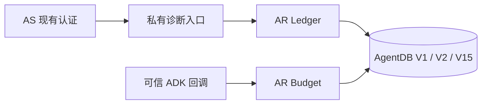
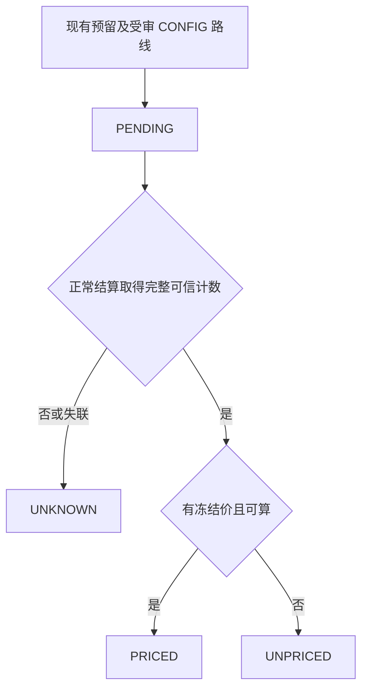
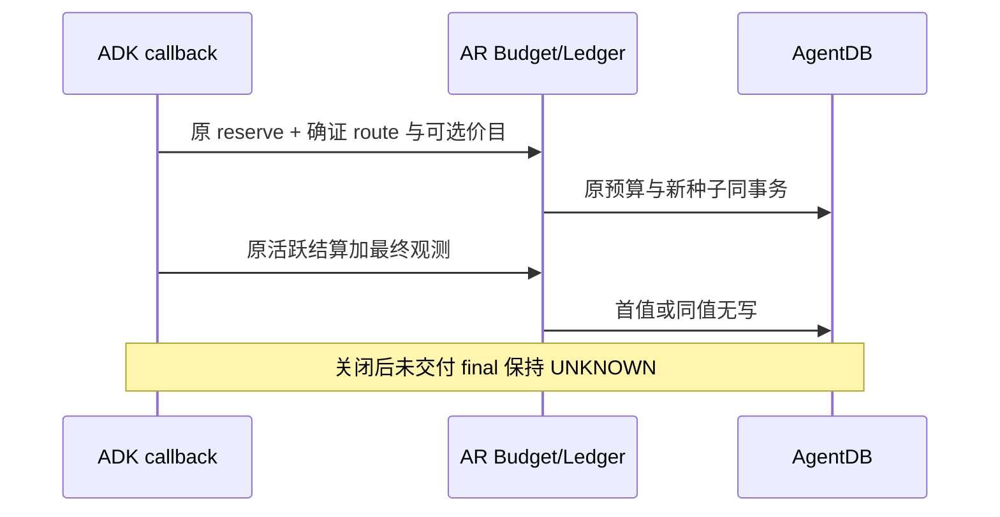
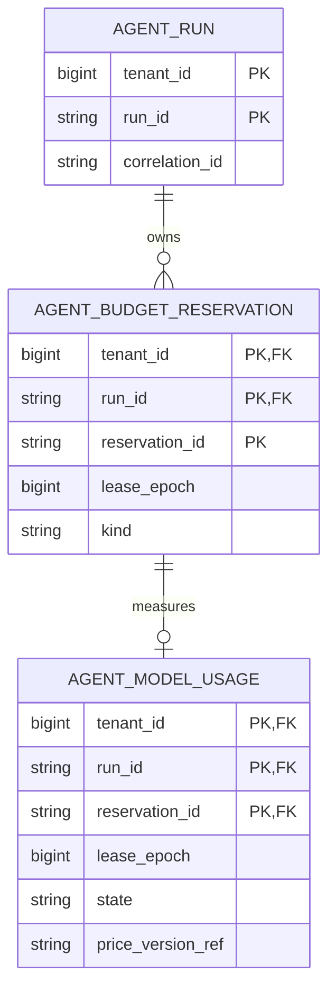

# T4-02 首切片：Agent 模型用量账本与源内查询

| Field | Value |
| --- | --- |
| Document | `2026-11-05-16-08-agent-model-usage-ledger.md` |
| Template Version | `9` |
| Archetype Cleanup | `Not applicable` |
| Status | `Review` |
| Type | `Feature` |
| Complexity | `Complex` |
| Complexity Drivers | `受权 owner 数据隔离、预算与用量语义分离、事务重放、冻结费率与兼容部署` |
| Created | `2026-11-05 16:08 Asia/Shanghai` |
| Updated | `2026-11-05 17:10 Asia/Shanghai` |
| Owner | `天机决策负责人` |
| Repository | `tianji-service` |
| Scope | `AR 现有预算/账本与 AS 已认证宿主诊断；单一 AgentDB V15；T3-12 后实施` |
| Change Surface | `MODEL 预留/终值、价格快照、owner-local Query、默认关闭和同源 readiness` |
| Affected Chapters | `§7, §8, §9, §10, §11, §13, §14, §15, §16, §17, §18` |
| Source Requirement | `主计划 §19 T4-02 与 §17 S12 的用量、权限、持久查询子集` |
| Baseline Revision | `tianji-service 2f10711b152bbce7000ba7fb31d6f931e4f52927；Components 87af09fea9a9d58e7127b009d76f60438c79e569；tianji-web f558e02c8d07da2da758c5273a5eb531ca251018` |
| Amends | `None` |
| Supersedes | `None` |
| Depends On | [主计划](../../../../docs/plans/agent-framework-upgrade-plan.md) §19 T3-12 与 T4-02 |
| Related Specs | [T3-12](2026-11-05-15-13-expense-four-path-acceptance.md), [T4-01 A1](2026-11-05-16-17-platform-release-artifact-candidate.md) |
| Related Plans | [主计划](../../../../docs/plans/agent-framework-upgrade-plan.md) §17 与 §19 |

## 1. Summary

给 AgentDB 增加一次已预留 MODEL 调用对应的一份安全用量事实。首切片仅捕获已声明并受审的 CONFIG 累计终值，将模型计数和冻结内部价格投影给同一 owner 的源内诊断调用。预算保留、执行结果、HTTP/SDK、ProcessDB 与流式协议延续当前行为。

在 T3-12 闭环、技术持久化例外和本 Spec 获批之后实施。该切片可分别用有限测试和隔离 PostgreSQL 取证，独立于完整 S12。

## 2. Background and Current State

### 2.1 Business and user context

天机值守需要从持久事实确认具体运行观察到的模型用量和计价依据，采样不足时仍能读取。现有预算用于保护执行额度，缺失用量或超额时保留额度，不能直接当成费用明细。 [决定收口](decision-closure.md)

### 2.2 Repository evidence

| Evidence ID | Classification | Exact path/symbol/decision/command | Observed fact | Design significance | Verification limit/freshness |
| --- | --- | --- | --- | --- | --- |
| EVD-001 | Static repository | AR `AgentBudgetService.reserveBudget/settleBudget`、`JdbcAgentLedgerRepository.lockRunForBudget/markOutstandingBudgetUnknown`、AgentDB V2 | 按 owner、run、reservation、lease epoch 预留/结算；超额或缺失可保留 UNKNOWN | 复用所有权与同源事务，独立账本解释终值 | 未执行 DB |
| EVD-002 | Static repository | AR `AdkRunBudgetPlugin.beforeModelCallback/afterModelCallback/close`、`AdkAgentRunExecutor` | before 使用 eventId；partial 不结算；deadline/heartbeat/idle 可结束订阅，close 清除已准入上下文 | 只记录已有可信活跃终值；不开放晚到写 | 当前未发现可靠 post-close final 交付缝 |
| EVD-003 | Static repository | Components `SpringAiModelAdapter`；AR `JTokkitChatModelBudgetEstimator.require/actualUsage/cost`、`ModelBudgetProperties.Profile` | adapter 保留最后非空 usage；现有估算器验证 profile、模型/路由/币种并按八位向上计价 | 首轮显式累计口径；复用受信绑定和预算值 | 不能证明通用增量/真实账单 |
| EVD-004 | Static repository | AS `AgentRunController.list/get`、`TianjiAgentAccess.require`；AR `AgentLedgerService.get/list`、V5 owner 索引 | GET/LIST 均 READ；guard 验证身份/资源，账本独立按完整 owner 过滤 | 复用精确资源身份，新增源内诊断入口 | 当前无受支持外部诊断端点 |
| EVD-005 | Static repository | AS `TianjiAgentStorageConfiguration`、AR `AgentStorageVerifier.verifyLinked`；AgentDB V1–V14 | standalone storage 条件装配，基础/可选 schema 预检查分开 | 默认关闭，不让旧基线强依赖 V15 | 候选 SQL 尚未生成 |
| EVD-006 | Static repository | C `AgentUsageDTO` 和 AR `AdkAgentRunExecutor` 完成逻辑 | DTO 允许 nullable usage；执行成功当前保持原结果值 | 内部可复用值，公开字段/结果不变 | 非外部计费验收 |

关键源码 [预算服务](/Users/mario/SelfProject/Stellar-Enclosure/tianji-service/stellar-enclosure-tianji-agent-runtime/src/main/java/top/egon/cola/platform/tianji/agent/infrastructure/persistence/AgentBudgetService.java:41) · [订阅截止](/Users/mario/SelfProject/Stellar-Enclosure/tianji-service/stellar-enclosure-tianji-agent-runtime/src/main/java/top/egon/cola/platform/tianji/agent/infrastructure/adk/AdkAgentRunExecutor.java:372) · [callback 清理](/Users/mario/SelfProject/Stellar-Enclosure/tianji-service/stellar-enclosure-tianji-agent-runtime/src/main/java/top/egon/cola/platform/tianji/agent/infrastructure/adk/AdkRunBudgetPlugin.java:364) · [资源授权](/Users/mario/SelfProject/Stellar-Enclosure/tianji-service/stellar-enclosure-tianji-agent-server/src/main/java/top/egon/cola/platform/tianji/agent/server/security/TianjiAgentAccess.java:34) · [profile 费率约束](/Users/mario/SelfProject/Stellar-Enclosure/tianji-service/stellar-enclosure-tianji-agent-runtime/src/main/java/top/egon/cola/platform/tianji/agent/autoconfigure/ModelBudgetProperties.java:16)

### 2.3 Problem statement and gap

V2 没有独立价格快照和观测状态；预算 UNKNOWN 可能已经收到超额实测。当前 AR 也没有受权的用量明细或精确 correlation 筛选。本切片新增一次模型调用的持久观测，不把估算、采样、未知值混成实测费用。

### 2.4 Evidence and current-chain map

| Entry/trigger | Current call chain | Data read/written | External dependency | Consumers | Evidence |
| --- | --- | --- | --- | --- | --- |
| CONFIG 模型请求与响应 | `AdkRunBudgetPlugin` → Adapter → `AgentBudgetService` | V2 原预留、结算 | 宿主 ChatModel | AR 执行 | EVD-001/002/003 |
| owner 读已知运行 | AS `AgentRunController` → `access.require` → AR ledger/repository | AgentDB V1/V5 | 既有 Shoubing/Jianshen 权威 | USER/SERVICE exact owner | EVD-004 |
| standalone storage ready | AS named factory → AR storage verifier | Flyway/history/keys/permissions | 预先 provision 的 AgentDB | AS / AR runtime | EVD-005 |

### 2.5 Archetype example cleanup

Cleanup disposition: Not applicable

Reason: 已有独立天机六模块。根提交 7c14d67 建立天机平台合同，此次为运行账本的技术增强。未发现本范围涉及 native archetype 示例导入或新业务模块。

## 3. Goals and Non-goals

### 3.1 Goals

建立一次可信 MODEL 调用一个账本槽；确定有效计数、未定价、未知和未采集区别；维持旧预算与公开接口；使用当前已认证 owner 与有界持久读取。

### 3.2 Non-goals

新增公开 API、SDK、业务 Event、依赖、监控服务、frontend、ProcessDB、真实供应商账单、汇率或价格服务。后续 T4-02 负责 delta 适配和晚到回调、PS business/correlation 投影、实际跨源 Span Links、指标/告警/留存和 S12。

### 3.3 Change Surface and Design Depth

| Area/layer | Disposition | Exact repository evidence | Changed or preserved behavior/contract | Required Spec treatment | Chapter(s) |
| --- | --- | --- | --- | --- | --- |
| AR 预算调用边与账本 | Affected | EVD-001–003 | 支持精确的 CONFIG usage 和独立状态 | 完整设计 | §7, §8, §9, §10, §11, §13, §14, §15, §16, §17, §18 |
| AS source owner 诊断与 readiness | Affected | EVD-004/005 | 既有 READ 之后的内部读和默认关闭 | 完整设计 | §7, §8, §9, §10, §14, §15, §16, §17, §18 |
| C/CL/public endpoints/现有执行结果 | Unchanged | EVD-004/006 | 既有 JSON、SSE、权限、异常和预算行为 | 保留和回归 | §9, §16 |
| PS/W、Frontend 与 S12 实际运行 | Unchanged | 主计划 T4-02/S12 | 本切片不改其工程或环境 | 仅指出后续边界 | §12, §16 |

## 4. Requirements and Acceptance Criteria

| ID | Atomic requirement | Priority | Observable acceptance criteria | Source |
| --- | --- | --- | --- | --- |
| REQ-001 | 一次确证模型调用一条终值 | Must | 相同 final 幂等，冲突不覆写；partial/TOOL/未声明路线不计费 | T4-02 用量 |
| REQ-002 | 可解释实际用量和价格 | Must | 冻结价、准确八位费用，null 与 0 区分，未知或失联保持额度与运行事实 | T4-02 价格/预算 |
| REQ-003 | owner 内部读取不依赖追踪采样 | Must | GET/LIST 当前授权，完整 owner 过滤，精确 run/correlation 有界，不披露他人存在 | S12 子集 |
| REQ-004 | V15 additive 且向后兼容 | Must | 关闭可用 V14，启用须 V15 及权限；无自动 DDL，无公开契约变化 | T4-02/AGENTS |
| REQ-005 | 证据分层并保持隐私 | Must | 有限及独立 PG 对照；本切片不称为真实 S12 或供应商成本验收 | §17/主计划 |

### 4.1 Scenario matrix

| Scenario | Actor/trigger | Preconditions | Main path | Alternative/failure path | Data/state change | Observable result | Requirements |
| --- | --- | --- | --- | --- | --- | --- | --- |
| 重复终值 | 可信 callback | exact reservation | 单次冻结值 | 同值 no-op；异值冲突 | 账本只首写 | 额度不重复扣减 | REQ-001/002 |
| UNKNOWN/未定价 | 供应商回包或取消 | opt-in 槽 | 可确认实际计数 | 无价→UNPRICED；无确证计数→UNKNOWN；关闭后不补写 | 费用可空 | 不用零代未知 | REQ-002 |
| 无采样读 | 已认证 owner | 既有 GET/LIST READ | 精确 owner 查 | 同键外租户、超时、窗口不合规 | 只读 | 无外部 owner 提示 | REQ-003/005 |
| 跨部署 | AS 版本/开关 | 预置 V14/V15 | 旧版和 off 新版仍使用原账本 | on 缺 schema、受限权限不足启动失败 | 只添加一张表 | 独立 readiness | REQ-004 |

### 4.2 Use-case analysis

#### 4.2.1 Actor inventory

| Actor ID | Actor/role | Goal and responsibility | Entry/channel | Permission/tenant context | Evidence |
| --- | --- | --- | --- | --- | --- |
| ACTOR-001 | AR 真实模型回调 | 记录原调用的已证终值 | 现有 ADK 回调 | 原 actor/lease/slot | EVD-001/002 |
| ACTOR-002 | AS 已认证调用方 | 查询自身用量诊断 | 私有宿主 façade | 既有 GET/LIST READ 与 exact owner | EVD-004 |
| ACTOR-003 | AgentDB 运维/验收 | 批准路线和 schema 后开启 | 现有 deployment config | 拥有源、最小角色 | EVD-005 |

#### 4.2.2 Use-case artifact

| ID | Use case/goal | Primary actor | Supporting actors/systems | Trigger | Preconditions | Main success outcome | Alternatives/failures | Postconditions | Requirements | Interfaces/pages | Tests |
| --- | --- | --- | --- | --- | --- | --- | --- | --- | --- | --- | --- |
| UC-001 | 持久记录精确用量 | ACTOR-001 | AgentDB | MODEL reserve/final | 现有授权、opt-in route | 账本首值 | 未知/未价/冲突 | 原 budget 语义 | REQ-001/002 | INT-001 | TEST-001/002/003 |
| UC-002 | 从 run 或 correlation 读取模型事实 | ACTOR-002 | AS/AR | 同一 owner 支持请求 | 当前授权及窗口 | 安全只读 projection | 无 owner、超时 | 不披露其他人数据 | REQ-003/005 | INT-002/003 | TEST-004 |
| UC-003 | 以可回滚配置启用 | ACTOR-003 | AS/AgentDB | 升级 | 预置同源 V15 | readiness 成功 | 缺 V15 拒绝启用 | 旧路径仍可回滚 | REQ-004/005 | INT-004 | TEST-005 |

## 5. Constraints, Assumptions, and Decisions

### 5.1 Confirmed constraints

主计划 T3-12 源码前置已完成；E 验收未执行，S12 与生产启用保持独立门禁。只允许 V15 候选新增，原 V1–V14 永久不改；不自动部署/迁移/开启。AS 走现有真实身份与授权；AR 仅接收由可信宿主校验的 actor 和已经确证的调用事实。

### 5.2 Small-gap assumptions

| ID | Inference | Repository evidence | Why locally reversible | Impact if wrong |
| --- | --- | --- | --- | --- |
| ASM-001 | known-run 100 明细/页；correlation 20 根/页且每根最多 5 明细；UTC 最大 31 天、事务 2 秒 | V5 owner+created/run 现有索引 | 内部接口且无公开 SLO | 真负载不足时可缩窗，新增索引需另审 |
| ASM-002 | 配置精确 modelRouteRef，首次至少一个经过审查的路线 | ContextWindow 与固定定义 snapshot 已绑定 route | 私有部署参数 | 缺供方口径证明保持未采集，不能计量 |

### 5.3 Resolved decisions

- DEC-001 首轮只支持 CONFIG 与受审累计终值。Components 现有最后非空 usage 不是通用增量协议；在 operator allowlist 之外保留 NOT_INSTRUMENTED。
- DEC-002 post-close 晚到证据移出首切片。ADK 真实代码在 heartbeat/deadline/idle 信号终止订阅，插件关闭清空已准入上下文。当前没有可信回调句柄可在结束后恢复，所以本切片不保留订阅、不加补写接口和 accept_until 字段。以预算/运行已提交状态投影 UNKNOWN。
- DEC-003 由 AS 私有诊断 façade 在已有认证请求上下文内执行原 GET/LIST 授权，再调用 ledger；无 Controller mapping。没有实际认证上下文的调用拒绝。AR 的 TrustedAgentActor 是信任边界内部载体，构造函数本身不等于认证。
- DEC-004 新表用于独立测量事实，不 ALTER V2、不写 AgentRun 结果、不增新事务管理器。启用后的账本事务失败沿原有失败路径；导出不存在于此事务。

### 5.4 Open major decisions

| ID | Decision | Evidence and impact | Candidate recommendation | Required owner input |
| --- | --- | --- | --- | --- |
| DEC-005 | 保留现有 AR/AS 技术纵切 | 当前 ledger、Budget 和权威只用同源 plain JDBC、immutable Flyway 和现有 named factory | Root 按用户主 Plan 授权仅确认 §8/§11 的一张技术账本、严格值对象/显式行映射、同一命令事务和已有权限。无新依赖、业务 CRUD/软删除、POM、生产授权或应用启动 | 每步按具体门禁复核；真实运行保持未验收 |

## 6. Project Technology Context

Java 25、Spring Boot/Jackson、现有 JTokkit/ADK/Spring AI、PostgreSQL 和 Flyway。AR、AS、C 分别为 stellar-enclosure-tianji-agent-runtime、stellar-enclosure-tianji-agent-server、stellar-enclosure-tianji-contract。各 POM 不变。

### 6.1 Java architecture profile and capability baseline

| Architecture profile | Archetype/template or base package | Exact evidence and verifier | Existing deviations | Design action |
| --- | --- | --- | --- | --- |
| 既有授权 → 账本服务 → JDBC 技术纵切 | `top.egon.cola.platform.tianji.agent` | EVD-001/004/005，AS factory/AgentLedgerService/JdbcAgentLedgerRepository | plain JDBC/Flyway，现有非生成技术范围 | DEC-005 下原位扩展 |

| Need | Spring/JDK candidate | Spring Boot Starter candidate | Egon-COLA/module candidate | Proven gap | Decision/dependency impact |
| --- | --- | --- | --- | --- | --- |
| 可信模型值 | BigDecimal、Instant | 现有模型接入 | AgentBudgetSettlement、JTokkit、ADK | 缺冻结价格和状态 | 现有结构中加入私有观测 |
| 账本 | JdbcTemplate、TransactionTemplate | AS storage | AgentBudgetService、AgentStorageVerifier | V2 不是计量状态 | 单 V15，无依赖 |
| 权限和分页 | 现有 Spring Security、SQL keyset | 现有 API security | TianjiAgentAccess、V5 owner index | 缺内部诊断与精确相关键 | 既有资源和约束 |

### 6.2 User-mandated Java rule compliance

| Literal rule | Affected? | Repository evidence | Exact design decision | Files/types/interfaces | Validation/test evidence | Status/blocker |
| --- | --- | --- | --- | --- | --- | --- |
| Rule 1 | Yes | EVD-001/004 | 私有 Query/DTO/VO，沿当前命名 | §8/10 | TEST-004 | PASS |
| Rule 2 | Yes | EVD-004 | 现有授权/严格构造；DEC-005 已锁 | INT-001–003 | TEST-001/004 | PASS |
| Rule 3 | Yes | EVD-001/006 | immutable record、现有显式 JDBC 投影；DEC-005 已锁 | §10 | TEST-003/004 | PASS |
| Rule 4 | Yes | EVD-005 | 现有 named factory，DEC-005 已锁 | §8/16 | TEST-005 | PASS |
| Rule 5 | Yes | EVD-001/003 | JDK 和现有组件，无依赖变更 | §6.1 | import/POM 检查 | PASS |
| Rule 6 | Yes | EVD-006 | 无新增 wire；内部固定枚举字面值 | §9/10 | TEST-005 | PASS |
| Rule 7 | Yes | EVD-005 | AS base YAML 保持同结构、缺省 off | §16 | TEST-005 | PASS |
| Rule 9 | Yes | EVD-001/003 | 复用已绑定 estimator Strategy | §13 | TEST-001/002 | PASS |
| Rule 10 | Yes | EVD-001 | UTC Instant、数据库微秒 | §6.3/11 | TEST-003/004 | PASS |
| Rule 11 | Yes | EVD-005 | 已有技术纵切、一张同源表，DEC-005 已锁 | §8/11 | DEC-005 | PASS |

### 6.3 Time semantics and conversion contract

Time contract: Required

| Time ID | Fields/symbols | Semantics | Java/runtime type | Storage policy | Wire policy | Business zone source | Display zone source | Boundary / DST rules | Precision / Clock | Compatibility | Verification |
| --- | --- | --- | --- | --- | --- | --- | --- | --- | --- | --- | --- |
| TIME-001 | created_at、measured_at、query from/to、observedAt | Occurred instant | Instant | UTC instant | Internal | Not applicable: 技术事实 | Not applicable: 无 UI | UTC [from,to)，无本地日历解释 | AgentDB 微秒，结算获锁后取单一时刻 | 原结算/SSE 不变 | TEST-003/004 |
| TIME-002 | query window / timeout | Duration | Duration | Not persisted | Internal | Not applicable: elapsed duration | Not applicable: 无 UI | 31 天及 2 秒上限 | 数据库 timeout 和 java.time | 旧公开分页不变 | TEST-004 |

## 7. Architecture Design

### 7.0 Minimum-design baseline and element-necessity audit

| Proposed element | Change | Requirements | Existing/direct alternative | Concrete inadequacy of alternative | Added calls/state/coupling/failures/migration/operations | Verdict |
| --- | --- | --- | --- | --- | --- | --- |
| MODEL 测量事实 | New | REQ-001/002 | 直接汇总 V2 | 缺冻结价/独立状态，不能改变预算语义 | 每 MODEL 一行，V15 | Add |
| owner-local 诊断 | Expand | REQ-003/005 | 原 GET/LIST 或 collector | 原端点无用量/相关键，采样有缺口 | 内部读，无公开 API | Add |
| 冻结价格与 readiness | Expand | REQ-002/004 | 当前估算值、基础 verifier | 无价目重放，基础检查不能强需 V15 | 小值及独立校验 | Add |

| Path | Network calls | Client states | Server contracts/state | Failure and TOCTOU points | Additional user/business value |
| --- | --- | --- | --- | --- | --- |
| Direct baseline | 现有模型与授权 | 已知 run | V2 预算 | 缺可信价格 | 预算护栏 |
| Selected design | 现有模型与授权；同源有限读 | 内部 owner 查询 | V2 与一张测量表 | 启用后写入与预算同事务，无跨源快照 | 独立价格及无采样读 |

### 7.1 System Architecture Design

### 7.2 High-Level Design

#### 7.2.2 High-level decision and quality matrix

| Concern/use case | Required behavior | Selected mechanism | Failure/degradation behavior | Trade-off | Verification | Requirements |
| --- | --- | --- | --- | --- | --- | --- |
| 幂等 | 一次终值 | 原锁/摘要 | 异值冲突 | 每模型一行 | TEST-003 | REQ-001 |
| 费用 | null 和零区分 | 价格冻结/DB 时钟 | UNKNOWN/UNPRICED | 不做 FX | TEST-002/003 | REQ-002 |
| 隐私 | owner-first 无采样 | 既有 READ + 源内事务 | foreign 不泄露 | 无公开路由 | TEST-004 | REQ-003/005 |
| 兼容 | off 支持 V14 | 独立 readiness | on 缺 V15 拒绝 | 可选能力 | TEST-005 | REQ-004 |

### 7.3 Detailed Design

#### 7.3.1 Capture and pricing

只有 AS usage 开启、execution mode CONFIG、原授权和 session/lease fencing 成功，且经 ContextWindow 与定义 snapshot 校验的完整 modelRouteRef 在受审累计集合，才记录 MODEL。TOOL、CODE_FIRST、未知路线或未启用保持原路径且无 ledger 写。保存确证 route 和模型名（ContextWindow 上限 256/512 UTF-16 单元，限制控制字符、坏标量和首尾空白），无 provider 原始 ID、token 或输入。现有 adapter 的 usage-only 不生成文本。

现有 AgentModelBudgetEstimator 默认可选价目 empty 保持宿主兼容。JTokkit 在同次 `require(snapshot,model)` 绑定上提供币种和两费率。价格 ID 对固定域、exact route/model、币种、规范费率与算法版本使用现有 length-safe digest；费率规范 `stripTrailingZeros().toPlainString()`。费用 (input × inputRate + output × outputRate)/1_000_000 以 BigDecimal 一次计算并向上八位。不可用快照不给零价，既有 policyVersionRef 不充当价目版本。原 callback 已准入 final 的有效 usageMetadata 与原 AgentBudgetSettlement 两个实测计数必须一致，非负，能 checked addition，提供 total 时必须相等。缺数据或非确证归 UNKNOWN，已确认零仍为零。UNPRICED 是有效计数但冻结价缺失或费用超出原精度；保留可用价目。现有 estimator/预算错误继续按原行为。

#### 7.3.2 Atomicity and original state

沿 run → reservation → ledger 锁序，种子随已成功原预留同事务建立；INSERT SELECT 精确匹配 tenant/run/reservation、MODEL 与原 epoch。旧 reservation 的精确重放保留原语义，已有种子才比对冻结输入，历史不追补。活跃终值在现有预算事务确认 ownership/epoch 和 settlement lease 后，以 PENDING CAS 首写。预算原超额在事务提交后抛出时可保留确证测量，额度保留原行为。预算事务本身失败时账本一并回滚。相同已存终值摘要或同 UNKNOWN reason 无写；异值使用既有幂等冲突并保留首值。PENDING 可变为 PRICED/UNPRICED/UNKNOWN，其他已存状态不可升级。

PENDING 仅在同源 V2 为 RESERVED、run RUNNING、epoch 相同、有效 lease owner 且 expiry 晚于数据库观察时间时显示；否则只读投影 UNKNOWN，不回写。复用原 lockLeaseForSettlement 判定；仅取消请求或 deadline 已过不自行改写终态。post-close 回调无写，新 epoch 或运行重试不复用原 slot。

#### 7.3.3 Authorization

AS 私有 façade 在既有真实认证上下文执行 TianjiAgentAccess.require；run 用 GET_API，correlation 用 LIST_API，复用现有 USER/SERVICE READ/scope。无新 route、permission 或公开 SDK，入口不接收调用者传入 actor、tenant、issuer。AR 仅供可信内部宿主，SQL 先用四元 owner，所有明细再用确证 run 同源键。禁用 collector 或未采样不影响读。

#### 7.3.6 Conclusion evidence chain

| Conclusion | Repository/user evidence | Constraint or requirement | Design decision | Consequence and trade-off | Verification and acceptance evidence |
| --- | --- | --- | --- | --- | --- |
| 额度独立 | EVD-001 V2 | REQ-001/002 原重放和额度 | 一对一事实，同事务 | 每 MODEL 一行 | TEST-003 |
| 可信回调 | EVD-002 close | REQ-002 防止晚到猜测 | 仅已确证活跃终值 | 缺失维持 UNKNOWN | TEST-001/003 |
| 隐私 | EVD-004 | REQ-003/005 | exact owner 本地 Query | 无公开入口 | TEST-004 |
| 兼容 | EVD-005 | REQ-004 | 独立 V15 readiness | 显式开才查询 | TEST-005 |

## 8. Package Structure and Code File Tree

以下以对应模块 `src/main/java/top/egon/cola/platform/tianji/agent/` 为根，为设计范围而非实施顺序。

| Module/path | Purpose and exact affected symbol |
| --- | --- |
| AR `infrastructure/adk/AdkRunBudgetPlugin.java` | 原 before/after 的 MODEL 已准入观测 |
| AR `infrastructure/adk/AgentModelBudgetEstimator.java`、`JTokkitChatModelBudgetEstimator.java` | 可选冻结价格与同绑定实现 |
| AR `domain/AgentModelUsagePriceVO.java` | 小不可变价目值，persistence 不依赖 ADK |
| AR `infrastructure/persistence/AgentBudgetService.java`、`JdbcAgentLedgerRepository.java` | 预留、结算、owner bounded 读 |
| AR `infrastructure/persistence/AgentLedgerService.java`、`AgentStorageVerifier.java` | 可选构造、查询载体及独立 V15 readiness |
| AS `server/TianjiAgentStorageConfiguration.java`、`server/AgentModelUsageDiagnostics.java` | 现有工厂、私有授权 façade |
| AS `src/main/resources/application.yml` | opt-in 默认关闭 |
| AR `src/main/resources/db/tianji-agent/V15__add_agent_model_usage.sql` | 候选唯一新增 |
| AR tests `infrastructure/adk/AgentModelUsageCaptureTest.java`、`infrastructure/persistence/AgentModelUsageStoreTest.java` | 有限，无连接与监听 |
| AR tests `infrastructure/persistence/AgentModelUsagePostgresTest.java` | 独立 PG，仅受权 I 选择；有限阶段只编译 |
| AS test `server/AgentModelUsageDiagnosticsTest.java` | 原权限资源和开关兼容 |

## 9. Interface Definitions

### 9.0 API protocol and documentation governance

既有 AgentRunController.get/list/result 的路由、授权、错误、JSON/SSE 与 OAS 保持。私有诊断无 Controller mapping，无新增 HTTP/GraphQL/API manifest 或 event body。

### 9.1 Interface Inventory

| ID | Contract | Caller and owner | CQE |
| --- | --- | --- | --- |
| INT-001 | 原 MODEL reserve/settle 内可选观测值 | AR | 原 owner-local Command |
| INT-002 | `AgentModelUsageDiagnostics.byRun(GetAgentRunQuery, afterReservationId)` | AS 现有 GET | Query |
| INT-003 | `AgentModelUsageDiagnostics.byCorrelation(AgentModelUsageCorrelationQuery)` | AS 现有 LIST | Query |
| INT-004 | `stellar.tianji.agent.storage.model-usage-enabled` / `model-usage-cumulative-route-refs` | operator | 私有配置 |

### 9.2 Per-interface Detailed Contracts

- INT-001 仅由原 callback 与原可信 MODEL 请求构造可选观测，保留 AgentBudgetSettlement。无 late writer。重复 canonical identity 或状态由同一事务处理。
- INT-002 复用 GetAgentRunQuery 验证 exact run，owner 先过滤，V2 MODEL 左联 V15；reservationId 按固定 C 排序，内部 exclusive cursor，每页 100 和一条 sentinel。已有无种子 slot 显示 NOT_INSTRUMENTED。无 run 或 foreign 使用相同现有不可见结果。
- INT-003 exact correlation 使用 C StartAgentRunCommand 同一约束。UTC 显式 from < to、最多 31 天，以数据库 observedAt 排除未来；cursor 绑定 exact owner 与 query 字段，留在宿主内部。按 (created_at,run_id) DESC，根每页 20，模型每根最多 5，各用 sentinel，结果最多 100 模型事实。空与 foreign 一致；源超时为 unavailable。
- INT-004 enabled=false，route-refs=[]。显式开启须 storage 已装配、V15 verified、非空且 ≤32 个唯一 exact immutable refs，无通配。API 关闭时不装配认证 façade，runtime 关闭时无新 capture，已有同 owner 事实可在 API 权限下读取。

结果只含 runId、请求内可见 correlation、createdAt/observedAt、slot 分页身份、模型路由/名、状态、计数/费用/币种/价目版本与固定安全原因。权限主体和原始内容、秘密、诊断异常不出投影。全部源内读取使用 §11 的有限同一 primary snapshot。

## 10. POJO and Data Model Design

| Type | Role and scope | State/field invariants |
| --- | --- | --- |
| `AgentBudgetRequest/Reservation/Settlement` | reuse existing budget data | 权威额度含义和 DTO 原样 |
| `AgentModelUsagePriceVO` | AR immutable frozen value | exact route/model，币种及两费率 all-or-none，按固定域生成价目版本 |
| ledger package-private model observation value | 原 callback→原预算事务 | MODEL 已验证，安全路由/模型，nullable price，可信 final 两非负计数或固定原因；防御复制 |
| `AgentModelUsageCorrelationQuery` 与内部 cursor | AR/AS private Query | 现有相关键上限、UTC 半开窗口、exclusive exact owner/query fingerprint；不提供解析公网 token |
| `AgentModelUsagePageDTO/RunDTO/SlotDTO`（内部 ledger 嵌套值） | AR→AS 受权 projection | 独立状态 PENDING/UNKNOWN/UNPRICED/PRICED/NOT_INSTRUMENTED，计数和可空价格含义明确 |
| `AgentUsageDTO` | reuse C value for known actual counts | 只有确证计数用 ACTUAL；未定价 cost null；缺实际用量的 slot 保留内部状态与 null usage |

私有确证原因闭集：UNKNOWN 对应 MISSING_USAGE、INVALID_USAGE、MODEL_ERROR 或 RESERVATION_ENDED（后者只在 read projection 推导）；UNPRICED 为 PRICE_MISSING/PRICE_OVERFLOW；其他状态无原因。没有任意字符串诊断、持久 ordinal 或新业务 mapper。

## 11. Database Design

### 11.1 Table Inventory

| Table | Existing/new | Purpose and owner | Read/write paths | Change | DDL script | Requirements |
| --- | --- | --- | --- | --- | --- | --- |
| tianji_agent.agent_model_usage | New | AR 独立实际测量 | existing reserve/settle + exact owner read | Create | `classpath:db/tianji-agent/V15__add_agent_model_usage.sql` | REQ-001–004 |

V2 reservation 和 V1/V5 run 是现有邻接表，沿原始 owner/外键，只读/原写接口复用。两表和所有索引、生产 schema 范围保持。

### 11.2 Per-table Detailed Design

#### 11.2.1 tianji_agent.agent_model_usage

##### Purpose, ownership, and lifecycle

只有同源 AR 写，一个已获准 V2 MODEL 预留最多一行。单 AgentDB、tenant 逻辑隔离、无软删除、无额外分片，保存真实测量状态及价格，既有 retention 策略另有未来规划。

##### Complete column design

| Column | Native type | Length/precision | Null | Default | Generated | PK/FK/unique/check | Meaning | Source/mapping | Example |
| --- | --- | --- | --- | --- | --- | --- | --- | --- | --- |
| tenant_id | bigint | 64-bit | No | None | No | PK/FK，>0 | Owner tenant | V2 same key | 42 |
| run_id | varchar | 64 | No | None | No | PK/FK | exact run | V2 same key | run-42 |
| reservation_id | varchar | 128 | No | None | No | PK/FK，C 排序 | slot | V2 eventId | slot-1 |
| lease_epoch | bigint | 64-bit | No | None | No | >0，写路径匹配 V2 | 原 attempt | V2 | 1 |
| model_route_ref | varchar | 256 | No | None | No | 合法不可空 | exact bound route | ContextWindow | text-route@1#digest |
| model_name | varchar | 512 | No | None | No | 合法不可空 | 已证内部模型 | ContextWindow | fixture-model |
| price_version_ref | char | 64 | Yes | None | No | lower-hex，价格组 all-or-none | frozen tariff ID | 价目域摘要 | 64 hex |
| currency | char | 3 | Yes | None | No | [A-Z]{3}，价格组 | frozen unit | estimator | USD |
| input_rate_per_million / output_rate_per_million | numeric | 32,8 各 | Yes | None | No | 非负有限，价格组 | frozen rate | estimator | 0.50000000 |
| state | varchar | 16 | No | PENDING | No | 四种持久状态闭集 | 测量状态 | 原预算 seam | PRICED |
| actual_input_tokens / actual_output_tokens | bigint | 64-bit 各 | Yes | None | No | 两者同空或同有；非负；和不超 bigint | 两项确证计数 | 可信 final | 3 / 2 |
| actual_cost | numeric | 24,8 | Yes | None | No | 仅 PRICED，非负有限 | internal charge | 冻结价运算 | 0.00000250 |
| safe_reason | varchar | 32 | Yes | None | No | UNKNOWN/UNPRICED 闭集 | 最小诊断 | §10 | PRICE_MISSING |
| final_sha256 | char | 64 | Yes | None | No | 仅 PRICED/UNPRICED，lower-hex | exact immutable replay | canonical digest | 64 hex |
| created_at | timestamptz | 6 | No | None | No | finite | 预留种子时间 | 同源 DB clock | UTC instant |
| measured_at | timestamptz | 6 | Yes | None | No | 仅 PRICED/UNPRICED，finite 且 >= created_at | 接受的测量时间 | 同源 DB clock | UTC instant |

冻结价四项全有或全空。PENDING 无计数、费用、摘要、原因和 measured_at；UNKNOWN 同样无测量字段，须 closed reason。UNPRICED 必须两计数、摘要和 measured_at，无费用，PRICE_MISSING 要求空价格组，PRICE_OVERFLOW 要求存在冻结价。PRICED 必须两计数、费用、摘要和 measured_at、完整价格组，原因空。SQL CHECK 用明确 IS NULL/IS NOT NULL 防 UNKNOWN 三值逻辑绕过；计数加总以 numeric 运算防数据库 bigint 先溢出。费率精度覆盖现有 profile precision 18、scale 最低 -6 的 24 位整数；金额沿既有 16 位整数加八位小数。数据库时钟倒退至早于种子时拒绝已启用写事务。final_sha256 使用 length-safe fixed-domain digest，覆盖完整 slot、epoch、冻结价身份、状态、计数、费用或价格原因，明确 nullable tags；不含测量时间，保持同 final 重放。

##### Keys, relationships, and constraints

PK `(tenant_id,run_id,reservation_id)`；同顺序 FK 到 `agent_budget_reservation`，NO ACTION update/delete。V2 没有包含 kind/epoch 的被引用 UK，因此在同一已获授权事务中通过 INSERT SELECT 强制 MODEL/epoch，并在 CAS 复验 ledger 与同源 V2 affinity。没有第二个状态表、附加索引、跨源 FK、期限列或用于采集原文的列。正常 app 角色只需最小 SELECT/INSERT/UPDATE，冻结字段只在 seed INSERT，后续 UPDATE 限测量字段，不授 DELETE 或 DDL。

##### Index inventory and per-index justification

| Index | Type/unique | Ordered columns/expressions | Predicate/include | Query and operation | Cardinality/selectivity | Sort/coverage role | Write/storage cost | Decision |
| --- | --- | --- | --- | --- | --- | --- | --- | --- |
| agent_model_usage_pkey | B-tree unique | tenant_id,run_id,reservation_id | None | 精确插入/CAS，owner 已核验 run 明细 | 每 slot 唯一 | 同 run 的有界范围/C 排序 | 每 model 一条 | Add |

##### Access patterns and SQL shape

| Operation | Caller | Predicate/join/order | Expected rows | Index/constraint | Lock/isolation | Failure/idempotency |
| --- | --- | --- | --- | --- | --- | --- |
| Seed | AgentBudgetService | 精确 V2 PK + MODEL/epoch | 1 新或 0 重放 | PK/FK | 原同源 write | 不回填；冻结输入 drift 冲突 |
| Settle | AgentBudgetService | 精确 slot + epoch + PENDING | 1 或 replay 0 | PK | run → reservation → ledger | 读取同值回放，异值拒绝 |
| Read | AgentLedgerService | owner-first run 与限定 V2 MODEL 左联 ledger；related keyset | 每页 <=20 roots/100 facts | 现有 owner index 和两个 PK | 单 primary REPEATABLE_READ，原 transaction manager | 读超时或不完整 unavailable |

读无写，沿现有 `terminalReference` primary route 避免将 Spring readOnly 错路由副本。拒绝外部事务。先取一次 AgentDB observedAt，使用有界事务与参数化查询；候选 transaction/statement timeout 2 秒，失败用固定已有不可用类别，不降级扫描。相关键筛选落在既有 V5 owner/date index 后；owner 和 window/limit 必须都在 SQL 侧。known run 和 correlation 分别采用 §9 固定 sentinel。

##### Migration and historical-data handling

候选唯一版本 `stellar-enclosure-tianji-agent-runtime/src/main/resources/db/tianji-agent/V15__add_agent_model_usage.sql`，合入前再次锁定 AgentDB 已有最新 V14 与 V15 未占用。V1–V14 字节永久不改；完成最终 SQL 时记录 SHA-256 与 Flyway checksum，受控数据库在初始化环境应用，一次生成后 immutable。无回填、原对象变更、SQL repair 或 down migration。旧 V2 行无账本为 NOT_INSTRUMENTED。

##### Transaction, consistency, and recovery

采用现有预算原 transaction manager，与成功预留/结算原子提交。已存 UNKNOWN 和两个测量态不可由常规调用覆盖。回滚时测量和原预算同回滚；已启用的持久化异常属于原基础设施失败，不参与外部重试。崩溃/关闭后观察既有源事实确定 PENDING 或 UNKNOWN；无 reconciliation writer 或 late 入口。

### 11.3 Entity-relationship diagram

物理名为 `tianji_agent.agent_run`、`tianji_agent.agent_budget_reservation`、`tianji_agent.agent_model_usage`。既有 owner tuple 在 run，ledger 只依附原事务验证的 MODEL slot。

## 12. Frontend Page Design

Unchanged。tianji-web 与既有运行页面不改。内部宿主查询没有浏览器 route、公共结果字段或 UI 状态。

## 13. Design Patterns and Architecture Principles

沿现有 AgentModelBudgetEstimator Strategy 解析已绑定模型/价目，默认 empty 不迫使宿主提供新能力。首切片使用同一明确累计口径，无新 provider 策略注册表或事件流。用确定性同源事务和 CAS 处理额度与测量两个不同状态。AS 隐藏认证和资源键，AR 保留存储 owner 边界。

## 14. Test Design

| Test | Level and fixture | Observable evidence |
| --- | --- | --- |
| TEST-001 | U，真实现有 adapter 与 Fake 终值，allowed/blocked route | usage-only 无文本，partial 不入账，重复与未知，TOOL/CODE_FIRST/off 原样；取消/关闭无 late 写 |
| TEST-002 | U，JTokkit frozen profile 和不可验证价格 | 两项实测/total 一致、实际零、费率精度/八位向上、价目版本变化、UNPRICED 与 overflow |
| TEST-003 | I，独立 PG V1–V15，同源事务 | 约束/权限、同键同值/冲突、并发首写、错误回滚、旧 epoch、超额保留原 budget；取消时只读 UNKNOWN，无迟到 mutation |
| TEST-004 | U+I，两个 tenant 与同租户不同 kind/issuer/subject，Fake 无采样 | GET/LIST 当前真实授权 seam，exact owner、UTC/keyset/截断/超时，无秘密或外 owner 提示 |
| TEST-005 | U+I，AS storage/feature readiness 和现有对外回归 | off 无 V15 SQL，V14 按当前 behavior；on 缺校验和/表/权限拒绝；HTTP/SDK/SSE 和出包接口不变 |

所有有限选择器禁止选择任何 PostgresTest。AgentModelUsagePostgresTest 只在受权 I 执行，有限门禁仅编译。I 不连接生产，mock 和编译均不是 PostgreSQL 原子性证据。完整 S12 在后续独立 E，首切片不通过兼容测试代替。

## 15. Non-functional and Cross-cutting Design

同源、不接触 collector，失败可理解且不回未知值为零。日志仅固定 operation/outcome/error code，不记 subject、runId、model route、prompt、tool、异常原文、token 或 hash。无 metric/trace tag 增加，计费事实不暴露给采样器。短窗口和 timeout 防无界扫描，V5 access path 需要代表性 EXPLAIN；不可接受时缩窄内部保护窗口，新增索引须明确 scope 审批。

## 16. Compatibility, Migration, Rollout, and Rollback

保持 AS storage 现有 named factory。关闭时沿用当前构造与 `withTerminalEvents` 路径；新开关不触发 V15 访问。开启时已有工厂构造同一 DataSource 的 opt-in ledger，保留既有 publisher，再由同源 Verifier 专用入口校验成功且唯一 V15 Flyway 行、校验和、primary、columns/PK/FK/CHECK 与最小写/读权限。现有主 Verifier 仍允许既有 V14 及 V15 状态下关闭；禁止新增自迁移。已有注入自定义 ledger 的宿主默认仍关闭。若 standalone 开启但注入未声明此能力或源不同，当前 storage guard 阻断。AS API 只读 façade 依赖真实受信授权 Bean；不开 API 不装配。旧二进制可在 additive V15 运行。回滚关闭或还原旧制品，保留已提交历史，修正需新的获批版本。

## 17. Alternatives and Decisions

| Alternative | Cost / limitation | Decision |
| --- | --- | --- |
| ALTER V2 并作计费读 | 将额度/退款和测量混在一行，旧 replay 难保证 | 只新增一对一表 |
| 引入公网聚合 API | 新权限、消费者、错误与兼容成本 | AS source-private |
| 持有已取消模型订阅等晚到用量 | 当前没有可信稳定回调边，破坏执行取消 | 后续另证设计 |
| 源内永久 trace 起源与 correlation 索引 | 首切片无消费者/规模证明，额外存储 | 不列入 V15 |

## 18. Risks and Open Questions

DEC-005 只确认本切片源码技术边界。Provider cumulative 资格由明确已有证据与 operator 配置界定，未证明路线不会开启。未来需要重新设计 post-close 的可信用量交付、增量 frame ID/重放，以及跨源授权拼接；本切片的 UNKNOWN 不可被事后任意修订。S12 还必须做 PS/AS 持久 business/correlation→Process/Run/Tool/Model/失败、真实异步 Span Link、Worker 传播、队列 lag/UNKNOWN/SLO 与整链秘密/低基数验证。真实供应商账单、费用和生产阈值仍各自取证。

## 19. Traceability Matrix

| Requirement | Use case | Design | Tests | Evidence |
| --- | --- | --- | --- | --- |
| REQ-001 | UC-001 | §7/10/11 | TEST-001/003 | 首值、重放和旧 epoch |
| REQ-002 | UC-001 | §7/10/11 | TEST-002/003 | 价格/未知与预算分离 |
| REQ-003 | UC-002 | §7/9/11 | TEST-004 | exact owner 和无采样 |
| REQ-004 | UC-003 | §11/16 | TEST-005 | V14/V15 模式兼容 |
| REQ-005 | UC-002/UC-003 | §14/15/18 | TEST-004/005 | 无披露、分层声明 |

## 20. Review and Acceptance

### 20.1 Original-request fidelity

范围为 T4-02 首个 AR 用量切片；完整链路、晚到、增量与 S12 仍显式在后续工作。

### 20.2 Repository and technical fidelity

依据 EVD-001–006 重新核对使用的账本、预算、当前授权、回调关闭和现有 V1–V14。未编译、未启动或访问运行时。

### 20.3 Cross-section consistency

权威始终为源内已提交 owner 和原 MODEL slot。配置与数据库状态闭集相符，公开 usage 兼容；非采样查询不提供跨 owner 访问。

### 20.4 Relationship and effective-design review

主计划 T3-12 与审查前置。相关两份草稿用于候选收窄，本 Spec 未接受，现有有效规范未改写。

### 20.5 Blocking Manual Check

| Check ID | Applicability | Status | Evidence | Finding | Required action/exception |
| --- | --- | --- | --- | --- | --- |
| MC-ARCH-001 | Applicable | PASS | §6.1/8 | 原技术 profile | DEC-005 |
| MC-REUSE-001 | Applicable | PASS | §6/7 | 复用 AR/AS | None |
| MC-DEP-001 | Applicable | PASS | §6/8 | 无新增依赖 | None |
| MC-NAME-001 | Applicable | PASS | §8/10 | 语义命名 | None |
| MC-VALID-001 | Applicable | PASS | §9/11 | 原授权与技术严格边界 | DEC-005 |
| MC-MODEL-001 | Applicable | PASS | §10 | 不可变模型与 JDBC | DEC-005 |
| MC-CONVERT-001 | Applicable | PASS | §10 | 既有技术显式投影 | DEC-005 |
| MC-LOG-001 | Applicable | PASS | §15 | 固定技术诊断 | DEC-005 |
| MC-BEAN-001 | Applicable | PASS | §16 | 现有 named factory | DEC-005 |
| MC-UTIL-001 | Applicable | PASS | §6.1/7 | 现有工具库 | None |
| MC-JSON-001 | Applicable | PASS | §9/16 | 既有 wire | None |
| MC-TIME-001 | Applicable | PASS | §6.3/11 | DB UTC 微秒 | None |
| MC-CONFIG-001 | Applicable | PASS | §9/16 | 默认关闭并隔离 readiness | None |
| MC-PATTERN-001 | Applicable | PASS | §13 | 既有 estimator Strategy | None |
| MC-SCOPE-001 | Applicable | PASS | §3/8/18 | 单库、单表、无公开变更 | None |
| MC-TEST-001 | Applicable | PASS | §14/19 | U/I 独立，E 仍待 | None |
| MC-BLOCKER-001 | Applicable | PASS | §5.4 | 源码技术边界已锁 | DEC-005 |

### 20.6 Final verdict

PASS — Ready for user review

## Java / CQE contract review

原 MODEL reserve/settle 仍是 Command；两个内部读取是 Query；原终态 Event 仍经既有 Outbox。值对象、枚举、授权和校验遵循已有 Java 边界；技术 JDBC、显式投影与 named factory 的原位技术设计仅限 DEC-005 范围，不改业务软删除或平台层次。

## Backend generation and dependency evidence

AgentDB V1–V14 是现有 immutable Flyway；候选一张技术账本并非 native archetype 业务 CRUD 的 catalog 输入。在实际 SQL Step 一次创建前锁定 V15 实现与校验和。本候选没有 SQL 文件、生成器运行、依赖或任何仓库修改。
