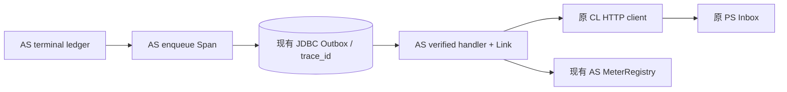
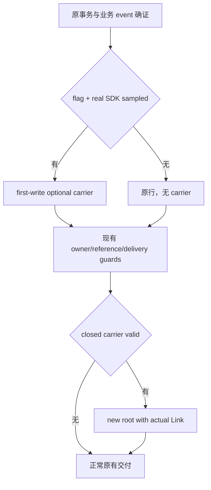
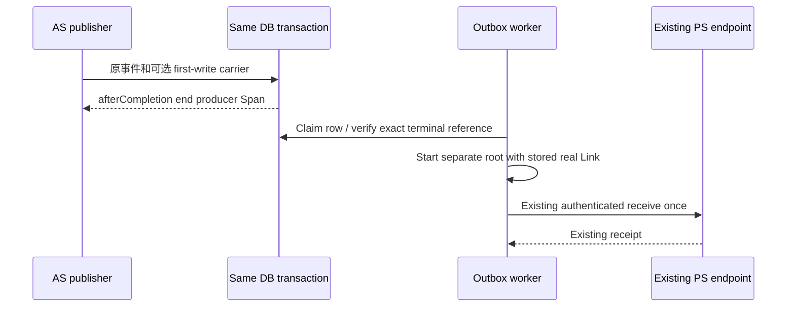

# T4-02 第二切片：Agent 终态 Outbox 异步 Span Link

| Field | Value |
| --- | --- |
| Document | `2026-11-05-17-35-agent-terminal-outbox-span-links.md` |
| Template Version | `9` |
| Archetype Cleanup | `Not applicable` |
| Status | `Review` |
| Type | `Feature` |
| Complexity | `Complex` |
| Complexity Drivers | `持久队列因果、幂等指纹保护、混部署、观测异常隔离与低基数` |
| Created | `2026-11-05 17:35 Asia/Shanghai` |
| Updated | `2026-11-05 17:35 Asia/Shanghai` |
| Owner | `天机决策负责人` |
| Repository | `tianji-service` |
| Scope | `AS terminal enqueue→Outbox→AS verified delivery attempt；PS/CL/W 核对边界；无新依赖或 SQL` |
| Change Surface | `现有 AS 两个 owner-local 入口、一个局部 OTel helper、默认关闭、固定低基数 evidence` |
| Affected Chapters | `§7, §8, §9, §10, §13, §14, §15, §16, §17, §18` |
| Source Requirement | `主计划 §19 T4-02、§17 S12；首切片仅 AR 账本` |
| Baseline Revision | `tianji-service 74369e760829d60e41d658b780681a54efcb22a0；Components 87af09fea9a9d58e7127b009d76f60438c79e569；现有 usage source 已提交` |
| Amends | `None` |
| Supersedes | `None` |
| Depends On | [主计划](../../../../docs/plans/agent-framework-upgrade-plan.md) §19 T3-12/T4-02；首切片 source gate 后实施 |
| Related Specs | [用量首切片](2026-11-05-16-08-agent-model-usage-ledger.md) |
| Related Plans | [异步 Link 实现](../plan/2026-11-05-17-45-agent-terminal-span-link-implementation.md), [主计划](../../../../docs/plans/agent-framework-upgrade-plan.md) §17/19 |

## 1. Summary

为 AS 已有终态交付增加一条真实异步关联。已有采样的生产者 SpanContext 以封闭版本值随原事务写入，AS 经现有 ledger、route 与事件校验后，在独立 delivery Span 上添加真实 Link。观测字段与原终态事件、通用 Outbox 幂等指纹、HTTP 和 PS Inbox 状态各自独立。

候选仅做 AS enqueue→delivery，默认关闭，保留现有 IdP、重投与终态事务。PS/Worker 的跨服务 span 与完整 S12 仍需独立设计、授权及运行取证。

## 2. Background and Current State

### 2.1 Business and user context

T4-02 要求追溯异步因果并避免业务数据泄露。首切片已有 owner-local 用量方案，但当前终态 enqueue 与异步交付之间缺可查询的 Link。 [主计划](../../../../docs/plans/agent-framework-upgrade-plan.md)

### 2.2 Repository evidence

| Evidence ID | Classification | Exact path/symbol | Observed fact | Design significance | Verification limit |
| --- | --- | --- | --- | --- | --- |
| EVD-001 | Static repository | AS `OutboxAgentTerminalEventPublisher.publish`、`AgentResultDeliveryHandler.deliver` | header 精确为 tianji-event-fingerprint singleton，handler 校验真实 route 与 ledger reference 再用既有 client | header 变化会被旧 handler 判永久错误 | 仅当前源 |
| EVD-002 | Static repository | Components `DefaultTransactionalOutbox.enqueueInTransaction`、`JdbcOutboxStore.enqueue`、`DeliveryContext.traceId` | headers 参与幂等 fingerprint，traceId 不参与；同 key 同 fingerprint 返回已有行、不覆盖诊断值；JDBC trace_id varchar(128) | 可验证首写携带且重投不改；禁止把新 carrier 塞入原 headers | 受权 PG 仍需实跑 |
| EVD-003 | Static repository | Components `OutboxDispatcher.markDead`、`OutboxDeadLetterNotifier` | 技术 traceId 可进 dead-letter callback；当前 Tianji 未发现自定义 listener，通用 notifier 自身只固定错误日志 | channel-local 语义要审查已部署订阅方 | 外部部署未知 |
| EVD-004 | Static artifact | 两份实际 exec archive 与 owning Surefire classpath；本地 javap | AS OTel API/SDK 1.62.0、Micrometer 1.17.2；PS Micrometer 1.17.2、无 OTel；AS pinned 支持 getOrNoop、setNoParent、addLink 和 SpanProcessor | AS 可做真实 Link 和 finite SDK，PS 无可复用 Link API | 不证明已安装 collector |
| EVD-005 | Static repository | CL `HttpAgentResultClient.receive`；PS `AgentResultInboxController/AgentResultInbox/AgentResultCorrelationService` | 已有 producer/auth、canonical event/fingerprint、同源 PENDING 与 native apply；没有 carrier 序列化/持久列 | 首切片保留 HTTP、PS schema 与应用事实 | 不证明 cross-PS trace |
| EVD-006 | Static repository | W `RemoteWorkerPoller`、CL `HttpProcessClient`、Components `TraceContext` | acquire→execute→ack；HTTP 没有此链的显式 carrier，TraceContext 是 MDC 值且可自造 ID | Worker/source later；MDC ID 不作 SpanContext 证据 | 不代表无部署级 auto-instrumentation |
| EVD-007 | Primary specification | OTel Trace API，W3C Trace Context v00 | Link 是 Span 的关联对象，能关联不同 trace；v00 具有确定 trace/span ID 与 flags | 使用真实 addLink、可验证闭合编码 | 指标和 exporter 可查性仍需 S12 |

核心源锚点：[AS publisher](/Users/mario/SelfProject/Stellar-Enclosure/tianji-service/stellar-enclosure-tianji-agent-server/src/main/java/top/egon/cola/platform/tianji/agent/server/integration/process/OutboxAgentTerminalEventPublisher.java:52) · [AS delivery](/Users/mario/SelfProject/Stellar-Enclosure/tianji-service/stellar-enclosure-tianji-agent-server/src/main/java/top/egon/cola/platform/tianji/agent/server/integration/process/AgentResultDeliveryHandler.java:67) · [Outbox fingerprint 与 traceId](/Users/mario/SelfProject/Stellar-Enclosure/Stellar-Enclosure-Components/stellar-enclosure-component-transactional-outbox-starter/src/main/java/top/egon/cola/component/outbox/transaction/DefaultTransactionalOutbox.java:83) · [JDBC 首写与回执](/Users/mario/SelfProject/Stellar-Enclosure/Stellar-Enclosure-Components/stellar-enclosure-component-transactional-outbox-starter/src/main/java/top/egon/cola/component/outbox/store/JdbcOutboxStore.java:76) · [OpenTelemetry Link](https://opentelemetry.io/docs/specs/otel/trace/api/#specifying-links) · [W3C traceparent v00](https://www.w3.org/TR/trace-context/#traceparent-header)

### 2.3 Problem statement and gap

在 headers 增加可变 traceparent 会改变当前 Outbox 幂等证据，旧 handler 也会拒绝该记录。现有仅存 traceId 无法确定真实起源 span。本候选在已存在的技术诊断字段使用 channel-local 版本化 carrier，保留业务头与 fingerprint。

### 2.4 Evidence and current-chain map

| Entry/trigger | Current call chain | Data read/written | External dependency | Consumers | Evidence |
| --- | --- | --- | --- | --- | --- |
| linked Agent terminal | ledger 状态 CAS → publisher → JDBC Outbox | event、headers、trace_id | same AgentDB | AS delivery | EVD-001/002 |
| dispatcher claim/retry | DeliveryContext → handler → terminalReference → client | persisted metadata 与当前 verified ledger | 既有 AS/PS auth transport | PS Inbox | EVD-001/002/005 |
| BPMN Worker | poller acquire → BusinessDB execute → SDK ack | lease/receipt/run correlation | ProcessDB/BusinessDB | PS/W | EVD-006 |

### 2.5 Archetype example cleanup

Cleanup disposition: Not applicable

Reason: 已有六模块的天机技术平台。仅在现有终态 publisher/handler 加入诊断，没有新业务模块或示例承接。

## 3. Goals and Non-goals

### 3.1 Goals

真实 enqueue→delivery Span Link、一次首写 carrier、相同幂等输入、关闭不触发观测、低基数计数以及有限断言与真实 exporter 验收分级。

### 3.2 Non-goals

本切片范围止于 AS。跨 PS/Worker propagation、PS apply-after-restart link、Agent queue 起源、新数据库列/DDL、HTTP header、权限、SDK、全链指标、真实供应商质量与生产 SLO 留在后续。

### 3.3 Change Surface and Design Depth

| Area/layer | Disposition | Exact repository evidence | Changed or preserved behavior/contract | Required Spec treatment | Chapter(s) |
| --- | --- | --- | --- | --- | --- |
| AS terminal telemetry | Affected | EVD-001–004 | local immutable carrier and actual Link | 细化设计 | §7, §8, §9, §10, §13, §14, §15, §16, §17, §18 |
| Outbox generic storage/validator | Context-only | EVD-002/003 | 现有 trace_id 和 fingerprint，无 schema/API | 复用边界 | §11, §16 |
| PS/CL/W 与前端 | Unchanged | EVD-005/006 | 既有 auth/HTTP/worker/DB 流程 | 兼容和范围 | §9, §12 |

## 4. Requirements and Acceptance Criteria

| ID | Atomic requirement | Priority | Observable acceptance criteria | Source |
| --- | --- | --- | --- | --- |
| REQ-001 | 首次已提交 terminal Outbox 能携带真实起源 | Must | 有效采样 enqueue 上下文形成一个闭合 carrier；同一 row/retry 原值不变 | T4-02 async |
| REQ-002 | verified delivery 生成实际 Span Link | Must | SDK span data 的 link trace/span IDs 精确等于源，delivery 新 root | S12 子集 |
| REQ-003 | 幂等、授权与事务原义保持 | Must | 原头/事件/HTTP/重投字节和次数不变；unknown carrier 没有业务拒绝 | T4-02 |
| REQ-004 | 可控低基数及默认关闭 | Must | 固定唯一 meter 和四值 tag，敏感数据不进属性/日志；off 无调 SDK | S12 子集 |
| REQ-005 | 源证据与运行验收独立 | Must | 有限 SDK Link 断言；真实 collector/运行链另验 | §17 |

### 4.1 Scenario matrix

| Scenario | Actor/trigger | Preconditions | Main path | Alternative/failure path | Data/state change | Observable result | Requirements |
| --- | --- | --- | --- | --- | --- | --- | --- |
| 同 row 多次 delivery | AS producer/dispatcher | origin sampled、原权限与事件匹配 | 首存 carrier，独立 delivery links | 重投仍同 origin，新 delivery span | 原事件状态原样 | SDK Link IDs 对齐 | REQ-001/002/003 |
| 回滚/无 SDK | 原 enqueue | 默认关闭、no SDK 或原 Tx 失败 | off 保持旧字段 | rollback 无 durable origin，no SDK 正常交付 | 无新 schema | no metadata failure | REQ-003/004 |
| 老 row 或伪 carrier | dispatcher | 既有真 event/route | 原样交付 | absent/malformed 仅观测原因 | 原 receipt 路径 | 无 raw identifiers | REQ-003/004 |
| actual S12 | 用户/隔离 collector | T3-12 E 等前置 | exporter 查 Link | 无配置未验收 | 运行证据独立 | 不用 finite 代替 | REQ-005 |

### 4.2 Use-case analysis

#### 4.2.1 Actor inventory

| Actor ID | Actor/role | Goal and responsibility | Entry/channel | Permission/tenant context | Evidence |
| --- | --- | --- | --- | --- | --- |
| ACTOR-001 | AS 当前 producer/dispatcher | 在原终态交易链关联异步交付 | 同源 Outbox | 既有 exact linked owner | EVD-001/002 |
| ACTOR-002 | 部署观测 operator | 选择本地安全 tracing，验证 collector | existing runtime config | 部署范围，非业务 owner 查找 | EVD-004/007 |

#### 4.2.2 Use-case artifact

| ID | Use case/goal | Primary actor | Supporting actors/systems | Trigger | Preconditions | Main success outcome | Alternatives/failures | Postconditions | Requirements | Interfaces/pages | Tests |
| --- | --- | --- | --- | --- | --- | --- | --- | --- | --- | --- | --- |
| UC-001 | 将实际 terminal 与 delivery Link | ACTOR-001 | AgentDB、OTel | 原 terminal | flag、真实 sampled origin、event/route proof | 确证 link | missing/invalid 继续交付 | 幂等及业务状态保持 | REQ-001/002/003 | INT-001/002 | TEST-001/002/003 |
| UC-002 | 核对低基数和实际导出 | ACTOR-002 | MeterRegistry、collector | opt-in / S12 | 明确隔离与已审批 | 固定计数与真实证据 | off/no provider 透明 | 分层 | REQ-004/005 | INT-003 | TEST-004/005 |

## 5. Constraints, Assumptions, and Decisions

### 5.1 Confirmed constraints

T3-12 与首切片源码及后续审批依赖不变；运行由用户发起。原 generic Outbox envelope/headers、事件指纹、HTTP、PS Inbox、Worker、数据库迁移及 POM 保持。

### 5.2 Small-gap assumptions

| ID | Inference | Repository evidence | Why locally reversible | Impact if wrong |
| --- | --- | --- | --- | --- |
| ASM-001 | AS installed provider 可来自明确宿主 bean 或已配置 global，无强制初始化 | 本地 OTel getOrNoop 与既有 OpenTelemetry provider seam | flag off/no-op | 无 SDK 时仅无 Link，不影响业务 |
| ASM-002 | 当前没有 Tianji channel 的自定义 dead-letter traceId 消费者 | 源内搜索空 | versioned optional diagnostic slot | 部署有消费者须先审兼容 |

### 5.3 Resolved decisions

DEC-001 保持 header singleton 和 event/Outbox 两个 fingerprint。DEC-002 仅 AS 建真实 producer/consumer Span，不以 MDC 或字面 traceId 充当真实 Link。DEC-003 暂缓 PS 与 Worker 传输和 S12。DEC-004 默认关闭、现有 SDK 与 Micrometer，只读获取，不注册/替换全局 telemetry。

### 5.4 Open major decisions

| ID | Decision | Evidence and impact | Candidate recommendation | Required owner input |
| --- | --- | --- | --- | --- |
| DEC-005 | 只在 AS Tianji terminal channel 采用封闭版本化 carrier，显式默认关闭 | EVD-002/003：既有诊断字段不进幂等；不变更通用 Outbox | Root 按主 Plan 确认精确 source scope；运行前必须确认部署 DEAD listener 对 opaque 值兼容且真实 exporter 有证据 | 只在现有 PS/CL/W、原 headers、hash、schema 均不变的前提下实施；不授权启用 |

## 6. Project Technology Context

Java 25、Spring Boot、AS 已装配 ADK 的 OTel API/SDK 1.62.0、AS/PS 的 Micrometer 1.17.2。核对真实 exec 内 BOOT-INF/lib：AS 有 api/SDK trace，PS 只有 Micrometer 这一路径。C/CL/W 不承担新 telemetry 运行依赖；未发现其现有 thin boundary 具备真正 Span Link。

### 6.1 Java architecture profile and capability baseline

| Architecture profile | Archetype/template or base package | Exact evidence and verifier | Existing deviations | Design action |
| --- | --- | --- | --- | --- |
| 既有 AS 技术 owner-local integration | `top.egon.cola.platform.tianji.agent.server.integration.process` | EVD-001/002，当前 Spring factories 与直接 publisher/handler | 技术 helper / named factory | 保留现有边界，仅新增 AS 内部窄值 |

| Need | Spring/JDK candidate | Spring Boot Starter candidate | Egon-COLA/module candidate | Proven gap | Decision/dependency impact |
| --- | --- | --- | --- | --- | --- |
| afterCompletion | 现有 Spring Tx | 现有 JDBC | OutboxTransactionGuard | 必须避免在原锁期间导出 | 复用现有 transaction synchronization |
| Span/Link | OTel 1.62.0 | 已有 AS runtime | 原 OpenTelemetry provider seam | PS 无实际 OTel | 只在 AS；不新增依赖 |
| carrier | JDK String、SQL varchar | existing JDBC Outbox | trace_id 技术 slot | headers 进 hash | DEC-005 scoped slot |
| metric | existing MeterRegistry | Actuator | 原 MicrometerOutboxMetrics | 缺 carrier availability | 单低基数 AS counter，不重复 delivery KPI |

### 6.2 User-mandated Java rule compliance

| Literal rule | Affected? | Repository evidence | Exact design decision | Files/types/interfaces | Validation/test evidence | Status/blocker |
| --- | --- | --- | --- | --- | --- | --- |
| Rule 1 | Yes | EVD-001 | local technical observation / immutable carrier value | §8/10 | TEST-001 | PASS |
| Rule 2 | Yes | EVD-001/002 | existing event/owner validation first，carrier strict 独立 | INT-001/002 | TEST-001/002 | PASS |
| Rule 3 | Yes | EVD-001 | immutable value，封闭直接投影 | §10 | TEST-001 | PASS |
| Rule 4 | Yes | EVD-001 | existing named factory，安全技术观察，无业务日志 | §8 | TEST-003/004 | PASS |
| Rule 5 | Yes | EVD-004 | 已有 JDK/Spring/OTel/Micrometer | §6.1 | dependency compare | PASS |
| Rule 6 | Yes | EVD-001/002 | 原 Jackson/event headers 不动 | §9 | TEST-002 | PASS |
| Rule 7 | Yes | 现有 AS YAML | one opt-in key default false | §16 | TEST-003 | PASS |
| Rule 9 | Yes | EVD-001 | existing delivery handler/tx synchronization extension | §13 | TEST-002/003 | PASS |
| Rule 10 | Yes | EVD-001/004 | 仅 SDK 观察时间，无业务 clock overwrite | §6.3 | TEST-003 | PASS |
| Rule 11 | Yes | EVD-002 | 保留 owner source + 现有 Outbox，trace slot 审批 | §8/11 | DEC-005 | PASS |

### 6.3 Time semantics and conversion contract

Time contract: Required

| Time ID | Fields/symbols | Semantics | Java/runtime type | Storage policy | Wire policy | Business zone source | Display zone source | Boundary / DST rules | Precision / Clock | Compatibility | Verification |
| --- | --- | --- | --- | --- | --- | --- | --- | --- | --- | --- | --- |
| TIME-001 | enqueue/delivery Span 观察时间 | Occurred instant | Instant | Not persisted | Internal | Not applicable: 技术 Span | Not applicable: 无页面 | 无跨进程时钟排序条件 | 已配置 OTel SDK clock；producer end afterCompletion | 原事件 finishedAt 与 delivery deadline 不改 | TEST-002/003 |

## 7. Architecture Design

### 7.0 Minimum-design baseline and element-necessity audit

| Proposed element | Change | Requirements | Existing/direct alternative | Concrete inadequacy of alternative | Added calls/state/coupling/failures/migration/operations | Verdict |
| --- | --- | --- | --- | --- | --- | --- |
| 真实 Span Link | New | REQ-001/002 | MDC traceId 字段 | 缺实际 span identity 或 link data | 两处可选 SDK 操作 | Add |
| 单个诊断 carrier | Expand | REQ-001/003 | optional headers 或原 traceId | headers 进 fingerprint；普通 traceId 缺 spanId | 同一技术 slot 的 closed version | Add，DEC-005 |
| 低基数计数 | Expand | REQ-004 | 原 Outbox success/retry/duration | 缺 carrier 可用性的判定 | 一个固定 counter，不重复 KPI | Add |
| cross-PS 或 Worker header | Keep | REQ-003/005 | 现有 HTTP | 当前 PS 无消费 SDK，新增 header 无实际 value | 候选无公共契约 | Keep |

| Path | Network calls | Client states | Server contracts/state | Failure and TOCTOU points | Additional user/business value |
| --- | --- | --- | --- | --- | --- |
| Direct baseline | 原 once per attempt | 现有状态 | 原 fingerprint/metadata | 无实际异步因果 | 现有交付 |
| Selected design | 相同，无新调用 | 无变化 | first-write optional telemetry | 观测缺失降级，原业务独立 | 单边真实 Link |

### 7.1 System Architecture Design

### 7.2 High-Level Design

#### 7.2.2 High-level decision and quality matrix

| Concern/use case | Required behavior | Selected mechanism | Failure/degradation behavior | Trade-off | Verification | Requirements |
| --- | --- | --- | --- | --- | --- | --- |
| 幂等 | 原 same business payload 重放 | 原 headers unchanged，现有 trace_id 不参与 hash | 只保留首值 | 依赖 slot compatibility | TEST-003 | REQ-001/003 |
| 因果 | real span ID Link | actual SpanBuilder.addLink | no provider or sampled origin 缺 | 不全链 S12 | TEST-002 | REQ-002 |
| 隐私与基数 | 无 payload/身份 tags | 固定 span names 和 enum counter | invalid 原值丢弃 | 四个 series | TEST-004 | REQ-004 |
| 事务 | 原 rollback / HTTP | afterCompletion 后 end，handler 原 scope | SDK 异常降级 | 宿主 SDK 性能单验 | TEST-003/005 | REQ-003/005 |

### 7.3 Detailed Design

#### 7.3.1 Source capture and first-write

在原 Outbox publisher 完成现有 selected transaction、event producer、destination 以及 canonical event 编码检查之后，才尝试观测。先注册该已存在 Spring transaction 的 afterCompletion callback，后建立可选 producer Span `tianji.agent.result.enqueue`，kind PRODUCER，无 parent。固定 callback 只在 Tx 结束后结束已建立 span；callback 失败安全抑制。注册失败时无 span/metadata。避免在持锁事务主动 flush 或等待 exporter；start 使用当前已配置本地 SDK，任意外部自定义 processor 的性能不在有限承诺内，实际启用按 §15。无 SDK/无 sampled valid local context/invalid capture 时仍执行原 enqueue。

将真实 sampled SpanContext 编码为 `tianji-link-v1:00-<trace-id>-<span-id>-01`。严格 70 ASCII 字节，32/16 位小写十六进制、两 ID 非全零、flags 仅 sampled bit，其他 flags/tracestate/baggage 均舍弃。仅在 tianji-agent-result 的 OutboxMessage.traceId 槽写入；维持当前唯一 fingerprint header、事件 payload、eventId 与 idempotencyKey。槽 nullable varchar(128)，原 JDBC 首写后 immutability 无新 schema；重复相同业务 fingerprint 返回已有 row，不覆盖已存 metadata，重试只读。rollback 不产生 durable carrier，即使本地 producer span 记录失败完成。

#### 7.3.2 Delivery and fault isolation

既有 handler 完成非 transaction、事件 payload、唯一 header/fingerprint、实际 route/owner 和 bounded terminalReference 验证之后才读取 traceId；其它 channels 与普通 traceId 继续既有用途。null、旧普通 traceId、未知版本不启动带 Link 的 span；已知前缀但长度/ID/flags 不合规仅计固定 invalid。有效时用空 TraceState 的真实 SpanContext 重建，delivery span `tianji.agent.result.deliver`，kind CONSUMER、setNoParent、在 start 前 addLink，不改变当前 OTel Context/MDC。span 生命周期只包围原调用，按原 scope/destination 与剩余 deadline；在真正 send 前保留原末端 deadline 检查。每次被调用的 delivery attempt 自己的 SpanId，重投继续引用首存 trace/span ID。端到端 SDK 证据应从 SpanData.links 取值，不能用 attribute 代替。

局部 SDK/registry RuntimeException 只屏蔽观测操作；business 调用仍只进入一次，失败后不执行第二份 fallback 业务。保持原 retry/permanent/success 判断。delivery 无 ambient transaction，结束 span 不包住/变更业务错误。关闭时不调用 OTel/registry；enabled but no provider 业务照旧。

#### 7.3.3 Binding and optional diagnostics

AS 两个现有 bean factories 复用现有 Environment/owner data、optional OpenTelemetry/MeterRegistry。优先读取明确可用的单一宿主 OpenTelemetry，fallback 到 pinned GlobalOpenTelemetry.getOrNoop；不主动调用 set/reset/get 初始化或装 exporter。两入口读取同一 default-off flag。Metric 仅 handler 记录一个 counter `tianji.agent.result.trace.carrier`，唯一 tag `result` 为 linked、absent、invalid、unavailable，预定义四类，关闭时不注册。linked 表示已建立记录型带 Link 的本地 span，并非确认导出。原 Component backlog/delivery/retry/dead 继续作为交付指标。

#### 7.3.6 Conclusion evidence chain

| Conclusion | Repository/user evidence | Constraint or requirement | Design decision | Consequence and trade-off | Verification and acceptance evidence |
| --- | --- | --- | --- | --- | --- |
| 原 envelope | EVD-001/002 headers 参与 hash | REQ-003 保持幂等 | 使用现有 trace_id 技术 slot | 需要审 DEAD consumer | TEST-003 |
| 真 Link | EVD-004/007 AS 实有 OTel | REQ-002 精确 span IDs | actual SDK addLink at start | 只覆盖 AS | TEST-002/005 |
| 安全退化 | EVD-001 route/reference guards | REQ-003/004 不绕 auth | side-effect-free decoder + best effort | 缺 carrier 继续交付 | TEST-001/003 |
| PS/W 边界 | EVD-005/006 PS 无 OTel、W CL 无 carrier | REQ-005 不冒充 full trace | 无 wire 改动 | S12 独立 | TEST-005 |

## 8. Package Structure and Code File Tree

以下均在 AS `stellar-enclosure-tianji-agent-server` 的现有 package。无 Components、C、CL、PS、W、POM 或 migration 修改。

| Exact relative path | Change | Purpose |
| --- | --- | --- |
| `src/main/java/top/egon/cola/platform/tianji/agent/server/integration/process/AgentResultSpanObservation.java` | Create | package-local 仅两调用点使用，封闭 carrier/Span 作用域/低基数 |
| `src/main/java/top/egon/cola/platform/tianji/agent/server/integration/process/OutboxAgentTerminalEventPublisher.java` | Modify | optional first-write metadata |
| `src/main/java/top/egon/cola/platform/tianji/agent/server/integration/process/AgentResultDeliveryHandler.java` | Modify | verified delivery actual Link |
| `src/main/java/top/egon/cola/platform/tianji/agent/server/integration/process/TianjiAgentTerminalOutboxConfiguration.java` | Modify | existing named publisher factory |
| `src/main/java/top/egon/cola/platform/tianji/agent/server/integration/process/TianjiAgentResultDeliveryConfiguration.java` | Modify | existing named handler factory |
| `src/main/resources/application.yml` | Modify | one default-off key |
| `src/test/java/top/egon/cola/platform/tianji/agent/server/integration/process/AgentResultSpanObservationTest.java` | Create | strict carrier / actual local OTel SDK / counters |
| `src/test/java/top/egon/cola/platform/tianji/agent/server/integration/process/OutboxAgentTerminalEventPublisherTest.java`、`src/test/java/top/egon/cola/platform/tianji/agent/server/integration/process/AgentResultDeliveryHandlerTest.java` | Modify | integration boundaries and old regressions |

## 9. Interface Definitions

### 9.0 API protocol and documentation governance

只有已有终态 CQE Event 的技术持久 metadata 和 AS local telemetry。`AgentTerminalEvent`、`HttpAgentResultClient.receive` 与 PS controller/Inbox 的请求、响应、身份 scope、版本、fingerprint、日志和路由原义继续。无新增 REST/GraphQL、OpenAPI 或 permissions。

### 9.1 Interface Inventory

| ID | Contract | Caller/owner | Role |
| --- | --- | --- | --- |
| INT-001 | tianji-agent-result trace_id optional closed carrier | AS publisher, existing Outbox/dispatcher | Technical event metadata only |
| INT-002 | `AgentResultSpanObservation` optional producer/delivery observations | AS existing publisher and handler | Local helper |
| INT-003 | `stellar.tianji.agent.terminal-events.span-links-enabled=false` 与固定 counter | deployer / AS | Runtime config, telemetry |

### 9.2 Per-interface Detailed Contracts

- INT-001 值为 null 或 §7.3.1 精确版本字符串；existing row 的普通 traceId/unknown version 不解释为 Link。writer 不接受外部输入，也不从授权 token、W3C inbound baggage、业务 correlation 或 MDC 生成。首次已提交 row 的值为唯一，重复已知 payload 继续 original fingerprint。
- INT-002 受信调用在 original owner-local technical boundary；start/record/end 的错误闭合为 absent/unavailable，不包裹业务异常、不重复业务调用。真实 delivery Link 最多一个，no parent；Span 仅固定名称与 kind，不写 raw status/path/event details。
- INT-003 default false。开启只在原 terminal/delivery prerequisites 成立时启用对应端。Meter 名、唯一 tag 和闭合结果如 §7.3.3，无任何 ID、供应商、动态 path/owner 或异常文字。既有 HTTP 和安全限制未改变。

## 10. POJO and Data Model Design

只新增 AS 同包技术 helper。carrier 在内部解成真实 immutable SpanContext，旧 OutboxMessage/DeliveryContext 保持；无公共 VO/JSON。内部计数结果只用四个固定枚举，任何外部字符串不直接成为 tag。Span handle 只在一次 enqueue synchronization 或一次 delivery attempt 存活，持久记录不含线程、Request、token 或原始 payload。合法 carrier 不构成 caller 身份。

## 11. Database Design

Unchanged。已有 JDBC Outbox trace_id nullable varchar(128) 与同源 first insert。原 PS Inbox、native apply 和 AgentDB model usage 保持；legacy traceId 不被解释为新 carrier。 [Outbox schema validator](/Users/mario/SelfProject/Stellar-Enclosure/Stellar-Enclosure-Components/stellar-enclosure-component-transactional-outbox-starter/src/main/java/top/egon/cola/component/outbox/store/JdbcOutboxSchemaValidator.java:120)

## 12. Frontend Page Design

Unchanged。无 UI、跨源运营查询或新 API，完整运营面由后续 T4-02/T4-04 处理。

## 13. Design Patterns and Architecture Principles

使用窄 Observer 角色。现有 publisher 与 handler 继续负责业务和安全判断，技术 helper 只观察事务生命周期与交付尝试。共享一处 carrier 校验与异常隔离避免两处语义漂移；Outbox state machine、route 和 dispatcher 继续使用现有边界。

## 14. Test Design

| Test | Level / source | Acceptance |
| --- | --- | --- |
| TEST-001 | U AgentResultSpanObservationTest | strict 70 ASCII/ID/version，拒绝 all-zero、uppercase；legacy/unknown 无 Link；off 无动作；坏 carrier 不抛业务 |
| TEST-002 | U 现有 SDK trace 1.62.0，SdkTracerProvider + test SpanProcessor/SpanData | real origin，两个独立 delivery root，getLinks 精确 traceId+spanId，只有一个 Link，缺/坏 carrier 无 Link，无 global/context mutation |
| TEST-003 | U 现有 publisher/handler suites；I separately authorized | 原 event bytes、header singleton、fingerprint 与 authority 顺序；afterCompletion；rollback/no provider 保持原结果；重复/失败无 extra business call；真实 first-write/retention 属 I |
| TEST-004 | U SimpleMeterRegistry / test registry | exact meter、单 tag 四个 series，ID 变化不增基数，off 无注册；无 token/prompt/raw traceparent/stacktrace |
| TEST-005 | E/S12 separately authorized | 真实 installed SDK、collector、持久重投及查询真实 Link；现有 Outbox 和授权无改变；S12 整链与秘密扫描单列 |

未来有限精确类为 AgentResultSpanObservationTest、OutboxAgentTerminalEventPublisherTest、AgentResultDeliveryHandlerTest，按影响回归现有 HttpAgentResultClientTest 与 Process permission tests。使用 JDK25 现有 source reactor，不选择任何 PostgresTest/E。隔离 I 获准后才使用既有 AgentTerminalOutboxPostgresTest seam，若当前 fixture 无真实 carrier 重投用例则在 I/E scope 单列补齐。SpanProcessor 只本地读取 SpanData，无新 exporter、SDK-testing 或测试网络。

## 15. Non-functional and Cross-cutting Design

carrier 只含真实 OTel TraceId/SpanId/sample bit 与版本，不承接授权。除了 SDK 必需 IDs/Link，不附加 eventId、runId、tenant、subject、source、destination、payload、模型/工具内容、raw HTTP 或异常。指标不按 ID 或 opaque token 分组。既有 ADK capture 门禁保持，实际 S12 仍需扫描日志/OTLP/export 中的凭据、完整 prompt、thought 和工具参数。

原事务先校验，producer end 在 afterCompletion，避免在锁持有期间主动导出。实际启用前须有既有受控非阻塞/有界 SDK processor，S12 验证 exporter 故障下的 commit、重投和吞吐。有限测试证明 RuntimeException 隔离与原业务调用数。

## 16. Compatibility, Migration, Rollout, and Rollback

旧 AS handler 忽略 traceId，原 headers singleton、payload、idempotency 和 retry 保持。先发布 off，核对 legacy/closed reader 与 DEC-005 的实际 DEAD listener，再由 operator 启用。回滚关闭 flag 或旧制品，已提交 carrier 保留首值，旧 binary 仍交付。原 SQL、POM、C/CL/PS/W 和认证不变。

## 17. Alternatives and Decisions

| Alternative | Cost / limitation | Decision |
| --- | --- | --- |
| headers 加 traceparent | 改变通用 fingerprint 且旧 handler 拒绝 | 排除 |
| 普通 traceId 或用 eventId 推导 spanId | 缺真实 source SpanContext | 排除 |
| Components 新增非幂等 metadata API | 跨组件兼容与更大实现面 | 仅 DEC-005 不接受时另审 |
| PS 增 OTel 或反射 | 当前 PS 无 SDK，跨边及依赖需另证 | 独立 approval/future |
| AS channel-local versioned trace_id | 首值、重投保持；审查 deployed DEAD listener | 候选选择 |

## 18. Risks and Open Questions

DEC-005 只锁 source，实际启用仍需部署兼容与 exporter 证据。若将来要求 PS authenticated ingress 的真实 Link，需核对并审批 PS 的 OTel API/可用 SDK、CL 窄 transport carrier 和验证时机，继续保持原 event body/fingerprint。即使 ingress 可验，Inbox apply-after-restart 仍缺持久 carrier，需要独立 metadata/schema 决策。Worker pickup/ACK、Agent queue origin、跨源业务查询、lag/SLO、迟到与增量仍在其他切片。用户隔离 S12 验证真实 collector、采样、no-secrets 和完整链路。

## 19. Traceability Matrix

| Requirement | Use case | Changed design | Tests | Evidence |
| --- | --- | --- | --- | --- |
| REQ-001 | UC-001 | §7/9/11 | TEST-001/003 | immutable carrier |
| REQ-002 | UC-001 | §7/9 | TEST-002/005 | actual SDK Link IDs |
| REQ-003 | UC-001 | §7/9/16 | TEST-003 | auth/fingerprint/retry kept |
| REQ-004 | UC-002 | §7/15 | TEST-001/004 | bounded labels/privacy |
| REQ-005 | UC-002 | §14/18 | TEST-005 | separate E |

## 20. Review and Acceptance

### 20.1 Original-request fidelity

覆盖现有 terminal Outbox 异步边的真实 Link、低基数与兼容；完整 S12 另验。

### 20.2 Repository and technical fidelity

核对实际 AS/PS artifact、pinned OTel javap、现有 fingerprint 与安全交付，不涉及代码修改或运行。

### 20.3 Cross-section consistency

只有一个 closed optional 诊断槽。off/mixed versions 继续旧交付，无新公网契约。

### 20.4 Relationship and effective-design review

首切片保持 usage 边界。本候选需诊断槽和 deployed listener 审批，主计划 E/S12 独立。

### 20.5 Blocking Manual Check

| Check ID | Applicability | Status | Evidence | Finding | Required action/exception |
| --- | --- | --- | --- | --- | --- |
| MC-ARCH-001 | Applicable | PASS | §6/8 | existing AS owner | None |
| MC-REUSE-001 | Applicable | PASS | §6/7 | existing Outbox/OTel | None |
| MC-DEP-001 | Applicable | PASS | EVD-004 | no dependency change | None |
| MC-NAME-001 | Applicable | PASS | §8/10 | narrow technical names | None |
| MC-VALID-001 | Applicable | PASS | §7/9 | original owner and strict carrier | None |
| MC-MODEL-001 | Applicable | PASS | §10 | immutable technical value | None |
| MC-CONVERT-001 | Applicable | PASS | §10 | closed same-scope projection | None |
| MC-LOG-001 | Applicable | PASS | §15 | no private log/attributes | None |
| MC-BEAN-001 | Applicable | PASS | §8/9 | existing named factories | None |
| MC-UTIL-001 | Applicable | PASS | §6/7 | existing JDK/SDK | None |
| MC-JSON-001 | Applicable | PASS | §9/16 | original wire | None |
| MC-TIME-001 | Applicable | PASS | §6.3/7 | SDK timing only | None |
| MC-CONFIG-001 | Applicable | PASS | §9/16 | one default false flag | None |
| MC-PATTERN-001 | Applicable | PASS | §13 | bounded Observer | None |
| MC-SCOPE-001 | Applicable | PASS | §5.4/11 | diagnostic slot compatibility | DEC-005 |
| MC-TEST-001 | Applicable | PASS | §14/19 | finite vs approved runtime | None |
| MC-BLOCKER-001 | Applicable | PASS | §5.4/18 | deployed consumer and channel-local semantics | DEC-005 |

### 20.6 Final verdict

PASS — Ready for user review

## Java / CQE contract review

原终态 Event 仍由既有 Outbox，观测不建立业务 Command/Query 或授权。只使用既有物理表与技术字段。

## Backend generation and dependency evidence

本候选无需 generator、DDL 或依赖。AS exec 已有 OTel 1.62.0/Micrometer 1.17.2；PS 真实 Link 能力另审。
