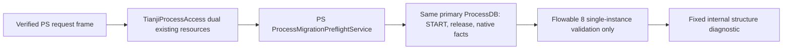
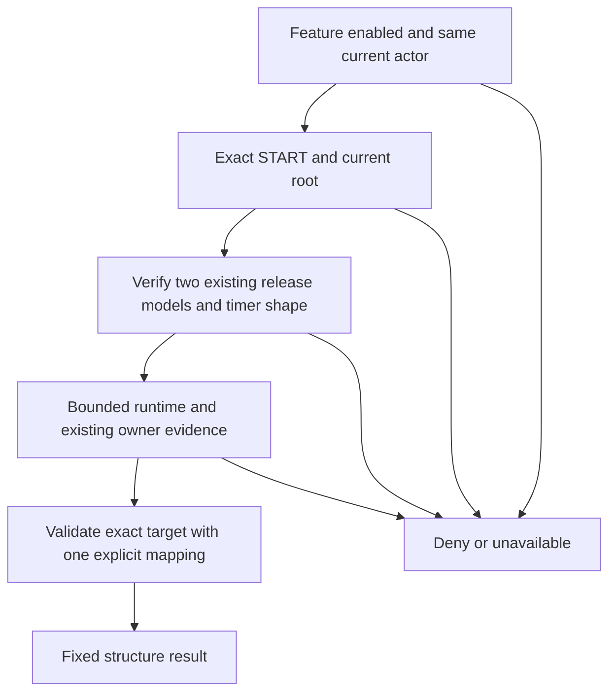
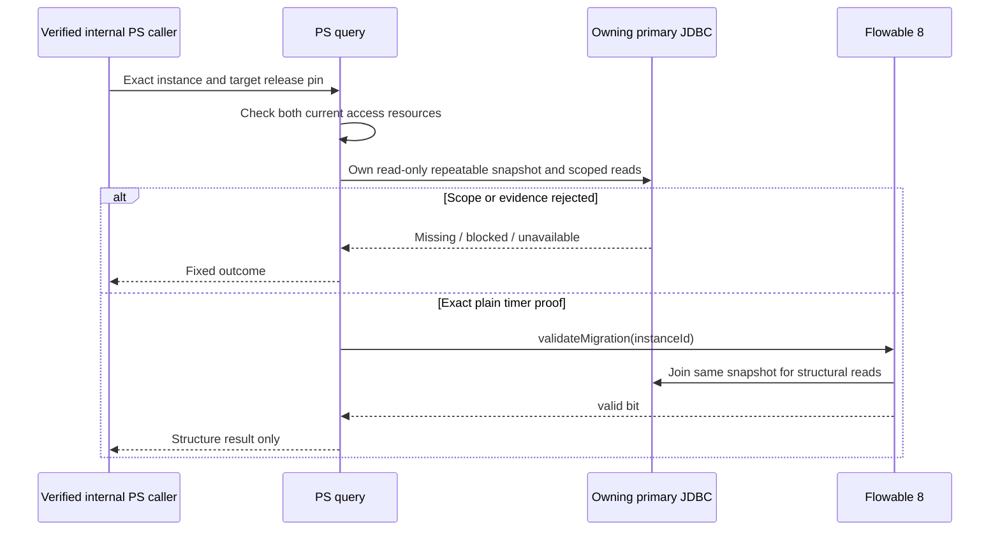

# 天机单实例 BPMN 迁移只读预检

| Field | Value |
| --- | --- |
| Document | `2026-11-05-18-46-bpmn-migration-preflight.md` |
| Template Version | `9` |
| Archetype Cleanup | `Not applicable` |
| Status | `Review` |
| Type | `Feature` |
| Complexity | `Complex` |
| Complexity Drivers | exact START/tenant/source, released/native model affinity, PostgreSQL read-only snapshot, Flowable capability boundary and negative evidence |
| Created | `2026-11-05 18:46 Asia/Shanghai` |
| Updated | `2026-11-05 18:52 Asia/Shanghai` |
| Owner | 天机平台决策人 |
| Repository | `tianji-service` |
| Scope | T4-01B0，现有显式发布 Process 的单个 BPMN 定时等待，只在 PS 内部验证 Flowable 结构兼容性 |
| Change Surface | PS 内部只读 Query、最小已发布模型与原生快照、现有双权限护栏、独立默认关闭 factory、有限测试和隔离 I 设计 |
| Affected Chapters | `§7, §8, §9, §10, §13, §14, §15, §16, §17, §18` |
| Source Requirement | [整体蓝图](../../../../docs/plans/agent-framework-upgrade-plan.md) `§19 T4-01` 的 BPMN dry-run，Root 明确批准可独立交付的 owner-local diagnostic |
| Baseline Revision | `tianji-service 695c9115921ba3068db445526b7bf51be87a350b` clean，`tianji-web e5d14225abacd4766aa21f9b59ce2364cd23bb3b` context |
| Amends | `None` |
| Supersedes | `None` |
| Depends On | [整体蓝图](../../../../docs/plans/agent-framework-upgrade-plan.md) `§19 T4-01`；[Process Control](2026-11-04-23-22-process-control-cancellation.md) `§7, §9, §11` 的现有 scope/storage |
| Related Specs | [候选制品](2026-11-05-16-17-platform-release-artifact-candidate.md)，[离线签名](2026-11-05-17-30-platform-release-detached-signature.md)，[Worker 恢复](2026-11-05-13-41-process-worker-recovery.md) |
| Related Plans | [Read-only preflight implementation](../plan/2026-11-05-18-53-bpmn-migration-preflight.md) |

## 1. Summary

Process Server 增加一个独立默认关闭的内部只读诊断。当前有权读取实例和发布的 exact START owner，可以对同租户两份已存在的单 BPMN 发布执行一次结构验证。只接受一条无分支、无变量的普通定时等待路径。成功返回 `NATIVE_STRUCTURE_VALIDATED_ONLY`，并给出源/目标 release 和一个固定 activity 标识及观察时刻。任何作用域、证据、部署、事务或原生 API 不一致都关闭正例。

这是一条已有显式 release 的结构诊断，供后续获批的 PS 运维调用使用。当前没有外部入口。Root 对此窄技术范围的审阅不替代正式 Spec/Plan 审阅及隔离 I。平台签名发布、激活、回滚和实际迁移继续按整体蓝图的顺序与权限单独交付。

## 2. Background and Current State

### 2.1 Business and user context

持有双读权限的原 START 所有者需要知道，一个已进入极简定时等待的现有实例，在某一明确发布上能否通过 Flowable 的单实例结构校验。当前所有者查询可以观察等待，却没有这项针对精确目标的判断。先有结构诊断，可在进入治理审查前尽早排除错误目标或活动映射。诊断没有动作资格，调用者不得将它作为迁移授权或版本兼容承诺。

### 2.2 Repository evidence

以下 PS Java 路径相对 `stellar-enclosure-tianji-process-server/src/main/java/top/egon/cola/platform/tianji/process/server/`。

| Evidence ID | Classification | Exact source | Observed fact | Verification limit |
| --- | --- | --- | --- | --- |
| EVD-001 | Static repository | PS `execution/ProcessExecutionService#startInTransaction`、`execution/ProcessCommandReceiptStore#readStartByInstance`，V1/V3 | 同源 START 先绑定发布和输入，再启动准确 native definition，APPLIED receipt 绑定完整 owner、release 和 instance。现有只读方法严格匹配 tenant/type/issuer/subject | 不是 governed activation 或历史迁移 binding |
| EVD-002 | Static repository | PS `release/ProcessReleaseService#get,manifestHash`、`release/VerifiedProcessModels#process`、V1/V8 | 查同租户发布，准确 definition/deployment/version，读取最多 512 KiB，重算模型 SHA，再用当前安全模型验证。V1 ACTIVE 是已发布状态 | 无 live signer/revocation/activation；当前读取无简单 timer 形状判定 |
| EVD-003 | Static repository | PS `execution/ProcessControlNativeAccess#readRecoveryRoot,requireTransaction`，`ProcessSecurityConfiguration#processConfiguration,caseDataSource`，`ProcessStorageConfiguration#verify` | 已有精确 Spring owner engine/schema/source/manager，PostgreSQL primary/UTF8/origin 和 root affinity。原生 helper 已用 JDBC 做有限 ACT SELECT | 既有 Control/Recovery 不证明 migration native join、时钟或禁止写入 |
| EVD-004 | Pinned vendor API and bytecode | Root pom `flowable.version=8.0.0`；本地 `flowable-engine-8.0.0.jar` SHA-256 `e81615c4c2f7332c184f31d362e34a807c6c745e6b9da745e73b2d3adb4f5850` | builder validateMigration(instanceId) 转到 ProcessMigrationService.validateMigrationForProcessInstance，后者选专用 validation command。经理检查目标模型与活动映射，某些复杂路径可解析 call-activity 表达式 | 仅固定版静态 API/命令，不等于所有图形可安全验证或迁移。 [Flowable 8 API](https://www.flowable.com/open-source/docs/all-javadocs/org/flowable/engine/migration/ProcessInstanceMigrationBuilder.html) · [固定版验证命令](https://raw.githubusercontent.com/flowable/flowable-engine/flowable-8.0.0/modules/flowable-engine/src/main/java/org/flowable/engine/impl/cmd/ProcessInstanceMigrationValidationCmd.java) · [固定版验证管理器](https://raw.githubusercontent.com/flowable/flowable-engine/flowable-8.0.0/modules/flowable-engine/src/main/java/org/flowable/engine/impl/migration/ProcessInstanceMigrationManagerImpl.java) |
| EVD-005 | Pinned vendor source and mappings | Flowable 8.0.0 `IntermediateCatchTimerEventActivityBehavior`、`TimerEventHandler.createConfiguration`、engine PG DDL 和 TimerJob.xml、Spring interceptor | 普通中间 timer 使用 `trigger-timer`、精确 activityId handler cfg。默认 REQUIRED interceptor 复用已存在 Spring TX。Timer native due date 是 timestamp 语义 | 必须通过隔离 I 核对实际 row 形状、UTC 写读与物理只读。 [固定版普通 timer](https://raw.githubusercontent.com/flowable/flowable-engine/flowable-8.0.0/modules/flowable-engine/src/main/java/org/flowable/engine/impl/bpmn/behavior/IntermediateCatchTimerEventActivityBehavior.java) · [固定版 Spring 事务拦截器](https://raw.githubusercontent.com/flowable/flowable-engine/flowable-8.0.0/modules/flowable-spring-common/src/main/java/org/flowable/common/spring/SpringTransactionInterceptor.java) |
| EVD-006 | Static repository | PS `security/TianjiProcessAccess#require`、`TianjiProcessPermissions.GET_API,RELEASE_GET_API`，Jianshen `PermissionExecutionGuard#requireExecution` | 可在已验证 PS servlet frame 先核现有实例 READ 与 release READ，完整 actor 必须一致；无请求就无法形成可信内部入口 | 无新的公开路由或运维 grant |
| EVD-007 | Static repository | PS `ProcessModelValidator#validateBpmn`、`ValidatedProcessModel#timerWaits`、V4/V5/V6/V8/V10 | 发布可包含普通 timer，也可包含更复杂的 Worker、人工、Case、Agent bridge 等。已有 owner 账本可作存在性否决；V4/V10 没有 tenant+instance 前缀索引 | 没有历史完整性/容量承诺。缺角色、时间或目录证据不可证明缺席 |
| EVD-008 | Root scope / existing evidence | T4-01 A1/A2、T3-12 source and live boundary | A1/A2 证明离线候选和合成签名路径。Root 只批准独立内部诊断，实际平台 activation/migration 继续受前置门禁约束 | 不可使用离线签名或 caller SHA 作为 live release/governance authority |

### 2.3 Problem statement and gap

Flowable 的通用结构校验以 native ID 为入口，SDK 并不具备天机的 START 所有者、发布体系、应用链接、活动限制或操作审计。直接外露会扩大安全面。既有 PS owner 和发布数据足以支持一个窄诊断，前提是 native occupancy 和同源只读能得到确切证据。当前未发现经过验收的治理迁移执行入口，也未发现需要本阶段新增的跨服务 API。

### 2.4 Evidence and current-chain map

| Entry/trigger | Current call chain | Data and effect | Boundary |
| --- | --- | --- | --- |
| 显式 Process START | ProcessController.start → TianjiProcessAccess → ProcessExecutionService → ProcessReleaseService/VerifiedProcessModels → Flowable start/APPLIED receipt | owns exact release, runtime ID, business input | only existing PS owner |
| 已知 Process Control | ProcessControlController → ProcessControlService.control → root/release/native wait | read snapshot, existing control wire | no target release migration validation |
| Pinned engine native validation | ProcessMigrationService → migration builder → dedicated command → migration manager | structural validation of one instance | no Tianji authorization |
| 平台发布治理 | A1 CLI / A2 detached signature | local artifact bytes only | no active pointer or migration authority |

### 2.5 Archetype example cleanup

Cleanup disposition: Not applicable

Reason: PS 是现有技术 owner，scope 为既有 release/Flowable 配置中的窄只读诊断。当前 POM/应用与源码是明确业务及技术功能，不生成 Maven business project 或样例。

## 3. Goals and Non-goals

### 3.1 Goals

同一现有可信 owner、同一 primary ProcessDB、同一快照中验证一个 exact Process 实例和一个 exact 目标 release。只有完全符合极简 timer 形状才调用 Flowable 单实例 validation。报告保持闭合、可理解、可失败关闭。默认无内部 bean。

### 3.2 Non-goals

无公开 HTTP、C/CL/AS/AR/TS/PaC、外部 grant、额外证书、签名、撤销或 activation。无 SQL migration、ACT DML、行锁、receipt 写入、重新计算 timer、resume、调度、变量读写/反序列化、模型发布、批量 validate、迁移执行、自动推进和 CMMN 迁移。其余业务路径只能作为否决证据。

### 3.3 Change Surface and Design Depth

| Area/layer | Disposition | Exact repository evidence | Changed or preserved behavior | Required treatment | Chapter(s) |
| --- | --- | --- | --- | --- | --- |
| PS internal query and guards | Affected | EVD-001/003/004/006 | trusted dual-read, closed bounded validation | exact Query/data/failure/flow/tests | §7, §8, §9, §10, §13, §14, §15, §16, §17, §18 |
| Same ProcessDB read path and native evidence | Affected | EVD-001/002/003/005/007 | read-only primary and exact native/owner probes, no table change | access paths and consistency only | §7, §8, §14, §15 |
| Public REST/CL/PaC/Web and configured routes | Unchanged | EVD-006/008 | no production HTTP/RPC and no role/grant | concise scope evidence | §9 |
| Schema, migration execution, release pointer, Agent/Case behavior | Unchanged | EVD-002/007/008 | existing owner/writes unaffected | no new DDL/ER/action design | §11 |
| Frontend | Unchanged | Web e5d1422 and T4-04A | Worker observation remains unrelated | existing paths only | §12 |

## 4. Requirements and Acceptance Criteria

| ID | Atomic requirement | Priority | Observable acceptance criteria | Source |
| --- | --- | --- | --- | --- |
| REQ-001 | Internal/default-off and current owner-only | Must | no bean off, API also required; verify existing GET+RELEASE_GET for one same verified actor before source; missing/foreign/no START proof reveals nothing | EVD-001/006, Root |
| REQ-002 | Exact existing source and target releases | Must | source from START + exact native root; target from same tenant and caller manifest pin, two stored and recomputed immutable digests; same key, exact IDs and target native version greater | EVD-001/002 |
| REQ-003 | Narrow unambiguous timer-only eligibility for validation | Must | exact start→timer→end, equal fixed timer and empty input schemas/variables, one live root/child and one expected timer, no prohibited native or owner evidence | EVD-003/005/007 |
| REQ-004 | Same physically read-only repeatable primary snapshot | Must | one owning connection/engine manager/schema, UTC timestamp requirement, no ambient transaction, fixed bound, native validation joins or whole read fails | EVD-003/004/005 |
| REQ-005 | Only single-instance native structural result | Must | exact ID-based builder, one derived id→same id mapping, only validateMigration; fixed report or fixed rejection, no raw details/actions/write | EVD-004 |
| REQ-006 | Separate finite source and independent isolated I/activation | Must | mocks prove calls/guards; future exact I must prove positives, negatives and no ACT or business writes; no automatic startup/enablement | EVD-005/008, Root |

### 4.1 Scenario matrix

| Scenario | Actor/trigger | Preconditions | Main path | Alternative/failure | Data/state change | Observable result | Requirements |
| --- | --- | --- | --- | --- | --- | --- | --- |
| exact plain wait | exact START owner | both current rights, correct releases and timer shape | native validation once | engine rejects safe structure | none | NATIVE_STRUCTURE_VALIDATED_ONLY or NATIVE_REJECTED | REQ-001–005 |
| missing or foreign | known exact ID query | verified actor not owning START | owner probe only | unavailable store is a different fixed source error | none | same not-found as missing, no target probe | REQ-001 |
| mismatched target | same actor | missing release, wrong manifest, native/hash/version drift | closed rejection | no native validation | none | fixed target/source reason, no leaked artifact | REQ-002/005 |
| risky or stale state | elapsed timer, second execution or linked evidence | exact owner | bounded reject before engine | unavailable optional authority yields no positive | none | fixed source/shape status | REQ-003/004 |
| failed transaction | interrupted, replica, wrong engine, timeout or DML attempt | service attempted | abort read and discard partial report | default disabled means zero work | none | fixed source unavailable | REQ-004/006 |
| repeat/concurrent change | same query later or scheduler races | old snapshot may differ | independently sample each request | no lock, no guarantee of future state | none | precise observation only | REQ-004/005/006 |

### 4.2 Use-case analysis

| Actor ID | Actor/role | Goal and responsibility | Entry/channel | Permission/tenant context | Evidence |
| --- | --- | --- | --- | --- | --- |
| ACTOR-001 | Current exact verified PS owner | See structure diagnostic for one known instance and release | future approved internal PS caller | existing dual resources plus full START tuple | EVD-001/006 |
| ACTOR-002 | PS and pinned Flowable | Verify data and bounded structure without changing Process | local technical query | existing ProcessDB owner | EVD-003/004 |
| ACTOR-003 | Operator running isolated acceptance | Prove read-only native behavior before enabling | separate explicit I | existing reviewed disposable runtime, no source grant | EVD-005/008 |

| ID | Use case/goal | Primary actor | Supporting actors/systems | Trigger | Preconditions | Main success outcome | Alternatives/failures | Postconditions | Requirements | Interfaces/pages | Tests |
| --- | --- | --- | --- | --- | --- | --- | --- | --- | --- | --- | --- |
| UC-001 | 检查明确实例与发布 | ACTOR-001 | ACTOR-002 | internal invoke | valid current identity, dual rights, exact owner | one fixed native-only report | missing/foreign/unsupported/unavailable | no mutation, no future authority | REQ-001–005 | INTERNAL-001 | TEST-001–004 |
| UC-002 | 确认真实只读边界 | ACTOR-003 | ACTOR-002 | separately authorized I | pinned versions, isolated ProcessDB/runtime | safe positive and zero writes | skip/different session/unproven timer keeps feature disabled | evidence only | REQ-004/006 | INTERNAL-001 acceptance | TEST-005/006 |

## 5. Constraints, Assumptions, and Decisions

| ID | Decision | Evidence and consequence |
| --- | --- | --- |
| DEC-001 | Root approves independent internal technical source under existing reads only | EVD-008. Governed activation sequence and actual migration remain untouched. Final Spec/Plan review before edits |
| DEC-002 | Exactly one top-level start→timer→end, zero variables/dependencies, same timer ID/duration and later target native version | EVD-002/004/005. Any extra topology or action defers |
| DEC-003 | Source/target current legacy Process release ACTIVE means published in its own ProcessDB | EVD-002. Caller expected SHA pins selection. It conveys no signing, governance approval or current permission |
| DEC-004 | Default false and no public route. Explicit opt-in only after actual isolated acceptance | EVD-005/008. No new credentials, roles, environment permission change or tests that launch engine during source U |
| ASM-001 | Single future eligible internal caller can supply a verified existing PS servlet context | EVD-006. No such new handler in this slice. A CLI/scheduler/no request frame cannot invoke by fabricating a ProcessActor |
| ASM-002 | A deployment eligible for runtime I has read coverage of all required existing relations, native UTC timer provenance and acceptable query plans | EVD-005/007. If unproven, leave capability disabled and do not widen scope |

## 6. Project Technology Context

Java 25/Spring Boot current source reactor, pinned Flowable 8.0.0 and PostgreSQL ProcessDB. PS is the existing technical JDBC engine profile and local transaction owner. Reuse current catalog verifier, ModelValidator, XML bounds, root/START patterns and authorization. No new dependency or native build.

### 6.1 Java architecture profile and capability baseline

The scope uses the current PS technical profile already selected for Process Control/Worker. Business/public Java contracts, AR/AS and DB management remain with existing owners. Direct Spring JDBC read projection is bounded technical engine access under this reviewed scope. No MP entity/store, new Spring layer, command/event or generated CRUD.

| Need | Existing capability | Exact gap | Decision |
| --- | --- | --- | --- |
| request identity | TianjiProcessAccess and exact START helper | none | reuse two existing guards and full actor equality |
| publication and model | ProcessReleaseService.get/manifestHash, VerifiedProcessModels.process, SafeModelXml | same storage affinity and narrow shape | add direct checks to owning existing types |
| runtime facts | ProcessControlNativeAccess.readRecoveryRoot and pinned ACT/read patterns | timer evidence and absence completeness | minimal bounded scalar projection |
| native validation | pinned ProcessMigrationService | no authorized orchestration | one direct Query service and optional named bean |

### 6.2 User-mandated Java rule compliance

| Literal rule | Affected? | Repository evidence | Exact design decision | Files/types/interfaces | Validation/test evidence | Status/blocker |
| --- | --- | --- | --- | --- | --- | --- |
| Rule 1 | Yes | PS semantic Query/DTO/VO conventions | immutable Query/DTO/VO, named service | §8/10 | TEST-001/002 | PASS |
| Rule 2 | Yes | existing C GetProcessInstanceQuery/GetProcessReleaseQuery and PS actor validation | validate bounded closed query at construction, current guards before transaction and state proof at owner handoff | INTERNAL-001 | TEST-001/003 | PASS |
| Rule 3 | Yes | existing immutable records | records for immutable values only, explicit JDBC technical scalar evidence | §8/10/11 | TEST-002/003 | PASS |
| Rule 4 | Yes | named manual PS bean factory, existing safe logging | explicit bean/qualifiers, existing PS technical constructor affinity, no new business logging path | §8 | TEST-001 | PASS |
| Rule 5 | Yes | existing JDK/Spring/JDBC and safe XML | reuse exact helpers and java.time, no new utilities/dependencies | §7/8 | TEST-002/004 | PASS |
| Rule 6 | Yes | internal only; legacy Jackson intact | no external serializer, only fixed native handler equality with pinned vendor helper | §7.3/10 | TEST-003/004 | PASS |
| Rule 7 | Yes | current PS base-only default switches | add explicit false in base and verify existing overrides preserve flags | §8/16 | TEST-001 | PASS |
| Rule 9 | Yes | complex closed admission, existing Worker Specifications | direct pure timer specification separates derived graph compatibility from source orchestration, no new interface/engine | §7.3/13 | TEST-002/003 | PASS |
| Rule 10 | Yes | existing Instant/Duration and native timestamp | DB Instant and explicit UTC legacy boundary, no wall fallback | TIME-001/002/003 | TEST-003/005 | PASS |
| Rule 11 | Yes | existing PS technical JDBC ownership and migration guard | keep PS query/layer, no DDL, CRUD, Event or write | §7/11/16 | TEST-004/005 | PASS |

### 6.3 Time semantics and conversion contract

Time contract: Required

| Time ID | Fields/symbols | Semantics | Java/runtime type | Storage policy | Wire policy | Business zone source | Display zone source | Boundary / DST rules | Precision / Clock | Compatibility | Verification |
| --- | --- | --- | --- | --- | --- | --- | --- | --- | --- | --- | --- |
| TIME-001 | observedAt | Occurred instant | Instant | Not persisted | Internal | Not applicable: no calendar policy | Not applicable: no frontend | one primary DB observation, no OS fallback | existing PostgreSQL precision | internal safe observation only | TEST-003, TEST-005 |
| TIME-002 | native timer due date predicate | Occurred instant | PostgreSQL timestamp without time zone | Legacy UTC | Internal | explicitly configured UTC for native writer/reader and same session, with provenance witness | Not applicable: no frontend | due strictly greater than observedAt, equality rejects | PostgreSQL original timestamp precision, no JVM now as fallback | interpret legacy native field as UTC only with reviewed write/read evidence and SQL conversion `DUEDATE_ AT TIME ZONE 'UTC'`; otherwise unavailable | TEST-003, TEST-005 |
| TIME-003 | fixed released timer duration | Duration | Duration | Not persisted | Internal | Not applicable: fixed elapsed duration | Not applicable: no UI | exact parsed source/target value, no calendar or timezone arithmetic | existing validator 1s..365d, first slice canonical whole-second ISO duration | model bytes unchanged | TEST-002 |

## 7. Architecture Design

### 7.0 Minimum-design baseline and element-necessity audit

| Proposed element | Change | Requirements | Existing/direct alternative | Concrete inadequacy of alternative | Added calls/state/coupling/failures/migration/operations | Verdict |
| --- | --- | --- | --- | --- | --- | --- |
| existing owner/access/release/model | Keep | REQ-001/002 | existing helpers | none | current source chain reused | Keep |
| internal ProcessMigrationPreflightService | Add | REQ-001–005 | direct call existing Flowable | no owner/current target/transaction proof | one scoped query, no exposed transport | Add |
| pure plain-timer specification | Add | REQ-003 | timerWaits contains ID only | doesn't prove only start/timer/end and absence of other nodes/edges | one bounded existing XML parse per model | Add |
| native guarded occupancy and storage affinity | Expand | REQ-002–004 | existing Control snapshot | merges artifact types and can miss contradictions or separate source | minimal scalar probes, no row locks or DDL | Add |
| default-off named factory | Add | REQ-001/006 | always available Bean | would enable unproven owner runtime path | one config key, disabled initially | Add |
| public API/caller-supplied native mapping/activation or reusable token | Exclude | REQ-005/006 | fixed internal result | outside source approval | none | Remove |

| Path | Network calls | Client states | Server contracts/state | Failure and TOCTOU points | Additional user/business value |
| --- | --- | --- | --- | --- | --- |
| Direct raw native validate | no added network | arbitrary target ID and mapping | engine-only structural truth | wrong owner/mapping may be used, no approved wrapper | insufficient |
| Selected local preflight | existing IAM guard activity only | exact query, fixed result | one read-only local transaction and no persistence | owner/release/evidence validation and one snapshot, future state not guaranteed | operator can pre-screen a concrete existing release pair |

### 7.1 System Architecture Design

### 7.2 High-Level Design

#### 7.2.2 High-level decision and quality matrix

| Concern/use case | Required behavior | Selected mechanism | Failure/degradation behavior | Trade-off | Verification | Requirements |
| --- | --- | --- | --- | --- | --- | --- |
| Identity | same current verified actor and exact START first | both existing resource guards, same full actor | missing/foreign fixed not-found, no target probe | two existing IAM checks | TEST-001 | REQ-001 |
| Consistency | one ProcessDB snapshot and physical read-only | existing owner manager with 2s bounds | source unavailable on join/flush/time drift | default-off until isolated I | TEST-003/005 | REQ-004 |
| Capacity | one instance and one timer | bounded scopes and sentinels, fixed artifact limits | unavailable if plans do not fit | restrict deployment; no new indexes here | TEST-003/005 | REQ-003/006 |
| Result safety | safe closed structure only | consume native Boolean and local enum | fixed unavailable on native exception | no dynamic diagnosis in report | TEST-004 | REQ-005 |

### 7.3 Detailed Design

**1. Authority and transaction.** Internal service calls `TianjiProcessAccess.require(GET_API)` then `require(RELEASE_GET_API)`, requires exact equality of returned non-LEGACY ProcessActor, and rejects ambient transaction or interrupted thread. IAM calls stay outside DB transaction. No caller actor parameter. A named opt-in factory checks exact SpringProcessEngineConfiguration, existing DataSourceTransactionManager, actual single PS DataSource and schema, releases object identity and native access affinity. Reuse existing API schema readiness. Native migration manager is the pinned default. Default CommandConfig propagation is REQUIRED. Custom pre/post command or MyBatis interceptors that could add effects are unsupported. No permissive substitute, lazy fallback or separate owner.

Open a REPEATABLE_READ transaction on the same primary with Spring readOnly=false only for primary routing, then run physical `SET TRANSACTION READ ONLY` before business SQL. Set local 2s statement timeout and 2s Spring transaction timeout. Verify actual bound datasource, PostgreSQL primary, UTF8, origin, configured current schema, read-only mode, transaction isolation and UTC. Sample one DB Instant. Recheck transaction state/affinity after native call before success. Verify the read path has the read prerequisites in §7.3.4. Report fixed dependency unavailable on timeout, mismatch, interrupt or runtime read/flush errors. No retries or row locks.

**2. START and release.** Read exactly one APPLIED START using `ProcessCommandReceiptStore#readStartByInstance` and original verified actor/instance. A missing, foreign or nonunique owner proof returns the existing fixed not-found, before any target lookup. Reuse `ProcessControlNativeAccess#readRecoveryRoot` and cross-check live root tenant, instance, original definition, active state and known business identity. Absent root yields `INSTANCE_NOT_LIVE`. Bind source release from receipt and definition exactly from the original native root. Load target after source owner through existing `ProcessReleaseService#get` and match caller expected manifest SHA. Require exactly one BPMN in each release, same definition key, distinct release/native definition IDs, target native version greater, non-suspended definitions. Reuse `VerifiedProcessModels#process` for exact deployment bytes, active definition and pinned model SHA. Recompute both single-member legacy `ProcessReleaseService#manifestHash` values with actual verified XML and stored empty schema. No latest alias, cross-owner target fallback, model import, or release publication.

**3. Plain-timer admission.** `ProcessModelValidator#plainMigrationTimer` reuses `SafeModelXml` on the already verified model bytes. Accept one top-level executable BPMN process, exactly one none startEvent, one intermediateCatchEvent with exactly one timerEventDefinition/timeDuration, one none endEvent, and exactly two unconditioned sequenceFlow elements start→timer→end. Apart from names/IDs and existing allowed namespaces/document-level XML syntax, no other flow elements, boundary, events, routes, listeners, extension, expression, DI, subprocess, message or additional process. Require empty START schema, timer activity ID equal in both, fixed same canonical whole-second duration within existing bounds; reject calendarName, date, cycle, fractional, dynamic and timer changes. The graph proves this supported class never creates any linked Worker/Case/Agent state through normal execution. Still require explicit absence probes against existing authoritative data so contradictions fail closed.

**4. Native and attached evidence.** Within the same physically read-only snapshot, probe execution scope by exact instance/root prefix with sentinel max3. Require exactly the top-level root and one direct active leaf on the known timer, same tenant, same original native definition and current process instance. Root is native scope with no activity, no parent/super/callback. Leaf is non-scope, not concurrent/event-scope/multi-instance, no lock/callback/reference and exact parent. Both revisions positive and active suspension state. Any additional execution or mismatched row fails closed. Require exactly one timer job in scope (limit2) with original instance/definition/tenant, leaf execution and exact activity/element. Require type timer and `TriggerTimerEventJobHandler.TYPE`, no repeat/lock/error/scope/correlation, matching exact `TimerEventHandler.createConfiguration(activityId,null,null)`. Compare native due against the one observation under reviewed UTC. Reject other timer or native executable, suspended, deadletter, external Worker, task, event subscription or runtime variable rows attached to root/leaf/process. Verify owner V4/V5/V6/V8/V10 by same tenant and instance scoped exists. Any matching Worker history/recovery, Agent dispatch/inbox, linked Case, or incomplete availability/visibility rejects. Never materialize variable, auth, execution payload or native job identifiers in DTO.

**5. Native validation.** Only after all guards, call `ProcessEngine#getProcessMigrationService()` once, create builder, pin exact native target definition ID, add one `ActivityMigrationMapping.createMappingFor(timerId,timerId)`, call `validateMigration(instanceId)` once. No name/version selector overload, process-wide validation, action script, delegate, custom mappings, history upgrade or any migrate method. Consume only `isMigrationValid()`, never the validation messages. Return safe closed result with one observedAt. This is an observation of the then-current graph. An elapsed timer or an advance immediately afterwards gives no guarantee for a later command.

#### 7.3.4 Exact existing read access and failure boundary

Use configured quoted schema, fixed table names and positional bound values. The existing Process role must already have visibility to the listed sources. Verify durable ordinary no-inheritance/no-partition/non-RLS relations, effective SELECT, exact projected columns and available existing owner migration evidence. Incomplete coverage returns source unavailable. Reuse the current catalog patterns without invoking Worker recovery's write-readiness verifier.

| Source group | Bound key and proof | Existing index / limits |
| --- | --- | --- |
| START and release | exact full actor + APPLIED START/resource_id; releases tenant/key, native IDs and model metadata | V1 APPLIED partial unique and V3 actor; release PK, native unique; existing helper limits and one model |
| Flowable execution | same instance/root and direct child identity, same tenant/definition, no extra rows | pinned ACT_IDX_EXE_PROCINST/ROOT, `LIMIT 3` |
| Timer native | exact process/leaf scope, count <=1 and all expected fields | pinned timer mapping; `LIMIT 2`, finite fixed SQL deadline |
| Other ACT runtime | same scope `act_ru_job, act_ru_suspended_job, act_ru_deadletter_job, act_ru_external_job, act_ru_task, act_ru_event_subscr, act_ru_variable` | fixed EXISTS checks only; native job mappings use process_instance_id_, task/event/variable use proc_inst_id_ or execution_id_ per pinned mappings |
| Owner Worker/Agent/Case | V4 lease BPMN scope_id, V5 dispatch and V6 inbox BPMN scope_id, V8 LINKED_BPMN parent_process_instance_id, V10 process_instance_id, all exact tenant | SELECT EXISTS only; V8 linked index. V4/V10 lack a demonstrated scope-leading index. Prove production-like plans within bound or defer, no corrective schema in this slice |

No row locking, write, receipt, new clock, retry or cache. Abort/discard pending facts on any failure. Other Process transactions remain free to advance. Evidence is complete only in the current verified snapshot.

#### 7.3.6 Conclusion evidence chain

| Conclusion | Evidence → finding → decision | Verification |
| --- | --- | --- |
| legacy authority useful independently | EVD-001/002 exact START/definition already available → raw validate lacks ownership → only explicit same-owner internal diagnostic | TEST-001/002 |
| native behavior remains gated | EVD-004/005 dedicated validation exists but plugin/transaction/cache/time need real proof → close all shape and source gates → default-off, isolated I before opt-in | TEST-003–006 |

## 8. Package Structure and Code File Tree

All paths below under PS module, current package `top.egon.cola.platform.tianji.process.server`. Future Plan fixes exact file/commit order.

| Operation | Exact path within PS | Purpose |
| --- | --- | --- |
| Create | `src/main/java/top/egon/cola/platform/tianji/process/server/execution/ProcessMigrationPreflightService.java` | one owner-only read orchestration and nested immutable Query/DTO/enums |
| Modify | `src/main/java/top/egon/cola/platform/tianji/process/server/execution/ProcessControlNativeAccess.java` | bounded native scalar timer/occupancy check and physically read-only proof helpers; existing paths unchanged |
| Modify | `src/main/java/top/egon/cola/platform/tianji/process/server/release/ProcessModelValidator.java` | pure closed timer shape derivation and PlainMigrationTimerVO |
| Modify | `src/main/java/top/egon/cola/platform/tianji/process/server/release/ProcessReleaseService.java` | compare exact owner storage affinity and verify single member legacy manifest; existing behavior unchanged |
| Modify | `src/main/java/top/egon/cola/platform/tianji/process/server/ProcessSecurityConfiguration.java` | named internal conditional factory using exact existing authority; no routing |
| Modify | `src/main/resources/application.yml` | add `stellar.tianji.process.migration-preflight.enabled: false` |
| Create | `src/test/java/top/egon/cola/platform/tianji/process/server/execution/ProcessMigrationPreflightServiceTest.java` | finite mocked transaction, permission, status, release and native method/mapping |
| Modify | `src/test/java/top/egon/cola/platform/tianji/process/server/ProcessStorageConfigurationTest.java` | exact flag/conditions and no other route or grants |
| Modify | `src/test/java/top/egon/cola/platform/tianji/process/server/release/ProcessModelValidatorTest.java` | positive timer and graph negatives, finite only |

The isolated I witness is an explicit later execution gate and does not add a new selected integration suite here. No separate utility/framework, POM, C/CL, schema/SQL, application startup hook, manifest or route path.

## 9. Interface Definitions

External API disposition: Unchanged. Existing resource keys are authority checks only. No public protocol, handler, payload, OAS or PaC artifact schema changes.

### 9.1 Interface Inventory

| ID | Change/necessity verdict | Name/purpose | Kind | API style/CQE role | Consumer | Owner | Method + URL / GraphQL field / symbol / topic | Operation ID/schema source | Input | Output | Auth/tenant | Error model | Idempotency/version | Requirements |
| --- | --- | --- | --- | --- | --- | --- | --- | --- | --- | --- | --- | --- | --- | --- |
| INTERNAL-001 | New/Add | Inspect BPMN structure | Java | Internal Query | separately approved PS caller inside already verified PS request frame | named default-off PS Bean | `ProcessMigrationPreflightService#inspect(ValidateProcessMigrationQuery)` | local signature and §10 | exact instanceId, targetReleaseVersion, expectedTargetManifestSha256 | closed `ProcessMigrationPreflightDTO` | dual existing current resources, exact START owner, same source | fixed denied/not-found/unavailable/closed result | independent read, no command or actionable version | REQ-001–006 |

### 9.2 Per-interface Detailed Contracts

#### 9.2.1 INTERNAL-001 — Inspect current single-instance BPMN structure

##### Necessity and interaction-cost decision

| Concern | Decision |
| --- | --- |
| Change classification | New internal Query, no external transport |
| Independent consumer goal | An approved PS operator can inspect current structural compatibility for one exact known pair |
| Parameter ownership and derivation | Caller selects target release key and digest. PS derives original START, native definitions, owner and single mapping |
| Direct/no-new-interface alternative | Existing Control only describes source wait. Raw Flowable lacks Tianji target authority and owner proof |
| Caller use of result | Read the current structure diagnostic and review failures. No field is forwarded to a command |
| Round trips and failure points | One local bounded snapshot and one native validation, current IAM reads only. Failure produces fixed denial/unavailable/report |
| Verdict | Add this local boundary for REQ-001–006 |

##### Identity and purpose

`ProcessMigrationPreflightService#inspect(ValidateProcessMigrationQuery)` is a local Java method. The current verified PS request frame supplies both existing authorization checks. There is no caller actor parameter, serialization, endpoint or generated contract.

##### Request parameters

| Parameter | Type / required | Validation and ownership |
| --- | --- | --- |
| instanceId | String, required | Existing GetProcessInstanceQuery validates length, exact text and no dot segments. Must be current actor's exact APPLIED START |
| targetReleaseVersion | String, required | Existing GetProcessReleaseQuery validates explicit key. Lookup within current tenant after owner proof |
| expectedTargetManifestSha256 | String, required | Exactly 64 lowercase hex, compared to stored and recomputed legacy manifest. Caller selection pin only |

No source selector, mappings, variables, release alias or flags.

##### Success response

Immutable ProcessMigrationPreflightDTO with the fields in §10. NATIVE_STRUCTURE_VALIDATED_ONLY means the one exact native structural validator returned true for this snapshot. It has no action token, active pointer status, raw ID or execution eligibility.

##### Error responses

Malformed input uses a fixed invalid query error. Existing current auth/permission denial is preserved. Missing/foreign/ambiguous START returns existing fixed not-found before target disclosure. Known bounded observations use INSTANCE_NOT_LIVE, TARGET_UNAVAILABLE, TARGET_PIN_MISMATCH, RELEASE_PAIR_UNSUPPORTED, SHAPE_UNSUPPORTED, ACTIVE_EVIDENCE_UNSAFE or NATIVE_REJECTED. Uncertain connection/clock/catalog/row scope/null native result or native exception maps to fixed dependency unavailable without a partial report or cause text.

##### Interface logic for frontend and consumers

No frontend caller. Internal flow authorizes both current resources, verifies exact START, current root and releases, checks plain graph plus owner/native evidence, then invokes native validation once. A consumer may explicitly inspect again using current auth and a new snapshot. It must render the status as one diagnostic observation. No action is triggered or inferred. Any future operation separately reauthorizes and rechecks against its own approved authority.

##### Compatibility and verification

Existing routes, C/CL/OAS/PaC and release models retain their current contracts. TEST-001/003/004 verify local boundaries, exact ordered calls and closed output. TEST-005 separately proves actual engine/read-only behavior.

## 10. POJO and Data Model Design

| Value | Fields | Invariant |
| --- | --- | --- |
| ValidateProcessMigrationQuery | instanceId, targetReleaseVersion, expectedTargetManifestSha256 | all required and bounded, existing C validators, immutable |
| ProcessMigrationPreflightDTO | instanceId, sourceReleaseVersion, targetReleaseVersion, status, activityId, observedAt | immutable, exact owner authorized first. source key is verified START release, target key is the validated requested label even when unavailable. Target existence is never implied by the label. activityId present only for the two native result branches. observedAt from the one DB sample |
| ProcessMigrationPreflightStatusEnum | NATIVE_STRUCTURE_VALIDATED_ONLY, INSTANCE_NOT_LIVE, TARGET_UNAVAILABLE, TARGET_PIN_MISMATCH, RELEASE_PAIR_UNSUPPORTED, SHAPE_UNSUPPORTED, ACTIVE_EVIDENCE_UNSAFE, NATIVE_REJECTED | fixed enum names, no text from Flowable |
| PlainMigrationTimerVO | activityId, Duration | one verified ordinary timer, bounded ID and canonical fixed duration |
| Internal native facts | minimal scoped execution/timer values, safe Booleans | no authority outside local Query; foreign/ambiguous withheld |
| Auth/source exceptions | existing fixed missing/denial and safe IllegalStateException for unavailable | never expose raw exception or internal ID |

## 11. Database Design

Scope disposition: Context-only for existing ProcessDB persistence and data model. New technical reads and bounded access paths are specified in §7.3.4. No table, key, index, relationship, ER or DDL change. Current engine/START/release/lease/bridge/Case/Worker stores retain ownership. The capability never calls Flyway or schema repair.

## 12. Frontend Page Design

Scope disposition: Unchanged. Existing Web T4-04 Worker lookup has no Process migration action or visibility. No new page, BFF or external rendering.

## 13. Design Patterns and Architecture Principles

Use a local read-only Query boundary for exact current authorization and snapshot. Use a closed Specification for plain timer graph and native evidence so semantic admission is explicit and separately testable. Reuse existing execution/store/model helpers and Flowable only as structural validator. No separate abstract factory, registry or callback. The existing named Spring conditional factory only binds exact owner objects.

## 14. Test Design

| ID | Layer / owning test | Concrete proof |
| --- | --- | --- |
| TEST-001 | finite PS ProcessMigrationPreflightServiceTest, ProcessStorageConfigurationTest | default false/disabled bean, no public route/grant changes. Dual existing guards same actor before JDBC, absent/foreign/legacy indistinguishable as required, source mismatch or ambient rejected |
| TEST-002 | finite ProcessModelValidatorTest and service | approved plain positive, absent/wrong/deployed target, exact hash and version, nonempty input or new node/gateway/boundary/message/Worker/Case/listener/async/change timer rejects, no engine invocation on negative |
| TEST-003 | finite ProcessMigrationPreflightServiceTest | exact isolation, primary/schema/physical read-only/UTC and one clock, extra leaf, locked/expired/equal timer, wrong handler/cfg/owner/job, duplicate occupancy, nullable clock, owner proof unreadable, no native call |
| TEST-004 | finite ProcessMigrationPreflightServiceTest | exact target ID and one id→id mapping, only validateMigration(instanceId), isMigrationValid only; false/null/throw fixed and no log/result raw diagnostics; verify no migrate, batch or writes |
| TEST-005 | separate isolated actual Flowable 8/PostgreSQL I, design-only here | provision existing V1–V10 and exact engine with known UTC JDBC/JVM. Publish two plain releases and start one real instance on the older release under test setup. With capturing datasource in the actual engine path prove physical same read-only JDBC transaction, no SQL DML or schedule events during validation, unchanged root/execution/job IDs/revisions, due and owner receipts. Independent writer races are controlled or isolated. Verify real UTC negative, mismatch graph, held timer and strict role/plan bounds |
| TEST-006 | separate source regression and acceptance audit | finite existing ProcessReleaseServiceTest, ProcessControlNativeAccessTest, ProcessControlServiceTest, ProcessWorkerRecoveryServiceTest and ProcessStorageConfigurationTest; compare current API and all existing SQL/PaC bytes. Opt-in I must actually execute and assert nonzero positive/negatives, no skipped or mock substitution |

Future Plan names selectors and exact source reactor settings. Source U uses mocks only, never selects current `*PostgresTest`, child app/Flowable engine tests, browser or network. I operates under independent user action. Release E/S11, authority/activation and actual migration remain separate.

## 15. Non-functional and Cross-cutting Design

| Attribute | Constraint | Proof |
| --- | --- | --- |
| Ownership | existing current dual resources, exact owner and primary | TEST-001/003 |
| Bound | one instance, two releases, one timer, ≤2s transaction/statement gates, fixed artifact/row caps | TEST-002/003/005 |
| Privacy | no raw Flowable errors, XML, activity payload, credentials, business keys or native execution/job IDs in report/log | TEST-004 |
| Operability | when unknown permissions, timestamp, optional source, isolation, read-only state or performance, keep disabled | TEST-005/006 |

## 16. Compatibility, Migration, Rollout, and Rollback

Current default disabled, API off implies disabled. Existing application profile layout, schema, public permissions, current Process Control and worker operations unchanged. No code auto-launches a Flowable engine, Postgres or app. Before any opt-in an operator proves isolated I using the pinned engine and real ProcessDB role, validates actual same-connection read-only behavior, supported timer and UTC provenance, and approves the intended internal caller. Disabling removes the capability without changing Process data. Source rollback is one PS-only revert. Real migration execution must await governed activation, release compatibility and dedicated approval/E tests.

## 17. Alternatives and Decisions

| Alternative | Evidence and trade-off | Decision |
| --- | --- | --- |
| Existing Control snapshot alone | good owner snapshot, no target release or Flowable validation | insufficient for current diagnostic |
| Raw Flowable validation or REST | available but admits arbitrary target/mappings and lacks Tianji scope | reject |
| Narrow local dry-run | existing explicit release and verified native source, safe stage without claiming release authority | select as reviewed source |
| Actual migration or activation first | true governed migration needs current live authority, pointer and reader compatibility | preserve roadmap order and separate validation |

## 18. Risks and Open Questions

| Risk / decision | Consequence | Disposition |
| --- | --- | --- |
| Upstream validates activity mappings, may silently skip some unsupported execution combinations | false positive if trusted without exact scope | precheck exact graph/native evidence, refuse ambiguous cases |
| Legacy timer timestamp does not carry a zone | wrong active timing | require pinned UTC for actual write/read and I. Unknown historical provenance keeps disabled |
| Optional linked ledger unreadable or broad scan | absence/performance cannot be proved | refuse unsupported deployment; no fallback or new privilege |
| Engine custom interceptors, different storage or new Flowable version | could invalidate read-only proof | require pinned default validation chain and I before opt-in |
| Current runtime acceptance missing | source U cannot establish engine behavior | no runtime enable or claim, explicit operator gate |
| No authorized new HTTP/private operational caller yet | can only prepare internal source capability | keep default false, require named approved caller before live opt-in |
| Activated migration/rollback semantics not designed here | normal START readers expect original release | separate future design and actual authority; no execution |

## 19. Traceability Matrix

| Requirement | Use case | Affected areas/chapters | Context-only/unchanged boundary | Tests | Acceptance evidence |
| --- | --- | --- | --- | --- | --- |
| REQ-001 | UC-001 | §7/8/9 default-off and auth | old PaC/public routing | TEST-001 | strict identity and zero work off |
| REQ-002 | UC-001 | §7/10/11 release binding | immutable existing publication | TEST-002 | owner/root/hash and target negatives |
| REQ-003 | UC-001 | §7/10/11 timer and occupancy | existing other runtime paths | TEST-002/003/005 | exact plain gate and no unavailable proof |
| REQ-004 | UC-001, UC-002 | §7/11/15 same snapshot | existing ProcessDB | TEST-003/005 | bounded read-only and actual physical proof later |
| REQ-005 | UC-001 | §7/9/10 native only | no public/native mutation | TEST-004/005 | exact call and safe result |
| REQ-006 | UC-002 | §14/16/18 evidence | governance and E remain separate | TEST-005/006 | finite and real acceptance distinguished |

## 20. Review and Acceptance

### 20.1 Original-request fidelity

T4-01 existing release diagnostic only. The feature can be source-designed and finite-verified independently of signer/activation because it makes no release or action authority claim. Actual governed migration remains sequenced after activation and acceptance.

### 20.2 Repository and technical fidelity

Checked pinned APIs, upstream exact tag, current PS owner/release/START/runtime design and authoritative SQL/mappings statically. No Engine, DB, Maven or application executed in Spec turn.

### 20.3 Cross-section consistency

One internal Query, no public API, one snapshot and one native validation path. Native tables and bindings preserve existing ownership. Complex diagrams, statuses, gates and traceability agree. Missing proof remains unavailable.

### 20.4 Relationship and effective-design review

Master T4-01 governance ordering and predecessor Process Control/Worker policies remain. A1/A2 offline verification provides context only. Root scoped this candidate to independent structural observation.

### 20.5 Blocking Manual Check

| Check ID | Applicability | Status | Evidence | Finding | Required action/exception |
| --- | --- | --- | --- | --- | --- |
| MC-ARCH-001 | Applicable | PASS | §6.1/8 | existing PS technical owner | None |
| MC-REUSE-001 | Applicable | PASS | §6.1/7 | existing access, release/model/native/Flowable | None |
| MC-DEP-001 | Applicable | PASS | EVD-004/§8 | no dependency or toolchain change | None |
| MC-NAME-001 | Applicable | PASS | §8/10 | semantic Query, DTO and immutable VO | None |
| MC-VALID-001 | Applicable | PASS | §7/9/10 | current verified owner and exact bounded checks | None |
| MC-MODEL-001 | Applicable | PASS | §10 | immutable record values only | None |
| MC-CONVERT-001 | Applicable | PASS | §7/10/11 | explicit minimized technical JDBC data, no Java entity conversion | None |
| MC-LOG-001 | Not applicable | N/A | §7/10/15 | no new business log or raw diagnostics | None |
| MC-BEAN-001 | Applicable | PASS | §7/8 | named same-source conditional factory | None |
| MC-UTIL-001 | Applicable | PASS | §6/7 | current JDK/JDBC/native helpers | None |
| MC-JSON-001 | Not applicable | N/A | §9/10 | internal method, no external JSON/enum changes | None |
| MC-TIME-001 | Applicable | PASS | TIME-001/002/003 | explicit UTC, current observation and future I | None |
| MC-CONFIG-001 | Applicable | PASS | §8/16 | one default-false flag and no other profile change | None |
| MC-PATTERN-001 | Applicable | PASS | §7/13 | narrow Query and pure closed Specification | None |
| MC-SCOPE-001 | Applicable | PASS | §3/8/9/11/16 | exact PS-only source, no migration writes | None |
| MC-TEST-001 | Applicable | PASS | TEST-001–006 | finite and actual I requirements separate | None |
| MC-BLOCKER-001 | Applicable | PASS | §5/16/18 | ready for source design review, opt-in remains gated | None |

### 20.6 Final verdict

PASS — Ready for user review

Only the internal source design is ready for review. Implemented behavior, real read-only engine validation, activation, migration execution, E and any deployment remain independently pending.
