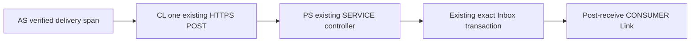
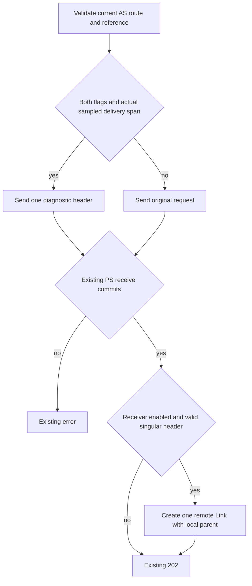
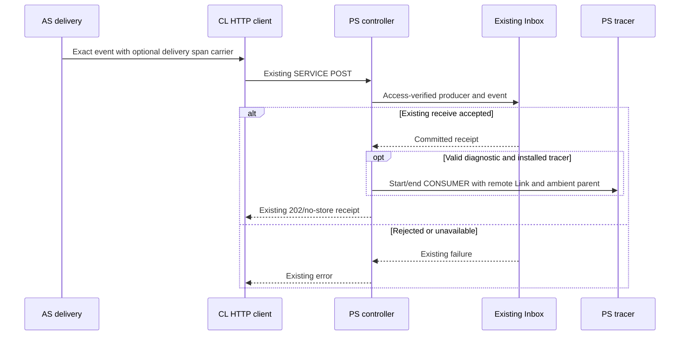

# T4-02 AS 到 PS Agent 结果接收 Span Link

| Field | Value |
| --- | --- |
| Document | 2026-11-05-19-19-agent-result-receive-span-links.md |
| Template Version | 9 |
| Archetype Cleanup | Not applicable |
| Status | Accepted |
| Type | Architecture |
| Complexity | Complex |
| Complexity Drivers | AS、CL、PS 三模块，现有 SERVICE 跨 owner 传递白名单和新 PS BOM 依赖决策 |
| Created | 2026-11-05 19:19 Asia/Shanghai |
| Updated | 2026-11-05 19:38 Asia/Shanghai |
| Owner | Tianji AS/PS 技术所有者和 Master 决策人 |
| Repository | tianji-service |
| Scope | 现有 Agent-result HTTP 传递的默认关闭诊断 Link |
| Change Surface | 现有 AS/CL/PS 传递接收路径、一个 PS POM、两份 base YAML、三个有限测试 |
| Affected Chapters | §7, §8, §9, §13, §14, §15, §16 |
| Source Requirement | Master §13.3、§14.7、§19 T4-02 和 S12 |
| Baseline Revision | Source83 clean af26473216d259049a4edac8b2d42b236d3a5fa7。继承 Step82 PS artifact/YAML/PaC 基线，执行前仍核对 exact HEAD |
| Amends | [Master §14.7](../../../../docs/plans/agent-framework-upgrade-plan.md#147-api错误幂等和传递契约) §14.7，限定 INTERNAL-001，DEC-001 已批准并记录于 Master |
| Supersedes | None |
| Depends On | [AS local link](2026-11-05-17-35-agent-terminal-outbox-span-links.md#7-architecture-design) |
| Related Specs | [PS Inbox decision delay](2026-11-05-18-43-process-inbox-decision-delay.md) |
| Related Plans | [Master T4-02](../../../../docs/plans/agent-framework-upgrade-plan.md) |

## 1. Summary

拟让 PS 在现有 Agent 结果接收成功后建立一个 Link 到本次真实 AS delivery span。两端开关明确默认 false。用户已明确批准私有诊断头窄例外及 PS 两项依赖，正式源码验证、运行启用和部署分别授权。

## 2. Background and Current State

| Evidence | Classification | Exact authority | Limit |
| --- | --- | --- | --- |
| EVD-001 | Committed source | AS AgentResultSpanObservation#delivery 在核验后从 Outbox trace_id 建立实际本地 Link | Source77 默认关闭，无跨 owner 请求头 |
| EVD-002 | Committed source | CL HttpAgentResultClient#receive 固定 route、SERVICE token、tenant 断言、一次请求与 202 receipt 验证 | C 接口没有诊断输入 |
| EVD-003 | Committed source | PS AgentResultInboxController#receive、TianjiProcessAccess#require、AgentResultProducerRegistry#require、AgentResultInbox#receive | 权限、issuer、tenant、producer/owner/source、dispatch 和 event 校验后事务完成 |
| EVD-004 | Existing artifacts and cached POM | Step82 PS exec SHA a2d19814011957d53aa72ae4897c529214de11cc76e0502e18b2ece5e7bcc1e8 未含 OTel/Micrometer Tracing。AS exec SHA 8c84e9b4078eef7d87b6fa88d26f9b9786bb531d0cb83ce869f165def0cb0165 含 OTel 1.62.0。Boot 4.1.2 BOM 管理同版 | 当前留存产物只读核查。没有新 package 或部署证明 |
| EVD-005 | Off-repo isolated prototype | 现有缓存类路径上真实 JDK25/JUnit 24 项通过，13 路径补丁 SHA a644c6311b69832a6f55442cb27268318321b7910ad5813f6d0e19bf407b1700 | 只是原型。未变更工作树、应用、PG 或 exporter |
| EVD-006 | Normative predecessor | Master §13.3 要求异步 link，§14.7 现已记录用户批准的唯一私有头窄例外 | 仅精确 HTTPS POST、双方默认关闭 |

### 2.4 Evidence and current-chain map

| Entry/trigger | Current call chain | Data read/written | External dependency | Consumer | Evidence |
| --- | --- | --- | --- | --- | --- |
| AS Outbox verified delivery | AgentResultDeliveryHandler → verified terminalReference → delivery span → HttpAgentResultClient | 现有 terminal event、trace_id 和 exact fingerprint header | Current SERVICE token and exact HTTPS endpoint | PS Inbox | EVD-001/002 |
| PS received POST | Body advice → controller/service access → registry → Inbox transaction and receipt | Existing dispatch intent, Inbox immutable payload/fingerprint and accepted receipt | Existing verified SERVICE authority and JDBC | AS delivery ACK | EVD-003 |
| Future deferred application | PS Inbox poller → native Flowable owner | Existing durable event, no trace metadata | Existing native engine | Process | EVD-003，§18 独立 |

### 2.5 Archetype example cleanup

Cleanup disposition: Not applicable
Reason: 改动只扩展现有 AS/CL/PS 技术适配和已有测试，没有生成业务 archetype 或替换示例链。

## 3. Goals and Non-goals

在既有结果 HTTP 链路中验证一个有限 Link，保留旧 payload、权限、receipt、配置、动作和持久化归属。范围不包括 exporter、生产启用、Inbox 持久传播、Worker、queued admission、业务关联查询、SLO 或 S12。

### 3.3 Change Surface and Design Depth

| Area/layer | Disposition | Exact repository evidence | Exact delta or preserved invariant | Required Spec treatment | Chapters |
| --- | --- | --- | --- | --- | --- |
| AS/CL/PS diagnostic transport | Affected | EVD-001/002/003 | 一项私有可选诊断头和 post-receive link | 完整设计、协作、有限测试 | §7, §8, §9, §13, §14, §15, §16 |
| Runtime and storage | Unchanged | Inbox V6 and current result transaction | SQL、fingerprint、重试、后续应用维持 | §11 保全 | §11 |
| Public UI and external API | Not applicable | SERVICE-only private route | 无公开 API、UI 或 PaC 变更 | §12 和现有资源核验 | §12 |
| Telemetry DTO | Unchanged | C AgentTerminalEvent/Receipt | 无新 C DTO、auth 字段或 body 模型 | §10 | §10 |

## 4. Requirements and Acceptance Criteria

| ID | Requirement | Acceptance |
| --- | --- | --- |
| REQ-001 | 现有 AS 来源和 exact route 上产生诊断值 | 双开关、recording/local/valid/sampled；取本次实际 delivery Span ID；原调用、deadline 和重试不变 |
| REQ-002 | 闭合私有载体并保持 C/CL 旧兼容 | HTTPS 精确 POST，可选单头，固定格式；非法/cleartext 不发头；关闭时同 body、旧 headers、eventId 和 fingerprint |
| REQ-003 | PS 仅在精确接收成功后建立 Link | 授权和 Inbox 完整校验成功后读取一项值，真实 CONSUMER span 保留本地 parent；关闭、拒绝、冲突、缺 provider 或坏值不创建 |
| REQ-004 | 固定依赖、default-off、回滚与审批 | 仅 PS 两直接声明，BOM 1.62.0；运行只多 API、Context、Common；无 runtime SDK/exporter，Step82 和 lag 配置保留 |
| REQ-005 | 区分有限与真实运行证据 | exact test、实际包和 scope 证据。DEAD listeners、provider、collector、Inbox apply/restart、Worker 与 S12 单独验收 |

### 4.1 Scenario matrix

| Scenario | Trigger | Preconditions | Main or failure path | Data change | Evidence | Requirements |
| --- | --- | --- | --- | --- | --- | --- |
| S-01 | 旧发/收任一端或显式 false | 当前 SERVICE 路径 | 原接收或忽略私有头 | 原回执和事件 | byte/request and config tests | REQ-001/002/004 |
| S-02 | 两端 opt-in 与有效采样 | exact terminal reference 和 committed receipt | CL 单头，PS 同 parent 真实 Link | 仅 trace | local SDK proof | REQ-001/002/003 |
| S-03 | 无效、重复、缺 provider 或 exporter exception | 已授权并接收 | 保留 202、忽略 Link | 无新业务状态 | negative tests | REQ-003/005 |
| S-04 | tenant、主体、dispatch、event 冲突 | 原拒绝路径 | 原 4xx/5xx，不读诊断 | 原边界 | MockMvc/source | REQ-003 |
| S-05 | 现有重投 | exact replay | 可能每次收到成功 ACK 时有单 Link | 原 row 与 receipt，非首写证明 | match current Inbox source | REQ-002/003 |

### 4.2 Use-case analysis

| ID | Actor | Evidence |
| --- | --- | --- |
| ACTOR-001 | AS terminal Outbox worker | AgentResultDeliveryHandler |
| ACTOR-002 | PS Inbox owner | AgentResultInboxController and AgentResultInbox |
| ACTOR-003 | Operator and decision owner | Master §14.7 / S12 |

| ID | Use case/goal | Actor | Preconditions and trigger | Outcome | Failure or alternative | Postconditions | Requirements |
| --- | --- | --- | --- | --- | --- | --- | --- |
| UC-001 | 将接受结果与真实 AS 投递 Span 关联 | ACTOR-001/002 | 正常 SERVICE POST 且两端启用 | 单 Link，旧 receipt | 旧端兼容或诊断跳过 | 原事务/事件 | REQ-001, REQ-002, REQ-003 |
| UC-002 | 审查与验证窄范围变更 | ACTOR-003 | 两项授权和 Step82 source lock | 源码/包 evidence | 未批准时停止源码；运行需独立批准 | 两端默认 false | REQ-004, REQ-005 |

## 5. Constraints, Assumptions, and Decisions

| ID | Branch | Effect |
| --- | --- | --- |
| DEC-001 | 未批准、拒绝或仅批准一项 | 禁止依赖变更和 private header 源码，保留当前 AS 本地功能。无默认授权 |
| DEC-001 | 选定分支。2026-11-05 用户明确批准该 exact HTTPS POST 的私有诊断头例外，以及 PS OTel API compile 和 SDK Trace test，版本由 Boot BOM 管理为 1.62.0 | Master §14.7 已记录。源码仍需 exact source GO，两端仍 false。审批不含启用或部署 |
| DEC-002 | 部署启用 | 未来独立授权及验证 DEAD listeners、唯一 recording bean、非阻塞 exporter、采样、proxy allowlist/日志后，先 PS 后 AS |
| ASM-001 | Step82 已独立收口 | PS YAML 同路径分离 hunk。重新读取 clean SHA 和 contextual patch，不拷贝旧全文件 |

Master §14.7 已记录如下窄例外。仅 AS 到 PS 的既有 SERVICE 结果接收 POST 可在独立开关启用后携带 X-Egon-Tianji-Agent-Result-Link。值限一项固定长度 v00 sampled W3C 结构，只用于精确事件成功接收后的原生 Span Link，不参与业务身份、摘要或授权，禁止作为父上下文、记录或向其他路径转发。

## 6. Project Technology Context

既有 Tianji C/CL 与 AS/PS 的 owner-local 技术适配架构。依赖复用 Boot 4.1.2 BOM、AS OTel 1.62.0、CL JDK HttpClient、PS Servlet/OTel API、JUnit 与现有权限/事务。PS 仅新增默认 compile io.opentelemetry:opentelemetry-api 和 test io.opentelemetry:opentelemetry-sdk-trace，不写版本，由 BOM 固定 1.62.0。运行传递 Context、Common，测试另有 SDK Common。Micrometer Observation 和 TraceContext 无原生 Link。缓存 Micrometer Tracing/bridge 1.7.2 支持 Link，但两者在 PS 产物均缺且范围更宽。API-only 缺唯一已安装 OpenTelemetry bean 时 no-op，不设全局 provider 或 exporter。API SHA d58143928c049233653e6bf1282ff8a767ebdd5e6a82b3f336158c30e40b431d，SDK Trace SHA fb6c0953b229a6da1db813135ae11a621bf9da56b7356c1e93049ed4b088c232。

### 6.2 User-mandated Java rule compliance

| Literal rule | Affected? | Repository evidence | Exact design decision | Files/types/interfaces | Validation/test evidence | Status/blocker |
| --- | --- | --- | --- | --- | --- | --- |
| Rule 1 | Yes | AS observation and existing CL/PS types | Names align with current adapter; no new business DTO | §8 | G1 | PASS |
| Rule 2 | Yes | Existing body advice and authority | Body validation unchanged; closed optional diagnostic guard at CL/PS | INTERNAL-001 | R2/R3/G1 | PASS |
| Rule 3 | No | Existing C immutable types | No new POJO or conversion | §10 | S1 | N/A |
| Rule 4 | Yes | Existing Spring configuration and controller | Reuse named existing beans, explicit selected constructor and provider; observation no log/bean | §7/8 | G1 | PASS |
| Rule 5 | Yes | Cached JDK/OTel | JDK regex and approved OTel-native API only, no reflection | §6/7 | G1/P1 | PASS |
| Rule 6 | No | Existing event/receipt JSON and enums | No JSON or storage delta | §9/10/11 | R2/S1 | N/A |
| Rule 7 | Yes | AS/PS base YAML | Explicit false at both locations, no profile drift | §8/16 | R1/P1 | PASS |
| Rule 9 | Yes | Existing protocol owner adapters | Preserve adapter; use direct composition within technical boundary | §13 | G1 | PASS |
| Rule 10 | No | Existing delivery deadline/reception Instant | Preserve clock and semantics | §6.3 | G1 | N/A |
| Rule 11 | Yes | Existing AS Outbox and PS Inbox + current C/CL | No business interface, event owner, SQL or CQE topology change | §7/9/11 | P1/S1 | PASS |

### 6.3 Time semantics and conversion contract

Time contract: Not applicable
Reason: Existing deadlines and receipt Instants retain their prior semantics. A native Span start/end in the local test SDK adds no business clock, conversion, wire field or persisted time.

## 7. Architecture Design

### 7.0 Minimum-design baseline and element-necessity audit

| Proposed element | Change | Requirements | Direct baseline | Verdict |
| --- | --- | --- | --- | --- |
| Existing delivery and receive adapters | Keep/modify | REQ-001, REQ-002, REQ-003 | AS-only Links have no PS relation | Reuse exact current path |
| Closed CL validator and optional concrete overload | Add | REQ-002 | Existing C has no diagnostic argument | Required shared format without C change |
| PS receive observation + API/test SDK | Add | REQ-003, REQ-004 | MDC/Observation do not provide actual Link | Approved PS-only scope, package gate |
| Durable metadata and poller link | None | REQ-005 | Current ingress-only | Independent future design |

| Path | Network calls | Client states | New business writes | Failure cost |
| --- | --- | --- | --- | --- |
| Existing | one exact POST | existing | existing | existing |
| Proposed | same one POST | same | same | optional diagnostic skip |

### 7.1 System Architecture Design

AS owns the recording source and deadline. CL owns fixed format and exact HTTP transport. PS owns authentication, tenant policy, registration/dispatch/event and local ambient parent. Link is independent diagnostic metadata.

### 7.2 High-Level Design

#### 7.2.2 High-level decision and quality matrix

| Concern/use case | Required behavior | Mechanism | Failure/degradation | Verification |
| --- | --- | --- | --- | --- |
| Identity and privacy | No new authority or high-cardinality tags | Exact existing SERVICE and Inbox success; no MDC mutation/attrs | ignore Link | R3/G1 |
| Consistency and retry | Event and receipt unchanged | private header omitted from canonical data; same call | existing status and retry | R2/G1/P1 |
| Availability and operability | Disabled, optional provider | no runtime exporter or new thread; 202 business response | Telemetry exception no effect; deployed blocking provider is runtime gate | R1/G1/P1 |
| Coexistence | Preserve Step82 and lag | Two independent YAML subtrees and exact staged diff | no full file overwrite | P0/P1/S1 |

### 7.3 Detailed Design

AS starts current delivery observation only after existing route, terminal reference, transaction and deadline gates. Delivery.wireCarrier() exposes only its own recording, valid, local and sampled context while live. Original local link remains on that span. Config requires local observation and the new independent sender flag. Handler chooses original overload when absent. CL never reads ambient telemetry. Header attachment requires HTTPS plus exact raw path /api/tianji/v1/agent-result-inbox. Existing prefixed HTTPS and loopback HTTP POST remain available without the diagnostic header. PS retains method receive(AgentTerminalEvent) and existing constructor for direct fixtures. Enabled helper consults ServletRequestAttributes after Inbox returns, requires POST and exact raw request URI before header access, checks at most one header, resolves only unique OpenTelemetry provider, creates SpanKind.CONSUMER with addLink(remote) and ends without makeCurrent. Absent or invalid branches perform no provider lookup where possible. No additional operation.

#### 7.3.6 Conclusion evidence chain

| Conclusion | Source evidence | Constraint | Decision | Verification |
| --- | --- | --- | --- | --- |
| Dedicated optional header | EVD-001, EVD-002, EVD-006 | Ambient traceparent can be consumed before authority | Narrow explicit exception, no reparenting | R2 and local parent test |
| Actual PS Link after current receipt | EVD-003, EVD-004 | No deployed provider verified and no new storage | API only plus test SDK, after success | R3/G1/P1 and future E |
| Default-off and separate rollout | EVD-004/005 | Valid data cannot confer authority and export can block | Leave runtime disabled pending actual E | P1 and §16 |

## 8. Package Structure and Code File Tree

| Operation | Exact path |
| --- | --- |
| Modify | stellar-enclosure-tianji-agent-server/src/main/java/top/egon/cola/platform/tianji/agent/server/integration/process/AgentResultDeliveryHandler.java |
| Modify | stellar-enclosure-tianji-agent-server/src/main/java/top/egon/cola/platform/tianji/agent/server/integration/process/AgentResultSpanObservation.java |
| Modify | stellar-enclosure-tianji-agent-server/src/main/java/top/egon/cola/platform/tianji/agent/server/integration/process/TianjiAgentResultDeliveryConfiguration.java |
| Modify | stellar-enclosure-tianji-agent-server/src/main/resources/application.yml |
| Modify | stellar-enclosure-tianji-agent-server/src/test/java/top/egon/cola/platform/tianji/agent/server/integration/process/AgentResultDeliveryHandlerTest.java |
| Create | stellar-enclosure-tianji-client/src/main/java/top/egon/cola/platform/tianji/client/AgentResultTraceLinkCarrier.java |
| Modify | stellar-enclosure-tianji-client/src/main/java/top/egon/cola/platform/tianji/client/HttpAgentResultClient.java |
| Create | stellar-enclosure-tianji-client/src/test/java/top/egon/cola/platform/tianji/client/HttpAgentResultTraceLinkTest.java |
| Modify | stellar-enclosure-tianji-process-server/pom.xml |
| Modify | stellar-enclosure-tianji-process-server/src/main/java/top/egon/cola/platform/tianji/process/server/api/AgentResultInboxController.java |
| Create | stellar-enclosure-tianji-process-server/src/main/java/top/egon/cola/platform/tianji/process/server/api/AgentResultInboxReceiveObservation.java |
| Modify | stellar-enclosure-tianji-process-server/src/main/resources/application.yml |
| Modify | stellar-enclosure-tianji-process-server/src/test/java/top/egon/cola/platform/tianji/process/server/api/AgentResultInboxControllerTest.java |
| Create | docs/egon/spec/2026-11-05-19-19-agent-result-receive-span-links.md |
| Create | docs/egon/plan/2026-11-05-19-20-agent-result-receive-span-links.md |
| Create | docs/egon/evidence/2026-11-05-agent-result-receive-span-links.md |

## 9. Interface Definitions

### 9.1 Interface Inventory

| ID | Existing operation | Change | Owner |
| --- | --- | --- | --- |
| INTERNAL-001 | POST /api/tianji/v1/agent-result-inbox | Internal SERVICE optional transport diagnostic metadata | AS/CL send and PS receive |

### 9.2 Per-interface Detailed Contracts

#### INTERNAL-001 — Accepted Agent result diagnostic Link

##### Necessity and interaction-cost decision

| Concern | Decision |
| --- | --- |
| Change classification | Existing internal SERVICE transport optional header; no new route or public contract |
| Independent consumer goal | Correlate successful PS receipt with this AS delivery span |
| Parameter ownership and derivation | AS recording delivery span owns value, CL validates shape, PS checks after committed receipt |
| Direct/no-new-interface alternative | Use current POST and optional header. Ambient traceparent would affect context before controller |
| Caller use of result | AS continues to match original eventId and fingerprint and treats all accepted states as durable receipt |
| Round trips and failure points | Exactly one current dispatch and receive transaction. Local telemetry can skip |
| Verdict | Required only on approval of narrow private route metadata |

##### Identity and purpose

POST /api/tianji/v1/agent-result-inbox remains the existing internal SERVICE result admission command, not a new endpoint or a new CQE business Event. The optional link joins two independently traced observations.

##### Request parameters

| Name | Location | Requirement |
| --- | --- | --- |
| Existing AgentTerminalEvent | JSON body | Current closed model and size rules, exact same bytes and fingerprint |
| Authorization and X-Egon-Tianji-Tenant | Existing headers | Current verified SERVICE, tenant/issuer/subject assertion and route authority |
| X-Egon-Tianji-Agent-Result-Link | Optional header | Only exact root-path HTTPS POST, never path prefixes or aliases. Exactly one 55-character ASCII value, v00 + lower-hex 32 trace ID + lower-hex 16 span ID + sampled 01, segments separated by hyphens, both IDs nonzero. No duplicate or merged value, whitespace, baggage, tracestate or additional data |

##### Success response

Existing HTTP 202 with Cache-Control no-store and exact AgentResultReceipt fields eventId, eventFingerprint, state and receivedAt. No carrier returned. Link occurs at acceptance acknowledgement and can exist per idempotent retry, not first-insert proof.

##### Error responses

Existing authentication, authorization, tenant conflict, body, registry, dispatch, receipt and dependency failure outcomes stay authoritative. Bad/duplicate/absent carrier or unavailable provider is diagnostic skip after a successful receipt. Telemetry exception cannot convert success to rejection.

##### Interface logic for frontend and consumers

No Web consumer. AS keeps old result ownership, client overload and transport retry classification. CL sends one exact request, PS processes the same business request and only then reads bounded header metadata.

##### Compatibility and verification

Old or flag-off endpoints remain interoperable because the added header is optional and ignored when absent or unrecognized. Current PaC definitions, body/receipt schema and existing C interface remain byte/schema compatible. TEST-001 through TEST-005 cover exact behavior.

## 10. POJO and Data Model Design

Existing C event and receipt stay authoritative. The carrier is a bounded String in the concrete CL transport. PS reconstructs an SDK SpanContext after validation and no business DTO or persistence model is added.

## 11. Database Design

Current PS V6 Inbox schema, immutable JSON/fingerprint, producer/dispatch locking and ACK transaction remain the authority. No storage of received header, Link or caller attributes. No migration is part of this work.

## 12. Frontend Page Design

Not applicable. There is no Web consumer or new public route in this scope.

## 13. Design Patterns and Architecture Principles

Reuse existing AS delivery, CL HTTP client and PS receive as transport adapters. The only new helper units are shared validation and package-local observation. A general propagator or global filter would expand the trust surface before authentication, so the point-specific adapter is the smaller policy boundary.

## 14. Test Design

| Test | Actual assertions |
| --- | --- |
| TEST-001 | AS real SDK delivery IDs, context unchanged, false/no provider fallback and unchanged receiver call |
| TEST-002 | CL no listener with FakeHttpClient, exact POST, two bodies byte equal, only one added header, invalid/loopback/prefixed HTTPS omits, one send |
| TEST-003 | PS MockMvc real SDK, after successful Inbox call, exact remote Link/local parent, no attrs/ambient mutation, malformed/duplicate/prefixed or escaped raw URI/wrong method/wrong authority/no provider/error skip and existing 202 |
| TEST-004 | Actual AS/PS archive config default false, PS OTel runtime allowlist and actual manifest compatibility |
| TEST-005 | Step82 configuration merge, 27 SQL bytes and exact scope comparison |

## 15. Non-functional and Cross-cutting Design

Closed fixed 55-byte value and at most one accepted header, no new public logs, tags, metrics, correlation data, storage, network call, thread or SDK startup. No duration claim for post-receive Span. A synchronous exporter could delay ACK even though commit is already complete, so deployment readiness requires a verified bounded non-blocking processor. No dependency/version override.

## 16. Compatibility, Migration, Rollout, and Rollback

Source default false is its own gate. Step82 and the non-overlapping Source83 test-only change are complete. Lock exact clean Source83 HEAD and approved Step82 producer manifest, preserve migration-preflight.enabled=false and agent-results.lag-metrics-enabled=false while adding only the receiver false leaf. At runtime, after separate approval and evidence, stage receiver first and sender second. Roll back sender first, then receiver. Missing PS provider is no-op. DEC-001 covers the narrowly scoped source only. No migration, flag activation or launch is authorized by this Spec.

## 17. Alternatives and Decisions

The deferred branch would retain current AS-only scope if either approval were declined. DEC-001 selected both exact changes. Standard traceparent risks pre-authorization reparenting. Micrometer tracing bridge or a Boot exporter is broader than a PS native API seam and would introduce additional runtime choices. A persisted Inbox link adds durable owner, replay and schema decisions that the first-receive slice does not need.

## 18. Risks and Open Questions

OPEN-001 is DEC-001 approval. OPEN-002 is Step82 clean baseline after this draft. Separately unverified are actual DEAD listeners, unique PS production provider, exporter, header forwarding/redaction, async Inbox apply/restart, Worker, and S12. A format-valid authenticated header is diagnostic input and does not prove trace ownership.

## 19. Traceability Matrix

| Requirement | Use case | Evidence |
| --- | --- | --- |
| REQ-001 | UC-001 | TEST-001 |
| REQ-002 | UC-001 | TEST-002 |
| REQ-003 | UC-001 | TEST-003 |
| REQ-004 | UC-002 | TEST-004, TEST-005 |
| REQ-005 | UC-002 | TEST-004, TEST-005, future §18 |

## 20. Review and Acceptance

### 20.5 Blocking Manual Check

| Check ID | Applicability | Status | Evidence | Finding | Required action/exception |
| --- | --- | --- | --- | --- | --- |
| MC-ARCH-001 | Applicable | PASS | §7/8 | Existing AS/CL/PS ownership | None |
| MC-REUSE-001 | Applicable | PASS | §6/7 | Existing transport, API and authority reused | None |
| MC-DEP-001 | Applicable | PASS | §5/6 | User approved exact PS API compile and Trace SDK test | P1 verifies actual packaged scope |
| MC-NAME-001 | Applicable | PASS | §8 | Exact adapter and test names | None |
| MC-VALID-001 | Applicable | PASS | §7/9 | Closed header and existing body authorization | None |
| MC-MODEL-001 | Not applicable | N/A | §10 | No new business model | None |
| MC-CONVERT-001 | Not applicable | N/A | §10 | No conversion layer | None |
| MC-LOG-001 | Applicable | PASS | §15 | No raw diagnostic/logging additions | None |
| MC-BEAN-001 | Applicable | PASS | §7/8 | Existing beans and unique lazy provider | None |
| MC-UTIL-001 | Applicable | PASS | §6/7 | JDK parsing and native OTel API scope | None |
| MC-JSON-001 | Not applicable | N/A | §9/10 | Existing body and fingerprint unchanged | None |
| MC-TIME-001 | Not applicable | N/A | §6.3 | No business or wire timing change | None |
| MC-CONFIG-001 | Applicable | PASS | §8/16 | Two explicit false defaults and compatible Step82 | None |
| MC-PATTERN-001 | Applicable | PASS | §13 | Existing adapters reused for separate owner boundaries | None |
| MC-SCOPE-001 | Applicable | PASS | §5/9 | Exact Master exception approved and raw-path guarded | Source GO before execution |
| MC-TEST-001 | Applicable | PASS | §14 | Exact finite and artifact tests with independent runtime | None |
| MC-BLOCKER-001 | Applicable | PASS | §5/18 | Dual decision closed, Source83 observed and runtime separate | Source GO and exact lock before execution |

**PASS — Ready for user review**
