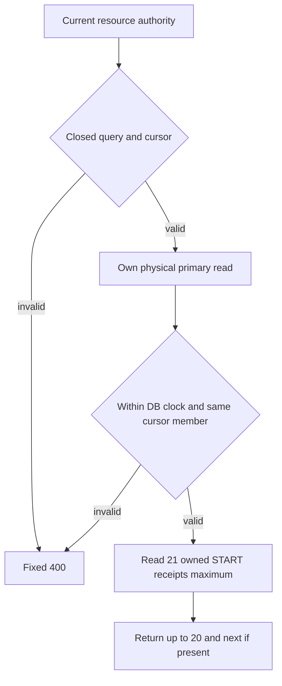
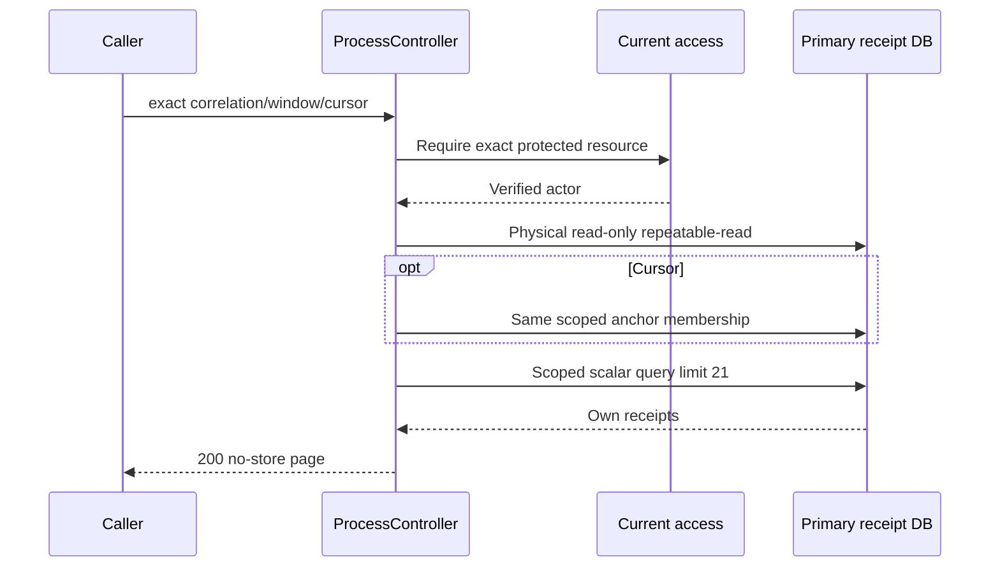

# T4-02 Process owner 精确关联查询

| Field | Value |
| --- | --- |
| Document | 2026-11-05-20-36-owned-process-correlation-lookup.md |
| Template Version | 9 |
| Archetype Cleanup | Not applicable |
| Status | Review |
| Type | Feature |
| Complexity | Complex |
| Complexity Drivers | C/PS 公开查询、当前 USER/SERVICE 权限与 owner、主库窗口及不可信 cursor |
| Created | 2026-11-05 20:36 Asia/Shanghai |
| Updated | 2026-11-05 20:36 Asia/Shanghai |
| Owner | Tianji Process |
| Repository | tianji-service |
| Scope | C DTO 与 PS exact owner 有界公开 GET 和权限制品 |
| Change Surface | 现有 ProcessController/security、同库 START receipt 查询和 OpenAPI |
| Affected Chapters | §7, §8, §9, §10, §13, §14, §15, §16 |
| Source Requirement | Master §13.3、§17.2 S12、§19 T4-02 持久 correlation 查询 |
| Baseline Revision | Service d5ccd8225da3c8f27adffdee04cb9d1d787ed7f2 |
| Amends | None |
| Supersedes | None |
| Depends On | [Master T4-02](../../../../docs/plans/agent-framework-upgrade-plan.md#t4-02--全链路观测token费用与运行sla) |
| Related Specs | None |
| Related Plans | None |

## 1. Summary

用一个精确 correlationId 和 UTC 半开窗口查当前 Process owner 的已应用 START 收据。GET 返回流程实例 ID、发布版本和提交时间。已有详情 GET 可在其独立授权下读取业务键和 native 状态。查询不依赖采样。

## 2. Background and Current State

| ID | Source authority | Existing boundary |
| --- | --- | --- |
| EVD-001 | PS ProcessCommandReceiptStore#startByInstance、readStartByInstance、V1/V3 migrations | START/APPLIED 绑定完整 owner，已存 correlation、resource_id、release_key、created_at |
| EVD-002 | PS ProcessExecutionService#get、ProcessController#instance | 已知实例 GET 返回 owner 的 native snapshot，缺 correlation 发现入口 |
| EVD-003 | V1 tianji_process_start_receipt_instance_idx、V3 主键 | tenant/resource 的 APPLIED START 唯一。resource_id 和 correlation_id C 排序。无 correlation/time 专用索引 |
| EVD-004 | TianjiProcessAccess#require、ProcessSecurityConfiguration、TianjiProcessPermissions | current issuer、tenant、type、subject 和资源权限 |
| EVD-005 | PS V5/V6 bridge、AR V7/V13/V15、AgentModelUsageDiagnostics#byCorrelation | bridge SERVICE 可不同于 PS START USER，私有 AS facts 不能扩大授权 |
| EVD-006 | Source84 private Link、PS ProcessControlNativeAccess#beginMigrationObservation | Link 仅诊断，现有 primary-first 物理只读先例 |

### 2.4 Evidence and current-chain map

| Entry/trigger | Current call chain | Data read/written | External dependency | Consumer | Evidence |
| --- | --- | --- | --- | --- | --- |
| Start | ProcessController → ProcessExecutionService → owner receipt then native | START/APPLIED correlation and ID | ProcessDB/Flowable | Current detail GET | EVD-001/002 |
| Existing detail | exact authority → exact receipt → native snapshot | one known owned instance | Access/ProcessDB | USER/SERVICE | EVD-002/004 |
| Linked Agent event | PS V5/V6 and AR V7 authority | immutable relation under separate owner | existing bridge | Future S12 | EVD-005/006 |

### 2.5 Archetype example cleanup

Cleanup disposition: Not applicable
Reason: 现有 C/PS 技术路径扩展，无新生成业务工程或 archetype 示例链。

## 3. Goals and Non-goals

从已知 correlationId 取得当前 owner 的有界收据定位。唯一新增公开操作是 GET。无直接 businessKey 检索、native/Agent/Tool/Model join、全租户查询、统计、SQL 迁移、权限定义或 SDK/Web 消费。真实权限注册、部署和 S12 独立。

### 3.3 Change Surface and Design Depth

| Area/layer | Disposition | Exact repository evidence | Exact delta or preserved invariant | Required Spec treatment | Chapters |
| --- | --- | --- | --- | --- | --- |
| C and PS REST/receipt query | Affected | EVD-001/002/004 | 新 owner GET、C、PaC/OAS 和有限测试 | full design | §7, §8, §9, §10, §13, §14, §15, §16 |
| ProcessDB layout | Context-only | EVD-001/003 | 现有表/索引，仅新 SELECT | access/trade-off | §11 |
| SDK/Web/Agent/trace | Unchanged | EVD-005/006 | 各自 owner，当前 Link 不变 | context | §12 |

## 4. Requirements and Acceptance Criteria

| ID | Requirement | Acceptance |
| --- | --- | --- |
| REQ-001 | 独立精确路径并复用既有 READ | 同 USER/SERVICE 和 OAuth scope、新 PaC 资源、四元 owner 和 no-store |
| REQ-002 | 只发现同 owner 的 START/APPLIED | 一张表、同库 primary physical read-only、半开 ≤31d、2s、20+1、稳定顺序 |
| REQ-003 | 有界分页 | opaque cursor、owner/window/order binding 加同域成员核验；非法/foreign/stale 同 400 |
| REQ-004 | 锁合同和范围 | 现有 POM/SQL/trace 维持，实际有限和 Boot OAS/PaC 证明，真实 I/S12 独立 |

### 4.1 Scenario matrix

| Scenario | Preconditions | Main or alternative path | Observable result | Requirements |
| --- | --- | --- | --- | --- |
| S-01 owned match | current READ and valid window | own START query | bounded 200 | REQ-001/002 |
| S-02 no own match or foreign-only | authorized valid lookup | owner filters all | same 200 empty | REQ-001/002 |
| S-03 >20 own matches | matching query and possibly valid member | sentinel and exclusive next page | 20 and next only if more | REQ-002/003 |
| S-04 bad/foreign/stale cursor | current authority | closed parse/binding/member | uniform 400 no echo | REQ-003 |
| S-05 denied or source fault | missing scope or primary timeout | old guard or controlled failure | no DB on denial, source 503 | REQ-001/004 |

### 4.2 Use-case analysis

| ID | Actor | Evidence |
| --- | --- | --- |
| ACTOR-001 | Current USER or SERVICE owner | Existing Process GET resource |
| ACTOR-002 | Release operator | Master T4-02 |

| ID | Use case/goal | Actor | Trigger | Outcome | Alternative | Postcondition |
| --- | --- | --- | --- | --- | --- | --- |
| UC-001 | Resolve exact correlation to owned Process IDs | ACTOR-001 | known correlation and window | bounded immutable receipt page | empty/invalid/unavailable | use existing detail independently |
| UC-002 | Verify source contract without deployment | ACTOR-002 | exact source GO | finite and static proof | I/E pending | independent runtime acceptance |

## 5. Constraints, Assumptions, and Decisions

DEC-001 independent /process-instance-correlations path, existing global API default false, no additional flag, new exact protected resource. DEC-002 one receipt table only. DEC-003 cursor is navigation evidence, not a permission or signature. DEC-004 no schema/index. Per-call logical limit and timeout are enforceable. Physical scan cost remains an I gate.

## 6. Project Technology Context

C remains JDK-only. PS reuses Spring JDBC/TransactionTemplate, verified Process access, PaC and Shoubing filters, OrchestrationChecks and ProcessRequestDigest. Existing Flyway stays operator-owned. No new dependency or POM.

### 6.2 User-mandated Java rule compliance

| Literal rule | Affected? | Repository evidence | Exact design decision | Files/types/interfaces | Validation/test evidence | Status/blocker |
| --- | --- | --- | --- | --- | --- | --- |
| Rule 1 | Yes | §6/7 existing C and PS | Exact Query/DTO names and existing adapters | Exact §8 inventory | §14 tests | PASS |
| Rule 2 | Yes | §6/7 existing C and PS | Validate trusted owner then closed parameters and typed Query | Exact §8 inventory | §14 tests | PASS |
| Rule 3 | Yes | §6/7 existing C and PS | Immutable value records only, no ordinary production PO | Exact §8 inventory | §14 tests | PASS |
| Rule 4 | Yes | §6/7 existing C and PS | Reuse current controller/security configuration without new injected business bean | Exact §8 inventory | §14 tests | PASS |
| Rule 5 | Yes | §6/7 existing C and PS | Existing JDK time/Base64 and current digest | Exact §8 inventory | §14 tests | PASS |
| Rule 6 | Yes | §6/7 existing C and PS | Current Spring Jackson and closed OAS fields | Exact §8 inventory | §14 tests | PASS |
| Rule 7 | No | §6/7 existing C and PS | Existing API flag and profile remain | Exact §8 inventory | §14 tests | N/A |
| Rule 9 | Yes | §6/7 existing C and PS | Reuse Query adapter, no new business pattern | Exact §8 inventory | §14 tests | PASS |
| Rule 10 | Yes | §6/7 existing C and PS | Strict UTC Instant and native OffsetDateTime JDBC | Exact §8 inventory | §14 tests | PASS |
| Rule 11 | Yes | §6/7 existing C and PS | Existing owner JDBC technical boundary, no DDL or CQE writer | Exact §8 inventory | §14 tests | PASS |

### 6.3 Time semantics and conversion contract

Time contract: Required

| Time ID | Fields/symbols | Semantics | Java/runtime type | Storage policy | Wire policy | Business zone source | Display zone source | Boundary / DST rules | Precision / Clock | Compatibility | Verification |
| --- | --- | --- | --- | --- | --- | --- | --- | --- | --- | --- | --- |
| TIME-001 | fromInclusive, toExclusive, cursor anchor | Occurred instant | Instant / OffsetDateTime for JDBC | Not persisted | UTC Z | Explicit ZoneOffset.UTC | Wire UTC Z | Half-open and <=31d, no offset/leap/24:00 | Micros, valid Gregorian year 0001–9999, upper bound database clock | Accept JS .000Z without loss | TEST-001 and TEST-002 |
| TIME-002 | observedAt, submittedAt | Occurred instant | Instant / OffsetDateTime for JDBC | UTC instant | UTC Z | Explicit UTC Instant | Wire UTC Z | Exact immutable receipt and same DB observation | Micros, PostgreSQL native timestamptz/clock_timestamp | No conversion through local wall-clock | TEST-002 and TEST-003 |

## 7. Architecture Design

### 7.0 Minimum-design baseline and element-necessity audit

| Proposed element | Change | Requirements | Direct alternative | Verdict |
| --- | --- | --- | --- | --- |
| Existing controller/access | Modify | REQ-001 | detail needs known ID | one sibling route |
| Two C records | Create | REQ-002/003 | existing instance DTO includes native state and lacks pagination | narrow response/query |
| Existing receipt and execution adapters | Modify | REQ-002/003 | existing receipt get by ID | owner filter and time-bounded read |
| New schema/aggregator | None | REQ-004 | existing owner receipt is sufficient | no new layer |

| Path | Network calls | Client states | Data changes | Consequence |
| --- | --- | --- | --- | --- |
| Existing known ID GET | one | existing | none | no discovery |
| Proposed query | one per page | exact inputs/cursor | none | return owned IDs |
| Cross owner | separate | independent auth | existing owner sources | future association proof |

### 7.1 System Architecture Design


Identity and resource policy remain owned by existing Process security. The execution service owns transaction, and the single receipt table owns data. No native or Agent link read.

### 7.2 High-Level Design

#### 7.2.2 High-level decision and quality matrix

| Concern/use case | Requirement | Mechanism | Failure | Verification |
| --- | --- | --- | --- | --- |
| Current authority | exact owner and protected resource | existing READ/scope and complete actor | no DB on denial | TEST-003/004 |
| Availability | bounded one page | 2s and LIMIT 21 | controlled 503 | TEST-002 |
| Continuation | deterministic same domain | V1 uniqueness/C and member cursor | uniform 400 | TEST-001/002 |
| Compatibility | no ID collision/new authority | sibling path and exact PaC delta | other routes preserved | TEST-004/005 |



### 7.3 Detailed Design

ProcessController#correlations calls access.require(CORRELATION_LIST_API) before validating the MultiValueMap. Admit required keys and one optional cursor once each. Build typed C query. ProcessExecutionService#listByCorrelation rejects null/LEGACY or ambient transaction, uses separate correlation read template with existing manager, primary first, REPEATABLE_READ, 2s, SET TRANSACTION READ ONLY and SET LOCAL statement_timeout. Verify same bound primary/read-only/UTF8 relation and SELECT ability, then database observedAt. Convert PostgreSQL timestamptz with native OffsetDateTime to Instant, no implicit JVM timezone.

Scope on existing qualified receipt table is tenant_id/subject_type/subject_issuer/subject_id, command_type='START', state='APPLIED', exact C correlation_id, created_at >= from and < to. Order DESC created_at then DESC resource_id COLLATE C. Use same collation in exclusive tuple keyset. V1 partial unique tenant/resource guarantees no tie. Up to 21 scalar rows. Up to 20 output, next from last exposed row only if 21st present. Inconsistent source returns controlled unavailable. No join, variables, native state, command ID or request hash projection.

Cursor v1. plus unpadded canonical Base64URL, total ≤1200, strict UTF-8. Three LF-separated fields are canonical anchor Instant, exact instance ID and 64-lower-hex digest. Bind ProcessRequestDigest over domain TIANJI_PROCESS_CORRELATION_CURSOR_V1, tenant/type/issuer/subject/correlation/normalized from/to/anchor time/instance ID. Validate anchor membership in same scoped table/snapshot before page read. Forged, foreign and stale share 400. Digest is navigation affinity without a signer. Each request has its own snapshot, so concurrent newly committed receipts may affect later pages.



#### 7.3.6 Conclusion evidence chain

| Conclusion | Evidence | Constraint | Decision | Test |
| --- | --- | --- | --- | --- |
| Local receipt only | EVD-001/003 | immutable source and exact owner | narrow lookup | TEST-002 |
| Bound cursor without authority expansion | EVD-003/004 | cursor is untrusted | digest plus exact member and SQL owner | TEST-001/002 |
| No cross-owner exposure | EVD-005/006 | linked SERVICE may differ | no joins/IDs from other owner | TEST-002/005 |

## 8. Package Structure and Code File Tree

| Operation | Exact path |
| --- | --- |
| Modify | `stellar-enclosure-tianji-contract/src/test/java/top/egon/cola/platform/tianji/contract/orchestration/OrchestrationContractTest.java` |
| Modify | `stellar-enclosure-tianji-process-server/src/test/java/top/egon/cola/platform/tianji/process/server/api/ProcessControllerTest.java` |
| Create | `stellar-enclosure-tianji-process-server/src/test/java/top/egon/cola/platform/tianji/process/server/execution/ProcessCorrelationLookupTest.java` |
| Modify | `stellar-enclosure-tianji-process-server/src/test/java/top/egon/cola/platform/tianji/process/server/ProcessPermissionIntegrationTest.java` |
| Create | `stellar-enclosure-tianji-contract/src/main/java/top/egon/cola/platform/tianji/contract/orchestration/ListProcessInstancesByCorrelationQuery.java` |
| Create | `stellar-enclosure-tianji-contract/src/main/java/top/egon/cola/platform/tianji/contract/orchestration/ProcessInstanceCorrelationPageDTO.java` |
| Modify | `stellar-enclosure-tianji-process-server/src/main/java/top/egon/cola/platform/tianji/process/server/execution/ProcessCommandReceiptStore.java` |
| Modify | `stellar-enclosure-tianji-process-server/src/main/java/top/egon/cola/platform/tianji/process/server/execution/ProcessExecutionService.java` |
| Modify | `stellar-enclosure-tianji-process-server/src/main/java/top/egon/cola/platform/tianji/process/server/security/TianjiProcessPermissions.java` |
| Modify | `stellar-enclosure-tianji-process-server/src/main/java/top/egon/cola/platform/tianji/process/server/ProcessSecurityConfiguration.java` |
| Modify | `stellar-enclosure-tianji-process-server/src/main/java/top/egon/cola/platform/tianji/process/server/api/ProcessController.java` |
| Create | `stellar-enclosure-tianji-process-server/src/main/resources/META-INF/tianji/openapi/process-instance-correlation-v1.json` |
| Create | `docs/egon/spec/2026-11-05-20-36-owned-process-correlation-lookup.md` |
| Create | `docs/egon/plan/2026-11-05-20-37-owned-process-correlation-lookup.md` |
| Create | `docs/egon/evidence/2026-11-05-owned-process-correlation-lookup.md` |

## 9. Interface Definitions

### 9.0 API protocol and documentation governance

| Concern | Decision/evidence |
| --- | --- |
| Protocol selection | Existing HTTP JSON, one REST collection |
| CQE application level | Simple Query over immutable receipts, no Command/Event |
| REST source of truth | C records, PS mapping and packaged contract-first 3.1 |
| GraphQL source of truth | Current PS REST boundary, no new GraphQL operation |
| Springdoc/OpenAPI compatibility | Static packaged OpenAPI, no runtime dependency |
| Legacy Swagger/Springfox status | Existing Process artifact requires no legacy generator |
| Security and documentation exposure | Static OAS only, protected runtime operation |
| Contract publication and drift gate | Finite source reflection/schema and actual Boot package/PaC |

### 9.1 Interface Inventory

| ID | Change/necessity verdict | Name/purpose | Kind | API style/CQE role | Consumer | Owner | Method + URL / GraphQL field / symbol / topic | Operation ID/schema source | Input | Output | Auth/tenant | Error model | Idempotency/version | Requirements |
| --- | --- | --- | --- | --- | --- | --- | --- | --- | --- | --- | --- | --- | --- | --- |
| API-001 | Add bounded owner discovery | Find owned Process START receipts | HTTP | REST Query | Current approved owner | PS | GET /api/tianji/v1/process-instance-correlations | listOwnedProcessStartsByCorrelation from C and OAS | exact correlation UTC window cursor | receipt page | new key with current READ/scope | existing Process envelope | read-only, v1 cursor | REQ-001/002/003/004 |

### 9.2 Per-interface Detailed Contracts

#### API-001 — List Process START receipts by exact correlation

##### Necessity and interaction-cost decision

| Concern | Decision |
| --- | --- |
| Change classification | Add an external REST read to existing Process API |
| Independent consumer goal | Resolve exact correlation to currently owned instance IDs |
| Parameter ownership and derivation | Query is untrusted; actor derives only from current auth |
| Direct/no-new-interface alternative | Existing detail requires ID; telemetry cannot grant access |
| Caller use of result | See immutable receipt IDs and independently request existing detail |
| Round trips and failure points | One GET per page and optional same-table anchor check |
| Verdict | Smallest useful receipt discovery without new data owner |

##### API style and CQE semantics

| Concern | Decision/evidence |
| --- | --- |
| Protocol style | REST Query consistent with current Process HTTP |
| CQE role | Simple Query with one source of truth |
| Resource/task semantics | Current owner matching applied START receipt locations |
| Read/write and side effects | existing receipt SELECT only |
| Consistency and idempotency | read-only snapshot per response |
| Why this style | exact public route, same authority and bounded purpose |

##### Identity and purpose

| Concern | Definition |
| --- | --- |
| Route | GET /api/tianji/v1/process-instance-correlations |
| Resource | tianji.api.process.instance.correlations with label api.process.correlations |
| Operation | listOwnedProcessStartsByCorrelation |
| Authorization | USER or SERVICE, TIANJI_PROCESS_READ, tianji:process:read and exact current owner |
| Cache | no-store success and existing controlled errors |
| HEAD | implicit same protected path, body suppressed |

##### Request parameters

| Name | Location | Type and validation |
| --- | --- | --- |
| correlationId | required query | ASCII [A-Za-z0-9][A-Za-z0-9_.:-]{0,127}, exact |
| fromInclusive | required query | strict UTC yyyy-MM-ddTHH:mm:ss[.1..6]Z, Gregorian year 0001–9999 |
| toExclusive | required query | same, after from and ≤31 days, at or before DB observedAt |
| cursor | optional query | v1. plus canonical unpadded Base64URL, ≤1200, exact member |
| X-Egon-Tianji-Tenant | existing optional header | asserted tenant consistency only |
| Authentication | existing header | protected PS identity, resource and scope |

Reject repeat/unknown keys, offsets, malformed dates, leap seconds and 24:00. Accept JS .000Z. No body, owner selector, page size, wildcards or custom order.

##### Success response

HTTP 200 application/json and Cache-Control no-store. Exact closed fields. Empty is items=[] and nextCursor=null. A cursor is present only on a complete 20-row visible page with sentinel.

```jsonc
{
  "correlationId": "expense-1", // Exact query identity
  "observedAt": "2026-11-05T10:20:30Z", // Owner DB observation
  "items": [ // Visible owned START receipt locations
    {
      "instanceId": "process-1", // Existing detail identifier
      "releaseVersion": "v1", // Immutable release
      "submittedAt": "2026-11-05T10:20:00Z" // START receipt time
    }
  ],
  "nextCursor": null // No continuation
}
```

##### Error responses

400 TIANJI_INVALID_COMMAND for bad input, window or cursor including foreign/stale. Existing 401, 403, 409 TIANJI_TENANT_CONTEXT_CHANGED, 503 TIANJI_DEPENDENCY_UNAVAILABLE and unexpected 500. Valid missing own or foreign-only yields 200 empty. Error uses existing controller/filter contract without raw query echo.

```jsonc
{
  "code": "TIANJI_INVALID_COMMAND", // Fixed error code
  "correlationId": null // No request identifier echo
}
```

Current pre-controller auth can omit the optional null field. No new normalization filter.

##### Interface logic for frontend and consumers

1. Obtain existing PS identity and the exact new resource decision.
2. Supply one exact correlation and a bounded UTC half-open window.
3. Encode parameters once and provide no body or owner selector.
4. Check 200 bounded result and exact correlation affinity.
5. Carry cursor only for the same caller and normalized query.
6. Treat own empty and typed errors distinctly.
7. Use returned IDs via the existing independently authorized detail GET and clear cursor on context change.

##### Documentation contract

| Concern | Decision/evidence |
| --- | --- |
| Documentation authority | Contract-first PS OpenAPI 3.1 and exact C fields |
| REST OpenAPI operation / GraphQL SDL operation | operationId listOwnedProcessStartsByCorrelation for exact GET |
| Annotation/mapping ownership | ProcessController and existing PaC annotations |
| Generated schema elements | Generated OAS effect static checked query bounds, closed success and OAuth |
| Compatibility and drift proof | actual Boot OAS plus PaC GET/HEAD and finite MockMvc |

##### Compatibility and verification

New sibling path does not reserve an ID in the original route. Existing C, detail and clients remain unchanged. Verify actual Boot archive OAS and PaC resource delta, and defer grant activation and SDK/Web to independent work.

### 9.3 OpenAPI 3 and springdoc annotation plan

| Target | Required annotation/configuration | Exact values/source | Generated OAS effect | Verification |
| --- | --- | --- | --- | --- |
| PS operation | Contract-first packaged OAS 3.1 and @GetMapping plus permission annotations | API-001 exact path and operationId | one GET, four query inputs, closed schema/errors and scope | TEST-003/005 |
| Docs runtime | Existing PS has no springdoc docs route | static package artifact only | no new runtime surface | Boot proof |

### 9.4 API contract generation and blocking gate

| Gate ID | Applicability | Status | Evidence | Finding | Required action/exception |
| --- | --- | --- | --- | --- | --- |
| API-GATE-001 | Applicable | PASS | §9/14 | Exact owner discovery necessity | None |
| API-GATE-002 | Applicable | PASS | §9/14 | REST Query and no event | None |
| API-GATE-003 | Applicable | PASS | §9/14 | Complete method/query/success/error contract | None |
| API-GATE-004 | Not applicable | N/A | §9/14 | GraphQL absent | None |
| API-GATE-005 | Applicable | PASS | §9/14 | Closed bounded C DTO | None |
| API-GATE-006 | Applicable | PASS | §9/14 | Current four-part authority and exact path | None |
| API-GATE-007 | Applicable | PASS | §9/14 | Static contract-first 3.1 | None |
| API-GATE-008 | Applicable | PASS | §9/14 | Actual producer drift and manifest checks | None |
| API-GATE-009 | Applicable | PASS | §9/14 | Traceability complete and current SQL scope | None |

## 10. POJO and Data Model Design

ListProcessInstancesByCorrelationQuery(correlationId, fromInclusive, toExclusive, cursor) uses strict parseUtc and exact C validation. ProcessInstanceCorrelationPageDTO(correlationId, observedAt, items, nextCursor) holds nested immutable ReceiptDTO(instanceId, releaseVersion, submittedAt). C enforces at most 20 unique rows with no future submittedAt and validates nullable cursor. PS validates time/C ID ordering against every row including the sentinel. Existing instance/release syntax. No persisted model or public actor.

## 11. Database Design

Context-only V1/V3 receipt table and exact owner prefix. V1 partial unique index supports anchor. No new schema. Correlation/time may scan/sort owner's existing range. The two-second timeout protects individual read; physical PG query plan/volume and performance remain independent.

## 12. Frontend Page Design

No Web/SDK source in this step. Existing detail stays independently authorized.

## 13. Design Patterns and Architecture Principles

Extend the existing query and receipt adapters directly. Reuse length-safe digest and standard JDK time/Base64. No new search service, cursor signer, native or aggregation layer.

## 14. Test Design

| Test | Scope |
| --- | --- |
| TEST-001 | C UTC/leap/year/precision/window, exact immutable DTO and bounded cursor |
| TEST-002 | finite scoped JDBC, primary-only repeatable read, keyset, cap, empty, invalid anchor and timeout |
| TEST-003 | exact MockMvc path/param/authority/no-store/error and original detail behavior |
| TEST-004 | current permission chain, USER/SERVICE scope, new exact route and no broader match |
| TEST-005 | actual PS exec OpenAPI and PaC exact delta, SQL/trace/POM unchanged |

## 15. Non-functional and Cross-cutting Design

Two-second bound and output cap. No new telemetry dimensions/logs, native/remote call, secret or owner echo. UTC wire preserves microseconds.

## 16. Compatibility, Migration, Rollout, and Rollback

Existing global Process API defaults false. The resource remains subject to independent current catalog and grant. No activation, schema, POM or config changes. Source one backend commit. Actual PG/I and SDK/Web separate.

## 17. Alternatives and Decisions

Nested by-correlation literal could reserve a formerly legal instance ID. Native/dispatch joins require extra authority and work. Receipt is sufficient for the first discoverability gap and maintains one data owner.

## 18. Risks and Open Questions

Existing I plans and realistic cardinality remain unverified. No linked-Agent disclosure, direct business-key lookup or full S12. Future relation proof requires independently authorized precise owner/association, not string equality.

## 19. Traceability Matrix

| Requirement | Use case | Test |
| --- | --- | --- |
| REQ-001 | UC-001 | TEST-003/004 |
| REQ-002 | UC-001 | TEST-001/002 |
| REQ-003 | UC-001 | TEST-001/002 |
| REQ-004 | UC-002 | TEST-004/005 |

## 20. Review and Acceptance

### 20.5 Blocking Manual Check

| Check ID | Applicability | Status | Evidence | Finding | Required action/exception |
| --- | --- | --- | --- | --- | --- |
| MC-ARCH-001 | Applicable | PASS | §7/8/14 | Existing C/PS boundary | None |
| MC-REUSE-001 | Applicable | PASS | §7/8/14 | Existing permission/JDBC/receipt adapters | None |
| MC-DEP-001 | Applicable | PASS | §7/8/14 | No dependency change | None |
| MC-NAME-001 | Applicable | PASS | §7/8/14 | Exact Query/DTO/adapter symbols | None |
| MC-VALID-001 | Applicable | PASS | §7/8/14 | Current authority, query, exact cursor | None |
| MC-MODEL-001 | Applicable | PASS | §7/8/14 | Immutable C value DTOs | None |
| MC-CONVERT-001 | Not applicable | N/A | §7/8/14 | No mapping layer or PO | None |
| MC-LOG-001 | Not applicable | N/A | §7/8/14 | No new log/diagnostic echo | None |
| MC-BEAN-001 | Applicable | PASS | §7/8/14 | Existing named beans and injection | None |
| MC-UTIL-001 | Applicable | PASS | §7/8/14 | Existing JDK and length-safe digest | None |
| MC-JSON-001 | Applicable | PASS | §7/8/14 | Closed wire/OAS and exact errors | None |
| MC-TIME-001 | Applicable | PASS | §7/8/14 | UTC microsecond/DB clock | None |
| MC-CONFIG-001 | Not applicable | N/A | §7/8/14 | No config or profile changes | None |
| MC-PATTERN-001 | Applicable | PASS | §7/8/14 | Existing owner query adapter | None |
| MC-SCOPE-001 | Applicable | PASS | §7/8/14 | One exact route, zero schema/trace scope | None |
| MC-TEST-001 | Applicable | PASS | §7/8/14 | Finite plus actual package and separate I | None |
| MC-BLOCKER-001 | Applicable | PASS | §7/8/14 | Source review, runtime separate | None |

**PASS — Ready for user review**
