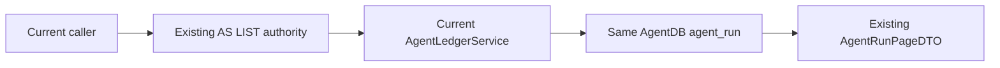
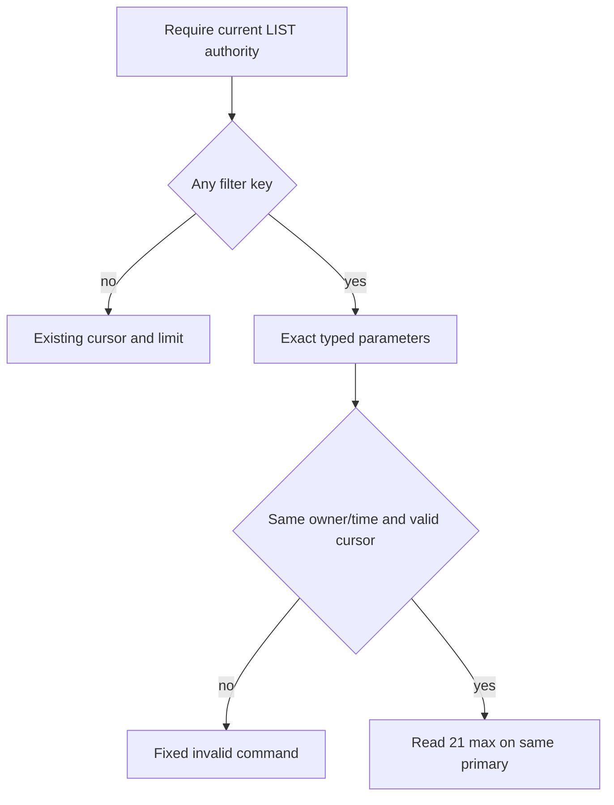

# T4-02 当前 Agent owner 的精确关联筛选

| Field | Value |
| --- | --- |
| Document | 2026-11-05-21-52-owned-agent-correlation-filter.md |
| Template Version | 9 |
| Archetype Cleanup | Not applicable |
| Status | Review |
| Type | Feature |
| Complexity | Complex |
| Complexity Drivers | C、AR、AS 的既有公开列表兼容、当前 owner 和不可信有界 cursor |
| Created | 2026-11-05 21:52 Asia/Shanghai |
| Updated | 2026-11-05 21:52 Asia/Shanghai |
| Owner | Tianji Agent |
| Repository | tianji-service |
| Scope | 既有 Agent LIST 的一个 opt-in 同 owner correlation/window 分支 |
| Change Surface | C typed query、AR agent_run scoped SELECT、AS existing controller 和 static OAS |
| Affected Chapters | §7, §8, §9, §10, §13, §14, §15, §16 |
| Source Requirement | Master §13.3、§17.2 S12 与 §19 T4-02 同 owner 持久关联发现 |
| Baseline Revision | Read-only observed Service af504a47f5251bfd96528bab7568983ca3a02516; source GO re-lock after independent snapshot commit |
| Amends | None |
| Supersedes | None |
| Depends On | [Master T4-02](../../../../docs/plans/agent-framework-upgrade-plan.md#t4-02--全链路观测token费用与运行sla) |
| Related Specs | [PS owned correlation](2026-11-05-20-36-owned-process-correlation-lookup.md) |
| Related Plans | None |

## 1. Summary

当前 LIST 权限可在原 GET 上增加一次精确 correlation 和 UTC 半开窗口读取。筛选只查同一 Agent owner 的 agent_run 行，返回现有 AgentRunPageDTO 和独立绑定 cursor。既有未筛选 GET、权限、结果字段和老游标原样。未来控制台可另行发起现有 Agent READ 的「同关联标识」查询，不能据字符串一致认定 Process 与 Agent 是同一执行链。

## 2. Background and Current State

| ID | Exact authority | Current implication |
| --- | --- | --- |
| EVD-001 | AgentRunController#list、TianjiAgentAccess#require、TianjiAgentPermissions.LIST_API | 既有 GET、USER/SERVICE、TIANJI_AGENT_READ 和 tianji:agent:read，无新权限能力 |
| EVD-002 | AgentLedgerService#list、JdbcAgentLedgerRepository#list、V1 agent_run 和 V5 issuer owner created index | 已按 tenant/type/issuer/subject 读，持久 correlation_id 无外部筛选，RUN_COLUMNS 已是公开运行摘要 |
| EVD-003 | AgentEventDTO.correlationId、StartAgentRunCommand 和 ledger start | 既有 READ owner 已可在 owned event 中看到键，新增精确可发现性，不新增返回字段 |
| EVD-004 | AgentModelUsageDiagnostics#byCorrelation、AgentLedgerService#listModelUsageByCorrelation | 私有 V15 可选投影，包含用量路径，不能替代此非用量读取 |
| EVD-005 | PS V5/V6、AR V7 LinkedAgentDispatch、Web ExecutionTimelinePage、现有 /runs/:runId | PS START USER 与 linked SERVICE owner 可不同。Web 后续只可并列显示独立 AS 当前身份结果 |
| EVD-006 | AR AgentLedgerService#inspectRecovery / JdbcAgentLedgerRepository#beginRecoveryObservation | 已有主库先路由、事务内物理只读和两秒边界 |

### 2.4 Evidence and current-chain map

| Entry/trigger | Current chain | Data read/written | Dependency | Consumer | Evidence |
| --- | --- | --- | --- | --- | --- |
| Existing list | AS verified LIST → AR get current owner | Existing run projection | current AgentDB | Web /runs | EVD-001/002 |
| Existing events | AS owned run event read | correlationId persisted per run/event | same owner | SSE/SDK | EVD-003 |
| Separate bridge | PS exact dispatch/Inbox and AS linked SERVICE | immutable relation, distinct owners | bridge permissions | Future accepted investigation | EVD-004/005 |

### 2.5 Archetype example cleanup

Cleanup disposition: Not applicable
Reason: 修改已有 C/AR/AS 技术入口，无生成工程或示例替换。

## 3. Goals and Non-goals

按一项 exact correlation 找到当前 Agent owner 运行。只改既有 LIST 的可选筛选分支，无新路由、PaC、grant、表、索引、OpenTelemetry、V15 readiness、trace carrier 或 runtime。业务键、异 owner 关联、资金输出、Web 和完整 S12 独立。

### 3.3 Change Surface and Design Depth

| Area/layer | Disposition | Exact repository evidence | Exact delta or preserved invariant | Required Spec treatment | Chapters |
| --- | --- | --- | --- | --- | --- |
| C/AR/AS LIST filter | Affected | EVD-001/002/003 | exact optional HTTP query and same projection | complete design | §7, §8, §9, §10, §13, §14, §15, §16 |
| Current AgentDB layout | Context-only | V1/V5, EVD-002 | existing scoped query only | exact index/scan boundary | §11 |
| PS/CL/Web, V15 and traces | Unchanged | EVD-004/005 | owner and artifacts stay | separate | §12 |

## 4. Requirements and Acceptance Criteria

| ID | Requirement | Acceptance |
| --- | --- | --- |
| REQ-001 | 原 LIST 兼容与现有权限 | 原资源、route、scope、actor、默认 limit/legacy cursor 和公开摘要不变 |
| REQ-002 | 当前 owner exact filter | 三个条件、UTC 半开 ≤31d、same-primary 2s、agent_run only、20+1、no V15 |
| REQ-003 | Bound cursor | strict v1 ≤256、owner+window digest、same-scope anchor，坏/foreign/stale 同 400 |
| REQ-004 | 实际源码与制品 | exact finite、actual packaged OAS、zero declarative PaC and SQL diff，真实 I/CLI/Web/S12 separate |

### 4.1 Scenario matrix

| Scenario | Preconditions | Main or alternative path | Outcome | Requirement |
| --- | --- | --- | --- | --- |
| S-01 legacy | no new filter key | original cursor/limit code | same behavior | REQ-001 |
| S-02 valid filter | exact current owner and window | own START run rows only | 200 bounded existing DTO | REQ-001/002 |
| S-03 foreign/no own matches | authorized query | owner predicate removes others | same 200 empty | REQ-002 |
| S-04 invalid or stale cursor | current authority | reject shape/scope/member | same 400 | REQ-003 |
| S-05 denied/source unavailable | current policy or primary failure | existing guard/typed fixed error | 401/403/503 | REQ-001/004 |

### 4.2 Use-case analysis

| ID | Actor | Evidence |
| --- | --- | --- |
| ACTOR-001 | Current Agent USER/SERVICE owner | Existing LIST resource |
| ACTOR-002 | Release operator | Master T4-02 |

| ID | Use case/goal | Actor | Trigger | Outcome | Alternative | Postcondition |
| --- | --- | --- | --- | --- | --- |
| UC-001 | Discover own Agent runs by known correlation | ACTOR-001 | three exact filter fields | same-owner result with next | legacy/empty/error | no cross-owner evidence |
| UC-002 | Prove source compatibility before activation | ACTOR-002 | exact approved source | finite and artifact proof | I/runtime independent | no grants |

## 5. Constraints, Assumptions, and Decisions

DEC-001 reuse current LIST API/permission and response, no new grants. When none of the three new filter keys occurs, use old binders and old semantics, including existing tolerance for unrelated unknown keys. If any new filter key occurs, require exactly all three and optionally cursor, once each, no supplied limit. DEC-002 use existing non-usage agent_run. DEC-003 cursor is navigation evidence, not signer or privilege. DEC-004 future Web explicitly checks existing Agent READ and shows only an independent same-correlation list.

## 6. Project Technology Context

C remains JDK-only and immutable query. Existing AS Spring MVC/PaC and AR own JDBC/TransactionTemplate and DB clock. Use existing read authority, JDK Base64 and AgentJsonCodec resultHash. No POM or config.

### 6.2 User-mandated Java rule compliance

| Literal rule | Affected? | Repository evidence | Exact design decision | Files/types/interfaces | Validation/test evidence | Status/blocker |
| --- | --- | --- | --- | --- | --- | --- |
| Rule 1 | Yes | §6/7 current C and AS/AR | Exact Query and existing DTO/adapter names | §8 inventory | §14 | PASS |
| Rule 2 | Yes | §6/7 current C and AS/AR | Exact parameters, verified actor and bounded cursor | §8 inventory | §14 | PASS |
| Rule 3 | Yes | §6/7 current C and AS/AR | Immutable value Query, existing page DTO | §8 inventory | §14 | PASS |
| Rule 4 | Yes | §6/7 current C and AS/AR | Existing named Spring owner boundary | §8 inventory | §14 | PASS |
| Rule 5 | Yes | §6/7 current C and AS/AR | Existing JDK and AgentJsonCodec hash | §8 inventory | §14 | PASS |
| Rule 6 | Yes | §6/7 current C and AS/AR | Existing Jackson and static OAS | §8 inventory | §14 | PASS |
| Rule 7 | No | §6/7 current C and AS/AR | No profile/config change | §8 inventory | §14 | N/A |
| Rule 9 | Yes | §6/7 current C and AS/AR | Direct existing query adapter | §8 inventory | §14 | PASS |
| Rule 10 | Yes | §6/7 current C and AS/AR | UTC Instant and native OffsetDateTime | §8 inventory | §14 | PASS |
| Rule 11 | Yes | §6/7 current C and AS/AR | Existing owner JDBC technical boundary and no DDL | §8 inventory | §14 | PASS |

### 6.3 Time semantics and conversion contract

Time contract: Required

| Time ID | Fields/symbols | Semantics | Java/runtime type | Storage policy | Wire policy | Business zone source | Display zone source | Boundary / DST rules | Precision / Clock | Compatibility | Verification |
| --- | --- | --- | --- | --- | --- | --- | --- | --- | --- | --- | --- |
| TIME-001 | fromInclusive, toExclusive and createdAt cursor | Occurred instant | Instant and JDBC OffsetDateTime | Not persisted | UTC Z | Explicit UTC | UTC wire | Gregorian and half-open ≤31d | Micros, DB upper bound | Supports JS .000Z and exact historical years | TEST-001 and TEST-002 |
| TIME-002 | Existing Agent run createdAt and database observation | Occurred instant | Instant and JDBC OffsetDateTime | UTC instant | UTC Z | Explicit UTC | UTC wire | One exact current primary snapshot | micros and DB clock | Same existing public summary | TEST-002 and TEST-003 |

## 7. Architecture Design

### 7.0 Minimum-design baseline and element-necessity audit

| Proposed element | Change | Requirements | Existing baseline | Verdict |
| --- | --- | --- | --- | --- |
| Existing LIST | Modify | REQ-001 | Same authority/output, no filters | opt-in branch |
| ListAgentRunsByCorrelationQuery | Create | REQ-002/003 | old query lacks exact UTC fields | immutable typed filter |
| Existing ledger/repository | Modify | REQ-002/003 | owns non-usage agent_run | same read owner |
| New endpoint/aggregator/grant | None | REQ-004 | existing resource sufficient | keep |

| Path | Network calls | Client states | Data change | Consequence |
| --- | --- | --- | --- | --- |
| Legacy | same 1 GET | old cursor | none | unchanged |
| Filter | same 1 GET | exact parameters and cursor | none | discover owned run |
| Cross owner | separate | independent source grants | none here | no inferred join |

### 7.1 System Architecture Design



AS obtains verified actor. AR owns filtering and physical read. AgentDB alone owns response. No PS or V15 access.

### 7.2 High-Level Design

#### 7.2.2 High-level decision and quality matrix

| Concern/use case | Requirement | Mechanism | Failure | Verification |
| --- | --- | --- | --- | --- |
| Current owner | no new grant | current LIST and full actor predicate | no foreign rows | TEST-002/003 |
| Compatibility | old behavior | only new fields select branch | same unfiltered semantics | TEST-003/004 |
| Bound time | two-second and 20+1 | same primary and immutable page | controlled 503 | TEST-002 |
| Continuation | same query and owner | strict v1 plus scoped member | uniform 400 | TEST-001/002 |



### 7.3 Detailed Design

AgentRunController#list preserves existing cursor/int limit binders, also captures raw MultiValueMap. Call access.require(LIST_API) before filter inspection. Only correlationId/fromInclusive/toExclusive select new branch. Require these exact three keys once, optionally cursor once. Supplying limit to filtered branch is invalid. Unfiltered uses original ListAgentRunsQuery untouched.

AR AgentLedgerService#listByCorrelation validates verified non-LEGACY owner, disallows ambient transaction and uses existing manager with primary routing, RR and 2s. Shared JdbcAgentLedgerRepository#beginPrimaryReadObservation establishes physical read-only and local timeout before facts. Preserve existing recovery wrapper/error behavior. Use DB clock; future upper bound rejected. Use agent_run only with full actor, exact correlation_id COLLATE C, created_at ≥ from and < to. Order DESC created_at/run_id COLLATE C, exclusive keyset, 21 rows maximum. Reuse RUN_COLUMNS with internal correlation recheck. Verify each row and sentinel exact scope, uniqueness and descending keys. Return at most 20. No lease, V15, command, input, snapshot or result body selected.

Cursor is v1. plus canonical unpadded Base64URL, ≤256 characters, payload bindingSha256|createdAt.toString()|runId. Use strict UTF-8 decode and navigable ASCII run ID length 1–64. Actor identity fingerprint, exact correlation and canonical normalized UTC from/to are serialized with domain TIANJI_AGENT_RUN_CORRELATION_CURSOR_V1: and existing json.resultHash. Check valid canonical anchor timestamp, allowed navigable run ID and exact same scoped anchor member in same table/transaction before list. Return uniform 400 for stale/foreign/malformed. Digest is not a signer. Each page owns its own read snapshot.

```mermaid
sequenceDiagram
  participant U as Caller
  participant A as AS LIST
  participant R as AR owner
  participant D as AgentDB
  U->>A: GET with three exact filter fields
  A->>A: Current resource/actor then validate input
  A->>R: Same actor and typed query
  R->>D: Read-only primary; optional exact member
  R->>D: Narrow SELECT limit 21
  D-->>R: Own run rows
  R-->>U: Existing no-store DTO
```

#### 7.3.6 Conclusion evidence chain

| Conclusion | Evidence | Constraint | Decision | Proof |
| --- | --- | --- | --- | --- |
| Existing authority sufficient | EVD-001/003 | already reads owned runs/events | optional LIST filter with same fields | TEST-003/004 |
| AgentDB-only | EVD-002/004/006 | independent of usage flag/trace | same owner primary SELECT | TEST-002 |
| Cross-owner claims excluded | EVD-005 | bridge SERVICE identity may differ | independent owned result only | TEST-002/005 |

## 8. Package Structure and Code File Tree

| Operation | Exact path |
| --- | --- |
| Modify | `stellar-enclosure-tianji-contract/src/test/java/top/egon/cola/platform/tianji/contract/agent/AgentContractTest.java` |
| Create | `stellar-enclosure-tianji-agent-runtime/src/test/java/top/egon/cola/platform/tianji/agent/infrastructure/persistence/AgentRunCorrelationLookupTest.java` |
| Modify | `stellar-enclosure-tianji-agent-server/src/test/java/top/egon/cola/platform/tianji/agent/server/api/AgentRunHttpTest.java` |
| Create | `stellar-enclosure-tianji-contract/src/main/java/top/egon/cola/platform/tianji/contract/agent/ListAgentRunsByCorrelationQuery.java` |
| Modify | `stellar-enclosure-tianji-agent-runtime/src/main/java/top/egon/cola/platform/tianji/agent/infrastructure/persistence/JdbcAgentLedgerRepository.java` |
| Modify | `stellar-enclosure-tianji-agent-runtime/src/main/java/top/egon/cola/platform/tianji/agent/infrastructure/persistence/AgentLedgerService.java` |
| Modify | `stellar-enclosure-tianji-agent-server/src/main/java/top/egon/cola/platform/tianji/agent/server/api/AgentRunController.java` |
| Create | `stellar-enclosure-tianji-agent-server/src/main/resources/META-INF/tianji/openapi/agent-run-correlation-v1.json` |
| Create | `docs/egon/spec/2026-11-05-21-52-owned-agent-correlation-filter.md` |
| Create | `docs/egon/plan/2026-11-05-21-53-owned-agent-correlation-filter.md` |
| Create | `docs/egon/evidence/2026-11-05-owned-agent-correlation-filter.md` |

## 9. Interface Definitions

### 9.0 API protocol and documentation governance

| Concern | Decision/evidence |
| --- | --- |
| Protocol selection | Existing REST JSON LIST |
| CQE application level | Simple Query, no write/Event |
| REST source of truth | Existing mapping, typed C query and packaged AS contract-first OAS |
| GraphQL source of truth | Existing AS uses REST here, no GraphQL |
| Springdoc/OpenAPI compatibility | Existing static pattern, no runtime dependency |
| Legacy Swagger/Springfox status | No legacy generator involved |
| Security and documentation exposure | Existing resource and OAuth protected; static OAS only |
| Contract publication and drift gate | Actual AS Boot bytes and exact zero PaC delta |

### 9.1 Interface Inventory

| ID | Change/necessity verdict | Name/purpose | Kind | API style/CQE role | Consumer | Owner | Method + URL / GraphQL field / symbol / topic | Operation ID/schema source | Input | Output | Auth/tenant | Error model | Idempotency/version | Requirements |
| --- | --- | --- | --- | --- | --- | --- | --- | --- | --- | --- | --- | --- | --- | --- |
| API-001 | Extend existing read | Exact owner Agent run filter | HTTP | REST Query | Current owner and future timeline | AS | GET /api/tianji/v1/agent-runs | listOwnedAgentRuns from C and AS OAS | optional filter window | existing AgentRunPageDTO | current LIST and scopes | existing error envelope | same legacy or v1 filter cursor | REQ-001/002/003/004 |

### 9.2 Per-interface Detailed Contracts

#### API-001 — Existing Agent LIST with optional exact correlation

##### Necessity and interaction-cost decision

| Concern | Decision |
| --- | --- |
| Change classification | Add optional filters to existing external GET |
| Independent consumer goal | Discover owned Agent runs by known correlation and UTC window |
| Parameter ownership and derivation | Filter input untrusted; identity derived by existing resource |
| Direct/no-new-interface alternative | Existing list alone scans pages and does not filter exact correlation |
| Caller use of result | Same run summaries and existing detail lookup |
| Round trips and failure points | one GET per page, optional scoped anchor lookup |
| Verdict | Extend same authority and result shape |

##### API style and CQE semantics

| Concern | Decision/evidence |
| --- | --- |
| Protocol style | REST Query |
| CQE role | Read model over existing rows |
| Resource/task semantics | Existing current owner's Agent run collection |
| Read/write and side effects | SELECT only, no business effects |
| Consistency and idempotency | Same owner and one primary snapshot per filtered page |
| Why this style | Existing route and transport already establish exact owner |

##### Identity and purpose

| Concern | Definition |
| --- | --- |
| Route | GET /api/tianji/v1/agent-runs |
| Resource | tianji.api.agent.list |
| Operation | listOwnedAgentRuns |
| Authority | USER/SERVICE, existing TIANJI_AGENT_READ and tianji:agent:read, four-part owner |
| Cache | existing no-store |
| HEAD | existing implicit mapping, no new declaration |

##### Request parameters

| Name | Location | Rule |
| --- | --- | --- |
| correlationId | filter query | exact safe C Agent text, ≤128 UTF-16, no trim/control/lone surrogate |
| fromInclusive | filter query | Gregorian 0001–9999 UTC Z, optional 1–6 fractions, included |
| toExclusive | filter query | same syntax, excluded, after lower ≤31 days and not beyond DB observation |
| cursor | optional query | old legacy format when unfiltered; strict v1 and ≤256 when filtered |
| limit | legacy optional query | existing default 20, 1–100; explicit limit invalid on filtered branch |
| Authorization and tenant assertion | existing transport | exact current actor, never a selector |

Presence of any filter key requires all three, one value each, and only optional cursor. Preserve legacy binder behavior. No body.

##### Success response

Existing AgentRunPageDTO 200 no-store. Filtered rows max20, cursor only on a full visible page with sentinel. Empty own/foreign-only both items=[] and nextCursor=null. Public response does not echo correlation or source relation.

```jsonc
{
  "items": [ // Existing owned Agent run summaries
    {
      "runId": "d506ddcb-be70-4c17-90fd-64e93a5faaba", // Existing run detail ID
      "definitionKey": "expense", // Existing summary field
      "definitionVersion": 1, // Existing version
      "sessionId": null, // Existing nullable owner field
      "status": "QUEUED", // Existing lifecycle
      "waitReason": null, // Existing nullable field
      "cancelRequested": false, // Existing flag
      "attempt": 0, // Existing attempt
      "revision": 0, // Existing revision
      "lastEventSequence": 1, // Existing persisted event watermark
      "deadlineAt": "2026-11-05T10:30:00Z", // Existing deadline
      "createdAt": "2026-11-05T10:20:00Z", // Existing creation time
      "finishedAt": null // Existing terminal time
    }
  ],
  "nextCursor": null // Existing nullable continuation
}
```

##### Error responses

400 TIANJI_INVALID_COMMAND for incomplete/wrong bounds/invalid or foreign/stale cursor; current 401/403/409 tenant change, 503 source unavailable and unexpected 500 as established. No raw input or owner echo.

```jsonc
{
  "code": "TIANJI_INVALID_COMMAND", // Existing fixed code
  "message": "TIANJI_INVALID_COMMAND", // Existing sanitized fixed message
  "correlationId": null, // No request value returned
  "decisionId": null, // Existing optional authority reference
  "retryAfter": null // Existing optional Duration hint
}
```

Use actual AgentErrorDTO field names and current error writer. Existing pre-controller auth may be narrower. No response normalization change.

##### Interface logic for frontend and consumers

1. Use current verified Agent owner with existing LIST authority.
2. Send no filter for legacy list.
3. For filter send the three exact values and optional v1 cursor only.
4. Encode once and consume only existing Agent run summaries.
5. Use next cursor only with identical normalized filter and owner.
6. Treat 200 empty as current own empty and errors independently.
7. Follow existing independently protected run detail, with no claim of Process association.

##### Documentation contract

| Concern | Decision/evidence |
| --- | --- |
| Documentation authority | Contract-first static AS OpenAPI 3.1 |
| REST OpenAPI operation / GraphQL SDL operation | operationId listOwnedAgentRuns, original GET |
| Annotation/mapping ownership | existing AgentRunController/permission annotations |
| Generated schema elements | Generated OAS effect explicit legacy/filter query constraints and same output/response |
| Compatibility and drift proof | actual Boot OAS, zero declarative PaC and finite owner/legacy |

##### Compatibility and verification

Existing client signatures, unfiltered defaults, original cursor and result type remain supported. Actual packaged OAS and committed AS manifest prove the same resource and no extra grants. SDK/Web implement a deliberate new consumer after source package proof.

### 9.3 OpenAPI 3 and springdoc annotation plan

| Target | Required annotation/configuration | Exact values/source | Generated OAS effect | Verification |
| --- | --- | --- | --- | --- |
| Existing AS GET | Contract-first static 3.1 with existing @GetMapping and PaC | listOwnedAgentRuns and new optional trio | same path and scope, closed query/response | TEST-003/005 |
| Documentation runtime | no springdoc addition | existing Boot static artifact only | no new endpoint | actual package |

### 9.4 API contract generation and blocking gate

| Gate ID | Applicability | Status | Evidence | Finding | Required action/exception |
| --- | --- | --- | --- | --- | --- |
| API-GATE-001 | Applicable | PASS | §9/14 | Exact owner discovery necessity | None |
| API-GATE-002 | Applicable | PASS | §9/14 | REST query and no CQE write | None |
| API-GATE-003 | Applicable | PASS | §9/14 | Exact existing operation with optional contract | None |
| API-GATE-004 | Not applicable | N/A | §9/14 | No GraphQL operation | None |
| API-GATE-005 | Applicable | PASS | §9/14 | Closed typed output | None |
| API-GATE-006 | Applicable | PASS | §9/14 | Current authority and no extra grant | None |
| API-GATE-007 | Applicable | PASS | §9/14 | Static 3.1 contract-first | None |
| API-GATE-008 | Applicable | PASS | §9/14 | Actual producer drift gate | None |
| API-GATE-009 | Applicable | PASS | §9/14 | Scope traceability and immutable source | None |

## 10. POJO and Data Model Design

C ListAgentRunsByCorrelationQuery(correlationId, fromInclusive, toExclusive, cursor). Filter page size is the AR fixed constant 20. Public AgentRunPageDTO unchanged. Cursor is a bound navigation token, not a new authority. No domain write objects.

## 11. Database Design

Existing agent_run V1/V5. V5 full owner/time/run index and no migration. Exact C equality and sort can still require owner-window scanning. A physical PG plan and actual volume/latency remain I. Model usage schema irrelevant.

## 12. Frontend Page Design

No Web code in this backend step. After artifact proof, current ExecutionTimelinePage may offer a separate manual Agent query to identities that also already pass tianji.page.runs, and use existing /runs/:runId. Label as same-correlation own results and keep independently separate from PS receipts.

## 13. Design Patterns and Architecture Principles

Direct existing query adapter extension, reuse current authority, transaction and digest. No generic broker, token signer or cross-owner graph. Same wire output stays independent from optional usage.

## 14. Test Design

| Test | Scope |
| --- | --- |
| TEST-001 | C exact broad text/strict UTC and fixed window/cursor syntax |
| TEST-002 | finite primary/same-owner, 20+1, ordered keyset, no V15 and cursor scope/member |
| TEST-003 | actual MockMvc existing LIST resource, old arguments unchanged, strict optional branch, no ledger on denied/incomplete |
| TEST-004 | existing USER/SERVICE Agent permission and optional usage finite regression |
| TEST-005 | actual AS Boot OpenAPI byte/contract proof, identical declaration PaC, unchanged old SQL |

## 15. Non-functional and Cross-cutting Design

Two-second read bound, no log fields, no session/owner disclosure beyond existing run summary, no read of linked SERVICE under current USER. Exact UTC clock and cursor phase. No provider or new metric dimensions.

## 16. Compatibility, Migration, Rollout, and Rollback

One source commit. Existing API default-off and current grants remain. Additive query branch and reserved new names are explicit. No POM, Flyway, DB, cfg, activation or deployment. Actual Web, I and S12 separate.

## 17. Alternatives and Decisions

A new route would create a separate resource and grant surface. Publishing V15 would expose more data and require readiness. Bridging by correlation equality is not authorized. Existing LIST filter is minimal authoritative discovery.

## 18. Risks and Open Questions

Physical PostgreSQL scan/time and active deployment behavior remain unverified. Existing exact URL/SSE/README behavior outside this filter unchanged. Actual Process↔Agent ownership relation must independently prove durable link tuple and authorizations.

## 19. Traceability Matrix

| Requirement | Use case | Tests |
| --- | --- | --- |
| REQ-001 | UC-001 | TEST-003/004 |
| REQ-002 | UC-001 | TEST-001/002 |
| REQ-003 | UC-001 | TEST-001/002/003 |
| REQ-004 | UC-002 | TEST-004/005 |

## 20. Review and Acceptance

### 20.5 Blocking Manual Check

| Check ID | Applicability | Status | Evidence | Finding | Required action/exception |
| --- | --- | --- | --- | --- | --- |
| MC-ARCH-001 | Applicable | PASS | §7/8/14 | Existing C/AR/AS boundary | None |
| MC-REUSE-001 | Applicable | PASS | §7/8/14 | Existing LIST, digest and physical read | None |
| MC-DEP-001 | Applicable | PASS | §7/8/14 | No dependency change | None |
| MC-NAME-001 | Applicable | PASS | §7/8/14 | Exact Query names | None |
| MC-VALID-001 | Applicable | PASS | §7/8/14 | Current verified owner and bounded query | None |
| MC-MODEL-001 | Applicable | PASS | §7/8/14 | Immutable typed values | None |
| MC-CONVERT-001 | Not applicable | N/A | §7/8/14 | No new entity mapping | None |
| MC-LOG-001 | Not applicable | N/A | §7/8/14 | No new log | None |
| MC-BEAN-001 | Applicable | PASS | §7/8/14 | Reuse existing Spring bean and controller | None |
| MC-UTIL-001 | Applicable | PASS | §7/8/14 | Existing JDK and hash | None |
| MC-JSON-001 | Applicable | PASS | §7/8/14 | Closed OAS, same public DTO | None |
| MC-TIME-001 | Applicable | PASS | §7/8/14 | Strict UTC micros | None |
| MC-CONFIG-001 | Not applicable | N/A | §7/8/14 | No profile/config changes | None |
| MC-PATTERN-001 | Applicable | PASS | §7/8/14 | Direct owner query composition | None |
| MC-SCOPE-001 | Applicable | PASS | §7/8/14 | Same GET and scope, exact paths | None |
| MC-TEST-001 | Applicable | PASS | §7/8/14 | Exact source and actual artifact gates | None |
| MC-BLOCKER-001 | Applicable | PASS | §7/8/14 | Source scope and independent runtime | None |

**PASS — Ready for user review**
