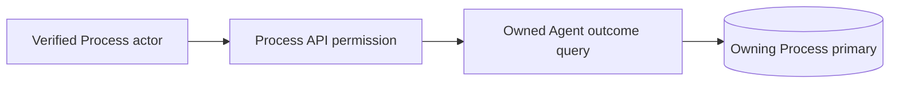
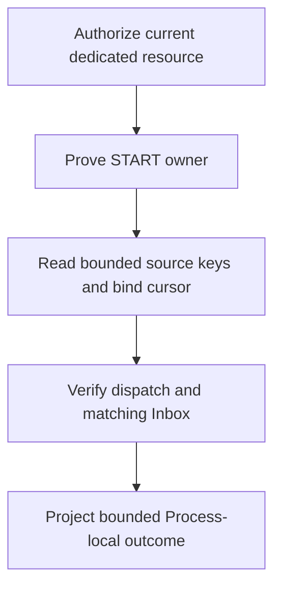
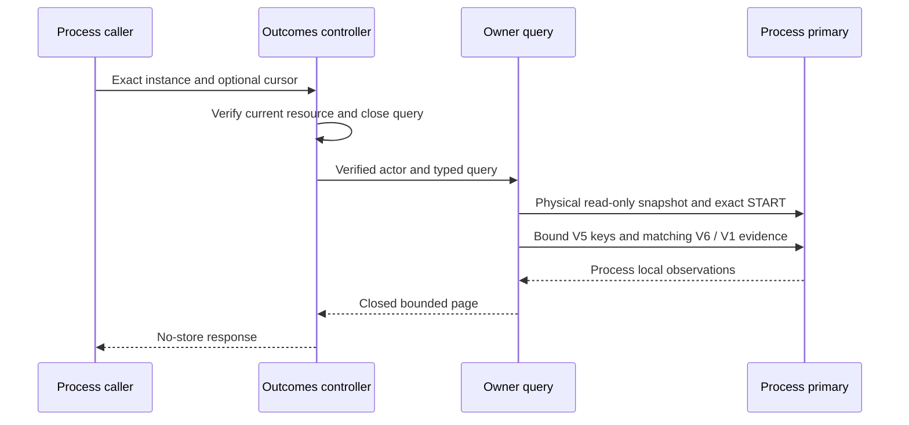

# T4-02 Process owner 的 Agent 回执观察

| Field | Value |
| --- | --- |
| Document | 2026-11-05-22-41-process-owned-agent-outcomes.md |
| Template Version | 9 |
| Archetype Cleanup | Not applicable |
| Status | Review |
| Type | Feature |
| Complexity | Complex |
| Complexity Drivers | 独立受保护 REST、四部分 START owner、精确的既有派发与回执关系、可重验的有限分页 |
| Created | 2026-11-05 22:41 Asia/Shanghai |
| Updated | 2026-11-05 22:41 Asia/Shanghai |
| Owner | Tianji Process |
| Repository | tianji-service |
| Scope | PS+C 既有 Process START/dispatch/Inbox 的只读投影 |
| Change Surface | 单一默认关闭的 GET、C 中立值、同源 primary 只读事务、独立静态 OpenAPI |
| Affected Chapters | §7, §8, §9, §10, §13, §14, §15, §16 |
| Source Requirement | [Master §19 T4-02 与 S12](../../../../docs/plans/agent-framework-upgrade-plan.md) 持久关联 |
| Baseline Revision | tianji-service 279d8858e46981c7930c838479bf0970fb32d0c9 (SLA prerequisite committed) |
| Amends | None |
| Supersedes | None |
| Depends On | [Owned Process correlation lookup](2026-11-05-20-36-owned-process-correlation-lookup.md#7-architecture-design) |
| Related Specs | None |
| Related Plans | [Process owner Agent outcomes](../plan/2026-11-05-22-42-process-owned-agent-outcomes.md) |

## 1. Summary

已授权的 Process START owner 可查看单个实例的本地派发、Inbox 回执及已核验的 Agent 终态。查询复用现有持久事实，能区分未确认运行、未观察回执、已收到、已应用、迟到忽略和处理死信。输出保留 Process 来源边界与运行 ID 隔离。

## 2. Background and Current State

| Evidence ID | Classification | Source | Current behavior |
| --- | --- | --- | --- |
| EVD-001 | Committed PS | [START exact reader](../../../stellar-enclosure-tianji-process-server/src/main/java/top/egon/cola/platform/tianji/process/server/execution/ProcessCommandReceiptStore.java#L137) · [V1 unique](../../../stellar-enclosure-tianji-process-server/src/main/resources/db/tianji-process/V1__create_process_release_store.sql#L45) | tenant/type/issuer/subject 精确命中 START/APPLIED。资源键同租户仅一条。现有相关查询已使用同源物理只读。 |
| EVD-002 | Committed PS | [Native linked dispatch](../../../stellar-enclosure-tianji-process-server/src/main/java/top/egon/cola/platform/tianji/process/server/worker/FlowableWorkerService.java#L321) · [V5](../../../stellar-enclosure-tianji-process-server/src/main/resources/db/tianji-process/V5__add_agent_dispatch_intent.sql#L29) | 既有桥接 SERVICE 从 verified native job/lease、发布、精确 START correlation 持久写派发。V5 subject 是桥接身份。 |
| EVD-003 | Committed PS | [Inbox ingress and row decoder](../../../stellar-enclosure-tianji-process-server/src/main/java/top/egon/cola/platform/tianji/process/server/bridge/AgentResultInbox.java#L73) · [V6](../../../stellar-enclosure-tianji-process-server/src/main/resources/db/tianji-process/V6__add_agent_result_inbox.sql#L24) | 先认证 producer、已注册 owner 与 exact V5。早到事件可在 run 未绑定时接受，同 occurrence 不等同唯一 run。 |
| EVD-004 | Committed PS | [Application and audit](../../../stellar-enclosure-tianji-process-server/src/main/java/top/egon/cola/platform/tianji/process/server/bridge/AgentResultCorrelationService.java#L103) · [Producer registry](../../../stellar-enclosure-tianji-process-server/src/main/java/top/egon/cola/platform/tianji/process/server/bridge/AgentResultProducerRegistry.java#L25) | V6 APPLIED、原生 message 及 V1 AGENT_RESULT 审计同事务。当前 owner/producer/source 注册可精确核对。 |
| EVD-005 | Committed PS | [V9 partial index](../../../stellar-enclosure-tianji-process-server/src/main/resources/db/tianji-process/V9__add_process_cancellation_receipts.sql#L79) · [Schema readiness](../../../stellar-enclosure-tianji-process-server/src/main/java/top/egon/cola/platform/tianji/process/server/ProcessApiSchemaVerifier.java#L438) | V5 PK 可走 tenant/source/type/scope 前缀。V9 open 索引不覆盖 CLOSED，现有 V1–V6 readiness 可复用。 |

### 2.4 Evidence and current-chain map

| Entry/trigger | Authority | Evidence | Gap |
| --- | --- | --- | --- |
| Process owner → own START | PS current protected resource + full actor | EVD-001 | 详情 GET 只返回 native snapshot |
| Bridge SERVICE → Agent terminal receipt → Process apply | PS V5/V6 + registered producer + AGENT_RESULT | EVD-002/003/004 | 当前内部证据未作为 Process owner 的最小读面 |
| Agent owner detail | Independently authorized AS current owner | EVD-002/003 | PS caller 并不因此获得 AS run 权限 |

### 2.5 Archetype example cleanup

Cleanup disposition: Not applicable

Reason: 现有中立 C 和 PS 已交付模块中增加技术读路径，无新 archetype 或示例域。

## 3. Goals and Non-goals

提供单实例、单受控来源、有限完整分页的 Process 本地证据。AS 列表/详情、Tool/Model 遍历、原生写入、数据库结构、追踪采样/持久化和真实 S12 独立。

### 3.3 Change Surface and Design Depth

| Area/layer | Disposition | Exact repository evidence | Changed or preserved behavior/contract | Required Spec treatment | Chapter(s) |
| --- | --- | --- | --- | --- | --- |
| Public C/PS Query and authorization | Affected | ProcessController, TianjiProcessAccess, neutral C | One dedicated GET/HEAD resource and closed response | Closed REST, actors, ownership, exact pack | §7, §8, §9, §10, §13, §14, §15, §16 |
| Process local read | Affected | EVD-001–005 | Same-source bounded scalar/event evidence | Root proof, binding, cursor, state | §7, §14, §15 |
| Existing DB schema and writers | Context-only | V1/V3/V5/V6, native bridge | Preserve existing structures and write semantics | Existing identities and read plan only | §11 |
| AS/CL/Web/Collector | Not applicable | EVD-002/003 | Independent auth and contracts preserved | Boundary only | §12 |

## 4. Requirements and Acceptance Criteria

| ID | Atomic requirement | Priority | Observable acceptance criteria | Source |
| --- | --- | --- | --- | --- |
| REQ-001 | 显式有权、精确 START owner | Must | default false；当前 exact resource + READ/scope；非 owner/不存在 404；无 lookup by shared correlation | EVD-001 |
| REQ-002 | 只读权威事实和已核验状态 | Must | V5 已固定 model、exact source、V6 exact confirmed run、canonical fingerprint、注册与 APPLIED audit | EVD-002–004 |
| REQ-003 | 有界、稳定、无标识泄漏的导航 | Must | 单源 SQL 前缀最多 257 ids，最多 20 results；scope 257 固定 503；cursor digest membership 无 native ID | EVD-005 |
| REQ-004 | 运行边界与兼容 | Must | 物理只读 primary RR/2s、独立 OAS/PaC/label、旧 API/权限制品/迁移保持，明确 S12 待测 | EVD-001/005 |

### 4.1 Scenario matrix

| Scenario | Trigger | Expected behavior | Verification |
| --- | --- | --- | --- |
| Current owner | One active scope with committed evidence | Return exact local outcomes and verified terminal where present | TEST-001/002 |
| Foreign/stale cursor or owner | Valid current resource policy, wrong subject/instance scope | 404 for unowned instance; 400 for bad anchor of an owned instance | TEST-002/003 |
| Early, wrong or duplicate match | V6 received before run persistence, mismatched run, duplicate source rows | Unknown before exact bind, match only exact run, ambiguous rows fail closed | TEST-002 |
| Storage dependency unavailable | No owning read transaction, over-scope or corrupted audit | Fixed 503, no partial result | TEST-002/003 |

### 4.2 Use-case analysis

#### 4.2.1 Actor inventory

| Actor ID | Actor | Goal | Permission/context |
| --- | --- | --- | --- |
| ACTOR-001 | Process USER or SERVICE START owner | Diagnose own instance's linked results | Current dedicated resource and Process READ/scope |
| ACTOR-002 | Bridge and Inbox configured operators | Maintain declared PS source bindings | Existing config, no new granted runtime capability |

#### 4.2.2 Use-case artifact

| ID | Use case/goal | Primary actor | Supporting actors/systems | Trigger | Preconditions | Main success outcome | Alternatives/failures | Postconditions | Requirements | Interfaces/pages | Tests |
| --- | --- | --- | --- | --- | --- | --- | --- | --- | --- | --- | --- |
| UC-001 | Inspect linked outcome for one owned Process instance | ACTOR-001 | Existing PS storage and ACTOR-002 | Explicit GET | Enabled source, current auth and exact START | Bounded local outcomes and optional cursor | 400/404/503 or explicit no evidence | No mutation or cross-owner lookup | REQ-001–004 | API-001 | TEST-001–005 |

## 5. Constraints, Assumptions, and Decisions

One unique source per configured tenant from existing Inbox registrations. An absent pilot source is unavailable to the caller as 404. Multiple configured sources for one tenant reject activation of this observation feature. Existing Inbox enabled and Process API enabled are mandatory. Existing registrations are verified by the current registry, so this observation is scoped to current configured source/owners and fails closed on invalid matching evidence. Current A3/SLA work remains separate. Runtime can choose disable without changing writers.

## 6. Project Technology Context

C remains JDK-only. PS uses existing Boot MVC, Jackson, JDBC, physical read-only owner transaction, current Actor guard, PaC, same-source registry and schema verifier. No dependency, datasource, Flyway or Flowable write change.

### 6.2 User-mandated Java rule compliance

| Literal rule | Affected? | Repository evidence | Exact design decision | Files/types/interfaces | Validation/test evidence | Status/blocker |
| --- | --- | --- | --- | --- | --- | --- |
| Rule 1 | Yes | §7 and existing PS packages | Exact Query, DTO, private VO and existing adapters | §8 inventory | TEST-001/002 | PASS |
| Rule 2 | Yes | Current ProcessController auth and C validation | Guard first, closed query, existing validation/record checks | §8 inventory | TEST-001/003 | PASS |
| Rule 3 | Yes | Neutral C value records | Immutable value records only, local row/projection and no entity converter | §8 inventory | TEST-001/002 | PASS |
| Rule 4 | Yes | Existing named technical MVC factories | Named query Bean and qualified controller injection, no business logging | §8 inventory | TEST-003/004 | PASS |
| Rule 5 | Yes | Existing JDK/JDBC and ProcessRequestDigest | Reuse existing domain-safe hashing and decoder | §8 inventory | TEST-002 | PASS |
| Rule 6 | Yes | Existing neutral enum serialization | Closed named enum values with exact PS static OAS, no ordinal | §8 inventory | TEST-001/005 | PASS |
| Rule 7 | Yes | Single owning PS application.yml | One false property, adjacent existing config preserved | §8 inventory | TEST-004/005 | PASS |
| Rule 9 | Yes | Existing owner Query adapter pattern | Direct same-source reader, no parallel cross-service facade | §8 inventory | TEST-002 | PASS |
| Rule 10 | Yes | Existing receipt timestamptz/Instant | Exact UTC DB observation and reported times | §6.3 | TEST-001/002 | PASS |
| Rule 11 | Yes | Existing technical owner Query paths | SELECT only on existing persisted schema, no new persistence module, DDL or Event | §8/11 | TEST-002/005 | PASS |

### 6.3 Time semantics and conversion contract

Time contract: Required

| Time ID | Fields/symbols | Semantics | Java/runtime type | Storage policy | Wire policy | Business zone source | Display zone source | Boundary / DST rules | Precision / Clock | Compatibility | Verification |
| --- | --- | --- | --- | --- | --- | --- | --- | --- | --- | --- | --- |
| TIME-001 | observedAt, dispatchRecordedAt, receivedAt, decidedAt | Occurred instant | java.time.Instant and OffsetDateTime | UTC instant | UTC Z | Explicit UTC Instant | Wire UTC Z | Exact same-db clock and row times, no local-time conversion | PostgreSQL native timestamptz up to micros | Existing clocks and no AS time equivalence | TEST-001/002 |

## 7. Architecture Design

### 7.0 Minimum-design baseline and element-necessity audit

| Proposed element | Change | Requirements | Existing/direct alternative | Concrete inadequacy of alternative | Added calls/state/coupling/failures/migration/operations | Verdict |
| --- | --- | --- | --- | --- | --- | --- |
| Explicit PS GET | Add | REQ-001/004 | Existing ProcessInstanceDTO | Closed clients and native snapshot serve different ownership facts | One no-store read per page, no persisted state | Add |
| Owner-local outcome reader | Add | REQ-002/003 | Existing bridge write/reconcile | Methods may lock/write, select sensitive seed inputs or use SERVICE owner | One same-source bounded read transaction | Add |
| Current Process access, V1/V5/V6 and registry | Keep | REQ-001–004 | New copied diagnostics store | Existing durable owner facts and source index fit | No migration or external call | Keep |

| Path | Network calls | Client states | Server contracts/state | Failure and TOCTOU points | Additional user/business value |
| --- | --- | --- | --- | --- | --- |
| Current Process detail only | One | Native snapshot | Existing API | No linked terminal evidence | Process state |
| Selected explicit sibling | One per page | Local owner evidence or typed refusal | One Query, no stored state | Scoped membership and same snapshot | Can distinguish confirmed result, Inbox decision and no evidence |

### 7.1 System Architecture Design

Caller → PS security/permission guard → dedicated controller → ProcessLinkedAgentOutcomeQuery → owning ProcessDB. PS query does not call AS, Flowable runtime operations or outbound transport. The flow validates exact START before reading dispatches.



### 7.2 High-Level Design

#### 7.2.2 High-level decision and quality matrix

| Concern/use case | Decision | Evidence/verification |
| --- | --- | --- |
| Isolation | Full START owner; source and registrations server-derived | EVD-001/003, TEST-002/003 |
| Privacy | No raw run, occurrence, producer, source, execution, event or failure codes in response | EVD-002/003, TEST-001/002 |
| Bounded consistency | Physical primary RR, 2s, stable C order with 257 sentinel and strict join | EVD-005, TEST-002 |
| Compatibility | Separate default-off route, no prior DTO or permission meaning changes | TEST-004/005 |



### 7.3 Detailed Design

1. Use current verified actor, reject LEGACY or ambient transaction. Select exact source by actor tenant from current validated registry config. Own Process primary TransactionTemplate with non-readonly routing metadata, REPEATABLE_READ, 2s. First SQL physically SET TRANSACTION READ ONLY and statement timeout. Verify current primary/UTF8/origin, read-only RR, same schema, four permanent readable non-RLS relations and database observedAt. Enabled bean verifies the actual existing V1–V6 migration/check/shape chain and exact storage participants.
2. Read current START/APPLIED via readStartByInstance. Read only 257 candidate V5 occurrence keys with exact tenant/source/BPMN/instance and C ascending. Require strict unique valid IDs; >256 means unavailable. Optional cursor is v1. and 64 lower hex digits from ProcessRequestDigest over domain TIANJI_PROCESS_AGENT_OUTCOME_CURSOR_V1, tenant/type/issuer/subject/source/instance/occurrence. Resolve digest to exactly one current scoped key, mismatch 400. No raw key in cursor, no authentication granted. Read next up to 20 positions. A next digest is emitted only with another key. Newly committed rows before anchor do not repeat the prior key; each page is a fresh source snapshot.
3. Bound exact selected V5 rows using scoped IN and 21-result sentinel. Check returned order/count, exact START release/correlation, V1 BPMN release definition model digest, configured SERVICE owner, existing dispatch idempotency digest, phase/closed/time. Read no V5 instruction or input_data. Join V6 only on exact all FK columns plus owner and confirmed run. Strict accepted-event decoder validates canonical event fingerprint and row, and current registry rechecks binding. Verify event link/definition/version/deadline unless explicit DISPATCH_MISMATCH. APPLIED additionally requires same V1 AGENT_RESULT exact producer, event hash, release/correlation and nonempty internal execution witness, and cannot be SUBMITTED. No native or cross-owner state inference.
4. No confirmed run yields RUN_NOT_CONFIRMED. Confirmed run with no matching receipt yields NOT_OBSERVED. PENDING Inbox is RECEIVED; terminal local states APPLIED/IGNORED_LATE/DEAD require decidedAt and expected local code family. Only exact linked valid event emits COMPLETED/FAILED/CANCELLED/TIMED_OUT. DISPATCH_MISMATCH exposes only local DEAD with no terminalStatus. Do not return reason code or treat DEAD as Agent FAILED. Invalid required evidence returns fixed 503, without partial response.



#### 7.3.6 Conclusion evidence chain

| Conclusion | Evidence | Constraint | Decision | Test |
| --- | --- | --- | --- | --- |
| Only exact Process owner reads | EVD-001/002 | SERVICE dispatch owner differs | START fence before V5 or V6 | TEST-002/003 |
| Terminal is proved by current linked receipt | EVD-003/004 | Early event and independent run owner | Exact run join, registry and fingerprint; APPLIED audit | TEST-002 |
| Bounded opaque traversal | EVD-005 | No new index or hidden cursor IDs | One source and max256 scope with membership | TEST-002 |

## 8. Package Structure and Code File Tree

| Operation | Exact path |
| --- | --- |
| Create | `stellar-enclosure-tianji-process-server/src/test/java/top/egon/cola/platform/tianji/process/server/api/ProcessAgentOutcomesControllerTest.java` |
| Modify | `stellar-enclosure-tianji-contract/src/test/java/top/egon/cola/platform/tianji/contract/orchestration/OrchestrationContractTest.java` |
| Create | `stellar-enclosure-tianji-contract/src/main/java/top/egon/cola/platform/tianji/contract/orchestration/GetProcessAgentOutcomesQuery.java` |
| Create | `stellar-enclosure-tianji-contract/src/main/java/top/egon/cola/platform/tianji/contract/orchestration/ProcessAgentOutcomePageDTO.java` |
| Create | `stellar-enclosure-tianji-process-server/src/test/java/top/egon/cola/platform/tianji/process/server/bridge/ProcessLinkedAgentOutcomeQueryTest.java` |
| Create | `stellar-enclosure-tianji-process-server/src/main/java/top/egon/cola/platform/tianji/process/server/bridge/ProcessLinkedAgentOutcomeQuery.java` |
| Modify | `stellar-enclosure-tianji-process-server/src/main/java/top/egon/cola/platform/tianji/process/server/bridge/AgentDispatchStore.java` |
| Modify | `stellar-enclosure-tianji-process-server/src/main/java/top/egon/cola/platform/tianji/process/server/bridge/AgentResultInbox.java` |
| Modify | `stellar-enclosure-tianji-process-server/src/main/java/top/egon/cola/platform/tianji/process/server/security/TianjiProcessPermissions.java` |
| Modify | `stellar-enclosure-tianji-process-server/src/main/java/top/egon/cola/platform/tianji/process/server/ProcessSecurityConfiguration.java` |
| Create | `stellar-enclosure-tianji-process-server/src/main/java/top/egon/cola/platform/tianji/process/server/api/ProcessAgentOutcomesController.java` |
| Modify | `stellar-enclosure-tianji-process-server/src/main/resources/application.yml` |
| Create | `stellar-enclosure-tianji-process-server/src/main/resources/META-INF/tianji/openapi/process-agent-outcomes-v1.json` |
| Create | `docs/egon/spec/2026-11-05-22-41-process-owned-agent-outcomes.md` |
| Create | `docs/egon/plan/2026-11-05-22-42-process-owned-agent-outcomes.md` |
| Create | `docs/egon/evidence/2026-11-05-process-owned-agent-outcomes.md` |

## 9. Interface Definitions

### 9.0 API protocol and documentation governance

| Concern | Decision/evidence |
| --- | --- |
| Protocol selection | Existing Process HTTP JSON, one REST operation |
| CQE application level | Query only |
| REST source of truth | Neutral C, controller, packaged static OpenAPI 3.1 |
| GraphQL source of truth | Existing REST boundary, no GraphQL |
| Springdoc/OpenAPI compatibility | Static artifact with no added runtime docs dependency |
| Legacy Swagger/Springfox status | Existing packaging, no legacy generator |
| Security and documentation exposure | Static artifact and separately protected route |
| Contract publication and drift gate | Exact PS packaged OAS and PaC plus finite MockMvc |

### 9.1 Interface Inventory

| ID | Change/necessity verdict | Name/purpose | Kind | API style/CQE role | Consumer | Owner | Method + URL / GraphQL field / symbol / topic | Operation ID/schema source | Input | Output | Auth/tenant | Error model | Idempotency/version | Requirements |
| --- | --- | --- | --- | --- | --- | --- | --- | --- | --- | --- | --- | --- | --- | --- |
| API-001 | Add bounded owner evidence | Agent outcomes for exact Process instance | HTTP | REST Query | Current Process owner | PS | GET /api/tianji/v1/process-instances/{instanceId}/agent-outcomes | getOwnedProcessAgentOutcomes from C and OAS | instanceId, optional cursor | process-local page | Existing READ/scope and new exact resource | Existing Process envelopes | read-only v1 | REQ-001–004 |

### 9.2 Per-interface Detailed Contracts

#### API-001 — Get Process-local Agent outcomes

##### Necessity and interaction-cost decision

| Concern | Decision |
| --- | --- |
| Change classification | Existing Process protected namespace new read |
| Independent consumer goal | Distinguish locally observed Agent/Inbox outcomes for an owned instance |
| Parameter ownership and derivation | Caller supplies instance/cursor; actor/source derived independently |
| Direct/no-new-interface alternative | Existing closed Process detail and AS owner reads cannot express this local evidence |
| Caller use of result | Inspect local outcome and follow exact cursor |
| Round trips and failure points | One GET per page, bounded same-database snapshot |
| Verdict | Separate exact default-off Process Query |

##### API style and CQE semantics

| Concern | Decision/evidence |
| --- | --- |
| Protocol style | REST Query over JSON consistent with existing Process API |
| CQE role | Simple Query |
| Resource/task semantics | One existing APPLIED START instance, local linked evidence |
| Read/write and side effects | Same ProcessDB SELECT, no write |
| Consistency and idempotency | One snapshot per request, cursor revalidated |
| Why this style | Exact path and separate resource policy |

##### Identity and purpose

| Concern | Definition |
| --- | --- |
| Route | GET /api/tianji/v1/process-instances/{instanceId}/agent-outcomes |
| Resource | tianji.api.process.agent.outcomes / label api.agent.outcomes |
| Operation | getOwnedProcessAgentOutcomes |
| Authorization | USER or SERVICE, TIANJI_PROCESS_READ, tianji:process:read, dedicated current resource policy and exact START actor |
| Cache | no-store success and controlled errors |
| HEAD | implicit same protected path, no body |

##### Request parameters

| Name | Location | Type and validation |
| --- | --- | --- |
| instanceId | required path | Exact existing GetProcessInstanceQuery, safe 1–255 characters with . and .. rejected |
| cursor | optional query | Exactly v1. plus 64 lowercase hex, member for exact authorized scope |
| X-Egon-Tianji-Tenant | existing optional header | Assert verified tenant consistency only |
| Authentication | existing bearer header | Current PS identity/resource/scope |

Reject unknown or repeated query names and malformed or stale cursor. No body, actor/source/run/correlation selectors, page size or custom order.

##### Success response

200 application/json, Cache-Control no-store. Exact keys `instanceId`, `observedAt`, `items`, `nextCursor`. Items are 0–20 values containing exactly `activityId`, `dispatchState`, `inboxState`, `terminalStatus`, `dispatchRecordedAt`, `receivedAt`, `decidedAt`. Enum names and state conditions follow §7.3. `dispatchRecordedAt` is the timestamp of V5 intent creation. `receivedAt`, `decidedAt` and `terminalStatus` are nullable by state; RECEIVED/APPLIED/IGNORED_LATE require terminal, DEAD may omit it. nextCursor is null for the last page. An empty owned page uses items=[] and nextCursor=null. Timestamp strings are UTC Z.

```jsonc
{
  "instanceId": "process-1", // Exact authorized Process instance
  "observedAt": "2026-11-05T10:20:30Z", // Owner database observation
  "items": [ // Bounded Process-local linked observations
    {
      "activityId": "agentStart", // Authored Process element identifier
      "dispatchState": "ACKNOWLEDGED", // Local dispatch phase
      "inboxState": "APPLIED", // Local Inbox decision
      "terminalStatus": "COMPLETED", // Verified status in exact received event
      "dispatchRecordedAt": "2026-11-05T10:20:00Z", // V5 intent creation
      "receivedAt": "2026-11-05T10:20:15Z", // V6 receive time
      "decidedAt": "2026-11-05T10:20:16Z" // V6 decision time
    }
  ],
  "nextCursor": null // No continuation
}
```

##### Error responses

| HTTP | Fixed code | Condition |
| --- | --- | --- |
| 400 | TIANJI_INVALID_COMMAND | Invalid query or malformed/stale/foreign anchor for an owned instance |
| 401 | TIANJI_UNAUTHENTICATED | Missing/invalid current authentication |
| 403 | TIANJI_PERMISSION_DENIED | Current resource, scope or principal access denied |
| 404 | TIANJI_RESOURCE_NOT_FOUND | Missing/unowned exact START or absent enabled source |
| 409 | TIANJI_TENANT_CONTEXT_CHANGED | Existing tenant consistency guard |
| 503 | TIANJI_DEPENDENCY_UNAVAILABLE | Unready/ambiguous/corrupt evidence, above supported scope, timeout or same source unavailable |

Existing safe Process error shape, no payload, credentials or diagnostic IDs. Authentication filter may omit the optional null field.

```jsonc
{
  "code": "TIANJI_RESOURCE_NOT_FOUND", // Stable Process diagnostic
  "correlationId": null // No diagnostic identity echoed
}
```

##### Interface logic for frontend and consumers

1. Obtain current Process identity and exact dedicated resource authorization.
2. Select the exact instance from an existing independently authorized receipt or detail.
3. Encode the path and only an optional same-scope server cursor, with no body.
4. Verify 200 and the closed response including exact instance affinity.
5. Distinguish current authorization, invalid anchor, local empty and unavailable outcomes.
6. Carry continuation only for the same actor and instance; clear on context change.
7. Source-label output as Process bridge and Inbox evidence and keep AS navigation separate.

##### Documentation contract

| Concern | Decision/evidence |
| --- | --- |
| Documentation authority | Contract-first static packaged PS OpenAPI 3.1 and neutral C |
| REST OpenAPI operation / GraphQL SDL operation | operationId getOwnedProcessAgentOutcomes for exact GET |
| Annotation/mapping ownership | ProcessAgentOutcomesController and PaC definitions |
| Generated schema elements | Generated OAS effect is one protected GET with closed request/response/errors and OAuth |
| Compatibility and drift proof | Actual PS archive OAS and exact PaC delta plus MockMvc |

##### Compatibility and verification

The existing ProcessInstanceDTO, API and AS endpoints retain original fields/authority. Verify exact packed route, method, security, enum and closed response. Runtime permission assignment and transport acceptance are independent.

### 9.3 OpenAPI 3 and springdoc annotation plan

| Target | Required annotation/configuration | Exact values/source | Generated OAS effect | Verification |
| --- | --- | --- | --- | --- |
| PS operation | @GetMapping, @PermissionResource, @RequiresPermissions; Contract-first static OpenAPI 3.1 | API-001, process-agent-outcomes-v1.json | One exact GET, opaque cursor, closed data/errors | TEST-003/005 |
| Runtime docs | Existing static only | No springdoc route or dependency | Existing production docs behavior | TEST-005 |

### 9.4 API contract generation and blocking gate

| Gate ID | Applicability | Status | Evidence | Finding | Required action/exception |
| --- | --- | --- | --- | --- | --- |
| API-GATE-001 | Applicable | PASS | §9/14 | Exact owner discovery necessity | None |
| API-GATE-002 | Applicable | PASS | §9/14 | REST Query and no event | None |
| API-GATE-003 | Applicable | PASS | §9/14 | Complete method/query/success/error contract | None |
| API-GATE-004 | Not applicable | N/A | §9/14 | GraphQL absent | None |
| API-GATE-005 | Applicable | PASS | §9/14 | Closed bounded C DTO | None |
| API-GATE-006 | Applicable | PASS | §9/14 | Current four-part authority and exact path | None |
| API-GATE-007 | Applicable | PASS | §9/14 | Static contract-first 3.1 | None |
| API-GATE-008 | Applicable | PASS | §9/14 | Actual producer drift and manifest checks | None |
| API-GATE-009 | Applicable | PASS | §9/14 | Traceability complete and current SQL scope | None |

## 10. POJO and Data Model Design

GetProcessAgentOutcomesQuery, ProcessAgentOutcomePageDTO, nested ItemDTO and closed enums are immutable neutral records with bounded values. SourceScopeVO and DispatchOutcomeVO are internal immutable read facts. Existing event DTO, row mapper and digest helpers retain wire/storage behavior.

## 11. Database Design

N/A for schema. Same existing owner read uses V1/V3/V5/V6 tables in §7.3. No DDL, data copy, grant, cross-database lock or schema change.

## 12. Frontend Page Design

N/A. Existing Web and SDK remain separate. Consumer flow is documented in API-001.

## 13. Design Patterns and Architecture Principles

Use current dedicated Query adapter because bridge writer/store APIs also lock, resolve and read private input. One narrow read transaction with reused validation is simpler than adding a cross-service facade or copied evidence model.

## 14. Test Design

| ID | Scope | Verification |
| --- | --- | --- |
| TEST-001 | C values | exposes_only_bounded_process_local_agent_outcome_evidence |
| TEST-002 | PS SQL and trust boundary | ProcessLinkedAgentOutcomeQueryTest 4 finite methods, same actor/snapshot/registry, cursor/early/duplicates/mismatch/audit, 257 sentinel |
| TEST-003 | Current resource and strict REST | ProcessAgentOutcomesControllerTest, exact mapping, auth before parsing, no-store, 400/404/503 and closed response |
| TEST-004 | Owning regression and default | ProcessPermissionIntegrationTest, ProcessApiConfigurationTest and existing Dispatch/Inbox tests |
| TEST-005 | Producer and compatibility | Actual PS package OAS, PaC one GET/HEAD resource and label, YAML false, unchanged SQL/POM and old OAS |

## 15. Non-functional and Cross-cutting Design

The query stays within the 2s owner read budget. Select one PK prefix per instance with 257 hard cap, return up to 20, refuse inconsistent joins. No broad discovery, sensitive fields, network or DB mutation. Real query plan, runtime IAM and S12 are separate.

## 16. Compatibility, Migration, Rollout, and Rollback

The new flag defaults false. Only explicitly enabled, correctly authorized PS read routes may operate. Runtime roles and actual deployment activation require separate approval. No schema change. Roll back source with one focused commit.

## 17. Alternatives and Decisions

Existing owner detail is too narrow to carry accepted bridge facts and has closed wire clients. AS direct lookup requires an independent owner; no matching based on correlation strings. A single trusted source with bounded opaque cursor uses existing V5 index and keeps storage unchanged.

## 18. Risks and Open Questions

An instance over 256 occurrences refuses the entire scope. An unconfigured historical source is outside this first slice. Both are intentional limits of the closed product query. Multi-source history, new indexes, AS navigation, dedicated UI, and S12 require separate work and real deployment evidence.

## 19. Traceability Matrix

| Requirement | Use case | Design | API | Tests |
| --- | --- | --- | --- | --- |
| REQ-001 | UC-001 | §7/9 | API-001 | TEST-001/003/005 |
| REQ-002 | UC-001 | §7.3/10 | API-001 | TEST-002/004 |
| REQ-003 | UC-001 | §7.3/9 | API-001 | TEST-001/002 |
| REQ-004 | UC-001 | §8/14/16 | API-001 | TEST-003/004/005 |

## 20. Review and Acceptance

### 20.5 Blocking Manual Check

| Check ID | Applicability | Status | Evidence | Finding | Required action/exception |
| --- | --- | --- | --- | --- | --- |
| MC-ARCH-001 | Applicable | PASS | §7/8/14 | Existing C/PS boundary | None |
| MC-REUSE-001 | Applicable | PASS | §7/8/14 | Existing permission/JDBC/receipt adapters | None |
| MC-DEP-001 | Applicable | PASS | §7/8/14 | No dependency change | None |
| MC-NAME-001 | Applicable | PASS | §7/8/14 | Exact Query/DTO/adapter symbols | None |
| MC-VALID-001 | Applicable | PASS | §7/8/14 | Current authority, query, exact cursor | None |
| MC-MODEL-001 | Applicable | PASS | §7/8/14 | Immutable C value DTOs | None |
| MC-CONVERT-001 | Not applicable | N/A | §7/8/14 | No mapping layer or PO | None |
| MC-LOG-001 | Not applicable | N/A | §7/8/14 | No new log/diagnostic echo | None |
| MC-BEAN-001 | Applicable | PASS | §7/8/14 | Named owner query and qualified technical injection | None |
| MC-UTIL-001 | Applicable | PASS | §7/8/14 | Existing JDK and length-safe digest | None |
| MC-JSON-001 | Applicable | PASS | §7/8/14 | Closed wire/OAS and exact errors | None |
| MC-TIME-001 | Applicable | PASS | §7/8/14 | UTC microsecond/DB clock | None |
| MC-CONFIG-001 | Applicable | PASS | §8/16 | One owner-only default-false property, existing settings remain | None |
| MC-PATTERN-001 | Applicable | PASS | §7/8/14 | Existing owner query adapter | None |
| MC-SCOPE-001 | Applicable | PASS | §7/8/14 | One exact route, zero schema/trace scope | None |
| MC-TEST-001 | Applicable | PASS | §7/8/14 | Finite plus actual package and separate I | None |
| MC-BLOCKER-001 | Applicable | PASS | §7/8/14 | Source review, runtime separate | None |

### 20.6 Final verdict

PASS — Ready for user review
