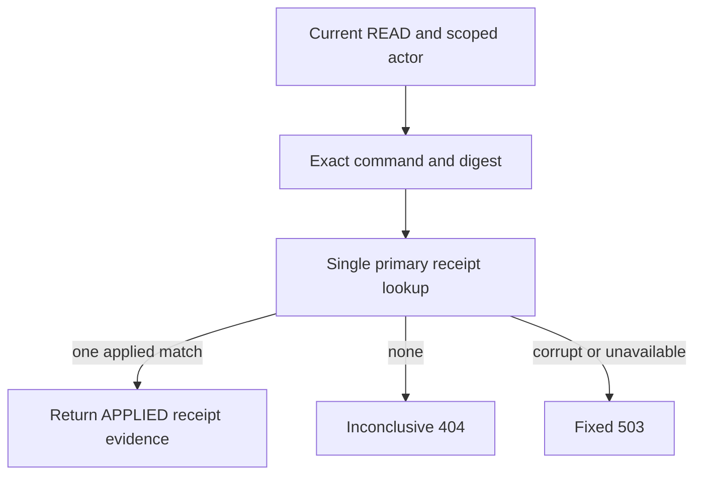

# T4-03 Process owner 的精确 START 回执证据

| Field | Value |
| --- | --- |
| Document | 2026-11-05-23-50-owned-process-start-receipt.md |
| Template Version | 9 |
| Archetype Cleanup | Not applicable |
| Status | Review |
| Type | Feature |
| Complexity | Complex |
| Complexity Drivers | 精确当前 owner、独立请求摘要、跨所有者误判与丢 ACK 语义 |
| Created | 2026-11-05 23:50 Asia/Shanghai |
| Updated | 2026-11-05 23:50 Asia/Shanghai |
| Owner | Tianji Process |
| Repository | tianji-service |
| Scope | PS 上一个默认关闭的当前 START owner 精确回执读 |
| Change Surface | C query/DTO、PS 现有主库回执读、独立 REST 和 PaC 资源声明 |
| Affected Chapters | §7, §8, §9, §10, §13, §14, §15, §16 |
| Source Requirement | Master §17.2 S11 与 §19 T4-03 外部副作用人工核对前置 |
| Baseline Revision | Read-only observed Service fd5ebbc329d3a4f78221fb03d3230483f49f77b1; exact clean baseline re-locked after independent Agent first-claim timing source |
| Amends | None |
| Supersedes | None |
| Depends On | [Master T4-03](../../../../docs/plans/agent-framework-upgrade-plan.md#t4-03--有界checkpoint失联恢复与对账) |
| Related Specs | [Process owner 关联读取](2026-11-05-20-36-owned-process-correlation-lookup.md) |
| Related Plans | None |

## 1. Summary

允许已具备 Process READ 的当前 START owner 用独立掌握的命令 ID 和原始请求摘要核对一条已应用回执。结果只报告实例标识、回执状态和创建时间。缺少匹配仍然是不确定，既有 Agent Tool 状态、授权和恢复逻辑不参与此调用。

## 2. Background and Current State

| ID | Exact authority | Current implication |
| --- | --- | --- |
| EVD-001 | PS ProcessExecutionService#startInTransaction、ProcessCommandReceiptStore#insert/apply | 同事务提交 Process START 与 scoped APPLIED 回执。旧 instance GET 需要丢 ACK 时可能未知的实例 ID |
| EVD-002 | V1 tianji_process_command_receipt、V3 issuer migration、ProcessCommandReceiptStore#beginCorrelationObservation | 已有 full owner PK、精确 commandId、request SHA 与 primary RR 两秒物理只读 |
| EVD-003 | C OrchestrationRequestDigests#start、PS ProcessRequestDigest#hash、ProcessValues#inputs | 对原合法输入的类型归一和摘要算法一致。摘要校验请求身份，不授访问权 |
| EVD-004 | AS TianjiFixedBpmnStartToolTransport.SCOPES、verifiedCall、hostReceiptReference | 原 SERVICE 仅持 RELEASE_READ+START。commandId 为 intentId，丢 ACK 无派生引用，不能扩权或再次 POST |
| EVD-005 | AR ToolInvocationRecorder、ToolResultAccessStore#recordKnownStartResultAccess | V13 保存 UNKNOWN。V14 RECONCILE 只核验已知本地成功结果，不能查外部系统 |
| EVD-006 | PS TianjiProcessAccess、TianjiProcessPermissions.READ、ProcessSecurityConfiguration、ProcessApiErrors | 可复用完整当前身份、独立资源检查、现有安全链和固定错误 |

### 2.4 Evidence and current-chain map

| Entry/trigger | Current chain | Data read/written | Dependency | Consumer | Evidence |
| --- | --- | --- | --- | --- | --- |
| Governed START | AS bound SERVICE → PS START → same DB receipt | Current command and applied effect | START and release READ | AS Tool | EVD-001/003/004 |
| Current owner lookup | PS current READ → same primary scoped correlation | Receipt summary | Primary RR/2s | Current PS owner | EVD-002/006 |
| Ambiguous response | AS one-shot failure → private UNKNOWN | No confirmed result | Existing lease and grant | Owner disposition | EVD-004/005 |

### 2.5 Archetype example cleanup

Cleanup disposition: Not applicable
Reason: Existing C/PS technical source and existing immutable receipt read. No project generation or example replacement.

## 3. Goals and Non-goals

使同一已授权 PS owner 能明确确认一条匹配 APPLIED 证据。无需实例 ID、Flowable runtime/history、二次写入或读其他库。AS 凭据升级、operator 代签、跨 owner、Tool 状态结案、自动重发、Web/SDK 与完整 S11/S12 保持独立。

### 3.3 Change Surface and Design Depth

| Area/layer | Disposition | Exact repository evidence | Exact delta or preserved invariant | Required Spec treatment | Chapters |
| --- | --- | --- | --- | --- | --- |
| C/PS receipt evidence | Affected | EVD-001/002/003/006 | one guarded GET and immutable narrow DTO | Exact interfaces/validation | §7, §8, §9, §10, §13, §14, §15, §16 |
| Current ProcessDB receipt | Context-only | EVD-001/002 | Same table and PK, SELECT only | Exact access path | §11 |
| AS/AR/CL/Web, Worker and IAM deploy | Unchanged | EVD-004/005/006 | No privilege, replay, consumer or deployment | Evidence boundary | §12 |

## 4. Requirements and Acceptance Criteria

| ID | Requirement | Acceptance |
| --- | --- | --- |
| REQ-001 | Current owner guarded read | Both flags, exact resource and existing READ, USER/SERVICE full owner, authorization before validation |
| REQ-002 | Exact applied evidence only | Scoped START+APPLIED with exact ID and hash, bounded primary physical READ ONLY, closed three-field result |
| REQ-003 | Inconclusive absence and no retry | Foreign, wrong hash, pending and missing uniform 404; no state, write, fallback or replay |
| REQ-004 | Finite and artifact proof | True RED, actual focused tests, actual packaged OAS/additive PaC, existing migrations and behavior preserved |

### 4.1 Scenario matrix

| Scenario | Preconditions | Main or alternative path | Outcome | Requirement |
| --- | --- | --- | --- | --- |
| S-01 Exact applied | Enabled and current full owner | One exact validated key and digest | 200 APPLIED evidence | REQ-001/002 |
| S-02 Mismatch or absent | Enabled and authorized | Pending, foreign, missing or different digest | Same 404, inconclusive | REQ-002/003 |
| S-03 Refused | Disabled, invalid, unauthorized or wrong method | Existing auth/routing or exact query rejection | No unsafe read | REQ-001/003 |
| S-04 Unavailable | Source timeout, bad row or unavailable primary | Fail closed | Fixed 503 | REQ-002/003 |

### 4.2 Use-case analysis

| ID | Actor | Evidence |
| --- | --- | --- |
| ACTOR-001 | Current Process START owner with independent READ | EVD-001/006 |
| ACTOR-002 | Isolated acceptance operator | Master T4-03/S11 |

| ID | Use case/goal | Actor | Trigger | Outcome | Alternative | Postcondition |
| --- | --- | --- | --- | --- | --- |
| UC-001 | Verify exact positive applied evidence | ACTOR-001 | Known ID and expected digest | receipt + UTC timestamp | inconclusive or unavailable | No AS state change |
| UC-002 | Independently verify bounded implementation | ACTOR-002 | Reviewed producer source | finite/package evidence | actual I/E separate | No grant or activation |

## 5. Constraints, Assumptions, and Decisions

DEC-001 Use current Process READ and distinct resource. Exact PS owner is verified tenant, subject type, issuer and subject. Existing AS SERVICE credential lacks Process READ and receives no additional authority.

DEC-002 Reuse the existing Process receipt store and primary, physical-read-only transaction. A committed matching APPLIED row is positive evidence that PS applied the START. A missing match does not prove absence of an external effect.

DEC-003 One explicit default-off route. Approval of this PS source slice does not activate the route or permit deployed grant registration, replay, AS reconciliation or environment startup.

## 6. Project Technology Context

Existing C immutable record profile and PS Spring MVC/PaC/technical JDBC profile. The new read uses existing V1/V3 source truth, PG JDBC timestamp conversion and current capability boundaries. No new dependencies or native engine call.

### 6.2 User-mandated Java rule compliance

| Literal rule | Affected? | Repository evidence | Exact design decision | Files/types/interfaces | Validation/test evidence | Status/blocker |
| --- | --- | --- | --- | --- | --- | --- |
| Rule 1 | Yes | EVD-001/003 | Explicit Query and DTO | §8/10 | TEST-001 | PASS |
| Rule 2 | Yes | EVD-003/006 | Existing guard and strict constructor | §9/10 | TEST-001/003 | PASS |
| Rule 3 | Yes | EVD-001/003 | Immutable records, existing explicit JDBC | §8/10 | TEST-001/002 | PASS |
| Rule 4 | Yes | EVD-006 | Existing constructor, one adapter, no new business log | §8/13 | TEST-003 | PASS |
| Rule 5 | Yes | EVD-003 | Existing JDK and Spring types | §6/8 | TEST-001/002 | PASS |
| Rule 6 | Yes | EVD-006 | Current Jackson and explicit fixed status | §9/10 | TEST-003/005 | PASS |
| Rule 7 | Yes | EVD-006 | Explicit false base, no override | §16 | TEST-004/005 | PASS |
| Rule 9 | Yes | EVD-001/002 | Existing query adapter | §7/13 | TEST-002 | PASS |
| Rule 10 | Yes | EVD-002 | OffsetDateTime JDBC to UTC Instant | §6.3/10 | TEST-002/003 | PASS |
| Rule 11 | Yes | EVD-001/002 | Existing technical profile, no DDL/write/Event | §11 | TEST-002/005 | PASS |

### 6.3 Time semantics and conversion contract

Time contract: Required

| Time ID | Fields/symbols | Semantics | Java/runtime type | Storage policy | Wire policy | Business zone source | Display zone source | Boundary / DST rules | Precision / Clock | Compatibility | Verification |
| --- | --- | --- | --- | --- | --- | --- | --- | --- | --- | --- | --- |
| TIME-001 | recordedAt / existing created_at | Occurred instant | JDBC OffsetDateTime and Instant | UTC instant | UTC Z | Explicit UTC | UTC wire | Gregorian 0001–9999, independent of JVM zone | PostgreSQL microseconds, original receipt creation clock | No commit or lifecycle time claim | TEST-001/002/003 |

## 7. Architecture Design

### 7.0 Minimum-design baseline and element-necessity audit

| Proposed element | Change | Requirements | Existing baseline | Verdict |
| --- | --- | --- | --- | --- |
| Exact current owner GET | Add | REQ-001/002 | Existing GET requires instance and correlation lacks exact digest | One distinct read |
| C Query/DTO | Add | REQ-002 | Existing full snapshots disclose unrelated fields | Two immutable values |
| PS receipt read | Extend | REQ-002/003 | Existing exact PK and primary guard | Reuse without engine |
| AS grant/reconciler | None | REQ-003 | Source lacks authority and observation after loss | Keep independent |

| Path | Network calls | Client states | Data change | Consequence |
| --- | --- | --- | --- | --- |
| Original START | Existing | Existing success or UNKNOWN | Existing transaction | No change |
| Current-owner exact receipt | One GET | positive, inconclusive, denied or unavailable | None | Positive PS effect fact only |

### 7.1 System Architecture Design


### 7.2 High-Level Design

#### 7.2.2 High-level decision and quality matrix

| Concern/use case | Requirement | Mechanism | Failure | Verification |
| --- | --- | --- | --- | --- |
| Authority | REQ-001 | Exact path and current full actor | 401/403 and no lookup | TEST-003/004 |
| Evidence | REQ-002 | Primary, bounded exact receipt match | 503 on corrupt source | TEST-001/002 |
| Uncertainty | REQ-003 | Positive only and no mutation | Uniform inconclusive 404 | TEST-002/003 |



### 7.3 Detailed Design

Separate ProcessStartReceiptController is active only when the existing Process API and new receipt flag are both true. TianjiProcessAccess#require runs before validation. Require exactly one commandId and one requestSha256 in raw MultiValueMap. The existing command grammar and canonical 64 lowercase hex digest form GetProcessStartReceiptQuery. Existing global identity filter path is exact and allows the verified USER/SERVICE choice. The Spring chain admits only GET and implicit HEAD when both flags are on.

ProcessExecutionService#getStartReceipt rejects LEGACY, ambient JDBC/Spring synchronization and interruption. Reuse existing primary-routed 2s RR TransactionTemplate and ProcessCommandReceiptStore#beginReceiptObservation (rename of private correlation guard). It enforces physical READ ONLY and statement timeout, bound configured normal schema relation, primary/current schema/privilege/UTF-8/origin/catalog guards. One narrow business SELECT over the same receipt table matches full owner, command_type START, state APPLIED, exact C commandId and request digest. Select only resource_id and created_at. LIMIT 2 is a fail-closed duplicate sentinel. Zero rows is the existing Process 404. One validated row yields fixed APPLIED and native offset→Instant. Duplicate, corrupt row, interruption or data/transaction failure use existing fixed 503 response. No joins, Flowable query or side effects.

```mermaid
sequenceDiagram
  participant O as Current owner
  participant P as PS exact resource
  participant D as ProcessDB primary
  O->>P: GET with commandId and independently expected digest
  P->>P: Verify scope, resource, full actor and parameters
  P->>D: Physical read-only; SELECT scoped START APPLIED
  alt One exact match
    D-->>P: instance id and receipt creation time
    P-->>O: 200 closed APPLIED evidence
  else No exact match
    P-->>O: Uniform inconclusive 404
  else Corrupt or unavailable
    P-->>O: Fixed 503
  end
```

#### 7.3.6 Conclusion evidence chain

| Conclusion | Evidence | Constraint | Decision | Proof |
| --- | --- | --- | --- | --- |
| Existing source proves positive application | EVD-001/002/003 | Exact owner+command+digest | Existing read on primary | TEST-001/002 |
| AS UNKNOWN remains independent | EVD-004/005 | Original SERVICE lacks READ | No AS path/grant or fallback | TEST-003/005 |
| Independent exposure is bounded | EVD-006 | Existing READ and explicit default off | New exact protected resource | TEST-003/004/005 |

## 8. Package Structure and Code File Tree

| Exact path | Change | Responsibility |
| --- | --- | --- |
| stellar-enclosure-tianji-contract/src/main/java/top/egon/cola/platform/tianji/contract/orchestration/GetProcessStartReceiptQuery.java | Create | GetProcessStartReceiptQuery |
| stellar-enclosure-tianji-contract/src/test/java/top/egon/cola/platform/tianji/contract/orchestration/OrchestrationContractTest.java | Modify | OrchestrationContractTest |
| stellar-enclosure-tianji-process-server/src/main/java/top/egon/cola/platform/tianji/process/server/execution/ProcessCommandReceiptStore.java | Modify | ProcessCommandReceiptStore |
| stellar-enclosure-tianji-process-server/src/test/java/top/egon/cola/platform/tianji/process/server/execution/ProcessCorrelationLookupTest.java | Modify | ProcessCorrelationLookupTest |
| stellar-enclosure-tianji-process-server/src/main/java/top/egon/cola/platform/tianji/process/server/execution/ProcessExecutionService.java | Modify | ProcessExecutionService |
| stellar-enclosure-tianji-process-server/src/test/java/top/egon/cola/platform/tianji/process/server/ProcessPermissionIntegrationTest.java | Modify | ProcessPermissionIntegrationTest |
| stellar-enclosure-tianji-process-server/src/main/java/top/egon/cola/platform/tianji/process/server/ProcessSecurityConfiguration.java | Modify | ProcessSecurityConfiguration |
| stellar-enclosure-tianji-process-server/src/test/java/top/egon/cola/platform/tianji/process/server/ProcessSecurityConfigurationTest.java | Modify | ProcessSecurityConfigurationTest |
| stellar-enclosure-tianji-process-server/src/main/java/top/egon/cola/platform/tianji/process/server/api/ProcessStartReceiptController.java | Create | ProcessStartReceiptController |
| stellar-enclosure-tianji-process-server/src/test/java/top/egon/cola/platform/tianji/process/server/api/ProcessStartReceiptControllerTest.java | Create | ProcessStartReceiptControllerTest |
| stellar-enclosure-tianji-contract/src/main/java/top/egon/cola/platform/tianji/contract/orchestration/ProcessStartReceiptDTO.java | Create | ProcessStartReceiptDTO |
| stellar-enclosure-tianji-process-server/src/main/java/top/egon/cola/platform/tianji/process/server/security/TianjiProcessPermissions.java | Modify | TianjiProcessPermissions |
| stellar-enclosure-tianji-process-server/src/main/resources/application.yml | Modify | application |
| stellar-enclosure-tianji-process-server/src/main/resources/META-INF/tianji/openapi/process-start-receipt-v1.json | Create | process-start-receipt-v1 |

## 9. Interface Definitions

### 9.0 API protocol and documentation governance

| Concern | Decision/evidence |
| --- | --- |
| Protocol selection | Existing REST JSON family |
| CQE application level | Simple Query over a committed local receipt |
| REST source of truth | Static OAS 3.1 and exact Spring mapping |
| GraphQL source of truth | No GraphQL operation |
| Springdoc/OpenAPI compatibility | Existing contract-first packaging |
| Legacy Swagger/Springfox status | No legacy generator |
| Security and documentation exposure | Existing OAuth scope and READ plus a distinct resource |
| Contract publication and drift gate | Actual PS Boot OAS and additive PaC |

### 9.1 Interface Inventory

| ID | Change/necessity verdict | Name/purpose | Kind | API style/CQE role | Consumer | Owner | Method + URL / GraphQL field / symbol / topic | Operation ID/schema source | Input | Output | Auth/tenant | Error model | Idempotency/version | Requirements |
| --- | --- | --- | --- | --- | --- | --- | --- | --- | --- | --- | --- | --- | --- | --- |
| API-001 | Add one exact route | Read owned APPLIED START evidence | HTTP | REST Query | Verified current owner | PS | GET /api/tianji/v1/process-start-receipts | getOwnedProcessStartReceipt, static OAS | exact commandId/digest | ProcessStartReceiptDTO | current full owner and READ | current OrchestrationErrorDTO | v1 observation | REQ-001/002/003/004 |

### 9.2 Per-interface Detailed Contracts

#### API-001 — Exact owned applied START receipt

##### Necessity and interaction-cost decision

| Concern | Decision |
| --- | --- |
| Change classification | New default-off exact GET |
| Independent consumer goal | Obtain positive applied START evidence despite a lost original ACK |
| Parameter ownership and derivation | Caller supplies exact command/digest, server derives full actor |
| Direct/no-new-interface alternative | Existing GET requires instance id and correlation lacks exact digest |
| Caller use of result | Observe positive application or remain uncertain |
| Round trips and failure points | One GET, one scoped receipt lookup |
| Verdict | Minimum independently managed permission resource |

##### API style and CQE semantics

| Concern | Decision/evidence |
| --- | --- |
| Protocol style | REST Query |
| CQE role | Source-local receipt evidence |
| Resource/task semantics | Exact current owner's previously issued START |
| Read/write and side effects | SELECT only, no replay or mutation |
| Consistency and idempotency | One primary snapshot per read |
| Why this style | Existing authenticated Process family |

##### Identity and purpose

| Concern | Definition |
| --- | --- |
| Route | GET /api/tianji/v1/process-start-receipts |
| Resource | tianji.api.process.startReceipt.get and api.process.startReceipt label |
| Operation | getOwnedProcessStartReceipt |
| Authority | USER/SERVICE, TIANJI_PROCESS_READ, tianji:process:read and full START owner |
| Cache | Existing no-store response semantics |
| HEAD | Implicit Spring GET mapping, same guard, no body |

##### Request parameters

| Name | Location | Rule |
| --- | --- | --- |
| commandId | Required query | Exact original START grammar [A-Za-z0-9][A-Za-z0-9_.:-]{0,127}, once |
| requestSha256 | Required query | 64 lowercase hexadecimal ASCII, once, no whitespace or normalization |
| Authorization and tenant assertion | Existing transport | Current verified authority only |

No request body or extra query selectors. Compute expected hash independently from exact validated original request through OrchestrationRequestDigests.start. It is neither a credential nor evidence unless the same source confirms a match.

##### Success response

200 JSON no-store, with only these fields. APPLIED names the receipt state, and recordedAt is existing created_at written in the transaction that ultimately applied START.

```jsonc
{
  "instanceId": "instance-1", // Existing public Process instance reference
  "status": "APPLIED", // Exact durable receipt state
  "recordedAt": "2026-11-05T10:20:30.123456Z" // Original receipt creation instant
}
```

##### Error responses

400 TIANJI_INVALID_COMMAND for malformed exact query after authorization. 401/403 for existing auth and resource checks; 409 for existing tenant assertion conflict. The same 404 TIANJI_RESOURCE_NOT_FOUND covers no applied exact owned match, including wrong digest, foreign and pending. 503 TIANJI_DEPENDENCY_UNAVAILABLE is the existing controlled source failure. Disabled routes follow existing security/routing. Existing early filters may emit narrower bodies.

```jsonc
{
  "code": "TIANJI_RESOURCE_NOT_FOUND", // No exact positive evidence
  "correlationId": null // No request details echoed
}
```

##### Interface logic for frontend and consumers

1. Establish independent current Process READ and exact START owner.
2. Use the original command id without normalization.
3. Derive the expected digest from the original exact validated START.
4. Send a single authorized GET with only the two query parameters.
5. Read positive APPLIED as Process receipt evidence.
6. Treat 404 as inconclusive, 503 as unavailable, and policy errors independently.
7. Never write Agent state, trigger recovery or reissue START based on this response.

##### Documentation contract

| Concern | Decision/evidence |
| --- | --- |
| Documentation authority | Contract-first static AS/PS convention, actual PS archive |
| REST OpenAPI operation / GraphQL SDL operation | operationId getOwnedProcessStartReceipt |
| Annotation/mapping ownership | ProcessStartReceiptController and existing permission annotations |
| Generated schema elements | Generated OAS effect exact path, two required parameters and three closed fields |
| Compatibility and drift proof | Actual Boot OAS and exact one resource+label delta |

##### Compatibility and verification

Existing START, instance GET, correlation and Tool paths stay independent. No CL/Web consumer is included. Existing fixed errors and exact default-off path are verified.

### 9.3 OpenAPI 3 and springdoc annotation plan

| Target | Required annotation/configuration | Exact values/source | Generated OAS effect | Verification |
| --- | --- | --- | --- | --- |
| PS receipt route | Contract-first static OpenAPI 3.1, standard MVC/PaC | getOwnedProcessStartReceipt, existing READ | Exact authorized GET | TEST-003/005 |
| Runtime documentation | No springdoc addition | Existing archive contract | No extra path | TEST-005 |

### 9.4 API contract generation and blocking gate

| Gate ID | Applicability | Status | Evidence | Finding | Required action/exception |
| --- | --- | --- | --- | --- | --- |
| API-GATE-001 | Applicable | PASS | §7/9 | Exact positive evidence goal | None |
| API-GATE-002 | Applicable | PASS | §9 | Read-only Query | None |
| API-GATE-003 | Applicable | PASS | §9 | One Method and URL | None |
| API-GATE-004 | Not applicable | N/A | §9 | No GraphQL | None |
| API-GATE-005 | Applicable | PASS | §9/10 | Closed DTO and error mapping | None |
| API-GATE-006 | Applicable | PASS | §5/9 | Current exact owner and existing READ | None |
| API-GATE-007 | Applicable | PASS | §9 | Contract-first OAS | None |
| API-GATE-008 | Applicable | PASS | §14 | Actual artifact gate prescribed | None |
| API-GATE-009 | Applicable | PASS | §16 | Independent activation | None |

## 10. POJO and Data Model Design

GetProcessStartReceiptQuery validates exact original command syntax and expected digest. ProcessStartReceiptDTO contains existing navigable Process instance ID, non-null singleton StatusEnum.APPLIED and source UTC recordedAt validated to microseconds and years 0001–9999. Private Store row is two JDBC columns. No raw receipt, input, digest, identity, token, release, engine or Tool fields in response.

## 11. Database Design

One existing tianji_process_command_receipt read. V1 exact command_id C and created_at timestamptz. V3 full tenant/type/issuer/subject/kind/command PK. Existing canonical digest remains opaque. Only START and APPLIED rows qualify. Same source primary RR, physically read-only, two seconds and duplicate sentinel, no lock or new index. Existing APPLIED write remains same transaction as engine START.

## 12. Frontend Page Design

No frontend or client work. Existing owner recovery-disposition remains local Agent evidence.

## 13. Design Patterns and Architecture Principles

Reuse the existing authenticated HTTP adapter and primary-read persistence boundary. The separate controller is required for default-off capability gating. No new reconciliation service, transport, strategy or state.

## 14. Test Design

| ID | Test or gate | Exact proof |
| --- | --- | --- |
| TEST-001 | OrchestrationContractTest | Expected absent contract red, exact digest and closed output |
| TEST-002 | ProcessCorrelationLookupTest | Typed absent evidence red, SQL/parameter/physical guard, no engine calls, exact ownership and corruption |
| TEST-003 | ProcessStartReceiptControllerTest and ProcessPermissionIntegrationTest | Protected GET, invalid query after auth, no-store, exact fixed outputs, controlled current IAM behavior |
| TEST-004 | ProcessSecurityConfigurationTest and mock Servlet ContextRunner | Exact USER/SERVICE policy red, disabled matrix, unsupported method |
| TEST-005 | Actual PS package | OpenAPI bytes, exact one PaC resource+label, immutable SQL and default false |

Isolated JDK25 proof uses local compiled dependencies, MockMvc and controlled JDBC. No actual server, database, grants or process restart. Actual package gates remain prescribed.

## 15. Non-functional and Cross-cutting Design

One narrow result, at most two matched rows observed for defensive duplicate detection, no enumeration, no identifiers echoed in errors and no new metrics/logging. Standard audited operational controls still apply to any future deployed query. The new resource grants no AS authority.

## 16. Compatibility, Migration, Rollout, and Rollback

Add stellar.tianji.process.api.start-receipt-read-enabled=false in base YAML. Require existing API true plus new true. Roll back mapping by disabling the new switch. No schema, grants, activation, dependency, old API or snapshot shape change.

## 17. Alternatives and Decisions

Correlation-only lookup cannot prove the original command payload. Retrying POST may mutate on an actual miss and requires START authority. Raw row exposure broadens privacy. Explicit exact positive receipt read is the bounded prerequisite.

## 18. Risks and Open Questions

Uncertain history remains unresolved without exact authorized positive evidence. The normal AS execution credential cannot use this route. Any external adapter, operator credential role, AS write reconciliation and actual S11 E remain separate decisions/evidence.

## 19. Traceability Matrix

| Requirement | Design | Interface | Files | Tests |
| --- | --- | --- | --- | --- |
| REQ-001, UC-001 | §7/9/16 | API-001 | PS controller, permission and security | TEST-003/004 |
| REQ-002 | §7/9/10/11 | API-001 | C values and receipt read | TEST-001/002 |
| REQ-003 | §5/7/9/18 | API-001 | PS controller and service | TEST-002/003 |
| REQ-004, UC-002 | §8/14/16 | API-001 | C/PS tests and artifacts | TEST-001/002/003/004/005 |

## 20. Review and Acceptance

### 20.5 Blocking Manual Check

| Check ID | Applicability | Status | Evidence | Finding | Required action/exception |
| --- | --- | --- | --- | --- | --- |
| MC-ARCH-001 | Applicable | PASS | §7/8/9/14/16 | Existing C/PS technical profile | None |
| MC-REUSE-001 | Applicable | PASS | §7/8/9/14/16 | Reuse exact owner and transaction | None |
| MC-DEP-001 | Applicable | PASS | §7/8/9/14/16 | No dependencies | None |
| MC-NAME-001 | Applicable | PASS | §7/8/9/14/16 | Exact immutable Query/DTO | None |
| MC-VALID-001 | Applicable | PASS | §7/8/9/14/16 | Current owner and exact two parameters | None |
| MC-MODEL-001 | Applicable | PASS | §7/8/9/14/16 | Closed immutable receipt | None |
| MC-CONVERT-001 | Applicable | PASS | §7/8/9/14/16 | Explicit JDBC projection | None |
| MC-LOG-001 | Not applicable | N/A | §7/8/9/14/16 | No new logs | None |
| MC-BEAN-001 | Applicable | PASS | §7/8/9/14/16 | Existing Spring controller style | None |
| MC-UTIL-001 | Applicable | PASS | §7/8/9/14/16 | Existing Spring/JDK primitives | None |
| MC-JSON-001 | Applicable | PASS | §7/8/9/14/16 | Closed static OpenAPI and output | None |
| MC-TIME-001 | Applicable | PASS | §7/8/9/14/16 | UTC microsecond receipt | None |
| MC-CONFIG-001 | Applicable | PASS | §7/8/9/14/16 | Default off and both flags | None |
| MC-PATTERN-001 | Applicable | PASS | §7/8/9/14/16 | Direct query boundary | None |
| MC-SCOPE-001 | Applicable | PASS | §7/8/9/14/16 | One PS resource only | None |
| MC-TEST-001 | Applicable | PASS | §7/8/9/14/16 | Finite and actual producer separate | None |
| MC-BLOCKER-001 | Applicable | PASS | §7/8/9/14/16 | External reconciliation and environment separate | None |

**PASS — Ready for user review**
