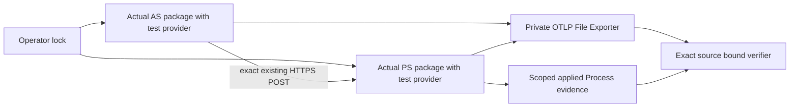
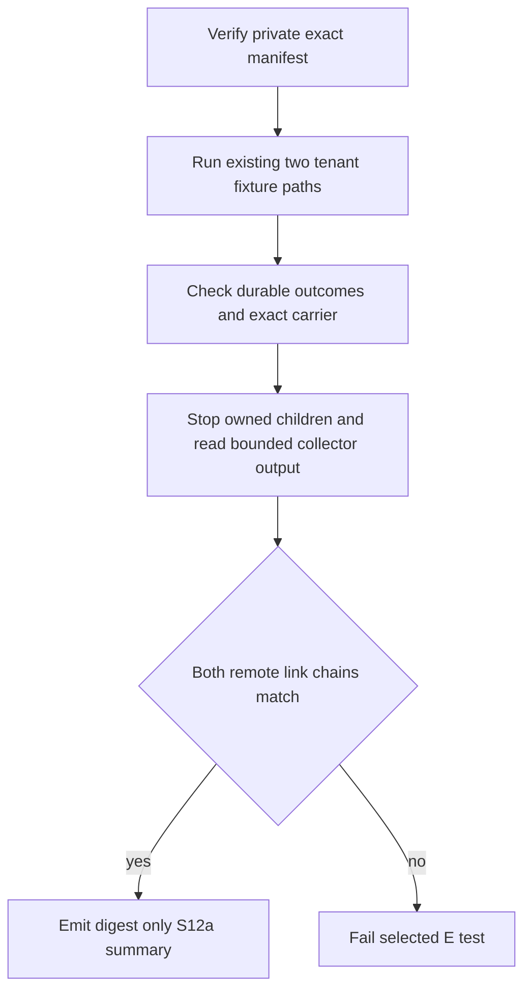
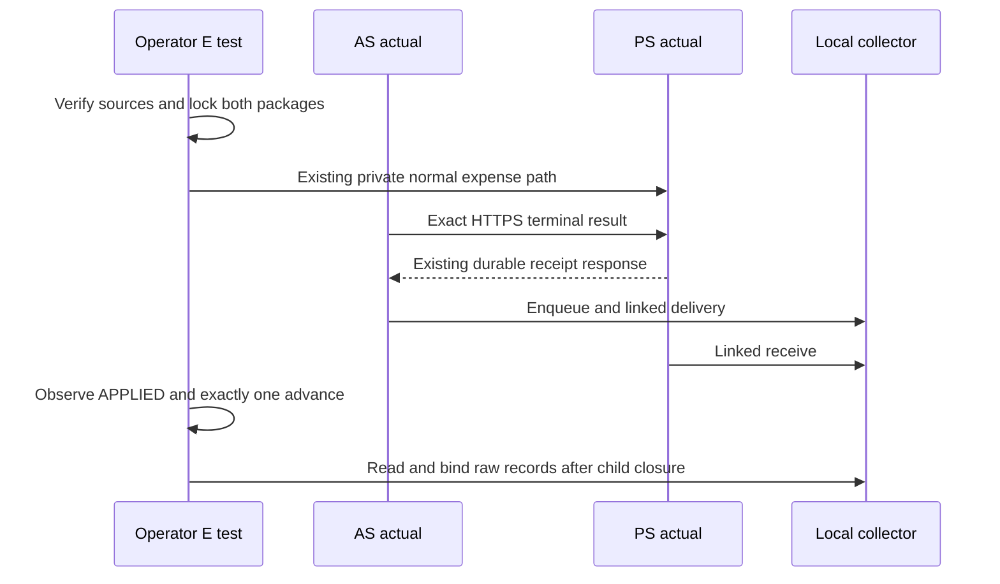

# T4-02 S12a AS→PS 接收 Link 运行验收切片

| Field | Value |
| --- | --- |
| Document | 2026-11-06-00-37-s12-receive-link-evidence.md |
| Template Version | 9 |
| Archetype Cleanup | Not applicable |
| Status | Review |
| Type | Technical Design |
| Complexity | Complex |
| Complexity Drivers | 两份已锁制品、两个租户、私有采集器和持久回执的确定关联 |
| Created | 2026-11-06 00:37 Asia/Shanghai |
| Updated | 2026-11-06 00:37 Asia/Shanghai |
| Owner | Tianji AS/PS |
| Repository | tianji-service |
| Scope | 仅测试代码和操作者 S12a 接收 Link 证据 |
| Change Surface | AS/PS 测试启动与已有 expense fixture，独立 E 选择器及采集器证明 |
| Affected Chapters | §7, §8, §10, §14, §15, §16 |
| Source Requirement | Master §17.2 S12 与 §19 T4-02 实际 AS→PS 接收 Link |
| Baseline Revision | Service f7641a373892bd9e054f79ec97bfbb9dfc8c8e45 |
| Amends | None |
| Supersedes | None |
| Depends On | [Master T4-02](../../../../docs/plans/agent-framework-upgrade-plan.md#t4-02--全链路观测token费用与运行sla) |
| Related Specs | None |
| Related Plans | None |

## 1. Summary

增加独立显式 opt-in 的 S12a E fixture。使用实际 AS/PS 可执行包、现有两个测试租户和 normal expense 流程。每条路径核对已应用 PS Inbox 与一次原生推进，并从该事件的 AS 持久载体精确连到采集器中的 enqueue、deliver、receive Span。此源码切片只交付可执行入口及有限证据。运行验收由操作者另行完成。

## 2. Background and Current State

| ID | Exact authority | Current implication |
| --- | --- | --- |
| EVD-001 | AS AgentResultSpanObservation#enqueueCarrier/delivery、AgentResultDeliveryHandler；CL HttpAgentResultClient 和 AgentResultTraceLinkCarrier | AS 现有 enqueue/deliver，实际 wire 仅既有精确 HTTPS 路径可带已批准诊断头 |
| EVD-002 | PS AgentResultInboxController 和 AgentResultInboxReceiveObservation#afterReceive | 回执成功后只在精确 raw URI 读一次头，使用唯一 Spring OpenTelemetry provider，Link 独立于当前父上下文 |
| EVD-003 | PS ExpenseAcceptanceHarness#launchCommand/verifyArtifact、BusinessProcessAgentAcceptanceIT.Driver#assertNormalEnd | 实际包和测试类树锁、TLS、独立存储和两个租户。已具备有界回执/Flowable/fixture 结果 |
| EVD-004 | ExpenseAcceptanceFaultRelay#forward 与 REQUEST_HEADERS、AS/PS Expense*AcceptanceMain | 原 relay 不转发该头。现有 mains 可在验证私有设置后显式挂测试 initializer |
| EVD-005 | AS Boot 归档 OTel 1.62.0；PS pom 已有测试级 sdk-trace 及其 sdk-common，实际 PS 包已有 API/context/common | 从已锁 AS 归档抽出两个精确 SDK JAR 供 PS 测试子进程。生产包仍无 PS trace SDK |
| EVD-006 | Master S12 和已交付 receive Link 证据 | 现有 U 与制品证据未覆盖实际 collector、独立 HTTPS 及一次应用的同批事实 |

### 2.4 Evidence and current-chain map

| Entry/trigger | Current chain | Data read/written | Dependency | Consumer | Evidence |
| --- | --- | --- | --- | --- | --- |
| Terminal delivery | AS persisted enqueue → delivery span → exact HTTPS client | Existing event and diagnostic carrier | Existing AS/CL | PS Inbox | EVD-001 |
| Accepted result | PS verified endpoint → durable receive → optional Span Link | Existing result fingerprint and receipt | Existing PS auth/store | Current process instance | EVD-002 |
| Fixture | Operator lock → AS/PS mains → native normal expense path | Existing isolated fixture state | Exact signed-off scopes and packages | Source and E verifier | EVD-003/004 |
| Collector | Test provider → local OTLP HTTP → raw File Exporter | Six closed trace observations expected | Official collector pin and existing SDK | New exact evidence check | EVD-005/006 |

### 2.5 Archetype example cleanup

Cleanup disposition: Not applicable
Reason: Existing test modules and existing fixtures. No project generation or example replacement.

## 3. Goals and Non-goals

检验真实采集器保存的 AS enqueue→AS delivery→PS receive 证据与各自持久业务事实匹配。用单独授权的运行数据和已锁制品。保留原 expense E、产品默认值、权限、API、载体协议、迁移和依赖。负面 route、结果重投和重启、Worker tracing、V15、metrics cardinality、日志扫描与完整 S12 仍独立。

### 3.3 Change Surface and Design Depth

| Area/layer | Disposition | Exact repository evidence | Exact delta or preserved invariant | Required Spec treatment | Chapters |
| --- | --- | --- | --- | --- | --- |
| AS/PS Java test sources | Affected | EVD-001–005 | fixed test provider, explicit launch and finite evidence | exact paths and gates | §7, §8, §10, §14, §15, §16 |
| Actual AS/PS route and store | Context-only | EVD-001/002/003 | existing direct HTTPS and read-only fixture witnesses | no API/DDL changes | §9, §11 |
| Collector fixture and operator workflow | Affected | EVD-005/006 | local pinned profile and private evidence | exact bounded opt-in | §7, §8, §14, §15, §16 |
| Web/SDK/grants/production settings | Unchanged | EVD-001/002 | independent ownership | no consumer or grant scope | §12 |

## 4. Requirements and Acceptance Criteria

| ID | Requirement | Acceptance |
| --- | --- | --- |
| REQ-001 | Operator opt-in and independent fixture source | Separate RECEIVE_LINK manifest property, exact archive/test tree pins, isolated two tenants and owner stores |
| REQ-002 | Bind actual durable process outcome | Per tenant completed Agent, applied Inbox, succeeded Outbox, one AGENT_RESULT/native wait advance and existing normal effect receipts |
| REQ-003 | Bind real collector graph to exact durable event | Six expected spans, each source carrier matches its own remote delivery and receive links, no parent substitution or leaked fields |
| REQ-004 | Source/runtime separation | Actual finite and test compile proof first; E only after isolated user opt-in, raw provenance retained, no full S12 credit |

### 4.1 Scenario matrix

| Scenario | Preconditions | Main or alternative path | Outcome | Requirement |
| --- | --- | --- | --- | --- |
| S-01 Authorized path | Exact privately locked archives and input | Two tenant normal flows via AS and PS | Existing once-applied facts and matched collector evidence | REQ-001/002/003 |
| S-02 Missing or invalid profile | Property absent or malformed/present unauthorized | Explicit selector only | Skip on absent, fail on invalid, no E credit | REQ-001/004 |
| S-03 Wrong telemetry | Missing, duplicate, stale, cross-linked or leaked span | Fail bounded collector gate | No positive report | REQ-003/004 |
| S-04 Source validation | No live services supplied | Compile-only E and finite SDK/parser/archive checks | Source evidence only | REQ-004 |

### 4.2 Use-case analysis

| ID | Actor | Evidence |
| --- | --- | --- |
| ACTOR-001 | Authorized fixture operator | Existing T3-12 profile and Master S12 |
| ACTOR-002 | Source reviewer | Actual archive and finite test evidence |

| ID | Use case/goal | Actor | Trigger | Outcome | Alternative | Postcondition |
| --- | --- | --- | --- | --- | --- | --- |
| UC-001 | Prove one receive path per tenant | ACTOR-001 | Approved private manifest and collector | Raw linked and matched outcome report | fail/skip independent | No production effect |
| UC-002 | Verify safe fixture source | ACTOR-002 | Source GO | finite and package proof | no runtime credit | Ordinary expense gates intact |

## 5. Constraints, Assumptions, and Decisions

DEC-001 Reuse normal expense fixture with a distinct RECEIVE_LINK suite/property. Existing manifest structure and class-tree digest remain authoritative. The ordinary expense report writer rejects the new suite. Source work does not authorize child, collector, database, provider or deployment launch.

DEC-002 Existing AR V1–V14, PS V1–V10, Worker V1–V2 and owner-scoped stores remain the disposable fixture profile. Add no dependency/POM. PS operator test child may load exactly OTel sdk-trace/common 1.62.0 from the verified AS executable archive. No production runtime receives these additions.

DEC-003 Collector uses one reviewed loopback OTLP/HTTP endpoint, fixed official Contrib 0.136.0, no remote export, private raw File Exporter. Exact operator binary and configuration provenance is external to source. Current certified Linux arm64 archive SHA is f768015766c8ace50caf9130ad0f38e4781f76b9abe4380b26c875108bb51899.

## 6. Project Technology Context

JDK25, existing Boot 4.1.2, JUnit, Jackson 3, OTel Java SDK 1.62.0 and existing plain JDBC observer. Existing artifact test path uses Boot PropertiesLauncher. Two main adapters are test-only. Reuse live artifact loaders; provide one deterministic in-memory codec/sink seam for finite assertions.

### 6.2 User-mandated Java rule compliance

| Literal rule | Affected? | Repository evidence | Exact design decision | Files/types/interfaces | Validation/test evidence | Status/blocker |
| --- | --- | --- | --- | --- | --- | --- |
| Rule 1 | Yes | EVD-003/005 | Existing fixture classes and named test observations | §8/10 | TEST-001/002 | PASS |
| Rule 2 | Yes | EVD-003 | Existing closed manifest plus explicit transport/evidence checks | §7/10 | TEST-001/002 | PASS |
| Rule 3 | Yes | EVD-003 | Immutable test observation record, no new production PO | §10 | TEST-002 | PASS |
| Rule 4 | Yes | EVD-002/003 | One explicit test bean and existing startup boundaries, no business log | §7/15 | TEST-002/003 | PASS |
| Rule 5 | Yes | EVD-005 | Existing JDK, Jackson and OTel only | §6/7 | TEST-001/003 | PASS |
| Rule 6 | Yes | EVD-005 | Closed JSON OTLP fixture and duplicate-key rejection | §7/10 | TEST-001/002 | PASS |
| Rule 7 | Yes | EVD-003 | Private child properties only; existing defaults intact | §16 | TEST-002/003 | PASS |
| Rule 9 | Yes | EVD-003 | Existing harness and direct test adapter | §13 | TEST-002 | PASS |
| Rule 10 | Yes | EVD-003/005 | Instant for occurrence; monotonic polling bound | §6.3/7 | TEST-002 | PASS |
| Rule 11 | Yes | EVD-001/003 | Existing owner-scoped fixture/read topology and no production write changes | §11 | TEST-003/004 | PASS |

### 6.3 Time semantics and conversion contract

Time contract: Required

| Time ID | Fields/symbols | Semantics | Java/runtime type | Storage policy | Wire policy | Business zone source | Display zone source | Boundary / DST rules | Precision / Clock | Compatibility | Verification |
| --- | --- | --- | --- | --- | --- | --- | --- | --- | --- | --- | --- |
| TIME-001 | OTLP startTimeUnixNano/endTimeUnixNano and test lower bound | Occurred instant | Instant and decimal epoch-nanos | Not persisted | Internal | Explicit epoch UTC | Private UTC evidence | start ≥ run start; end ≥ start; reject stale | Nanosecond decimal OTLP wire, same isolated host clock; monotonic 5s poll | No business time change | TEST-002/004 |

## 7. Architecture Design

### 7.0 Minimum-design baseline and element-necessity audit

| Proposed element | Change | Requirements | Existing baseline | Verdict |
| --- | --- | --- | --- | --- |
| Existing harness and normal scenario | Extend test only | REQ-001/002 | Current scoped real child boot and witness logic | Reuse |
| Test-only provider and verifier | Add | REQ-003 | Existing local SDK tests do not exercise isolated collected transport | Fixed OTel fixture and strict graph gate |
| Separate E selector and recipe | Add | REQ-004 | Expense E emits different four-path claim | Dedicated safe boundary |
| Prod APIs, ports, carriers and dependencies | None | REQ-004 | Existing exact behavior sufficient | Preserve |

| Path | Network calls | Client states | Data change | Consequence |
| --- | --- | --- | --- | --- |
| Ordinary source | none added | same | none | stable |
| Operator E | existing fixture HTTPS plus loopback OTLP | only successful scoped result | disposable fixture only | exact private raw proof |

### 7.1 System Architecture Design

### 7.2 High-Level Design

#### 7.2.2 High-level decision and quality matrix

| Concern/use case | Requirement | Mechanism | Failure | Verification |
| --- | --- | --- | --- | --- |
| Actual source and isolation | REQ-001 | current lock + private separate suite | no launch for unapproved profile | TEST-002/003 |
| Outcome | REQ-002 | existing normal fixture witnesses | mismatch fails | TEST-004 |
| Trace integrity | REQ-003 | event-derived carrier and closed six-span graph | no positive summary | TEST-001/002/004 |
| No fake evidence | REQ-004 | finite/package/E split | skipped or absent E remains open | TEST-003/004 |

### 7.3 Detailed Design

Use a separate test property and enum without changing old suite evidence or configuration behavior. Existing manifest verifies revisions, private files, package SHA, both fixture class-tree SHA, exact owned endpoints/credentials, empty disposable sources and current migration history. S12-specific library extractor checks archive SHA again, unique expected nested entries, size and exact constant SDK SHA before the children. Recheck PS fixture tree before the AS child loads its one fixed initializer and the staged SDK files against source constants before the PS child. Require a fresh privateRoot each attempt. Existing main paths validate operator config first. No arbitrary class name or exported loader location can be supplied by child configuration.

The fixture enables the three existing AS and PS observation flags only in private fixture configuration. AS destination goes directly to the exact PS loopback HTTPS root so the old relay strips no carrier. Both children obtain a unique fixed test provider and send closed diagnostic data to the exact local OTLP HTTP trace endpoint. Batches are bounded and rejected as a whole if unknown scope, attributes, events or trace state occur. No browser, external provider or production service is involved.

Both normal paths retain current tests for START, linked terminal state, applied Inbox, succeeded Outbox and business effects. Test reads the exact outbox message's durable enqueue carrier only after observing its scoped applied Inbox result. After the owned children stop, the verifier reads a private, single-link bounded collector file and requires two independent enqueue→deliver→receive graphs with six distinct trace IDs, exact source IDs, remote sampled links and no parent substitution. The report emits only package/test-tree/collector digests and count. No actual E report can be inferred from the compile gate.

#### 7.3.6 Conclusion evidence chain

| Conclusion | Evidence | Constraint | Decision | Proof |
| --- | --- | --- | --- | --- |
| Same real product HTTP behavior | EVD-001/002/004 | Exact HTTPS path, no production changes | Private direct destination only | TEST-003/004 |
| Evidence covers actual applied results | EVD-003 | Event/destination/tenant binding | durable carrier and count per path | TEST-004 |
| Source evidence cannot imply S12 | EVD-006 | Collector and actual environment separate | narrow S12a result and no ordinary E evidence | TEST-001/003/004 |

## 8. Package Structure and Code File Tree

| Operation | Exact path |
| --- | --- |
| Modify | stellar-enclosure-tianji-process-server/src/test/java/top/egon/cola/platform/tianji/process/server/acceptance/BusinessProcessAgentAcceptanceIT.java |
| Modify | stellar-enclosure-tianji-process-server/src/test/java/top/egon/cola/platform/tianji/process/server/acceptance/ExpenseAcceptanceHarness.java |
| Modify | stellar-enclosure-tianji-agent-server/src/test/java/top/egon/cola/platform/tianji/agent/server/acceptance/ExpenseAgentAcceptanceMain.java |
| Modify | stellar-enclosure-tianji-process-server/src/test/java/top/egon/cola/platform/tianji/process/server/acceptance/ExpenseProcessAcceptanceMain.java |
| Create | stellar-enclosure-tianji-process-server/src/test/java/top/egon/cola/platform/tianji/process/server/acceptance/S12ReceiveLinkAcceptanceIT.java |
| Create | stellar-enclosure-tianji-process-server/src/test/java/top/egon/cola/platform/tianji/process/server/acceptance/S12ReceiveLinkCollectorEvidence.java |
| Create | stellar-enclosure-tianji-process-server/src/test/java/top/egon/cola/platform/tianji/process/server/acceptance/S12ReceiveLinkCollectorEvidenceTest.java |
| Create | stellar-enclosure-tianji-process-server/src/test/java/top/egon/cola/platform/tianji/acceptance/S12ReceiveLinkInitializer.java |
| Create | stellar-enclosure-tianji-process-server/src/test/java/top/egon/cola/platform/tianji/acceptance/S12ReceiveLinkTelemetry.java |
| Create | stellar-enclosure-tianji-process-server/src/test/java/top/egon/cola/platform/tianji/acceptance/S12ReceiveLinkTelemetryTest.java |
| Create | stellar-enclosure-tianji-process-server/src/test/resources/acceptance/s12/collector-v0.136.0.yaml |
| Create | docs/egon/spec/2026-11-06-00-37-s12-receive-link-evidence.md |
| Create | docs/egon/plan/2026-11-06-00-38-s12-receive-link-evidence.md |
| Create | docs/egon/evidence/2026-11-06-s12-receive-link-evidence.md |
| Create | docs/egon/evidence/2026-11-06-s12-receive-link-operator.md |

## 9. Interface Definitions

Context-only external interfaces. Existing POST /api/tianji/v1/agent-result-inbox, existing private approved diagnostic header, existing START and Worker routes are only exercised. No new API, header, grant, PaC or public consumer. The private E selector/property, loopback test collector and fixed evidence line are local test interfaces in §§7/10/14.

## 10. POJO and Data Model Design

Reuse ExpenseAcceptanceManifestDTO plus test-only RECEIVE_LINK suite value. Evidence parser holds an immutable ObservedSpan with fixed name, trace ID, span ID, parent and one linked key. Collector JSON contains exact service.name, scope, span name, kind, span identifiers, timestamp and at most one remote sampled Link. Existing artifact hashes identify accepted launch inputs. Output contains exact SHA-256 strings and number of paths, no business/tenant/run/trace identifiers.

## 11. Database Design

Context-only. Existing Driver validates three fresh disposable fixture stores, existing revisions and fixed Flyway histories. One additional observer SELECT reads only the trace_id from the exact successful AS Outbox row using scoped Inbox event and known destination/channel. No DDL, external database, production schema or data change.

## 12. Frontend Page Design

No Web or SDK change in this test fixture.

## 13. Design Patterns and Architecture Principles

Reuse the existing expense driver and test launch adapter. A single explicit SpanExporter converts only the tested SDK envelopes and lets the same logic target a finite in-memory sink or isolated real collector. Do not add a general telemetry platform or a second E harness.

## 14. Test Design

| ID | Test or gate | Exact proof |
| --- | --- | --- |
| TEST-001 | Typed RED and S12ReceiveLinkTelemetryTest | Missing positive collector result; real SDK remote link and local parent separation, closed attrs and endpoint rejection |
| TEST-002 | S12ReceiveLinkCollectorEvidenceTest and ExpenseAcceptanceHarnessTest | Complete vs partial, wrong source, cross-link, duplicate, stale and privacy rejection; unchanged normal harness and private initializer |
| TEST-003 | Actual bounded G1/P1 | Existing AS/CL/PS finite selectors; actual AS/PS Boot class-only linkage, all E sources compile but no E test selected, fixture stays test-only |
| TEST-004 | Operator-only S12ReceiveLinkAcceptanceIT | Actual two scoped receipt/advance and exact collector chains, one raw test report with no skips, retained SHA-256 and independent provenance |

## 15. Non-functional and Cross-cutting Design

Fixed loopback collector, no proxies/redirects, bounded two-second export, bounded queue/batch and private file ≤128 KiB. Use monotonic final wait at most five seconds. Only fixed trace fields may leave the test provider. Report only non-sensitive hashes. Current source scans no real provider export or logs.

## 16. Compatibility, Migration, Rollout, and Rollback

Use only test sources/resources and source evidence docs. Ordinary Business/Recovery manifests, runtime flags, APIs, dependencies, model and migrated schemas stay compatible. No collector binary enters the repo. A future actual E run requires private isolated provisioning and independent operator authorization. Withdraw the opt-in by omitting the new manifest/selector.

## 17. Alternatives and Decisions

The ordinary expense fault relay intentionally excludes this private diagnostic header. Direct existing HTTPS in the new normal slice preserves that boundary. An independent fake collector fixture tests only parser behavior; actual E must capture the pinned external collector. A new production export dependency is unnecessary.

## 18. Risks and Open Questions

No real E result yet. Runtime provider uniqueness, IAM, PostgreSQL, receiver and collector output remain to be observed. This slice does not cover replay, restart, Worker Links, V15, full business-to-model/tool/failure chain, actual metrics cardinality or log scan.

## 19. Traceability Matrix

| Requirement | Use case | Design | Evidence |
| --- | --- | --- | --- |
| REQ-001 | UC-001 | §5/7/8 | TEST-002/003/004 |
| REQ-002 | UC-001 | §7/11 | TEST-004 |
| REQ-003 | UC-001 | §7/10/15 | TEST-001/002/004 |
| REQ-004 | UC-002 | §14/16/18 | TEST-002/003/004 |

## 20. Review and Acceptance

### 20.5 Blocking Manual Check

| Check ID | Applicability | Status | Evidence | Finding | Required action/exception |
| --- | --- | --- | --- | --- | --- |
| MC-ARCH-001 | Applicable | PASS | §5/7/8/14/16 | Existing fixture and actual AS/PS | None |
| MC-REUSE-001 | Applicable | PASS | §5/7/8/14/16 | Existing real launcher and normal witness | None |
| MC-DEP-001 | Applicable | PASS | §5/7/8/14/16 | No POM or new production dependency | None |
| MC-NAME-001 | Applicable | PASS | §5/7/8/14/16 | Explicit test fixture types | None |
| MC-VALID-001 | Applicable | PASS | §5/7/8/14/16 | Exact manifest, local endpoint and closed parser | None |
| MC-MODEL-001 | Applicable | PASS | §5/7/8/14/16 | Immutable source evidence | None |
| MC-CONVERT-001 | Applicable | PASS | §5/7/8/14/16 | Fixed SDK envelope | None |
| MC-LOG-001 | Applicable | PASS | §5/7/8/14/16 | Digest-only report and no product log | None |
| MC-BEAN-001 | Applicable | PASS | §5/7/8/14/16 | One explicit test provider only | None |
| MC-UTIL-001 | Applicable | PASS | §5/7/8/14/16 | Existing JDK, Jackson and SDK | None |
| MC-JSON-001 | Applicable | PASS | §5/7/8/14/16 | Strict private collector JSON | None |
| MC-TIME-001 | Applicable | PASS | §5/7/8/14/16 | UTC nanos and monotonic wait | None |
| MC-CONFIG-001 | Applicable | PASS | §5/7/8/14/16 | Private test opt-in | None |
| MC-PATTERN-001 | Applicable | PASS | §5/7/8/14/16 | Existing driver and fixed exporter | None |
| MC-SCOPE-001 | Applicable | PASS | §5/7/8/14/16 | 15 test/resource/doc paths only | None |
| MC-TEST-001 | Applicable | PASS | §5/7/8/14/16 | Finite/packaged/live evidence separated | None |
| MC-BLOCKER-001 | Applicable | PASS | §5/7/8/14/16 | No E or production activation inferred | None |

**PASS — Ready for user review**
