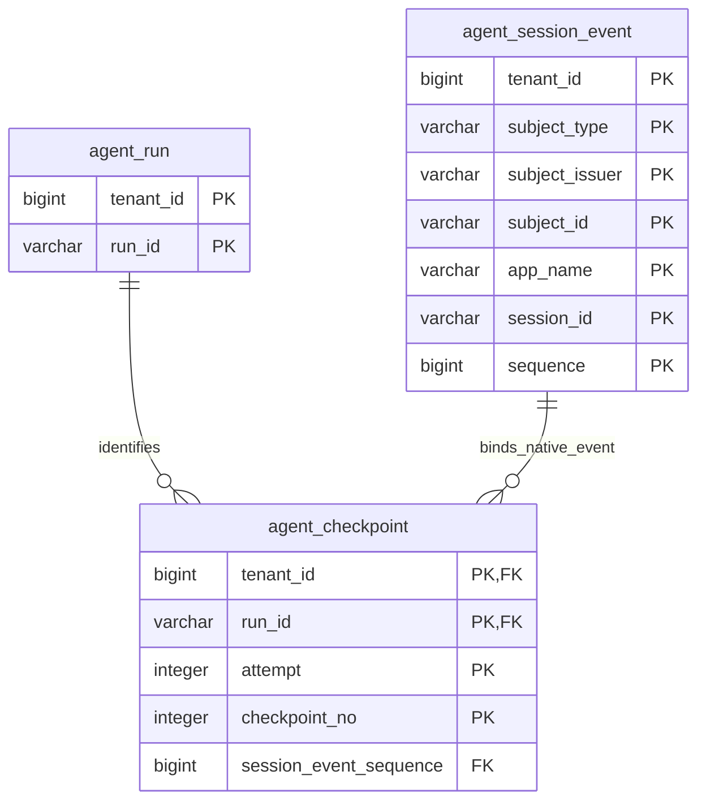

# T4-03 Agent checkpoint 存储契约

| Field | Value |
| --- | --- |
| Document | docs/egon/spec/2026-11-06-01-25-agent-checkpoint-storage.md |
| Template Version | 9 |
| Archetype Cleanup | Not applicable |
| Status | Review |
| Type | Feature |
| Complexity | Simple |
| Complexity Drivers | One owner-local catalog guard and new inert relational contract |
| Created | 2026-11-06 01:25 Asia/Shanghai |
| Updated | 2026-11-06 01:25 Asia/Shanghai |
| Owner | Tianji Agent Runtime |
| Repository | tianji-service |
| Scope | AgentDB V16 and optional internal schema readiness only |
| Change Surface | One classpath Flyway SQL, one existing verifier, one finite test and three documents |
| Affected Chapters | §7, §8, §11, §14, §15, §16 |
| Source Requirement | [主计划 §10.2、§17 S11、§19 T4-03](../../../../docs/plans/agent-framework-upgrade-plan.md) |
| Baseline Revision | 98ccd8fa189aecf54641d8e55af5a7a02060610d |
| Amends | None |
| Supersedes | None |
| Depends On | None |
| Related Specs | [V15 模型用量](2026-11-05-16-08-agent-model-usage-ledger.md), [双 JVM 恢复探针](2026-11-06-00-31-adk-durable-resume-fork.md) |
| Related Plans | [Checkpoint storage](../plan/2026-11-06-01-26-agent-checkpoint-storage.md) |

## 1. Summary

新增一份 AgentDB V16 和可显式调用的内部校验。表只保存未来首条持久用户输入的有限证据，当前没有写入、读取、启动装配或接管入口。独立的写入步骤和操作者验收决定何时可在实际环境使用此表。

## 2. Background and Current State

| Evidence ID | Classification | Exact source | Observed fact |
| --- | --- | --- | --- |
| EVD-001 | Current database | AR V1, V3, V5 and V15 under db/tianji-agent | Run PK and full-owner native event PK exist. V15 is current tip and no checkpoint table exists. |
| EVD-002 | Current readiness | AgentStorageVerifier#verify, #verifyModelUsage, #checksum | Primary/catalog inspection uses Spring JDBC and independently checks optional historical schema. |
| EVD-003 | Current transaction | PostgresAdkSessionService#append, JdbcAdkSessionRepository#lockRun and #liveFences | Current append owns native event and Session revision; both Run and Session are fenced. |
| EVD-004 | Current provenance | AgentLedgerService#executionMaterial and AgentRunAuthorization.Request | Reuse existing verified definition, request and canonical snapshot digests in future capture. |
| EVD-005 | Current operator fixtures | AgentModelUsagePostgresTest#database, AdkDurableResumeBoundaryPostgresTest#probeFlyway, BusinessProcessAgentAcceptanceIT#history | Explicit V15, V9 and V14 pins respectively, with separate historical acceptance. |
| EVD-006 | Current boot | AS and PS application.yml, TianjiAgentStorageConfiguration | Flyway disabled in both products. AS SQL init never. No default writer or catalog check for this feature. |

### 2.5 Archetype example cleanup

Cleanup disposition: Not applicable

Reason: An established ordinary JDBC infrastructure module and a new migration only. No generated business modules or examples enter scope.

## 3. Goals and Non-goals

锁定新存储契约与接入前校验。写入、恢复调用、Run 接管、权限或授予、更改产品配置、应用 DDL、修复 Flyway 和真实 S11 均属独立步骤。

### 3.3 Change Surface and Design Depth

| Area/layer | Disposition | Exact repository evidence | Changed or preserved behavior/contract | Required Spec treatment | Chapter(s) |
| --- | --- | --- | --- | --- | --- |
| AR primary storage | Affected | EVD-001/002/003 | V16 and exact new optional catalog guard | Typed schema, verification and rollout | §7/§8/§11/§14/§15/§16 |
| Future capture and recovery | Context-only | EVD-003/004 | Existing Run and Session flow remains authoritative | Future dependency and evidence | §7/§10/§18 |
| App, API and frontend | Unchanged | EVD-005/006 | Existing boot, scopes and clients | No wire or runtime changes | §9/§12/§16 |

## 4. Requirements and Acceptance Criteria

| ID | Atomic requirement | Priority | Observable acceptance criteria | Source |
| --- | --- | --- | --- | --- |
| REQ-001 | Define bounded immutable V16 | Must | One new migration, exact typed fields, digest and boundary bounds, existing 27 SQL match source baseline | T4-03 storage and EVD-001 |
| REQ-002 | Preserve owner and deletion lifecycle | Must | Run and full-owner Session-event CASCADE FK and supporting index; no parent table DDL, grant or backfill | T4-03 and EVD-001/003 |
| REQ-003 | Verify exact optional storage on primary | Must | Fixed V16 resource/history, columns, constraints, index and insert-only role, reject all mismatch with sanitized error | T4-03 and EVD-002 |
| REQ-004 | Keep storage inert and protect compatibility | Must | No runtime invocation, config, public contract, V15 changes, DDL execution or live acceptance claims | EVD-004/005/006 |

### 4.2 Use-case analysis

| Actor ID | Actor | Evidence |
| --- | --- | --- |
| ACTOR-001 | Agent storage operator or later owning host | Current pre-provisioned AgentDB and exact optional verifier, EVD-002/006 |
| ACTOR-002 | Maintainer | Existing owner source reactor, EVD-002/005 |

| ID | Use case/goal | Actors | Main flow | Outcome |
| --- | --- | --- | --- | --- |
| UC-001 | Check prerequisite before future capture | ACTOR-001 | Explicit internal verifier call on configured primary inspects exact V16 and role | Returns void for exact catalog or fails closed |
| UC-002 | Review a backward-compatible source Step | ACTOR-002 | Run finite/catalog tests and packaged resource/scope gates | Source proof and independently identified operator gates |

## 5. Constraints, Assumptions, and Decisions

Use current ordinary PostgreSQL, same Agent owning primary and exact Flyway version chain. All 27 old production migrations are immutable. New V16 adds a table and one child index only. The user-directed existing classpath Flyway migration path governs this storage. This is later technical DDL for the existing Agent JDBC profile, outside the native CREATE catalog generator's supported profiles.

ASM-001. The Session event is the durable native source. Its full-owner sequence key supports an enforceable FK without altering an existing table. Native event ID is separately recorded and must match the source event when future code writes or consumes it.

## 6. Project Technology Context

Java 25 and existing Spring JDBC/Tx with PostgreSQL. No public JSON, PO, ORM mapping, Bean or dependency. Technical evidence uses current repository-level direct verification.

### 6.2 User-mandated Java rule compliance

```text
1 类名规范，必须以 java的pojo规范命名。以dao po bo vo dto query command event等结尾
2 每层之间必须被 springboot-validation 校验，复用对象使用分组校验；基于原生和自定义约束注解、@Valid、@Validated 及 ConstraintValidator 扩展实现。ValidationUtils 只承担通用手工校验，不承载全部业务校验；电话号码复用 libphonenumber。
3 Java POJO 默认使用 class，注解为 @Data @NoArgsConstructor @AllArgsConstructor @Accessors(chain = true)，按构造目标选择 @Builder 或 @SuperBuilder；父类状态参与相等性时使用 @EqualsAndHashCode(callSuper = true)。只有不可变 value object 可以使用 record，并豁免 class 的 Lombok 规范；普通实体不能因简单而使用 record。使用 MapStruct、MapStructPlus 和 egon-cola-component-common-core 的 BaseConverter（双向）或 BaseForwardConverter（不可逆投影）进行转换。
4业务类必须使用@Slf4j注解注入log对象。如果业务类被spring管理，必须指定名称，如果是单例的情况下，参考@Service("userService")。如果需要依赖注入，必须@RequiredArgsConstructor进行修饰，不要代码中写。且属性必须被@qualify修饰。
5 工具类只允许使用jdk原生、Apache Commons(commons-lang3、commons-collections4、commons-io、commons-text、commons-codec、commons-beanutils)、Guava。针对Tika按需引入。
6 JSON 使用 Spring Boot Jackson；持久化枚举值使用 @EnumValue，向前端输出的枚举值使用 @JsonValue，禁止 ordinal 作为业务编码。
7 springboot 多环境配置文件，必须保持配置一致，但值不一定一致。
9 复杂业务必须引入设计模式，不允许硬编码
10 日期相关的必须使用java.time下的实体类，不允许使用java.util下的
11 只允许现有三层结构或当前 egon-cola-archetypes 的 DDD 结构，三层结构保持现状。必须尽量复用 egon-cola-components；持久化模块必须使用 Egon COLA MP Starter，DDL 统一由 egon-mp-sdj-ext-starter 分布式管理。业务唯一键必须组合业务列与 deletedAt（数据库 deleted_at），并验证 NULL、租户及重复软删除语义。采用 CQE（Command Query Event）；Event 必须经 egon-cola-component-transactional-outbox-starter 或 MQ 中间件投递。
```

| Literal rule | Affected? | Repository evidence | Exact design decision | Files/types/interfaces | Validation/test evidence | Status/blocker |
| --- | --- | --- | --- | --- | --- | --- |
| Rule 1 | Yes | EVD-001/002/003 | Existing technical verifier and exact test name | §7/§8/§11 | TEST-001–004 | PASS |
| Rule 2 | Yes | EVD-001/002/003 | Check PostgreSQL catalog and privilege shape at storage boundary | §7/§8/§11 | TEST-001–004 | PASS |
| Rule 3 | No | EVD-001/002/003 | No persistence object or application DTO | §7/§8/§11 | TEST-001–004 | N/A |
| Rule 4 | No | EVD-001/002/003 | Existing non-Bean verifier and fixed domain exception | §7/§8/§11 | TEST-001–004 | N/A |
| Rule 5 | Yes | EVD-001/002/003 | Existing JDBC/transaction and JDK digest | §7/§8/§11 | TEST-001–004 | PASS |
| Rule 6 | No | EVD-001/002/003 | DDL JSONB shape only, with no Java or wire JSON change | §7/§8/§11 | TEST-001–004 | N/A |
| Rule 7 | No | EVD-001/002/003 | No product property or startup wiring | §7/§8/§11 | TEST-001–004 | N/A |
| Rule 9 | No | EVD-001/002/003 | One fixed technical guard, without business variation | §7/§8/§11 | TEST-001–004 | N/A |
| Rule 10 | Yes | EVD-001/002/003 | UTC occurrence in timestamptz(6) from a later database clock | §7/§8/§11 | TEST-001–004 | PASS |
| Rule 11 | Yes | EVD-001/002/003 | Existing AR Flyway/JDBC boundary and existing CQE unchanged | §7/§8/§11 | TEST-001–004 | PASS |

### 6.3 Time semantics and conversion contract

Time contract: Required

| Time ID | Fields/symbols | Semantics | Java/runtime type | Storage policy | Wire policy | Business zone source | Display zone source | Boundary / DST rules | Precision / Clock | Compatibility | Verification |
| --- | --- | --- | --- | --- | --- | --- | --- | --- | --- | --- | --- |
| TIME-001 | agent_checkpoint.captured_at | Occurred instant | PostgreSQL timestamptz(6), future Java java.time.Instant | UTC instant | UTC Z | Not applicable: absolute instant | Not applicable: private storage | Reject infinite instants, DST independent | Six fractional digits, future PostgreSQL clock_timestamp(), no capture call in this Step | New field, older timestamps untouched | Step 1 TEST-001/004 and future operator round-trip |

## 7. Architecture Design

### 7.0 Minimum-design baseline and element-necessity audit

| Proposed element | Change | Requirements | Direct alternative | Verdict |
| --- | --- | --- | --- | --- |
| Existing AgentStorageVerifier | Add one explicit optional method | REQ-003 | Generic boot verifier proves earlier tables only | Necessary |
| V16 Agent checkpoint table | Add one immutable migration | REQ-001/002 | Current history and usage tables have different authorities and retention | Necessary |
| Separate reader, writer, service or port | None | REQ-004 | Existing schema guard plus packaged SQL suffice | Deferred |

| Path | Network calls | Client states | Authority | Decision |
| --- | --- | --- | --- | --- |
| This source Step | No new route | No client changes | Existing Agent primary, explicit call | Keep |
| Future capture and takeover | Separate review | Current lifecycle until separately implemented | Existing owner plus approved future gate | Separate |

### 7.1 System Architecture Design

Traditional repository-owned AR infrastructure. The current primary DataSource stays authoritative. Existing release/Agent/Process ownership and CQE interfaces do not change.

### 7.2 High-Level Design

A dedicated V16 table references the existing exact Run and native Session event. The new method `public void verifyCheckpointCapture()` in `AgentStorageVerifier` is an explicit technical prerequisite. Current application constructors and startup guard never call it.

### 7.3 Detailed Design

The verifier rejects an ambient transaction and verifies the bounded immutable classpath SQL resource before catalog access. On its own existing primary transaction, verify physical primary, writable transaction, UTF8, origin role, exactly one successful V16 SQL history row with exact filename and Flyway checksum, closed table/columns/keys/checks/indexes and runtime role. Runtime role must be an ordinary non-owner, non-superuser and non-bypass role with existing schema usage but no schema CREATE and an INSERT-only grant on the new table. Refuse table/column SELECT, UPDATE and REFERENCES, table DELETE, TRUNCATE and TRIGGER, INSERT WITH GRANT OPTION, inherited owner privilege, RLS, partitions, inheritance, rewriting and untrusted triggers. Only validated ordinary FK trigger shape is acceptable. Current source never executes the writer. Catalog and JDBC failures yield the current fixed sanitized dependency error.

## 8. Package Structure and Code File Tree

| Operation | Exact path | Scope |
| --- | --- | --- |
| CREATE | `stellar-enclosure-tianji-agent-runtime/src/test/java/top/egon/cola/platform/tianji/agent/infrastructure/persistence/AgentCheckpointStorageVerifierTest.java` | Fixed catalog finite test |
| CREATE | `stellar-enclosure-tianji-agent-runtime/src/main/resources/db/tianji-agent/V16__add_agent_checkpoint.sql` | One immutable V16 |
| MODIFY | `stellar-enclosure-tianji-agent-runtime/src/main/java/top/egon/cola/platform/tianji/agent/infrastructure/persistence/AgentStorageVerifier.java` | Current Agent verifier opt-in method |
| CREATE | `docs/egon/spec/2026-11-06-01-25-agent-checkpoint-storage.md` | Effective reviewed contract |
| CREATE | `docs/egon/plan/2026-11-06-01-26-agent-checkpoint-storage.md` | One source Step |
| CREATE | `docs/egon/evidence/2026-11-06-agent-checkpoint-storage.md` | Actual source/package evidence |

## 9. Interface Definitions

No API, event, SDK, frontend or wire contract changes. The internal void method is specified in §7.

## 10. POJO and Data Model Design

No new Java data carrier or mapping. The typed relational record below is linked to the original Run and native Session event rows. A future caller can reuse `AgentRunAuthorization.Request`, whose exact owner and digests are already computed by `AgentLedgerService#executionMaterial`.

## 11. Database Design

### 11.1 Table Inventory

| Table | Existing/new | Purpose and owner | Read/write paths | Change | DDL script | Requirements |
| --- | --- | --- | --- | --- | --- | --- |
| tianji_agent.agent_checkpoint | New | AR historical recovery boundary | Catalog only in this Step | New table | V16__add_agent_checkpoint.sql | REQ-001/002/003 |

Existing Agent Run and native Session event are FK targets with their original PKs, ownership, lifecycle and DDL.

### 11.2 Per-table Detailed Design

#### 11.2.1 tianji_agent.agent_checkpoint

##### Purpose, ownership, and lifecycle

AgentDB SINGLE owning primary, tenant-scoped technical evidence. Append-only application contract. A future admitted run records at most one first boundary per attempt. No backfill, runtime writer, data exposure or retention job in this Step. Owner erasure remains possible through existing parent deletions. Independent retention is a later operator policy. No raw input, model response, tokens or credentials enter this table.

##### Complete column design

| Column | Native type | Length/precision | Null | Default | Generated | PK/FK/unique/check | Meaning | Source/mapping | Example |
| --- | --- | --- | --- | --- | --- | --- | --- | --- | --- |
| `tenant_id` | bigint | 64 bit | No | None | No | PK, both FKs, positive | Owner tenant | Current Agent run and session owner | 42 |
| `run_id` | varchar | 64 C | No | None | No | PK, Run FK | Run identifier | Locked Agent run | run-fixture |
| `attempt` | integer | 32 bit | No | None | No | PK, positive | Run attempt | Locked Agent run | 1 |
| `checkpoint_no` | integer | 32 bit | No | None | No | PK, positive | Checkpoint ordinal | First boundary has ordinal 1 | 1 |
| `subject_type` | varchar | 16 C | No | None | No | Session event FK, USER only | Owner subject type | Existing Agent scope | USER |
| `subject_issuer` | varchar | 64 C | No | None | No | Session event FK, issuer digest | Verified issuer fingerprint | Existing Agent scope | 64 lowercase hex |
| `subject_id` | varchar | 256 C | No | None | No | Session event FK | Exact owner subject | Existing Agent scope | fixture-owner |
| `app_name` | varchar | 128 C | No | None | No | Session event FK, tianji only | Native Session namespace | Existing Session binding | tianji |
| `session_id` | varchar | 128 C | No | None | No | Session event FK | Native Session identifier | Existing Session binding | fixture-session |
| `run_lease_epoch` | bigint | 64 bit | No | None | No | Positive | Owning Run fencing epoch at cut | Locked Run | 1 |
| `run_revision` | bigint | 64 bit | No | None | No | Positive | Observed Run revision | Locked Run | 2 |
| `run_event_sequence` | bigint | 64 bit | No | None | No | Positive | Observed product event watermark | Locked Run | 2 |
| `session_lease_epoch` | bigint | 64 bit | No | None | No | Positive | Owning Session fence at cut | Locked Session lease | 1 |
| `prior_session_revision` | bigint | 64 bit | No | None | No | Nonnegative, exact increment | Session revision before append | Locked Session | 0 |
| `session_revision` | bigint | 64 bit | No | None | No | Prior revision plus one | Session revision after append | Existing Session update | 1 |
| `prior_session_event_sequence` | bigint | 64 bit | No | None | No | Nonnegative, exact increment | Native sequence before append | Locked Session | 0 |
| `session_event_sequence` | bigint | 64 bit | No | None | No | Session event FK, prior sequence plus one | New native sequence | Existing Session update | 1 |
| `native_invocation_id` | varchar | 128 C | No | None | No | Bounded exact text | ADK invocation provenance | Decoded durable event | fixture-invocation |
| `native_event_id` | varchar | 128 C | No | None | No | Bounded exact text | ADK event identity | Decoded durable event | fixture-input-event |
| `definition_key` | varchar | 128 C | No | None | No | Bounded exact text | Published definition key | Verified execution material | fixture-agent |
| `definition_version` | bigint | 64 bit | No | None | No | Positive | Published definition version | Verified execution material | 1 |
| `definition_sha256` | char | 64 C | No | None | No | Lowercase SHA-256 | Definition identity | Existing canonical verified digest | 64 lowercase hex |
| `request_sha256` | char | 64 C | No | None | No | Lowercase SHA-256 | Original request identity | Existing canonical verified digest | 64 lowercase hex |
| `snapshot_sha256` | char | 64 C | No | None | No | Lowercase SHA-256 | Execution snapshot identity | Existing canonical verified digest | 64 lowercase hex |
| `policy_version_ref` | varchar | 256 C | No | None | No | Bounded exact text | Policy provenance | Existing verified policy ref | fixture-policy-v1 |
| `engine_version` | varchar | 32 C | No | None | No | SemVer numeric triple | ADK engine provenance | Pinned product ADK build | 1.13.0 |
| `safe_boundary` | varchar | 64 C | No | None | No | Versioned code and first-cut invariant | Historical checkpoint kind | Closed Java capture scope in next Step | FIRST_DURABLE_INPUT_V1 |
| `tool_receipts` | jsonb | 64 items and 16384 bytes | No | None | No | Array, empty for first cut | Bounded receipt references | First cut has no Tool effects | [] |
| `captured_at` | timestamptz | 6 digits | No | None | No | Finite | Capture occurrence instant | Future primary database clock | 2026-11-06T01:00:00.000000Z |

##### Keys, relationships, and constraints

The PK is `(tenant_id, run_id, attempt, checkpoint_no)`. Add a CASCADE delete FK to `agent_run(tenant_id,run_id)` and a CASCADE delete FK to `agent_session_event(tenant_id,subject_type,subject_issuer,subject_id,app_name,session_id,sequence)`, with default update NO ACTION. The child uses its `session_event_sequence` for the latter. V5 already owns the referenced exact tuple. The FK covers event existence under the full owner. Future writing must prove the redundant native event ID equals the actual referenced event and all provenance matches the locked Run. Numeric bounds require positive owner tenant, attempt, ordinal, run/session epochs, Run revision/event sequence and definition version. Prior Session counters are nonnegative and new counters equal prior plus one. Use nine exact checks for Run scope, owner, Session progress, native IDs, definition, engine/boundary, receipts, first input and capture time. Owner is USER with a current issuer fingerprint and app tianji. Require canonical lowercase digests, numeric engine version and bounded textual identity. The first boundary code requires attempt and ordinal one, both prior Session counters zero and exactly empty receipts. All receipt arrays are bounded in count and serialized bytes. The future Java writer has only the first boundary in its allowlist.

##### Index inventory and per-index justification

| Index | Type/unique | Ordered columns/expressions | Predicate/include | Query and operation | Cardinality/selectivity | Sort/coverage role | Write/storage cost | Decision |
| --- | --- | --- | --- | --- | --- | --- | --- | --- |
| agent_checkpoint_pkey | B-tree unique | tenant_id, run_id, attempt, checkpoint_no | None | Exact checkpoint, Run cascade by prefix | At most one identity | PK and Run delete | One entry per row | Required |
| agent_checkpoint_session_event_idx | B-tree nonunique | tenant_id, subject_type, subject_issuer, subject_id, app_name, session_id, session_event_sequence | None | Owner Session event FK cascade | Exact event tuple | Supports bounded parent erase access | One entry per row | Required |

##### Access patterns and SQL shape

| Operation | Caller | Predicate/join/order | Expected rows | Index/constraint | Lock/isolation | Failure/idempotency |
| --- | --- | --- | --- | --- | --- | --- |
| Inspect only | Explicit AgentStorageVerifier | Exact schema and fixed relation/version in pg_catalog/history | Exact closed catalog facts | Existing history plus PostgreSQL catalogs | Own primary read-oriented transaction | Any mismatch fixed unavailable |
| Future append | Future scoped Session append | Exact live Run, Session, event identity, owner and prior/new revision | One row | PK and both FK targets | Existing Run → Session → lease transaction | Collision or failed write rolls event and checkpoint back |
| Cascading erase | Existing Run and Session event deletion | Full FK keys | Zero or matching checkpoint rows | Existing PK and new Session FK index | PostgreSQL existing delete transaction | Preserves deleting eligible parent rows |

##### Migration and historical-data handling

One new CREATE-only Flyway version V16, 4053 bytes, SHA-256 `8521cd49e7ae4401f7dd9847b27918eeeca26b2ef926aa3d43821d900ed2ca36` and Flyway signed CRC `-415542202`. Existing 27 SQL files, V15 SHA-256 `f5b414af7c1b422697b7ab98823d78fbff0f6327e858a1f5bf816e6b75a74238`, histories and privileges remain intact. New empty table. Migrate only via independently approved operator procedure and preserve exact file after commit.

##### Transaction, consistency, and recovery

Storage Step does not install or write the table. Later capture must commit the event, Session revision and checkpoint in one existing AgentDB transaction under both fences, with the primary database clock for capture time and no network operation inside. A checkpoint is a historical cut. Later execution evidence and fresh authority determine eligibility.

### 11.3 Entity-relationship diagram



## 12. Frontend Page Design

No frontend surface. Existing owner disposition semantics and all current UI routes remain governed by their current Specs.

## 13. Design Patterns and Architecture Principles

Reuse the existing direct verifier pattern. The concern is one fixed catalog contract, without a variable business rule or an execution lifecycle that would justify another Strategy, service, factory or adapter.

## 14. Test Design

| Test ID | Gate | Required evidence |
| --- | --- | --- |
| TEST-001 | R1/G1 | Exact intended failure against no-op readiness, then immutable V16 resource, names and catalog assertions |
| TEST-002 | G1 | Strict finite success and rejection for primary, history, shape, constraints, index and least-privilege role, with redacted failures |
| TEST-003 | G1/P1 | Existing optional storage and ordinary recovery fixtures remain compatible, no product checkpoint caller, no external path |
| TEST-004 | P1/S1 | Packaged V16 in AR and nested AS artifact, exact earlier 27 SQL and PaC, no runtime execution |

Future operator tests independently prove applied V15→V16, role grants, full-owner foreign keys and both cascade paths. A later writer and real process death positive proof must bind the exact newly committed native input and zero pre-model reservations. Native continuation and Run takeover need separate S11 evidence and current authorization.

## 15. Non-functional and Cross-cutting Design

Bound classpath bytes and fixed catalog queries. Use no customer data or credentials in catalog fixtures or exceptions. Retain no content and add no telemetry, grant, outbound call or role provisioning. Primary verification is explicit and optional.

## 16. Compatibility, Migration, Rollout, and Rollback

Default host boot continues without V16, with Flyway disabled and no check or startup flag in scope. V15 usage tests remain pinned to 14→15 and their exact 15-row history. Existing BUSINESS/RECOVERY/S12 fixtures remain at Agent V14, and the native fork remains at V9. Provisioning is separate. Revert unapplied source as one commit. If an operator has applied V16 in a later authorized procedure, leave immutable history and data intact and design an approved forward change if required.

## 17. Alternatives and Decisions

Reuse existing Session event as the checkpoint's linked evidence instead of duplicating native payload. Keep both CASCADE deletes to preserve current parent erasure, with a new child FK index. Keep verification and later write/eligibility as independent source steps.

## 18. Risks and Open Questions

Actual V16 schema/privilege acceptance, operator atomicity, restart, engine compatibility and full S11 remain pending. The existing native fork's original Run lease cannot establish expired Run takeover. Source Step does not authorize any external reconcile, DDL application or product enablement.

## 19. Traceability Matrix

| Requirement | Use case | Design | Tests |
| --- | --- | --- | --- |
| REQ-001 | UC-002 | §8/§11 | TEST-001/004 |
| REQ-002 | UC-001/UC-002 | §11/§16 | TEST-002/004 |
| REQ-003 | UC-001 | §7/§11 | TEST-001/002 |
| REQ-004 | UC-002 | §3/§8/§16/§18 | TEST-003/004 |

## 20. Review and Acceptance

### 20.5 Blocking Manual Check

| Check ID | Applicability | Status | Evidence | Finding | Required action/exception |
| --- | --- | --- | --- | --- | --- |
| MC-ARCH-001 | Applicable | PASS | §7/§8 | Existing AR JDBC and isolated schema ownership | None |
| MC-REUSE-001 | Applicable | PASS | §2/§7 | Reuse current technical verifier, Flyway history and JDBC fixtures | None |
| MC-DEP-001 | Applicable | PASS | §6/§8 | No dependency, generator or new build tool | None |
| MC-NAME-001 | Applicable | PASS | §7/§8 | Current verifier, exact technical table and test names | None |
| MC-VALID-001 | Applicable | PASS | §7/§11/§14 | Exact catalog and role shape, closed errors | None |
| MC-MODEL-001 | Applicable | PASS | §10/§11 | Typed historical relational evidence, no new object model | None |
| MC-CONVERT-001 | Not applicable | N/A | §10 | No DTO or persistence object conversion | None |
| MC-LOG-001 | Applicable | PASS | §7/§15 | Only fixed technical failure, no sensitive payload or role | None |
| MC-BEAN-001 | Not applicable | N/A | §7/§8 | No host Bean or startup wiring | None |
| MC-UTIL-001 | Applicable | PASS | §6/§7 | JDK digest and current Spring JDBC only | None |
| MC-JSON-001 | Not applicable | N/A | §9/§11 | Database array constraint only, no JSON mapper or API | None |
| MC-TIME-001 | Applicable | PASS | §6.3/§11 | Occurrence UTC and microsecond precision recorded | None |
| MC-CONFIG-001 | Not applicable | N/A | §8/§16 | AS and PS bootstrap defaults preserved | None |
| MC-PATTERN-001 | Not applicable | N/A | §13 | Direct fixed catalog proof in existing component | None |
| MC-SCOPE-001 | Applicable | PASS | §3/§8/§16 | Six paths, one V16, zero runtime or authority changes | None |
| MC-TEST-001 | Applicable | PASS | §14 | Exact finite proof and independent operator gates | None |
| MC-BLOCKER-001 | Applicable | PASS | §18 | Writer, DDL provisioning and actual S11 remain independent | None |

### 20.6 Final verdict

PASS — Ready for user review

Source design review only. Actual operator evidence and product capture remain distinct.
