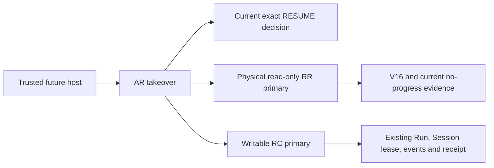
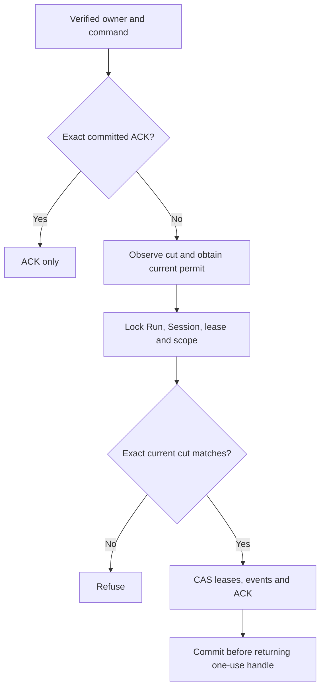
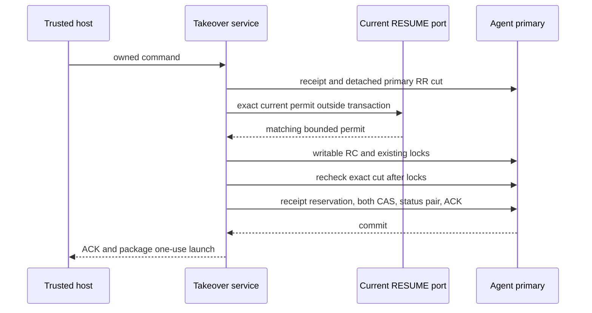

# T4-03 Agent checkpoint 原子接管

| Field | Value |
| --- | --- |
| Document | docs/egon/spec/2026-11-06-03-04-agent-checkpoint-takeover.md |
| Template Version | 9 |
| Archetype Cleanup | Not applicable |
| Status | Review |
| Type | Feature |
| Complexity | Complex |
| Complexity Drivers | Fresh exact authorization, detached observation, ordered lock recheck, two epochs and durable receipt |
| Created | 2026-11-06 03:04 Asia/Shanghai |
| Updated | 2026-11-06 03:04 Asia/Shanghai |
| Owner | Tianji Agent Runtime |
| Repository | tianji-service |
| Scope | Internal first-input expired-Run takeover transaction and bounded proof |
| Change Surface | Eight AR Java paths and three documents; no product binding |
| Affected Chapters | §7, §8, §9, §10, §11, §14, §15, §16 |
| Source Requirement | [主计划 §10.2、§17.2 S11、§19 T4-03](../../../../docs/plans/agent-framework-upgrade-plan.md) |
| Baseline Revision | 9849d535afa8c0e51aa65924760355a02fe3b1e6 |
| Amends | None |
| Supersedes | None |
| Depends On | [V16 capture](2026-11-06-01-42-agent-checkpoint-capture.md#73-detailed-design), [V16 observation](2026-11-06-02-18-agent-checkpoint-observation.md#73-detailed-design) |
| Related Specs | [V16 catalog](2026-11-06-01-25-agent-checkpoint-storage.md) |
| Related Plans | [Takeover plan](../plan/2026-11-06-03-05-agent-checkpoint-takeover.md) |

## 1. Summary

在同一 owner、Run 和首个 attempt 的精确 V16 首输入切点上，要求独立当前 RESUME 许可。写事务持有现有顺序的锁，在锁后读取最新证据，原子提交 Run 与 Session 新栅栏、两个逻辑状态事件和 ACK。重放只返回历史 ACK。执行原生续跑、真实 IAM 适配和产品装配独立交付。

## 2. Background and Current State

| Evidence ID | Exact source | Observed fact |
| --- | --- | --- |
| EVD-001 | AgentCheckpointObservationService#observe, V16 storage and capture | Exact owned first-input cut and zero prior budget/Tool progress are observed in a physical primary read-only snapshot. |
| EVD-002 | JdbcAdkSessionRepository#lockRun/#session/#lockLease/#tryLockScopeForCheckpoint and PostgresAdkSessionService#requireRunFence | Existing Run, Session, Session lease and scope lock order. |
| EVD-003 | V2__add_run_governance.sql and V5__bind_agent_ownership_to_issuer.sql | Existing owner-scoped Command receipt operation/key, request hash, exact Run and result. |
| EVD-004 | AgentLedgerService#reconcileDue and AgentRunTransitions | Expired Run becomes fenced SUSPENDED/LEASE_EXPIRED. The existing logical transitions are SUSPENDED→QUEUED→RUNNING. Ordinary dispatch starts fresh queued work. |
| EVD-005 | AgentExecutionGrant#fingerprint and existing host grant store | Exact owner, execution, audience and deadline material are available. RESUME requires a fresh separate decision. |
| EVD-006 | AgentStorageVerifier and ToolActionIntentSql | Existing V16 SELECT-only and V13 catalog evidence checks; Tool origin mutation takes the exact Run lock in its existing writer protocol. |

### 2.4 Evidence and current-chain map

| Entry/trigger | Current chain | Gap | Design response |
| --- | --- | --- | --- |
| Owner expired Run | Reconcile then read exact V16 cut | Read observation can stale | Recompute exact Match after existing order of locks |
| Lost command result | Existing V2/V5 receipt | Replay cannot redispatch | Store ACK only; return one package handle after fresh commit |
| Current authority | Existing execution/audience binding | Normal grant is insufficient for RESUME | Independent exact permit outside JDBC |

### 2.5 Archetype example cleanup

Cleanup disposition: Not applicable

Reason: Existing AR Session/JDBC infrastructure. No generated project, example or migration work.

## 3. Goals and Non-goals

Implement one conditional source-only takeover. Scope ends at committed ACK and package-local one-use launch capability. Native Runner start, API, dispatcher, IAM integration, provisioning and actual S11/PG are separate.

### 3.3 Change Surface and Design Depth

| Area/layer | Disposition | Exact repository evidence | Changed or preserved behavior/contract | Required Spec treatment | Chapter(s) |
| --- | --- | --- | --- | --- | --- |
| AR takeover/observation/Session | Affected | EVD-001–006 | Current permit and exact locked cut advance both epochs once | Internal contracts, locks and failure evidence | §7/§8/§9/§10/§11/§14/§15/§16 |
| Existing capture and observer | Context-only | EVD-001/006 | Preserve public observation and separate capture identity | Existing role and result compatibility | §7/§11/§16 |
| Product callers/config/PaC | Unchanged | EVD-004/005 | No application caller or external declaration | Compare actual packages | §9/§16 |

## 4. Requirements and Acceptance Criteria

| ID | Requirement | Priority | Observable acceptance | Source |
| --- | --- | --- | --- | --- |
| REQ-001 | Bind a fresh independent RESUME decision | Must | Verified USER, exact Run/command/revision, immutable cut, execution and resource material; authority outside JDBC; mismatch/deny/expiry fail closed. | EVD-001/005 and T4-03 |
| REQ-002 | Revalidate and mutate same Run and attempt atomically | Must | Run, Session, lease and scope locks then RC recheck; both epochs, two events and ACK commit together or roll back. | EVD-001–004/006 |
| REQ-003 | Preserve safe idempotency and launch ownership | Must | Same-key replay gives ACK only. Altered request conflicts. Only fresh winning commit gets one get-and-clear handle; no write retry on contention. | EVD-003/004 |
| REQ-004 | Protect production and verify exact source | Must | 11 paths, 28 unchanged SQL, unchanged AS/PS YAML/PaC, exact typed RED and 30 finite G1/P1. | EVD-001/005/006 |

### 4.1 Scenario matrix

| Scenario | Invariants | Negative outcome | Verification |
| --- | --- | --- | --- |
| Fresh precise permit | Exact locked cut and owner; both fences advance | Stale cut, busy lock, owner/epoch drift or expiry refuses | TEST-001/002/003 |
| Replay and race | Existing scoped receipt ACK only | Changed payload conflicts; no winner receipt means conflict | Step 1 TEST-003/004 |
| Partial write | Same-source atomic commit | Failed Session, ACK or event rolls all back | TEST-004 |
| Source proof | Default-unwired and no migration | Missing, skip, or artifact drift fails gate | TEST-005 |

### 4.2 Use-case analysis

#### 4.2.1 Actor inventory

| Actor ID | Actor | Permission/context |
| --- | --- | --- |
| ACTOR-001 | Trusted future host | Verified USER owner and separately supplied exact RESUME authority |
| ACTOR-002 | Owning Agent primary | V16 SELECT-only and independently provisioned existing-table DML |
| ACTOR-003 | Reviewer | Local JDK25 offline source reactor |

#### 4.2.2 Use-case artifact

| ID | Use case/goal | Actors | Trigger/preconditions | Main flow | Alternative/failure | Postcondition | Requirements |
| --- | --- | --- | --- | --- | --- | --- | --- |
| UC-001 | Claim exact first-input continuation | ACTOR-001, ACTOR-002 | Verified owner Run SUSPENDED/LEASE_EXPIRED, attempt 1 | Observe cut, obtain exact fresh permit, lock and recheck; CAS leases | Stale, busy, denied or expired refuses | ACK and one ephemeral handle only after commit | REQ-001/002 |
| UC-002 | Replay a command | ACTOR-001, ACTOR-002 | Exact owner and original key | Read exact committed ACK | Altered request conflicts | No second mutation or launch | REQ-003 |
| UC-003 | Verify scoped source | ACTOR-003 | Reviewed baseline and candidates | Test phases, archive and scope proof | Unrelated error/skip rejects | Source/package evidence only | REQ-004 |

## 5. Constraints, Assumptions, and Decisions

Retain same Run, first attempt, native invocation and original deadline. Require an explicitly constructed owning Agent primary, exact V16 SELECT-only mode, V13 evidence reads and existing table DML from separately provisioned privileges. No granting or role mutation here. Existing capture INSERT role, observed status, ordinary grants and ordinary queue claims do not establish this authority. No nested Session write transaction.

## 6. Project Technology Context

Java 25, Spring JDBC/Tx, PostgreSQL, ADK Session and existing Agent ledger. Preserve the existing Agent Runtime infrastructure and ownership.

### 6.2 User-mandated Java rule compliance

```text
1 类名规范，必须以 java的pojo规范命名。以dao po bo vo dto query command event等结尾
2 每层之间必须被 springboot-validation 校验，复用对象使用分组校验；基于原生和自定义约束注解、@Valid、@Validated 及 ConstraintValidator 扩展实现。ValidationUtils 只承担通用手工校验，不承载全部业务校验；电话号码复用 libphonenumber。
3 Java POJO 默认使用 class，注解为 @Data @NoArgsConstructor @AllArgsConstructor @Accessors(chain = true)，按构造目标选择 @Builder 或 @SuperBuilder；父类状态参与相等性时使用 @EqualsAndHashCode(callSuper = true)。只有不可变 value object 可以使用 record，并豁免 class 的 Lombok 规范；普通实体不能因简单而使用 record。使用 MapStruct、MapStructPlus 和 egon-cola-component-common-core 的 BaseConverter（双向）或 BaseForwardConverter（不可逆投影）进行转换。
4业务类必须使用@Slf4j注解注入log对象。如果业务类被spring管理，必须指定名称，如果是单例的情况下，参考@Service("userService")。如果需要依赖注入，必须@RequiredArgsConstructor进行修饰，不要代码中写。且属性必须被@qualify修饰。
5 工具类只允许使用jdk原生、Apache Commons(commons-lang3、commons-collections4、commons-io、commons-text、commons-codec、commons-beanutils)、Guava。针对Tika按需引入。
6 JSON 使用 Spring Boot Jackson；持久化枚举值使用 @EnumValue，向前端输出的枚举值使用 @JsonValue，禁止 ordinal 作为业务编码。
7 springboot 多环境配置文件，必须保持配置一致，但值不一定一致。
9 复杂业务必须引入设计模式，不允许硬编码
10 日期相关的必须使用java.time下的实体类，不允许使用java.util下的
11 只允许现有三层结构或当前 egon-cola-archetypes 的 DDD 结构，三层结构保持现状。必须尽量复用 egon-cola-components；持久化模块必须使用 Egon COLA MP Starter，DDL 统一由 egon-mp-sdj-ext-starter 分布式管理。业务唯一键必须组合业务列与 deletedAt（数据库 deleted_at），并验证 NULL、租户及重复软删除语义。采用 CQE（Command Query Event）；Event 必须经 egon-cola-component-transactional-outbox-starter 或 MQ 中间件投递。
```

| Literal rule | Affected? | Repository evidence | Exact design decision | Files/types/interfaces | Validation/test evidence | Status/blocker |
| --- | --- | --- | --- | --- | --- | --- |
| Rule 1 | Yes | EVD-001–006 | Use exact existing AR adapter and semantic internal type names | §7/§8/§10/§11 | TEST-001–005 | PASS |
| Rule 2 | Yes | EVD-001–006 | Validate verified USER, command, exact permit and locked evidence | §7/§8/§10/§11 | TEST-001–005 | PASS |
| Rule 3 | Yes | EVD-001–006 | Use immutable request/ack and an internal one-use launch capability | §7/§8/§10/§11 | TEST-001–005 | PASS |
| Rule 4 | No | EVD-001–006 | No Spring Bean or new logger | §7/§8/§10/§11 | TEST-001–005 | N/A |
| Rule 5 | Yes | EVD-001–006 | Reuse Spring JDBC/Tx, JDK SHA-256, ADK and current test stack | §7/§8/§10/§11 | TEST-001–005 | PASS |
| Rule 6 | Yes | EVD-001–006 | Fixed existing JSONB acknowledgement and status schema, no ordinal | §7/§8/§10/§11 | TEST-001–005 | PASS |
| Rule 7 | No | EVD-001–006 | No configuration or profile change | §7/§8/§10/§11 | TEST-001–005 | N/A |
| Rule 9 | Yes | EVD-001–006 | Use explicit current authority port and existing JDBC adapters | §7/§8/§10/§11 | TEST-001–005 | PASS |
| Rule 10 | Yes | EVD-001–006 | Use Instant and DB UTC with conservative microsecond expiry | §7/§8/§10/§11 | TEST-001–005 | PASS |
| Rule 11 | Yes | EVD-001–006 | Keep existing AR/AgentDB/Session and Command receipt ownership | §7/§8/§10/§11 | TEST-001–005 | PASS |

### 6.3 Time semantics and conversion contract

Time contract: Required

| Time ID | Fields/symbols | Semantics | Java/runtime type | Storage policy | Wire policy | Business zone source | Display zone source | Boundary / DST rules | Precision / Clock | Compatibility | Verification |
| --- | --- | --- | --- | --- | --- | --- | --- | --- | --- | --- | --- |
| TIME-001 | ResumePermit.expiresAt, Run/Session lease expiry | Occurred instant | java.time.Instant, JDBC Timestamp and PostgreSQL timestamptz | UTC instant | Internal | Not applicable: absolute instant | Not applicable: no display | Strictly before permit and original deadline; both leases share one expiry | Database clock_timestamp; truncate permit down to microseconds. Least of DB now plus 30 seconds, original deadline and permit expiry | Existing schema/deadlines | Step 1 TEST-003/004 |
| TIME-002 | Read, writer and lock bounds | Duration | Spring TransactionTemplate and PostgreSQL local timeouts | Not persisted | Internal | Not applicable: elapsed duration | Not applicable: no display | Two-second transaction and statement bounds, one-second lock timeout, no write retry | Existing DB/JDBC elapsed clocks | No existing scheduler defaults changed | Step 1 TEST-002/004 |

## 7. Architecture Design

### 7.0 Minimum-design baseline and element-necessity audit

| Proposed element | Change | Requirements | Existing/direct alternative | Concrete inadequacy | Added cost and failure | Verdict |
| --- | --- | --- | --- | --- | --- | --- |
| Internal takeover transaction | Add | REQ-001–003 | Reconciler, observer and queue claim | Neither atomically prepares paired takeover fences, and queue claim starts new work | Existing rows and one bounded write transaction | Add |
| Trusted RESUME authority port | Add | REQ-001 | Existing grant/observation | Cannot bind current exact resume request and cut | One detached decision per fresh claim | Add |
| V2/V5 receipt and V16 | Reuse | REQ-002/003 | New intent/lease tables | Existing owner and exact keys suffice | No migration | Keep |

| Path | Network calls | Client states | Server state | Failure and TOCTOU | Value |
| --- | --- | --- | --- | --- | --- |
| Historical ACK | None | Original command | Existing receipt | Invalid evidence refuses | No duplicate launch |
| Fresh takeover | One independent authority call | Owned revision | Existing Run, Session lease, events and ACK | Lock and recheck after detached authority | Safely prepare exact original invocation |

### 7.1 System Architecture Design



No product host registration, Controller, scheduler or IAM adapter.

### 7.2 High-Level Design

Read a historical ACK first. For a fresh command, read a bounded exact ResumeMatch in a physical read-only RR transaction, then call the explicit RESUME authority outside transactions. Under the established Run, Session, Session lease and scope lock order, re-evaluate current evidence in the same primary writable READ_COMMITTED transaction. This post-lock statement snapshot includes shared-state writes committed before acquisition, unlike reusing the earlier RR snapshot.



#### 7.2.2 High-level decision and quality matrix

| Concern/use case | Constraint | Decision | Evidence |
| --- | --- | --- | --- |
| Owner and authorization | Detached observation is not a write permit | Exact current RESUME plus same-source locked equality | EVD-001/005 |
| Lock freshness | Observe scoped phantom rows committed before scope lock | Writable RC statement snapshot after locks | EVD-002/006 |
| Atomicity and replay | Both fences, two events and one ACK commit together | Existing receipt key, no persisted launch or write retry | EVD-002/003 |

### 7.3 Detailed Design

The entry requires a verified non-legacy USER, bounded command and worker, and no ambient transaction or bound source. The receipt request digest frames RESUME purpose, owner identity, Run, command and expected revision. Fresh ResumeRequest includes existing verified execution, command and exact immutable cut digest. Resource binding uses TIANJI_AGENT_RUN_RESUME and current execution/audience material. The injected authority runs outside JDBC. A missing permit denies, mismatch or unavailable authority fails closed, and permit expiry cannot exceed original deadline. DB expiry checks are exclusive and truncate the permit downward to microseconds.

After fresh authorization, check writer mode and physical primary. Lock Run, check replay, lock Session, Session lease and scope, then independently recompute the Match in writable RC. Include exact owner, status, current sequence and epochs, native input and state, execution hashes, absence of budget/Tool progress, and exact V16 SELECT-only and V13 evidence. Do not reuse the detached Match as the CAS proof. An equality mismatch or busy/invalid fence refuses before receipt DML.

Reserve operation RESUME under the existing V5 owner/operation/command key. One physical CAS writes SUSPENDED/LEASE_EXPIRED to RUNNING, same Run and attempt 1, Run revision and sequence plus two, epoch plus one. Under the same connection reacquire the exact inactive prior Session lease, increment its epoch and check both fences with the same expiry. Append existing schema-1 RUN_STATUS_CHANGED logical events SUSPENDED→QUEUED and QUEUED→RUNNING with fixed CHECKPOINT_RESUME reason and contiguous sequences. No separately visible QUEUED state. Complete the existing receipt with fixed ACK and recheck live expiry before returning transaction result.



Historical ACK contains no lease, invocation, permit or launch token. Same-command replay returns only immutable ACK; mismatched digest conflicts. Known lock/serialization races may cause one bounded independent receipt read after rollback, without retrying the writer. A successful new transaction alone returns the package-private atomic get-and-clear Launch. Process loss before dispatch requires existing expiry/reconciliation and later product evidence.

#### 7.3.6 Conclusion evidence chain

| Conclusion | Evidence | Decision |
| --- | --- | --- |
| Preview and normal grants cannot authorize takeover | EVD-001/005 and stale-cut R1 | Fresh exact RESUME and current locked equality |
| Old scope/lease progress cannot be ignored | EVD-002/006 | RC post-lock recheck and atomic paired fence |
| Replay cannot recreate authority | EVD-003/004 | ACK-only receipt and one ephemeral new-commit handle |

## 8. Package Structure and Code File Tree

| Operation | Exact path |
| --- | --- |
| CREATE | `stellar-enclosure-tianji-agent-runtime/src/test/java/top/egon/cola/platform/tianji/agent/infrastructure/adk/session/AgentCheckpointTakeoverServiceTest.java` |
| MODIFY | `stellar-enclosure-tianji-agent-runtime/src/test/java/top/egon/cola/platform/tianji/agent/infrastructure/adk/session/AgentCheckpointObservationServiceTest.java` |
| MODIFY | `stellar-enclosure-tianji-agent-runtime/src/test/java/top/egon/cola/platform/tianji/agent/infrastructure/adk/session/AdkCheckpointCaptureTest.java` |
| MODIFY | `stellar-enclosure-tianji-agent-runtime/src/main/java/top/egon/cola/platform/tianji/agent/infrastructure/persistence/AgentStorageVerifier.java` |
| MODIFY | `stellar-enclosure-tianji-agent-runtime/src/main/java/top/egon/cola/platform/tianji/agent/infrastructure/adk/session/JdbcAdkSessionRepository.java` |
| MODIFY | `stellar-enclosure-tianji-agent-runtime/src/main/java/top/egon/cola/platform/tianji/agent/infrastructure/adk/session/PostgresAdkSessionService.java` |
| MODIFY | `stellar-enclosure-tianji-agent-runtime/src/main/java/top/egon/cola/platform/tianji/agent/infrastructure/adk/session/AgentCheckpointObservationService.java` |
| CREATE | `stellar-enclosure-tianji-agent-runtime/src/main/java/top/egon/cola/platform/tianji/agent/infrastructure/adk/session/AgentCheckpointTakeoverService.java` |
| CREATE | `docs/egon/spec/2026-11-06-03-04-agent-checkpoint-takeover.md` |
| CREATE | `docs/egon/plan/2026-11-06-03-05-agent-checkpoint-takeover.md` |
| CREATE | `docs/egon/evidence/2026-11-06-agent-checkpoint-takeover.md` |

## 9. Interface Definitions

### 9.1 Interface Inventory

| Interface | Protocol | Owner | Scope |
| --- | --- | --- | --- |
| INT-001 | Internal Java Command | AgentCheckpointTakeoverService#takeOver | Exact verified owner, command, worker and ACK |
| INT-002 | Trusted internal Java port | ResumeAuthorization#authorize | Fresh RESUME for exact immutable execution/command/cut/resource |

### 9.2 Per-interface Detailed Contracts

INT-001 accepts TrustedAgentActor, ResumeCommand(runId, commandId, expectedRevision), and workerId. Require verified USER, nonblank UTF-8 text without control characters or leading/trailing whitespace, runId at most 64, command/worker at most 128, and revision from zero through Long.MAX_VALUE minus two. Return historical or new ACK(runId, RUNNING, attempt=1, revision) and only on new commit a package one-use handle for both leases and exact invocation. Existing denied, not-found, revision/idempotency and dependency errors apply. No external wire contract.

INT-002 accepts immutable ResumeRequest containing existing owner execution material, exact command and cut SHA-256, bound by fixed RESUME purpose to exact host resource. A supplied ResumePermit must exactly match request and expire no later than original deadline. No permit is denial; exception or mismatch is unavailable. Never call inside JDBC.

## 10. POJO and Data Model Design

Internal immutable ResumeCommand, ResumeRequest, ResumePermit, Acknowledgement and ResumeMatch; fixed private row values. Private AtomicReference carries an ephemeral one-use Launch. Existing result JSONB holds runId, status, attempt and revision only. Existing schema-1 event JSONB carries from, status and fixed CHECKPOINT_RESUME. No new DTO mapper or ordinal.

## 11. Database Design

### 11.1 Table Inventory

| Table | Existing/new | Purpose and owner | Read/write paths | Change | DDL script | Requirements |
| --- | --- | --- | --- | --- | --- | --- |
| tianji_agent.agent_run | Existing | Owner Run and epoch | Owned row lock and exact CAS | Existing columns | V1/V2/V5 | REQ-001/002 |
| tianji_agent.agent_run_command_receipt | Existing | Owner Command ACK | Scoped lookup, insert and ACK completion | RESUME in existing operation field | V2/V5 | REQ-002/003 |
| tianji_agent.agent_session_lease | Existing | Full owner Session epoch | Exact prior inactive epoch UPDATE | Existing columns | V3/V5 | REQ-002 |
| tianji_agent.agent_event | Existing | Ordered status events | Two contiguous appends | Existing schema 1 | V1 | REQ-002 |
| tianji_agent.agent_checkpoint and existing Session/budget/V13 witnesses | Existing | Exact boundary | Scoped current evidence reads | No write | Existing V3/V5/V13/V16 | REQ-001/002/004 |

### 11.2 Per-table Detailed Design

#### 11.2.1 tianji_agent.agent_run_command_receipt

##### Purpose, ownership, and lifecycle

Persist one bounded RESUME ACK in the existing exact owner operation and command scope.

##### Complete column design

| Column | Native type | Use |
| --- | --- | --- |
| tenant_id, subject_type, subject_issuer, subject_id | Existing V2/V5 full owner types | Complete verified owner key |
| operation, command_id, request_hash | varchar(32), varchar(128), char(64) | RESUME, bounded exact command and SHA-256 |
| run_id, result, created_at | varchar(64), jsonb, timestamptz | Exact existing Run reference, four-field ACK and database occurrence instant |

##### Keys, relationships, and constraints

Reuse V5 full owner, operation and command primary key plus V2 Run reference. Different Run or request hash conflicts.

##### Index inventory and per-index justification

| Index | Type/unique | Ordered columns/expressions | Predicate/include | Query and operation | Cardinality/selectivity | Sort/coverage role | Write/storage cost | Decision |
| --- | --- | --- | --- | --- | --- | --- | --- | --- |
| agent_run_command_receipt_pkey | Existing B-tree unique | tenant_id, subject_type, subject_issuer, subject_id, operation, command_id | None | Exact lookup and insert conflict | At most one | No new sort | Existing index | Reuse |

##### Access patterns and SQL shape

| Operation | Caller | Predicate/join/order | Expected rows | Index/constraint | Lock/isolation | Failure/idempotency |
| --- | --- | --- | --- | --- | --- | --- |
| ACK lookup | AR takeover | Complete owner Run and receipt key | At most one | Existing PK | Physical read-only RR or already locked writer | Wrong owner not found; changed digest conflict |
| Reserve and complete | AR takeover | Existing owner key, exact Run/request and result IS NULL | Exactly one each on new commit | Existing PK and FK | Same writable RC transaction | Any failure rolls back; ACK only on replay |

##### Migration and historical-data handling

All 28 existing SQL bytes remain identical. No new table, index, grants or backfill.

##### Transaction, consistency, and recovery

Keep all Run/Session lease CAS, consecutive events and receipt completion in the same bounded writable transaction. V16 and V13 remain read-only. Post-lock exact owner and no-progress evidence is read in RC after existing locks.

#### 11.2.2 tianji_agent.agent_run

##### Purpose, ownership, and lifecycle

Agent Run owns exact lifecycle and original product lease. Existing ledger and Session table ownership and retention remain authoritative.

##### Complete column design

| Column | Native type | Use |
| --- | --- | --- |
| tenant_id, run_id, status, wait_reason, revision, last_event_sequence, lease_epoch, lease_owner, lease_expires_at | Existing V1/V2/V5 native key, varchar status, bigint counters, timestamptz expiry | Existing exact selected columns only; no new field or type. |

##### Keys, relationships, and constraints

Reuse the existing composite key and exact owner/fence checks. All foreign keys and row constraints remain unchanged.

##### Index inventory and per-index justification

| Index | Type/unique | Ordered columns/expressions | Predicate/include | Query and operation | Cardinality/selectivity | Sort/coverage role | Write/storage cost | Decision |
| --- | --- | --- | --- | --- | --- | --- | --- | --- |
| agent_run_pkey | Existing B-tree unique | tenant_id, run_id | None | Exact existing key | At most one row per lookup or event sequence | No additional sort | Existing index only | Reuse |

##### Access patterns and SQL shape

| Operation | Caller | Predicate/join/order | Expected rows | Index/constraint | Lock/isolation | Failure/idempotency |
| --- | --- | --- | --- | --- | --- | --- |
| Exact takeover operation | AR internal takeover | Lock exact complete owner Run then update only SUSPENDED/LEASE_EXPIRED with expected Session, revision, watermark and epoch. | One exact row per write or event | Existing key | Same writable primary RC transaction | Any mismatch or failed write rolls back all participants |

##### Migration and historical-data handling

All 28 production SQL files stay byte-identical. No data rewrite, grants, additional index or DDL.

##### Transaction, consistency, and recovery

Advance same Run and attempt once with revision and watermark plus two and epoch plus one. No participant starts an independent writable transaction or issues a second automatic attempt.


#### 11.2.3 tianji_agent.agent_session_lease

##### Purpose, ownership, and lifecycle

Existing native Session lease remains full-owner scoped. Existing ledger and Session table ownership and retention remain authoritative.

##### Complete column design

| Column | Native type | Use |
| --- | --- | --- |
| tenant_id, subject_type, subject_issuer, subject_id, app_name, session_id, lease_epoch, lease_owner, lease_expires_at | Existing V3/V5 native owner key, bigint epoch and timestamptz expiry | Existing exact selected columns only; no new field or type. |

##### Keys, relationships, and constraints

Reuse the existing composite key and exact owner/fence checks. All foreign keys and row constraints remain unchanged.

##### Index inventory and per-index justification

| Index | Type/unique | Ordered columns/expressions | Predicate/include | Query and operation | Cardinality/selectivity | Sort/coverage role | Write/storage cost | Decision |
| --- | --- | --- | --- | --- | --- | --- | --- | --- |
| agent_session_lease_pkey | Existing B-tree unique | tenant_id, subject_type, subject_issuer, subject_id, app_name, session_id | None | Exact existing key | At most one row per lookup or event sequence | No additional sort | Existing index only | Reuse |

##### Access patterns and SQL shape

| Operation | Caller | Predicate/join/order | Expected rows | Index/constraint | Lock/isolation | Failure/idempotency |
| --- | --- | --- | --- | --- | --- | --- |
| Exact takeover operation | AR internal takeover | Lock after Session row then UPDATE only the same inactive prior epoch and current common expiry. | One exact row per write or event | Existing key | Same writable primary RC transaction | Any mismatch or failed write rolls back all participants |

##### Migration and historical-data handling

All 28 production SQL files stay byte-identical. No data rewrite, grants, additional index or DDL.

##### Transaction, consistency, and recovery

Advance Session epoch once and recheck the new Run and Session fences on the same connection. No participant starts an independent writable transaction or issues a second automatic attempt.


#### 11.2.4 tianji_agent.agent_event

##### Purpose, ownership, and lifecycle

Existing ordered Agent Run audit and status history. Existing ledger and Session table ownership and retention remain authoritative.

##### Complete column design

| Column | Native type | Use |
| --- | --- | --- |
| tenant_id, run_id, sequence, event_id, event_type, schema_version, correlation_id, payload, occurred_at | Existing V1 native Run key, bigint sequence, varchar IDs, JSONB and timestamptz | Existing exact selected columns only; no new field or type. |

##### Keys, relationships, and constraints

Reuse the existing composite key and exact owner/fence checks. All foreign keys and row constraints remain unchanged.

##### Index inventory and per-index justification

| Index | Type/unique | Ordered columns/expressions | Predicate/include | Query and operation | Cardinality/selectivity | Sort/coverage role | Write/storage cost | Decision |
| --- | --- | --- | --- | --- | --- | --- | --- | --- |
| agent_event_pkey | Existing B-tree unique | tenant_id, run_id, sequence | None | Exact existing key | At most one row per lookup or event sequence | No additional sort | Existing index only | Reuse |

##### Access patterns and SQL shape

| Operation | Caller | Predicate/join/order | Expected rows | Index/constraint | Lock/isolation | Failure/idempotency |
| --- | --- | --- | --- | --- | --- | --- |
| Exact takeover operation | AR internal takeover | Append two contiguous existing schema-1 RUN_STATUS_CHANGED events for the exact owned Run. | One exact row per write or event | Existing key | Same writable primary RC transaction | Any mismatch or failed write rolls back all participants |

##### Migration and historical-data handling

All 28 production SQL files stay byte-identical. No data rewrite, grants, additional index or DDL.

##### Transaction, consistency, and recovery

Both events are visible only with the paired leases and complete ACK. Fixed CHECKPOINT_RESUME reason. No participant starts an independent writable transaction or issues a second automatic attempt.


### 11.3 Entity-relationship diagram

Relational model change: No

Existing Run owns ordered events and the Command receipt. V16 binds the exact Run and native Session event, and the Session lease uses the existing full owner key. No physical relationship changes.

## 12. Frontend Page Design

Unchanged. No page, route or transport consumer.

## 13. Design Patterns and Architecture Principles

Use one narrow current authority port because external trust varies by host. Keep one existing AR JDBC transaction and reuse the Session and observation adapters, with no alternate dispatcher or state machine framework.

## 14. Test Design

| Test ID | Design |
| --- | --- |
| TEST-001 | Typed R1 omits only postlock Match equality; stale-cut selector must produce one expected missing-conflict assertion failure. |
| TEST-002 | Same Run and attempt, two logical status events, new paired epochs and one-shot handle. Existing checkpoint reader/capture checks pass. |
| TEST-003 | Fresh exact authorization outside transaction, wrong/misbound permit rejection, expiry and ACK-only replay. |
| TEST-004 | Session/receipt failure rollback, one bounded ACK read after lock/serialization failure, no writer retry. |
| TEST-005 | All 30 finite cases and actual clean AS/PS producer artifacts, effective PaC/config equality and 28 immutable SQL. No PG/integration evidence credited. |

## 15. Non-functional and Cross-cutting Design

Fixed primary/read mode checks, controlled search_path, two-second bounds and one-second lock timeout. Full owner scope and fixed failure strings, no raw invocation, lease, permit or source payload. V16 reader privilege validation remains exact.

## 16. Compatibility, Migration, Rollout, and Rollback

No schema, config, POM, permission producer, Controller or host construction changes. Existing capture writer and observer remain separate. Revert the one focused source commit to roll back. Future use requires verified privileges, actual native continuation evidence and real current RESUME adapter.

## 17. Alternatives and Decisions

Ordinary claim starts a fresh attempt. A visible intermediate QUEUED state would race that poller. Commit one physical CAS with two logical status events atomically. Use existing receipt and an ephemeral launch handle to enforce replay isolation.

## 18. Risks and Open Questions

Real current IAM, PostgreSQL privileges, actual native continuation and crash after claim before launch remain separate gates. Current source has no app binding and does not prove full S11 or production acceptance.

## 19. Traceability Matrix

| Requirement | Use case | Design | Tests |
| --- | --- | --- | --- |
| REQ-001 | UC-001 | §5/7/9/11 | TEST-001/003 |
| REQ-002 | UC-001 | §6.3/7/10/11 | TEST-001/002/004 |
| REQ-003 | UC-002 | §7/9/10/11 | TEST-002/003/004 |
| REQ-004 | UC-003 | §8/14/16/18 | TEST-005 |

## 20. Review and Acceptance

### 20.5 Blocking Manual Check

| Check ID | Applicability | Status | Evidence | Finding | Required action/exception |
| --- | --- | --- | --- | --- | --- |
| MC-ARCH-001 | Applicable | PASS | §7/8/11 | Existing AR owning adapter | None |
| MC-REUSE-001 | Applicable | PASS | EVD-001–006 | Existing exact V16 match, scoped locks and V2/V5 receipts | None |
| MC-DEP-001 | Applicable | PASS | §6/8 | Existing JDK, Spring, ADK and JUnit | None |
| MC-NAME-001 | Applicable | PASS | §7/8/10 | Exact internal symbols and private facts | None |
| MC-VALID-001 | Applicable | PASS | §5/7/11/14 | Owner, permit, cut, expiry and epoch rechecks | None |
| MC-MODEL-001 | Applicable | PASS | §10 | Immutable command/ACK and atomic handle | None |
| MC-CONVERT-001 | Not applicable | N/A | §10 | No cross-layer mapper or wire DTO | None |
| MC-LOG-001 | Applicable | PASS | §7/15 | Fixed errors and redacted technical values | None |
| MC-BEAN-001 | Not applicable | N/A | §8/16 | Explicit host construction, no Spring registration | None |
| MC-UTIL-001 | Applicable | PASS | §6/10 | Existing JDK digest and exact authority binding | None |
| MC-JSON-001 | Applicable | PASS | §10/11 | ACK-only existing JSONB and status schema 1 | None |
| MC-TIME-001 | Applicable | PASS | §6.3/11 | UTC Instant and database expiry clock | None |
| MC-CONFIG-001 | Not applicable | N/A | §16 | No config or activation change | None |
| MC-PATTERN-001 | Applicable | PASS | §13 | Explicit authority port and direct adapter reuse | None |
| MC-SCOPE-001 | Applicable | PASS | §8/16 | Eight Java and three documents; 28 existing SQL | None |
| MC-TEST-001 | Applicable | PASS | §14 | Exact R1 and 30 finite owner/P1 gates | None |
| MC-BLOCKER-001 | Applicable | PASS | §18 | Source-only acceptance separated from operational prerequisites | None |

### 20.6 Final verdict

PASS — Ready for user review
