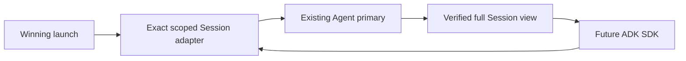
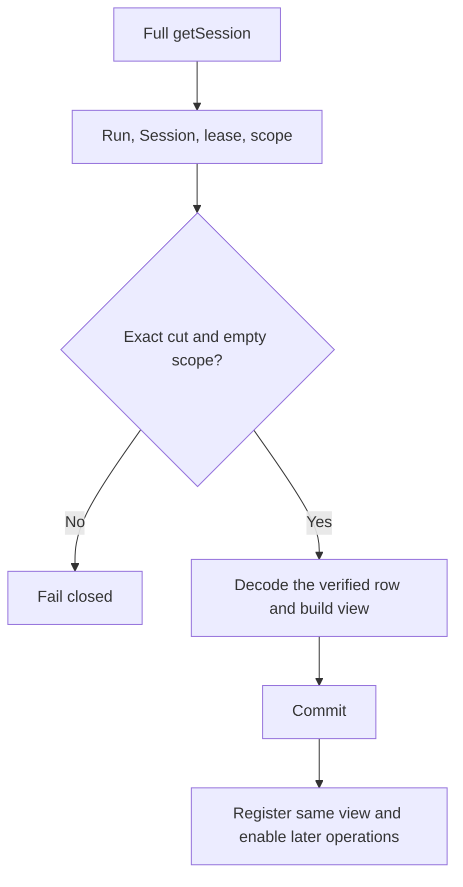
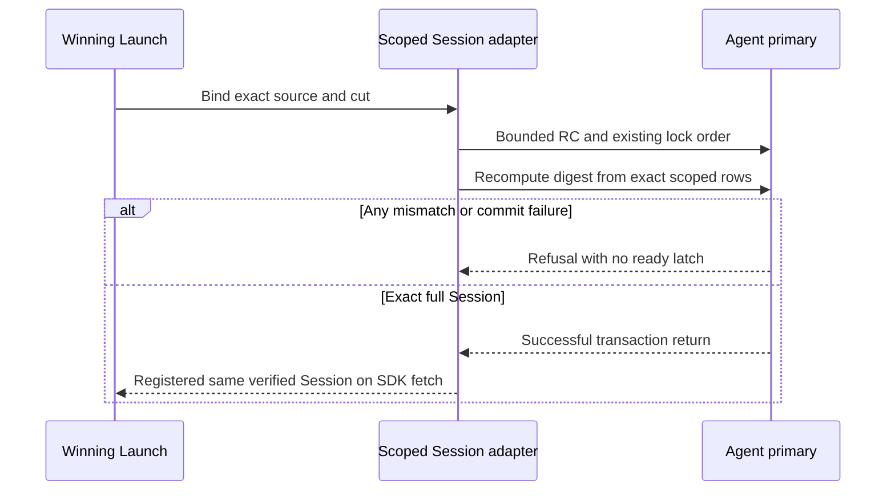

# T4-03 接管后首次 Session 读取

| Field | Value |
| --- | --- |
| Document | docs/egon/spec/2026-11-06-03-42-agent-checkpoint-resume-first-read.md |
| Template Version | 9 |
| Archetype Cleanup | Not applicable |
| Status | Review |
| Type | Feature |
| Complexity | Complex |
| Complexity Drivers | Exact post-claim fences, byte-preserving checkpoint digest, ordered locking and commit-only latch |
| Created | 2026-11-06 03:42 Asia/Shanghai |
| Updated | 2026-11-06 03:42 Asia/Shanghai |
| Owner | Tianji Agent Runtime |
| Repository | tianji-service |
| Scope | Guard the first full ADK Session view of a winning takeover |
| Change Surface | Four existing Java sources, one finite test class and three review artifacts |
| Affected Chapters | §7, §8, §9, §10, §11, §14, §15, §16 |
| Source Requirement | [主计划 §10.2、§17.2 S11、§19 T4-03](../../../../docs/plans/agent-framework-upgrade-plan.md) |
| Baseline Revision | 76fd92c6fb855a540d9711e180062360501e3cb1 |
| Amends | None |
| Supersedes | None |
| Depends On | [Committed takeover](2026-11-06-03-04-agent-checkpoint-takeover.md#73-detailed-design) |
| Related Specs | None |
| Related Plans | [First read plan](../plan/2026-11-06-03-43-agent-checkpoint-resume-first-read.md) |

## 1. Summary

把已经提交的接管 Launch 绑定到同一主库、同一完整 owner 和新双租约的 Session 适配器。ADK 的首次完整读取在现有锁序中重验原始断点摘要并返回同一份 Session 视图。事务成功返回后才开放后续读取和写入。

## 2. Background and Current State

| Evidence ID | Exact source | Observed fact |
| --- | --- | --- |
| EVD-001 | AgentCheckpointTakeoverService#commit and TakeoverResult#takeLaunch | Only the fresh commit has an ephemeral launch. Receipt replay has only ACK. |
| EVD-002 | AgentCheckpointObservationService#resumeMatch | Existing length-prefixed SHA-256 binds exact raw state, codec, event metadata and payload plus original fences. |
| EVD-003 | PostgresAdkSessionService#getSession/#appendEvent/#readableSession and JdbcAdkSessionRepository | Existing scoped Run, Session and lease checks, scope advisory lock, bounded history and native codec paths. |
| EVD-004 | V16 product-origin PostgreSQL probe and Components explicit resume bridge | Explicit original invocation uses the bound Session SPI. The live operator proof and executor wiring are separate. |

### 2.4 Evidence and current-chain map

| Entry/trigger | Current chain | Gap | Design response |
| --- | --- | --- | --- |
| New-commit launch | Claim transaction returns exact cut and leases | State can drift before the SDK fetch | Bind the same primary and attest in the actual first fetch |
| SDK full getSession | Bound Run, Session and lease checks | Ordinary view can include new shared state | Acquire existing scope lock and verify original bytes before returning |
| Rollback or loss | Current storage fails the call | A precommit latch would open later access | Mark ready only after successful transaction return and registration |

### 2.5 Archetype example cleanup

Cleanup disposition: Not applicable

Reason: Existing AR Session adapter, with no generated project, example code or migration changes.

## 3. Goals and Non-goals

Deliver exact first-read guarding for internal takeover launch. Native executor, IAM and operational privileges remain separate.

### 3.3 Change Surface and Design Depth

| Area/layer | Disposition | Exact repository evidence | Changed or preserved behavior/contract | Required Spec treatment | Chapter(s) |
| --- | --- | --- | --- | --- | --- |
| AR Session, cut and launch | Affected | EVD-001–004 | Revalidate under locks, deliver same committed view | Exact interfaces, immutable digest, locking and tests | §7, §8, §9, §10, §11, §14, §15, §16 |
| Ordinary capture and ledger | Context-only | EVD-002/003 | Keep normal Session and capture behavior | Focused regression | §7/16 |
| Host, controller and permissions | Unchanged | EVD-001/004 | No wiring or declaration | Artifact parity | §16 |

## 4. Requirements and Acceptance Criteria

| ID | Requirement | Priority | Observable acceptance | Source |
| --- | --- | --- | --- | --- |
| REQ-001 | Bind only winning exact launch to the Session guard | Must | Exact source identity and full owner, successor epochs and same fixed expiry. No ordinary rebind or renewal on resume adapter. | EVD-001/003 |
| REQ-002 | Reprove the locked first full view | Must | Exact postclaim Run revision/sequence plus two, Session revision/sequence, one bounded raw original event, empty scope/state, exact digest and invocation, both live fences. | EVD-001–004 |
| REQ-003 | Publish readiness after transaction success | Must | Returned Session is the checked view. Early filtered reads/list/append and ambient transactions refuse. Rollback leaves gate closed. | EVD-003 |
| REQ-004 | Preserve source and prove bounded scope | Must | Typed digest RED and 29 owner tests, actual archives, eight paths and 28 immutable SQL. | EVD-002–004 |

### 4.1 Scenario matrix

| Scenario | Invariant | Failure | Verification |
| --- | --- | --- | --- |
| Two valid codecs | Exact raw digest and same SDK view | Wrong codec or changed event refuses | Step 1 TEST-001/002 |
| Postclaim drift | Current Run, lease and scope locked | Advance, expiry, busy scope or any progress refuses | TEST-002 |
| Early access and commit failure | Ready only after successful registration | No premature filtered read, list or append | TEST-003 |

### 4.2 Use-case analysis

| Actor ID | Actor | Context |
| --- | --- | --- |
| ACTOR-001 | Trusted native resume caller | Holds winning in-process Launch |
| ACTOR-002 | Owning Agent primary | Existing scoped Session and Run records |
| ACTOR-003 | Source reviewer | Finite fixture and offline artifact check |

| ID | Use case/goal | Actors | Trigger/preconditions | Main flow | Alternatives/failure | Postcondition | Requirements |
| --- | --- | --- | --- | --- | --- | --- | --- |
| UC-001 | Open exact Session for original invocation | ACTOR-001/002 | Winning launch and unbound same-source owner store | Bind successor leases, full locked read, compare old digest and return same view after commit | Drift, rollback, early append or filtered read refused | Guard ready only after success | REQ-001/002/003 |
| UC-002 | Verify source scope | ACTOR-003 | Exact baseline and typed candidates | R1, G1, P1 and S1 | Error/skip/mismatched artifacts fail | Finite source evidence | REQ-004 |

## 5. Constraints, Assumptions, and Decisions

No ambient transaction for the first full read. Keep the existing primary DataSource identity and owner/app/session boundary. Verify V16 facts through the digest already bound to the takeover. Do not retain raw state/payload in the launch. The future executor must furnish the guarded adapter directly to the SDK, whose first full fetch uses an empty GetSessionConfig Optional. The current step does not start native execution.

## 6. Project Technology Context

Existing Agent Runtime infrastructure, JDK25, Spring JDBC/Tx, PostgreSQL and versioned ADK Session codecs.

### 6.2 User-mandated Java rule compliance

```text
1 类名规范，必须以 java的pojo规范命名。以dao po bo vo dto query command event等结尾
2 每层之间必须被 springboot-validation 校验，复用对象使用分组校验；基于原生和自定义约束注解、@Valid、@Validated 及 ConstraintValidator 扩展实现。ValidationUtils 只承担通用手工校验，不承载全部业务校验；电话号码复用 libphonenumber。
3 Java POJO 默认使用 class，注解为 @Data @NoArgsConstructor @AllArgsConstructor @Accessors(chain = true)，按构造目标选择 @Builder 或 @SuperBuilder；父类状态参与相等性时使用 @EqualsAndHashCode(callSuper = true)。只有不可变 value object 可以使用 record，并豁免 class 的 Lombok 规范；普通实体不能因简单而使用 record。使用 MapStruct、MapStructPlus 和 egon-cola-component-common-core 的 BaseConverter（双向）或 BaseForwardConverter（不可逆投影）进行转换。
4业务类必须使用@Slf4j注解注入log对象。如果业务类被spring管理，必须指定名称，如果是单例的情况下，参考@Service("userService")。如果需要依赖注入，必须@RequiredArgsConstructor进行修饰，不要代码中写。且属性必须被@qualify修饰。
5 工具类只允许使用jdk原生、Apache Commons(commons-lang3、commons-collections4、commons-io、commons-text、commons-codec、commons-beanutils)、Guava。针对Tika按需引入。
6 JSON 使用 Spring Boot Jackson；持久化枚举值使用 @EnumValue，向前端输出的枚举值使用 @JsonValue，禁止 ordinal 作为业务编码。
7 springboot 多环境配置文件，必须保持配置一致，但值不一定一致。
9 复杂业务必须引入设计模式，不允许硬编码
10 日期相关的必须使用java.time下的实体类，不允许使用java.util下的
11 只允许现有三层结构或当前 egon-cola-archetypes 的 DDD 结构，三层结构保持现状。必须尽量复用 egon-cola-components；持久化模块必须使用 Egon COLA MP Starter，DDL 统一由 egon-mp-sdj-ext-starter 分布式管理。业务唯一键必须组合业务列与 deletedAt（数据库 deleted_at），并验证 NULL、租户及重复软删除语义。采用 CQE（Command Query Event）；Event 必须经 egon-cola-component-transactional-outbox-starter 或 MQ 中间件投递。
```

| Literal rule | Affected? | Repository evidence | Exact design decision | Files/types/interfaces | Validation/test evidence | Status/blocker |
| --- | --- | --- | --- | --- | --- | --- |
| Rule 1 | Yes | EVD-001–004 | Use existing adapter and immutable internal cut with an explicit first-read guard | §7/8/9/10/11 | TEST-001–004 | PASS |
| Rule 2 | Yes | EVD-001–004 | Check complete owner, source, fixed epochs, snapshot and decoded envelope at boundary | §7/8/9/10/11 | TEST-001–004 | PASS |
| Rule 3 | Yes | EVD-001–004 | Reuse ResumeMatch, SessionView and ADK objects; mutable readiness has one lease-bound owner | §7/8/9/10/11 | TEST-001–004 | PASS |
| Rule 4 | No | EVD-001–004 | Existing direct adapters; no new bean, injection or logging | §7/8/9/10/11 | TEST-001–004 | N/A |
| Rule 5 | Yes | EVD-001–004 | Reuse existing JDBC, codecs and JDK SHA-256 | §7/8/9/10/11 | TEST-001–004 | PASS |
| Rule 6 | Yes | EVD-001–004 | Reuse native versioned codecs; no wire JSON contract or ordinal | §7/8/9/10/11 | TEST-001–004 | PASS |
| Rule 7 | No | EVD-001–004 | No configuration or profile edits | §7/8/9/10/11 | TEST-001–004 | N/A |
| Rule 9 | Yes | EVD-001–004 | Guarded adapter composes existing physical locks and proven native Session view | §7/8/9/10/11 | TEST-001–004 | PASS |
| Rule 10 | Yes | EVD-001–004 | Use fixed DB UTC lease instants and bounded transaction durations | §7/8/9/10/11 | TEST-001–004 | PASS |
| Rule 11 | Yes | EVD-001–004 | Existing Agent Runtime Session adapter and Agent primary ownership | §7/8/9/10/11 | TEST-001–004 | PASS |

### 6.3 Time semantics and conversion contract

Time contract: Required

| Time ID | Fields/symbols | Semantics | Java/runtime type | Storage policy | Wire policy | Business zone source | Display zone source | Boundary / DST rules | Precision / Clock | Compatibility | Verification |
| --- | --- | --- | --- | --- | --- | --- | --- | --- | --- | --- | --- |
| TIME-001 | Run and Session lease expiry, original Run deadline and event timestamp | Occurred instant | java.time.Instant, JDBC Timestamp and existing native epoch millis | UTC instant | Internal | Not applicable: absolute instant | Not applicable: no display | Both successor leases match original claimed expiry and remain strictly live on the primary | Database clock_timestamp and unchanged PostgreSQL microseconds; preserve stored native epoch millis in digest | Existing deadlines and V16 digest | Step 1 TEST-001/002 |
| TIME-002 | Initial read bounds | Duration | Spring TransactionTemplate and PostgreSQL local timeouts | Not persisted | Internal | Not applicable: elapsed duration | Not applicable: no display | Two-second transaction/statement bound, one-second lock timeout, nonblocking scope acquisition | JDBC/DB elapsed clocks | Ordinary Session paths retain current timing | Step 1 TEST-001/004 |


## 7. Architecture Design

### 7.0 Minimum-design baseline and element-necessity audit

| Proposed element | Change | Requirements | Existing alternative | Gap | Added cost | Verdict |
| --- | --- | --- | --- | --- | --- | --- |
| Launch Session binding | Extend | REQ-001 | Ordinary withLease | Does not know claimed cut or primary identity | One internal scope check | Use |
| Guard first view | Extend | REQ-002/003 | Detached preflight and reload | A later SDK load could see a different Session | One bounded read using current locks | Use |
| Original digest | Reuse | REQ-002 | Store another token or schema field | Existing immutable cut already binds all bytes | No migration or new retention | Reuse |

| Path | Network calls | Client states | Owner state | Failure boundary |
| --- | --- | --- | --- | --- |
| Winning bound first read | Existing Agent primary only | Existing SDK full Session request | Lease-local readiness after transaction | Drift and failed commit never publish readiness |
| Ordinary capture | Existing paths | Existing behavior | Existing lease and capture facts | Existing regressions |

### 7.1 System Architecture Design



### 7.2 High-Level Design

Bind the winning launch to an unbound same-source adapter. Run the existing lease-scoped lock sequence on the first full view. Only publish that view and ready state after the transaction returns.



#### 7.2.2 High-level decision and quality matrix

| Concern/use case | Constraint | Decision | Evidence |
| --- | --- | --- | --- |
| TOCTOU | No detached preflight then reload | Return same verified view | EVD-002/003 |
| Exact fences | Current claim, not ordinary renewed lease | Scope and compare absolute expiry and postclaim watermarks | EVD-001/003 |
| Failed commit | No readiness leakage | Serialized first fetch and volatile ready only after registration | EVD-003 |

### 7.3 Detailed Design

Package-local Launch carries the winning primary DataSource identity. bindSession uses an unbound PostgresAdkSessionService with exact source identity and complete owner. Check successor Run and Session epochs and common expiry. The bound resume adapter refuses another ordinary binding or renewal.

The first full getSession is serialized on a lease-local guard, rejects filtered configuration and any ambient transaction, and uses bounded READ_COMMITTED. Set local statement and lock timeouts and known search path. Lock Run and verify scoped status RUNNING attempt one, successor epoch and exact expiry, original deadline, postclaim revision and event sequence plus two, and absent cancel/result/error. Lock Session then lease and match the successor lease expiry. Take the existing nonblocking scope lock after those locks. Require the captured Session revision and sequence, empty local decoded state and zero APP and USER scope counts. Require one event in a two-row bounded lookup and at most 1 MiB. Hash exact DB state text, codec, event id, timestamp and raw payload using the existing owner/binding framing with original cut epochs and watermarks. Decode that same event row and compare native id, timestamp and invocation. Build the full Session with that same event and empty verified state, then recheck both live fences.

The adapter registers the returned Session and marks its volatile guard ready after the transaction returns. Until that happens, listEvents and any append including partial refuse. Failed transaction or mismatch preserves guarded retry. Later operations use the existing bound adapter fences. Ordinary capture is independent.



#### 7.3.6 Conclusion evidence chain

| Conclusion | Evidence | Decision |
| --- | --- | --- |
| View and proof share one physical transaction | EVD-002/003 and exact lock test | Hash the row that supplies the view |
| Commit failure cannot open later operations | EVD-003 and failed-commit control | Serialize first read and latch after return |

## 8. Package Structure and Code File Tree

| Operation | Exact path |
| --- | --- |
| CREATE | `stellar-enclosure-tianji-agent-runtime/src/test/java/top/egon/cola/platform/tianji/agent/infrastructure/adk/session/AdkCheckpointResumeFirstReadTest.java` |
| MODIFY | `stellar-enclosure-tianji-agent-runtime/src/main/java/top/egon/cola/platform/tianji/agent/infrastructure/adk/session/AgentCheckpointObservationService.java` |
| MODIFY | `stellar-enclosure-tianji-agent-runtime/src/main/java/top/egon/cola/platform/tianji/agent/infrastructure/adk/session/JdbcAdkSessionRepository.java` |
| MODIFY | `stellar-enclosure-tianji-agent-runtime/src/main/java/top/egon/cola/platform/tianji/agent/infrastructure/adk/session/PostgresAdkSessionService.java` |
| MODIFY | `stellar-enclosure-tianji-agent-runtime/src/main/java/top/egon/cola/platform/tianji/agent/infrastructure/adk/session/AgentCheckpointTakeoverService.java` |
| CREATE | `docs/egon/spec/2026-11-06-03-42-agent-checkpoint-resume-first-read.md` |
| CREATE | `docs/egon/plan/2026-11-06-03-43-agent-checkpoint-resume-first-read.md` |
| CREATE | `docs/egon/evidence/2026-11-06-agent-checkpoint-resume-first-read.md` |

## 9. Interface Definitions

### 9.1 Interface Inventory

| Interface | Protocol | Owner | Purpose |
| --- | --- | --- | --- |
| INTERNAL-001 | Package Java handoff and existing Session SPI | Launch#bindSession and bound PostgresAdkSessionService#getSession | Verify the exact first full view of the committed takeover |

### 9.2 Per-interface Detailed Contracts

#### 9.2.1 INTERNAL-001 — Winning checkpoint Session view

##### Necessity and interaction-cost decision

| Concern | Decision |
| --- | --- |
| Change classification | Existing package launch gains an exact guarded binding |
| Independent consumer goal | Return a verified full view to the native SDK |
| Parameter ownership and derivation | Launch binds source/owner/cut and successor leases, caller supplies same-source store |
| Direct/no-new-interface alternative | Ordinary withLease permits detached preflight and an unverified later view |
| Caller use of result | The future SDK receives only the guarded Session adapter |
| Round trips and failure points | Existing primary reads plus exact current Run proof and bounded scope check |
| Verdict | Keep the narrow package handoff with no external wire change |

##### Identity and purpose

Only the winning internal launch supplies the verified cut and successor lease. Preserve the same owner, primary source and Session.

##### Request parameters

Bind an unbound same-source PostgresAdkSessionService. The first SDK getSession call supplies exact app, user and Session with an empty GetSessionConfig Optional.

##### Success response

The SDK receives one registered full Session view built from the raw checked first event and verified empty state. Readiness opens only after transaction success.

##### Error responses

Changed cut, scope or filtered first read gives the existing revision conflict. Lost fence gives the existing lease expiry. Existing invalid binding and storage failure signals remain internal.

##### Interface logic for frontend and consumers

No frontend consumer. Future native executor passes the bound adapter directly to the SDK, whose first full getSession performs the gate. The launch exposes no raw Session data.

##### Compatibility and verification

Historical ACK behavior and ordinary Session/capture adapters retain their contracts. Verify R1 and both codec, lease, scope, partial and commit-failure controls.

## 10. POJO and Data Model Design

ResumeMatch remains an immutable internal record with the same fields and original digest framing. A private ResumeFirstRead owns mutable readiness for one bound adapter. SessionView and ADK Event/Session codecs are reused. No new wire DTO or mapper.

## 11. Database Design

### 11.1 Table Inventory

| Table | Existing/new | Purpose and owner | Read/write path | Change | DDL | Requirements |
| --- | --- | --- | --- | --- | --- | --- |
| tianji_agent.agent_run | Existing | Run | lockRun; checkpointRunMatches | No schema change | V1/V5 | REQ-001–003 |
| tianji_agent.agent_session | Existing | Session | session(id, true) | No schema change | V3/V5 | REQ-001–003 |
| tianji_agent.agent_session_lease | Existing | Session lease | lockLease; liveFences | No schema change | V3/V5 | REQ-001–003 |
| tianji_agent.agent_session_event | Existing | Session history | eventBounds; events | No schema change | V3/V5 | REQ-001–003 |
| tianji_agent.agent_session_scope_state | Existing | APP and USER Session scope | tryLockScopeForCheckpoint; scopeBounds | No schema change | V3/V5 | REQ-001–003 |

### 11.2 Per-table Detailed Design

#### 11.2.1 tianji_agent.agent_run

##### Purpose, ownership, and lifecycle

The existing Agent primary owns the Run row and its established lifecycle. The first-read guard only consumes these facts.

##### Complete column design

| Column | Native type | Use |
| --- | --- | --- |
| Full owner keys, Session, status/attempt, revision/sequence, exact owner/epoch, expiry/deadline and absent cancel/result | Existing exact V1/V5 native types | Read scoped persisted fields, retain their current definitions and constraints |

##### Keys, relationships, and constraints

Reuse the existing primary key on tenant_id, run_id; scope uses the same tenant/app advisory lock as the capture and takeover paths.

##### Index inventory and per-index justification

| Index | Type/unique | Ordered columns | Query | Decision |
| --- | --- | --- | --- | --- |
| agent_run_pkey | Existing B-tree unique | tenant_id, run_id | Owner-scoped lock or bounded history/count | Reuse; no added write or storage cost |

##### Access patterns and SQL shape

| Operation | Caller | Predicate and bounds | Isolation and failure |
| --- | --- | --- | --- |
| lockRun; checkpointRunMatches | Resume first full Session read | Lock the owner Run first then check attempt 1, RUNNING, revision/watermark plus two and exact successor deadline/expiry. | Same writable RC physical primary, no mutation; any mismatch fails closed. |

##### Migration and historical-data handling

No backfill, DDL, index, role grant or format conversion. Preserve all 28 production SQL files byte-for-byte.

##### Transaction, consistency, and recovery

The successful initial view is built before releasing the same Run, Session, lease and scope locks. The adapter registers that view and releases the in-process gate only after the transaction returns.

#### 11.2.2 tianji_agent.agent_session

##### Purpose, ownership, and lifecycle

The existing Agent primary owns the Session row and its established lifecycle. The first-read guard only consumes these facts.

##### Complete column design

| Column | Native type | Use |
| --- | --- | --- |
| Full owner/app/session key, revision, sequence, raw state and codec, updated timestamp | Existing exact V3/V5 native types | Read scoped persisted fields, retain their current definitions and constraints |

##### Keys, relationships, and constraints

Reuse the existing primary key on tenant_id, subject_type, subject_issuer, subject_id, app_name, session_id; scope uses the same tenant/app advisory lock as the capture and takeover paths.

##### Index inventory and per-index justification

| Index | Type/unique | Ordered columns | Query | Decision |
| --- | --- | --- | --- | --- |
| agent_session_pkey | Existing B-tree unique | tenant_id, subject_type, subject_issuer, subject_id, app_name, session_id | Owner-scoped lock or bounded history/count | Reuse; no added write or storage cost |

##### Access patterns and SQL shape

| Operation | Caller | Predicate and bounds | Isolation and failure |
| --- | --- | --- | --- |
| session(id, true) | Resume first full Session read | Lock exact owned row and compare captured revision/sequence. Decode empty local state and hash the exact stored text and codec. | Same writable RC physical primary, no mutation; any mismatch fails closed. |

##### Migration and historical-data handling

No backfill, DDL, index, role grant or format conversion. Preserve all 28 production SQL files byte-for-byte.

##### Transaction, consistency, and recovery

The successful initial view is built before releasing the same Run, Session, lease and scope locks. The adapter registers that view and releases the in-process gate only after the transaction returns.

#### 11.2.3 tianji_agent.agent_session_lease

##### Purpose, ownership, and lifecycle

The existing Agent primary owns the Session lease row and its established lifecycle. The first-read guard only consumes these facts.

##### Complete column design

| Column | Native type | Use |
| --- | --- | --- |
| Full owner/app/session key, lease owner, epoch and expiry | Existing exact V3/V5 native types | Read scoped persisted fields, retain their current definitions and constraints |

##### Keys, relationships, and constraints

Reuse the existing primary key on tenant_id, subject_type, subject_issuer, subject_id, app_name, session_id; scope uses the same tenant/app advisory lock as the capture and takeover paths.

##### Index inventory and per-index justification

| Index | Type/unique | Ordered columns | Query | Decision |
| --- | --- | --- | --- | --- |
| agent_session_lease_pkey | Existing B-tree unique | tenant_id, subject_type, subject_issuer, subject_id, app_name, session_id | Owner-scoped lock or bounded history/count | Reuse; no added write or storage cost |

##### Access patterns and SQL shape

| Operation | Caller | Predicate and bounds | Isolation and failure |
| --- | --- | --- | --- |
| lockLease; liveFences | Resume first full Session read | Lock successor lease after Session row. Check exact owner, incremented epoch and unchanged fixed expiry before the full view. | Same writable RC physical primary, no mutation; any mismatch fails closed. |

##### Migration and historical-data handling

No backfill, DDL, index, role grant or format conversion. Preserve all 28 production SQL files byte-for-byte.

##### Transaction, consistency, and recovery

The successful initial view is built before releasing the same Run, Session, lease and scope locks. The adapter registers that view and releases the in-process gate only after the transaction returns.

#### 11.2.4 tianji_agent.agent_session_event

##### Purpose, ownership, and lifecycle

The existing Agent primary owns the Session history row and its established lifecycle. The first-read guard only consumes these facts.

##### Complete column design

| Column | Native type | Use |
| --- | --- | --- |
| Full owner/app/session key, sequence, native ID, timestamp and payload | Existing exact V3/V5 native types | Read scoped persisted fields, retain their current definitions and constraints |

##### Keys, relationships, and constraints

Reuse the existing primary key on tenant_id, subject_type, subject_issuer, subject_id, app_name, session_id, sequence; scope uses the same tenant/app advisory lock as the capture and takeover paths.

##### Index inventory and per-index justification

| Index | Type/unique | Ordered columns | Query | Decision |
| --- | --- | --- | --- | --- |
| agent_session_event_pkey | Existing B-tree unique | tenant_id, subject_type, subject_issuer, subject_id, app_name, session_id, sequence | Owner-scoped lock or bounded history/count | Reuse; no added write or storage cost |

##### Access patterns and SQL shape

| Operation | Caller | Predicate and bounds | Isolation and failure |
| --- | --- | --- | --- |
| eventBounds; events | Resume first full Session read | Read at most two indexed rows, require exactly one at original sequence and bounded raw payload. Decode that same row once. | Same writable RC physical primary, no mutation; any mismatch fails closed. |

##### Migration and historical-data handling

No backfill, DDL, index, role grant or format conversion. Preserve all 28 production SQL files byte-for-byte.

##### Transaction, consistency, and recovery

The successful initial view is built before releasing the same Run, Session, lease and scope locks. The adapter registers that view and releases the in-process gate only after the transaction returns.

#### 11.2.5 tianji_agent.agent_session_scope_state

##### Purpose, ownership, and lifecycle

The existing Agent primary owns the APP and USER Session scope row and its established lifecycle. The first-read guard only consumes these facts.

##### Complete column design

| Column | Native type | Use |
| --- | --- | --- |
| Existing tenant/app/actor/scope and state key, counts only | Existing exact V3/V5 native types | Read scoped persisted fields, retain their current definitions and constraints |

##### Keys, relationships, and constraints

Reuse the existing primary key on tenant_id, app_name, scope_type, subject_type, subject_issuer, subject_id, state_key; scope uses the same tenant/app advisory lock as the capture and takeover paths.

##### Index inventory and per-index justification

| Index | Type/unique | Ordered columns | Query | Decision |
| --- | --- | --- | --- | --- |
| agent_session_scope_state_pkey | Existing B-tree unique | tenant_id, app_name, scope_type, subject_type, subject_issuer, subject_id, state_key | Owner-scoped lock or bounded history/count | Reuse; no added write or storage cost |

##### Access patterns and SQL shape

| Operation | Caller | Predicate and bounds | Isolation and failure |
| --- | --- | --- | --- |
| tryLockScopeForCheckpoint; scopeBounds | Resume first full Session read | Try existing transaction-scoped advisory lock after Session lease. Require both relevant scope counts zero without loading shared values. | Same writable RC physical primary, no mutation; any mismatch fails closed. |

##### Migration and historical-data handling

No backfill, DDL, index, role grant or format conversion. Preserve all 28 production SQL files byte-for-byte.

##### Transaction, consistency, and recovery

The successful initial view is built before releasing the same Run, Session, lease and scope locks. The adapter registers that view and releases the in-process gate only after the transaction returns.


### 11.3 Entity-relationship diagram

Relational model change: No. Existing keys, relationships and migrations stay intact. The table inventory documents existing access and locking only.

## 12. Frontend Page Design

Not applicable. The handoff is package-local and no page, REST or PaC resource changes.

## 13. Design Patterns and Architecture Principles

Use the existing lease-bound Session adapter as the guarded adapter. It owns the verified view and ready boundary. A separate preflight cannot guarantee the same view reaches the SDK.

## 14. Test Design

| Test | Evidence | Boundary |
| --- | --- | --- |
| TEST-001 | Both codec views, locked order, digest framing and existing full Session return | Finite mocked JDBC and real codecs |
| TEST-002 | Same-id changed raw input RED, scope/history/codec and lease drift | Finite owner test |
| TEST-003 | Filtered/list/partial and ambient transaction negative, commit failure and retry | Finite owner test |
| TEST-004 | Clean owner 29-case regression and producer archive parity | Offline source and packages only |

## 15. Non-functional and Cross-cutting Design

Bound the initial transaction and lock waits; read at most two history rows and decode at most one bounded payload. Preserve raw state/event redaction and existing exception messages. No production model or provider call.

## 16. Compatibility, Migration, Rollout, and Rollback

No new grant, configuration, migration or host caller. Actual AR class is packaged through existing AS, with unchanged PS ownership and manifests. Rollback is the one scoped source commit. PostgreSQL, native product executor and current host authorization require independent acceptance.

## 17. Alternatives and Decisions

Detached preflight plus an ordinary SDK read can race between verification and the returned view. Use the existing scoped storage transaction to return the verified view directly.

## 18. Risks and Open Questions

Real PostgreSQL privileges and native Runner behavior under an actual process restart remain operator acceptance. Future executor must retain the fixed lease window and recheck current model authority before budget reservation.

## 19. Traceability Matrix

| Requirement | Use case | Design | Tests |
| --- | --- | --- | --- |
| REQ-001 | UC-001 | §7/9/10 | TEST-001/003 |
| REQ-002 | UC-001 | §7/11 | Step 1 TEST-001/002 |
| REQ-003 | UC-001 | §7/9/11 | TEST-003 |
| REQ-004 | UC-002 | §8/14/16 | TEST-004 |

## 20. Review and Acceptance

### 20.5 Blocking Manual Check

| Check ID | Applicability | Status | Evidence | Finding | Required action/exception |
| --- | --- | --- | --- | --- | --- |
| MC-ARCH-001 | Applicable | PASS | §7/8/11 | Existing scoped Agent primary and Session adapter | None |
| MC-REUSE-001 | Applicable | PASS | EVD-001–004 | Use existing fences, Session view and cut hash | None |
| MC-DEP-001 | Applicable | PASS | §6/8 | Existing JDK25, Spring JDBC and ADK | None |
| MC-NAME-001 | Applicable | PASS | §7/8/10 | Existing immutable cut and scoped launch | None |
| MC-VALID-001 | Applicable | PASS | §7/9/11/14 | Full owner and source checks and exact locked history | None |
| MC-MODEL-001 | Applicable | PASS | §10 | Separate guarded adapter readiness and immutable cut | None |
| MC-CONVERT-001 | Not applicable | N/A | §10 | No cross-layer mapper or wire DTO | None |
| MC-LOG-001 | Applicable | PASS | §15 | Fixed generic failures without raw stored history or owner | None |
| MC-BEAN-001 | Not applicable | N/A | §8/16 | No Spring registration or injection | None |
| MC-UTIL-001 | Applicable | PASS | §6/7 | Reuse framed JDK digest and existing codecs | None |
| MC-JSON-001 | Applicable | PASS | §7/10 | Retain supported stored event and state codecs | None |
| MC-TIME-001 | Applicable | PASS | §6.3/11 | Check exact absolute expiry and bounded lock waits | None |
| MC-CONFIG-001 | Not applicable | N/A | §16 | No configuration changes | None |
| MC-PATTERN-001 | Applicable | PASS | §13 | Guarded adapter composes scoped existing reads | None |
| MC-SCOPE-001 | Applicable | PASS | §8/16 | Five Java paths and three review artifacts | None |
| MC-TEST-001 | Applicable | PASS | §14 | Exact RED and 29 finite owner/P1 checks | None |
| MC-BLOCKER-001 | Applicable | PASS | §18 | Separate runtime, native executor and IAM gates | None |

### 20.6 Final verdict

PASS — Ready for user review
