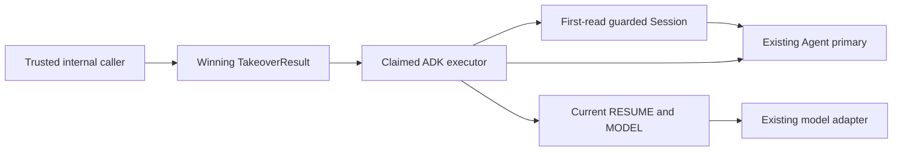
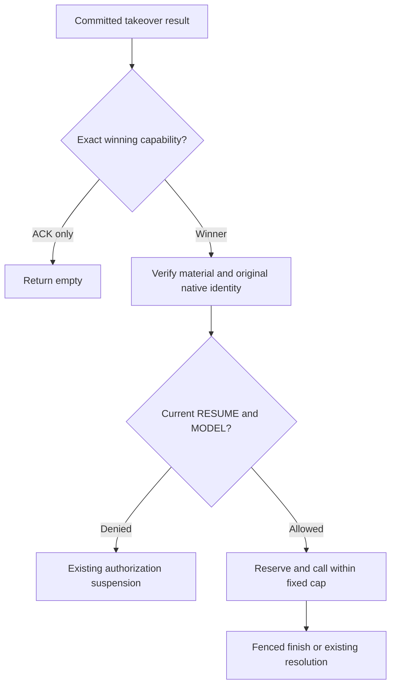
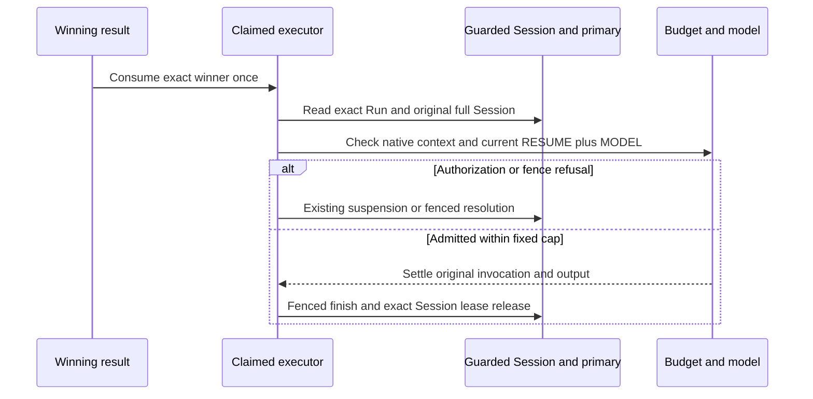

# T4-03 守卫断点恢复执行器

| Field | Value |
| --- | --- |
| Document | docs/egon/spec/2026-11-06-03-47-agent-checkpoint-guarded-executor.md |
| Template Version | 9 |
| Archetype Cleanup | Not applicable |
| Status | Review |
| Type | Feature |
| Complexity | Complex |
| Complexity Drivers | One-use owner-scoped handoff, native invocation identity, conjunctive live authorization and fixed dual-lease deadline |
| Created | 2026-11-06 03:47 Asia/Shanghai |
| Updated | 2026-11-06 03:47 Asia/Shanghai |
| Owner | Tianji Agent Runtime |
| Repository | tianji-service |
| Scope | Execute an eligible first-input checkpoint through the internal guarded ADK executor |
| Change Surface | Three production Java classes, two finite test classes and three review artifacts |
| Affected Chapters | §7, §8, §9, §10, §14, §15, §16 |
| Source Requirement | [主计划 §10.2、§17.2 S11、§19 T4-03](../../../../docs/plans/agent-framework-upgrade-plan.md) |
| Baseline Revision | b64f3aae86082ac4095b65f0aefad493c6f344fd |
| Amends | None |
| Supersedes | None |
| Depends On | [Guarded first full read](2026-11-06-03-42-agent-checkpoint-resume-first-read.md#73-detailed-design) |
| Related Specs | None |
| Related Plans | [Guarded executor Plan](../plan/2026-11-06-03-48-agent-checkpoint-guarded-executor.md) |

## 1. Summary

赢得断点接管后，内部调用方把一次性的结果交给现有执行器。执行器在原 Run、原 Session 和原 ADK invocation 上恢复符合约束的 CONFIG 根代理。模型准入同时依赖当前 RESUME 权限和现有 MODEL 权限，恢复时限仍由已认领的固定双租约和原 Run deadline 决定。

## 2. Background and Current State

| Evidence ID | Exact source | Observed fact |
| --- | --- | --- |
| EVD-001 | AgentCheckpointTakeoverService#commit, TakeoverResult#takeLaunch, Launch#bindSession | A fresh transaction commits a one-use launch with exact owner, cut and successor leases. Replay returns ACK alone. |
| EVD-002 | PostgresAdkSessionService#getSession and #verifySessionLease | First full read on the bound adapter verifies the original cut and returns the checked view. Existing scoped fences cover later Session operations. |
| EVD-003 | AdkAgentRunExecutor#executeScoped, AdkRunBudgetPlugin#beforeModelCallback and #afterModelCallback | Existing queued execution claims and renews, authorizes MODEL, reserves/settles budget and finishes the owned Run. |
| EVD-004 | Components AgentFlowSessionRunner#withExplicitResume and product-origin ADK 1.13 probe | The explicit six-argument Runner path accepts original invocation and null fresh input. Product-origin proof used the pre-model first-input cut. |
| EVD-005 | AgentRunAuthorization, AgentExecutionAuthorization and AgentLedgerService | Existing independent MODEL grant, exact authorization request, database clock, lease and Run transitions provide current admission and completion facts. |

### 2.4 Evidence and current-chain map

| Entry/trigger | Current chain | Gap | Design response |
| --- | --- | --- | --- |
| Fresh takeover | Claim commits new dual leases and capability | Queued executor claims again | Consume winner once and reuse the claimed body |
| ADK native continuation | Components supports explicit invocation | Execution has not connected it to guarded Session | Pass same-source bound adapter directly to original invocation |
| Model callback and completion | Current MODEL, budget and fenced ledger | Need live RESUME and exact native context on resume | Check both permissions before admission and bind expected callback identity |
| Fixed cap and cancel | Ordinary path renews leases and observes cancellation | Renewing would exceed accepted authority window | Read-only periodic Run and Session control with fixed cutoff |

### 2.5 Archetype example cleanup

Cleanup disposition: Not applicable

Reason: Existing Agent Runtime module and no generated project or example files.

## 3. Goals and Non-goals

Deliver the guarded Java executor boundary for the narrow first-input checkpoint. Host trigger, current authority composition, database credentials and live S11 acceptance are separate gates.

### 3.3 Change Surface and Design Depth

| Area/layer | Disposition | Exact repository evidence | Changed or preserved behavior/contract | Required Spec treatment | Chapter(s) |
| --- | --- | --- | --- | --- | --- |
| AR executor, budget callbacks and capability | Affected | EVD-001–005 | Resume from one winning claim with independent permissions and exact native identity | Execution handoff, lifecycle and validation | §7, §8, §9, §10, §14, §15, §16 |
| Agent primary persistence and existing Session adapter | Context-only | EVD-002/005 | Reuse existing tables, first read, budget and ledger operations | Record exact reused bounds and transitions | §7/11 |
| Host, HTTP, permissions publication and deployment | Unchanged | EVD-001/004/005 | Existing source and artifact contracts | Archive parity and separate acceptance | §16/18 |

## 4. Requirements and Acceptance Criteria

| ID | Requirement | Priority | Observable acceptance | Source |
| --- | --- | --- | --- | --- |
| REQ-001 | Consume only the winning claim within the exact internal boundary | Must | Exact primary and authority identity, no ambient transaction, one use, exact reread of claimed material, ACK-only replay does not open Session, call authority or run. | EVD-001/002/005 |
| REQ-002 | Resume only the original narrow native invocation | Must | Pinned ADK 1.13, supported CONFIG root and input, verified Session, same actor/user/Session and invocation, null new input, scoped callback and event checks. | EVD-002–004 |
| REQ-003 | Require both current authorizations before budget and model work | Must | Exact live RESUME permit covering the fixed cap and current MODEL decision at every MODEL admission. Either denial prevents reservation and provider work and uses existing authorization suspension. | EVD-003/005 |
| REQ-004 | Keep fixed cap, cancellation and completion fenced | Must | No second Run claim, Session acquisition, heartbeat or renewal. Cancel and cutoff stop processing through existing transitions. Cap expiry and Run deadline remain distinct. | EVD-002/003/005 |
| REQ-005 | Prove finite source scope and preserve existing behavior | Must | One intended MODEL RED, 80 owner tests repeated in producer, archive parity, eight paths and 28 immutable SQL. | EVD-001–005 |

### 4.1 Scenario matrix

| Scenario | Invariant | Failure | Verification |
| --- | --- | --- | --- |
| Winner and exact capability | Both identities and claim match | Wrong binding refuses, ACK replay has no execution | TEST-001/004 |
| Native first-input continuation | Original invocation, Session and user | Unsupported inputs, topology or callback identity refuse | TEST-001 |
| Either permission denied | Admission requires RESUME and MODEL | Existing authorization suspension, no budget or model | TEST-002/003 |
| Fixed cap and periodic cancellation | No renewal; only owned finish and release | Lease expiry differs from Run timeout; persisted cancel aborts provider | TEST-005/006 |

### 4.2 Use-case analysis

| Actor ID | Actor | Context |
| --- | --- | --- |
| ACTOR-001 | Trusted in-process resume caller | Holds winning committed result and the same ResumeAuthorization instance |
| ACTOR-002 | Owning Agent primary and native Runner | Supplies scoped Run and verified Session, model admission and settlement |
| ACTOR-003 | Source reviewer | Reproduces exact red mutation and finite gates |

| ID | Use case/goal | Actors | Trigger/preconditions | Main flow | Alternatives/failure | Postcondition | Requirements |
| --- | --- | --- | --- | --- | --- | --- | --- |
| UC-001 | Continue original invocation | ACTOR-001/002 | Winning exact claim, available pinned engine | Consume once, read exact Run, resume through guarded Session, authorize, settle and finish | Replay empty; mismatch/denial/expiry refuses; cancel aborts | Existing fenced Run and Session lifecycle | REQ-001–004 |
| UC-002 | Review isolated source change | ACTOR-003 | Exact baseline and typed A/B candidates | R1, G1, P1 and S1 | Other failures, skipped tests and archive drift fail | Exact source evidence | REQ-005 |

## 5. Constraints, Assumptions, and Decisions

Use the exact source and ResumeAuthorization instance that issued the winning result. Authority must still apply to the exact original request and remain valid through the fixed cap. The existing MODEL authorizer has its own current grant rules; the resume permit cannot issue or replace that grant. Existing first-read proof and native ADK engine support are prerequisites.

## 6. Project Technology Context

Existing Agent Runtime infrastructure, JDK25, PostgreSQL, RxJava, Spring AI and pinned ADK 1.13 Components bridge.

### 6.2 User-mandated Java rule compliance

```text
1 类名规范，必须以 java的pojo规范命名。以dao po bo vo dto query command event等结尾
2 每层之间必须被 springboot-validation 校验，复用对象使用分组校验；基于原生和自定义约束注解、@Valid、@Validated 及 ConstraintValidator 扩展实现。ValidationUtils 只承担通用手工校验，不承载全部业务校验；电话号码复用 libphonenumber。
3 Java POJO 默认使用 class，注解为 @Data @NoArgsConstructor @AllArgsConstructor @Accessors(chain = true)，按构造目标选择 @Builder 或 @SuperBuilder；父类状态参与相等性时使用 @EqualsAndHashCode(callSuper = true)。只有不可变 value object 可以使用 record，并豁免 class 的 Lombok 规范；普通实体不能因简单而使用 record。使用 MapStruct、MapStructPlus 和 egon-cola-component-common-core 的 BaseConverter（双向）或 BaseForwardConverter（不可逆投影）进行转换。
4业务类必须使用@Slf4j注解注入log对象。如果业务类被spring管理，必须指定名称，如果是单例的情况下，参考@Service("userService")。如果需要依赖注入，必须@RequiredArgsConstructor进行修饰，不要代码中写。且属性必须被@qualify修饰。
5 工具类只允许使用jdk原生、Apache Commons(commons-lang3、commons-collections4、commons-io、commons-text、commons-codec、commons-beanutils)、Guava。针对Tika按需引入。
6 JSON 使用 Spring Boot Jackson；持久化枚举值使用 @EnumValue，向前端输出的枚举值使用 @JsonValue，禁止 ordinal 作为业务编码。
7 springboot 多环境配置文件，必须保持配置一致，但值不一定一致。
9 复杂业务必须引入设计模式，不允许硬编码
10 日期相关的必须使用java.time下的实体类，不允许使用java.util下的
11 只允许现有三层结构或当前 egon-cola-archetypes 的 DDD 结构，三层结构保持现状。必须尽量复用 egon-cola-components；持久化模块必须使用 Egon COLA MP Starter，DDL 统一由 egon-mp-sdj-ext-starter 分布式管理。业务唯一键必须组合业务列与 deletedAt（数据库 deleted_at），并验证 NULL、租户及重复软删除语义。采用 CQE（Command Query Event）；Event 必须经 egon-cola-component-transactional-outbox-starter 或 MQ 中间件投递。
```

| Literal rule | Affected? | Repository evidence | Exact design decision | Files/types/interfaces | Validation/test evidence | Status/blocker |
| --- | --- | --- | --- | --- | --- | --- |
| Rule 1 | Yes | EVD-001–005 | Use one claimed execution body and a narrow one-use takeover capability | §7/8/9/10/11 | TEST-001–006 | PASS |
| Rule 2 | Yes | EVD-001–005 | Check exact source, authority, owner, invocation, fixed cap and both live permissions | §7/8/9/10/11 | TEST-001–006 | PASS |
| Rule 3 | Yes | EVD-001–005 | Reuse existing immutable run authorization and scoped lease records | §7/8/9/10/11 | TEST-001–006 | PASS |
| Rule 4 | No | EVD-001–005 | Existing executor and direct Session adapter without new beans or logging | §7/8/9/10/11 | TEST-001–006 | N/A |
| Rule 5 | Yes | EVD-001–005 | Reuse existing Agent ledger, ADK bridge and Spring AI model adapter | §7/8/9/10/11 | TEST-001–006 | PASS |
| Rule 6 | No | EVD-001–005 | Existing run, Session and permission contracts without wire or JSON changes | §7/8/9/10/11 | TEST-001–006 | N/A |
| Rule 7 | No | EVD-001–005 | Existing settings without new profile, configuration or dependency | §7/8/9/10/11 | TEST-001–006 | N/A |
| Rule 9 | Yes | EVD-001–005 | Share postclaim execution and use existing adapters across guarded native boundaries | §7/8/9/10/11 | TEST-001–006 | PASS |
| Rule 10 | Yes | EVD-001–005 | Derive fixed bounds from database Instant and use monotonic scheduling for elapsed waits | §7/8/9/10/11 | TEST-001–006 | PASS |
| Rule 11 | Yes | EVD-001–005 | Existing Agent Runtime and owning Agent primary only | §7/8/9/10/11 | TEST-001–006 | PASS |

### 6.3 Time semantics and conversion contract

Time contract: Required

| Time ID | Fields/symbols | Semantics | Java/runtime type | Storage policy | Wire policy | Business zone source | Display zone source | Boundary / DST rules | Precision / Clock | Compatibility | Verification |
| --- | --- | --- | --- | --- | --- | --- | --- | --- | --- | --- | --- |
| TIME-001 | Original Run deadline, successor lease expiry and resume authorization expiry | Occurred instant | java.time.Instant | UTC instant | Internal | Not applicable: absolute instant | Not applicable: no display | Current time strictly precedes the common lease cap for execution and the exact permit must cover the cap. Distinguish cap expiry from actual Run deadline | Owner primary database clock and stored precision | Original deadline and successor lease rows are reused | Step 1 TEST-002/003/005 |
| TIME-002 | Remaining invocation cap and control interval | Duration | java.time.Duration and RxJava timer | Not persisted | Internal | Not applicable: elapsed duration | Not applicable: no display | Resumed timer uses the earlier absolute limit translated once into remaining duration. Periodic control rechecks current DB facts | Nanosecond duration for resumed cutoff, one-second control poll | Ordinary heartbeat and timeout behavior preserved | Step 1 TEST-001/005/006 |


## 7. Architecture Design

### 7.0 Minimum-design baseline and element-necessity audit

| Proposed element | Change | Requirements | Existing alternative | Gap | Added cost | Verdict |
| --- | --- | --- | --- | --- | --- | --- |
| Opaque consumed Execution | Extend | REQ-001 | Package Launch only | Executor is in sibling package, and must enforce identity and consume once | One immutable capability backed by existing launch latch | Use |
| Shared claimed execution body | Reuse | REQ-002–004 | Duplicate resumed executor | Drifts in budget, output, cancellation and result transitions | Narrow branches for entry, explicit invocation and control | Reuse |
| Exact resumed context and read-only control | Extend | REQ-002–004 | Ordinary context and heartbeat | Invocation and cap need fixed provenance | One callback identity binding and one scoped read per tick | Use |

| Path | Network calls | Client states | Owner state | Failure boundary |
| --- | --- | --- | --- | --- |
| Winning resume | Existing primary, current authorizers, model only on admission | Existing internal result and native execution | Fixed owned leases and ordinary result lifecycle | Refuse or existing fenced completion |
| ACK-only replay | None from executor | Empty Optional | Existing ACK | No launch consumed |
| Queued execution | Existing behavior | Existing contract | Ordinary claim and heartbeat | Existing behavior |

### 7.1 System Architecture Design



### 7.2 High-Level Design

The executor unwraps a winning result only once for its exact source and authority. It reads the claimed material, checks the narrow CONFIG shape and supplies the guard to the explicit native Runner. The shared claimed body retains budget, projection, output, finish and cleanup.



#### 7.2.2 High-level decision and quality matrix

| Concern/use case | Constraint | Decision | Evidence |
| --- | --- | --- | --- |
| Handoff | Replay has an ACK and no launch | Consume exact winner once | EVD-001 |
| First resumed read | Need original cut and Session view | Supply existing bound adapter to native Runner | EVD-002/004 |
| Admission and completion | Independent current permissions and no fixed-cap extension | Reuse MODEL pipeline, add exact RESUME and read-only control | EVD-003/005 |

### 7.3 Detailed Design

TakeoverResult captures only the winning launch. consumeForExecution checks exact primary and ResumeAuthorization object identity plus transaction scope before consuming the shared launch latch and returning an opaque Execution. Replay returns empty. The executor rereads owner-scoped ExecutionMaterial and verifies the original request, exact RUNNING attempt one, postclaim revision/sequence and the claimed facts. It releases the exact Session lease if it consumed the capability and cannot enter the shared body.

Reuse the first-input checkpoint eligibility predicate. Require a durable, supported CONFIG LlmAgent leaf with no subagents, outputKey, tools, prompts, skills, external context assembly, process link, artifacts or task data. Require pinned engine and a nonlegacy USER. Bind expected native user, Session and invocation at both MODEL callback boundaries. Pass the guarded Session and original invocation to the explicit six-argument Runner with null new content and initial state. Compare raw event invocation before projection.

At each resumed MODEL admission and retry, recheck the exact current RESUME decision on database time and require the ordinary MODEL authorizer on the same request. A RESUME permit must cover the fixed claim cap. Existing authorization failure suspends through the owned Run transition. Keep existing budget settlement, output projection, event and result fences.

The resumed control loop observes current owner Run state, cancellation and database time, then verifies the fixed Run and Session lease. It never claims, acquires or renews. A dedicated timer stops the subscription at the earlier fixed lease cap or Run deadline. Cap expiry uses lease-loss resolution, while actual deadline uses existing timeout logic. Existing owned cancellation and finish CAS govern terminal updates. Always close Runner and release exact Session lease through existing cleanup.



#### 7.3.6 Conclusion evidence chain

| Conclusion | Evidence | Decision |
| --- | --- | --- |
| Only winner can execute the original cut | EVD-001/002/004, TEST-001/004 | One-use exact binding and native invocation |
| RESUME cannot stand in for MODEL | EVD-003/005, TEST-002/003 | Independently require both current decisions |
| Resumed execution cannot extend its authority window | EVD-002/005, TEST-005/006 | Read-only control and fixed cutoff |

## 8. Package Structure and Code File Tree

| Operation | Exact path |
| --- | --- |
| CREATE | `stellar-enclosure-tianji-agent-runtime/src/test/java/top/egon/cola/platform/tianji/agent/infrastructure/adk/AdkCheckpointResumeExecutorTest.java` |
| MODIFY | `stellar-enclosure-tianji-agent-runtime/src/test/java/top/egon/cola/platform/tianji/agent/infrastructure/adk/session/AgentCheckpointTakeoverServiceTest.java` |
| MODIFY | `stellar-enclosure-tianji-agent-runtime/src/main/java/top/egon/cola/platform/tianji/agent/infrastructure/adk/session/AgentCheckpointTakeoverService.java` |
| MODIFY | `stellar-enclosure-tianji-agent-runtime/src/main/java/top/egon/cola/platform/tianji/agent/infrastructure/adk/AdkRunBudgetPlugin.java` |
| MODIFY | `stellar-enclosure-tianji-agent-runtime/src/main/java/top/egon/cola/platform/tianji/agent/infrastructure/adk/AdkAgentRunExecutor.java` |
| CREATE | `docs/egon/spec/2026-11-06-03-47-agent-checkpoint-guarded-executor.md` |
| CREATE | `docs/egon/plan/2026-11-06-03-48-agent-checkpoint-guarded-executor.md` |
| CREATE | `docs/egon/evidence/2026-11-06-agent-checkpoint-guarded-executor.md` |

## 9. Interface Definitions

### 9.1 Interface Inventory

| Interface | Protocol | Owner | Purpose |
| --- | --- | --- | --- |
| INTERNAL-001 | Internal Java | AdkAgentRunExecutor#executeResume | Consume one verified checkpoint claim and return existing Run result |
| INTERNAL-002 | Existing native ADK Runner and callbacks | AgentFlowSessionRunner and AdkRunBudgetPlugin | Resume exact invocation and check original context at model boundaries |

### 9.2 Per-interface Detailed Contracts

#### 9.2.1 INTERNAL-001 — Guarded resume execution

##### Necessity and interaction-cost decision

| Concern | Decision |
| --- | --- |
| Change classification | New internal overload-like execution entry, with existing external API |
| Independent consumer goal | Use the already committed winning claim |
| Parameter ownership and derivation | Committed TakeoverResult and its original ResumeAuthorization instance |
| Direct/no-new-interface alternative | executeQueued would claim and renew again |
| Caller use of result | Existing AgentRunDTO when consumed, empty for ACK alone or already spent |
| Round trips and failure points | Exact scoped Run reread and existing guarded Session path, read-only periodic control |
| Verdict | Narrow internal executeResume entry with shared execution body |

##### Identity and purpose

Trusted caller hands off the exact committed result to its owning executor once.

##### Request parameters

TakeoverResult and the same ResumeAuthorization instance. Executor supplies its exact configured primary DataSource and Session write mode. Active ambient transaction is refused.

##### Success response

Optional containing existing AgentRunDTO for the resolved consumed execution. ACK-only or already spent result has an empty Optional.

##### Error responses

Invalid capability binding, engine, ownership or revision fail closed through existing internal errors. Live authorization denial and cancellation follow existing owned transitions.

##### Interface logic for frontend and consumers

An internal consumer receives only the existing result projection. No controller or frontend calls the entry in this Step.

##### Compatibility and verification

Queued entry and replay ACK remain compatible. TEST-001–006 cover the narrow execution boundary.

#### 9.2.2 INTERNAL-002 — Exact native continuation and model boundary

##### Necessity and interaction-cost decision

| Concern | Decision |
| --- | --- |
| Change classification | Reuse existing explicit Runner and budget callbacks |
| Independent consumer goal | Continue the same ADK native invocation with no new input |
| Parameter ownership and derivation | Winning capability provides original invocation and guarded adapter; ADK supplies callback context |
| Direct/no-new-interface alternative | Ordinary Runner input would start a new invocation |
| Caller use of result | Shared completion projects only same-invocation events |
| Round trips and failure points | Existing Session reads and model callbacks; no extra replayed input |
| Verdict | Use existing explicit ADK interface and narrow exact callback guard |

##### Identity and purpose

Use app tianji, exact scoped user and Session and original invocation.

##### Request parameters

Pass original invocation ID, null new content, existing non-auto-creating RunConfig and null initial state. MODEL callbacks must present the exact bound identity.

##### Success response

Native event stream on the same invocation supplies output to existing projection and settlement.

##### Error responses

Mismatched callback/event, invalid lease or absent authorization prevents further admission or owned writes.

##### Interface logic for frontend and consumers

Native SDK and Agent Runtime are the only consumers.

##### Compatibility and verification

Ordinary Runner and model callbacks retain existing behavior. TEST-001/002/003/005/006 exercise actual finite Runner and Fake model.

## 10. POJO and Data Model Design

The opaque Execution holds the exact winning immutable launch and already bound Session. It exposes existing actor, request and lease values. Existing TakeoverAckDTO and AgentRunDTO are reused. AdkRunBudgetPlugin keeps one bound private ResumeContext for exact user, Session and invocation.

## 11. Database Design

Database change: Not applicable. This Step adds no schema or SQL and uses existing Agent Runtime calls.

### 11.1 Table Inventory

| Existing context only | Reused ownership boundary | Purpose in this Step |
| --- | --- | --- |
| tianji_agent.agent_run and existing Run event ledger | AgentLedgerService | Read exact claimed Run and current cancellation, append owned projections and finish existing result |
| tianji_agent.agent_session and agent_session_lease | Scoped PostgresAdkSessionService | Exact guarded first full read, existing fenced writes and release |
| Existing budget reservation and usage ledger | AdkRunBudgetPlugin and AgentLedgerService | Reuse owned budget reservation and settlement after live authorization |

### 11.2 Per-table Detailed Design

Not applicable. Persisted schema, existing predicates, lifecycle, migrations and indexes retain their current definitions. Step 127 owns the first-read SQL and transaction order. This Step composes existing ledger and Session operations.

### 11.3 Entity-relationship diagram

Relational model change: No. Existing keys and ownership remain as defined in prior Steps.

## 12. Frontend Page Design

Not applicable. No frontend or public transport contract.

## 13. Design Patterns and Architecture Principles

Use an opaque one-use capability for cross-package handoff and share the existing postclaim execution body. One body preserves identical budget settlement, projection and terminal transitions for both entries. Distinct branches retain the scoped resumed invocation and its fixed control policy.

## 14. Test Design

| Test | Evidence | Boundary |
| --- | --- | --- |
| TEST-001 | Ordinary producer first-input cut, exact native resume, original model prompt and settlement, no duplicate input or renewal | Actual ADK Runner and production Spring AI adapter with in-memory delegated Session and Fake model |
| TEST-002 | Denied live RESUME stops before MODEL, budget and provider | Actual finite Runner and Fake |
| TEST-003 | Denied MODEL with allowed RESUME suspends and cannot reserve/call | Exact assertion RED and actual finite Runner/Fake |
| TEST-004 | ACK-only replay is inert; takeover capability covers identity and consumption | Executor and takeover controls |
| TEST-005 | Already expired fixed lease does not become a Run timeout or model call | Finite executor and existing ownership behavior |
| TEST-006 | Persisted cancellation observed during active stream stops Fake upstream and releases exact lease without renewal | Actual periodic control, real Spring AI adapter and finite Fake |
| TEST-007 | Exact owner suite and clean actual archive parity | G1/P1/S1 source and package evidence |

## 15. Non-functional and Cross-cutting Design

Keep the resumed stream bounded by the fixed cap and original deadline. Use owner-scoped read-only periodic control and existing diagnostic redaction. Scope failures and transport failures retain existing error handling.

## 16. Compatibility, Migration, Rollout, and Rollback

Preserve current host registration, permission catalog, runtime YAML, dependencies, SQL, external contracts, queued worker and ACK replay. Verify actual nested AR binaries in AS and AS/PS publication artifact parity. Roll back the one scoped source commit.

## 17. Alternatives and Decisions

An independent resumed runner would duplicate budget, output and terminal lifecycle. An ordinary queued entry would re-claim and renew. Use the exact committed capability and share the already claimed execution body.

## 18. Risks and Open Questions

Current host authority composition and an eligible production caller still require implementation in a separate Step. Actual PostgreSQL privilege, same-source operational acceptance and live S11 restart recovery require separate evidence.

## 19. Traceability Matrix

| Requirement | Use case | Design | Tests |
| --- | --- | --- | --- |
| REQ-001 | UC-001 | §7/9/10 | TEST-001/004 |
| REQ-002 | UC-001 | §7/9/14 | TEST-001/003 |
| REQ-003 | UC-001 | §7/9/15 | TEST-002/003 |
| REQ-004 | UC-001 | §6.3/7/11 | Step 1 TEST-001/005/006 |
| REQ-005 | UC-002 | §8/14/16 | TEST-007 |

## 20. Review and Acceptance

### 20.5 Blocking Manual Check

| Check ID | Applicability | Status | Evidence | Finding | Required action/exception |
| --- | --- | --- | --- | --- | --- |
| MC-ARCH-001 | Applicable | PASS | §7/8/11 | Agent Runtime internal owner and existing primary | None |
| MC-REUSE-001 | Applicable | PASS | EVD-001–005 | Existing completion, budget, guarded Session and explicit Runner | None |
| MC-DEP-001 | Applicable | PASS | §6/16 | Existing JDK25, Agent Runtime and pinned ADK | None |
| MC-NAME-001 | Applicable | PASS | §7/9/10 | TakeoverResult, scoped Execution and existing decisions | None |
| MC-VALID-001 | Applicable | PASS | §7/9/14 | One-use winner, exact owner and both live boundaries | None |
| MC-MODEL-001 | Applicable | PASS | §10 | Separate claimed execution data from callback identity guard | None |
| MC-CONVERT-001 | Not applicable | N/A | §10 | Existing DTO and no new mapper | None |
| MC-LOG-001 | Applicable | PASS | §15 | Existing generic messages and no raw input or grants | None |
| MC-BEAN-001 | Not applicable | N/A | §8/16 | Existing executor with no registration change | None |
| MC-UTIL-001 | Applicable | PASS | §6/7 | Reuse existing Reactor, RxJava, Session and ledger helpers | None |
| MC-JSON-001 | Not applicable | N/A | §10/16 | Existing native and wire formats | None |
| MC-TIME-001 | Applicable | PASS | §6.3/11 | Fixed lease cap, original deadline and separate error classification | None |
| MC-CONFIG-001 | Not applicable | N/A | §16 | Existing configuration and manifests | None |
| MC-PATTERN-001 | Applicable | PASS | §13 | One-use capability and shared claimed execution | None |
| MC-SCOPE-001 | Applicable | PASS | §8/16 | Exact five Java paths and three review artifacts | None |
| MC-TEST-001 | Applicable | PASS | §14 | Exact MODEL RED and 80 finite cases in each owner run | None |
| MC-BLOCKER-001 | Applicable | PASS | §18 | Separate host authority, PostgreSQL and runtime acceptance | None |

### 20.6 Final verdict

PASS — Ready for user review
