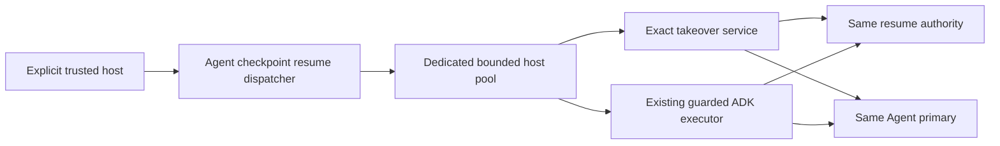
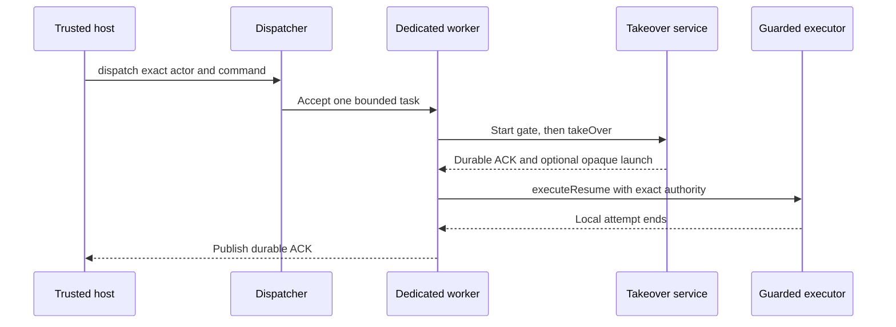

# T4-03 断点续跑的宿主派发

| Field | Value |
| --- | --- |
| Document | docs/egon/spec/2026-11-06-04-22-agent-checkpoint-resume-dispatch.md |
| Template Version | 9 |
| Archetype Cleanup | Not applicable |
| Status | Review |
| Type | Feature |
| Complexity | Complex |
| Complexity Drivers | Bounded admission before a durable claim, exact capability binding, one-task handoff, and shutdown races |
| Created | 2026-11-06 04:22 Asia/Shanghai |
| Updated | 2026-11-06 04:22 Asia/Shanghai |
| Owner | Tianji Agent Runtime |
| Repository | tianji-service |
| Scope | Optional internal host dispatch for an expired lease and eligible first-input checkpoint |
| Change Surface | Three production Java classes, one finite test class and three review artifacts |
| Affected Chapters | §7, §8, §9, §10, §14, §15, §16 |
| Source Requirement | [主计划 §10.2、§17.2 S11、§19 T4-03](../../../../docs/plans/agent-framework-upgrade-plan.md) |
| Baseline Revision | 697d50759a300c1a56ca81b1d411a653ee4a3185 |
| Amends | None |
| Supersedes | None |
| Depends On | [Guarded executor Spec](2026-11-06-03-47-agent-checkpoint-guarded-executor.md#73-detailed-design) |
| Related Specs | None |
| Related Plans | [Host dispatch Plan](../plan/2026-11-06-04-23-agent-checkpoint-resume-dispatch.md) |

## 1. Summary

已核实主体可由受信宿主显式提交窄范围 checkpoint 命令。宿主先取得有界执行容量，然后在一个任务内接管并使用同一个授权实例续跑。返回的 ACK 仅表示已持久接管。缺省没有任何宿主调用入口。

## 2. Background and Current State

| Evidence ID | Exact source | Observed fact |
| --- | --- | --- |
| EVD-001 | AgentRunDispatcher#dispatch/#close/#awaitQuiescence | Ordinary dispatch coalesces by owner/run and delegates queued claims through its borrowed executor. |
| EVD-002 | AgentCheckpointTakeoverService#takeOver and TakeoverResult#consumeForExecution | Exact receipt replays are ACK-only; fresh winner has one-use capability bound to source and authority by identity. |
| EVD-003 | AdkAgentRunExecutor#executeResume and #executeResumed | Existing worker reuses the original invocation and fixed leases, verifies current RESUME and MODEL and owns postclaim fences. |
| EVD-004 | TianjiAgentRuntimeAutoConfiguration#validateDispatchExecutor and AgentStorageVerifier#verifyCheckpointObservation/#verifyCheckpointCapture | Host controls bounded pool and control scheduler. Observation and capture use distinct V16 privileges. |
| EVD-005 | AgentCheckpointCapturePostgresTest and TianjiExecutionGrantIssuer#ensureInternal | An opt-in fixture assembles exact execution source and current local decisions. The existing START issuance reads a request-bound verified token. |

### 2.4 Evidence and current-chain map

| Entry/trigger | Current chain | Gap | Design response |
| --- | --- | --- | --- |
| Explicit checkpoint command | Takeover commits then returns a capability | Caller can commit before guaranteeing a worker | One host task starts before any takeover |
| Exact receipt replay | Takeover returns durable ACK without launch | Separate queued entry would claim again | Pass opaque result to existing single-consume execution |
| Host shutdown | Ordinary dispatcher gates new queued work | Resume requires an explicit start fence on accepted tasks | Fence close and worker start under one monitor |

### 2.5 Archetype example cleanup

Cleanup disposition: Not applicable

Reason: Existing Agent Runtime module with no project generation or example ownership.

## 3. Goals and Non-goals

Deliver one explicit internal dispatcher for existing expired-lease first-input recovery. Production trigger, public resume operation, PaC, permission issuance and real runtime acceptance are separate.

### 3.3 Change Surface and Design Depth

| Area/layer | Disposition | Exact repository evidence | Changed or preserved behavior/contract | Required Spec treatment | Chapter(s) |
| --- | --- | --- | --- | --- | --- |
| AR host dispatcher and producer binding | Affected | EVD-001–003 | Check admission and exact binding before claim | Internal contract and concurrency | §7, §8, §9, §10, §14, §15, §16 |
| Agent primary and guarded execution | Context-only | EVD-002–004 | Reuse exact claim, ACK and fixed lease fences | Verify compatibility and retained owner boundaries | §7/11/16 |
| AS/PS transport, Spring, authority and deployment | Unchanged | EVD-004/005 | Explicit standalone source only | Artifact parity and independent activation gate | §16/18 |

## 4. Requirements and Acceptance Criteria

| ID | Requirement | Priority | Observable acceptance | Source |
| --- | --- | --- | --- | --- |
| REQ-001 | Validate host binding and capacity before takeover | Must | Worker session source, takeover source and resume authority match by object identity. Bounded rejecting pool and out-of-transaction caller guard. Rejection produces no claim. | EVD-001–004 |
| REQ-002 | Keep takeover and native continuation in one admitted task | Must | One submission. The same worker calls takeover, then guarded executor with the opaque result and same authority. Replay yields the original ACK without native execution. | EVD-002/003 |
| REQ-003 | Preserve committed outcome and avoid redrive | Must | Precommit failure propagates. After a durable ACK, runtime failure leaves the ACK intact. No second submission, retry or substitute claim. | EVD-002/003 |
| REQ-004 | Stop new and unstarted commands and drain started work | Must | Close and start are linearized. Borrowed pool and unrelated work stay host-owned. Caller wait cancellation has no execution effect. Drain is bounded. | EVD-001/004 |
| REQ-005 | Preserve disabled-by-absence release scope | Must | Exact R1/R2 assertions, focused tests and actual AS/PS archive proof; seven paths and 28 immutable migrations. Production role, authority and E remain pending. | EVD-001–005 |

### 4.1 Scenario matrix

| Scenario | Invariant | Failure | Verification |
| --- | --- | --- | --- |
| Wrong authority/source, full pool, or worker creation failure | No takeover before acceptance and no rejected task left in queue | Exact binding or capacity rejection | TEST-001/002 |
| Winner, replay, and postcommit failure | One task and original durable ACK | Committed failure is handled by existing reconciliation | TEST-003 |
| Shutdown during admission | Unstarted commands cannot claim, running task drains | Canceled pending wait reports dependency unavailable | TEST-004 |

### 4.2 Use-case analysis

| Actor ID | Actor | Context |
| --- | --- | --- |
| ACTOR-001 | Trusted internal host | Supplies actor, command and dedicated pool with exact collaborators |
| ACTOR-002 | Existing Agent takeover and ADK executor | Owns durable transaction and native execution fences |
| ACTOR-003 | Source reviewer | Reproduces typed RED and offline acceptance |

| ID | Use case/goal | Actors | Trigger/preconditions | Main flow | Alternatives/failure | Postcondition | Requirements |
| --- | --- | --- | --- | --- | --- | --- | --- |
| UC-001 | Explicitly dispatch a checkpoint | ACTOR-001/002 | Eligible exact command outside transaction | Admit, claim, consume and return durable ACK | Capacity, stale command or authorization denial surfaces without execution | Existing guarded ledger and Session lifecycle | REQ-001–003 |
| UC-002 | Stop the host dispatcher | ACTOR-001 | Owned host begins shutdown | Fence admission, invalidate unstarted tasks, await started work | Time limit or interruption is observable | Other host tasks and executor remain host-owned | REQ-004 |
| UC-003 | Verify isolated release scope | ACTOR-003 | Pinned baseline and exact candidate | Typed R1/R2, G1, P1 and S1 | Other failures or scope drift fail the gate | Reviewable source evidence | REQ-005 |

## 5. Constraints, Assumptions, and Decisions

The trusted host owns the dedicated ThreadPoolExecutor and preserves its bounded AbortPolicy configuration. Maximum pool size and queue capacity are each limited to 128. The supplied authority is suitable for worker-thread calls, independent of servlet token propagation. The same physical primary DataSource object binds takeover and executor. A real recovery role reads V16 while writing existing eligible lifecycle records. An ADK executor using that role has checkpoint capture disabled.

## 6. Project Technology Context

Use existing Agent Runtime, JDK 25 pool/future types, Spring transaction inspection, SLF4J, and the pinned ADK bridge.

### 6.2 User-mandated Java rule compliance

```text
1 类名规范，必须以 java的pojo规范命名。以dao po bo vo dto query command event等结尾
2 每层之间必须被 springboot-validation 校验，复用对象使用分组校验；基于原生和自定义约束注解、@Valid、@Validated 及 ConstraintValidator 扩展实现。ValidationUtils 只承担通用手工校验，不承载全部业务校验；电话号码复用 libphonenumber。
3 Java POJO 默认使用 class，注解为 @Data @NoArgsConstructor @AllArgsConstructor @Accessors(chain = true)，按构造目标选择 @Builder 或 @SuperBuilder；父类状态参与相等性时使用 @EqualsAndHashCode(callSuper = true)。只有不可变 value object 可以使用 record，并豁免 class 的 Lombok 规范；普通实体不能因简单而使用 record。使用 MapStruct、MapStructPlus 和 egon-cola-component-common-core 的 BaseConverter（双向）或 BaseForwardConverter（不可逆投影）进行转换。
4业务类必须使用@Slf4j注解注入log对象。如果业务类被spring管理，必须指定名称，如果是单例的情况下，参考@Service("userService")。如果需要依赖注入，必须@RequiredArgsConstructor进行修饰，不要代码中写。且属性必须被@qualify修饰。
5 工具类只允许使用jdk原生、Apache Commons(commons-lang3、commons-collections4、commons-io、commons-text、commons-codec、commons-beanutils)、Guava。针对Tika按需引入。
6 JSON 使用 Spring Boot Jackson；持久化枚举值使用 @EnumValue，向前端输出的枚举值使用 @JsonValue，禁止 ordinal 作为业务编码。
7 springboot 多环境配置文件，必须保持配置一致，但值不一定一致。
9 复杂业务必须引入设计模式，不允许硬编码
10 日期相关的必须使用java.time下的实体类，不允许使用java.util下的
11 只允许现有三层结构或当前 egon-cola-archetypes 的 DDD 结构，三层结构保持现状。必须尽量复用 egon-cola-components；持久化模块必须使用 Egon COLA MP Starter，DDL 统一由 egon-mp-sdj-ext-starter 分布式管理。业务唯一键必须组合业务列与 deletedAt（数据库 deleted_at），并验证 NULL、租户及重复软删除语义。采用 CQE（Command Query Event）；Event 必须经 egon-cola-component-transactional-outbox-starter 或 MQ 中间件投递。
```

| Literal rule | Affected? | Repository evidence | Exact design decision | Files/types/interfaces | Validation/test evidence | Status/blocker |
| --- | --- | --- | --- | --- | --- | --- |
| Rule 1 | Yes | EVD-001–005 | Dispatcher denotes technical lifecycle, and command/ACK keep established names | §6/7/9/10/15/16 | TEST-001–005 | PASS |
| Rule 2 | Yes | EVD-001–005 | Existing immutable command validation and owner trust boundary, exact source/authority and transaction guards | §6/7/9/10/15/16 | TEST-001–005 | PASS |
| Rule 3 | Yes | EVD-001–005 | Reuse actor, command and ACK value objects; the private task contains technical synchronization state | §6/7/9/10/15/16 | TEST-001–005 | PASS |
| Rule 4 | No | EVD-001–005 | Technical host coordinator has no Spring bean, business service or Lombok in AR; uses existing SLF4J facade and explicit constructor | §6/7/9/10/15/16 | TEST-001–005 | N/A |
| Rule 5 | Yes | EVD-001–005 | Use JDK pool, queue, futures, UUID, and Spring transaction inspection already in AR | §6/7/9/10/15/16 | TEST-001–005 | PASS |
| Rule 6 | No | EVD-001–005 | No serialization, persistence enum, or JSON model changes | §6/7/9/10/15/16 | TEST-001–005 | N/A |
| Rule 7 | No | EVD-001–005 | No new dependency, property, profile or default assembly | §6/7/9/10/15/16 | TEST-001–005 | N/A |
| Rule 9 | Yes | EVD-001–005 | Command pattern in one Runnable binds takeover and execution to one admitted host task | §6/7/9/10/15/16 | TEST-001–005 | PASS |
| Rule 10 | Yes | EVD-001–005 | Use java.time.Duration and bounded elapsed future wait without changing database lease clock | §6/7/9/10/15/16 | TEST-001–005 | PASS |
| Rule 11 | Yes | EVD-001–005 | Keep the established Agent Runtime ownership and exact Agent primary; reuse existing persisted commands and events | §6/7/9/10/15/16 | TEST-001–005 | PASS |

### 6.3 Time semantics and conversion contract

Time contract: Required

| Time ID | Fields/symbols | Semantics | Java/runtime type | Storage policy | Wire policy | Business zone source | Display zone source | Boundary / DST rules | Precision / Clock | Compatibility | Verification |
| --- | --- | --- | --- | --- | --- | --- | --- | --- | --- | --- | --- |
| TIME-001 | awaitQuiescence timeout | Duration | java.time.Duration and TimeUnit.NANOSECONDS | Not persisted | Internal | Not applicable: elapsed time | Not applicable: no display | Positive and at most Long.MAX_VALUE nanoseconds. Timeout or interruption returns false, with interruption restored | JDK elapsed timed wait | Existing lease deadlines and database clock unchanged | Step 1 TEST-004 |

## 7. Architecture Design

### 7.0 Minimum-design baseline and element-necessity audit

| Proposed element | Change | Requirements | Existing alternative | Gap | Added cost | Verdict |
| --- | --- | --- | --- | --- | --- | --- |
| Explicit host dispatcher | Add | REQ-001–004 | AgentRunDispatcher | Ordinary path reclaims QUEUED and coalesces different resume commands | One coordinator, private task and lifecycle monitor | Use |
| Exact producer binding | Extend | REQ-001 | Check only at capability consumption | A mismatch would be detected after durable claim | Two identity predicates | Use |
| Separate executor submission or retry loop | Omit | REQ-002/003 | Existing single-use worker | An extra rejection window after claim can strand work | None | Reuse direct handoff |

| Path | Network calls | Client states | Owner state | Failure boundary |
| --- | --- | --- | --- | --- |
| Accepted winner | Existing takeover and guarded executor only | Durable ACK after local attempt | Same claim and fixed leases | Existing fenced resolution |
| Capacity rejection or shutdown before start | None | Typed failure | No claim | Local admission |
| Exact replay | Existing scoped receipt lookup | Original ACK | No fresh launch | Existing receipt validation |

### 7.1 System Architecture Design



### 7.2 High-Level Design

```mermaid
flowchart TD
  D["Valid host dispatch"] --> CCapacity and start gate?
  C -->|Refuse| R["Typed failure and no claim"]
  C -->|Start| T["Claim and keep opaque result"]
  T --> W["Invoke guarded executor in same task"]
  W --> A["Publish durable ACK after attempt"]
```

#### 7.2.2 High-level decision and quality matrix

| Concern/use case | Constraint | Decision | Evidence |
| --- | --- | --- | --- |
| Capacity | No durable state before a task starts | Abort rejection, removal of a rejected queued task, and monitor start gate | EVD-001/004 |
| Capability | Single-use and exact authority | Hand opaque result directly to guarded executor | EVD-002/003 |
| Shutdown | Pending task may already be handed off by the pool | Remove/fence by dispatcher ownership and observe full started task drain | TEST-004 |

### 7.3 Detailed Design

Validate object bindings before accepting any command. The caller passes the existing trusted actor and validated ResumeCommand, with no actual transaction, transaction synchronization or bound resource for the source. When a stock pool with core size zero first enqueues the task and its ThreadFactory then rejects worker creation, remove the rejected queue entry before notifying the caller. The active-set fence independently prevents takeover if another worker obtained the entry. On a bounded host worker, the same task starts takeover and passes the committed result to executeResume. Replays have no execution capability. Close fences new and unstarted work, and removes all owned queue entries before notifying canceled waits. The caller wait is detached from the task, and drain tracks started execution independently. Notify the ACK after the local attempt and publish drain before notifying dependent callbacks.



#### 7.3.6 Conclusion evidence chain

| Conclusion | Evidence | Decision |
| --- | --- | --- |
| No durable claim on invalid admission | EVD-001/002 and TEST-001/002 | Exact object binding and capacity before claim |
| No second submission and no close-induced claim | EVD-002/003 and TEST-003/004 | Private one-task command and monitor fence |

## 8. Package Structure and Code File Tree

```text
CREATE stellar-enclosure-tianji-agent-runtime/src/test/java/top/egon/cola/platform/tianji/agent/application/run/AgentCheckpointResumeDispatcherTest.java
MODIFY stellar-enclosure-tianji-agent-runtime/src/main/java/top/egon/cola/platform/tianji/agent/infrastructure/adk/session/AgentCheckpointTakeoverService.java
MODIFY stellar-enclosure-tianji-agent-runtime/src/main/java/top/egon/cola/platform/tianji/agent/infrastructure/adk/AdkAgentRunExecutor.java
CREATE stellar-enclosure-tianji-agent-runtime/src/main/java/top/egon/cola/platform/tianji/agent/application/run/AgentCheckpointResumeDispatcher.java
CREATE docs/egon/spec/2026-11-06-04-22-agent-checkpoint-resume-dispatch.md
CREATE docs/egon/plan/2026-11-06-04-23-agent-checkpoint-resume-dispatch.md
CREATE docs/egon/evidence/2026-11-06-agent-checkpoint-resume-dispatch.md
```

## 9. Interface Definitions

### 9.1 Interface Inventory

| Interface | Protocol | Owner | Purpose |
| --- | --- | --- | --- |
| INTERNAL-001 | Internal Java | AgentCheckpointResumeDispatcher | Construct exact host boundary, dispatch a command, and close/drain |

### 9.2 Per-interface Detailed Contracts

#### 9.2.1 INTERNAL-001 — Bounded explicit host dispatch

##### Necessity and interaction-cost decision

| Concern | Decision |
| --- | --- |
| Change classification | New internal Java coordinator, no registration or transport |
| Independent consumer goal | Reserve local worker before making a durable checkpoint claim |
| Parameter ownership and derivation | Trusted host supplies actor, validated command, pool and matching collaborators |
| Direct/no-new-interface alternative | Ordinary queued dispatch would re-claim and coalesce by run |
| Caller use of result | Observe durable ACK after local attempt, independently of native outcome |
| Round trips and failure points | Existing takeover and execution reads only after local admission |
| Verdict | One optional host dispatcher and no new permission or persistence adapter |

##### Identity and purpose

The explicit constructor binds one ThreadPoolExecutor, one AdkAgentRunExecutor, one AgentCheckpointTakeoverService, one DataSource and one ResumeAuthorization by exact object identity where applicable.

##### Request parameters

`dispatch(TrustedAgentActor, ResumeCommand)` accepts the existing verified actor and command with run ID, command ID and expected revision. The host controls shutdown with `close()` and a positive `awaitQuiescence(Duration)`.

##### Success response

`CompletionStage<Acknowledgement>` provides only the existing durable ACK after the local attempt. The ACK contains the committed run ID, status, attempt and revision. The wait does not own the submitted task or expose its launch.

##### Error responses

Invalid construction fails before dispatch. Ambient transactions fail before admission. Closed/unstarted work reports TIANJI_DEPENDENCY_UNAVAILABLE, and capacity rejection reports TIANJI_CAPACITY_EXCEEDED and clears any task accepted into the queue before worker creation failed. Existing precommit domain failures are propagated. After commitment, execution failures retain the ACK and do not start another attempt.

##### Interface logic for frontend and consumers

A trusted host calls explicitly, outside servlet authentication and transactions. Close the coordinator before tearing down the pool, and use the timed drain for already started work. Dependent callbacks should be nonblocking or explicitly asynchronous. There is no frontend consumer.

##### Compatibility and verification

Existing ordinary dispatch and direct takeover and executor behavior remain available. Finite tests exercise host binding, admission and close races and keep database/native acceptance separate.

## 10. POJO and Data Model Design

Reuse TrustedAgentActor, ResumeCommand, TakeoverResult and Acknowledgement. A private Runnable captures the actor and command and tracks technical start and completion. No mapper, data model or converter is needed.

## 11. Database Design

Relational model change: No. The exact existing Agent primary, recovery role and takeover/execution transactions retain their existing schema, locks, dual leases and durable receipt.

## 12. Frontend Page Design

No frontend contract or frontend consumer in this source slice.

## 13. Design Patterns and Architecture Principles

Use the JDK Command pattern through a private Runnable. It captures one explicit command and keeps the claim and capability use on one worker. Keeping the two calls as separate task submissions would expose a postcommit rejection window.

## 14. Test Design

| Test | Evidence | Boundary |
| --- | --- | --- |
| TEST-001 | Wrong source or authority raises IllegalArgumentException before submission; R1 removes this guard | Exact typed assertion and finite mocks |
| TEST-002 | Invalid pool, saturation, ambient transaction and closed admission start no claim. R2 proves a stock pool with core size zero and a bounded queue removes the tombstone when its ThreadFactory rejects after enqueue | Actual bounded ThreadPoolExecutor and existing Spring context |
| TEST-003 | Same worker and one submission, ACK replay, precommit failure and postcommit failure with no redrive | Finite dispatcher, takeover, guarded executor and ordinary dispatcher suites |
| TEST-004 | Queued and received-but-unstarted tasks never claim, unrelated work remains, and started work drains after wait cancellation | Deterministic latch-controlled worker and elapsed drain |
| TEST-005 | Clean producer archives and 28 immutable SQL | Source and artifact proof, no E claim |

## 15. Non-functional and Cross-cutting Design

The same worker performs the claim and continuation. After claim, log only the exception class through the existing AR SLF4J facade. Preserve the original durable ACK, then rely on existing reconciliation for unresolved ownership. The coordinator tracks its own work and never shuts down the host pool.

## 16. Compatibility, Migration, Rollout, and Rollback

No new migration, dependency, YAML, PaC, application or API binding. Verify both AS/PS archives and actual nested AR binaries. Roll back the single scoped commit.

## 17. Alternatives and Decisions

Using ordinary dispatch would re-claim QUEUED and conflate distinct commands. Submitting continuation after commitment introduces capacity failure while durable leases are held. The dedicated internal command reuses existing durable and native ownership checks.

## 18. Risks and Open Questions

Real operator recovery role, production current RESUME authority and live S11 PostgreSQL acceptance remain independent. Existing production START/MODEL grants do not supply a RESUME authority, and request-bound credentials are not propagated into this dispatcher.

## 19. Traceability Matrix

| Requirement | Use case | Design | Tests |
| --- | --- | --- | --- |
| REQ-001 | UC-001 | §5/7/9 | TEST-001/002 |
| REQ-002 | UC-001 | §7/9/13 | TEST-003 |
| REQ-003 | UC-001 | §7/9/15 | TEST-003 |
| REQ-004 | UC-002 | §6.3/7/9 | TEST-004 |
| REQ-005 | UC-003 | §8/14/16/18 | TEST-005 |

## 20. Review and Acceptance

### 20.5 Blocking Manual Check

| Check ID | Applicability | Status | Evidence | Finding | Required action/exception |
| --- | --- | --- | --- | --- | --- |
| MC-ARCH-001 | Applicable | PASS | §7/8 | Existing Agent Runtime owner and standalone technical coordinator | None |
| MC-REUSE-001 | Applicable | PASS | EVD-001–005 | Existing takeover, owner, authority, ADK and ledger behavior | None |
| MC-DEP-001 | Applicable | PASS | §6/16 | Existing JDK, Spring transaction support and SLF4J | None |
| MC-NAME-001 | Applicable | PASS | §8/10 | Technical dispatcher and reused immutable command and acknowledgement | None |
| MC-VALID-001 | Applicable | PASS | §7/9/14 | Exact identity, existing validated command, bounded pool, transaction and close guards | None |
| MC-MODEL-001 | Applicable | PASS | §10 | No new business data model; private task lifetime is separate from ACK | None |
| MC-CONVERT-001 | Not applicable | N/A | §10 | No mapper or DTO projection introduced | None |
| MC-LOG-001 | Applicable | PASS | §15 | Existing AR facade with failure type only, no token, owner, run or command | None |
| MC-BEAN-001 | Not applicable | N/A | §8/16 | No Spring bean, component scanning, auto-configuration or host registration | None |
| MC-UTIL-001 | Applicable | PASS | §6/7 | JDK pool/future primitives and existing transaction inspection | None |
| MC-JSON-001 | Not applicable | N/A | §10/16 | No JSON or serialization changes | None |
| MC-TIME-001 | Applicable | PASS | §6.3/7 | Bounded Duration and separate unchanged database lease times | None |
| MC-CONFIG-001 | Not applicable | N/A | §16 | No runtime configuration or profiles modified | None |
| MC-PATTERN-001 | Applicable | PASS | §13 | Runnable Command encapsulates one host attempt | None |
| MC-SCOPE-001 | Applicable | PASS | §8/16 | Exact four Java files, three review documents and existing migrations | None |
| MC-TEST-001 | Applicable | PASS | §14 | Exact R1/R2 and scoped owner suites with isolated clean packaging | None |
| MC-BLOCKER-001 | Applicable | PASS | §18 | Owner role, production authorization and live acceptance remain separate | None |

### 20.6 Final verdict

PASS — Ready for user review
