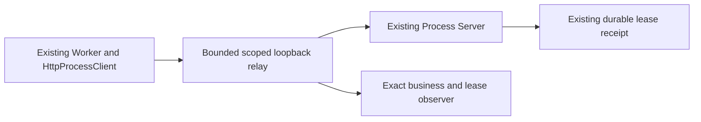
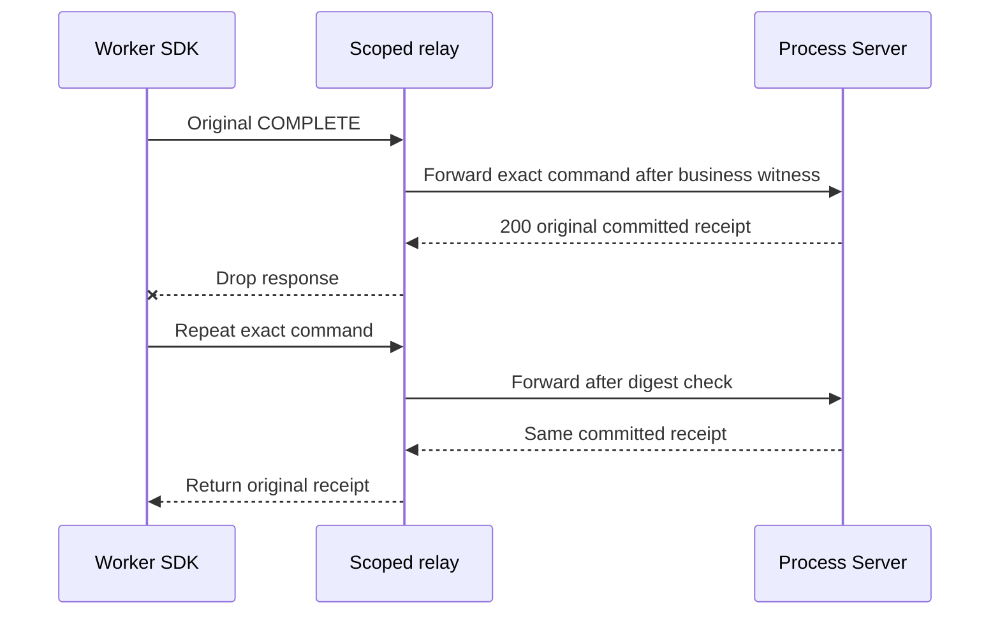

# S10 Worker 完成已提交后的 ACK 丢失验收

| Field | Value |
| --- | --- |
| Document | docs/egon/spec/2026-11-06-04-40-s10-forwarded-complete-ack.md |
| Template Version | 9 |
| Archetype Cleanup | Not applicable |
| Status | Review |
| Type | Feature |
| Complexity | Complex |
| Complexity Drivers | Scoped fault injection on a committed response, exact HTTP replay identity, and durable no-repeat assertions |
| Created | 2026-11-06 04:40 Asia/Shanghai |
| Updated | 2026-11-06 04:40 Asia/Shanghai |
| Owner | Tianji Process Server acceptance fixtures |
| Repository | tianji-service |
| Scope | Add committed Worker COMPLETE response loss to the existing opt-in recovery selector |
| Change Surface | Three test Java classes and three review artifacts |
| Affected Chapters | §7, §8, §9, §10, §14, §15, §16 |
| Source Requirement | [主计划 §17.2 S10 和 §19 T3-03/T3-10](../../../../docs/plans/agent-framework-upgrade-plan.md) |
| Baseline Revision | b46a86a7f47dd029190c52092a5e4c644eb8caec |
| Amends | None |
| Supersedes | None |
| Depends On | [Expense acceptance Spec](2026-11-05-15-13-expense-four-path-acceptance.md#73-detailed-design) |
| Related Specs | None |
| Related Plans | [Forwarded COMPLETE ACK Plan](../plan/2026-11-06-04-41-s10-forwarded-complete-ack.md) |

## 1. Summary

在原有双租户 S10 验收中，各增加一次 Process Server 已完成 Worker 命令但成功响应丢失的场景。故障夹具只允许完全相同的重试通过，并核对服务返回原提交收据。业务计数和租约仍只有一次。

## 2. Background and Current State

| Evidence ID | Exact source | Observed fact |
| --- | --- | --- |
| EVD-001 | WorkerRecoveryIT#lostAcknowledgement and ExpenseAcceptanceFaultRelay#exchange | Existing E selector drops COMPLETE before forwarding after BusinessDB commit, then checks old lease rejection and re-acquisition. |
| EVD-002 | ProcessServerPostgresTest#verifyWorkerLostAcknowledgement | MockMvc fixture already injects a post-Process-commit lost response. |
| EVD-003 | RemoteWorkerPoller#acknowledge and HttpProcessClient#complete/#call | The poller captures one immutable command for both sends. The same mapper serializes it into the HTTP body each time. |
| EVD-004 | BusinessProcessAgentAcceptanceIT.Driver#businessCommitted/#leaseRows/#assertNormalEnd | Existing witnesses resolve exact tenant, process, worker lease and business receipt, plus normal native result and effect count. |
| EVD-005 | ExpenseAcceptanceHarness and ExpenseBusinessWorkerFixture#openPoller | Exact manifest/artifact selection, isolated fixture roles, bounded worker and two ACK attempts in standard mode. |

### 2.4 Evidence and current-chain map

| Entry/trigger | Current chain | Gap | Design response |
| --- | --- | --- | --- |
| BusinessDB committed, PS request dropped | Existing case verifies expiry and new lease | Does not exercise an already committed PS completion | Retain existing path and add separate run |
| Process Server commits and 200 is lost | Existing MockMvc checks one effect | No real SDK/HTTPS fixture fault for this cut | Observe real successful upstream receipt, drop, then validate exact retry |

### 2.5 Archetype example cleanup

Cleanup disposition: Not applicable

Reason: Existing Process Server fixture sources only.

## 3. Goals and Non-goals

Add a source-ready opt-in E scenario and finite relay proof. Actual IAM/HTTPS/PostgreSQL execution and release evidence remain separate.

### 3.3 Change Surface and Design Depth

| Area/layer | Disposition | Exact repository evidence | Changed or preserved behavior/contract | Required Spec treatment | Chapter(s) |
| --- | --- | --- | --- | --- | --- |
| Process Server acceptance fixtures | Affected | EVD-001–005 | Test-only committed Worker COMPLETE fault and exact retry | Scoped relay and assertions | §7, §8, §9, §10, §14, §15, §16 |
| Worker, SDK and ProcessDb | Context-only | EVD-002–005 | Existing APIs, retry limits and receipts | Reused authority, transaction and lease evidence | §7/11/16 |

## 4. Requirements and Acceptance Criteria

| ID | Requirement | Priority | Observable acceptance | Source |
| --- | --- | --- | --- | --- |
| REQ-001 | Inject only on the exact owned committed COMPLETE | Must | Bound window matches job/occurrence and exact BusinessDB receipt/lease witness. Forward one real request and receive valid 200/COMPLETED before dropping the response. | EVD-001/002/004 |
| REQ-002 | Admit only exact retry with original durable receipt | Must | Same request-body digest and original typed receipt, including decision instant. Different payload is rejected before forwarding and different receipt cannot prove replay. | EVD-002/003 |
| REQ-003 | Confirm single effect and original lease in each tenant | Must | Same fixture command, one COMPLETED lease and business receipt, no reacquisition for occurrence, one business action and normal native end. | EVD-003–005 |
| REQ-004 | Keep original acceptance gates and finite scope | Must | Existing pre-forward loss and selector preserved. Typed R1 and full finite fixtures pass and operator test compiles. No separate machine witness field or live E claim. | EVD-001–005 |

### 4.1 Scenario matrix

| Scenario | Invariant | Failure | Verification |
| --- | --- | --- | --- |
| Commit then drop | Validate scope and actual upstream 200 receipt | No verified commit means no proof | TEST-001 |
| Same and different retries | Exact digest and original receipt | Different command is not forwarded; changed receipt ends proof | TEST-001/002 |
| Two tenant E fixture | One original lease and one business effect | Reacquisition or duplicate effect fails | TEST-004 |

### 4.2 Use-case analysis

| Actor ID | Actor | Context |
| --- | --- | --- |
| ACTOR-001 | Existing authenticated Worker poller | Uses production SDK to POST the same command twice |
| ACTOR-002 | Scoped expense relay and owner observers | Inject one transport fault after upstream evidence |
| ACTOR-003 | Operator and reviewer | Supplies exact manifest and evaluates E separately |

| ID | Use case/goal | Actors | Trigger/preconditions | Main flow | Alternatives/failure | Postcondition | Requirements |
| --- | --- | --- | --- | --- | --- | --- | --- |
| UC-001 | Simulate committed response loss | ACTOR-001/002 | Exact BusinessDB and lease witness | Forward, verify PS 200, discard response, compare retry and receipt | Scope, command or receipt drift fails closed | Original exact receipt replayed | REQ-001–003 |
| UC-002 | Review fixture source | ACTOR-003 | Exact source baseline | R1, G1 and clean compile/package | Gate fails on unexpected outcomes or scope drift | Operator E remains explicit | REQ-004 |

## 5. Constraints, Assumptions, and Decisions

Reuse the existing recovery manifest, TLS loopback relay and tenant-specific roles. Store only a request digest and typed response in the new phase state. The fixture uses the standard two-ACK-attempt mode. Stable JSON byte identity is asserted for the exact SDK command instance and fixed empty fixture output, not defined as a public canonical JSON protocol.

## 6. Project Technology Context

Existing JDK 25 HTTP fixture, bounded Jackson 3 mapper, production HttpProcessClient and RemoteWorkerPoller, PostgreSQL observers and Flowable.

### 6.2 User-mandated Java rule compliance

```text
1 类名规范，必须以 java的pojo规范命名。以dao po bo vo dto query command event等结尾
2 每层之间必须被 springboot-validation 校验，复用对象使用分组校验；基于原生和自定义约束注解、@Valid、@Validated 及 ConstraintValidator 扩展实现。ValidationUtils 只承担通用手工校验，不承载全部业务校验；电话号码复用 libphonenumber。
3 Java POJO 默认使用 class，注解为 @Data @NoArgsConstructor @AllArgsConstructor @Accessors(chain = true)，按构造目标选择 @Builder 或 @SuperBuilder；父类状态参与相等性时使用 @EqualsAndHashCode(callSuper = true)。只有不可变 value object 可以使用 record，并豁免 class 的 Lombok 规范；普通实体不能因简单而使用 record。使用 MapStruct、MapStructPlus 和 egon-cola-component-common-core 的 BaseConverter（双向）或 BaseForwardConverter（不可逆投影）进行转换。
4业务类必须使用@Slf4j注解注入log对象。如果业务类被spring管理，必须指定名称，如果是单例的情况下，参考@Service("userService")。如果需要依赖注入，必须@RequiredArgsConstructor进行修饰，不要代码中写。且属性必须被@qualify修饰。
5 工具类只允许使用jdk原生、Apache Commons(commons-lang3、commons-collections4、commons-io、commons-text、commons-codec、commons-beanutils)、Guava。针对Tika按需引入。
6 JSON 使用 Spring Boot Jackson；持久化枚举值使用 @EnumValue，向前端输出的枚举值使用 @JsonValue，禁止 ordinal 作为业务编码。
7 springboot 多环境配置文件，必须保持配置一致，但值不一定一致。
9 复杂业务必须引入设计模式，不允许硬编码
10 日期相关的必须使用java.time下的实体类，不允许使用java.util下的
11 只允许现有三层结构或当前 egon-cola-archetypes 的 DDD 结构，三层结构保持现状。必须尽量复用 egon-cola-components；持久化模块必须使用 Egon COLA MP Starter，DDL 统一由 egon-mp-sdj-ext-starter 分布式管理。业务唯一键必须组合业务列与 deletedAt（数据库 deleted_at），并验证 NULL、租户及重复软删除语义。采用 CQE（Command Query Event）；Event 必须经 egon-cola-component-transactional-outbox-starter 或 MQ 中间件投递。
```

| Literal rule | Affected? | Repository evidence | Exact design decision | Files/types/interfaces | Validation/test evidence | Status/blocker |
| --- | --- | --- | --- | --- | --- | --- |
| Rule 1 | Yes | EVD-001–005 | Reuse Worker command/receipt DTO names; relay and test types retain technical names | §6/7/9/10/15/16 | TEST-001–004 | PASS |
| Rule 2 | Yes | EVD-001–005 | Existing DTO field guards, exact tenant owner witness, bounded valid JSON, and exact retry digest | §6/7/9/10/15/16 | TEST-001–004 | PASS |
| Rule 3 | Yes | EVD-001–005 | Existing immutable CQE command and receipt; immutable private witness holds a digest and receipt only | §6/7/9/10/15/16 | TEST-001–004 | PASS |
| Rule 4 | No | EVD-001–005 | No Spring bean, injected business dependency, or logging added | §6/7/9/10/15/16 | TEST-001–004 | N/A |
| Rule 5 | Yes | EVD-001–005 | Existing fixture, Jackson mapper and JDK SHA-256 utilities | §6/7/9/10/15/16 | TEST-001–004 | PASS |
| Rule 6 | Yes | EVD-001–005 | Existing bounded Jackson codec decodes typed COMPLETE receipt and preserves exact request bytes | §6/7/9/10/15/16 | TEST-001–004 | PASS |
| Rule 7 | No | EVD-001–005 | No production settings, properties, profiles or new dependencies | §6/7/9/10/15/16 | TEST-001–004 | N/A |
| Rule 9 | Yes | EVD-001–005 | Reuse the fixture transport and existing guarded window state machine | §6/7/9/10/15/16 | TEST-001–004 | PASS |
| Rule 10 | Yes | EVD-001–005 | Use the existing elapsed Duration window and unchanged receipt Instant | §6/7/9/10/15/16 | TEST-001–004 | PASS |
| Rule 11 | Yes | EVD-001–005 | Existing Process Server test boundary, real SDK/Worker and observed receipts without new storage | §6/7/9/10/15/16 | TEST-001–004 | PASS |

### 6.3 Time semantics and conversion contract

Time contract: Required

| Time ID | Fields/symbols | Semantics | Java/runtime type | Storage policy | Wire policy | Business zone source | Display zone source | Boundary / DST rules | Precision / Clock | Compatibility | Verification |
| --- | --- | --- | --- | --- | --- | --- | --- | --- | --- | --- | --- |
| TIME-001 | FaultWindowDTO budget | Duration | java.time.Duration | Not persisted | Internal | Not applicable: elapsed | Not applicable: no display | Bound both forwards by the current window | Existing elapsed nanoTime | No lease or retry clock change | Step 1 TEST-001 |
| TIME-002 | WorkerReceiptDTO decidedAt | Occurred instant | java.time.Instant | UTC instant | UTC Z | Not applicable: absolute instant | Not applicable: no display | Require exact replay decidedAt equality | Existing persisted decision precision | No lease or retry clock change | Step 1 TEST-002 |

## 7. Architecture Design

### 7.0 Minimum-design baseline and element-necessity audit

| Proposed element | Change | Requirements | Existing alternative | Gap | Added cost | Verdict |
| --- | --- | --- | --- | --- | --- | --- |
| Forwarded COMPLETE fault phase | Extend | REQ-001/002 | Existing request-drop phase | Existing request never reaches PS | One two-step relay window | Use |
| Additional expense run | Extend | REQ-003 | Same existing run | Pre-forward and postcommit cuts are mutually exclusive | One distinct existing recovery scenario per tenant | Use |
| Dedicated release witness field | Omit | REQ-004 | Existing selector result | Existing release policy is already locked | None | Preserve |

| Path | Network calls | Client states | Owner state | Failure boundary |
| --- | --- | --- | --- | --- |
| Committed ACK loss | Original POST plus one same-command retry | Connection loss then original receipt | Same ProcessDB row and one effect | Missing or mismatched witness |
| Existing pre-forward loss | Existing behavior | New lease after expiry | Original BusinessDB receipt reused | Existing old lease rejection |

### 7.1 System Architecture Design



### 7.2 High-Level Design

```mermaid
flowchart TD
  O["Verify owned business commit"] --> P["Forward original COMPLETE"]
  P --> C["Validate 200 and committed receipt"]
  C --> D["Discard first response"]
  D --> SSame request digest?
  S -->|Yes| R["Forward and require original receipt"]
  S -->|No| F["Refuse before forward"]
```

#### 7.2.2 High-level decision and quality matrix

| Concern/use case | Constraint | Decision | Evidence |
| --- | --- | --- | --- |
| Match | Exact tenant, job and occurrence | Keep existing owner and business witnesses | EVD-004 |
| Drop | PS already accepted and committed | Verify exact upstream receipt before discard | EVD-002 |
| Retry | Same input and original decision | Bind digest and compare typed receipt | EVD-003 |

### 7.3 Detailed Design

The worker-facing relay claims the first matching exchange, verifies the existing business-commit witness, forwards to Process Server and requires a typed HTTP 200 COMPLETED receipt matching job and occurrence. It stores the request digest and receipt in its existing bounded window and closes that exchange without sending a response. The retry must match the original bytes before forwarding, and the relay only observes success when the whole response receipt equals the original. The per-tenant recovery selector checks the unique completed original lease and original business receipt, then runs the normal end and reconciliation assertions.



#### 7.3.6 Conclusion evidence chain

| Conclusion | Evidence | Decision |
| --- | --- | --- |
| New cut follows Process commit | EVD-002/004 and TEST-001 | Check typed successful response before transport loss |
| Replay cannot duplicate or drift | EVD-003–005 and TEST-001/002/004 | Exact bytes and receipt with original lease and effects |

## 8. Package Structure and Code File Tree

```text
CREATE stellar-enclosure-tianji-process-server/src/test/java/top/egon/cola/platform/tianji/process/server/acceptance/ExpenseWorkerCompletionFaultTest.java
MODIFY stellar-enclosure-tianji-process-server/src/test/java/top/egon/cola/platform/tianji/process/server/acceptance/ExpenseAcceptanceFaultRelay.java
MODIFY stellar-enclosure-tianji-process-server/src/test/java/top/egon/cola/platform/tianji/process/server/acceptance/WorkerRecoveryIT.java
CREATE docs/egon/spec/2026-11-06-04-40-s10-forwarded-complete-ack.md
CREATE docs/egon/plan/2026-11-06-04-41-s10-forwarded-complete-ack.md
CREATE docs/egon/evidence/2026-11-06-s10-forwarded-complete-ack.md
```

## 9. Interface Definitions

### 9.1 Interface Inventory

| Interface | Protocol | Owner | Purpose |
| --- | --- | --- | --- |
| INTERNAL-001 | Test-only Java and existing HTTP | ExpenseAcceptanceFaultRelay and WorkerRecoveryIT | Scope an opt-in lost response and observe exact retry |

### 9.2 Per-interface Detailed Contracts

#### 9.2.1 INTERNAL-001 — Committed COMPLETE response fault

##### Necessity and interaction-cost decision

| Concern | Decision |
| --- | --- |
| Change classification | Test-only phase on existing private relay |
| Independent consumer goal | Prove real postcommit response loss through SDK and poller |
| Parameter ownership and derivation | Existing owner-derived job, occurrence, source, tenant and window |
| Direct/no-new-interface alternative | Existing fault discards before Process Server receives request |
| Caller use of result | Existing selector requires exact replay and durable effect assertions |
| Round trips and failure points | Two existing COMPLETE POSTs and existing owner observers |
| Verdict | No production route or auth change |

##### Identity and purpose

The explicit private fault phase is keyed by the existing operator tenant, source, process, task and occurrence, and requires the owned business receipt.

##### Request parameters

The existing bounded validated CompleteWorkerTaskCommand wire body carries exact task, occurrence, lease token, business receipt and output, with the existing authenticated Worker identity.

##### Success response

The original HTTP 200 exact typed COMPLETED receipt is withheld once. The exact retry can only complete the observation after receiving the same job, occurrence, outcome and decidedAt.

##### Error responses

Missing ownership or upstream receipt, a mismatched retry body, expiry and a different replay receipt cannot produce success. Existing relay transport error handling remains unchanged.

##### Interface logic for frontend and consumers

This phase is reachable only from test infrastructure. The current async poller retries one exact command with the standard two-attempt fixture policy and uses the existing Worker endpoint.

##### Compatibility and verification

The existing pre-forward case still checks old lease rejection and re-acquisition. Finite relay tests use fake transport only, and the current operator selector controls real E.

## 10. POJO and Data Model Design

Reuse existing CompleteWorkerTaskCommand and WorkerReceiptDTO. The test-private witness carries only the request SHA-256 and immutable safe receipt. It does not extend the evidence JSON schema.

## 11. Database Design

Relational model change: No. Existing isolated ProcessDB lease receipt and BusinessDB effect witnesses are read through the current observer roles.

## 12. Frontend Page Design

There is no frontend page or new external interface.

## 13. Design Patterns and Architecture Principles

Extend the existing guarded fault-window state machine and use its transport adapter. One new branch models the second committed exchange without changing the old drop-before-forwarding decision.

## 14. Test Design

| Test | Evidence | Boundary |
| --- | --- | --- |
| TEST-001 | Same body admitted, changed output rejected before forwarding, original receipt returned after one discard | Exact finite R1 and green relay test |
| TEST-002 | Changed decidedAt cannot prove replay | Finite relay test |
| TEST-003 | Existing full harness suite and isolated compile of the operator source | G1/P1, no real listener, child or database |
| TEST-004 | Two tenant native runs, one original completed lease, matched receipt, effect count and normal end | Existing manifest-gated E selector, operator pending |

## 15. Non-functional and Cross-cutting Design

Preserve bounded request, response and window limits. The new digest and capability are not exported, and the private witness uses a redacted string representation. The production bearer is forwarded only through the existing loopback TLS relay path.

## 16. Compatibility, Migration, Rollout, and Rollback

No migration, POM, production configuration, manifest gate, production route or permission changes. The existing E evidence schema is preserved and the new checks gate selector success without a new machine witness field. Revert one scoped test commit to roll back.

## 17. Alternatives and Decisions

A separate test selector would duplicate the existing fresh-manifest and artifact setup and change operator evidence. An additional isolated run inside the existing selector preserves the locked shape.

## 18. Risks and Open Questions

Actual loopback HTTPS fault handling, fresh role-bound databases, exact Process and Agent executable jars, Worker fixture and production IAM remain part of unexecuted operator E. Finite protocol evidence does not claim S10 passed.

## 19. Traceability Matrix

| Requirement | Use case | Design | Tests |
| --- | --- | --- | --- |
| REQ-001 | UC-001 | §7/9 | TEST-001 |
| REQ-002 | UC-001 | §7/9/10 | TEST-001/002 |
| REQ-003 | UC-001 | §5/7/14 | TEST-004 |
| REQ-004 | UC-002 | §8/14/16/18 | TEST-003 |

## 20. Review and Acceptance

### 20.5 Blocking Manual Check

| Check ID | Applicability | Status | Evidence | Finding | Required action/exception |
| --- | --- | --- | --- | --- | --- |
| MC-ARCH-001 | Applicable | PASS | §7/8 | Only Process Server acceptance fixtures and finite test | None |
| MC-REUSE-001 | Applicable | PASS | EVD-001–005 | Existing relay, worker poller, same SDK, witnesses and selector | None |
| MC-DEP-001 | Applicable | PASS | §6/16 | Existing JDK, Jackson and test dependencies | None |
| MC-NAME-001 | Applicable | PASS | §8/10 | Existing Worker command and typed receipt plus private fixture witness | None |
| MC-VALID-001 | Applicable | PASS | §7/9/14 | Exact owner and business commit guard, digest and original typed receipt | None |
| MC-MODEL-001 | Applicable | PASS | §10 | Bounded private immutable witness, no business object introduced | None |
| MC-CONVERT-001 | Not applicable | N/A | §10 | Existing direct Jackson contract binding, no converter or mapping change | None |
| MC-LOG-001 | Applicable | PASS | §15 | Existing generic failures; no new logs or material exposed | None |
| MC-BEAN-001 | Not applicable | N/A | §8/16 | Existing test-only constructor, no Spring registration | None |
| MC-UTIL-001 | Applicable | PASS | §6/7 | Use JDK SHA-256 and existing relay codec and synchronization | None |
| MC-JSON-001 | Applicable | PASS | §9/10 | Use exact SDK bytes and existing strict typed WorkerReceiptDTO decode | None |
| MC-TIME-001 | Applicable | PASS | §6.3/7 | Existing bounded deadline, stable decidedAt Instant | None |
| MC-CONFIG-001 | Not applicable | N/A | §16 | No manifest gate, production config or profile changes | None |
| MC-PATTERN-001 | Applicable | PASS | §13 | Existing relay transport and guarded phase lifecycle | None |
| MC-SCOPE-001 | Applicable | PASS | §8/16 | Exact three test Java paths and three review documents | None |
| MC-TEST-001 | Applicable | PASS | §14 | Digest-only R1, full finite fixture class and separate operator compile gate | None |
| MC-BLOCKER-001 | Applicable | PASS | §18 | Real HTTPS, IAM, databases and E evidence still require operator environment | None |

### 20.6 Final verdict

PASS — Ready for user review
