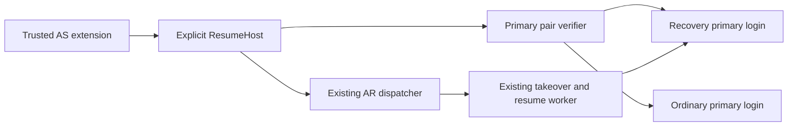
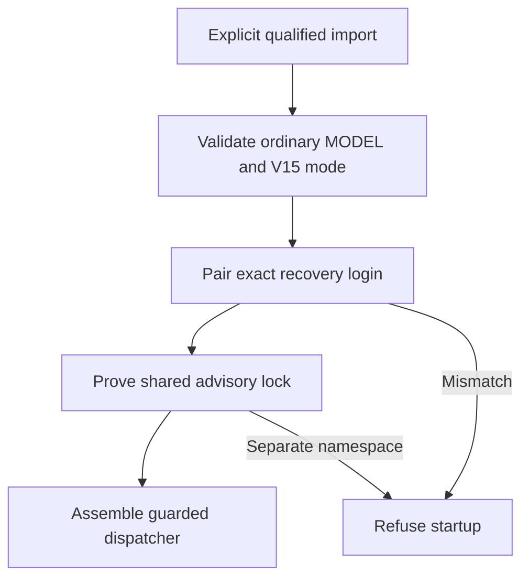
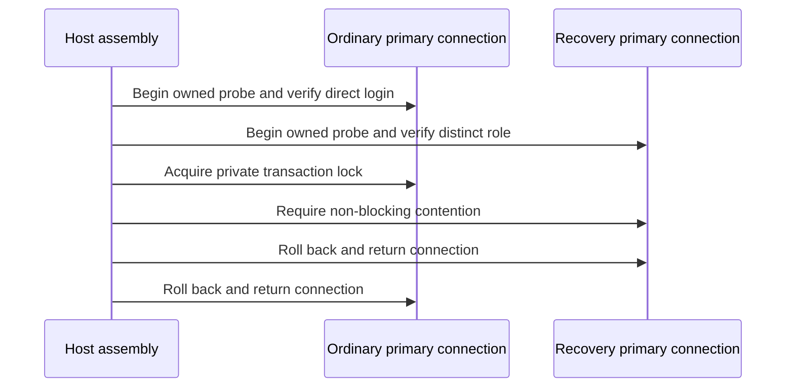

# T4-03 Agent Server checkpoint 恢复宿主

| Field | Value |
| --- | --- |
| Document | docs/egon/spec/2026-11-06-05-06-agent-checkpoint-as-resume-host.md |
| Template Version | 9 |
| Archetype Cleanup | Not applicable |
| Status | Review |
| Type | Feature |
| Complexity | Complex |
| Complexity Drivers | Two primary connection identities, independent authority, exact continuation and resource lifecycle |
| Created | 2026-11-06 05:06 Asia/Shanghai |
| Updated | 2026-11-06 05:06 Asia/Shanghai |
| Owner | Tianji Agent Runtime and Agent Server |
| Repository | tianji-service |
| Scope | Explicit dormant AS host for existing first-input checkpoint continuation |
| Change Surface | Two production Java paths, one finite test and three review artifacts |
| Affected Chapters | §7, §8, §9, §10, §14, §15, §16 |
| Source Requirement | [主计划 §10.2、§17.2 S11、§19 T4-03](../../../../docs/plans/agent-framework-upgrade-plan.md) |
| Baseline Revision | fe545cbcfcdbc184b7f475e85b7542db48432a35 |
| Amends | None |
| Supersedes | None |
| Depends On | [Internal dispatcher](2026-11-06-04-22-agent-checkpoint-resume-dispatch.md#73-detailed-design) |
| Related Specs | None |
| Related Plans | [Host Plan](../plan/2026-11-06-05-07-agent-checkpoint-as-resume-host.md) |

## 1. Summary

为已落地的首输入 checkpoint 恢复增加一个默认未装配的 Agent Server 宿主。受信扩展必须显式导入配置并提供准确命名的恢复绑定。启动时核对两连接共享同一主库，之后在同一个恢复数据源上组装接管、续跑和专用派发。MODEL 复用已有当前授权，RESUME 由独立提供者负责。

## 2. Background and Current State

| Evidence ID | Exact source | Observed fact |
| --- | --- | --- |
| EVD-001 | TianjiAgentServerApplication and TianjiAgentStorageConfiguration | Normal AS scan starts at agent.server. Storage and ordinary DataSource are already host-owned. |
| EVD-002 | AgentCheckpointResumeDispatcher and AgentCheckpointTakeoverService#takeOver | Existing bounded dispatcher checks exact recovery DataSource and RESUME object; claim and execution consume one winning capability. |
| EVD-003 | AdkAgentRunExecutor#executeResume/#checkpointRequestEligible and AgentStorageVerifier#verifyCheckpointObservation | Eligible first-input continuation is standalone USER and tool-free. The recovery connection needs V16 SELECT-only access, distinct from capture. |
| EVD-004 | TianjiExecutionGrantAuthorizer#evaluateRun and AgentExecutionGrantStore#lock | Existing current MODEL reads the ordinary START-purpose ticket on a QUEUED or RUNNING Run. SUSPENDED RESUME needs an independent authority. |
| EVD-005 | AgentLedgerService#modelUsageEnabled, AgentRunReconciler#usesLedger/#isRunning and TianjiGrantDispatchPoller#stop | Optional V15 needs explicit resource support. Ordinary reconciler handles later expired leases and host lifecycle distinguishes drain from pool ownership. |

### 2.4 Evidence and current-chain map

| Entry/trigger | Current chain | Gap | Design response |
| --- | --- | --- | --- |
| Standalone AS | Ordinary ledger, current MODEL and ordinary worker | V16 read role and independent RESUME unavailable by default | Explicit import and qualified external binding |
| First-input takeover | AR observer, takeover, exact dispatch and worker | No production composition validates distinct logins in one database | One non-blocking startup probe and existing V16 verifier |
| Host close | Bounded dispatcher supports drain, borrowed resources externally owned | Independent host pool needs ownership | Close dispatcher then drain and stop owned pool |

### 2.5 Archetype example cleanup

Cleanup disposition: Not applicable

Reason: Existing AS and AR modules with no project generation or example ownership.

## 3. Goals and Non-goals

Offer an explicitly imported dormant Java host for the first-input checkpoint on the owning Agent primary. RESUME authority implementation, production role provision, WAITING wait-token API, public exposure, automatic retry and real S11 remain separate.

### 3.3 Change Surface and Design Depth

| Area/layer | Disposition | Exact repository evidence | Changed or preserved behavior/contract | Required Spec treatment | Chapter(s) |
| --- | --- | --- | --- | --- | --- |
| AS host wiring | Affected | EVD-001/004/005 | One named opt-in bean outside the ordinary scan | Authority, resource ownership and lifecycle | §7/§8/§9/§10/§14/§15/§16 |
| AR infrastructure | Affected | EVD-002/003 | Verify same primary database with distinct login roles at assembly | SQL transaction and bounded checks | §7/§8/§14 |
| External API and database schema | Context-only | EVD-001–005 | Existing Agent contracts and privileges remain the basis | Byte parity and external acceptance | §16/18 |

## 4. Requirements and Acceptance Criteria

| ID | Requirement | Priority | Observable acceptance | Source |
| --- | --- | --- | --- | --- |
| REQ-001 | Keep ordinary AS dormant | Must | Ordinary AS shell omits the host even with a binding; explicit import without the exact qualified binding fails. | EVD-001 |
| REQ-002 | Pair physical AgentDB and exact roles | Must | Distinct connections with writable-primary session and distinct direct login roles. Both see same database-local private lock contention and are rolled back on all owned paths. V16 recovery role remains SELECT-only. | EVD-002/003 |
| REQ-003 | Reuse exact resume boundary with independent authorities | Must | Same recovery source and RESUME instance bind claim, worker and dispatcher. Ordinary authorizer stays MODEL-only in the guarded path. Require enabled ordinary reconciler on the same ledger and refuse dispatch when it is stopped. Reject V15 mode. | EVD-002–005 |
| REQ-004 | Close only owned resources | Must | One dedicated AbortPolicy worker without an admission queue or inherited request context. Stop new work, drain started work, close owned executor and retain borrowed control. | EVD-002/005 |
| REQ-005 | Prove exact source and artifact scope | Must | Typed R1, finite G1, actual clean AS/PS package and 28 immutable SQL files. Runtime remains an operator gate. | EVD-001–005 |

### 4.1 Scenario matrix

| Scenario | Invariant | Failure | Verification |
| --- | --- | --- | --- |
| Default AS or missing qualified binding | Resume remains explicit | Default omits host; explicit import with no binding refuses | TEST-001 |
| Separate primary, readonly session, or wrong login | No host can claim | Startup refuses and both owned transactions roll back | TEST-002 |
| Host ready and later closes | Only the owned executor shuts down | New dispatch gets typed unavailable | TEST-003/004 |

### 4.2 Use-case analysis

| Actor ID | Actor | Context |
| --- | --- | --- |
| ACTOR-001 | Trusted AS extension | Imports configuration and supplies qualified independent RESUME/role binding |
| ACTOR-002 | Existing Agent runtime | Owns exact admission, durable claim and guarded native execution |
| ACTOR-003 | Source reviewer | Reproduces typed R1 and owning finite gates |

| ID | Use case/goal | Actors | Trigger/preconditions | Main flow | Alternatives/failure | Postcondition | Requirements |
| --- | --- | --- | --- | --- | --- | --- | --- |
| UC-001 | Assemble the optional host | ACTOR-001/002 | Explicit import and ordinary runtime ready | Validate exact role and authority then wire existing dispatcher | Missing binding, foreign primary, V15 and V16 mismatch fail startup | Host exposed only after guards | REQ-001–003 |
| UC-002 | Dispatch and close | ACTOR-001/002 | Trusted actor and exact resume command | Admit one task, reuse durable semantics and close owned pool | Busy rejects before claim, close fences unstarted work | No redrive or borrowed executor stop | REQ-003/004 |
| UC-003 | Review the source delivery | ACTOR-003 | Locked baseline and offline environment | Typed R1, G1 and P1 | Unexpected failure or archive drift rejects | Separate source and operator evidence | REQ-005 |

## 5. Constraints, Assumptions, and Decisions

Use fixed, direct PostgreSQL primary pools. The external host configures finite borrow, connect and socket bounds and separately provisions the narrow recovery login with existing Session, Run, event, budget, command receipt and V13 evidence privileges. Existing V16 verifier checks SELECT-only. No DDL or grant is executed by startup. The startup probe verifies the acquired pair; it is not a substitute for an operator-owned fixed topology over the full pool lifetime. V15 is intentionally rejected because this source slice does not give the recovery role the separate model-usage storage contract.

## 6. Project Technology Context

Existing Java 25, Spring, JDBC, pinned ADK and Agent runtime. Reuse guarded takeover and continuation.

### 6.2 User-mandated Java rule compliance

```text
1 类名规范，必须以 java的pojo规范命名。以dao po bo vo dto query command event等结尾
2 每层之间必须被 springboot-validation 校验，复用对象使用分组校验；基于原生和自定义约束注解、@Valid、@Validated 及 ConstraintValidator 扩展实现。ValidationUtils 只承担通用手工校验，不承载全部业务校验；电话号码复用 libphonenumber。
3 Java POJO 默认使用 class，注解为 @Data @NoArgsConstructor @AllArgsConstructor @Accessors(chain = true)，按构造目标选择 @Builder 或 @SuperBuilder；父类状态参与相等性时使用 @EqualsAndHashCode(callSuper = true)。只有不可变 value object 可以使用 record，并豁免 class 的 Lombok 规范；普通实体不能因简单而使用 record。使用 MapStruct、MapStructPlus 和 egon-cola-component-common-core 的 BaseConverter（双向）或 BaseForwardConverter（不可逆投影）进行转换。
4业务类必须使用@Slf4j注解注入log对象。如果业务类被spring管理，必须指定名称，如果是单例的情况下，参考@Service("userService")。如果需要依赖注入，必须@RequiredArgsConstructor进行修饰，不要代码中写。且属性必须被@qualify修饰。
5 工具类只允许使用jdk原生、Apache Commons(commons-lang3、commons-collections4、commons-io、commons-text、commons-codec、commons-beanutils)、Guava。针对Tika按需引入。
6 JSON 使用 Spring Boot Jackson；持久化枚举值使用 @EnumValue，向前端输出的枚举值使用 @JsonValue，禁止 ordinal 作为业务编码。
7 springboot 多环境配置文件，必须保持配置一致，但值不一定一致。
9 复杂业务必须引入设计模式，不允许硬编码
10 日期相关的必须使用java.time下的实体类，不允许使用java.util下的
11 只允许现有三层结构或当前 egon-cola-archetypes 的 DDD 结构，三层结构保持现状。必须尽量复用 egon-cola-components；持久化模块必须使用 Egon COLA MP Starter，DDL 统一由 egon-mp-sdj-ext-starter 分布式管理。业务唯一键必须组合业务列与 deletedAt（数据库 deleted_at），并验证 NULL、租户及重复软删除语义。采用 CQE（Command Query Event）；Event 必须经 egon-cola-component-transactional-outbox-starter 或 MQ 中间件投递。
```

| Literal rule | Affected? | Repository evidence | Exact design decision | Files/types/interfaces | Validation/test evidence | Status/blocker |
| --- | --- | --- | --- | --- | --- | --- |
| Rule 1 | Yes | EVD-001–005 | Use verifier and configuration names for infrastructure; retain existing command and acknowledgement names. | §6/7/9/10/15/16 | TEST-001–005 | PASS |
| Rule 2 | Yes | EVD-001–005 | Validate explicit role, exact trusted binding, two primary sessions and existing command before work. | §6/7/9/10/15/16 | TEST-001–005 | PASS |
| Rule 3 | Yes | EVD-001–005 | ResumeBinding and Login are immutable identity values; reuse existing command and acknowledgement. | §6/7/9/10/15/16 | TEST-001–005 | PASS |
| Rule 4 | Yes | EVD-001–005 | Use one named technical @Bean and qualified host resources. No business Bean, logging or Lombok additions. | §6/7/9/10/15/16 | TEST-001–005 | PASS |
| Rule 5 | Yes | EVD-001–005 | Use only existing Spring/JDBC APIs and JDK SQL, SecureRandom and executors. | §6/7/9/10/15/16 | TEST-001–005 | PASS |
| Rule 6 | No | EVD-001–005 | The Java host boundary adds no JSON or persistence enum. | §6/7/9/10/15/16 | TEST-001–005 | N/A |
| Rule 7 | No | EVD-001–005 | Explicit Spring import supplies activation; no production property, YAML or profile change. | §6/7/9/10/15/16 | TEST-001–005 | N/A |
| Rule 9 | Yes | EVD-001–005 | Composition Root and lifecycle façade reuse the existing one-command dispatcher; physical identity verification stays in AR infrastructure. | §6/7/9/10/15/16 | TEST-001–005 | PASS |
| Rule 10 | Yes | EVD-001–005 | Use java.time.Duration for drain and bounded elapsed SQL statements without changing lease clock. | §6/7/9/10/15/16 | TEST-001–005 | PASS |
| Rule 11 | Yes | EVD-001–005 | Keep AR storage ownership and AS host wiring. Reuse existing eligible Agent CQE path, with no new DDL or event contract. | §6/7/9/10/15/16 | TEST-001–005 | PASS |

### 6.3 Time semantics and conversion contract

Time contract: Required

| Time ID | Fields/symbols | Semantics | Java/runtime type | Storage policy | Wire policy | Business zone source | Display zone source | Boundary / DST rules | Precision / Clock | Compatibility | Verification |
| --- | --- | --- | --- | --- | --- | --- | --- | --- | --- | --- | --- |
| TIME-001 | Primary verifier SQL statement timeout and ResumeHost drain | Duration | JDK JDBC query timeout and java.time.Duration | Not persisted | Internal | Not applicable: elapsed time | Not applicable: no display | Each probe SQL statement is bounded to two seconds and the host drain waits at most five seconds after close. Host pools supply finite borrow/connect/socket timeout. | JDK elapsed clock and PostgreSQL statement timeout | Existing durable lease expiry and database clock remain independent | Step 1 TEST-002/004 |

## 7. Architecture Design

### 7.0 Minimum-design baseline and element-necessity audit

| Proposed element | Change | Requirements | Existing alternative | Gap | Added cost | Verdict |
| --- | --- | --- | --- | --- | --- | --- |
| Explicit composition root | Add | REQ-001/003/004 | Register recovery worker globally | Would displace ordinary ledger/worker bean candidates | One named host | Use |
| Primary role verifier | Add | REQ-002 | Compare DataSource or database names | Equal labels do not prove a shared database | Two bounded connections and transient lock | Use |
| Policy and storage implementation | Reuse | REQ-002/003 | Duplicate ordinary grant and native runner | Ordinary grant cannot authorize suspended takeover | Existing authority and runtime boundaries | Reuse |

| Path | Network calls | Client states | Owner state | Failure boundary |
| --- | --- | --- | --- | --- |
| Default standalone AS | None for resume | No host entry | Ordinary owner only | Default component scan |
| Explicit startup | Bounded paired JDBC probe and existing V16 check | Host starts only after validation | Transient lock and two rolled-back transactions | Startup guards |
| Admitted host command | Existing authoritative RESUME and MODEL | Existing durable ACK | Original Run and Session leases | Existing guarded dispatcher |

### 7.1 System Architecture Design



AS explicit import exposes one named ResumeHost. Its qualified binding holds recovery DataSource, recovery login role and independent RESUME authority. The existing ordinary ledger is only used to verify current MODEL authority binding and existing modes.

### 7.2 High-Level Design

Verify ordinary storage, runtime, current MODEL and reconciliation enablement and exact ledger bindings; guard V15 before opening pools. Pair the direct primary connections, instantiate the existing V16-verifying takeover and a local resume-only ledger/worker, then expose bounded dispatch. The host returns the existing durable acknowledgement stage.



#### 7.2.2 High-level decision and quality matrix

| Concern/use case | Constraint | Decision | Evidence |
| --- | --- | --- | --- |
| Activation | Ordinary AS remains dormant | Explicit qualified import only | EVD-001/TEST-001 |
| Physical pairing | No durable writes or privileged function | Non-blocking transaction-scoped private key | EVD-003/TEST-002 |
| Authority and shutdown | Preserve exact grant and pool ownership | Reuse guarded worker and private host lifetime | EVD-002/004/005 |

### 7.3 Detailed Design

Outside any Spring-bound transaction, require distinct DataSource objects and own two fresh auto-commit connections. Disable auto-commit before probes, constrain each statement and require direct login (`current_user=session_user`), writable physical primary, same current database name and distinct roles. Recovery role must equal the explicit identifier. Generate one private 64-bit key with SecureRandom. Normal pool must acquire `pg_try_advisory_xact_lock` and recovery must see contention while the ordinary transaction still owns the key. Database-scoped advisory lock namespace provides the pairing evidence for these sessions. Both probes attempt rollback before closing and restore auto-commit only after successful rollback. The verifier redacts SQL and suppressed rollback diagnostics on failure. See [PostgreSQL pg_locks](https://www.postgresql.org/docs/18/view-pg-locks.html) and [PostgreSQL advisory lock functions](https://www.postgresql.org/docs/18/functions-admin.html#FUNCTIONS-ADVISORY-LOCKS).

Use the same recovery source and exact RESUME authority object across the local ledger/worker, takeover and dispatcher. Reuse current ordinary MODEL authorization only through the existing MODEL wrapper. Private worker keeps no separate tool or context provider, no capture and no linked terminal publisher. Existing first-input eligibility excludes linked Process runs and side-effectful features. Native Session writes use the existing deployment codec property. No START authority is promoted to RESUME.

Use one owned daemon worker with a synchronous handoff, exact AbortPolicy and no inherited thread locals. Borrow the ordinary qualified control executor. Refuse each new dispatch when the existing reconciler is stopped. On close, fence admission through the dispatcher, drain for five seconds, and shut down the owned pool. Timeout or interruption uses shutdownNow for the owned pool. The existing caller contract requires blocking CompletionStage dependents to run asynchronously.



#### 7.3.6 Conclusion evidence chain

| Conclusion | Evidence | Decision |
| --- | --- | --- |
| Two independent logins share database-local locking | TEST-002 and PostgreSQL advisory locks | Verify before constructing the takeover |
| One exact host owns only its pool | EVD-002/005 and TEST-004 | Keep worker and recovery ledger private |

## 8. Package Structure and Code File Tree

| Path | Change | Purpose |
| --- | --- | --- |
| `stellar-enclosure-tianji-agent-server/src/test/java/top/egon/cola/platform/tianji/agent/recovery/TianjiAgentCheckpointResumeConfigurationTest.java` | Create | Finite non-web Spring wiring and two PostgreSQL protocol stubs |
| `stellar-enclosure-tianji-agent-runtime/src/main/java/top/egon/cola/platform/tianji/agent/infrastructure/adk/session/AgentCheckpointResumePrimaryVerifier.java` | Create | Verify fixed host primary and exact login roles without durable writes |
| `stellar-enclosure-tianji-agent-server/src/main/java/top/egon/cola/platform/tianji/agent/recovery/TianjiAgentCheckpointResumeConfiguration.java` | Create | Compose the optional host and bounded lifecycle outside the default AS scan |
| `docs/egon/spec/2026-11-06-05-06-agent-checkpoint-as-resume-host.md` | Create | Pin exact host and authority semantics |
| `docs/egon/plan/2026-11-06-05-07-agent-checkpoint-as-resume-host.md` | Create | Pin baseline, gate sequence, source scope and Spec digest |
| `docs/egon/evidence/2026-11-06-agent-checkpoint-as-resume-host.md` | Create | Record actual gate outcomes and remaining operator conditions |

## 9. Interface Definitions

### 9.1 Interface Inventory

| Interface | Protocol | Owner | Purpose |
| --- | --- | --- | --- |
| INTERNAL-001 | Internal Java | Explicit AS host extension | Provide the named recovery binding and dispatch exact commands |

### 9.2 Per-interface Detailed Contracts

#### 9.2.1 INTERNAL-001 — Explicit checkpoint resume host

##### Necessity and interaction-cost decision

| Concern | Decision |
| --- | --- |
| Change classification | Explicit internal Spring host, no HTTP or policy changes |
| Independent consumer goal | Assemble existing checkpoint dispatch in the AS host |
| Parameter ownership and derivation | Trusted extension supplies exact recovery source, role and current RESUME |
| Direct/no-new-interface alternative | Existing AR dispatcher has no AS import, lifecycle or primary pairing |
| Caller use of result | Existing durable ACK stage |
| Round trips and failure points | Paired primary/role check at assembly and existing AR guarded work |
| Verdict | Reuse existing guarded execution behind one internal named host |

##### Identity and purpose

The imported configuration owns the dedicated pool and exact recovery binding. The reconciler and current MODEL authority must use the ordinary ledger.

##### Request parameters

Internal Java only. A trusted extension provides `@Bean("tianjiCheckpointResumeBinding") ResumeBinding(DataSource recoverySource, String recoveryRole, ResumeAuthorization resumeAuthority)` and explicitly imports `TianjiAgentCheckpointResumeConfiguration`. The `tianjiCheckpointResumeHost` bean exposes `CompletionStage<Acknowledgement> dispatch(TrustedAgentActor, ResumeCommand)` with the existing command validation, one-time claim, durable ACK and capacity behavior.

##### Success response

Return the existing durable acknowledgement stage.

##### Error responses

Absent/incorrect binding fails startup. A stopped reconciler, closed host, refused admission or existing guarded runtime decision fails closed.

##### Interface logic for frontend and consumers

The trusted extension calls the internal Java boundary; no frontend surface.

##### Compatibility and verification

TEST-001–005 verify opt-in, composition, scoped errors and actual artifact parity.

## 10. POJO and Data Model Design

`ResumeBinding` is an immutable host reference bundle with redacted diagnostic representation. `Login` is a private immutable comparison result. Existing trusted actor, resume command and acknowledgement are reused.

## 11. Database Design

No relational model change. The probe uses only transient PostgreSQL transaction advisory locks and session predicates. Existing V16 check and AR takeOver transactions own their established proof and writes.

## 12. Frontend Page Design

Not applicable. This Step adds no frontend surface.

## 13. Design Patterns and Architecture Principles

Composition Root owns dependency selection and startup fail-closed checks. The internal lifecycle façade keeps its private recovery worker and uses the existing command dispatcher. AR primary verifier isolates JDBC behavior from Spring bean assembly.

## 14. Test Design

| Test | Expected evidence |
| --- | --- |
| TEST-001 | The non-web default shell is dormant; explicit import requires the exact qualified binding. |
| TEST-002 | Paired mock protocol sees one key across both sessions, two rollback/connection returns; separate or wrongly scoped primary and SQL failure refuse before V16. Typed R1 proves the contention guard. |
| TEST-003 | Ordinary MODEL/ledger and reconciler/ledger mismatches, disabled reconciliation, V15 or V16 unavailable prevent host exposure. Stopped reconciliation refuses before recovery access. |
| TEST-004 | Context close fences existing host while borrowed control survives; existing bounded dispatch and guarded executor finite tests cover the actual command handoff. |
| TEST-005 | Actual AS and nested AR classes, PS exclusion, existing YAML/PaC and migration bytes, and no live test reports. |

## 15. Non-functional and Cross-cutting Design

No role, user, probe key, credentials or JDBC diagnostic text is added to a new log. Host lock is non-blocking and never persists. Callers see existing result and error semantics. The host does not provide automatic discovery or redrive.

## 16. Compatibility, Migration, Rollout, and Rollback

Existing POMs, permissions, SQL and configuration are byte-compatible. Roll back by removing the explicit external import or reverting the focused commit. No product activation accompanies source delivery.

## 17. Alternatives and Decisions

Object equality binds the claim and worker but cannot identify the same database behind two independent pools. The startup lock challenge uses built-in PostgreSQL functionality and requires no privileged catalog function. Keeping recovery ledger and worker as local instances avoids changing Spring selection for normal execution.

## 18. Risks and Open Questions

Production RESUME provider, narrowly provisioned role, fixed physical topology, actual V16/Run/Session execution and complete S11 need independent evidence. V15 recovery is outside this bounded host source mode and requires reviewed storage-role parity. The startup probe is not a deployment provisioner.

## 19. Traceability Matrix

| Requirement | Use case | Design | Test |
| --- | --- | --- | --- |
| REQ-001 | UC-001 | §7/9 | TEST-001 |
| REQ-002 | UC-001 | §7/11 | TEST-002/003 |
| REQ-003 | UC-001/002 | §7/9 | TEST-003/004 |
| REQ-004 | UC-002 | §6.3/7/13 | TEST-004 |
| REQ-005 | UC-003 | §8/14/16 | TEST-005 |

## 20. Review and Acceptance

### 20.5 Blocking Manual Check

| Check ID | Applicability | Status | Evidence | Finding | Required action/exception |
| --- | --- | --- | --- | --- | --- |
| MC-ARCH-001 | Applicable | PASS | §7/8 | AR owns technical database proof and AS owns explicit Spring composition | None |
| MC-REUSE-001 | Applicable | PASS | EVD-001–005 | Existing takeover, dispatcher, execution and MODEL policy are used | None |
| MC-DEP-001 | Applicable | PASS | §6/16 | Existing JDK, JDBC and Spring types | None |
| MC-NAME-001 | Applicable | PASS | §8/10 | Existing command and acknowledgement and new technical binding names | None |
| MC-VALID-001 | Applicable | PASS | §7/9/14 | Exact login, transaction, capability and dormant import validation | None |
| MC-MODEL-001 | Applicable | PASS | §10 | Technical host references and immutable binding values | None |
| MC-CONVERT-001 | Not applicable | N/A | §10 | No DTO mapper or domain projection | None |
| MC-LOG-001 | Applicable | PASS | §15 | Private binding is redacted and startup SQL details stay out of failure | None |
| MC-BEAN-001 | Applicable | PASS | §7/8 | Single named host bean outside the ordinary default scan | None |
| MC-UTIL-001 | Applicable | PASS | §6/7 | JDK primitives and existing Spring transaction inspection | None |
| MC-JSON-001 | Not applicable | N/A | §9/10 | No JSON or serialization contract | None |
| MC-TIME-001 | Applicable | PASS | §6.3/7 | Duration and finite statement timeout | None |
| MC-CONFIG-001 | Applicable | PASS | §7/16 | Explicit import and byte parity of all existing production configuration | None |
| MC-PATTERN-001 | Applicable | PASS | §13 | Composition Root and lifecycle façade reuse the command dispatcher | None |
| MC-SCOPE-001 | Applicable | PASS | §8/16 | Exact six paths, no production declaration changes, 28 SQL unchanged | None |
| MC-TEST-001 | Applicable | PASS | §14 | Typed R1, owning finite G1 and actual P1 | None |
| MC-BLOCKER-001 | Applicable | PASS | §18 | Operator authority, privileges and runtime activation independently gated | None |

### 20.6 Final verdict

PASS — Ready for user review
