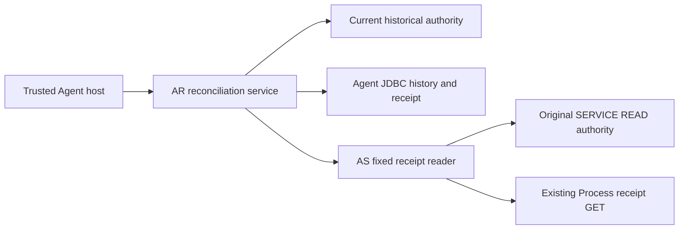
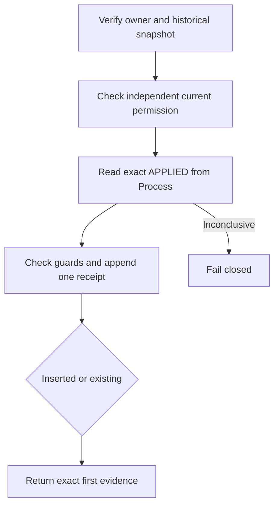
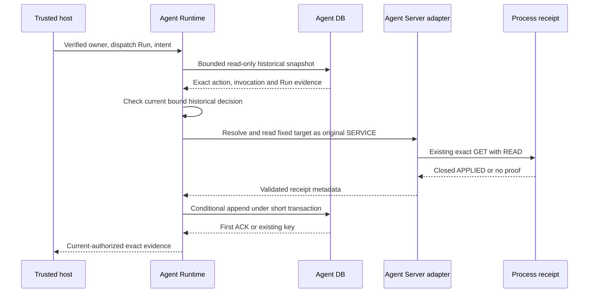

# T4-03 历史 Tool START 正向收据对账规格

| Field | Value |
| --- | --- |
| Document | docs/egon/spec/2026-11-06-05-28-tool-start-receipt-reconciliation.md |
| Template Version | 9 |
| Archetype Cleanup | Not applicable |
| Status | Review |
| Type | Feature |
| Complexity | Complex |
| Complexity Drivers | Separate current authorities, historical dispatch provenance, bounded cross-service observation, and append-only idempotency |
| Created | 2026-11-06 05:28 Asia/Shanghai |
| Updated | 2026-11-06 05:28 Asia/Shanghai |
| Owner | Tianji Agent Runtime and Agent Server |
| Repository | tianji-service |
| Scope | Explicit Java historical receipt reconciliation in Agent Runtime and Agent Server |
| Change Surface | V13 read and guarded V2/V5 insert, current historical authorization, bound Process receipt GET |
| Affected Chapters | §7, §8, §9, §10, §11, §14, §15, §16 |
| Source Requirement | [Master §17 S11 and §19 T4-03](../../../../docs/plans/agent-framework-upgrade-plan.md) |
| Baseline Revision | 2c886ae84e01e01d095a108bcbe36af86b3a80e7 |
| Amends | None |
| Supersedes | None |
| Depends On | [Owned Process START receipt](2026-11-05-23-50-owned-process-start-receipt.md#9-interface-definitions), [Process receipt Java SDK](2026-11-06-05-05-process-start-receipt-sdk.md#92-per-interface-detailed-contracts) |
| Related Specs | [Checkpoint resume host](2026-11-06-05-06-agent-checkpoint-as-resume-host.md) |
| Related Plans | [Historical receipt reconciliation plan](../plan/2026-11-06-05-29-tool-start-receipt-reconciliation.md) |

## 1. Summary

由显式宿主为原完整 owner 核对已经停止的 Agent Run 中某一次 Tool START。Agent 先验证原工具动作与调用，取得当前历史核对许可，再由独立 READ 凭据核对原 Process SERVICE 持有的精确收据。只有有效 APPLIED 可追加一份本地证据。没有正向收据的历史动作继续保留原状态。

## 2. Background and Current State

| Evidence ID | Exact source | Observed fact |
| --- | --- | --- |
| EVD-001 | ToolActionIntentSql#row, #requireHistoricalSource and V13__add_tool_execution_journal.sql | Existing validation reconstructs action inputs and verifies their digest, owner, linked invocation, outcome and immutable Run material. |
| EVD-002 | V2__add_run_governance.sql, V5__bind_agent_ownership_to_issuer.sql and JdbcAgentLedgerRepository | Existing command receipt uses a full-owner operation key and supports a JSONB result tied to an exact Run. |
| EVD-003 | TianjiFixedBpmnStartToolBindings#resolve, TianjiFixedBpmnStartToolTransport and TianjiProcessToolCredentialVerifier | START has fixed owner, definition, backend and argument mapping. Current START credentials use independent release and START privileges. |
| EVD-004 | ProcessStartReceiptClient#getStartReceipt, HttpProcessClient and ProcessStartReceiptController | The existing SDK sends one exact owner READ query and recognizes a bounded positive APPLIED response. |
| EVD-005 | AgentCheckpointTakeoverService and AgentLedgerService | Owned bounded primary transactions, lease fences and separate current authorization already have technical precedents. |

### 2.4 Evidence and current-chain map

| Entry/trigger | Current source chain | Evidence gap | Decision |
| --- | --- | --- | --- |
| Run stopped with unresolved START | V13 action and invocation remain paired under original identity | Existing action outcome can stay unknown after Process applied START | Take an owned historical snapshot and use the independent exact Process receipt. |
| Repeat or race | V2/V5 isolates commands by full owner and operation | Existing CANCEL and RESUME receipts do not describe historical Process evidence | Introduce one insert-only operation and return only matching evidence under current authorization. |

### 2.5 Archetype example cleanup

Cleanup disposition: Not applicable

Reason: This step extends the existing Agent Runtime and Agent Server modules. It creates no archetype or example project.

## 3. Goals and Non-goals

Provide an internal positive reconciliation command for the original owner and exact persisted dispatch. Separate first observation from original execution and preserve the V13 journal. Production exposure, authority provisioning, credential registration, promotion and live verification belong to independent steps.

### 3.3 Change Surface and Design Depth

| Area/layer | Disposition | Exact repository evidence | Changed or preserved behavior/contract | Required Spec treatment | Chapter(s) |
| --- | --- | --- | --- | --- | --- |
| Agent Runtime internal command and storage | Affected | EVD-001/002/005 | Verified historical read and one conditional positive receipt | Detailed source invariants and storage design | §7, §8, §9, §10, §11, §14, §15, §16 |
| Agent Server transport | Affected | EVD-003/004 | Bind exact historical target and read under original SERVICE with independent READ | Explicit adapter protocol | §7, §8, §9, §14, §16 |
| Process Server and Web | Context-only | EVD-004 | Existing exact receipt route and client-facing surfaces | Reuse existing contract and observe deployment boundary | §9, §12, §16 |

## 4. Requirements and Acceptance Criteria

| ID | Requirement | Priority | Observable acceptance | Source |
| --- | --- | --- | --- | --- |
| REQ-001 | Accept only the exact stopped original dispatch | Must | Full verified owner, exact dispatch Run and UUID, preserved paired V13 facts, inactive lease and ended dispatch window. | EVD-001/005 |
| REQ-002 | Bind both independent current authorities | Must | Exact historical permission precedes network access. The independent Process READ credential belongs to the recorded SERVICE, bound to the configured target. | EVD-003/004 |
| REQ-003 | Store positive evidence once | Must | Exact APPLIED admits one guarded V2/V5 insert. Source drift, absent receipt, denial, malformed proof or expiry cannot add evidence. | EVD-001/002/004 |
| REQ-004 | Preserve exact replay and audit | Must | Fresh current authorization and GET precede replay. Identical facts return original ACK, contradictory facts fail, original journal and run facts are preserved. | EVD-001/002/005 |
| REQ-005 | Verify build boundaries | Must | Typed finite RED and GREEN, actual package audit, no old migration changes and no runtime activation. | EVD-001–005 |

### 4.1 Scenario matrix

| Scenario | Preconditions | Expected action | Forbidden outcome | Gate |
| --- | --- | --- | --- | --- |
| Positive witness | Stopped eligible original run, matched V13 pair and two valid authorities | Observe APPLIED and append one closed receipt | Promote V13 or issue START | TEST-001/002 |
| Source/authority drift | Foreign owner, active dispatch, expired current permit or mismatched SERVICE | Refuse the next boundary or roll back | Leak raw evidence, retry START or create a receipt | TEST-001/002 |
| Inconclusive Process response | Exact GET has no valid positive response | Return sanitized unavailable result | Assert negative effect or add evidence | TEST-002 |
| Concurrent or repeated command | Same exact key and observed evidence | Re-read first committed result in a fresh snapshot and return original ACK | Replace first evidence or silently accept a contradiction | TEST-001/003 |

### 4.2 Use-case analysis

| Actor ID | Actor | Evidence-backed responsibility |
| --- | --- | --- |
| ACTOR-001 | Trusted Java host | Supplies verified original owner and exact dispatch Run plus intent identity. |
| ACTOR-002 | Current historical authority | Returns a short-lived positive decision bound to historical source and Process query. |
| ACTOR-003 | Original Process executor SERVICE | Supplies independently current Process READ under the exact original identity. |
| ACTOR-004 | Agent and Process stores | Agent validates original history and appends observation, Process owns the applied receipt. |

| ID | Use case/goal | Actors | Trigger/preconditions | Main flow | Alternative/failure | Postcondition | Requirements |
| --- | --- | --- | --- | --- | --- | --- | --- |
| UC-001 | Observe one historical START | ACTOR-001/002/003/004 | Exact stopped owned dispatch | Seal source, authorize, GET, compare and append | No positive record on mismatch or uncertainty | Durable observation separate from execution | REQ-001/002/003 |
| UC-002 | Review and safely repeat | ACTOR-001/002/003/004 | Historical key already exists or races | Revalidate current permissions and compare exact evidence | Changed evidence is a conflict | First receipt and historical states preserved | REQ-004/005 |

## 5. Constraints, Assumptions, and Decisions

Use the same existing trusted Agent primary writer and its existing command receipt permissions. V13 reads do not require extending row-lock privileges. The first source read uses repeatable read and a physical-primary read-only transaction. Use a separate guarded write and fresh read snapshot after a zero-row insert. No provisioned identity, role, permissions, migrations, feature flags, REST routes or deployment behavior are added by this step. Application host wiring and any separate writer role are separate operator decisions.

## 6. Project Technology Context

Java 25, existing Spring JDBC transaction management, canonical SHA-256 in orchestration contracts, Jackson for closed receipt result, existing JDK HTTP SDK and repository PostgreSQL DDL.

### 6.2 User-mandated Java rule compliance

```text
1 类名规范，必须以 java的pojo规范命名。以dao po bo vo dto query command event等结尾
2 每层之间必须被 springboot-validation 校验，复用对象使用分组校验；基于原生和自定义约束注解、@Valid、@Validated 及 ConstraintValidator 扩展实现。ValidationUtils 只承担通用手工校验，不承载全部业务校验；电话号码复用 libphonenumber。
3 Java POJO 默认使用 class，注解为 @Data @NoArgsConstructor @AllArgsConstructor @Accessors(chain = true)，按构造目标选择 @Builder 或 @SuperBuilder；父类状态参与相等性时使用 @EqualsAndHashCode(callSuper = true)。只有不可变 value object 可以使用 record，并豁免 class 的 Lombok 规范；普通实体不能因简单而使用 record。使用 MapStruct、MapStructPlus 和 egon-cola-component-common-core 的 BaseConverter（双向）或 BaseForwardConverter（不可逆投影）进行转换。
4业务类必须使用@Slf4j注解注入log对象。如果业务类被spring管理，必须指定名称，如果是单例的情况下，参考@Service("userService")。如果需要依赖注入，必须@RequiredArgsConstructor进行修饰，不要代码中写。且属性必须被@qualify修饰。
5 工具类只允许使用jdk原生、Apache Commons(commons-lang3、commons-collections4、commons-io、commons-text、commons-codec、commons-beanutils)、Guava。针对Tika按需引入。
6 JSON 使用 Spring Boot Jackson；持久化枚举值使用 @EnumValue，向前端输出的枚举值使用 @JsonValue，禁止 ordinal 作为业务编码。
7 springboot 多环境配置文件，必须保持配置一致，但值不一定一致。
9 复杂业务必须引入设计模式，不允许硬编码
10 日期相关的必须使用java.time下的实体类，不允许使用java.util下的
11 只允许现有三层结构或当前 egon-cola-archetypes 的 DDD 结构，三层结构保持现状。必须尽量复用 egon-cola-components；持久化模块必须使用 Egon COLA MP Starter，DDL 统一由 egon-mp-sdj-ext-starter 分布式管理。业务唯一键必须组合业务列与 deletedAt（数据库 deleted_at），并验证 NULL、租户及重复软删除语义。采用 CQE（Command Query Event）；Event 必须经 egon-cola-component-transactional-outbox-starter 或 MQ 中间件投递。
```

| Literal rule | Affected? | Repository evidence | Exact design decision | Files/types/interfaces | Validation/test evidence | Status/blocker |
| --- | --- | --- | --- | --- | --- | --- |
| Rule 1 | Yes | EVD-001–005 | Exact historical command, transport and persistence type names match their owning modules. | §7–11/16 | TEST-001–003 | PASS |
| Rule 2 | Yes | EVD-001–005 | Closed owner and target input, provenance, current decisions and positive result are checked at their boundary. | §7–11/16 | TEST-001–003 | PASS |
| Rule 3 | Yes | EVD-001–005 | Immutable records carry validated historical evidence, with no mutable business DTO projection. | §7–11/16 | TEST-001–003 | PASS |
| Rule 4 | Yes | EVD-001–005 | Explicitly constructed internal components keep diagnostic representations redacted and add no discovered bean. | §7–11/16 | TEST-001–003 | PASS |
| Rule 5 | Yes | EVD-001–005 | Use existing SHA-256, Spring JDBC, Jackson, JDK HTTP and the Process SDK. | §7–11/16 | TEST-001–003 | PASS |
| Rule 6 | Yes | EVD-001–005 | Use closed versioned JSON and named fixed status with exact persisted digest and scalar types. | §7–11/16 | TEST-001–003 | PASS |
| Rule 7 | Yes | EVD-001–005 | Preserve configuration and profiles by exact source and packaged byte checks. | §7–11/16 | TEST-001–003 | PASS |
| Rule 9 | Yes | EVD-001–005 | Reuse the SDK Adapter and JDBC Ledger around one focused reconciliation command. | §7–11/16 | TEST-001–003 | PASS |
| Rule 10 | Yes | EVD-001–005 | Use UTC Instant for observed moments and Duration/monotonic nanos for bounded elapsed work. | §7–11/16 | TEST-001–003 | PASS |
| Rule 11 | Yes | EVD-001–005 | Preserve AR ledger and AS adapter boundaries, add one receipt operation and retain existing event ownership. | §7–11/16 | TEST-001–003 | PASS |

### 6.3 Time semantics and conversion contract

Time contract: Required

| Time ID | Fields/symbols | Semantics | Java/runtime type | Storage policy | Wire policy | Business zone source | Display zone source | Boundary / DST rules | Precision / Clock | Compatibility | Verification |
| --- | --- | --- | --- | --- | --- | --- | --- | --- | --- | --- | --- |
| TIME-001 | V13 dispatch_not_after, current permit times | Occurred instant | java.time.Instant | UTC instant | Internal | UTC Agent primary and current authority | Not applicable: no display | Original cutoff elapsed and current authorization valid when appending | Database clock and exact microsecond comparison | Existing original authorization is historical provenance | Step 1 TEST-001/003 |
| TIME-002 | Process recordedAt and Agent created_at | Occurred instant | java.time.Instant | UTC instant | UTC Z | Separate Process and Agent clocks | Not applicable: no display | No ordering inference across two databases | Preserve Process UTC microseconds and Agent primary observation time | Existing closed Process receipt contract | Step 1 TEST-002/003 |
| TIME-003 | Operation, transport, statement and lock windows | Duration | java.time.Duration and monotonic elapsed nanos | Not persisted | Internal | Not applicable: duration measured by local monotonic clock | Not applicable: no display | Bound calls and lock waits independently of wall clock or DST | JDK monotonic time and local PostgreSQL timeouts | Existing bounded HTTP SDK and JDBC transaction semantics | Step 1 TEST-001/002/003 |

## 7. Architecture Design

### 7.0 Minimum-design baseline and element-necessity audit

| Proposed element | Change | Requirements | Existing/direct alternative | Concrete inadequacy | Added cost and failure | Verdict |
| --- | --- | --- | --- | --- | --- | --- |
| Internal historical reconciliation service | Add | REQ-001/002/003/004 | Execute tool or disclose V13 known result | Execution retries side effects, and result access requires already known facts | Two short local phases with independent authorization | Use |
| Existing V2/V5 command receipt | Reuse | REQ-003/004 | Add a dedicated table | Existing key and result can store the bounded evidence for current trusted writer | New operation discriminator and closed schema | Use |
| Existing exact Process receipt SDK | Reuse | REQ-002/003 | Reissue START or infer instance existence | Neither would prove the original digest under the original SERVICE owner | One bounded GET through trusted AS adapter | Use |

| Path | Network calls | Client states | Persisted evidence | Failure boundary |
| --- | --- | --- | --- | --- |
| Historical observation | At most one exact Process GET per invocation | Positive, unavailable, denied or conflict | Exact positive evidence only | No fallback or side-effect retry |
| Exact replay | Same current authorities and one exact GET | First original ACK, unavailable, denied or conflict | First audit remains | No update, second write or cached permission |
| Finite gates | None | Stub JDBC/HTTP and controlled clocks | Test doubles only | Actual I/E remains distinct |

### 7.1 System Architecture Design



AR owns exact historical facts, current authority ordering and local persistence. AS owns the fixed Process binding and SDK transport. Process Server remains the independent receipt authority.

### 7.2 High-Level Design



#### 7.2.2 High-level decision and quality matrix

| Concern/use case | Constraint | Selected design | Verification |
| --- | --- | --- | --- |
| Owner and scope | No fallback identity or arbitrary target | Bind immutable original tuple and exact existing backend | TEST-001/002 |
| Race and expiry | External GET cannot join Agent JDBC transaction | Read, release, GET, recheck, and insert with independent short transaction | TEST-001/003 |
| Audit and confidentiality | Keep original V13 effect and avoid raw data retention | Closed positive result under operation key and sanitized failures | TEST-001/003 |

### 7.3 Detailed Design



The first physical-primary read seals the typed V13 action and matching invocation plus exact original and dispatch Run provenance. Retain write predicates only in memory. Require a stopped dispatch Run without a lease and a passed original dispatch cutoff. Use the fixed tool binding from the dispatch Run. Reconstruct the original Process command with the stable intent UUID as command ID and correlation ID, then calculate the independent Process SHA-256. Check current historical authorization before obtaining Process evidence and maintain a bounded operation deadline.

The final physical-primary statement compares the original source stamps and first-observation states in one snapshot. A new receipt is eligible only for coherent DISPATCHING/UNKNOWN facts. An APPLIED fact in V13 is eligible only for exact replay of an existing matching observation and original native receipt reference. Historical permission is obtained before GET and checked again afterwards. Use matching UTC PostgreSQL session semantics for JSONB row rendering and time conversion. Recheck the authoritative Agent database clock after any waiting insert and validate the actual returned persisted evidence before commit. Invalid RETURNING evidence rolls back. Check the current authorization time window locally and enforce the upper expiry bound with the Agent database clock. Independent authority and database observation clocks do not establish a cross-system lower-bound ordering. A conflict loser may read the exact key in a separate fresh read-only repeatable-read snapshot under the same authorized command window. Keep replay evidence separate from source attempts and from authorization input.

#### 7.3.6 Conclusion evidence chain

| Conclusion | Evidence | Verification | Boundary |
| --- | --- | --- | --- |
| Positive evidence traces to the exact original dispatch | EVD-001 plus fixed binding and existing Process receipt | TEST-001/002 | Original journals retain their prior state. |
| Concurrent calls can converge on one immutable receipt | EVD-002 operation key plus source stamps and closed digest | TEST-001/003 | No cached receipt acts as authority. |

## 8. Package Structure and Code File Tree

- `stellar-enclosure-tianji-agent-server/src/test/java/top/egon/cola/platform/tianji/agent/server/integration/process/TianjiFixedBpmnStartReceiptReaderTest.java` — TianjiFixedBpmnStartReceiptReaderTest.
- `stellar-enclosure-tianji-agent-runtime/src/test/java/top/egon/cola/platform/tianji/agent/infrastructure/persistence/ToolStartReceiptReconciliationServiceTest.java` — ToolStartReceiptReconciliationServiceTest.
- `stellar-enclosure-tianji-agent-runtime/src/test/java/top/egon/cola/platform/tianji/agent/infrastructure/persistence/ToolStartReceiptReconciliationSqlTest.java` — ToolStartReceiptReconciliationSqlTest.
- `stellar-enclosure-tianji-agent-runtime/src/main/java/top/egon/cola/platform/tianji/agent/application/tool/HistoricalToolReceiptAuthorization.java` — HistoricalToolReceiptAuthorization.
- `stellar-enclosure-tianji-agent-runtime/src/main/java/top/egon/cola/platform/tianji/agent/application/tool/FixedBpmnStartReceiptRead.java` — FixedBpmnStartReceiptRead.
- `stellar-enclosure-tianji-agent-runtime/src/main/java/top/egon/cola/platform/tianji/agent/infrastructure/persistence/ToolActionIntentSql.java` — ToolActionIntentSql.
- `stellar-enclosure-tianji-agent-runtime/src/main/java/top/egon/cola/platform/tianji/agent/infrastructure/persistence/ToolStartReceiptReconciliationSql.java` — ToolStartReceiptReconciliationSql.
- `stellar-enclosure-tianji-agent-runtime/src/main/java/top/egon/cola/platform/tianji/agent/infrastructure/persistence/ToolStartReceiptReconciliationService.java` — ToolStartReceiptReconciliationService.
- `stellar-enclosure-tianji-agent-server/src/main/java/top/egon/cola/platform/tianji/agent/server/integration/process/TianjiFixedBpmnStartToolBindings.java` — TianjiFixedBpmnStartToolBindings.
- `stellar-enclosure-tianji-agent-server/src/main/java/top/egon/cola/platform/tianji/agent/server/integration/process/TianjiFixedBpmnStartToolTransport.java` — TianjiFixedBpmnStartToolTransport.
- `stellar-enclosure-tianji-agent-server/src/main/java/top/egon/cola/platform/tianji/agent/server/integration/process/TianjiFixedBpmnStartReceiptReader.java` — TianjiFixedBpmnStartReceiptReader.

## 9. Interface Definitions

### 9.1 Interface Inventory

| ID | Protocol | Owner | Purpose |
| --- | --- | --- | --- |
| INTERNAL-001 | Internal Java | Agent Runtime, called by trusted host | Check historical START and append verified positive evidence |
| INTERNAL-002 | Internal Java | Agent Runtime port and Agent Server reader | Bind exact original Process request and obtain current SERVICE-owned APPLIED |

### 9.2 Per-interface Detailed Contracts

#### 9.2.1 INTERNAL-001 — Historical START reconciliation

##### Necessity and interaction-cost decision

| Concern | Decision |
| --- | --- |
| Change classification | Explicit internal command with append-only observed evidence |
| Independent consumer goal | Confirm one historical START without invoking tool execution again |
| Parameter ownership and derivation | Trusted owner and exact Run/intent select persisted dispatch data |
| Direct/no-new-interface alternative | Existing execution completion expects original nonce and changes V13 |
| Caller use of result | Use the exact local evidence acknowledgement for the historical command |
| Round trips and failure points | Short read, current authorities, one exact GET, and short guarded append |
| Verdict | Add one narrow explicit Java command and retain original journals |

##### Identity and purpose

`ToolStartReceiptReconciliationService` owns the positive observation command and orchestrates only the exact stopped historical dispatch selected by the trusted caller.

##### Request parameters

Pass the full verified original owner, dispatch Run identifier and canonical intent UUID. Inputs never select credentials, backend or substitute owner, which are derived from trusted runtime evidence.

##### Success response

Return the exact durable positive acknowledgement of an APPLIED observation. Repeat of the exact first witness returns the original persisted result within current authority.

##### Error responses

Reject invalid scope, deny unavailable authority or absent proof, and fail closed on mismatch, unavailable storage, timeout or contradictory evidence. Use sanitized internal error messages.

##### Interface logic for frontend and consumers

The trusted host explicitly supplies current authority and invokes the command. Production routes, model disclosures and browser consumers require their own decisions.

##### Compatibility and verification

Existing V13 and V14 writers keep their established behavior. Verify original owner, unchanged source rows, conditional insert and replay with TEST-001 and TEST-003.

#### 9.2.2 INTERNAL-002 — Fixed receipt read

##### Necessity and interaction-cost decision

| Concern | Decision |
| --- | --- |
| Change classification | Internal bound read that uses the existing external query |
| Independent consumer goal | Verify the receipt of the exact already-issued START command |
| Parameter ownership and derivation | Fixed binding and typed original dispatch produce independent Process request digest |
| Direct/no-new-interface alternative | Reusing live START transport would expose mutation and inappropriate credentials |
| Caller use of result | Independently validated positive evidence goes to reconciliation service |
| Round trips and failure points | One exact GET, one current independent READ credential, and an operation deadline |
| Verdict | Reuse the existing SDK behind a purpose-specific AS adapter |

##### Identity and purpose

The Agent Server reader uses the fixed Process backend and verifies the original recorded SERVICE under independent current Process READ authority for the existing receipt route.

##### Request parameters

Use typed historical Run and action provenance, exact original executor and the caller's bounded operation window. Resolve and seal the exact original Process request through the configured binding.

##### Success response

Return the closed APPLIED receipt with the bound target and expected query provenance. Record only the permitted result needed by the local command.

##### Error responses

A missing receipt, unavailable provider, wrong executor, redirect, timeout, malformed JSON or inconsistent response produces no positive observation and no local write.

##### Interface logic for frontend and consumers

Only the explicit internal command consumes the adapter. A retry of the command makes a fresh authorized read of the same query rather than submitting another START.

##### Compatibility and verification

Existing live START backend mappings and credential scopes are unchanged. Verify independent digest, exact request, redirection policy and identity with TEST-002.

## 10. POJO and Data Model Design

Use immutable typed historical command, bound target, current permit and receipt values. The stable receipt request domain is `TIANJI_TOOL_START_RECEIPT_RECONCILE_V1`; the separate positive evidence domain is `TIANJI_TOOL_START_RECEIPT_POSITIVE_EVIDENCE_V1`. The fixed target includes `tianji.api.process.startReceipt.get` and the Process digest derived from the original command. Represent raw source comparison values as internal storage implementation data, with redacted diagnostics. Reuse existing canonical action, Run material, receipt DTO and hashing. Persistent JSON is versioned and closed, with independent request and Process evidence digests. Store historical source revisions and permitted audit metadata without raw action parameters, tokens or approval payload. Preserve the first decision deadline as a UTC Instant for strict reconstruction of the historical authority binding and validation of a stored receipt. A new current decision remains independent of that historical audit.

## 11. Database Design

### 11.1 Table Inventory

| Table | Owner | Access | Evidence |
| --- | --- | --- | --- |
| tianji_agent.agent_run_command_receipt | Agent Runtime | Exact operation-specific select and insert | Existing V2/V5 full owner key |

V13 action, invocation and Run rows are read as existing sources, with full provenance verified and compared. Their table definitions and write behaviors are outside the new operation.

### 11.2 Per-table Detailed Design

#### 11.2.1 tianji_agent.agent_run_command_receipt

##### Purpose, ownership, and lifecycle

The existing Agent Runtime command receipt table records a durable first positive historical START observation. Ownership is the exact original Agent actor and dispatch Run.

##### Complete column design

| Column | Native type | Existing constraint | Value for this operation |
| --- | --- | --- | --- |
| tenant_id | bigint | Required owner key | Original tenant |
| subject_type | varchar(16) | USER or SERVICE | Original owner type |
| subject_issuer | varchar(64) | Exact fingerprint or existing legacy sentinel | Verified original issuer fingerprint |
| subject_id | varchar(256) | Required owner key, C collation | Exact original subject |
| command_id | varchar(128) | Required operation key | Canonical intent UUID plus dispatch epoch |
| operation | varchar(32) | Required operation discriminator | TOOL_START_RECEIPT_RECONCILE |
| request_hash | char(64) | Required | Domain-separated immutable source and Process request binding |
| run_id | varchar(64) | Required, existing Run foreign key | Original dispatch Run |
| result | jsonb | Existing optional value | Required closed positive evidence for this operation |
| created_at | timestamptz | Required | Agent database observation time |

##### Keys, relationships, and constraints

Reuse the V5 primary key across tenant, owner type, issuer, subject, operation and command ID. Run foreign key and exact owner relation are verified by the existing schema and guarded insert predicates.

##### Index inventory and per-index justification

| Index | Type/unique | Operation | Justification |
| --- | --- | --- | --- |
| agent_run_command_receipt_pkey | B-tree unique | Scoped observation and replay | Exact key matches every owner and operation component |

##### Access patterns and SQL shape

| Operation | Caller | SQL shape | Decision |
| --- | --- | --- | --- |
| Observe once | Reconciliation storage | Conditional INSERT with existing V13 and Run stamp predicates and ON CONFLICT DO NOTHING | One inserted positive row or zero |
| Read replay | Reconciliation storage | Exact owner, operation and command lookup in a fresh read-only repeatable-read snapshot | Strict closed row plus digest and first ACK |

##### Migration and historical-data handling

Existing V2 and V5 contain the full physical table. A new internal operation uses their open discriminator and existing trusted writer. Existing other operations remain isolated by exact predicates.

##### Transaction, consistency, and recovery

A short read-only history snapshot precedes external calls. The final guarded statement compares source as visible in its own snapshot and uses existing uniqueness for races. Expired or contradictory evidence rolls back or returns a typed failure. The source comparison is scoped to the statement snapshot. Later V13 changes remain independently authoritative for execution.

### 11.3 Entity-relationship diagram

Relational model change: No

Reuse the existing receipt-to-Run foreign key and full-owner operation key. Tool references are stable evidence inputs and are not new relational keys.

## 12. Frontend Page Design

No UI surface is introduced. A future disclosure requires a separate effective specification and explicit authority.

## 13. Design Patterns and Architecture Principles

Use the existing JDBC Ledger and Java SDK Adapter patterns. Keep authority and transport as narrow host-provided boundaries. The reconciliation service coordinates one operation, and the new persistence implementation owns the conditional insert and closed result read.

## 14. Test Design

| Test | Objective | Method | Gate |
| --- | --- | --- | --- |
| TEST-001 | Verify history, current authorization, expiry, drift, and append-only order | Finite AR assertions with controlled time, authorization, database and transport collaborators | R1/G1 |
| TEST-002 | Verify exact bound GET and independent original SERVICE READ | Finite AS fixture and actual SDK parsing with JDK test transport | G1 |
| TEST-003 | Verify immutable replay and conflict, source predicates, and privacy | Typed negative and finite positive assertions, scope and packaging audit | R1/G1/P1 |
| TEST-004 | Verify operator environment | Separate PostgreSQL and current AS/PS authority I/E with isolated approved resources | Operator-only |

## 15. Non-functional and Cross-cutting Design

Bound current call, statement and lock waiting. Propagate sanitized failures without raw payloads, credentials, tool arguments or SQL exception diagnostics. Keep original execution logs and audit immutable. UTC conversion must preserve the exact Process receipt instant and independently represent the Agent observation instant.

## 16. Compatibility, Migration, Rollout, and Rollback

Only explicitly constructed internal Java composition can invoke this command. Existing Run, Tool, budget, Spring configuration, dependencies, permission declarations, SDK protocol and Flyway bytes are preserved. Revert the scoped commit for source rollback. Already appended positive observations stay isolated under their operation discriminator.

## 17. Alternatives and Decisions

A new table would isolate write grants but is unnecessary for the existing trusted writer. Promoting the V13 outcome would overwrite historical uncertainty and could expose it to current result-disclosure paths. One additional exact positive command receipt preserves the observed evidence and original execution record.

## 18. Risks and Open Questions

Actual current historical authority, original SERVICE READ provisioning, deployed caller, and operator acceptance remain independent. A dedicated writer unable to write existing CANCEL or RESUME operations would need separate schema and role review. The independent Process receipt proves one original START and does not establish the subsequent Process lifecycle.

## 19. Traceability Matrix

| Requirement | Use case | Design | Tests |
| --- | --- | --- | --- |
| REQ-001 | UC-001 | §7/9/11 | TEST-001 |
| REQ-002 | UC-001 | §7/9 | TEST-001/002 |
| REQ-003 | UC-001 | §7/10/11 | TEST-001/003 |
| REQ-004 | UC-002 | §7/9/11 | TEST-001/003 |
| REQ-005 | UC-002 | §14/16/18 | TEST-003/004 |

## 20. Review and Acceptance

### 20.5 Blocking Manual Check

| Check ID | Applicability | Status | Evidence | Finding | Required action/exception |
| --- | --- | --- | --- | --- | --- |
| MC-ARCH-001 | Applicable | PASS | §7/8 | AR owns historical orchestration and JDBC; AS owns Process credential and SDK read. | None |
| MC-REUSE-001 | Applicable | PASS | EVD-001–005 | Reuse V13 history, V2/V5 receipts, fixed target and existing exact SDK. | None |
| MC-DEP-001 | Applicable | PASS | §6/16 | Use JDK and established Spring, Jackson and test classpaths. | None |
| MC-NAME-001 | Applicable | PASS | §8–10 | Use focused Java names for observation, authorization and persistence. | None |
| MC-VALID-001 | Applicable | PASS | §7/9/14 | Check exact owner, independent authority, paired provenance and closed response. | None |
| MC-MODEL-001 | Applicable | PASS | §10/11 | Use immutable typed evidence, redacted private stamps and closed JSON. | None |
| MC-CONVERT-001 | Applicable | PASS | §9/10 | Existing typed canonical digest and explicit storage serialization boundaries. | None |
| MC-LOG-001 | Applicable | PASS | §15 | Fixed errors and redacted private metadata prevent credential or SQL leakage. | None |
| MC-BEAN-001 | Not applicable | N/A | §5/16 | Explicit host construction preserves ordinary application discovery. | None |
| MC-UTIL-001 | Applicable | PASS | §6/7 | Reuse SHA-256 helper and existing HTTP and JDBC infrastructure. | None |
| MC-JSON-001 | Applicable | PASS | §10/11 | Validate strict versioned receipt and positive Process response. | None |
| MC-TIME-001 | Applicable | PASS | §6.3/7/11 | Separate source/observation clocks and bound operation, statements and locks. | None |
| MC-CONFIG-001 | Applicable | PASS | §5/16 | No runtime setting or permission change; verify package parity. | None |
| MC-PATTERN-001 | Applicable | PASS | §13 | Reuse SDK Adapter and JDBC Ledger within a direct command service. | None |
| MC-SCOPE-001 | Applicable | PASS | §8/16 | Audit exact planned files and all 28 existing SQL migrations. | None |
| MC-TEST-001 | Applicable | PASS | §14 | Declare typed negative, finite, artifact and separate operator proof. | None |
| MC-BLOCKER-001 | Applicable | PASS | §18 | Current authority provisioning and PostgreSQL acceptance have independent operator gates. | None |

### 20.6 Final verdict

PASS — Ready for user review
