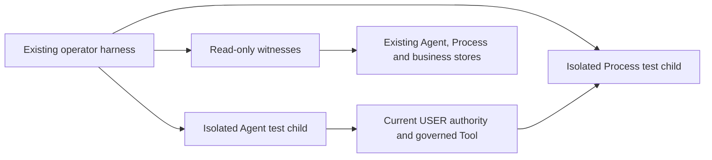
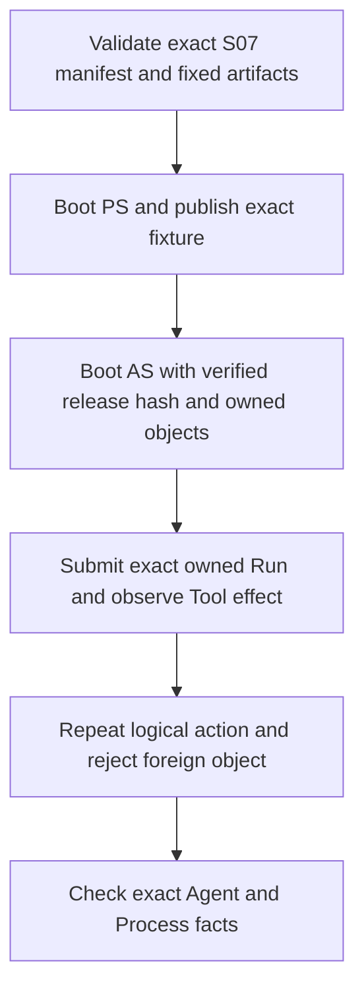
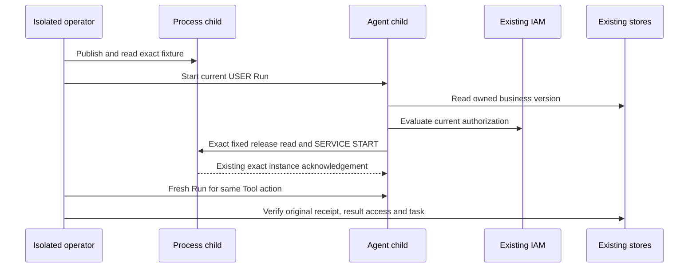

# S07 Agent 到 Process 受治理 START 组合验收

| Field | Value |
| --- | --- |
| Document | docs/egon/spec/2026-11-06-05-51-s07-governed-start-e.md |
| Template Version | 9 |
| Archetype Cleanup | Not applicable |
| Status | Review |
| Type | Feature |
| Complexity | Complex |
| Complexity Drivers | Artifact-pinned isolated children, distinct current USER and SERVICE identities, fixed release verification, and one cross-store Tool effect |
| Created | 2026-11-06 05:51 Asia/Shanghai |
| Updated | 2026-11-06 05:51 Asia/Shanghai |
| Owner | Tianji Agent Server and Process Server test fixtures |
| Repository | tianji-service |
| Scope | Exact S07 idempotent-write operator fixture, focused finite guards and review artifacts |
| Change Surface | Test-only two-child orchestration, exact fixture definition and database witnesses |
| Affected Chapters | §7, §8, §14, §15, §16 |
| Source Requirement | [Master §17.2 S07 and §19 T3-07/T4-05](../../../../docs/plans/agent-framework-upgrade-plan.md) |
| Baseline Revision | cc2c6818a7e122e81ea5d2a59172894b2c29656c |
| Amends | None |
| Supersedes | None |
| Depends On | [S07 Process authorization fixture](2026-11-06-04-32-s07-process-start-authorization.md#7-architecture-design), [Governed injection corpus](2026-11-05-19-27-governed-process-injection-corpus.md#14-test-design) |
| Related Specs | None |
| Related Plans | [S07 operator Plan](../plan/2026-11-06-05-52-s07-governed-start-e.md) |

## 1. Summary

增加专用 S07 操作者用例。隔离 Process 先发布固定 BPMN 和配套 DMN，隔离 Agent 再用真实受治理 Tool、权限链和独立 SERVICE 传输启动 Process。两个租户各自验证一次真正写入、第二次 Run 对原 Tool 结果的受控复用，以及外租户对象在派发前失败。

## 2. Background and Current State

| Evidence ID | Exact source | Observed fact |
| --- | --- | --- |
| EVD-001 | BusinessProcessAgentAcceptanceIT.Driver, ExpenseAcceptanceHarness and child mains | Existing artifact-pinned child harness owns the isolated HTTPS endpoints, roles, startup and suite selectors. Existing expense workflow starts the Process before its linked Agent submission. Its current child boot order and all existing suite routing remain separate from S07. |
| EVD-002 | TianjiGovernedProcessToolConfiguration and AdkGovernedProcessToolBridge#bindScope | Existing production Tool path requires independent current Tool authority, exact fixed profiles and trusted START action context. |
| EVD-003 | TianjiFixedBpmnStartToolTransport, ToolActionIntentSql and V14__add_tool_result_access_journal.sql | Existing START uses a pinned release, stable intent and verified SERVICE. The recorded result is independently authorized when exposed to a later exact Tool request. |
| EVD-004 | ExpenseBusinessWorkerFixture and ProcessServerPostgresTest | Existing disposable object table and native Flowable PostgreSQL witnesses support exact version and effect verification. |
| EVD-005 | ProcessPermissionIntegrationTest and S07 Process authorization evidence | Finite and compiled Process-side checks exist; the actual reverse Agent to Process direction needs a dedicated operator fixture. |

### 2.4 Evidence and current-chain map

| Entry/trigger | Current source chain | Evidence gap | Decision |
| --- | --- | --- | --- |
| Authorized direct Agent Run | Ordinary AS authorization, governed Tool model and fixed target are separate | Existing default expense case does not exercise this direction | Add an exact S07-only child configuration with actual production Tool path and Fake prompt response. |
| Process START and replay | One protected Process write, V13 action and V14 result access | Need exact original full SERVICE and native effect under actual operator identities | Correlate original dispatch, exact receipt and task with read-only isolated SQL witnesses. |

### 2.5 Archetype example cleanup

Cleanup disposition: Not applicable

Reason: Extend existing test sources and test child mains. No generated project, example or production bean is introduced by this Step.

## 3. Goals and Non-goals

Deliver the test-only operator fixture for the S07 idempotent-write lane and finite proof of its source guards. Legitimate human approval, approval tamper, expanded live resource-denial coverage and actual runtime validation are separate S07 work.

### 3.3 Change Surface and Design Depth

| Area/layer | Disposition | Exact repository evidence | Changed or preserved behavior/contract | Required Spec treatment | Chapter(s) |
| --- | --- | --- | --- | --- | --- |
| PS acceptance harness and oracle | Affected | EVD-001/003/004/005 | Exact private S07 selector, release preparation and two-tenant effect witnesses | Isolated entry, suite preservation, source and live gates | §7, §8, §14, §15, §16 |
| AS test child and fixture | Affected | EVD-001/002/003 | Test-only owner/version resolution, canonical definition and bounded Fake model | Exact Tool properties, separate authority and failure mapping | §7, §8, §14, §15, §16 |
| Runtime contracts, IAM and database schema | Context-only | EVD-002–005 | Existing production services, grants, repositories and migrations | Review unchanged product scope and operator prerequisites | §16/18 |

## 4. Requirements and Acceptance Criteria

| ID | Requirement | Priority | Observable acceptance | Source |
| --- | --- | --- | --- | --- |
| REQ-001 | Scope one separate S07 operator entry | Must | Exact private manifest, S07 child opt-in and artifact locks. Existing Business, Recovery and S12 modes preserve their prior dispatch and evidence behavior. | EVD-001 |
| REQ-002 | Bind original action to actual release and business version | Must | Compare exact published release/model/input and reread. Use canonical Agent definition hash and version from one exact disposable row after matching original owner, definition and tool. | EVD-002/004 |
| REQ-003 | Exercise actual protected Tool START | Must | Isolated AS uses current USER runtime and Tool authority, the pinned release transport uses the verified original SERVICE, and the exact APPLIED Process receipt and held native review task prove one effect. | EVD-002/003/005 |
| REQ-004 | Exercise replay and cross-tenant rejection | Must | Fresh same-action Run reaches the same instance through recorded-result access and does not add a second invocation or Process START. Wrong tenant object is rejected before Tool dispatch. | EVD-003/004 |
| REQ-005 | Keep source and operator proof distinct | Must | Typed RED and G1 complete without children or network. Inspect actual packages and exact test classes. Only independent real PostgreSQL/IAM E can prove the operator scenario. | EVD-001–005 |

### 4.1 Scenario matrix

| Scenario | Preconditions | Expected outcome | Gate |
| --- | --- | --- | --- |
| Positive Tool START in each tenant | Exact pinned release, verified USER and independent current SERVICE registrations | One settled Tool dispatch and one matching APPLIED receipt plus held task | TEST-003 |
| Fresh Run for same logical action | Same owned object/version and fixed Tool arguments | Original instance result from current-authorized V14 access, no second invocation or Process command | TEST-003 |
| Foreign object or incompatible release | Exact caller with foreign object, or model content outside pinned fixture | Fail before inappropriate dispatch; selected finite assertion rejects mismatch | TEST-001/003 |
| Existing suites | Existing exact mode and private manifest | Preserve their launch, evidence and run selection | TEST-002 |

### 4.2 Use-case analysis

| Actor ID | Actor | Evidence-backed responsibility |
| --- | --- | --- |
| ACTOR-001 | Isolated test operator | Supplies exact clean artifacts, private manifest, deployed current IAM and separately owned pre-migrated stores. |
| ACTOR-002 | Verified USER caller | Submits isolated Agent Run and holds original Agent tool action ownership. |
| ACTOR-003 | Original Process executor SERVICE | Uses current release READ and START through existing fixed transport. |
| ACTOR-004 | Test-owned observer | Reads only isolated witnesses to prove exact ownership, native state and result replay. |
| ACTOR-005 | Source reviewer | Runs finite guards and actual artifact inspection with no operator fixtures enabled. |

| ID | Use case/goal | Actors | Trigger/preconditions | Main flow | Alternative/failure | Postcondition | Requirements |
| --- | --- | --- | --- | --- | --- | --- | --- |
| UC-001 | Run isolated idempotent-write START | ACTOR-001/002/003/004 | Separate S07 manifest and exact current authorization | Publish fixed release, derive current business version, submit real Tool and read witnesses | Mismatch, foreign object, extra effect or invalid replay fails | One native effect and exact owner evidence per tenant | REQ-001/002/003/004 |
| UC-002 | Verify source delivery | ACTOR-005 | Exact baseline and existing local JDK 25 | Execute finite typed negatives, regression and artifact inspection | Missing proof or operator report fails source gate | Source-only proof | REQ-001/005 |

## 5. Constraints, Assumptions, and Decisions

Only the exact operator selector admits the private S07 mode. The fixture requires actual current independently provisioned IAM, two tenants, fixed existing resource scopes, locked AS/PS archives and test trees, and three isolated PostgreSQL stores. Fixture credentials remain in the private root. Source validation selects only finite tests. The governed START effect uses IDEMPOTENT_WRITE, and the companion DMN completes required production profile assembly.

## 6. Project Technology Context

Use established JDK 25, real AS and PS runtime, existing Shoubing/Jianshen authorization, Spring test configuration, canonical Agent codec, Flowable and PostgreSQL, plus finite JUnit fixtures.

### 6.2 User-mandated Java rule compliance

```text
1 类名规范，必须以 java的pojo规范命名。以dao po bo vo dto query command event等结尾
2 每层之间必须被 springboot-validation 校验，复用对象使用分组校验；基于原生和自定义约束注解、@Valid、@Validated 及 ConstraintValidator 扩展实现。ValidationUtils 只承担通用手工校验，不承载全部业务校验；电话号码复用 libphonenumber。
3 Java POJO 默认使用 class，注解为 @Data @NoArgsConstructor @AllArgsConstructor @Accessors(chain = true)，按构造目标选择 @Builder 或 @SuperBuilder；父类状态参与相等性时使用 @EqualsAndHashCode(callSuper = true)。只有不可变 value object 可以使用 record，并豁免 class 的 Lombok 规范；普通实体不能因简单而使用 record。使用 MapStruct、MapStructPlus 和 egon-cola-component-common-core 的 BaseConverter（双向）或 BaseForwardConverter（不可逆投影）进行转换。
4业务类必须使用@Slf4j注解注入log对象。如果业务类被spring管理，必须指定名称，如果是单例的情况下，参考@Service("userService")。如果需要依赖注入，必须@RequiredArgsConstructor进行修饰，不要代码中写。且属性必须被@qualify修饰。
5 工具类只允许使用jdk原生、Apache Commons(commons-lang3、commons-collections4、commons-io、commons-text、commons-codec、commons-beanutils)、Guava。针对Tika按需引入。
6 JSON 使用 Spring Boot Jackson；持久化枚举值使用 @EnumValue，向前端输出的枚举值使用 @JsonValue，禁止 ordinal 作为业务编码。
7 springboot 多环境配置文件，必须保持配置一致，但值不一定一致。
9 复杂业务必须引入设计模式，不允许硬编码
10 日期相关的必须使用java.time下的实体类，不允许使用java.util下的
11 只允许现有三层结构或当前 egon-cola-archetypes 的 DDD 结构，三层结构保持现状。必须尽量复用 egon-cola-components；持久化模块必须使用 Egon COLA MP Starter，DDL 统一由 egon-mp-sdj-ext-starter 分布式管理。业务唯一键必须组合业务列与 deletedAt（数据库 deleted_at），并验证 NULL、租户及重复软删除语义。采用 CQE（Command Query Event）；Event 必须经 egon-cola-component-transactional-outbox-starter 或 MQ 中间件投递。
```

| Literal rule | Affected? | Repository evidence | Exact design decision | Files/types/interfaces | Validation/test evidence | Status/blocker |
| --- | --- | --- | --- | --- | --- | --- |
| Rule 1 | Yes | EVD-001–005 | Scope the exact S07 fixture and finite test types in existing test packages. | §7/8/16 | TEST-001–003 | PASS |
| Rule 2 | Yes | EVD-001–005 | Validate owner, immutable release, Tool descriptor and business version at their owning fixture boundaries. | §7/8/16 | TEST-001–003 | PASS |
| Rule 3 | Yes | EVD-001–005 | Use existing immutable Agent, Tool and Process contracts plus small fixture records. | §7/8/16 | TEST-001–003 | PASS |
| Rule 4 | Yes | EVD-001–005 | Register explicit named test-only model and START resolver within the selected test child. | §7/8/16 | TEST-001–003 | PASS |
| Rule 5 | Yes | EVD-001–005 | Use JDK, current JDBC, JUnit and existing SDK with no dependency additions. | §7/8/16 | TEST-001–003 | PASS |
| Rule 6 | Yes | EVD-001–005 | Use existing Jackson and canonical Agent definition codec for bounded test evidence. | §7/8/16 | TEST-001–003 | PASS |
| Rule 7 | Yes | EVD-001–005 | Keep production properties stable and add only explicit private test mode inputs. | §7/8/16 | TEST-001–003 | PASS |
| Rule 9 | Yes | EVD-001–005 | Reuse Test Fixture and SDK Adapter to exercise the existing runtime path. | §7/8/16 | TEST-001–003 | PASS |
| Rule 10 | Yes | EVD-001–005 | Use bounded waits and durations with existing source and engine time semantics. | §7/8/16 | TEST-001–003 | PASS |
| Rule 11 | Yes | EVD-001–005 | Keep the AS/PS existing production responsibility and existing persistence and events. | §7/8/16 | TEST-001–003 | PASS |

### 6.3 Time semantics and conversion contract

Time contract: Required

| Time ID | Fields/symbols | Semantics | Java/runtime type | Storage policy | Wire policy | Business zone source | Display zone source | Boundary / DST rules | Precision / Clock | Compatibility | Verification |
| --- | --- | --- | --- | --- | --- | --- | --- | --- | --- | --- | --- |
| TIME-001 | Child readiness, Run poll, observer and Tool fixture windows | Duration | java.time.Duration and existing bounded waits | Not persisted | Internal | Not applicable: elapsed test deadlines | Not applicable: no display | Existing child and network limits bound the operator run | Existing monotonic wait and bounded query clocks | Preserve prior suite timeouts and existing engine timestamps | Step 1 TEST-001/002/003 |

## 7. Architecture Design

### 7.0 Minimum-design baseline and element-necessity audit

| Proposed element | Change | Requirements | Existing/direct alternative | Concrete inadequacy | Added cost and failure | Verdict |
| --- | --- | --- | --- | --- | --- | --- |
| Separate S07 fixture branch | Add | REQ-001/003 | Existing expense fixture | Existing workflow runs Process to Agent | Two owned children already supported by harness | Use |
| Scoped Fake and trusted version resolver | Add in test sources | REQ-002/003 | Derive authority from model parameters | Model input cannot attest owner or business version | Existing read-only observer and canonical definition hash | Use |
| Production bridges and journal | Reuse | REQ-003/004 | Stub Tool authority and inspect synthetic evidence | Stub cannot prove current protected behavior or native effect | Existing operator prerequisites and read-only witness queries | Use |

| Path | Network calls | Client states | Persisted evidence | Failure boundary |
| --- | --- | --- | --- | --- |
| E operator positive | Existing protected HTTPS Agent and Process calls, actual IAM | First action, exact replay and foreign object | Current V13/V14 facts, Process START receipt and native review task | Isolated owner/tenant, exact release and source |
| Source RED/G1/P1 | No HTTP, sockets, database or child launches | Fixed finite selectors | JUnit test and package evidence | Actual operator proof remains independent |

### 7.1 System Architecture Design



Only the test-mode host supplies the Fake model and trusted action context. Existing authority beans, governed Tool bridge, Process START and native workflow continue to supply operator behavior.

### 7.2 High-Level Design



#### 7.2.2 High-level decision and quality matrix

| Concern/use case | Constraint | Selected design | Verification |
| --- | --- | --- | --- |
| Isolation | Existing suites cannot use S07 fixture-only properties | Exact private S07 selector and owned harness flag | TEST-001/002 |
| Provenance | Business version and fixed definition cannot derive from prompt | Use one scoped read-only row and canonical immutable definition digest | TEST-001/003 |
| Positive effect | Current Process owner and exact START receipt must match native task | Verify original SERVICE scope through production transport and exact read-only facts | TEST-003 |

### 7.3 Detailed Design



The S07 driver owns artifact lock, isolated endpoints, finite lifecycle and exact suite mode. It starts Process before Agent, publishes fixed BPMN/DMN per tenant and compares the published release to a fresh read. The real published immutable manifest digest becomes a test-only AS property along with finite fixture data. The business observer reads version by exact source, tenant and object after matching full original USER, definition, digest, business key and Tool descriptor. Agent definition digest comes from the same canonical codec used by actual publication.

The Agent fixture emits one fixed governed Tool suggestion and interprets one exact result. Its ordinary admission and Tool authorization use production wiring. Process START uses its existing full SERVICE target and existing scopes. The first Run is joined to V13 and a settled budget, and the Process receipt must match full executor identity and canonical START digest. The exact native review task witnesses the live native instance. The second Run joins a V14 read of the original applied result and has no Tool invocation. The foreign object case stays outside the Tool dispatch boundary. After replay and foreign-object rejection, the test rereads the original exact evidence and compares global fixture-release START receipts and held native review tasks to the tenant count.

#### 7.3.6 Conclusion evidence chain

| Conclusion | Evidence | Verification | Boundary |
| --- | --- | --- | --- |
| First actual Tool START links to one native effect | Existing exact AS/PS authority and DB queries joining original facts | TEST-003 | Requires separate operator run. |
| Replay cannot falsely prove additional START | Fresh Run, existing V14 read witness and same result, exactly one native receipt | TEST-003 | Idempotent-write lane only. |

## 8. Package Structure and Code File Tree

- `stellar-enclosure-tianji-agent-server/src/test/java/top/egon/cola/platform/tianji/agent/server/acceptance/S07GovernedStartAgentFixtureTest.java` — S07GovernedStartAgentFixtureTest.
- `stellar-enclosure-tianji-process-server/src/test/java/top/egon/cola/platform/tianji/process/server/acceptance/S07GovernedStartFixtureTest.java` — S07GovernedStartFixtureTest.
- `stellar-enclosure-tianji-agent-server/src/test/java/top/egon/cola/platform/tianji/agent/infrastructure/persistence/S07FixtureDefinitionHash.java` — S07FixtureDefinitionHash.
- `stellar-enclosure-tianji-agent-server/src/test/java/top/egon/cola/platform/tianji/agent/server/acceptance/S07GovernedStartAgentFixtureConfiguration.java` — S07GovernedStartAgentFixtureConfiguration.
- `stellar-enclosure-tianji-agent-server/src/test/java/top/egon/cola/platform/tianji/agent/server/acceptance/ExpenseAgentAcceptanceMain.java` — ExpenseAgentAcceptanceMain.
- `stellar-enclosure-tianji-process-server/src/test/java/top/egon/cola/platform/tianji/process/server/acceptance/S07GovernedStartFixture.java` — S07GovernedStartFixture.
- `stellar-enclosure-tianji-process-server/src/test/java/top/egon/cola/platform/tianji/process/server/acceptance/ExpenseAcceptanceHarness.java` — ExpenseAcceptanceHarness.
- `stellar-enclosure-tianji-process-server/src/test/java/top/egon/cola/platform/tianji/process/server/acceptance/ExpenseProcessAcceptanceMain.java` — ExpenseProcessAcceptanceMain.
- `stellar-enclosure-tianji-process-server/src/test/java/top/egon/cola/platform/tianji/process/server/acceptance/BusinessProcessAgentAcceptanceIT.java` — BusinessProcessAgentAcceptanceIT.Driver.
- `stellar-enclosure-tianji-process-server/src/test/java/top/egon/cola/platform/tianji/process/server/acceptance/S07GovernedStartAcceptanceIT.java` — S07GovernedStartAcceptanceIT.

## 9. Interface Definitions

Only existing public Agent START/Run read and Process release/START routes are exercised. The private manifest and test-only fixture properties are operator inputs for this test.

## 10. POJO and Data Model Design

Reuse existing Agent definition, Tool descriptor, immutable target, process release and result contracts. Fixture records carry isolated source and observed facts without adding a persistent model.

## 11. Database Design

The fixture uses the existing disposable business object row, V13 action/invocation and V14 access, budget reservation, Process START receipt and native runtime task. Existing schema and migrations provide all persistence.

## 12. Frontend Page Design

The operator fixture has no UI scope.

## 13. Design Patterns and Architecture Principles

Reuse the existing Test Fixture and SDK Adapter patterns. The owned suite selects its exact test child and keeps production authority at the existing service boundaries.

## 14. Test Design

| Test | Objective | Method | Gate |
| --- | --- | --- | --- |
| TEST-001 | Fail closed on mismatched release and foreign original owner | Typed finite source mutations and exact assertions | R1/R2/G1 |
| TEST-002 | Verify existing modes and packaged test boundary | Existing finite harness, Tool and Process authorization regression plus class/package inspection | G1/P1/S1 |
| TEST-003 | Verify actual two-tenant governed START, replay and foreign object | Dedicated isolated operator E selector and exact DB witnesses | E1 |

## 15. Non-functional and Cross-cutting Design

Reuse artifact, revision, isolated database and private manifest checks. Keep current IAM and raw fixture credentials private, suppress uncontrolled leakage and bound queries and child waits. Read-only witnesses must use exact owner/tenant keys and fixed fixture selectors.

## 16. Compatibility, Migration, Rollout, and Rollback

New source lives in test trees and uses a separate operator manifest. Other modes keep their existing suite selectors and exact expected witnesses. Actual AS/PS production packages omit the fixture. Revert the focused source commit to remove the operator scenario.

## 17. Alternatives and Decisions

Extending the existing expense E by default would change the established direction and acceptance surface. A separate exact suite lets the existing production Tool path be exercised under actual current grants without mixing unrelated E assertions.

## 18. Risks and Open Questions

Actual isolated IAM, PostgreSQL and native START remain operator prerequisites. The new source covers authorized idempotent write, exact replay and cross-tenant object rejection. Approval-required action, forged approval and broader live policy denials remain additional S07 work.

## 19. Traceability Matrix

| Requirement | Use case | Design | Tests |
| --- | --- | --- | --- |
| REQ-001 | UC-001/002 | §5/7/16 | TEST-001/002 |
| REQ-002 | UC-001 | §7/10/11 | TEST-001/003 |
| REQ-003 | UC-001 | §7/9/11 | TEST-003 |
| REQ-004 | UC-001 | §7/11 | TEST-003 |
| REQ-005 | UC-002 | §14/16/18 | TEST-001/002/003 |

## 20. Review and Acceptance

### 20.5 Blocking Manual Check

| Check ID | Applicability | Status | Evidence | Finding | Required action/exception |
| --- | --- | --- | --- | --- | --- |
| MC-ARCH-001 | Applicable | PASS | §7/8 | Reuse existing AS/PS fixture and owner boundaries. | None |
| MC-REUSE-001 | Applicable | PASS | EVD-001–005 | Reuse existing IAM, canonical codec, SDK and disposable DB witnesses. | None |
| MC-DEP-001 | Applicable | PASS | §6/16 | Use JDK, Spring, JUnit and existing test dependencies. | None |
| MC-NAME-001 | Applicable | PASS | §8/10 | Names scope the exact S07 fixture and test child. | None |
| MC-VALID-001 | Applicable | PASS | §5/7/14 | Finite guards verify fixed release and original owner, E requires separate actual proof. | None |
| MC-MODEL-001 | Applicable | PASS | §10 | Use immutable existing wire and fixture records. | None |
| MC-CONVERT-001 | Not applicable | N/A | §10 | Existing codec and SDK cover conversion. | None |
| MC-LOG-001 | Applicable | PASS | §15 | Keep exact private fixture settings and credentials out of proof. | None |
| MC-BEAN-001 | Applicable | PASS | §5/7 | Explicit test-only child registers the scoped resolver and Fake model. | None |
| MC-UTIL-001 | Applicable | PASS | §6/7 | Reuse existing SDK, hashing and fixtures. | None |
| MC-JSON-001 | Applicable | PASS | §7/10 | Closed fixture inputs and bounded Fake script use existing JSON tools. | None |
| MC-TIME-001 | Applicable | PASS | §6.3/15 | Existing bounded lifecycle and fixed fixture durations. | None |
| MC-CONFIG-001 | Applicable | PASS | §5/16 | Exact private test properties and unchanged packaged configuration. | None |
| MC-PATTERN-001 | Applicable | PASS | §13 | Reuse existing Test Fixture and SDK Adapter patterns. | None |
| MC-SCOPE-001 | Applicable | PASS | §8/16 | Ten Java test paths, three documents and all 28 migration bytes audited. | None |
| MC-TEST-001 | Applicable | PASS | §14 | Typed negatives, 91 finite tests, real artifact and separate operator verification. | None |
| MC-BLOCKER-001 | Applicable | PASS | §18 | Live current IAM, PostgreSQL and S07 approval scope remain separate. | None |

### 20.6 Final verdict

PASS — Ready for user review
