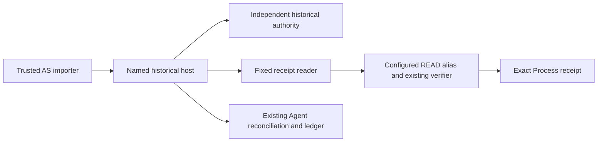
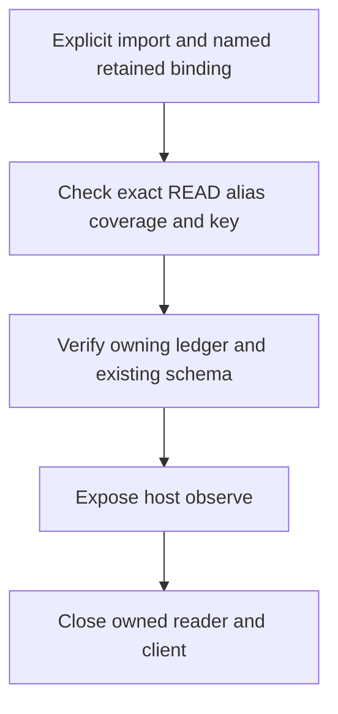
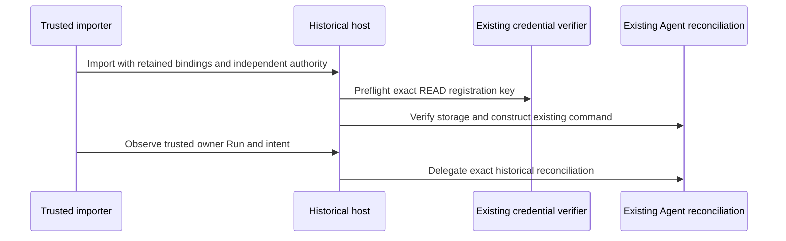

# T4-03 Agent Server 历史 START 对账宿主

| Field | Value |
| --- | --- |
| Document | docs/egon/spec/2026-11-06-06-06-historical-start-receipt-as-host.md |
| Template Version | 9 |
| Archetype Cleanup | Not applicable |
| Status | Review |
| Type | Feature |
| Complexity | Complex |
| Complexity Drivers | Retained dispatch identity, exact READ registration separation and explicit host lifecycle |
| Created | 2026-11-06 06:06 Asia/Shanghai |
| Updated | 2026-11-06 06:06 Asia/Shanghai |
| Owner | Tianji Agent Server |
| Repository | tianji-service |
| Scope | Explicit Java host for existing historical Tool START positive reconciliation |
| Change Surface | Three production Java paths, two finite-test paths and three review documents |
| Affected Chapters | §7, §8, §9, §10, §14, §15, §16 |
| Source Requirement | [Master §17.2 S11 and §19 T4-03](../../../../docs/plans/agent-framework-upgrade-plan.md) |
| Baseline Revision | 1d98cc93d68fbc736cf1d2ba5dc19aead0a6bf93 |
| Amends | None |
| Supersedes | None |
| Depends On | [Existing historical reconciliation](2026-11-06-05-28-tool-start-receipt-reconciliation.md#73-detailed-design) |
| Related Specs | None |
| Related Plans | [AS Host Plan](../plan/2026-11-06-06-07-historical-start-receipt-as-host.md) |

## 1. Summary

受信 Agent Server 宿主可显式装配历史 START 对账，提交原 owner、派发 Run 与 intent。宿主提供保留的固定 START 绑定、独立当前历史授权和 READ 注册。查询依然按原 SERVICE、原资源及原请求摘要校验。只有既有正向证据写入路径可追加收据。

## 2. Background and Current State

| Evidence ID | Exact source | Observed fact |
| --- | --- | --- |
| EVD-001 | TianjiAgentServerApplication, TianjiAgentStorageConfiguration and TianjiAgentCheckpointResumeConfiguration | Ordinary AS scans agent.server, owns its ledger and source, and supports a separate explicit Java import outside the scan. |
| EVD-002 | ToolStartReceiptReconciliationService and HistoricalToolReceiptAuthorization | Existing AR command verifies owned V13 history, takes independent current authority, and appends only positive evidence to the existing ledger. |
| EVD-003 | TianjiFixedBpmnStartReceiptReader and TianjiFixedBpmnStartToolBindings | The existing READ reader validates the exact owner and canonical original backend. The START registration ID contributes to the immutable backend digest. |
| EVD-004 | TianjiProcessToolCredentialVerifier and IdpServiceOAuth2Client#authorizationKey | Non-secret registration identity can be checked without token acquisition. Current credential validation binds tenant, issuer, SERVICE, app, audience and exact scope. |
| EVD-005 | TianjiGovernedProcessToolConfiguration | Live START bindings and transport are conditionally assembled for the current Tool profile. Historical work may need retained bindings after the live profile closes. |

### 2.4 Evidence and current-chain map

| Entry/trigger | Current chain | Gap | Decision |
| --- | --- | --- | --- |
| Historical Java observe | AR reconciliation consumes a verified Process READ adapter | No explicit AS-owned assembly | Add a named, explicitly imported host with the same ordinary ledger. |
| Retained fixed START target | Exact descriptor and backend digest include original registration | READ credentials need a separate registry key | Bind READ alias by original backend digest without rewriting it. |
| Operator-owned configuration | Independent current IAM and storage | A wrong READ registration should fail before work | Preflight trust and non-secret key with existing verifier before storage construction. |

### 2.5 Archetype example cleanup

Cleanup disposition: Not applicable

Reason: Existing production AS composition and finite test source. No archetype generation or example code.

## 3. Goals and Non-goals

Provide a callable internal Java host for already approved historical observation semantics. Explicit configuration retains the original route and separates READ registration. Production identities, grants, operator activation and actual S11 remain separate.

### 3.3 Change Surface and Design Depth

| Area/layer | Disposition | Exact repository evidence | Changed or preserved behavior/contract | Required Spec treatment | Chapter(s) |
| --- | --- | --- | --- | --- | --- |
| AS composition | Affected | EVD-001/005 | One named host outside ordinary component scan | Exact importer, supplied authority, storage and lifecycle | §7, §8, §9, §10, §14, §15, §16 |
| AS Process adapter | Affected | EVD-003/004 | Alternate READ registration without historical target change | Pinned coverage, disjointness and preflight | §7, §8, §9, §14 |
| AR and PS contracts | Context-only | EVD-002/003 | Reuse existing reconciliation and exact Process receipt | Scope and evidence | §11/16/18 |

## 4. Requirements and Acceptance Criteria

| ID | Requirement | Priority | Observable acceptance | Source |
| --- | --- | --- | --- | --- |
| REQ-001 | Keep the ordinary AS shell dormant | Must | A retained binding alone cannot register the host. An explicit import needs the exact named binding and existing qualified identity components. | EVD-001 |
| REQ-002 | Separate historical READ registrations | Must | Map covers exactly every retained backend digest and stays disjoint from all retained START registration IDs. Original backend, query digest and namespace stay exact. | EVD-003/005 |
| REQ-003 | Use independent current authority and exact SERVICE | Must | Explicit historical authority and OAuth client are passed into the existing guard. Startup checks trust and exact non-secret key with READ only and acquires no token. Request-time proof still verifies original actor. | EVD-002/004 |
| REQ-004 | Compose and close only owned host resources | Must | Match ordinary ledger and data source with storage enabled, use existing schema guards and bounded reader with no redirects, close reader and owned client, and refuse later calls. | EVD-001/002/003 |
| REQ-005 | Verify exact code and package scope | Must | Typed RED, finite tests and clean archive confirm host and original mode boundaries. All 28 SQL files match the locked baseline. | EVD-001–005 |

### 4.1 Scenario matrix

| Scenario | Invariant | Failure | Gate |
| --- | --- | --- | --- |
| Default app or unrelated binding | Host requires explicit selection | Default excludes it, explicit import fails without exact binding | TEST-001 |
| Missing, extra or live alias | Retained exact routing and independent credential key | Reject at composition before network or writes | TEST-002 |
| Wrong registered client or storage | Fail closed before host ready | Sanitized startup rejection | TEST-001/002 |
| Valid host and close | Existing command and scoped reader remain owners of operation | Closed host rejects; borrowed resources remain externally owned | TEST-003 |

### 4.2 Use-case analysis

| Actor ID | Actor | Context |
| --- | --- | --- |
| ACTOR-001 | Trusted AS extension | Explicitly imports the optional host and provides retained mapping and current authorities. |
| ACTOR-002 | Original executor SERVICE | Supplies current exact READ under an isolated authorization key through configured IAM. |
| ACTOR-003 | Source reviewer | Reproduces finite and packaged proof. |

| ID | Use case/goal | Actors | Trigger/preconditions | Main flow | Alternatives/failures | Postcondition | Requirements |
| --- | --- | --- | --- | --- | --- | --- | --- |
| UC-001 | Assemble explicit host | ACTOR-001/002 | Exact import, named retained binding and owning storage | Check alias, identity and schema; publish single host bean | Missing mapping, reused START registration or mismatched owner fails | Ready without acquiring token | REQ-001/002/003/004 |
| UC-002 | Observe and close | ACTOR-001/002 | Verified owner and exact retained Run/intent | Delegate existing reconciliation and enforce owned lifecycle | Inconclusive receipts remain unknown; closed host refuses | Existing positive append semantics | REQ-003/004 |
| UC-003 | Review exact source | ACTOR-003 | Locked baseline and offline reactor | Typed negative, finite and package verification | Unexpected assertion or scope mismatch fails | Evidence remains separate from runtime | REQ-005 |

## 5. Constraints, Assumptions, and Decisions

The trusted extension supplies retained fixed START bindings and a READ alias for each exact backend digest. A READ alias resolves to the same original tenant issuer, SERVICE client, app and Process resource; its exact READ grant and OAuth registration are externally provisioned. Use existing trusted issuer, authentication and principal conversion beans. The host requires existing ordinary Agent storage and a finite driver/pool configuration. The existing reconciliation service owns current authorization and positive write semantics.

## 6. Project Technology Context

Use JDK 25 HTTP, existing Spring Boot, Shoubing exact SERVICE proof, Process SDK and Agent JDBC ledger. Compose the existing command and adapter.

### 6.2 User-mandated Java rule compliance

```text
1 类名规范，必须以 java的pojo规范命名。以dao po bo vo dto query command event等结尾
2 每层之间必须被 springboot-validation 校验，复用对象使用分组校验；基于原生和自定义约束注解、@Valid、@Validated 及 ConstraintValidator 扩展实现。ValidationUtils 只承担通用手工校验，不承载全部业务校验；电话号码复用 libphonenumber。
3 Java POJO 默认使用 class，注解为 @Data @NoArgsConstructor @AllArgsConstructor @Accessors(chain = true)，按构造目标选择 @Builder 或 @SuperBuilder；父类状态参与相等性时使用 @EqualsAndHashCode(callSuper = true)。只有不可变 value object 可以使用 record，并豁免 class 的 Lombok 规范；普通实体不能因简单而使用 record。使用 MapStruct、MapStructPlus 和 egon-cola-component-common-core 的 BaseConverter（双向）或 BaseForwardConverter（不可逆投影）进行转换。
4业务类必须使用@Slf4j注解注入log对象。如果业务类被spring管理，必须指定名称，如果是单例的情况下，参考@Service("userService")。如果需要依赖注入，必须@RequiredArgsConstructor进行修饰，不要代码中写。且属性必须被@qualify修饰。
5 工具类只允许使用jdk原生、Apache Commons(commons-lang3、commons-collections4、commons-io、commons-text、commons-codec、commons-beanutils)、Guava。针对Tika按需引入。
6 JSON 使用 Spring Boot Jackson；持久化枚举值使用 @EnumValue，向前端输出的枚举值使用 @JsonValue，禁止 ordinal 作为业务编码。
7 springboot 多环境配置文件，必须保持配置一致，但值不一定一致。
9 复杂业务必须引入设计模式，不允许硬编码
10 日期相关的必须使用java.time下的实体类，不允许使用java.util下的
11 只允许现有三层结构或当前 egon-cola-archetypes 的 DDD 结构，三层结构保持现状。必须尽量复用 egon-cola-components；持久化模块必须使用 Egon COLA MP Starter，DDL 统一由 egon-mp-sdj-ext-starter 分布式管理。业务唯一键必须组合业务列与 deletedAt（数据库 deleted_at），并验证 NULL、租户及重复软删除语义。采用 CQE（Command Query Event）；Event 必须经 egon-cola-component-transactional-outbox-starter 或 MQ 中间件投递。
```

| Literal rule | Affected? | Repository evidence | Exact design decision | Files/types/interfaces | Validation/test evidence | Status/blocker |
| --- | --- | --- | --- | --- | --- | --- |
| Rule 1 | Yes | EVD-001–005 | Keep exact technical host and reader names and existing command input types. | §7–10/16 | TEST-001–003 | PASS |
| Rule 2 | Yes | EVD-001–005 | Validate retained key coverage, disjoint START identity and ordinary ledger/source. | §7–10/16 | TEST-001–003 | PASS |
| Rule 3 | Yes | EVD-001–005 | Use an immutable explicit binding and existing receipt value. | §7–10/16 | TEST-001–003 | PASS |
| Rule 4 | Yes | EVD-001–005 | Use one named technical bean outside default scan, qualified existing identity resources and redacted diagnostics. | §7–10/16 | TEST-001–003 | PASS |
| Rule 5 | Yes | EVD-001–005 | Use existing verifier, JDK HTTP and Spring. | §7–10/16 | TEST-001–003 | PASS |
| Rule 6 | Yes | EVD-001–005 | Reuse the existing Process receipt codec and persistence representation. | §7–10/16 | TEST-001–003 | PASS |
| Rule 7 | Yes | EVD-001–005 | Use exact Java import, keep production profiles and configuration unchanged. | §7–10/16 | TEST-001–003 | PASS |
| Rule 9 | Yes | EVD-001–005 | Use the Composition Root and lifecycle façade around the existing SDK Adapter. | §7–10/16 | TEST-001–003 | PASS |
| Rule 10 | Yes | EVD-001–005 | Use existing bounded elapsed windows and java.time.Duration for HTTP connect. | §7–10/16 | TEST-001–003 | PASS |
| Rule 11 | Yes | EVD-001–005 | Keep AS host and AR ledger ownership, with existing command behavior and no DDL. | §7–10/16 | TEST-001–003 | PASS |

### 6.3 Time semantics and conversion contract

Time contract: Required

| Time ID | Fields/symbols | Semantics | Java/runtime type | Storage policy | Wire policy | Business zone source | Display zone source | Boundary / DST rules | Precision / Clock | Compatibility | Verification |
| --- | --- | --- | --- | --- | --- | --- | --- | --- | --- | --- | --- |
| TIME-001 | Host HTTP connect and existing reader budget | Duration | java.time.Duration and monotonic elapsed nanos | Not persisted | Internal | Not applicable: elapsed duration | Not applicable: no display | Three-second connect bound and existing reader caps apply independently of wall clock or DST | JDK elapsed clock and current receipt deadlines | Original AR time checks and persisted clocks retained | Step 1 TEST-002/003 |

## 7. Architecture Design

### 7.0 Minimum-design baseline and element-necessity audit

| Proposed element | Change | Requirements | Existing/direct alternative | Concrete inadequacy | Added cost and failure | Verdict |
| --- | --- | --- | --- | --- | --- | --- |
| Explicit AS host | Add | REQ-001/003/004 | Construct service and adapter externally | Callers must recreate matching lifecycle and configuration | One named Java bean with two owned resources | Use |
| READ alias map and key preflight | Add | REQ-002/003 | Change historical backend or use current START registration | Historical digest changes or credential keys overlap | One immutable map and in-process validation | Use |
| Existing authority, reader and receipt append | Reuse | REQ-003/004 | New routes and storage | New surface and persistence are unnecessary | Existing explicit dependencies | Use |

| Path | Network calls | Client states | Persisted evidence | Failure boundary |
| --- | --- | --- | --- | --- |
| Explicit host composition | No token or HTTP request, existing local DB schema verifier | Ready or refused | None | Exact alias, trust and ledger |
| Historical observe | Existing one bounded Process GET | Positive or inconclusive | Existing V2/V5 append | Existing independent current authority and original SERVICE |
| Close | Stops owned reader work and HTTP client | Closed | None | Refuse later host admissions |

### 7.1 System Architecture Design



### 7.2 High-Level Design



#### 7.2.2 High-level decision and quality matrix

| Concern/use case | Constraint | Selected design | Verification |
| --- | --- | --- | --- |
| Retained exact routing | Credential alias must not change immutable dispatch identity | Resolve original backend, select separately pinned alias by backend SHA | TEST-002 |
| Security | Read only for original executor and independent current authority | Existing verifier rechecks runtime bearer and exact target after non-secret startup check | TEST-002/003 |
| Lifecycle | Storage and IAM belong to caller infrastructure | Own only bounded reader and no-redirect HTTP client | TEST-001/003 |

### 7.3 Detailed Design



The composition class sits in agent.recovery outside the actual application scanner. The named binding contains the retained fixed START bindings, alias map, independent historical authority and explicitly supplied configured OAuth client. Match the ordinary Agent ledger to the exact source and require enabled storage. Build one dedicated no-redirect HTTP client and the existing bounded reader with two workers. Confirm alias key set equals the retained backend digests; values stay disjoint from every retained START registration. The credential verifier checks current tenant trust and exact authorization key without token acquisition, then the existing reconciliation service verifies its storage before host publication.

The reader uses the alias only in the verified READ target. Its original fixed backend, namespace and Process request SHA derive through the existing canonical path. Each call keeps original executor equality and existing before/after trust and proof checks. The compatibility reader constructor continues its established programmatic contract; the named host always selects the alias constructor. Close rejects new host admissions, stops owned reader/HTTP resources and leaves the borrowed ledger, identity components and OAuth client with their original owner.

#### 7.3.6 Conclusion evidence chain

| Conclusion | Evidence | Verification | Boundary |
| --- | --- | --- | --- |
| Explicit import composes retained exact READ without enabling live START | Existing AS scan and exact alias preflight | TEST-001/002 | Real IAM setup remains externally owned. |
| Existing positive append is available to authorized Java host callers | Exact ordinary source and existing service/reader composition | TEST-003 | No exposed HTTP endpoint. |

## 8. Package Structure and Code File Tree

- `stellar-enclosure-tianji-agent-server/src/test/java/top/egon/cola/platform/tianji/agent/server/integration/process/TianjiFixedBpmnStartReceiptReaderTest.java` — TianjiFixedBpmnStartReceiptReaderTest.
- `stellar-enclosure-tianji-agent-server/src/test/java/top/egon/cola/platform/tianji/agent/recovery/TianjiHistoricalStartReceiptConfigurationTest.java` — TianjiHistoricalStartReceiptConfigurationTest.
- `stellar-enclosure-tianji-agent-server/src/main/java/top/egon/cola/platform/tianji/agent/server/integration/process/TianjiProcessToolCredentialVerifier.java` — TianjiProcessToolCredentialVerifier#requireConfigured.
- `stellar-enclosure-tianji-agent-server/src/main/java/top/egon/cola/platform/tianji/agent/server/integration/process/TianjiFixedBpmnStartReceiptReader.java` — TianjiFixedBpmnStartReceiptReader.
- `stellar-enclosure-tianji-agent-server/src/main/java/top/egon/cola/platform/tianji/agent/recovery/TianjiHistoricalStartReceiptConfiguration.java` — TianjiHistoricalStartReceiptConfiguration and HistoricalStartReceiptHost.

## 9. Interface Definitions

### 9.1 Interface Inventory

| ID | Style | Owner | Contract |
| --- | --- | --- | --- |
| INTERNAL-001 | Java command | Explicit AS historical host | HistoricalStartReceiptHost#observe |
| INTERNAL-002 | Java binding | Trusted AS extension | HistoricalStartReceiptBinding and explicit import |

### 9.2 Per-interface Detailed Contracts

#### 9.2.1 INTERNAL-001 Historical observation

##### Necessity and interaction-cost decision

| Concern | Decision |
| --- | --- |
| Change classification | Add an internal host method delegating the existing command. |
| Independent consumer goal | Observe one exact prior START with current authority. |
| Parameter ownership and derivation | Trusted original owner plus known Run and intent. |
| Direct/no-new-interface alternative | Direct command construction would repeat AS resource composition. |
| Caller use of result | Consume exact positive receipt with existing semantics. |
| Round trips and failure points | Existing one exact Process GET and owned ledger guards. |
| Verdict | Use one internal method. |

##### Identity and purpose

Verified original owner of the exact historical Tool START.

##### Request parameters

TrustedAgentActor owner, String dispatchRunId and UUID intentId. No URL or credential caller parameters.

##### Success response

Existing ReceiptVO with immutable exact recorded observation.

##### Error responses

Existing unknown, denied or unavailable errors apply. Closed host produces typed dependency unavailable.

##### Interface logic for frontend and consumers

Trusted Java extensions only. No frontend or HTTP consumer.

##### Compatibility and verification

Retain current AR receipt semantics and verify bounded host routing and close through TEST-003.

#### 9.2.2 INTERNAL-002 Explicit import binding

##### Necessity and interaction-cost decision

| Concern | Decision |
| --- | --- |
| Change classification | Add one explicitly qualified Java assembly binding. |
| Independent consumer goal | Enable scoped historical host only by trusted import. |
| Parameter ownership and derivation | Retained bindings, alias and authorities supplied by trusted application. |
| Direct/no-new-interface alternative | Current live Tool beans do not own retained profiles. |
| Caller use of result | Publish only one lifecycle-owning AS host. |
| Round trips and failure points | In-process key check and existing database schema verifier. |
| Verdict | Use one explicit binding. |

##### Identity and purpose

Trusted AS composition root with externally provisioned current authority.

##### Request parameters

Retained START bindings, exact backend-digest READ registration map, independent HistoricalToolReceiptAuthorization and configured IdpServiceOAuth2Client.

##### Success response

One named HistoricalStartReceiptHost available after identity and storage preflight.

##### Error responses

Missing or invalid qualified binding, changed registered actor or invalid storage fails at startup without exposing registration or private DB details.

##### Interface logic for frontend and consumers

Import from a trusted application configuration using Spring Java configuration.

##### Compatibility and verification

Existing direct reader constructor and existing live START wiring remain source-compatible. TEST-001/002.

## 10. POJO and Data Model Design

The immutable HistoricalStartReceiptBinding holds retained routing and externally owned authorities. Reuse original trusted actor, command inputs and ReceiptVO. No new serialization contract.

## 11. Database Design

Use the existing owning Agent ledger and source, existing AgentStorageVerifier and ToolExecutionStorageVerifier and existing V2/V5 operation. Schema, migrations and permissions stay unchanged.

## 12. Frontend Page Design

Internal Java host only.

## 13. Design Patterns and Architecture Principles

Use an explicit Composition Root and lifecycle façade. Reuse the existing Process SDK Adapter and command service.

## 14. Test Design

| Test | Objective | Method | Gate |
| --- | --- | --- | --- |
| TEST-001 | Verify dormant default and exact import/storage checks | Finite actual shell and narrow non-web context with mocks | G1/P1 |
| TEST-002 | Verify independent READ registration and retained routing | Typed negative for reused START alias, finite preflight and exact SDK fixture | R1/G1/P1 |
| TEST-003 | Verify exact Java call and owned shutdown | Controlled dependencies and archive proof | G1/P1/S1 |

## 15. Non-functional and Cross-cutting Design

Use existing deadline and bounded reader admission. Alias keys are non-secret and diagnostic representations are redacted. Preserve borrowed resources. External issuer and credential authorities stay responsible for currently granted READ and historical authorization.

## 16. Compatibility, Migration, Rollout, and Rollback

Trusted host uses explicit import only. Existing production package configuration and permissions stay byte-equivalent. Existing command and live START behavior stay compatible. Revert the scoped source commit for rollback.

## 17. Alternatives and Decisions

Default scanning would introduce silent startup ownership. Existing current governed Tool bindings depend on live START assembly, so retained bindings are provided independently. Preserve the original backend digest and separate READ registration at credential resolution.

## 18. Risks and Open Questions

Actual independently provisioned READ and historical authorization, PostgreSQL and S11 remain operator acceptance. Source preflight proves configured identity key shape and local trust; it cannot certify remote grants without runtime.

## 19. Traceability Matrix

| Requirement | Use case | Design | Tests |
| --- | --- | --- | --- |
| REQ-001 | UC-001 | §5/7/9 | TEST-001 |
| REQ-002 | UC-001 | §7/9 | TEST-002 |
| REQ-003 | UC-001/UC-002 | §7/9 | TEST-002/003 |
| REQ-004 | UC-001/UC-002 | §7/9/11 | TEST-001/003 |
| REQ-005 | UC-003 | §14/16 | TEST-001/002/003 |

## 20. Review and Acceptance

### 20.5 Blocking Manual Check

| Check ID | Applicability | Status | Evidence | Finding | Required action/exception |
| --- | --- | --- | --- | --- | --- |
| MC-ARCH-001 | Applicable | PASS | §7/8 | AS owns explicit composition and AR owns historical storage. | None |
| MC-REUSE-001 | Applicable | PASS | EVD-001–005 | Reuse exact verifier, original bindings, reader and AR command. | None |
| MC-DEP-001 | Applicable | PASS | §6/16 | Existing JDK, Spring, JDBC and test dependencies. | None |
| MC-NAME-001 | Applicable | PASS | §8/10 | Use existing technical reader, host and binding naming. | None |
| MC-VALID-001 | Applicable | PASS | §5/7/14 | Exact retained mapping, credential key and owning storage guards. | None |
| MC-MODEL-001 | Applicable | PASS | §10 | Immutable Java binding and existing receipt. | None |
| MC-CONVERT-001 | Not applicable | N/A | §10 | No DTO converter or new representation. | None |
| MC-LOG-001 | Applicable | PASS | §15 | Redact retained metadata and sanitize startup failures. | None |
| MC-BEAN-001 | Applicable | PASS | §5/7 | One named bean through explicit import outside ordinary AS scan. | None |
| MC-UTIL-001 | Applicable | PASS | §6/7 | Existing verifier, hashing and JDK HTTP. | None |
| MC-JSON-001 | Not applicable | N/A | §9/10 | Existing Process SDK contract remains unchanged. | None |
| MC-TIME-001 | Applicable | PASS | §6.3/15 | Existing bounded request window and explicit HTTP connect bound. | None |
| MC-CONFIG-001 | Applicable | PASS | §5/16 | Explicit Java import and unchanged production configuration. | None |
| MC-PATTERN-001 | Applicable | PASS | §13 | Composition Root and lifecycle façade reuse SDK Adapter. | None |
| MC-SCOPE-001 | Applicable | PASS | §8/16 | Five Java paths, three review documents and 28 immutable SQL files. | None |
| MC-TEST-001 | Applicable | PASS | §14 | Typed negative, 96 finite tests and real packaged scope. | None |
| MC-BLOCKER-001 | Applicable | PASS | §18 | Actual grants, authoritative implementation and S11 remain operator work. | None |

### 20.6 Final verdict

PASS — Ready for user review
