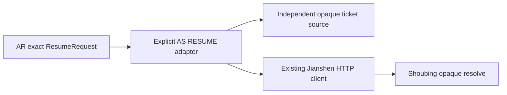
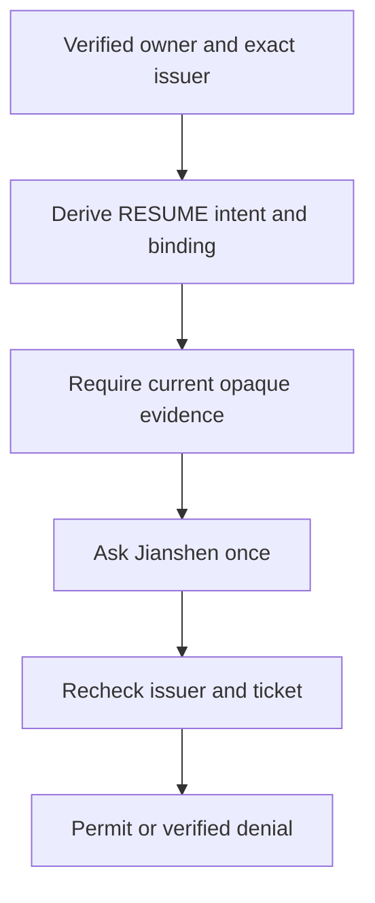
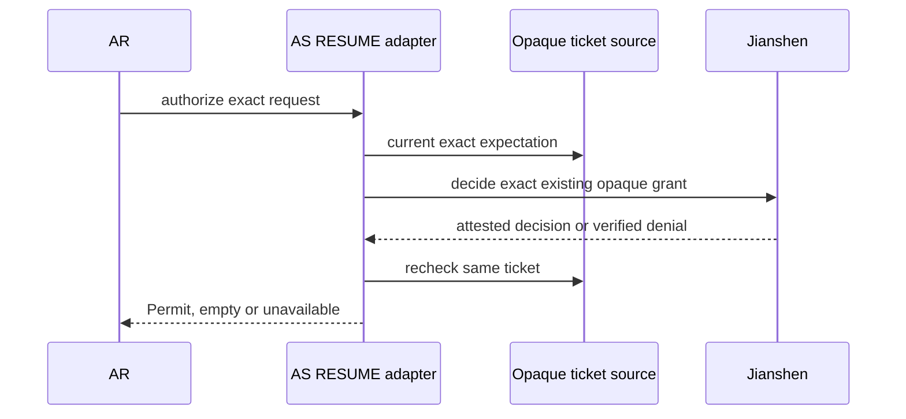

# T4-03 checkpoint 当前 RESUME 授权适配器

| Field | Value |
| --- | --- |
| Document | docs/egon/spec/2026-11-06-06-11-checkpoint-resume-grant-authority.md |
| Template Version | 9 |
| Archetype Cleanup | Not applicable |
| Status | Review |
| Type | Feature |
| Complexity | Complex |
| Complexity Drivers | Exact opaque purpose separation, fresh issuer trust, strict remote decision, deterministic command identity and bounded failure |
| Created | 2026-11-06 06:11 Asia/Shanghai |
| Updated | 2026-11-06 06:11 Asia/Shanghai |
| Owner | Tianji Agent Server |
| Repository | tianji-service |
| Scope | Explicit standalone Java adapter consuming separately issued RESUME evidence |
| Change Surface | One production class, one finite test and three review artifacts |
| Affected Chapters | §7, §8, §9, §10, §14, §15, §16 |
| Source Requirement | [主计划 §10.2、§17.2 S11、§19 T4-03](../../../../docs/plans/agent-framework-upgrade-plan.md) |
| Baseline Revision | 3bab28b884d62f830b3ef32faaa7b24967774692 |
| Amends | None |
| Supersedes | None |
| Depends On | [Explicit AS checkpoint host](2026-11-06-05-06-agent-checkpoint-as-resume-host.md#73-detailed-design) |
| Related Specs | None |
| Related Plans | [Current RESUME adapter Plan](../plan/2026-11-06-06-12-checkpoint-resume-grant-authority.md) |

## 1. Summary

Add an explicitly composed AS implementation of the existing checkpoint ResumeAuthorization port. The adapter uses a separately supplied opaque RESUME ticket and asks the existing Jianshen client for an exact current decision on each call. Ticket issuance and live policy remain independent.

## 2. Background and Current State

| Evidence ID | Exact path or symbol | Current fact |
| --- | --- | --- |
| EVD-001 | AgentCheckpointTakeoverService.ResumeRequest#bindingSha256 and #authorize | Existing resume needs the exact owner, checkpoint cut, command and revision. The winning lease reuses the same authority before model boundaries. |
| EVD-002 | TianjiAgentCheckpointResumeConfiguration.ResumeBinding and ResumeHost | The explicit host accepts a separate ResumeAuthorization and uses the existing ordinary authorizer for MODEL. |
| EVD-003 | HttpExecutionAuthorizationClient#decide/#requireDecision and TrustedIssuerRegistry#findByIssuer | Existing transport enforces issuer, USER subject, resource, purpose, intent UUID, binding, session, expiry and decision ID. The registry exposes active exact issuer snapshots. |
| EVD-004 | OAuthExecutionGrantService#issue/#resolve and OpaqueExecutionGrantCodec#grantId | Shoubing supports an explicit configured purpose and current scope proof. The USER grant ID does not incorporate subject or binding digest. |
| EVD-005 | ExecutionGrantAuthorizationService#requirePolicy and TianjiExecutionGrantAuthorizer#evaluateRun | Jianshen resolves a protected active USER POST per independent purpose policy. Existing Tianji ordinary grants bind the ordinary execution purpose and ledger. |

### 2.4 Evidence and current-chain map

| Entry/trigger | Existing chain | Required decision |
| --- | --- | --- |
| Checkpoint takeover | AR reads exact cut and invokes an injected ResumeAuthorization outside JDBC. | Resolve exact separately issued RESUME ticket and ask real Jianshen. |
| First and later model boundaries | AR checks the same resume authority and then ordinary MODEL. | Recheck current RESUME each time and preserve existing winning lease. |
| Production policy | Jianshen requires an active protected USER POST with exact current policy. | Keep operator review, issuance, resource and live roles separate from the adapter. |

### 2.5 Archetype example cleanup

Cleanup disposition: Not applicable

Reason: The change adds one explicit adapter to the established Agent Server. No generated module or sample domain is involved.

## 3. Goals and Non-goals

Provide real current decision evaluation for the existing resume port. The host supplies independently acquired opaque evidence and existing clients. Issuance and true operator provisioning need independent confirmation and evidence.

### 3.3 Change Surface and Design Depth

| Area/layer | Disposition | Exact repository evidence | Changed or preserved behavior/contract | Required Spec treatment | Chapter(s) |
| --- | --- | --- | --- | --- | --- |
| AS security adapter | Affected | EVD-001–005 | Explicit bounded decision with exact opaque binding | Detailed internal contract and error behavior | §7, §8, §9, §10, §14, §15, §16 |
| Checkpoint lifecycle | Context-only | EVD-001/002 | Existing claim, permit, winning lease and MODEL authority | Call relation | §7 |
| Runtime catalog, data, frontend | Unchanged | EVD-003–005 | Existing resources, YAML, permissions and SQL | Separate operator condition | §16 |

## 4. Requirements and Acceptance Criteria

| ID | Requirement | Acceptance criterion |
| --- | --- | --- |
| REQ-001 | Derive one exact current RESUME binding | SHA-256 domain-separated canonical v8 intent is stable and changes when owner, command, expected revision, checkpoint, resource or deadline changes. |
| REQ-002 | Use the existing current decision transport | Only active verified tenant USER with exact opaque RESUME evidence reaches Jianshen and only exact current decision yields existing ResumePermit. |
| REQ-003 | Preserve distinct refusal and unavailable | An explicit denied Jianshen response with unchanged trust and ticket is empty. Stale, mismatched, removed, expired or unavailable evidence fails closed. |
| REQ-004 | Bound network work and lifecycle | Dedicated zero-queue executor stops under timeout, saturation, interruption, closure and ambient transaction. Ticket lookup and decision are inside one bounded wait. |
| REQ-005 | Prove scoped source and artifacts | Typed R1, finite G1, actual clean package parity, strict docs and 28 identical SQL files. |

### 4.1 Scenario matrix

| Scenario | Observable result |
| --- | --- |
| Fresh exact RESUME | Same request and bounded permit expiry after two exact local binding observations. |
| Ordinary or cross-cut ticket | Refused before actual client call. |
| Authority denial after local drift | Unavailable, with provider details redacted. |
| Host close or saturated dependency | No permit, queue growth or inherited USER bearer. |

### 4.2 Use-case analysis

| Actor ID | Actor and authority |
| --- | --- |
| ACTOR-001 | Trusted AS host supplying a separately issued opaque ticket and exact issuer clients. |
| ACTOR-002 | Existing Jianshen execution authority and Shoubing verifier. |

| ID | Use case/goal | Actor | Trigger | Result |
| --- | --- | --- | --- | --- |
| UC-001 | Check the current right to continue one exact cut | ACTOR-001 | AR supplies ResumeRequest | Exact current permit, verified deny or unavailable. |
| UC-002 | Prove source scope and dependency boundaries | ACTOR-001 | Offline validation | Scoped source and artifact proof. |

## 5. Constraints, Assumptions, and Decisions

The trusted host owns construction and closure, finite current ticket lookup, the independent grant source, exact issuer registration and source-resource audience. Existing Shoubing and Jianshen service transport scopes are usable by independently provisioned clients. Normal START tickets, V6 storage and current bearer ownership are not sources for this adapter. Live RESUME requires a separately reviewed Jianshen resource and policy plus Shoubing binding, scope and operator acceptance.

## 6. Project Technology Context

JDK 25, AS and AR existing modules, real HttpExecutionAuthorizationClient, TrustedIssuerRegistry, Spring transaction inspection and existing tracing.

### 6.2 User-mandated Java rule compliance

```text
1 类名规范，必须以 java的pojo规范命名。以dao po bo vo dto query command event等结尾
2 每层之间必须被 springboot-validation 校验，复用对象使用分组校验；基于原生和自定义约束注解、@Valid、@Validated 及 ConstraintValidator 扩展实现。ValidationUtils 只承担通用手工校验，不承载全部业务校验；电话号码复用 libphonenumber。
3 Java POJO 默认使用 class，注解为 @Data @NoArgsConstructor @AllArgsConstructor @Accessors(chain = true)，按构造目标选择 @Builder 或 @SuperBuilder；父类状态参与相等性时使用 @EqualsAndHashCode(callSuper = true)。只有不可变 value object 可以使用 record，并豁免 class 的 Lombok 规范；普通实体不能因简单而使用 record。使用 MapStruct、MapStructPlus 和 egon-cola-component-common-core 的 BaseConverter（双向）或 BaseForwardConverter（不可逆投影）进行转换。
4业务类必须使用@Slf4j注解注入log对象。如果业务类被spring管理，必须指定名称，如果是单例的情况下，参考@Service("userService")。如果需要依赖注入，必须@RequiredArgsConstructor进行修饰，不要代码中写。且属性必须被@qualify修饰。
5 工具类只允许使用jdk原生、Apache Commons(commons-lang3、commons-collections4、commons-io、commons-text、commons-codec、commons-beanutils)、Guava。针对Tika按需引入。
6 JSON 使用 Spring Boot Jackson；持久化枚举值使用 @EnumValue，向前端输出的枚举值使用 @JsonValue，禁止 ordinal 作为业务编码。
7 springboot 多环境配置文件，必须保持配置一致，但值不一定一致。
9 复杂业务必须引入设计模式，不允许硬编码
10 日期相关的必须使用java.time下的实体类，不允许使用java.util下的
11 只允许现有三层结构或当前 egon-cola-archetypes 的 DDD 结构，三层结构保持现状。必须尽量复用 egon-cola-components；持久化模块必须使用 Egon COLA MP Starter，DDL 统一由 egon-mp-sdj-ext-starter 分布式管理。业务唯一键必须组合业务列与 deletedAt（数据库 deleted_at），并验证 NULL、租户及重复软删除语义。采用 CQE（Command Query Event）；Event 必须经 egon-cola-component-transactional-outbox-starter 或 MQ 中间件投递。
```

| Literal rule | Affected? | Repository evidence | Exact design decision | Files/types/interfaces | Validation/test evidence | Status/blocker |
| --- | --- | --- | --- | --- | --- | --- |
| Rule 1 | Yes | EVD-001–005 | Names identify the technical authorizer and immutable ticket binding. | §7–10 | TEST-001–005 | PASS |
| Rule 2 | Yes | EVD-001–005 | Exact owner, trusted tenant issuer, request, resource and ticket validation precede Jianshen. | §7–10 | TEST-001–005 | PASS |
| Rule 3 | Yes | EVD-001–005 | Use immutable binding and permit records with existing sealed ticket. | §7–10 | TEST-001–005 | PASS |
| Rule 4 | No | EVD-001–005 | Explicit constructed technical adapter has no component or business logger. | §7–10 | TEST-001–005 | N/A |
| Rule 5 | Yes | EVD-001–005 | Reuse JDK scheduling and hashing, and existing Jianshen and trust clients. | §7–10 | TEST-001–005 | PASS |
| Rule 6 | No | EVD-001–005 | No persisted/wire enum or JSON change. | §7–10 | TEST-001–005 | N/A |
| Rule 7 | No | EVD-001–005 | No property, YAML or auto-import changes. | §7–10 | TEST-001–005 | N/A |
| Rule 9 | Yes | EVD-001–005 | Adapter uses the existing resume authorization port and bounded worker pattern. | §7–10 | TEST-001–005 | PASS |
| Rule 10 | Yes | EVD-001–005 | Clock-backed current expiry and bounded elapsed wait use Java time. | §7–10 | TEST-001–005 | PASS |
| Rule 11 | Yes | EVD-001–005 | AS owns host identity adapter and AR retains command/lease ownership. | §7–10 | TEST-001–005 | PASS |

### 6.3 Time semantics and conversion contract

Time contract: Required

| Time ID | Fields/symbols | Semantics | Java/runtime type | Storage policy | Wire policy | Business zone source | Display zone source | Boundary / DST rules | Precision / Clock | Compatibility | Verification |
| --- | --- | --- | --- | --- | --- | --- | --- | --- | --- | --- | --- |
| TIME-001 | ResumeRequest.execution.deadlineAt, AgentExecutionGrant.Ticket.expiresAt, Decision.expiresAt, ResumePermit.expiresAt | Occurred instant | java.time.Instant | Not persisted | Internal | Not applicable: absolute instant | Not applicable: internal authority | Both the supplied ticket and returned decision must be strictly current. Decision never exceeds ticket expiry or existing Run deadline. | Clock.systemUTC and actual Instant precision | Existing AR still owns its fixed winning lease and Jianshen retains its existing wire fields. | Step 1 TEST-003 and TEST-004 |
| TIME-002 | Authorizer timeout and Future.get | Duration | java.time.Duration and nanos | Not persisted | Internal | Not applicable: elapsed | Not applicable: internal authority | Bound to min of 100ms–30s configured timeout and remaining Run deadline. Interruption cancels and restores caller flag. | Future elapsed nanos, Clock for remaining absolute time | Existing caller thread lifetime and model fence remain authoritative. | Step 1 TEST-004 |

## 7. Architecture Design

### 7.0 Minimum-design baseline and element-necessity audit

| Proposed element | Change | Requirements | Existing alternative and gap |
| --- | --- | --- | --- |
| Current ResumeAuthorization adapter | Add | REQ-001–004 | Ordinary current execution reads a different purpose and store. |
| Bound opaque evidence source | Add internal Java port | REQ-001–003 | Current host owns actual grant provider and requires command/cut context. |
| Dedicated zero-queue executor | Add local ownership | REQ-004 | Caller work and connection timeouts alone cannot bound all ticket-source work. |

| Path | Network calls | Client states | Decision |
| --- | --- | --- | --- |
| Exact current resume check | One existing Jianshen decision per authorization call | Opaque bound ticket and current issuer snapshots | No fallback or retry inside one call. |

### 7.1 System Architecture Design



### 7.2 High-Level Design



#### 7.2.2 High-level decision and quality matrix

| Concern/use case | Decision | Evidence |
| --- | --- | --- |
| Identity and command | Use full V1 binding and canonical version 8 UUID | TEST-001 |
| Trust drift | Compare exact active snapshot before and after call | TEST-003 |
| Capacity and timeout | Dedicated zero-queue virtual-worker pool and bounded Future | TEST-004 |

### 7.3 Detailed Design

The adapter exposes `expectation(ResumeRequest, URI issuer, URI resource)` for both decision and a later issuer. It uses `ResumeRequest.bindingSha256(resource)` as the full input and `OrchestrationRequestDigests.hash(List.of("TIANJI_AGENT_RUN_RESUME_INTENT_V1", binding), Map.of())`. The first 128 digest bits receive UUID version 8 and RFC variant bits. Shoubing receives the canonical UUID in the existing intent field. The local ticket binding is independently exact before sending an opaque ticket and the existing client validates the remote answer. After the call, lookup of the same ticket and exact active issuer snapshot must still succeed. Return a permit bounded by current Jianshen decision and the issued ticket. Nothing stores the current decision in the adapter.



#### 7.3.6 Conclusion evidence chain

| Conclusion | Evidence | Gate |
| --- | --- | --- |
| Ordinary or cross-cut grant cannot inherit resume authorization | Exact local binding and strict client purpose | R1/G1 |
| Result remains current when returned | Active issuer equality, exact ticket and upper expiry check | G1 |

## 8. Package Structure and Code File Tree

| Path | Operation | Responsibility |
| --- | --- | --- |
| `stellar-enclosure-tianji-agent-server/src/test/java/top/egon/cola/platform/tianji/agent/server/security/TianjiCheckpointResumeGrantAuthorizerTest.java` | Create | Finite exact binding, rejection and bounded current decision |
| `stellar-enclosure-tianji-agent-server/src/main/java/top/egon/cola/platform/tianji/agent/server/security/TianjiCheckpointResumeGrantAuthorizer.java` | Create | Explicit current RESUME adapter |
| `docs/egon/spec/2026-11-06-06-11-checkpoint-resume-grant-authority.md` | Create | Lock current authority and identity semantics |
| `docs/egon/plan/2026-11-06-06-12-checkpoint-resume-grant-authority.md` | Create | Pin exact baseline and validation |
| `docs/egon/evidence/2026-11-06-checkpoint-resume-grant-authority.md` | Create | Record observed results and open runtime gate |

## 9. Interface Definitions

### 9.1 Interface Inventory

| Interface | Protocol | Owner | Purpose |
| --- | --- | --- | --- |
| INTERNAL-001 | Internal Java | Explicit AS host | Current RESUME decision and exact opaque ticket lookup. |

### 9.2 Per-interface Detailed Contracts

#### 9.2.1 INTERNAL-001 — Current RESUME authorization

##### Necessity and interaction-cost decision

| Concern | Decision |
| --- | --- |
| Change classification | Explicit internal adapter, no new transport API. |
| Independent consumer goal | Existing checkpoint port can verify real current Jianshen evidence. |
| Parameter ownership and derivation | AR supplies verified owner and cut. Host supplies trusted issuer clients and opaque evidence by the exact derived expectation. |
| Direct/no-new-interface alternative | Ordinary current authorizer binds the ordinary purpose and ledger. |
| Caller use of result | Existing ResumePermit or empty for verified refusal. |
| Round trips and failure points | One existing Jianshen decision, before/after ticket and issuer checks. |
| Verdict | Reuse strict client and existing AR port. |

##### Identity and purpose

Only an active verified USER in the exact tenant issuer realm is eligible. RESUME purpose is fixed and uses the full checkpoint command binding. Trusted host supplies exact service credentials to the existing transport separately.

##### Request parameters

Internal constructor supplies resource, system code, trust registry, explicit exact issuer map, ResumeTicketSource, timeout and concurrency. ResumeTicketSource.current receives the immutable Expectation. BoundResumeTicket retains that binding and the existing AgentExecutionGrant.Ticket.

##### Success response

Return ResumePermit for the exact ResumeRequest and expiry from the validated decision within its original opaque ticket.

##### Error responses

A verified denial is empty only while trust and ticket match. Saturation, timeout, interruption, inactive issuer, stale or wrong binding and provider failures raise a sanitized unavailable error.

##### Interface logic for frontend and consumers

Only the trusted Java host imports the adapter. Existing AR obtains the permit. Issuance remains a separate synchronous authority boundary.

##### Compatibility and verification

TEST-001–005 verify exact identity and finite worker behavior. Existing client route, wire contract, role and resource delivery remain independent.

## 10. POJO and Data Model Design

Existing ResumeRequest, Expectation, AgentExecutionGrant.Ticket and ResumePermit retain their types. The immutable technical BoundResumeTicket adds exact local binding metadata and redacts string representation.

## 11. Database Design

This source adapter uses no database statements and adds no migration or data contract. Issued opaque ticket ownership is supplied by the host.

## 12. Frontend Page Design

No frontend interaction. Existing trusted checkpoint lifecycle remains the consumer.

## 13. Design Patterns and Architecture Principles

Use an Adapter for the existing ResumeAuthorization port and the current authoritative decision client. A dedicated bounded executor isolates the remote work. Exact request and ticket binding prevent reuse across purposes, commands and cuts.

## 14. Test Design

| Test ID | Coverage | Gate |
| --- | --- | --- |
| TEST-001 | Exact remote request, golden v8 identity and separation by actor, command, cut, revision, resource and deadline | G1 |
| TEST-002 | Other-cut opaque ticket rejected before Jianshen, and ordinary metadata cannot enter | R1/G1 |
| TEST-003 | Exact denial, trust/ticket drift, bound expiry and no permit beyond envelope | G1 |
| TEST-004 | No permit for ambient synchronization, closed worker, deadline, saturation or timeout | G1 |
| TEST-005 | Actual package scope and exact five paths, no PG or runtime report | P1/S1 |

## 15. Non-functional and Cross-cutting Design

Bound configured concurrency to one through eight. Reject on capacity and wait for at most the smaller of the configured timeout and remaining Run deadline. Capture existing trace context without inheriting caller thread locals. Do not emit opaque ticket or provider errors as diagnostic data.

## 16. Compatibility, Migration, Rollout, and Rollback

The adapter requires explicit host construction, independent owner issue and current IAM policy. Existing executable YAML, semantic PaC and 28 historical SQL files are checked against baseline. No default import or activation is part of this Step. Roll back the focused source commit if unused.

## 17. Alternatives and Decisions

Ordinary grants remain the current MODEL proof. A deterministic owner-bound intent separates each RESUME operation before issue. Generic trust in a caller-made allow result would omit the independent current Jianshen decision.

## 18. Risks and Open Questions

Live production still requires review of the independent protected RESUME resource and matching Jianshen policy, exact Shoubing purpose and user authorization, synchronous ticket issuance and the operator S11 run.

## 19. Traceability Matrix

| Requirement | Use case | Implementation | Test |
| --- | --- | --- | --- |
| REQ-001 | UC-001 | expectation and local exact binding | TEST-001 |
| REQ-002 | UC-001 | decide and exact issuer | TEST-001/002 |
| REQ-003 | UC-001 | requireCurrent and expiry | TEST-003 |
| REQ-004 | UC-001 | bounded work and close | TEST-004 |
| REQ-005 | UC-002 | focused files and package parity | TEST-005 |

## 20. Review and Acceptance

### 20.5 Blocking Manual Check

| Check ID | Applicability | Status | Evidence | Finding | Required action/exception |
| --- | --- | --- | --- | --- | --- |
| MC-ARCH-001 | Applicable | PASS | §7/8/14 | AS technical adapter implements existing AR ResumeAuthorization. | None |
| MC-REUSE-001 | Applicable | PASS | §7/8/14 | Existing verified issuer registry, strict HttpExecutionAuthorizationClient, opaque ticket and fingerprint. | None |
| MC-DEP-001 | Applicable | PASS | §7/8/14 | Existing HTTP and JDK dependencies only. | None |
| MC-NAME-001 | Applicable | PASS | §7/8/14 | Current grant authorizer, ticket source and bound value names match responsibility. | None |
| MC-VALID-001 | Applicable | PASS | §7/8/14 | Verified USER, tenant realm, exact RESUME binding, timeout, expiry and freshness rechecked. | None |
| MC-MODEL-001 | Applicable | PASS | §7/8/14 | Immutable expectation and bound ticket are reused or wrapped narrowly. | None |
| MC-CONVERT-001 | Not applicable | N/A | §7/8/14 | No business DTO mapper or new serialization boundary. | None |
| MC-LOG-001 | Applicable | PASS | §7/8/14 | Opaque ticket record redacts values and public failures carry no private cause. | None |
| MC-BEAN-001 | Not applicable | N/A | §7/8/14 | No component annotation or Bean declaration. | None |
| MC-UTIL-001 | Applicable | PASS | §7/8/14 | JDK bounded executor, byte buffer, hash codec and existing trace support. | None |
| MC-JSON-001 | Not applicable | N/A | §7/8/14 | Jianshen wire contract and client decoder retain their existing ownership. | None |
| MC-TIME-001 | Applicable | PASS | §7/8/14 | UTC Instant upper bounds and elapsed Future timeout are independent checks. | None |
| MC-CONFIG-001 | Applicable | PASS | §7/8/14 | Explicit host composition only and no production configuration edit. | None |
| MC-PATTERN-001 | Applicable | PASS | §7/8/14 | Adapter implements existing independent authority with bounded transport. | None |
| MC-SCOPE-001 | Applicable | PASS | §7/8/14 | Five paths, 28 SQL byte matches and no permission manifest delta. | None |
| MC-TEST-001 | Applicable | PASS | §7/8/14 | Typed local-binding R1 and exact finite G1/P1 archive gates. | None |
| MC-BLOCKER-001 | Applicable | PASS | §7/8/14 | Synchronous issuer, live RESUME policy and runtime gates remain distinct. | None |

### 20.6 Final verdict

PASS — Ready for user review
