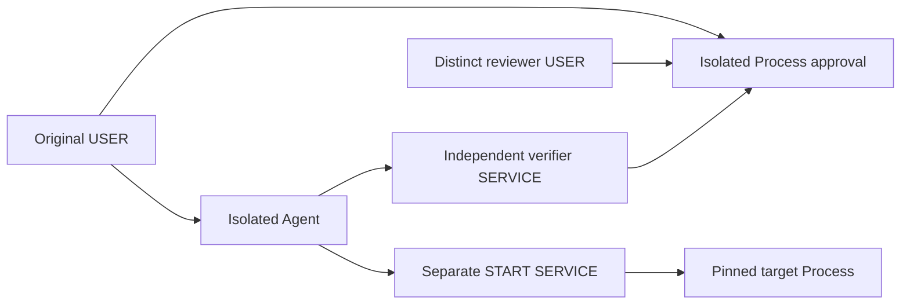
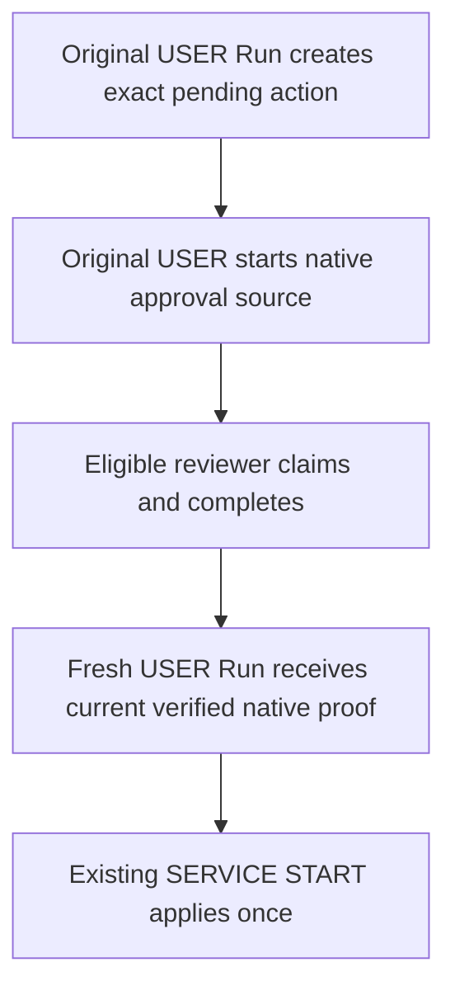
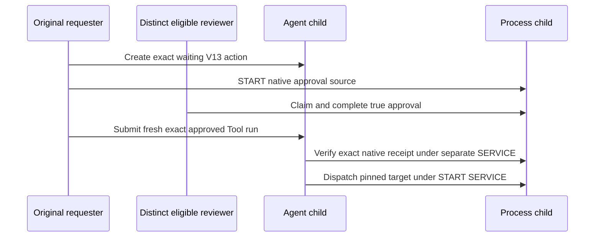

# S07 原请求者与真实审批 START 组合验收

| Field | Value |
| --- | --- |
| Document | docs/egon/spec/2026-11-06-06-13-s07-approved-start-e.md |
| Template Version | 9 |
| Archetype Cleanup | Not applicable |
| Status | Review |
| Type | Feature |
| Complexity | Complex |
| Complexity Drivers | Two isolated children, distinct current USER/reviewer/SERVICE identities, native approval and immutable cross-store action binding |
| Created | 2026-11-06 06:13 Asia/Shanghai |
| Updated | 2026-11-06 06:13 Asia/Shanghai |
| Owner | Tianji Agent Server and Process Server test fixtures |
| Repository | tianji-service |
| Scope | Exact S07 approval-required operator fixture, finite guards and review artifacts |
| Change Surface | Test-only child orchestration, pinned native approval, existing current IAM and read-only evidence |
| Affected Chapters | §7, §8, §14, §15, §16 |
| Source Requirement | [Master §17.2 S07 and §19 T3-07/T4-05](../../../../docs/plans/agent-framework-upgrade-plan.md) |
| Baseline Revision | 0f15cf7ec45952e3e2b217358eb8493c1d5285cd |
| Amends | None |
| Supersedes | None |
| Depends On | [S07 governed START operator fixture](2026-11-06-05-51-s07-governed-start-e.md#7-architecture-design) |
| Related Specs | None |
| Related Plans | [S07 approved operator Plan](../plan/2026-11-06-06-14-s07-approved-start-e.md) |

## 1. Summary

为两个租户准备独立审批验收。原 USER 先提交实际 Agent Run 生成等待审批的 V13 动作，再以同一身份向独立 Process 审批模型提交精确来源。真实候选审核人签领并提交批准后，新的 USER Run 经现有 Tool 授权、PS 审批验证与独立 SERVICE START 完成原动作。操作者核对一次派发和完整来源证据。

## 2. Background and Current State

| Evidence ID | Exact source | Observed fact |
| --- | --- | --- |
| EVD-001 | ExpenseAcceptanceHarness, BusinessProcessAgentAcceptanceIT.Driver and both child mains | Existing private manifests lock sources, test trees, child lifecycle and actual IAM. S07 IDW uses its own selector. |
| EVD-002 | S07GovernedStartAgentFixtureConfiguration and existing ToolApprovalBinding | The business resolver pins owner, model and current version. Approval source command derives four exact persisted action values. |
| EVD-003 | ApprovalConsumerRegistry, ApprovalVerificationService and TianjiFixedToolApprovalVerifier | Independent current verifier SERVICE is scoped to exact policy, source release, definition SHA, task key, reviewer roles, requester type and maximum age. |
| EVD-004 | FlowableHumanTaskService, HumanTaskReceiptStore, V7__add_human_task_receipts.sql and existing governed-human-task BPMN | Native APPROVAL signs source/start provenance and actual reviewer/role on a real completion. USER requester cannot claim own APPROVAL. |
| EVD-005 | ToolInvocationRecorder, V13__add_tool_execution_journal.sql and V14__add_tool_result_access_journal.sql | Approved action consumes exact receipt atomically before dispatch. V14 only permits cached IDW result disclosure. |

### 2.4 Evidence and current-chain map

| Entry/trigger | Current source chain | Evidence gap | Decision |
| --- | --- | --- | --- |
| Actual owned Run requiring approval | Current AS Tool PREPARE creates V13 pending source | Need isolated proof that no target effect predates approval | Read exact pending action and native receipts in operator fixture. |
| Genuine reviewer approval and dispatch | Process START, TASK_CLAIM/COMPLETE, verified receipt, Tool DISPATCH | Need actual provenance binding from requester through native reviewer to final SERVICE | Test-only observer selects exact opaque receipt. Existing verifier supplies independent authorization. |

### 2.5 Archetype example cleanup

Cleanup disposition: Not applicable

Reason: Extend existing test sources and test child mains. No generated project or production configuration added.

## 3. Goals and Non-goals

Deliver the approval-required positive operator path and finite guards. The fixture selects one exact native approval reference and exercises current production IAM in the separately run E path. Cached approved result, synthetic proof, negative live falsification matrix and new approval APIs are outside this step.

### 3.3 Change Surface and Design Depth

| Area/layer | Disposition | Exact repository evidence | Changed or preserved behavior/contract | Required Spec treatment | Chapter(s) |
| --- | --- | --- | --- | --- | --- |
| AS opt-in fixture | Affected | EVD-001/002/003 | Separate approval slot, immutable policy and bounded observer | Exact child, action version and selector checks | §7, §8, §14, §15, §16 |
| PS opt-in fixture | Affected | EVD-001/003/004 | Native approval BPMN, publisher, actual requester and reviewer witness | Model, lifecycle and owner separation | §7, §8, §14, §15, §16 |
| Existing IAM, runtime contracts and schema | Context-only | EVD-002–005 | Reuse existing capabilities and migrations | Preserve packaged scope and operator preconditions | §16/18 |

## 4. Requirements and Acceptance Criteria

| ID | Requirement | Priority | Observable acceptance | Source |
| --- | --- | --- | --- | --- |
| REQ-001 | Admit exact separate private approval mode | Must | Existing artifact and tenant pins, shared S07 child guard plus distinct approved flag. Existing mode selectors preserve behavior. | EVD-001 |
| REQ-002 | Bind native approval source to original action | Must | Obtain original V13 waiting action under exact USER. Publish and reread exact model and scalar input contract. USER starts exact source, separate reviewer signs approved decision. | EVD-002/004 |
| REQ-003 | Bind opaque selection to current business source | Must | Require exact owner, definition, tool and version and exact Process requester/source digest. PS verifier uses independent current approval SERVICE. | EVD-002/003 |
| REQ-004 | Exercise one actual approved START | Must | Second USER Run consumes native approved receipt, records one V13 dispatch and one exact target Process receipt under executor SERVICE, plus held native task. | EVD-003/004/005 |
| REQ-005 | Separate source gates and real operator evidence | Must | Exact mutations, finite suite and class/package scope checked independently. Operator fixture uses real PostgreSQL and IAM only under explicit configuration. | EVD-001–005 |

### 4.1 Scenario matrix

| Scenario | Preconditions | Expected outcome | Gate |
| --- | --- | --- | --- |
| Before native approval | Verified USER and current Tool scope | One V13 waiting action, no target START | TEST-003 |
| Native approve and dispatch | Same USER starts source, distinct eligible reviewer completes, independent current SERVICE verifies | One consumed V7 approval, one actual V13 dispatch and target receipt | TEST-003 |
| Version drift or altered source publication | Current version differs or PS reports wrong digest | Refuse reference or source model | TEST-001 |
| Existing suite regression | Existing private selectors | Earlier IDW/Business/Recovery/S12 boundaries remain separate | TEST-002 |

### 4.2 Use-case analysis

| Actor ID | Actor | Evidence-backed responsibility |
| --- | --- | --- |
| ACTOR-001 | Isolated operator | Supplies separately authorized private manifest, scopes, test trees and pre-migrated stores. |
| ACTOR-002 | Verified original USER | Owns Agent action and native approval source START. |
| ACTOR-003 | Verified eligible reviewer USER | Claims and completes the native approval task with approved Boolean. |
| ACTOR-004 | Independent verifier SERVICE | Reads current exact approval proof from existing PS endpoint. |
| ACTOR-005 | Original executor SERVICE | Uses existing release READ and START on the pinned target. |
| ACTOR-006 | Test-owned read-only observer | Selects opaque reference and reads source, consumption and effect witnesses. |

| ID | Use case/goal | Actors | Trigger/preconditions | Main flow | Alternative/failure | Postcondition | Requirements |
| --- | --- | --- | --- | --- | --- | --- | --- |
| UC-001 | Drive genuine approved START | ACTOR-001–006 | Exact private approved S07 mode and current authorization | Source START, reviewer approval, fresh Run and verified Tool dispatch | Missing receipt, wrong source or owner, extra dispatch fails | One approved target per tenant | REQ-001–004 |
| UC-002 | Verify finite source delivery | ACTOR-001 | JDK25 and exact baseline | Mutations, finite and class/package checks | Missing evidence or an operator report fails source gate | Source-only verification | REQ-001/005 |

## 5. Constraints, Assumptions, and Decisions

Use exact existing operator suite/artifact safety and preexisting isolated database roles. The approval SERVICE and START SERVICE use distinct subjects and registrations. The selected fixture reference comes from the PS read-only observer, independent of the current authorized verification HTTPS call. Production grants and configuration stay outside the test scope. Native approvals expire after two minutes from occurrence, and existing verifier tightens the current response window.

## 6. Project Technology Context

Use established JDK 25, real AS/PS under explicit test-only child modes, Shoubing/Jianshen, Spring, canonical Agent JSON, Flowable, PostgreSQL and finite JUnit suites.

### 6.2 User-mandated Java rule compliance

```text
1 类名规范，必须以 java的pojo规范命名。以dao po bo vo dto query command event等结尾
2 每层之间必须被 springboot-validation 校验，复用对象使用分组校验；基于原生和自定义约束注解、@Valid、@Validated 及 ConstraintValidator 扩展实现。ValidationUtils 只承担通用手工校验，不承载全部业务校验；电话号码复用 libphonenumber。
3 Java POJO 默认使用 class，注解为 @Data @NoArgsConstructor @AllArgsConstructor @Accessors(chain = true)，按构造目标选择 @Builder 或 @SuperBuilder；父类状态参与相等性时使用 @EqualsAndHashCode(callSuper = true)。只有不可变 value object 可以使用 record，并豁免 class 的 Lombok 规范；普通实体不能因简单而使用 record。使用 MapStruct、MapStructPlus 和 egon-cola-component-common-core 的 BaseConverter（双向）或 BaseForwardConverter（不可逆投影）进行转换。
4业务类必须使用@Slf4j注解注入log对象。如果业务类被spring管理，必须指定名称，如果是单例的情况下，参考@Service("userService")。如果需要依赖注入，必须@RequiredArgsConstructor进行修饰，不要代码中写。且属性必须被@qualify修饰。
5 工具类只允许使用jdk原生、Apache Commons(commons-lang3、commons-collections4、commons-io、commons-text、commons-codec、commons-beanutils)、Guava。针对Tika按需引入。
6 JSON 使用 Spring Boot Jackson；持久化枚举值使用 @EnumValue，向前端输出的枚举值使用 @JsonValue，禁止 ordinal 作为业务编码。
7 springboot 多环境配置文件，必须保持配置一致，但值不一定一致。
9 复杂业务必须引入设计模式，不允许硬编码
10 日期相关的必须使用java.time下的实体类，不允许使用java.util下的
11 只允许现有三层结构或当前 egon-cola-archetypes 的 DDD 结构，三层结构保持现状。必须尽量复用 egon-cola-components；持久化模块必须使用 Egon COLA MP Starter，DDL 统一由 egon-mp-sdj-ext-starter 分布式管理。业务唯一键必须组合业务列与 deletedAt（数据库 deleted_at），并验证 NULL、租户及重复软删除语义。采用 CQE（Command Query Event）；Event 必须经 egon-cola-component-transactional-outbox-starter 或 MQ 中间件投递。
```

| Literal rule | Affected? | Repository evidence | Exact design decision | Files/types/interfaces | Validation/test evidence | Status/blocker |
| --- | --- | --- | --- | --- | --- | --- |
| Rule 1 | Yes | EVD-001–005 | Scope exact S07 approved fixture and finite test classes. | §7/8/16 | TEST-001–003 | PASS |
| Rule 2 | Yes | EVD-001–005 | Validate original owner, current version, source binding and reviewer provenance. | §7/8/16 | TEST-001–003 | PASS |
| Rule 3 | Yes | EVD-001–005 | Use existing immutable Agent, Tool and Process wire contracts. | §7/8/16 | TEST-001–003 | PASS |
| Rule 4 | Yes | EVD-001–005 | Register the qualified test-only receipt selector only for the approved mode. | §7/8/16 | TEST-001–003 | PASS |
| Rule 5 | Yes | EVD-001–005 | Use JDK, current JDBC, JUnit and existing SDK with no dependencies added. | §7/8/16 | TEST-001–003 | PASS |
| Rule 6 | Yes | EVD-001–005 | Use existing Jackson, SHA and canonical Agent definition codec. | §7/8/16 | TEST-001–003 | PASS |
| Rule 7 | Yes | EVD-001–005 | Keep packaged production configuration stable and add only explicit private test inputs. | §7/8/16 | TEST-001–003 | PASS |
| Rule 9 | Yes | EVD-001–005 | Reuse Test Fixture and SDK Adapter patterns. | §7/8/16 | TEST-001–003 | PASS |
| Rule 10 | Yes | EVD-001–005 | Use bounded waits and UTC approval time contracts. | §7/8/16 | TEST-001–003 | PASS |
| Rule 11 | Yes | EVD-001–005 | Keep current ownership, persistence and native Process responsibility. | §7/8/16 | TEST-001–003 | PASS |

### 6.3 Time semantics and conversion contract

Time contract: Required

| Time ID | Fields/symbols | Semantics | Java/runtime type | Storage policy | Wire policy | Business zone source | Display zone source | Boundary / DST rules | Precision / Clock | Compatibility | Verification |
| --- | --- | --- | --- | --- | --- | --- | --- | --- | --- | --- | --- |
| TIME-001 | Existing driver readiness, Run poll and observer windows | Duration | java.time.Duration and bounded waits | Not persisted | Internal | Not applicable: elapsed test time | Not applicable: no display | Existing child and network limits apply | Existing monotonic wait, bounded query | Preserve previous operator selectors | Step 1 TEST-002/003 |
| TIME-002 | Native approval occurrence and verified expiry | Occurred instant | Instant | UTC instant | UTC Z | Not applicable: elapsed age | Not applicable: no display | Tighten actual verification deadline using existing PS checks | Existing database and issuer clocks | Existing runtime time rules | Step 1 TEST-003 |

## 7. Architecture Design

### 7.0 Minimum-design baseline and element-necessity audit

| Proposed element | Change | Requirements | Existing/direct alternative | Concrete inadequacy | Added cost and failure | Verdict |
| --- | --- | --- | --- | --- | --- | --- |
| Separate approved suite | Add | REQ-001/004 | Existing IDW E | IDW cannot prove human authority | Reuse existing driver and pinned target | Use |
| Native approval source | Add in test tree | REQ-002/004 | Fake ApprovedObservation | Fake proof cannot show real reviewer, owner, source or IAM | One fixed BPMN and exact reviewer role | Use |
| Opaque reference selection | Add in test child | REQ-003 | Carry receipt in Fake input | Prompt cannot attest approval selection | Bounded exact PS observer lookup and current business version check | Use |

| Path | Network calls | Client states | Persisted evidence | Failure boundary |
| --- | --- | --- | --- | --- |
| Operator E | Actual AS/PS HTTPS and IAM | Waiting, native approval, approved dispatch | V13, V7 and target Process START | Source/owner/version/role mismatch |
| R/G/P source | Finite no network | Typed source guards | JUnit and package | Actual operator proof remains separate |

### 7.1 System Architecture Design



### 7.2 High-Level Design



The existing S07 driver boots the scoped Process child, publishes and rereads source and target releases, pins approval consumer policy and passes exact approval metadata into the existing test-only Agent child. Existing conditional fixture guards remain the admission boundary.

#### 7.2.2 High-level decision and quality matrix

| Concern/use case | Constraint | Selected design | Verification |
| --- | --- | --- | --- |
| Scope isolation | Existing mode remains independently runnable | Separate private approved selector with shared S07 guard and exact approval flag | TEST-002 |
| Provenance | Actual native approval must identify source and requester | Pinned model and persisted original V13 action form source START | TEST-001/003 |
| Current authority | Read-only fixture selector cannot approve a Tool | Existing PS verified consumer and exact current START dispatch | TEST-003 |

### 7.3 Detailed Design



The approved profile retains the existing pinned target and required companion decision mapping. It adds the real APPROVAL_REQUIRED policy, canonical definition hash and existing approved transport settings. The Process native source model has one governed approval task with one exact candidate role and BOOLEAN approved field. The test creates the source START using original waiting V13 intent ID, request digest, current version and tool digest. Reviewer attempts use actual versions, and requester self-claim is refused.

The Agent observer query requires current business version, exact owner, action source command ID and digest, source release, definition SHA and task key. It returns only the opaque native approval receipt ID. The production approval verifier authenticates the independent current SERVICE, verifies policy and exact source against the native receipt, and the Tool recorder performs current dispatch authorization and consumes the approval atomically before the existing START call.

#### 7.3.6 Conclusion evidence chain

| Conclusion | Evidence | Verification | Boundary |
| --- | --- | --- | --- |
| Reviewer approval is native and source-bound | V7 full requester/reviewer/task/digest/role query | TEST-003 | Actual operator only |
| Approved dispatch creates one native effect | V13 approval receipt, one dispatch and exact SERVICE receipt plus native task | TEST-003 | Actual operator only |

## 8. Package Structure and Code File Tree

- `stellar-enclosure-tianji-agent-server/src/test/java/top/egon/cola/platform/tianji/agent/server/acceptance/S07GovernedStartAgentFixtureTest.java` — S07GovernedStartAgentFixtureTest.
- `stellar-enclosure-tianji-process-server/src/test/java/top/egon/cola/platform/tianji/process/server/acceptance/S07ApprovalFixtureTest.java` — S07ApprovalFixtureTest.
- `stellar-enclosure-tianji-process-server/src/test/java/top/egon/cola/platform/tianji/process/server/acceptance/ExpenseAcceptanceHarness.java` — ExpenseAcceptanceHarness.
- `stellar-enclosure-tianji-process-server/src/test/java/top/egon/cola/platform/tianji/process/server/acceptance/S07ApprovalFixture.java` — S07ApprovalFixture.
- `stellar-enclosure-tianji-process-server/src/test/java/top/egon/cola/platform/tianji/process/server/acceptance/ExpenseProcessAcceptanceMain.java` — ExpenseProcessAcceptanceMain.
- `stellar-enclosure-tianji-agent-server/src/test/java/top/egon/cola/platform/tianji/agent/server/acceptance/S07GovernedStartAgentFixtureConfiguration.java` — S07GovernedStartAgentFixtureConfiguration.
- `stellar-enclosure-tianji-agent-server/src/test/java/top/egon/cola/platform/tianji/agent/server/acceptance/ExpenseAgentAcceptanceMain.java` — ExpenseAgentAcceptanceMain.
- `stellar-enclosure-tianji-process-server/src/test/java/top/egon/cola/platform/tianji/process/server/acceptance/BusinessProcessAgentAcceptanceIT.java` — BusinessProcessAgentAcceptanceIT.
- `stellar-enclosure-tianji-process-server/src/test/java/top/egon/cola/platform/tianji/process/server/acceptance/S07ApprovedStartAcceptanceIT.java` — S07ApprovedStartAcceptanceIT.

## 9. Interface Definitions

Reuse existing Agent Run, Process release/START, native task list/get/claim/complete and approval verification contracts. Only the dedicated operator property and test fixture inputs are added.

## 10. POJO and Data Model Design

Use existing immutable contracts for policy, Tool action, native approval and Process receipt. Small test records carry source and observed facts.

## 11. Database Design

Read existing V13 action/invocation and exact V7 native task receipt under isolated observer roles. Use existing Process command receipts and runtime held task for target effect. No schema or migration files are changed.

## 12. Frontend Page Design

No frontend scope.

## 13. Design Patterns and Architecture Principles

Reuse the existing Test Fixture and SDK Adapter. Keep owner, role, provenance and native effect under the existing product boundaries.

## 14. Test Design

| Test | Objective | Method | Gate |
| --- | --- | --- | --- |
| TEST-001 | Reject stale business version and mismatched native release | Exact typed source mutations and finite assertions | R1/R2/G1 |
| TEST-002 | Preserve fixture selection and package isolation | Existing/new finite regression and class/package check | G1/P1/S1 |
| TEST-003 | Exercise genuine two-tenant current approval START | Exact dedicated operator E selector with actual receipts | E1 |

## 15. Non-functional and Cross-cutting Design

Reuse private manifest, fixture revision, independent scoped credentials and bounded local HTTPS/PostgreSQL checks. Observer reads only one exact reference and timeouts bound it. Credential values and source body stay private.

## 16. Compatibility, Migration, Rollout, and Rollback

Use separate approved operator manifest and test-only child inputs. Existing selectors remain independent. Production packages omit new fixture classes. Revert the single test-source commit for rollback.

## 17. Alternatives and Decisions

A synthetic approval callback cannot establish real reviewer provenance. A dedicated source BPMN under the actual requester allows the independent verifier to enforce the production binding. Approved cached result remains separate because immutable V14 currently admits only IDW.

## 18. Risks and Open Questions

Actual isolated IAM, PostgreSQL, timing and native workflow proof require the independently configured operator run. Approved replay result disclosure and the broader live denial matrix remain open S07 work.

## 19. Traceability Matrix

| Requirement | Use case | Design | Tests |
| --- | --- | --- | --- |
| REQ-001 | UC-001/002 | §5/7/16 | TEST-002 |
| REQ-002 | UC-001 | §7/11 | TEST-001/003 |
| REQ-003 | UC-001 | §7/9 | TEST-001/003 |
| REQ-004 | UC-001 | §7/11 | TEST-003 |
| REQ-005 | UC-002 | §14/16/18 | TEST-001–003 |

## 20. Review and Acceptance

### 20.5 Blocking Manual Check

| Check ID | Applicability | Status | Evidence | Finding | Required action/exception |
| --- | --- | --- | --- | --- | --- |
| MC-ARCH-001 | Applicable | PASS | §7/8 | Reuse existing AS and PS test child ownership. | None |
| MC-REUSE-001 | Applicable | PASS | EVD-001–005 | Reuse actual IAM, existing SDK, V7 provenance and V13 recorder. | None |
| MC-DEP-001 | Applicable | PASS | §6/16 | Use existing JDK, Spring and test dependencies. | None |
| MC-NAME-001 | Applicable | PASS | §8/10 | Exact named S07 approved fixture and owner records. | None |
| MC-VALID-001 | Applicable | PASS | §5/7/14 | Validate current version, source digest, native reviewer and actual effect. | None |
| MC-MODEL-001 | Applicable | PASS | §10 | Use immutable existing wire contracts and small fixture records. | None |
| MC-CONVERT-001 | Not applicable | N/A | §10 | Existing SDK performs wire conversion. | None |
| MC-LOG-001 | Applicable | PASS | §15 | Keep private settings and credentials out of proof. | None |
| MC-BEAN-001 | Applicable | PASS | §5/7 | Qualified test-only receipt selector under the dedicated mode. | None |
| MC-UTIL-001 | Applicable | PASS | §6/7 | Reuse existing SDK, hashing and fixtures. | None |
| MC-JSON-001 | Applicable | PASS | §7/10 | Keep closed Fake protocol, existing canonical codec and typed contracts. | None |
| MC-TIME-001 | Applicable | PASS | §6.3/15 | Bound fixture waits and preserve existing approval time ownership. | None |
| MC-CONFIG-001 | Applicable | PASS | §5/16 | Separate private approved test inputs and packaged configuration. | None |
| MC-PATTERN-001 | Applicable | PASS | §13 | Reuse existing Test Fixture and SDK Adapter patterns. | None |
| MC-SCOPE-001 | Applicable | PASS | §8/16 | Nine Java test paths and three documents plus 28 migration byte audit. | None |
| MC-TEST-001 | Applicable | PASS | §14 | Exact finite, package and independently pending operator evidence. | None |
| MC-BLOCKER-001 | Applicable | PASS | §18 | Live current IAM and PostgreSQL remain independent operator conditions. | None |

### 20.6 Final verdict

PASS — Ready for user review
