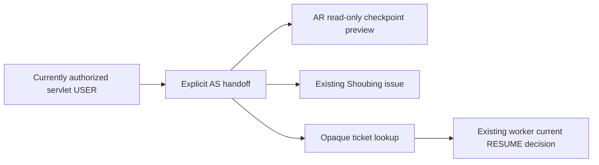
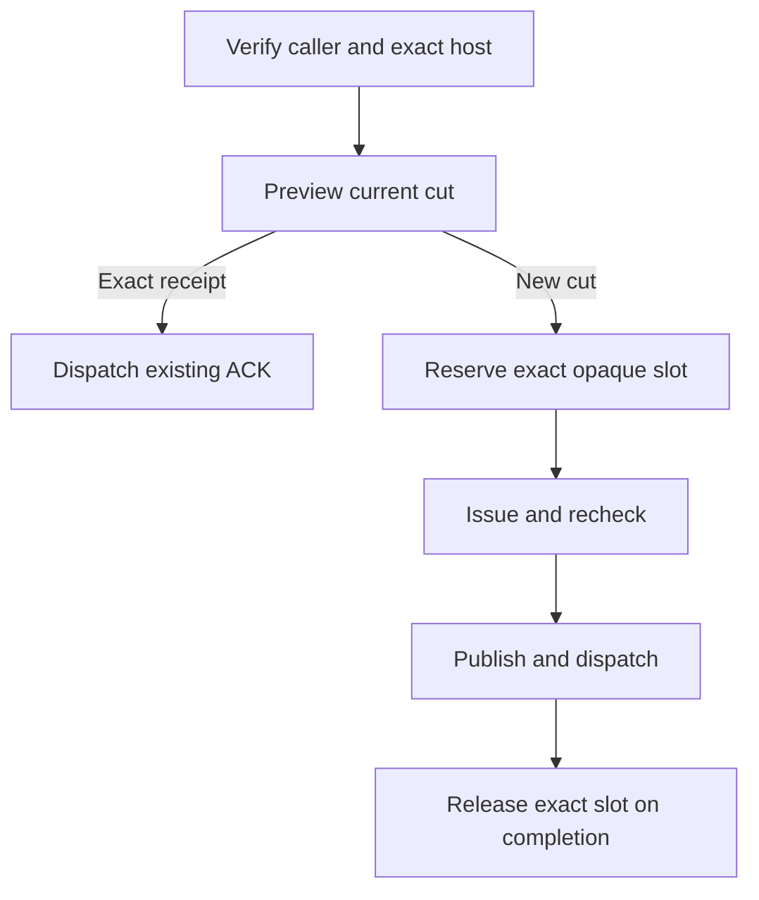
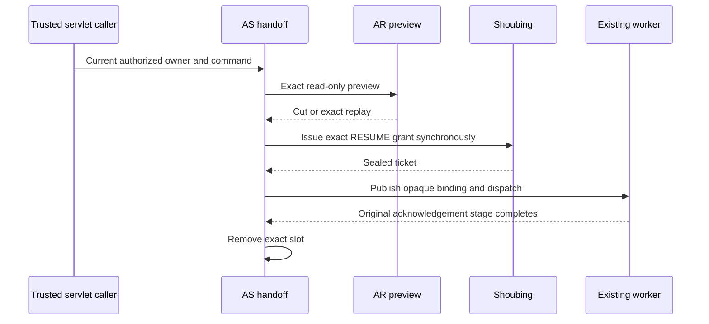

# T4-03 checkpoint RESUME 同步签发与密封凭据交接

| Field | Value |
| --- | --- |
| Document | docs/egon/spec/2026-11-06-06-20-checkpoint-resume-grant-handoff.md |
| Template Version | 9 |
| Archetype Cleanup | Not applicable |
| Status | Review |
| Type | Feature |
| Complexity | Complex |
| Complexity Drivers | Same servlet proof, read-only checkpoint preview, deterministic grant identity, bounded opaque handoff and async completion |
| Created | 2026-11-06 06:20 Asia/Shanghai |
| Updated | 2026-11-06 06:20 Asia/Shanghai |
| Owner | Tianji Agent Runtime and Agent Server |
| Repository | tianji-service |
| Scope | Explicit internal host issue and opaque RESUME handoff |
| Change Surface | Five Java paths and three review documents |
| Affected Chapters | §7, §8, §9, §10, §14, §15, §16 |
| Source Requirement | [主计划 §10.2、§17.2 S11、§19 T4-03](../../../../docs/plans/agent-framework-upgrade-plan.md) |
| Baseline Revision | 845346a6cd0f0bf533e86186f5b7bd64d857d271 |
| Amends | None |
| Supersedes | None |
| Depends On | [Explicit AS checkpoint host](2026-11-06-05-06-agent-checkpoint-as-resume-host.md#73-detailed-design) |
| Related Specs | None |
| Related Plans | [RESUME grant handoff Plan](../plan/2026-11-06-06-21-checkpoint-resume-grant-handoff.md) |

## 1. Summary

An explicitly composed AS host can preview the exact current checkpoint and use the current authorized USER servlet proof to issue a separate opaque RESUME ticket synchronously. Only the sealed evidence enters the asynchronous current-authority lookup.

## 2. Background and Current State

| Evidence ID | Exact source or symbol | Current fact |
| --- | --- | --- |
| EVD-001 | AgentCheckpointTakeoverService#takeOver and AgentCheckpointObservationService#matchForTakeover | Existing AR owns exact source, read-only cut matching and committed replay. |
| EVD-002 | TianjiAgentCheckpointResumeConfiguration.ResumeHost and AgentCheckpointResumeDispatcher | The explicit host owns readiness, bounded worker dispatch and the original acknowledgement stage. |
| EVD-003 | TianjiAgentAccess.Authorized, Rbac3AuthenticationToken and VerifiedUserTokenCarrier.current | Existing verified USER request provides owner, issuer, expiry and exact current servlet proof. |
| EVD-004 | HttpExecutionGrantClient#issue and ExecutionGrantContract.IssueRequest | Existing Shoubing transport supports a precise purpose, intent, binding and deadline. |
| EVD-005 | TianjiCheckpointResumeGrantAuthorizer#expectation and ResumeTicketSource | Exact independent current authorization uses the opaque ticket and original binding. |

### 2.4 Evidence and current-chain map

| Entry/trigger | Existing chain | Required link |
| --- | --- | --- |
| Authorized new RESUME | Servlet owns current USER proof. AR worker sees exact checkpoint and independent authority. | Synchronous read-only preview and issue before opaque publication. |
| Worker completion | Existing acknowledgement stage captures local attempt termination. | Release exact matching slot after completion. |
| Exact replay | Existing V2/V5 receipt has durable command result. | Preview returns empty and dispatcher resolves the committed replay. |

### 2.5 Archetype example cleanup

Cleanup disposition: Not applicable

Reason: Existing Agent Server and Runtime source only.

## 3. Goals and Non-goals

Supply a trusted internal issuing bridge and bind it to the exact existing worker authority. Live endpoint and independent protected policy require their own review.

### 3.3 Change Surface and Design Depth

| Area/layer | Disposition | Exact repository evidence | Changed or preserved behavior/contract | Required Spec treatment | Chapter(s) |
| --- | --- | --- | --- | --- | --- |
| AR checkpoint preview | Affected | EVD-001 | Expose bounded read-only exact request or existing replay. | Flow and tests | §7, §8, §9, §14 |
| AS host and grant handoff | Affected | EVD-002–005 | Synchronous verified issue, asynchronous sealed ticket, exact completion cleanup. | Contract, errors, lifecycle and package | §7, §8, §9, §10, §14, §15, §16 |
| Policy, endpoint and DB | Unchanged | Existing Jianshen and Shoubing paths | Existing routes, resources, scopes, SQL and user gates. | Runtime boundary | §16 |

## 4. Requirements and Acceptance Criteria

| ID | Requirement | Acceptance criterion |
| --- | --- | --- |
| REQ-001 | Preview exact current owner cut without execution | AR returns exact ResumeRequest for current cut and expected revision, empty for exact committed replay, and refuses stale or non-owner commands. |
| REQ-002 | Use only current verified USER proof for independent issuance | Verify exact host authority/source/resource, servlet authentication, issuer, owner and proof before issuing through existing client. Recheck current identity and expiry before publication. |
| REQ-003 | Bound opaque lifetime and failure | Reserve exact binding in bounded synchronized map. Publish only opaque proof within expiry. Completion or immediate dispatch failure removes the exact slot and independent requests cannot steal it. |
| REQ-004 | Preserve existing AR worker and current policy | Worker still checks live RESUME and existing MODEL before execution. Exact replay uses the existing ACK without a new grant. |
| REQ-005 | Prove focused source and artifacts | Typed R1, scoped finite G1, clean package P1, strict docs and 28 unchanged migration files. |

### 4.1 Scenario matrix

| Scenario | Observable result |
| --- | --- |
| Exact authorized new command | Preview, reserve, issue once on current request, publish and dispatch. |
| Stale cut or mismatched caller/host | No issue or publication. |
| Exact committed replay | Dispatch existing receipt result without issuance. |
| Competing or expired binding and stage completion | Capacity/current proof enforced and exact slot removed. |

### 4.2 Use-case analysis

| Actor ID | Actor and authority |
| --- | --- |
| ACTOR-001 | Trusted AS host caller, currently authorized by an independent RESUME policy. |
| ACTOR-002 | Shoubing issuer and existing AR worker. |

| ID | Use case/goal | Actor | Trigger | Result |
| --- | --- | --- | --- | --- |
| UC-001 | Acquire and hand off exact opaque evidence | ACTOR-001/002 | New authorized checkpoint command | Original asynchronous stage and exact slot lifecycle. |
| UC-002 | Replay committed resume or refuse stale command | ACTOR-001 | Repeated or changed input | Existing acknowledgement or conflict. |
| UC-003 | Prove focused scope | ACTOR-001 | Offline gate | Exact finite and package result. |

## 5. Constraints, Assumptions, and Decisions

The trusted caller must obtain dedicated current RESUME authorization before using this internal Java bridge. The existing Authorized value carries identity and expiry. The bridge matches it to the active servlet proof and exact independent worker adapter. Live approval, the future protected endpoint and active IAM resources remain a separate delivery.

## 6. Project Technology Context

JDK 25, existing Shoubing client, Spring Security/RBAC3 current principal, Spring request/transaction context and existing AR checkpoint workers.

### 6.2 User-mandated Java rule compliance

```text
1 类名规范，必须以 java的pojo规范命名。以dao po bo vo dto query command event等结尾
2 每层之间必须被 springboot-validation 校验，复用对象使用分组校验；基于原生和自定义约束注解、@Valid、@Validated 及 ConstraintValidator 扩展实现。ValidationUtils 只承担通用手工校验，不承载全部业务校验；电话号码复用 libphonenumber。
3 Java POJO 默认使用 class，注解为 @Data @NoArgsConstructor @AllArgsConstructor @Accessors(chain = true)，按构造目标选择 @Builder 或 @SuperBuilder；父类状态参与相等性时使用 @EqualsAndHashCode(callSuper = true)。只有不可变 value object 可以使用 record，并豁免 class 的 Lombok 规范；普通实体不能因简单而使用 record。使用 MapStruct、MapStructPlus 和 egon-cola-component-common-core 的 BaseConverter（双向）或 BaseForwardConverter（不可逆投影）进行转换。
4业务类必须使用@Slf4j注解注入log对象。如果业务类被spring管理，必须指定名称，如果是单例的情况下，参考@Service("userService")。如果需要依赖注入，必须@RequiredArgsConstructor进行修饰，不要代码中写。且属性必须被@qualify修饰。
5 工具类只允许使用jdk原生、Apache Commons(commons-lang3、commons-collections4、commons-io、commons-text、commons-codec、commons-beanutils)、Guava。针对Tika按需引入。
6 JSON 使用 Spring Boot Jackson；持久化枚举值使用 @EnumValue，向前端输出的枚举值使用 @JsonValue，禁止 ordinal 作为业务编码。
7 springboot 多环境配置文件，必须保持配置一致，但值不一定一致。
9 复杂业务必须引入设计模式，不允许硬编码
10 日期相关的必须使用java.time下的实体类，不允许使用java.util下的
11 只允许现有三层结构或当前 egon-cola-archetypes 的 DDD 结构，三层结构保持现状。必须尽量复用 egon-cola-components；持久化模块必须使用 Egon COLA MP Starter，DDL 统一由 egon-mp-sdj-ext-starter 分布式管理。业务唯一键必须组合业务列与 deletedAt（数据库 deleted_at），并验证 NULL、租户及重复软删除语义。采用 CQE（Command Query Event）；Event 必须经 egon-cola-component-transactional-outbox-starter 或 MQ 中间件投递。
```

| Literal rule | Affected? | Repository evidence | Exact design decision | Files/types/interfaces | Validation/test evidence | Status/blocker |
| --- | --- | --- | --- | --- | --- | --- |
| Rule 1 | Yes | EVD-001–005 | Use current handoff and preview names for technical ownership. | §7–10 | TEST-001–005 | PASS |
| Rule 2 | Yes | EVD-001–005 | Validate exact current verified USER, issuer, command, cut, host and source. | §7–10 | TEST-001–005 | PASS |
| Rule 3 | Yes | EVD-001–005 | Reuse immutable request, acknowledgement, expectation and bound ticket. | §7–10 | TEST-001–005 | PASS |
| Rule 4 | No | EVD-001–005 | Explicit technical construction, no new Spring bean or business logger. | §7–10 | TEST-001–005 | N/A |
| Rule 5 | Yes | EVD-001–005 | Use existing JDK, Spring, identity and HTTP transport. | §7–10 | TEST-001–005 | PASS |
| Rule 6 | No | EVD-001–005 | No JSON shape, persisted enum or wire contract change. | §7–10 | TEST-001–005 | N/A |
| Rule 7 | No | EVD-001–005 | No YAML, property or auto-registration. | §7–10 | TEST-001–005 | N/A |
| Rule 9 | Yes | EVD-001–005 | Use existing host facade and independent ticket-source adapter. | §7–10 | TEST-001–005 | PASS |
| Rule 10 | Yes | EVD-001–005 | UTC expiry is bounded by current USER proof and Run deadline. | §7–10 | TEST-001–005 | PASS |
| Rule 11 | Yes | EVD-001–005 | AS owns synchronous identity, AR retains exact checkpoint and CQE ownership. | §7–10 | TEST-001–005 | PASS |

### 6.3 Time semantics and conversion contract

Time contract: Required

| Time ID | Fields/symbols | Semantics | Java/runtime type | Storage policy | Wire policy | Business zone source | Display zone source | Boundary / DST rules | Precision / Clock | Compatibility | Verification |
| --- | --- | --- | --- | --- | --- | --- | --- | --- | --- | --- | --- |
| TIME-001 | Authorized.expiresAt, ResumeRequest.execution.deadlineAt, Issued.expiresAt and Slot.expiresAt | Occurred instant | java.time.Instant | Not persisted | Internal | Not applicable: absolute instant | Not applicable: internal authority | Caller and issued proof strictly current. Slot reserved only before min of owner expiry and Run deadline. Published ticket expiry must fit inside that reservation. | Clock.systemUTC and existing Instant precision | Existing Shoubing deadline wire contract and AR worker lease remain independent | Step 1 TEST-002/003 |
| TIME-002 | Existing ResumeHost shutdown wait | Duration | java.time.Duration | Not persisted | Internal | Not applicable: elapsed | Not applicable: internal host | Existing five-second drain, readiness closes immediately | Existing JDK wait boundary | No new scheduler or configured time | Step 1 TEST-003 |

## 7. Architecture Design

### 7.0 Minimum-design baseline and element-necessity audit

| Proposed element | Change | Requirements | Existing gap |
| --- | --- | --- | --- |
| Read-only checkpoint preview | Modify AR | REQ-001 | Existing worker discovers exact cut after asynchronous handoff. |
| Exact host wiring and bounded grant handoff | Modify/add AS | REQ-002–004 | Request thread proof cannot move to the worker and existing ordinary grant is unrelated. |
| Scope verification | Add/extend tests | REQ-005 | Require exact lifecycle and existing artifacts. |

| Path | Network calls | Client states | Decision |
| --- | --- | --- | --- |
| New exact command | One synchronous issue, existing worker decision afterward | Current servlet proof, exact opaque slot, original acknowledgement | Use existing issuer and worker. |
| Exact committed replay | No new issue | Original acknowledgement stage | Reuse durable replay. |

### 7.1 System Architecture Design



### 7.2 High-Level Design



#### 7.2.2 High-level decision and quality matrix

| Concern/use case | Decision | Evidence |
| --- | --- | --- |
| Raw bearer lifetime | Read only from the same verified servlet request during issue. | TEST-002 |
| Opaque lifetime | Bounded synchronized map keyed by exact expectation, expires and removes exact original slot. | TEST-003 |
| Replay | Reuse existing receipt without requesting new grant. | TEST-001/004 |

### 7.3 Detailed Design

The host exposes the same takeover preview and authority identity as the worker. Preview verifies the exact owner, expected Run revision and checkpoint cut using the existing reader. Exact committed receipt replays return empty. The production constructor derives the exact issue clients from IdpStarterProperties, explicitly supplied IdentityAuthorityProperties, TrustedIssuerRegistry, IdpServiceOAuth2Client and mapper. It uses existing exact issuer and tenant source bindings. The raw-client constructor is package-local for tests. The handoff matches verified servlet USER, tenant, issuer and token expiry to the supplied current authorized owner and exact worker adapter. Before and after issuance it requires the same servlet request attributes, RBAC3 authentication and USER token ID. It derives the existing deterministic RESUME expectation, reserves a bounded slot, issues with the raw servlet USER proof on the current caller thread, rechecks current identity and trust, and publishes only the bound opaque evidence. The worker repeats current checks and owns execution. Completion of the original dispatch stage removes only the matching slot. Detached caller cancellation does not own that stage or remove active worker evidence. Immediate failure also removes the slot. Expired slots are pruned on reserve/current lookup.



#### 7.3.6 Conclusion evidence chain

| Conclusion | Evidence | Gate |
| --- | --- | --- |
| Request bearer remains on synchronous caller | Exact servlet proof consumed only by existing issue client | G1 |
| Worker lifetime cannot retain a stale completed slot | Exact stage completion removes matching slot | R1/G1 |

## 8. Package Structure and Code File Tree

| Path | Operation | Responsibility |
| --- | --- | --- |
| `stellar-enclosure-tianji-agent-server/src/test/java/top/egon/cola/platform/tianji/agent/server/security/TianjiCheckpointResumeGrantHandoffTest.java` | Create | Exercise synchronous issue, exact caller and opaque lifetime through the worker stage. |
| `stellar-enclosure-tianji-agent-runtime/src/test/java/top/egon/cola/platform/tianji/agent/infrastructure/adk/session/AgentCheckpointTakeoverServiceTest.java` | Modify | Cover preview, stale cut and exact committed replay in existing AR test owner. |
| `stellar-enclosure-tianji-agent-runtime/src/main/java/top/egon/cola/platform/tianji/agent/infrastructure/adk/session/AgentCheckpointTakeoverService.java` | Modify | Preview exact resume request in a bounded read-only owner lookup. |
| `stellar-enclosure-tianji-agent-server/src/main/java/top/egon/cola/platform/tianji/agent/recovery/TianjiAgentCheckpointResumeConfiguration.java` | Modify | Expose existing takeover preview on the same explicitly constructed host. |
| `stellar-enclosure-tianji-agent-server/src/main/java/top/egon/cola/platform/tianji/agent/server/security/TianjiCheckpointResumeGrantHandoff.java` | Create | Issue on the verified USER request and publish only exact sealed proof. |
| `docs/egon/spec/2026-11-06-06-20-checkpoint-resume-grant-handoff.md` | Create | Define the exact handoff design and remaining operator boundary. |
| `docs/egon/plan/2026-11-06-06-21-checkpoint-resume-grant-handoff.md` | Create | Lock exact test owners, baseline and validation. |
| `docs/egon/evidence/2026-11-06-checkpoint-resume-grant-handoff.md` | Create | Record observed gates and unverified operator state. |

## 9. Interface Definitions

### 9.1 Interface Inventory

| Interface | Protocol | Owner | Purpose |
| --- | --- | --- | --- |
| INTERNAL-001 | Internal Java | Explicit AS host | Submit current verified owner and exact resume command with independent grant handoff. |

### 9.2 Per-interface Detailed Contracts

#### 9.2.1 INTERNAL-001 — Explicit resume grant handoff

##### Necessity and interaction-cost decision

| Concern | Decision |
| --- | --- |
| Change classification | Existing internal Java host and no transport change. |
| Independent consumer goal | Existing worker can receive separately issued exact opaque evidence. |
| Parameter ownership and derivation | Trusted caller supplies current authorized USER, exact command and explicit worker host/authority. |
| Direct/no-new-interface alternative | Existing worker runs after servlet proof lifetime and cannot issue itself. |
| Caller use of result | Existing CompletionStage of Acknowledgement. |
| Round trips and failure points | Read-only preview, one existing issue and existing worker verification. |
| Verdict | Add explicit bounded handoff and retain existing runtime. |

##### Identity and purpose

Only the current exact verified USER servlet proof and dedicated RESUME purpose can issue. Ordinary grant storage and current MODEL remain separate.

##### Request parameters

`submit(TianjiAgentAccess.Authorized, ResumeCommand, ResumeHost, TianjiCheckpointResumeGrantAuthorizer)`. The host's authority, resource and ticket source must be exact. The trusted caller supplies dedicated current permission. The handoff checks the same servlet request, RBAC3 authentication and token ID before and after using the current bearer with the configured exact Shoubing issue client.

##### Success response

Existing original acknowledgement stage. Exact committed replay requires no fresh issue and retains the existing durable result.

##### Error responses

Wrong caller, stale cut, unavailable issuer, expired proof, saturation and invalid host fail closed. A failed dispatch removes exact reserved proof. Provider exception details are not propagated.

##### Interface logic for frontend and consumers

Explicit internal trusted host only. Future protected endpoint and live RESUME policy require separate evidence.

##### Compatibility and verification

TEST-001–005 cover read-only preview, exact issuance boundary, capacity and cleanup, and executable parity.

## 10. POJO and Data Model Design

Reuse ResumeRequest, ResumeCommand, Acknowledgement, Authorized, Expectation and BoundResumeTicket. Slot holds expiry and the exact opaque evidence only while active. CallerVO is the same-request snapshot of servlet attributes, authentication and token ID, never passed to the worker.

## 11. Database Design

Existing preview reads current checkpoint and receipt. Existing takeover still owns writes. The preview reuses the existing receipt and checkpoint queries.

## 12. Frontend Page Design

No frontend changes.

## 13. Design Patterns and Architecture Principles

Use the existing host facade and an explicit ticket-source adapter. Hold the raw credential only while issuing on the verified caller request. Worker sees only sealed exact binding.

## 14. Test Design

| Test ID | Coverage |
| --- | --- |
| TEST-001 | Preview exact request, stale cut and committed replay. |
| TEST-002 | Exact verified USER, same servlet proof and synchronous issue, worker only opaque proof. |
| TEST-003 | Capacity and exact slot removal on completion/failure, bounded expiry and host readiness. |
| TEST-004 | Exact replay without new issue and current worker guard remains independent. |
| TEST-005 | Typed R1 and finite/package proof, exact eight paths and 28 SQL files. |

## 15. Non-functional and Cross-cutting Design

Reserve at most 128 exact slots, prune expired entries and keep USER bearer only in the synchronous issue call. Reuse configured bounded issue client and existing worker lifetime. No additional retry or runtime activation.

## 16. Compatibility, Migration, Rollout, and Rollback

Existing explicit host caller composition changes only when the new adapter is supplied. No default Spring import, endpoint, scope, permission, role or migration. Roll back this focused source commit if unused.

## 17. Alternatives and Decisions

Worker-side raw token transfer would cross its request lifetime. Preview and independent opaque ticket issue allow the original worker to verify current evidence without that transfer.

## 18. Risks and Open Questions

A dedicated protected RESUME resource, operator policy and active Shoubing/Jianshen configuration remain separate. S11 live IAM, PG and takeover run require independent evidence.

## 19. Traceability Matrix

| Requirement | Use case | Implementation | Test |
| --- | --- | --- | --- |
| REQ-001 | UC-001/002 | previewAuthorization | TEST-001 |
| REQ-002 | UC-001 | submit, requireCaller and issue | TEST-002 |
| REQ-003 | UC-001 | Slot reserve/publish/release | TEST-003 |
| REQ-004 | UC-002 | Existing host, worker and exact replay | TEST-004 |
| REQ-005 | UC-003 | finite and package scope | TEST-005 |

## 20. Review and Acceptance

### 20.5 Blocking Manual Check

| Check ID | Applicability | Status | Evidence | Finding | Required action/exception |
| --- | --- | --- | --- | --- | --- |
| MC-ARCH-001 | Applicable | PASS | §7/8/14 | AS identity and AR checkpoint boundaries stay separate. | None |
| MC-REUSE-001 | Applicable | PASS | §7/8/14 | Existing client, trusted issuer registry, current servlet token carrier and owner snapshot. | None |
| MC-DEP-001 | Applicable | PASS | §7/8/14 | Existing JDK, Spring and Shoubing dependencies. | None |
| MC-NAME-001 | Applicable | PASS | §7/8/14 | Technical preview and handoff names reflect ownership. | None |
| MC-VALID-001 | Applicable | PASS | §7/8/14 | Verified USER request, exact source and current cut before issue. | None |
| MC-MODEL-001 | Applicable | PASS | §7/8/14 | Existing immutable types carry exact metadata and sealed evidence. | None |
| MC-CONVERT-001 | Not applicable | N/A | §7/8/14 | No domain-to-wire conversion added. | None |
| MC-LOG-001 | Applicable | PASS | §7/8/14 | Opaque state and private bearer are excluded from diagnostics. | None |
| MC-BEAN-001 | Not applicable | N/A | §7/8/14 | No new component or named bean. | None |
| MC-UTIL-001 | Applicable | PASS | §7/8/14 | Existing Spring transaction checks and JDK synchronized reservation map. | None |
| MC-JSON-001 | Not applicable | N/A | §7/8/14 | Existing Shoubing contract owns serialization. | None |
| MC-TIME-001 | Applicable | PASS | §7/8/14 | Absolute expiry never exceeds either exact caller or execution deadline. | None |
| MC-CONFIG-001 | Applicable | PASS | §7/8/14 | Existing production flags and manifests keep byte and semantic parity. | None |
| MC-PATTERN-001 | Applicable | PASS | §7/8/14 | Existing host facade and dedicated handoff adapter. | None |
| MC-SCOPE-001 | Applicable | PASS | §7/8/14 | Five exact Java paths and three documents. | None |
| MC-TEST-001 | Applicable | PASS | §7/8/14 | Typed cleanup R1 and finite G1/P1 gates. | None |
| MC-BLOCKER-001 | Applicable | PASS | §7/8/14 | Dedicated resource and actual IAM/S11 remain operator evidence. | None |

### 20.6 Final verdict

PASS — Ready for user review
