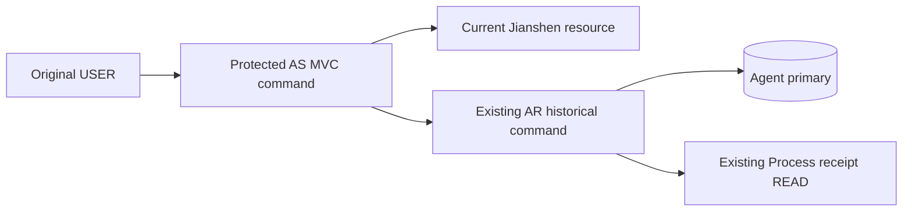
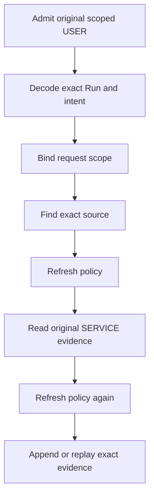
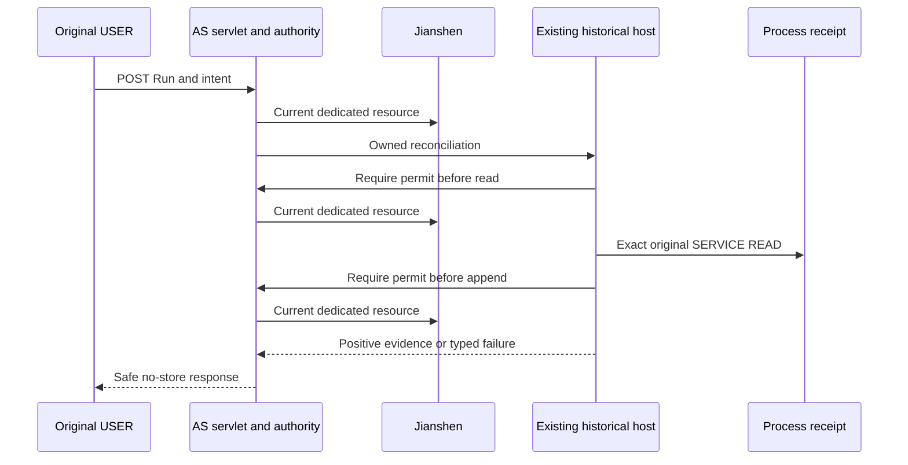

# T4-03 受保护历史 START 收据对账

| Field | Value |
| --- | --- |
| Document | docs/egon/spec/2026-11-06-06-55-protected-historical-start-receipt.md |
| Template Version | 9 |
| Archetype Cleanup | Not applicable |
| Status | Review |
| Type | Feature |
| Complexity | Complex |
| Complexity Drivers | 当前请求双重授权、原 SERVICE READ、历史证据写入及独立装配 |
| Created | 2026-11-06 06:55 Asia/Shanghai |
| Updated | 2026-11-06 06:55 Asia/Shanghai |
| Owner | Tianji Agent Server |
| Repository | tianji-service |
| Scope | 一个默认关闭 USER-only 历史 START 收据命令 |
| Change Surface | 七个 AS Java 文件、YAML、静态 OpenAPI 和三份审查文档 |
| Affected Chapters | §7, §8, §9, §10, §14, §15, §16 |
| Source Requirement | [Master §19 T4-03 and S11](../../../../docs/plans/agent-framework-upgrade-plan.md) 的有界人工核对 |
| Baseline Revision | a082ab1d7b98cc524e9e5880075aba6defccfa78 |
| Amends | None |
| Supersedes | None |
| Depends On | [Historical receipt host](2026-11-06-06-06-historical-start-receipt-as-host.md#73-detailed-design) |
| Related Specs | [Existing historical reconciliation](2026-11-06-05-28-tool-start-receipt-reconciliation.md) |
| Related Plans | [Protected historical receipt Plan](../plan/2026-11-06-06-56-protected-historical-start-receipt.md) |

## 1. Summary

受信 AS 宿主显式装配历史收据对账 POST。当前原 USER 在请求内为原 Run 和 intent 独立授权，两次 Jianshen 检查分别约束 Process 收据读取前和证据追加前。保留原固定 START 绑定与独立 READ 注册，由原 SERVICE 查询 Process。

## 2. Background and Current State

| Evidence ID | Exact source | Observed fact |
| --- | --- | --- |
| EVD-001 | ToolStartReceiptReconciliationService#observe | AR already verifies the exact owned V13 source, checks two permits outside DB transactions, appends positive evidence to V2/V5 and retains unknown otherwise. |
| EVD-002 | TianjiHistoricalStartReceiptConfiguration and TianjiFixedBpmnStartReceiptReader | Explicit host already retains exact backend bindings and separate READ registration for the original verified executor SERVICE. |
| EVD-003 | TianjiAgentAccess#require, PermissionExecutionGuard#requireUser and AuthorizationSnapshotLoader#load | Existing in-thread USER guard reads current SQL authorization, enforces resource/scope, verifies complete subject and replaces the request authentication snapshot. |
| EVD-004 | TianjiAgentSecurityConfiguration and IdpEndpointAuthenticationPolicy | AS has stateless filters and deny-all fallback; paths outside existing shared prefixes require USER by default. |
| EVD-005 | AgentApiErrors and packaged agent-recovery-disposition-v1.json | Existing API advice sanitizes errors and archives static OpenAPI. Historical unknown needs an endpoint-specific 409. |

### 2.4 Evidence and current-chain map

| Entry/trigger | Current chain | Gap | Decision |
| --- | --- | --- | --- |
| Explicit historical Java host | AR appends independently authorized positive evidence | No current servlet authority | Bind exact USER command context through existing Jianshen guard |
| Reconcile owner request | Existing Agent READ and live tools govern different acts | No protected historical command | Add dedicated POST, scope and permission, default disabled |
| Source receipt identity | Retained bindings and READ OAuth are explicit | HTTP must use same authority object as AR | Verify identity at assembly |

### 2.5 Archetype example cleanup

Cleanup disposition: Not applicable

Reason: Existing AS servlet and explicit recovery composition. No generated example or scaffold.

## 3. Goals and Non-goals

Add one controlled HTTP entrance to existing historical evidence reconciliation. Preserve original dispatch and application semantics, and keep runtime activation and provisioning under operator control.

### 3.3 Change Surface and Design Depth

| Area/layer | Disposition | Exact repository evidence | Changed or preserved behavior/contract | Required Spec treatment | Chapter(s) |
| --- | --- | --- | --- | --- | --- |
| AS route and security | Affected | EVD-003–005 | One exact USER-only POST | Body bound, resource, and sanitized errors | §7, §8, §9, §14, §15 |
| AS historical host | Affected | EVD-002 | Explicit same-instance authority and retained READ binding | Assembly and default-off | §7, §8, §10, §16 |
| AR reconciliation and PS receipt | Context-only | EVD-001/002 | Original owned positive evidence workflow | Reuse and preserve persistence and response | §11/14/18 |

## 4. Requirements and Acceptance Criteria

| ID | Requirement | Priority | Observable acceptance | Source |
| --- | --- | --- | --- | --- |
| REQ-001 | Expose one exact dormant protected command | Must | USER POST, dedicated permission/scope/resource, activation requires existing API/storage and explicit import | EVD-002–005 |
| REQ-002 | Bind independently fresh authority to current USER and exact command | Must | Same request/token/owner/run/intent, fresh before and after Process read, permit bounded by current snapshot and deadline | EVD-001/003 |
| REQ-003 | Delegate to existing exact original receipt workflow | Must | Same host authority, retained Process bindings and isolated READ; unknown remains unknown; no new write path outside existing evidence append | EVD-001/002 |
| REQ-004 | Bound HTTP and verify source artifacts | Must | 512-byte closed request, safe closed response/errors, typed RED, 34 finite tests, actual AS package and exactly one new permission/resource | EVD-004/005 |

### 4.1 Scenario matrix

| Scenario | Invariant | Failure/decision | Gate |
| --- | --- | --- | --- |
| Default configuration | Dormant even if optional config explicitly imported | Controller and host absent | TEST-001 |
| USER owner and current privilege | Independent refresh and exact command scope | Changed token, owner, run or intent refuses | TEST-002 |
| Current permission revoked between decisions | Second fresh guard rejects | No permit to append | TEST-002 |
| No Process evidence | Original side effect stays unknown | 409 safe code | TEST-003 |

### 4.2 Use-case analysis

| Actor ID | Actor | Context |
| --- | --- | --- |
| ACTOR-001 | Current original USER | Requests verified historical evidence through exact dedicated permission |
| ACTOR-002 | Agent Server and Jianshen | Verify current caller and run the existing reconciliation |
| ACTOR-003 | Original Process executor SERVICE | Separate READ supplies exact Process receipt |
| ACTOR-004 | Source reviewer | Reproduces bounded proof without real endpoints |

| ID | Use case/goal | Actors | Trigger/preconditions | Main flow | Alternatives/failures | Postcondition | Requirements |
| --- | --- | --- | --- | --- | --- | --- | --- |
| UC-001 | Reconcile owned historical START | ACTOR-001/002/003 | Explicitly enabled and independently authorized | Guard caller, verify exact source and read positive receipt, reauthorize and append | Denial, 404, conflict or unknown preserved | Existing scoped evidence only | REQ-001/002/003 |
| UC-002 | Review source delivery | ACTOR-004 | Exact parent and configured tools | Typed negative, finite suite, manifest/OAS parity and migration check | Unexpected gate fails | No runtime approval inferred | REQ-004 |

## 5. Constraints, Assumptions, and Decisions

Use fixed USER-only route outside shared principal prefixes, exact standard bearer authentication and optional asserted tenant. The operator explicitly imports protected configuration and supplies original retained START mappings, separate READ OAuth and normal Agent storage. Current Jianshen resource grants and Scope provision remain externally controlled. Preserve the old explicit Java host API.

## 6. Project Technology Context

Existing Spring MVC, Shoubing/Jianshen authentication, permission compiler, Jackson 3, JDK 25 and existing AR reconciliation. No dependency addition.

### 6.2 User-mandated Java rule compliance

| Literal rule | Affected? | Repository evidence | Exact design decision | Files/types/interfaces | Validation/test evidence | Status/blocker |
| --- | --- | --- | --- | --- | --- | --- |
| Rule 1 | Yes | EVD-001–005 | Keep the dedicated technical servlet/authority/permissions and immutable command record names. | §7–9 | TEST-001–003 | PASS |
| Rule 2 | Yes | EVD-001–005 | Check owned exact request, bounded shape and current verified authority at the affected servlet handoff. | §7–9 | TEST-001–003 | PASS |
| Rule 3 | Yes | EVD-001–005 | Reuse existing immutable ReceiptVO and small private immutable command/context records. | §7–9 | TEST-001–003 | PASS |
| Rule 4 | Yes | EVD-001–005 | Name each technical bean and qualify dependencies, using the existing explicit technical MVC constructor pattern. | §7–9 | TEST-001–003 | PASS |
| Rule 5 | Yes | EVD-001–005 | Use JDK, Spring and existing project dependencies with no new utilities. | §7–9 | TEST-001–003 | PASS |
| Rule 6 | Yes | EVD-001–005 | Use strict existing Jackson3 and static closed HTTP JSON contract. | §7–9 | TEST-001–003 | PASS |
| Rule 7 | Yes | EVD-001–005 | Keep existing hierarchy and add one deliberate default-false feature and independent scope mapping. | §7–9 | TEST-001–003 | PASS |
| Rule 9 | Yes | EVD-001–005 | Use an Adapter and one scoped request authority with existing AR command orchestration. | §7–9 | TEST-001–003 | PASS |
| Rule 10 | Yes | EVD-001–005 | Use Clock and Instant for UTC permits and existing receipt instants. | §7–9 | TEST-001–003 | PASS |
| Rule 11 | Yes | EVD-001–005 | Keep AS/AR/PS responsibilities and existing transaction/SQL and Event boundaries. | §7–9 | TEST-001–003 | PASS |

### 6.3 Time semantics and conversion contract

Time contract: Required

| Time ID | Fields/symbols | Semantics | Java/runtime type | Storage policy | Wire policy | Business zone source | Display zone source | Boundary / DST rules | Precision / Clock | Compatibility | Verification |
| --- | --- | --- | --- | --- | --- | --- | --- | --- | --- | --- | --- |
| TIME-001 | Permit checkedAt and expiresAt; recordedAt and observedAt | Occurred instant | java.time.Clock and Instant | UTC instant | UTC Z | Not applicable: absolute instant | Not applicable: no display | Limit permit by USER, fresh policy and command deadline | Existing clock and AR microsecond append cutoff | Existing historical semantics | TEST-002/003 |

## 7. Architecture Design

### 7.0 Minimum-design baseline and element-necessity audit

| Proposed element | Change | Requirements | Why needed | Verification |
| --- | --- | --- | --- | --- |
| Exact servlet command | Add | REQ-001/004 | Existing host has no protected entry | TEST-001/003 |
| In-thread historical authority | Add | REQ-002 | Live tool and READ policies govern other acts | TEST-002 |
| Protected host composition | Add | REQ-003 | Current adapter must be identical in host and servlet | TEST-001 |

| Path | Network calls | Client states | Decision |
| --- | --- | --- | --- |
| One exact POST | One client request, three current AS checks including admission, one owned Process read | Positive evidence or safe typed failure | Use |
| Generic recovery controller | Multiple policies and guessed operation | Ambiguous live vs historical state | Exclude |

### 7.1 System Architecture Design



### 7.2 High-Level Design

One default-off protected adapter uses the same dedicated authority bean on the servlet and receipt host.

#### 7.2.2 High-level decision and quality matrix

| Concern/use case | Decision | Witness |
| --- | --- | --- |
| Dormancy | Property and explicit import | TEST-001 |
| Current proof | Fresh guard, exact context and bounded permit | TEST-002 |
| Side-effect semantics | Reuse positive append and typed unknown | TEST-003 |

### 7.3 Detailed Design





Reject ambient transactions. Controller reads bounded bytes with strict duplicate/trailing JSON rejection. Bind exact selected servlet POST, current request identity and token, original full owner, Run and intent in a non-inheritable thread scope. Existing AR supplies original target binding and asks the same authority twice. Each refresh creates its own check ID, observes policy version, and caps validity by verified USER expiry, current snapshot and AR deadline. Drop the scope in finally. No USER bearer captured by the adapter; existing snapshot transport uses its normal request identity carrier.

#### 7.3.6 Conclusion evidence chain

| Conclusion | Evidence | Verification |
| --- | --- | --- |
| Request scope cannot leave owning thread | Explicit ThreadLocal and exact handler/owner/run/token predicates | TEST-002 |
| Existing append semantics remain authoritative | Identity-checked host plus existing AR APIs | TEST-001/003 |

## 8. Package Structure and Code File Tree

| Operation | Exact path |
| --- | --- |
| CREATE | `stellar-enclosure-tianji-agent-server/src/test/java/top/egon/cola/platform/tianji/agent/server/security/AgentHistoricalStartReceiptControllerTest.java` |
| CREATE | `stellar-enclosure-tianji-agent-server/src/main/java/top/egon/cola/platform/tianji/agent/server/security/TianjiHistoricalStartReceiptPermissions.java` |
| CREATE | `stellar-enclosure-tianji-agent-server/src/main/java/top/egon/cola/platform/tianji/agent/server/security/TianjiServletHistoricalStartReceiptAuthority.java` |
| MODIFY | `stellar-enclosure-tianji-agent-server/src/main/java/top/egon/cola/platform/tianji/agent/recovery/TianjiHistoricalStartReceiptConfiguration.java` |
| CREATE | `stellar-enclosure-tianji-agent-server/src/main/java/top/egon/cola/platform/tianji/agent/recovery/TianjiProtectedHistoricalStartReceiptConfiguration.java` |
| CREATE | `stellar-enclosure-tianji-agent-server/src/main/java/top/egon/cola/platform/tianji/agent/server/api/AgentHistoricalStartReceiptController.java` |
| MODIFY | `stellar-enclosure-tianji-agent-server/src/main/java/top/egon/cola/platform/tianji/agent/server/security/TianjiAgentSecurityConfiguration.java` |
| MODIFY | `stellar-enclosure-tianji-agent-server/src/main/resources/application.yml` |
| CREATE | `stellar-enclosure-tianji-agent-server/src/main/resources/META-INF/tianji/openapi/agent-historical-start-receipt-v1.json` |
| CREATE | `docs/egon/spec/2026-11-06-06-55-protected-historical-start-receipt.md` |
| CREATE | `docs/egon/plan/2026-11-06-06-56-protected-historical-start-receipt.md` |
| CREATE | `docs/egon/evidence/2026-11-06-protected-historical-start-receipt.md` |

## 9. Interface Definitions

### 9.0 API protocol and documentation governance

| Concern | Decision/evidence |
| --- | --- |
| Protocol selection | Existing bounded Agent JSON over HTTP |
| CQE application level | Command to record verified evidence |
| REST source of truth | Contract-first packaged AS OpenAPI 3.1 and MVC mapping |
| GraphQL source of truth | No GraphQL contract in affected AS module |
| Springdoc/OpenAPI compatibility | Existing static contract procedure and no runtime dependency |
| Legacy Swagger/Springfox status | Existing project does not introduce a legacy API generator |
| Security and documentation exposure | Dedicated protected resource and USER scope; static artifact |
| Contract publication and drift gate | Actual owning executable ZIP, typed finite MVC and exact PaC delta |

### 9.1 Interface Inventory

| ID | Change/necessity verdict | Name/purpose | Kind | API style/CQE role | Consumer | Owner | Method + URL / GraphQL field / symbol / topic | Operation ID/schema source | Input | Output | Auth/tenant | Error model | Idempotency/version | Requirements |
| --- | --- | --- | --- | --- | --- | --- | --- | --- | --- | --- | --- | --- | --- | --- |
| API-001 | Add one dedicated command | Reconcile owned historical START evidence | HTTP | REST Command | Current original USER | AS | POST /api/tianji/v1/agent-checkpoints/reconcile-start-receipt | reconcileOwnedHistoricalStartReceipt from packaged OAS | Exact runId and intentId | Closed positive receipt | USER and existing verified tenant, dedicated historical permission/scope | Safe Agent errors | Existing exact evidence replay | REQ-001–004 |

### 9.2 Per-interface Detailed Contracts

#### API-001 — Reconcile historical START evidence

##### Necessity and interaction-cost decision

| Concern | Decision |
| --- | --- |
| Change classification | Add one dedicated protected REST command |
| Independent consumer goal | Verify the original owned historical Tool START evidence |
| Parameter ownership and derivation | USER gives exact Run and intent, AS derives complete owner |
| Direct/no-new-interface alternative | Existing Java host serves trusted application code only |
| Caller use of result | Positive immutable historical receipt or exact safe failure |
| Round trips and failure points | One operator POST and one original SERVICE read with current authority |
| Verdict | Expose independent default-off action |

##### API style and CQE semantics

| Concern | Decision/evidence |
| --- | --- |
| Protocol style | REST Command over JSON with existing protected servlet |
| CQE role | Command because the historical evidence receipt may append |
| Resource/task semantics | Exact owned historical START dispatch evidence |
| Read/write and side effects | Existing positive append only, original V13 unchanged |
| Consistency and idempotency | Existing V2/V5 receipt replay and exact rechecks |
| Why this style | Explicit mutating evidence contract and existing stateless security |

##### Identity and purpose

| Concern | Definition |
| --- | --- |
| Route | POST /api/tianji/v1/agent-checkpoints/reconcile-start-receipt |
| Resource | tianji.api.agent.toolReceipt.reconcile |
| Permission/scope | TIANJI_AGENT_TOOL_RECEIPT_RECONCILE and tianji:agent:tool-receipt:reconcile |
| Principal | Verified current USER and same full original owner |
| Cache | no-store safe results |

##### Request parameters

| Name | Location | Type and validation |
| --- | --- | --- |
| runId | required JSON | Exact 1–64 valid characters |
| intentId | required JSON | Canonical lowercase UUID |
| X-Egon-Tianji-Tenant | existing optional header | Existing verified tenant assertion |

No query keys. Require application/json and at most 512 bytes. Reject unknown or duplicate fields and trailing values.

```jsonc
{
  "runId": "run-01", // Exact Agent Run identifier
  "intentId": "b1884cdf-252b-41f5-aeb9-3cba0094a5c1" // Canonical original Tool intent identifier
}
```

##### Success response

200 with no-store. All five fields are existing positive receipt projections. No original body, authorization hash or credentials.

```jsonc
{
  "intentId": "b1884cdf-252b-41f5-aeb9-3cba0094a5c1", // Canonical original Tool intent identifier
  "dispatchRunId": "run-01", // Original dispatch Run identifier
  "instanceId": "process-01", // Positive Process instance identifier
  "recordedAt": "2026-11-06T00:00:00Z", // Existing Process receipt UTC creation instant
  "observedAt": "2026-11-06T00:00:01Z" // Agent primary UTC observation instant
}
```

##### Error responses

| HTTP | Code | Condition |
| --- | --- | --- |
| 400 | TIANJI_INVALID_COMMAND | Bad body, fields, identifier or query |
| 401 | TIANJI_UNAUTHENTICATED | Missing or invalid USER |
| 403 | TIANJI_PERMISSION_DENIED | Current dedicated authority refused |
| 404 | TIANJI_RESOURCE_NOT_FOUND | No exact owned historical source |
| 409 | TIANJI_SIDE_EFFECT_UNKNOWN | No positive Process evidence |
| 409 | TIANJI_IDEMPOTENCY_CONFLICT or TIANJI_TENANT_CONTEXT_CHANGED | Existing evidence or asserted tenant conflict |
| 413 | TIANJI_REQUEST_TOO_LARGE | More than 512 bytes |
| 503 | TIANJI_DEPENDENCY_UNAVAILABLE | Current service, authority or storage unavailable |

```jsonc
{
  "code": "TIANJI_SIDE_EFFECT_UNKNOWN", // Stable application error code
  "message": "TIANJI_SIDE_EFFECT_UNKNOWN", // Sanitized error text
  "correlationId": null, // Existing optional correlation identifier
  "decisionId": null, // Existing optional decision identifier
  "retryAfter": null // Optional bounded server retry hint
}
```

##### Interface logic for frontend and consumers

1. Offer this command only for an identified Run and historical intent with a known original USER context.
2. Validate both identifiers and send only the two values in an application/json POST with current USER authorization.
3. Keep the operation pending until its bounded request resolves and retain the preexisting historical display.
4. On success verify both identifiers and present the exact positive receipt as observed historical evidence.
5. On validation, permission or ownership refusal surface the typed reason without exposing response credentials.
6. On unknown or dependency failure preserve uncertainty and allow explicit manual follow-up after current authorization.
7. Leave Run recovery and Tool invocation independently controlled by their own protected commands.

##### Documentation contract

| Concern | Decision/evidence |
| --- | --- |
| Documentation authority | Contract-first static AS OpenAPI 3.1 |
| REST OpenAPI operation / GraphQL SDL operation | operationId reconcileOwnedHistoricalStartReceipt |
| Annotation/mapping ownership | AgentHistoricalStartReceiptController and dedicated permission holder |
| Generated schema elements | Generated OAS effect is one exact POST and bounded schemas |
| Compatibility and drift proof | Actual Boot ZIP, PaC delta and finite MockMvc |

##### Compatibility and verification

Keep existing read, start, session and linked routes independent. Verify exact package and current authority with finite tests; deployment IAM and external Process remain separate.

### 9.3 OpenAPI 3 and springdoc annotation plan

| Target | Required annotation/configuration | Exact values/source | Generated OAS effect | Verification |
| --- | --- | --- | --- | --- |
| AS exact endpoint | Contract-first 3.1, @PostMapping and PaC annotations | API-001 and agent-historical-start-receipt-v1.json | One closed protected POST | TEST-001/003 |
| Runtime documentation | Existing static package only | No new serving route or springdoc dependency | Existing runtime behavior | TEST-001 |

### 9.4 API contract generation and blocking gate

| Gate ID | Applicability | Status | Evidence | Finding | Required action/exception |
| --- | --- | --- | --- | --- | --- |
| API-GATE-001 | Applicable | PASS | §9/14 | Exact protected command necessity | None |
| API-GATE-002 | Applicable | PASS | §9/14 | REST Command and existing positive evidence append | None |
| API-GATE-003 | Applicable | PASS | §9/14 | Closed bounded body, success and errors | None |
| API-GATE-004 | Not applicable | N/A | §9/14 | GraphQL absent | None |
| API-GATE-005 | Applicable | PASS | §9/14 | Closed exact wire fields | None |
| API-GATE-006 | Applicable | PASS | §9/14 | Current USER, exact scope and resource | None |
| API-GATE-007 | Applicable | PASS | §9/14 | Packaged contract-first 3.1 | None |
| API-GATE-008 | Applicable | PASS | §9/14 | Actual package and PaC delta | None |
| API-GATE-009 | Applicable | PASS | §9/14 | Scoped traceability and no new SQL | None |

## 10. POJO and Data Model Design

The private immutable command carries Run and UUID intent only. The immutable existing positive ReceiptVO supplies the five fields. The in-thread scope retains verified owner/token identity without the raw bearer.

## 11. Database Design

Use existing V13 source and V2/V5 receipt implementation. No table, migration or database role change.

## 12. Frontend Page Design

No Web change. Existing UI remains independent of the new protected operation.

## 13. Design Patterns and Architecture Principles

Use a servlet Adapter and exact request-scoped authority over the existing historical command. Keep durable checks and persistence in AR, and receipt ownership in Process.

## 14. Test Design

| ID | Gate | Evidence |
| --- | --- | --- |
| TEST-001 | G1/P1 | Default mock servlet shell, exact protected API metadata, host/authority identity and actual package |
| TEST-002 | R1/G1 | Real guard with controlled current snapshot backend; revoke after first permit, wrong scope/owner/token/intent |
| TEST-003 | G1/P1 | MockMvc bounded closed body, safe errors, typed result and previous AR/host tests |
| TEST-004 | Runtime separate | Actual IAM, original retained READ, HTTPS and PostgreSQL need operator approval and execution |

## 15. Non-functional and Cross-cutting Design

Use the existing reconciliation deadline and current loader bounds. No new logs echo body or credential. Scope removal is guaranteed by finally.

## 16. Compatibility, Migration, Rollout, and Rollback

Existing Java host, legacy HTTP and SQL are retained. New default false feature and explicit import keep the runtime dormant. Revert one commit or disable the new property to remove the route.

## 17. Alternatives and Decisions

Current ordinary READ cannot authorize evidence appends. Live RECONCILE grants bind a different in-flight operation. Use fresh dedicated servlet decisions because the existing AR calls occur on the request thread.

## 18. Risks and Open Questions

Actual catalog registration, independent grants, original SERVICE READ registrations and S11 remain operator-owned and unverified by finite tests.

## 19. Traceability Matrix

| Requirements | Use cases | Source/verification |
| --- | --- | --- |
| REQ-001 | UC-001 | §7/9 and TEST-001 |
| REQ-002 | UC-001 | §7/9 and TEST-002 |
| REQ-003 | UC-001 | §7/11 and TEST-003 |
| REQ-004 | UC-002 | §8/9/14 and TEST-001–004 |

## 20. Review and Acceptance

### 20.5 Blocking Manual Check

| Check ID | Applicability | Status | Evidence | Finding | Required action/exception |
| --- | --- | --- | --- | --- | --- |
| MC-ARCH-001 | Applicable | PASS | §7–9/14 | Existing AS protected adapter and AR/PS evidence ownership. | None |
| MC-REUSE-001 | Applicable | PASS | §7–9/14 | Reuse PermissionExecutionGuard, host and existing reconciliation. | None |
| MC-DEP-001 | Applicable | PASS | §7–9/14 | Use existing JDK/Spring/Jackson/JUnit with no dependency. | None |
| MC-NAME-001 | Applicable | PASS | §7–9/14 | Technical servlet, configuration and semantic historical authority. | None |
| MC-VALID-001 | Applicable | PASS | §7–9/14 | Exact Run, intent, current owner and two fresh guard checks. | None |
| MC-MODEL-001 | Applicable | PASS | §7–9/14 | Reuse immutable receipt, identity and request DTOs. | None |
| MC-CONVERT-001 | Not applicable | N/A | §7–9/14 | Existing unchanged ReceiptVO only. | None |
| MC-LOG-001 | Applicable | PASS | §7–9/14 | No credential or body echo. | None |
| MC-BEAN-001 | Applicable | PASS | §7–9/14 | Qualified technical beans and explicit import. | None |
| MC-UTIL-001 | Applicable | PASS | §7–9/14 | Use JDK bounded InputStream and existing Jackson. | None |
| MC-JSON-001 | Applicable | PASS | §7–9/14 | Closed request, safe response and OAS artifact. | None |
| MC-TIME-001 | Applicable | PASS | §7–9/14 | Current clock deadline and UTC receipt. | None |
| MC-CONFIG-001 | Applicable | PASS | §7–9/14 | Dedicated default-off property and scope map. | None |
| MC-PATTERN-001 | Applicable | PASS | §7–9/14 | Servlet Adapter and request-local authority. | None |
| MC-SCOPE-001 | Applicable | PASS | §7–9/14 | Nine source files and three review documents. | None |
| MC-TEST-001 | Applicable | PASS | §7–9/14 | Finite mock servlet proof and package comparison. | None |
| MC-BLOCKER-001 | Applicable | PASS | §7–9/14 | Live IAM and PostgreSQL remain separate. | None |

### 20.6 Final verdict

PASS — Ready for user review
