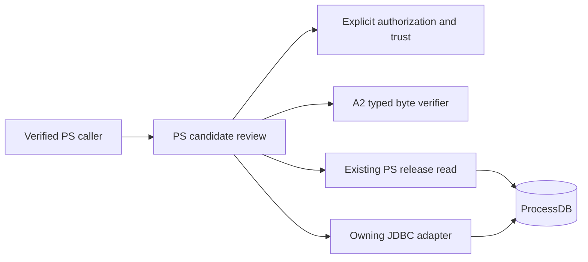
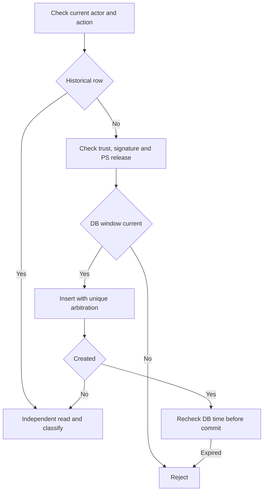
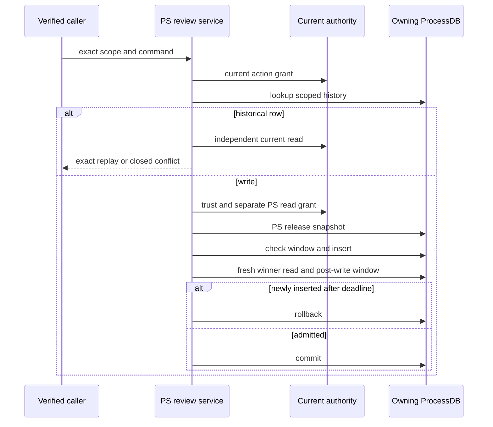
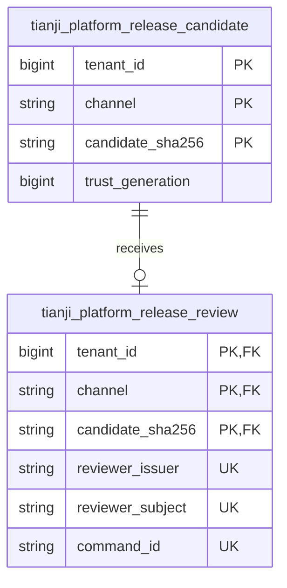

# T4-01 A3 天机发布候选与独立审阅

| Field | Value |
| --- | --- |
| Document | docs/egon/spec/2026-11-06-07-46-platform-release-candidate-review.md |
| Template Version | 9 |
| Archetype Cleanup | Not applicable |
| Status | Review |
| Type | Feature |
| Complexity | Complex |
| Complexity Drivers | 签名与权限来自独立权威，PS owning release 读取，双唯一键仲裁与有界写入 |
| Created | 2026-11-06 07:46 Asia/Shanghai |
| Updated | 2026-11-06 07:46 Asia/Shanghai |
| Owner | 天机发布治理决策方 |
| Repository | tianji-service |
| Scope | PS 内部候选提交、审阅、历史读取和唯一新增 V11 |
| Change Surface | PS release 技术包、精确迁移历史验证器、同源 SQL 和有限测试 |
| Affected Chapters | §7, §8, §9, §10, §11, §13, §14, §15, §16 |
| Source Requirement | 工作区 docs/plans/agent-framework-upgrade-plan.md §19 T4-01 不可变清单、验签与发布审核 |
| Baseline Revision | 7fd8e37057686d1e9fc7d3544668dccd0bc2efcf |
| Amends | None |
| Supersedes | None |
| Depends On | [A2 §9/10](2026-11-05-17-30-platform-release-detached-signature.md#9-interface-definitions) · [PS 快照 §9/10](2026-11-05-21-50-platform-release-process-snapshot.md#9-interface-definitions) |
| Related Specs | [PS Worker Recovery](2026-11-05-13-41-process-worker-recovery.md#62-user-mandated-java-rule-compliance) |
| Related Plans | [候选审阅实施](../plan/2026-11-06-07-47-platform-release-candidate-review.md) |

## 1. Summary

PS 在现有 ProcessDB 追加一份由已验证 SERVICE 提交的签名候选和至多一个由独立 USER 写入的终态审阅。两种写入复用 A2 验签和 PS 本地发布目录，要求显式可信装配。治理激活另行实施。

## 2. Background and Current State

| Evidence ID | Source | Observed fact |
| --- | --- | --- |
| EVD-001 | 主计划 T4-01、本对话 AGENTS.md Database migration and Flyway rules | 审核先于 CAS 激活，逻辑变更只新增一个 classpath:db Flyway 版本，已有迁移冻结。 |
| EVD-002 | PS PlatformReleaseSignatureVerifier/PlatformReleaseArtifactCli | 已有 A1 canonical envelope、A2 Ed25519、单租户/channel 和离线快照比对。 |
| EVD-003 | ProcessController.release、ProcessReleaseService.get/usesStorage、ProcessActor.verified | 已有授权读取同租户 ACTIVE release；主体携带 issuer fingerprint；LEGACY 不满足新增授权。 |
| EVD-004 | ProcessApiSchemaVerifier、ProcessStorageConfiguration、PS pom.xml、V9/V10 | 已有同源 JDBC/TransactionTemplate 和外部 Flyway。V10 Recovery 只接受已知迁移历史。 |

### 2.4 Evidence and current-chain map

| Entry/trigger | Current path | Gap and next owner |
| --- | --- | --- |
| A2 离线 | ArtifactCli → SignatureVerifier → 文件 | 缺少当前 signer 和 reviewer 权威。独立端口补充。 |
| Process release | ProcessController → ProcessReleaseService.get → ProcessDB | 已有 owner 只读来源。候选须绑定到同一次授权读。 |
| V10 readiness | ProcessApiSchemaVerifier → 精确历史 → Recovery schema | 已有模式保留。A3 加 V11 识别和单独 readiness。 |

### 2.5 Archetype example cleanup

Cleanup disposition: Not applicable

Reason: 已有 PS release 技术包与既有 ProcessDB Flyway 序列增强。没有 archetype、业务示例和生成层级变更。

## 3. Goals and Non-goals

交付同源持久候选及独立审阅事实。启用所需的生产装配、角色和权限注册、全局强序撤销、其他 owner 发布、激活与回滚各自验收。

### 3.3 Change Surface and Design Depth

| Area/layer | Disposition | Exact repository evidence | Changed or preserved behavior/contract | Required Spec treatment | Chapter(s) |
| --- | --- | --- | --- | --- | --- |
| PS release 技术应用与存储 | Affected | EVD-002/003/004 | 内部 submit/review/get、typed verifier、存储和 readiness | 权限、时间、命令、读、并发、迁移和验收 | §7, §8, §9, §10, §11, §13, §14, §15, §16 |
| PS public API、START、引擎和旧 CLI 结果 | Unchanged | ProcessController、PlatformReleaseArtifactCli | 外部合同、既有离线输出保持 | 兼容回归和源范围检查 | §14, §16 |
| Frontend、profile、PaC、Outbox 与依赖 | Not applicable | ProcessStorageConfiguration 和 PS pom.xml | 没有本切片的消费者或 Event | 检查路径和产物边界 | §12, §15 |

## 4. Requirements and Acceptance Criteria

| ID | Atomic requirement | Priority | Observable acceptance criteria | Source |
| --- | --- | --- | --- | --- |
| REQ-001 | 已验证 SERVICE 严格提交一份候选 | Must | 同 tenant/channel/完整 SHA，当前独立信任，原始有界 envelope+sidecar 验签通过才追加 | EVD-001/002/003 |
| REQ-002 | 提交与审阅对照当前 PS release | Must | 独立 owner read 授权；版本、清单和完整模型/有效输入相等 | EVD-001/003 |
| REQ-003 | 独立 USER 写一次终态审阅 | Must | 职责分离、当前 trust 未变、expectedRevision=0、ACCEPT/REJECT 为 revision 1 | EVD-001/003 |
| REQ-004 | 同源的并发、幂等和时限 | Must | 唯一键一个赢家；第二条语句读取；独立读权；精确历史或闭合冲突；晚到写入回滚 | EVD-001/004 |
| REQ-005 | 单 V11、默认关闭和旧前缀兼容 | Must | V1–V10 不改；精确 V11 与追加表独立验证；旧能力接受 V10/V11 | EVD-001/004 |

### 4.1 Scenario matrix

| Scenario | Preconditions | Main path | Result |
| --- | --- | --- | --- |
| 新候选 | verified SERVICE，当前信任/权限，PS release 一致 | 验签和对照后追加 | 单一候选及原始证据 |
| 独立审阅 | verified USER、信任代次匹配和人员分离 | 重验并对照，写入决定 | ACCEPT/REJECT revision 1 |
| 并发与历史 | 重试、另一命令、到期或换证 | 仲裁、查赢家、独立读权限或回滚 | 精确回执、闭合冲突或拒绝 |

### 4.2 Use-case analysis

| Actor ID | Actor | Goal and authorization |
| --- | --- | --- |
| ACTOR-001 | verified SERVICE | 同 scope 提交已签名候选 |
| ACTOR-002 | verified USER | 查看签名材料并独立审阅 |
| ACTOR-003 | 权威管理者 | 对确切主体和 scope 提供当前信任、授权和职责证明 |

| ID | Use case/goal | Primary actor | Trigger | Preconditions | Main outcome | Failure | Postcondition | Requirements |
| --- | --- | --- | --- | --- | --- | --- | --- | --- |
| UC-001 | 提交候选 | ACTOR-001 | Java 提交 | 当前 SUBMIT 和 trust | 提交回执 | 签名/发布/时限不符 | 最多一条候选 | REQ-001/002/004/005 |
| UC-002 | 独立审阅 | ACTOR-002 | Java 决定 | 当前授权、同代次、职责独立 | 审阅回执 | 已决定、过期或拒绝 | 唯一终态 | REQ-002/003/004/005 |
| UC-003 | 查看/重放历史 | ACTOR-001/002 | Java 读或重试 | 当前独立 READ_CANDIDATE | 同 scope 历史回执 | 缺失、拒绝或载荷冲突 | 无新事实 | REQ-004/005 |

## 5. Constraints, Assumptions, and Decisions

| ID | Decision and evidence |
| --- | --- |
| DEC-001 | CurrentTrust 选取服务端当前 scope 信任。可信 signer 责任人是 verified USER。信任为有界观察，强序撤销需要后续同事务栅栏。 |
| DEC-002 | CurrentAuthorization 逐 action 绑定完整身份和 scope。REVIEW_INDEPENDENT 额外证明人员职责分离，包括别名、委托及提交 SERVICE 的托管。 |
| DEC-003 | 用户 AGENTS 要求唯一新增 Flyway，主计划 T4-01 允许各 owner 追加事实。使用现有 PS 同源普通 JDBC、外部 Flyway 及两张不可变表，范围与 V9/V10 同一技术 profile。软删除会释放终态键，本次终身唯一。该决定限两张技术表和 V11。 |
| ASM-001 | trust generation 或签名材料变化后，同候选 SHA 不换证。获授权可以查询历史。 |
| ASM-002 | ACCEPT 是候选与 PS 本地发布对照通过并已审阅。其他依赖 owner 和治理激活仍有单独前置。 |

## 6. Project Technology Context

Java 25、Boot、JDBC/TransactionTemplate、Jackson 3。现有技术包沿 api → service → store 方向。PS pom.xml 排除 Outbox 引入的 Sharding JDBC MP Starter。ProcessStorageConfiguration 禁止应用启动时 Flyway、SQL init 和自动 schema update。当前候选 store 复用 exact engine、schema、源和事务管理器。

### 6.1 Java architecture profile and capability baseline

| Need | Exact source | Reuse decision |
| --- | --- | --- |
| JSON、签名、摘要、固定输出 | PlatformReleaseArtifactValidator、PlatformReleaseSignatureVerifier | 提取实际调用的包内 typed byte 核心。 |
| 已认证身份及发布 | ProcessActor、ProcessReleaseService.get/usesStorage | 沿用 owner read 与同源绑定，新增显式治理权威端口。 |
| 历史与同源存储 | ProcessApiSchemaVerifier、V9/V10 | 追加技术表且复用既有 readiness。 |

### 6.2 User-mandated Java rule compliance

精确技术先例。[V9](../evidence/2026-11-05-process-cancellation-storage.md) · [V10 §6.2](2026-11-05-13-41-process-worker-recovery.md#62-user-mandated-java-rule-compliance) · [V10 证据](../evidence/2026-11-05-worker-recovery-storage.md)

```text
1 类名规范，必须以 java的pojo规范命名。以dao po bo vo dto query command event等结尾
2 每层之间必须被 springboot-validation 校验，复用对象使用分组校验；基于原生和自定义约束注解、@Valid、@Validated 及 ConstraintValidator 扩展实现。ValidationUtils 只承担通用手工校验，不承载全部业务校验；电话号码复用 libphonenumber。
3 Java POJO 默认使用 class，注解为 @Data @NoArgsConstructor @AllArgsConstructor @Accessors(chain = true)，按构造目标选择 @Builder 或 @SuperBuilder；父类状态参与相等性时使用 @EqualsAndHashCode(callSuper = true)。只有不可变 value object 可以使用 record，并豁免 class 的 Lombok 规范；普通实体不能因简单而使用 record。使用 MapStruct、MapStructPlus 和 egon-cola-component-common-core 的 BaseConverter（双向）或 BaseForwardConverter（不可逆投影）进行转换。
4业务类必须使用@Slf4j注解注入log对象。如果业务类被spring管理，必须指定名称，如果是单例的情况下，参考@Service("userService")。如果需要依赖注入，必须@RequiredArgsConstructor进行修饰，不要代码中写。且属性必须被@qualify修饰。
5 工具类只允许使用jdk原生、Apache Commons(commons-lang3、commons-collections4、commons-io、commons-text、commons-codec、commons-beanutils)、Guava。针对Tika按需引入。
6 JSON 使用 Spring Boot Jackson；持久化枚举值使用 @EnumValue，向前端输出的枚举值使用 @JsonValue，禁止 ordinal 作为业务编码。
7 springboot 多环境配置文件，必须保持配置一致，但值不一定一致。
9 复杂业务必须引入设计模式，不允许硬编码
10 日期相关的必须使用java.time下的实体类，不允许使用java.util下的
11 只允许现有三层结构或当前 egon-cola-archetypes 的 DDD 结构，三层结构保持现状。必须尽量复用 egon-cola-components；持久化模块必须使用 Egon COLA MP Starter，DDL 统一由 egon-mp-sdj-ext-starter 分布式管理。业务唯一键必须组合业务列与 deletedAt（数据库 deleted_at），并验证 NULL、租户及重复软删除语义。采用 CQE（Command Query Event）；Event 必须经 egon-cola-component-transactional-outbox-starter 或 MQ 中间件投递。
```

| Literal rule | Affected? | Repository evidence | Exact design decision | Files/types/interfaces | Validation/test evidence | Status/blocker |
| --- | --- | --- | --- | --- | --- | --- |
| Rule 1 | Yes | PS immutable value 和技术组件 | 命令、回执、值对象及 verifier/store 区分 | §8/10 | TEST-001/003 | PASS |
| Rule 2 | Yes | V10 explicit technical profile、A2 严格输入 | 当前包内显式构造、bytes、角色、时间和作用域检查 | §9/10 | TEST-001/003 | PASS |
| Rule 3 | Yes | PS immutable receipt/owner mapping | defensive copy，无新 ORM 业务实体，已有 owner DTO 投影方式 | §10 | TEST-001/002 | PASS |
| Rule 4 | Yes | 既有 explicit technical factory | 同源显式装配，不引入 Spring managed Bean，记录审计 digest | §8/15 | TEST-005/006 | PASS |
| Rule 5 | Yes | A2 JDK/Jackson、PS JDBC | 复用现有工具，不加依赖 | §7 | TEST-001/006 | PASS |
| Rule 6 | Yes | Jackson 3 和闭合 SQL 枚举 | A2 JSON 合同保持，固定 ACCEPT/REJECT 无 ordinal | §9/11 | TEST-001/003 | PASS |
| Rule 7 | No | 无配置路径变更 | 不接线，配置 profile 无新增键 | §15/16 | TEST-006 | N/A |
| Rule 9 | Yes | 多权威、同源事务、现有 store Adapter | JDBC Adapter 隔离 DB 仲裁，service 组合权威 | §7/13 | TEST-003/004 | PASS |
| Rule 10 | Yes | Clock、Instant、timestamptz(6) | UTC 半开窗口和成功写入后复核 | §6.3/11 | TEST-004 | PASS |
| Rule 11 | Yes | AGENTS 单新增 Flyway、T4-01、V9/V10 PS 技术批准 | DEC-003 限同源普通 JDBC、外部 Flyway 和两张终身唯一技术审计表。MP/分布式 DDL/软删除的精确偏离仅本切片。内部 CQE。 | §5/7/11/16 | TEST-005/006/007 | PASS under scoped technical decision |

### 6.3 Time semantics and conversion contract

Time contract: Required

| Time ID | Fields/symbols | Semantics | Java/runtime type | Storage policy | Wire policy | Business zone source | Display zone source | Boundary / DST rules | Precision / Clock | Compatibility | Verification |
| --- | --- | --- | --- | --- | --- | --- | --- | --- | --- | --- | --- |
| TIME-001 | signatureIssuedAt, signatureExpiresAt | Occurred instant | Instant | UTC instant | UTC Z | UTC instant without local business zone | No new display | Start inclusive, end exclusive, no DST conversion | Seconds in signature, verification on DB clock | Existing A2 CLI Clock and output preserved | TEST-001/004 |
| TIME-002 | Grant/TrustLease, ownerObservedAt, submittedAt, decidedAt | Occurred instant | Instant | UTC instant | Internal | UTC instant without local business zone | No new display | Window intersection, post-insert check, no DST conversion | DB microseconds and no claim about commit instant | Existing PS timestamp contract preserved | TEST-002/004 |

## 7. Architecture Design

### 7.0 Minimum-design baseline and element-necessity audit

| Proposed element | Change | Requirements | Existing/direct alternative | Gap | Verdict |
| --- | --- | --- | --- | --- | --- |
| A2 typed verification | Expand | REQ-001/003 | Existing CLI stdout | File proof is not server input authority | One package method, same cryptography |
| Review service and two ports | Add | REQ-001/002/003/004 | RELEASE_READ or native approval | No candidate authority or reviewer duties | Explicit Java composition |
| Store and two audit tables | Add | REQ-004/005 | Existing Process release or command receipt | Wrong keys and lifecycle | One migration and same-source adapter |

| Path | Network calls | Client states | Failure points |
| --- | --- | --- | --- |
| A2 CLI | Zero | File verification | Path/pin/signature |
| PS internal review | No new transport; provider controls its calls | One scope and command | Authority, signature, owner, transaction |

### 7.1 System Architecture Design



### 7.2 High-Level Design



#### 7.2.2 High-level decision and quality matrix

| Concern/use case | Decision | Quality or failure constraint |
| --- | --- | --- |
| UC-001 exact signature | Bound bytes, scope, descriptor and Ed25519 | Candidate hash alone gives no signer authority |
| UC-002 reviewer independence | Current USER and explicit provider separation | Missing, stale or mismatched proof fails |
| UC-003 concurrent write/replay | Unique row and second fresh lookup | No provider I/O inside write transaction |

### 7.3 Detailed Design



Verifier compares exact canonical envelope, claim digest, independently pinned trust, role, purpose, key and UTC limits. Current PS release read checks version, manifest, full model set, cardinality and effective inputs from the owning DB. Owner time is sampled after the read. It is distinct from the release creation time. READ COMMITTED with JDBC/statement/lock timeout 5 s and transaction timeout 10 s, and no provider calls inside write. Unique scope and command key arbitrate. On success the database clock is checked both before and after insert. Exact history needs a separate current read grant.

#### 7.3.6 Conclusion evidence chain

| Conclusion | Evidence | Design and validation |
| --- | --- | --- |
| Offline proof does not supply owning release observation | EVD-002/003 | Typed verifier + direct owner read, TEST-001/002 |
| Candidate and terminal review are linked immutable facts | EVD-001/004 | Single V11 + owner/command keys, TEST-003/004/005/007 |

## 8. Package Structure and Code File Tree

PS src/main/java/top/egon/cola/platform/tianji/process/server retains package ownership. Modify PlatformReleaseSignatureVerifier and ProcessApiSchemaVerifier, add PlatformReleaseCandidateReviewService and PlatformReleaseCandidateReviewStore. Add exact V11 in the existing db/tianji-process sequence. Add two finite test types and extend the signature/catalog tests. The Plan enumerates all exact paths.

## 9. Interface Definitions

### 9.0 API protocol and documentation governance

Internal Java CQE only. No new external REST, GraphQL, OpenAPI or Event operation. Existing ProcessController, CLI and contract remain in effect.

### 9.1 Interface Inventory

| ID | Change | Purpose | Kind | Consumer | Owner | Symbol | Requirements |
| --- | --- | --- | --- | --- | --- | --- | --- |
| INTERNAL-001 | Add | Submit signed candidate | Command | verified SERVICE | PS | PlatformReleaseCandidateReviewService.submit | REQ-001/002/004 |
| INTERNAL-002 | Add | Decide once | Command | Independent verified USER | PS | PlatformReleaseCandidateReviewService.review | REQ-002/003/004 |
| INTERNAL-003 | Add | Inspect candidate and optional history | Query | verified actor | PS | PlatformReleaseCandidateReviewService.get | REQ-004 |
| INTERNAL-004 | Add | Resolve current release trust | Query port | Review service | Explicit server authority | CurrentTrust.current | REQ-001/003 |
| INTERNAL-005 | Add | Prove current exact action | Query port | Review service | Explicit server authority | CurrentAuthorization.current | REQ-001/002/003/004 |

### 9.2 Per-interface Detailed Contracts

#### INTERNAL-001 — Submit signed candidate

##### Necessity and interaction-cost decision

| Concern | Decision |
| --- | --- |
| Change classification | Add a Java-local contract with no web method, public schema or transport. |
| Independent consumer goal | 发布者取得同 scope 的不可变候选回执。 |
| Parameter ownership and derivation | actor 由已验证上下文取得，Scope 使用正租户、规范 channel 与完整候选 SHA，SignedMaterial 只含原始 envelope 1–1,048,576 字节和 sidecar 1–8,192 字节，防御性复制。 |
| Direct/no-new-interface alternative | Existing offline CLI and generic PS APIs cannot establish the requested operation and scoped audit. |
| Caller use of result | SubmissionReceipt 含完整 scope、提交 SERVICE、envelope/sidecar SHA、sourceRevision、PS releaseVersion/manifest、签名起止、trust generation/descriptor SHA/keyId/signer、提交与读取 audit SHA、ownerObservedAt 和 submittedAt。 |
| Round trips and failure points | In-process operation, with current provider and owner DB calls bounded by the admission contract. |
| Verdict | Keep a closed scope-specific operation and reuse existing signature and owner-source logic. |

##### Identity and purpose

submit(ProcessActor actor, Scope scope, SignedMaterial material)。发布者取得同 scope 的不可变候选回执。同候选完整 SHA、租户与渠道是授权、读取和审计的共同身份边界。

##### Request parameters

actor 由已验证上下文取得，Scope 使用正租户、规范 channel 与完整候选 SHA，SignedMaterial 只含原始 envelope 1–1,048,576 字节和 sidecar 1–8,192 字节，防御性复制。

##### Success response

SubmissionReceipt 含完整 scope、提交 SERVICE、envelope/sidecar SHA、sourceRevision、PS releaseVersion/manifest、签名起止、trust generation/descriptor SHA/keyId/signer、提交与读取 audit SHA、ownerObservedAt 和 submittedAt。

##### Error responses

非法输入、未验证身份、权限不足、trust/签名或 owner 不一致均拒绝。精确历史只在独立读授权后返回，换证或改内容产生 ProcessConflictException。

##### Interface logic for frontend and consumers

先授权 SUBMIT 和检查候选原始回执，再选当前信任及验签，随后授权 READ_PROCESS_RELEASE 并核对 PS owner。消费者可在同一命令安全重试。

##### Compatibility and verification

PS 内部 Java 合同单独装配，现有 HTTP、A2 CLI 和 Process START 保持。以 TEST-001 至 TEST-006 验证包内边界及现有消费者。

#### INTERNAL-002 — Record an independent decision

##### Necessity and interaction-cost decision

| Concern | Decision |
| --- | --- |
| Change classification | Add a Java-local contract with no web method, public schema or transport. |
| Independent consumer goal | 审阅者将一条终态决定归于 exact signed candidate。 |
| Parameter ownership and derivation | verified USER，Scope 同提交。ReviewCommand 的 commandId 为规范 ASCII 1–128 字节，expectedRevision 必须为 0，decision 为 ACCEPT 或 REJECT。 |
| Direct/no-new-interface alternative | Existing offline CLI and generic PS APIs cannot establish the requested operation and scoped audit. |
| Caller use of result | ReviewReceipt 返回完整 scope、reviewer、命令及 revision 1、review/independence/owner-read audit SHA、ownerObservedAt 和 decidedAt。 |
| Round trips and failure points | In-process operation, with current provider and owner DB calls bounded by the admission contract. |
| Verdict | Keep a closed scope-specific operation and reuse existing signature and owner-source logic. |

##### Identity and purpose

review(ProcessActor actor, Scope scope, ReviewCommand command)。审阅者将一条终态决定归于 exact signed candidate。同候选完整 SHA、租户与渠道是授权、读取和审计的共同身份边界。

##### Request parameters

verified USER，Scope 同提交。ReviewCommand 的 commandId 为规范 ASCII 1–128 字节，expectedRevision 必须为 0，decision 为 ACCEPT 或 REJECT。

##### Success response

ReviewReceipt 返回完整 scope、reviewer、命令及 revision 1、review/independence/owner-read audit SHA、ownerObservedAt 和 decidedAt。

##### Error responses

候选缺失是 ProcessResourceNotFoundException。签名身份相同、职责分离失败、trust 代次改变或 PS 漂移拒绝。改同 command 的 payload 产生 ProcessConflictException，另一命令终态竞争产生 ProcessVersionConflictException。

##### Interface logic for frontend and consumers

先授权 REVIEW，再识别历史；新写必须重新取得当前 trust 和 REVIEW_INDEPENDENT，重验原始材料，再做独立授权 owner read。历史分支额外要求 READ_CANDIDATE。

##### Compatibility and verification

PS 内部 Java 合同单独装配，现有 HTTP、A2 CLI 和 Process START 保持。以 TEST-001 至 TEST-006 验证包内边界及现有消费者。

#### INTERNAL-003 — Read candidate history

##### Necessity and interaction-cost decision

| Concern | Decision |
| --- | --- |
| Change classification | Add a Java-local contract with no web method, public schema or transport. |
| Independent consumer goal | 读取原始材料和现有审阅用于人工核验及复验。 |
| Parameter ownership and derivation | verified USER 或 SERVICE，scope 与 actor tenant 一致且 issuer 已验证。READ_CANDIDATE 授权只覆盖该候选。 |
| Direct/no-new-interface alternative | Existing offline CLI and generic PS APIs cannot establish the requested operation and scoped audit. |
| Caller use of result | CandidateView 包含候选提交回执、可防御性复制的原始 signed material、可选唯一审阅回执。 |
| Round trips and failure points | In-process operation, with current provider and owner DB calls bounded by the admission contract. |
| Verdict | Keep a closed scope-specific operation and reuse existing signature and owner-source logic. |

##### Identity and purpose

get(ProcessActor actor, Scope scope)。读取原始材料和现有审阅用于人工核验及复验。同候选完整 SHA、租户与渠道是授权、读取和审计的共同身份边界。

##### Request parameters

verified USER 或 SERVICE，scope 与 actor tenant 一致且 issuer 已验证。READ_CANDIDATE 授权只覆盖该候选。

##### Success response

CandidateView 包含候选提交回执、可防御性复制的原始 signed material、可选唯一审阅回执。

##### Error responses

缺失产生 ProcessResourceNotFoundException，角色或期限不足拒绝，响应不泄露另一租户或候选。trust 过期不撤销独立历史读权。

##### Interface logic for frontend and consumers

先授权再读取候选和可选决定，返回前复核授权。调用方用此查看候选，再由有独立职责的主体决定是否提交审阅。

##### Compatibility and verification

PS 内部 Java 合同单独装配，现有 HTTP、A2 CLI 和 Process START 保持。以 TEST-001 至 TEST-006 验证包内边界及现有消费者。

#### INTERNAL-004 — Resolve current signing trust

##### Necessity and interaction-cost decision

| Concern | Decision |
| --- | --- |
| Change classification | Add a Java-local contract with no web method, public schema or transport. |
| Independent consumer goal | 服务端独立确定当前签名 key、代次、有效期及责任主体。 |
| Parameter ownership and derivation | Scope 是候选具体 tenant/channel/SHA，解析绝不接受候选携带的 key、URL、信任钉选、JWT 或旧 CLI 输出。 |
| Direct/no-new-interface alternative | Existing offline CLI and generic PS APIs cannot establish the requested operation and scoped audit. |
| Caller use of result | TrustLease 绑定 Scope、独立的 1–8,192 字节描述、正 generation、descriptor SHA、keyId、verified signer USER 与 UTC observedAt/validUntil。 |
| Round trips and failure points | In-process operation, with current provider and owner DB calls bounded by the admission contract. |
| Verdict | Keep a closed scope-specific operation and reuse existing signature and owner-source logic. |

##### Identity and purpose

CurrentTrust.current(Scope scope)。服务端独立确定当前签名 key、代次、有效期及责任主体。同候选完整 SHA、租户与渠道是授权、读取和审计的共同身份边界。

##### Request parameters

Scope 是候选具体 tenant/channel/SHA，解析绝不接受候选携带的 key、URL、信任钉选、JWT 或旧 CLI 输出。

##### Success response

TrustLease 绑定 Scope、独立的 1–8,192 字节描述、正 generation、descriptor SHA、keyId、verified signer USER 与 UTC observedAt/validUntil。

##### Error responses

空结果、scope 不符、时限未到或已过、描述/key/签名不符均失败关闭；有界观察不宣称跨节点强序撤销。

##### Interface logic for frontend and consumers

在每次新写前调用一次。review 再验证与已记录 trust reference 相等。适配器提供当前证据及单调代次，失联时不使用失效缓存。

##### Compatibility and verification

PS 内部 Java 合同单独装配，现有 HTTP、A2 CLI 和 Process START 保持。以 TEST-001 至 TEST-006 验证包内边界及现有消费者。

#### INTERNAL-005 — Resolve current action authorization

##### Necessity and interaction-cost decision

| Concern | Decision |
| --- | --- |
| Change classification | Add a Java-local contract with no web method, public schema or transport. |
| Independent consumer goal | 当前主体按具体治理职责获取本次操作授权。 |
| Parameter ownership and derivation | Authorization 由服务构造，含 ProcessActor、Scope、Action 及需要时的 releaseVersion、signer、submitter。动作闭集为 SUBMIT、REVIEW、REVIEW_INDEPENDENT、READ_CANDIDATE、READ_PROCESS_RELEASE。 |
| Direct/no-new-interface alternative | Existing offline CLI and generic PS APIs cannot establish the requested operation and scoped audit. |
| Caller use of result | Grant 原样绑定请求，并带 64 位 audit SHA-256 和 UTC observedAt/validUntil。决策摘要应可由适配器的授权审计记录解释。 |
| Round trips and failure points | In-process operation, with current provider and owner DB calls bounded by the admission contract. |
| Verdict | Keep a closed scope-specific operation and reuse existing signature and owner-source logic. |

##### Identity and purpose

CurrentAuthorization.current(Authorization request)。当前主体按具体治理职责获取本次操作授权。同候选完整 SHA、租户与渠道是授权、读取和审计的共同身份边界。

##### Request parameters

Authorization 由服务构造，含 ProcessActor、Scope、Action 及需要时的 releaseVersion、signer、submitter。动作闭集为 SUBMIT、REVIEW、REVIEW_INDEPENDENT、READ_CANDIDATE、READ_PROCESS_RELEASE。

##### Success response

Grant 原样绑定请求，并带 64 位 audit SHA-256 和 UTC observedAt/validUntil。决策摘要应可由适配器的授权审计记录解释。

##### Error responses

空结果、请求/actor/tenant/发行方不匹配或超出授权时限失败关闭。人员分离的别名、委托及服务托管关系缺证时拒绝。

##### Interface logic for frontend and consumers

新写所有 action 在写入事务前查询。历史另查独立 READ_CANDIDATE。READ_PROCESS_RELEASE 绑定服务器读出的版本，不能用旧 task/普通发布授予隐式替代。

##### Compatibility and verification

PS 内部 Java 合同单独装配，现有 HTTP、A2 CLI 和 Process START 保持。以 TEST-001 至 TEST-006 验证包内边界及现有消费者。

## 10. POJO and Data Model Design

| Immutable value | Validation and ownership | Mapping |
| --- | --- | --- |
| Scope, SignedMaterial, ReviewCommand | Positive tenant, exact channel and lower SHA, bounded byte copies, fixed command format and expected revision 0 | Closed JDBC scope and raw bytea |
| Authorization, Grant, TrustReference, TrustLease | Exact verified actor/issuer/action and candidate/release; independent digest, responsibility, generation and validity | Provider proof stays in process, selected immutable digest/identity persisted |
| VerifiedCandidate | Produced only by real A2 verification; canonical envelope and key affinity; immutable model list | Legacy CLI unchanged and PS owner model set equality |
| SubmissionReceipt, ReviewReceipt, CandidateView | Record immutable facts, exact actor and scope; defensive raw arrays in SignedMaterial | Direct ResultSet projection; ACCEPT/REJECT string and derived revision 1 |
| AdmissionWindow and Adapter state | UTC intersection only, no new state machine or ORM lifecycle | Before/after DB clock gates, immutable INSERT |

A3 uses composition around A2 verifier and owner release lookup. No ORM entity, Spring-bound REST DTO, reusable generic converter or mutable task state. Audit rows are facts. Absence → submitted → optional decided; decisions never become the active release pointer.

## 11. Database Design

### 11.1 Table Inventory

| Table | Change | Physical owner | Lifecycle |
| --- | --- | --- | --- |
| tianji_platform_release_candidate | New in V11 | Owning ProcessDB schema | Immutable raw and typed submission evidence, one per tenant/channel/candidate |
| tianji_platform_release_review | New in V11 | Same owning ProcessDB schema | Immutable terminal decision, one per candidate, plus scoped actor command key |

### 11.2 Per-table Detailed Design

#### tianji_platform_release_candidate

##### Purpose, ownership, and lifecycle

Same exact owning ProcessDB schema as Process release storage. Append once, retain as audit history and retain lifetime uniqueness. No application update, delete, soft delete or retention job belongs to this slice.

##### Complete column design

| Column | Native type | Nullable/default | Design |
| --- | --- | --- | --- |
| tenant_id | bigint | NOT NULL; no default | Verified actor tenant, strictly positive on candidate and bound through review FK. |
| channel | varchar(64) COLLATE C | NOT NULL; no default | Closed lowercase ASCII channel, repeated in every key or owned read. |
| candidate_sha256 | char(64) COLLATE C | NOT NULL; no default | Full candidate digest, never a display prefix. |
| submitter_issuer | char(64) COLLATE C | NOT NULL; no default | Verified SERVICE issuer SHA-256 fingerprint. |
| submitter_subject | varchar(256) COLLATE C | NOT NULL; no default | Exact verified SERVICE subject, nonempty, trimmed and control-free. |
| envelope | bytea | NOT NULL; no default | Original canonical A1 bytes, 1–1,048,576, immutable. |
| sidecar | bytea | NOT NULL; no default | Original detached A2 signature sidecar, 1–8,192 bytes, immutable. |
| envelope_sha256 | char(64) COLLATE C | NOT NULL; no default | Raw A1 envelope SHA-256 from verifier. |
| sidecar_sha256 | char(64) COLLATE C | NOT NULL; no default | Raw A2 sidecar SHA-256. |
| source_revision | char(40) COLLATE C | NOT NULL; no default | Exact 40 hex source revision. |
| release_version | varchar(128) COLLATE C | NOT NULL; no default | Signed Process release version compared to the owner row. |
| manifest_sha256 | char(64) COLLATE C | NOT NULL; no default | Signed and owner-matched PS manifest SHA-256. |
| signature_issued_at | timestamptz(6) | NOT NULL; no default | Verified signature issuance in UTC. |
| signature_expires_at | timestamptz(6) | NOT NULL; no default | Verified exclusive UTC expiry. |
| trust_generation | bigint | NOT NULL; no default | Positive current authority generation recorded at submission. |
| trust_sha256 | char(64) COLLATE C | NOT NULL; no default | SHA-256 of independently selected raw trust descriptor. |
| signer_key_id | char(64) COLLATE C | NOT NULL; no default | Verified Ed25519 key identifier. |
| signer_issuer | char(64) COLLATE C | NOT NULL; no default | Verified signer responsibility USER issuer fingerprint. |
| signer_subject | varchar(256) COLLATE C | NOT NULL; no default | Verified signer responsibility USER subject. |
| submit_auth_sha256 | char(64) COLLATE C | NOT NULL; no default | Opaque SUBMIT audit digest. |
| owner_read_auth_sha256 | char(64) COLLATE C | NOT NULL; no default | Opaque exact READ_PROCESS_RELEASE audit digest. |
| owner_observed_at | timestamptz(6) | NOT NULL; no default | Primary DB observation immediately after owner release read. |
| submitted_at | timestamptz(6) | NOT NULL; no default | Owning DB submission observation, before signature expiry. |

##### Keys, relationships, and constraints

The primary key is tenant_id/channel/candidate_sha256. Named CHECK groups pin tenant, channel, SHA, valid subjects, release key, byte limits, generation and UTC bounds. It has no FK to native release rows so retained audit is independent of future retention.

##### Index inventory and per-index justification

| Index | Type/unique | Columns | Reason |
| --- | --- | --- | --- |
| tianji_platform_release_candidate_pkey | btree primary | tenant_id, channel, candidate_sha256 | Exact scoped lookup and one lifetime row |

##### Access patterns and SQL shape

| Operation | Caller | SQL shape and scope |
| --- | --- | --- |
| Insert | PlatformReleaseCandidateReviewStore | Schema-qualified INSERT, bound values and ON CONFLICT DO NOTHING. |
| Read winner | PlatformReleaseCandidateReviewStore | Second READ COMMITTED SELECT over same scope. |

##### Migration and historical-data handling

One additive V11 in the existing externally provisioned Flyway sequence. V1–V10 are byte-immutable. Existing releases require no backfill. Runtime V11 readiness pins script, normalized CRC32, packaged raw SHA, exact columns/constraints/indexes and scope-appropriate privileges.

##### Transaction, consistency, and recovery

Always use exact owned JDBC manager. Bounds are checked against the database immediately before append and after any successfully inserted row. Unresolved failures roll back. Concurrent losers use a separate winner query and never modify the historical result.

#### tianji_platform_release_review

##### Purpose, ownership, and lifecycle

Same exact owning ProcessDB schema as Process release storage. Append once, retain as audit history and retain lifetime uniqueness. No application update, delete, soft delete or retention job belongs to this slice.

##### Complete column design

| Column | Native type | Nullable/default | Design |
| --- | --- | --- | --- |
| tenant_id | bigint | NOT NULL; no default | Verified actor tenant, strictly positive on candidate and bound through review FK. |
| channel | varchar(64) COLLATE C | NOT NULL; no default | Closed lowercase ASCII channel, repeated in every key or owned read. |
| candidate_sha256 | char(64) COLLATE C | NOT NULL; no default | Full candidate digest, never a display prefix. |
| reviewer_issuer | char(64) COLLATE C | NOT NULL; no default | Verified USER issuer fingerprint, included in command uniqueness. |
| reviewer_subject | varchar(256) COLLATE C | NOT NULL; no default | Verified USER subject, included in command uniqueness. |
| command_id | varchar(128) COLLATE C | NOT NULL; no default | ASCII review idempotency key, scoped to tenant/channel/reviewer. |
| decision | varchar(8) COLLATE C | NOT NULL; no default | Closed ACCEPT or REJECT state. |
| review_auth_sha256 | char(64) COLLATE C | NOT NULL; no default | Opaque REVIEW grant audit digest. |
| independence_auth_sha256 | char(64) COLLATE C | NOT NULL; no default | Opaque reviewer-versus-signer/service separation grant audit digest. |
| owner_read_auth_sha256 | char(64) COLLATE C | NOT NULL; no default | Opaque exact READ_PROCESS_RELEASE audit digest. |
| owner_observed_at | timestamptz(6) | NOT NULL; no default | Primary DB observation immediately after owner release read. |
| decided_at | timestamptz(6) | NOT NULL; no default | Owning DB decision observation after owner read. |

##### Keys, relationships, and constraints

The primary key and non-deferrable NO ACTION FK share tenant_id/channel/candidate_sha256. Named CHECK groups require verified-looking issuer/subject and bounded command, closed decision, audit SHA and owner_observed_at <= decided_at.

##### Index inventory and per-index justification

| Index | Type/unique | Columns | Reason |
| --- | --- | --- | --- |
| tianji_platform_release_review_pkey | btree primary | tenant_id, channel, candidate_sha256 | Exact scoped lookup and one lifetime row |
| tianji_platform_release_review_command_idx | btree unique | tenant_id, channel, reviewer_issuer, reviewer_subject, command_id | Exact actor command replay and collision arbitration |

##### Access patterns and SQL shape

| Operation | Caller | SQL shape and scope |
| --- | --- | --- |
| Insert | PlatformReleaseCandidateReviewStore | Schema-qualified INSERT, bound values and ON CONFLICT DO NOTHING. |
| Read winner | PlatformReleaseCandidateReviewStore | Second READ COMMITTED SELECT over same scope or exact scoped reviewer command. |

##### Migration and historical-data handling

One additive V11 in the existing externally provisioned Flyway sequence. V1–V10 are byte-immutable. Existing releases require no backfill. Runtime V11 readiness pins script, normalized CRC32, packaged raw SHA, exact columns/constraints/indexes and scope-appropriate privileges.

##### Transaction, consistency, and recovery

Always use exact owned JDBC manager. Bounds are checked against the database immediately before append and after any successfully inserted row. Unresolved failures roll back. Concurrent losers use a separate winner query and never modify the historical result.

### 11.3 Entity-relationship diagram



Review command unique index also includes tenant_id and channel. Physical schema is the existing owning Process schema selected by the engine configuration.

## 12. Frontend Page Design

No UI change in this source slice. Existing tianji-web routes and protected read surfaces retain their contracts.

## 13. Design Patterns and Architecture Principles

Use an Adapter for JDBC isolation. It binds the existing process source and translates SQL constraint outcomes into a typed append result, so provider calls and business decisions stay outside transaction acquisition. Explicit ports define current independent authority without guessing production provider or adding a framework layer. A generic state machine or repository abstraction would obscure two fixed write outcomes and introduce unnecessary wiring.

## 14. Test Design

| ID | Gate | Evidence and assertion |
| --- | --- | --- |
| TEST-001 | Finite | Existing A2 signature and snapshot public-vector assertions, real Ed25519 scope/error checks and raw byte parity. |
| TEST-002 | Finite | Verified actor kinds/tenant and exact PS owner release mismatch rejection. |
| TEST-003 | Finite | Independent USER, signer equality, refusal, current generation/expiry, audited result, historical read and changed payload. |
| TEST-004 | Finite | Mock JDBC transaction READ COMMITTED fresh lookup and late DB window rollback, commit/rollback order. |
| TEST-005 | Finite | V11 prefix, V10 Recovery compatibility, exact scope FK, command index, column types and append-only role SQL. |
| TEST-006 | Static | No dependency, configuration, new HTTP/PaC, old migration or repository scope drift. |
| TEST-007 | Isolated integration acceptance | Authorized future PostgreSQL V10→V11, catalog/deparser compatibility, owner/runtime role, two connections racing, expiry rollback and V10/V11 old readers. This gate is pending runtime authority. |

## 15. Non-functional and Cross-cutting Design

Bound raw material, query, lock and transaction duration. Persist explicit audit hashes and UTC observations. Source verifies primary/origin session and role safety. Pinned append-only role denies table UPDATE/DELETE/TRUNCATE/TRIGGER/REFERENCES, column UPDATE/REFERENCES, schema ownership/CREATE, bypass/superuser, relation inheritance, rewrite rules and unsafe triggers. No role grants are shipped.

## 16. Compatibility, Migration, Rollout, and Rollback

Publish a PS build that recognizes exact V11 before the separate deployment owner may install V11. Existing V10 remains a valid prefix for Case/Cancellation/Recovery and other known-history consumers. Install V11 externally after incompatible old nodes leave service. Once migrated, code rollback floor is the first V11-aware build. Candidate operations remain disabled without explicit trusted Java composition. No previous Flyway script or applied database is changed by source delivery.

## 17. Alternatives and Decisions

| Alternative | Reason |
| --- | --- |
| Current Process release/receipt tables | Wrong authority and keys, mutable owner lifecycle cannot represent distinct immutable candidate history. |
| MP and soft delete for this path | Existing single-source PS technical transaction and user-mandated Flyway migration govern this exact slice; soft delete releases lifetime uniqueness. |
| Global revocation in this source slice | Needs same-transaction current trust writer/fence or specified deployment withdrawal bounds, beyond the independent provider contract. |

## 18. Risks and Open Questions

The production signer and authorization adapters, operator separation policies, role provisioning, owner integration and actual database acceptance require separate owner inputs. Test evidence with mock PG catalogs and transactions cannot establish live privileges or compatibility. No authority is inferred from a ProcessActor constructor, a local fixture or the packaged migration.

## 19. Traceability Matrix

| Requirement | Use case | Design | Test |
| --- | --- | --- | --- |
| REQ-001 | UC-001 | §7/9/10 | TEST-001/002 |
| REQ-002 | UC-001/002 | §7/9 | TEST-002/003 |
| REQ-003 | UC-002 | §7/9/11 | TEST-003/004 |
| REQ-004 | UC-001, UC-002, UC-003 | §7/9/11 | TEST-003/004/007 |
| REQ-005 | UC-001, UC-002, UC-003 | §11/15/16 | TEST-005/006/007 |

## 20. Review and Acceptance

### 20.5 Blocking Manual Check

| Check ID | Applicability | Status | Evidence | Finding | Required action/exception |
| --- | --- | --- | --- | --- | --- |
| MC-ARCH-001 | Applicable | PASS | §6.1, ProcessStorageConfiguration and V9/V10 | Existing technical owner and exact bounded Rule 11 scope | DEC-003 |
| MC-REUSE-001 | Applicable | PASS | §6.1 A2/owner/Flyway | Reuse actual owner read and verifier | Review scoped patch |
| MC-DEP-001 | Applicable | PASS | §6 and PS pom.xml | Current JDK/Jackson/JDBC sufficient | Preserve manifests |
| MC-NAME-001 | Applicable | PASS | §8/10 type list | Semantics separate Commands, Receipts, values and Adapter | Inspect literal names |
| MC-VALID-001 | Applicable | PASS | §9, A2 and exact PS technical profile | Closed actor, trust, scope, deadline and byte input | Run finite tests |
| MC-MODEL-001 | Applicable | PASS | §10 value classification | Immutable values and defensive arrays | Verify signatures |
| MC-CONVERT-001 | Applicable | PASS | §10, current PS ProcessController and release mapping | Direct JDBC and same neutral DTO projection within approved technical profile | No new mapper layer |
| MC-LOG-001 | Not applicable | N/A | §7/15 technical and internal data path | Audit is persisted; no new business logging contract | Never emit raw bytes |
| MC-BEAN-001 | Not applicable | N/A | §8/16 explicit construction | No Spring bean or auto startup lifecycle | No runtime activation |
| MC-UTIL-001 | Applicable | PASS | §6.1 JDK/Jackson/JDBC | Reuse approved native digest, time and existing JSON | No dependency |
| MC-JSON-001 | Applicable | PASS | §7/9 A2 | Strict unchanged JSON and no new wire schema | Verify existing CLI |
| MC-TIME-001 | Applicable | PASS | §6.3 TIME-001/002 | UTC half-open window and after-write check | Execute TEST-004 |
| MC-CONFIG-001 | Not applicable | N/A | §3.3 and §16 | No profile keys touched | Verify static scope |
| MC-PATTERN-001 | Applicable | PASS | §7/13 Adapter | Persistence isolation with explicit authority composition | Review lock boundary |
| MC-SCOPE-001 | Applicable | PASS | §3.3/11/16 and exact Plan list | Nine source paths, one new version | Verify hashes and git scope |
| MC-TEST-001 | Applicable | PASS | §14 TEST-001–007 | Finite, static and distinct live acceptance gates | Run only authorized finite gates |
| MC-BLOCKER-001 | Applicable | PASS | DEC-003 and §14/18 | Design closed for source review; runtime gates separately controlled | Keep Review until owner decision |

### 20.6 Final verdict

PASS — Ready for user review

## Java / CQE contract review

Scope, bytes, identity and current action grants form closed Java value contracts. Submitting and reviewing are commands, historical retrieval is a query. Technical audit insertion emits no Event.

## Backend generation and dependency evidence

Existing PS technical JDBC/externally provisioned Flyway and V9/V10 provide the exact owner profile. One new V11 is an additive audit migration under the user AGENTS rule. Native CRUD scaffolding, additional dependencies and runtime initialization are outside this scope.
