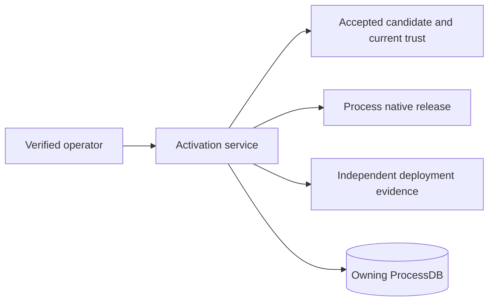
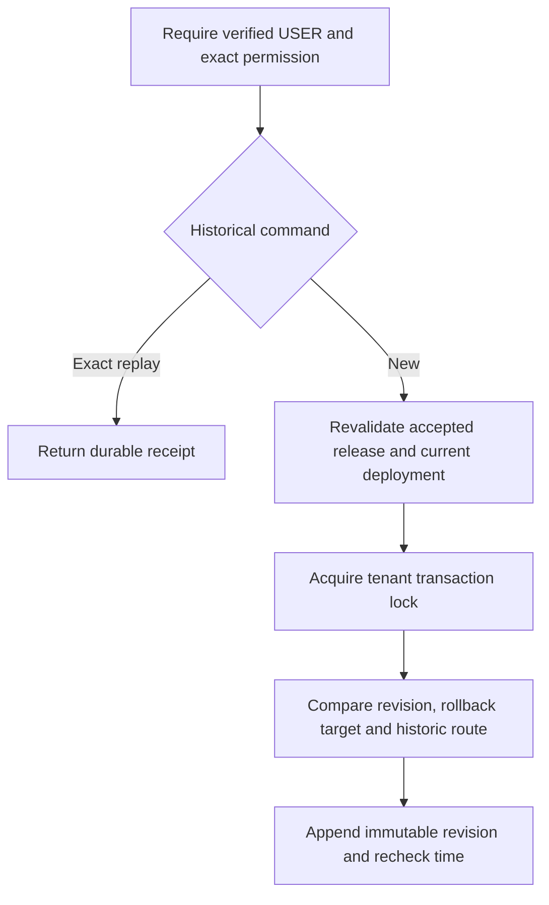
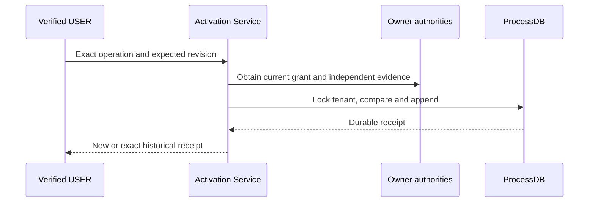
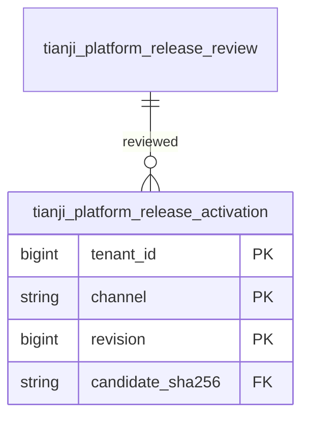

# T4-01 A4 签名发布激活和回滚规格

| Field | Value |
| --- | --- |
| Document | docs/egon/spec/2026-11-11-15-08-platform-release-activation.md |
| Template Version | 9 |
| Archetype Cleanup | Not applicable |
| Status | Review |
| Type | Feature |
| Complexity | Complex |
| Complexity Drivers | Current owner proof and immutable audit with concurrent revision comparison |
| Created | 2026-11-11 15:08 Asia/Shanghai |
| Updated | 2026-11-11 15:08 Asia/Shanghai |
| Owner | Tianji Process release governance |
| Repository | tianji-service |
| Scope | PS 的激活与回滚命令、独立发布证据、同库追加历史和 V12 |
| Change Surface | PS release technical package, schema verifier, one migration and focused tests |
| Affected Chapters | §7, §8, §10, §11, §13, §14, §15, §16 |
| Source Requirement | [主计划 T4-01](../../../../docs/plans/agent-framework-upgrade-plan.md) |
| Baseline Revision | 44d9dd530b278eac16a411faa86b9ca81fcbc736 |
| Amends | None |
| Supersedes | None |
| Depends On | [A3 §7](./2026-11-06-07-46-platform-release-candidate-review.md#7-architecture-design) |
| Related Specs | None |
| Related Plans | [A4 Plan](../plan/2026-11-11-15-09-platform-release-activation.md) |

## 1. Summary

通过实际 A2 签名、当前 A3 审阅、原生 Process 发布和独立部署证据后，按期望修订激活或回滚租户渠道。当前指针由最新追加修订表示，治理 START 消费由后续步骤接入。

## 2. Background and Current State

| Evidence ID | Repository symbol | Observed fact |
| --- | --- | --- |
| EVD-001 | PlatformReleaseSignatureVerifier and A2 CLI | Signature binds exact candidate, Process models and deployment declarations. |
| EVD-002 | PlatformReleaseCandidateReviewService and V11 | An independently accepted candidate and its current trust can be re-read in the owning Process service. |
| EVD-003 | ProcessReleaseService and VerifiedProcessModels | Release ownership and deployed native model content can be verified on the same Process source. |
| EVD-004 | AgentDispatchBinding and FlowableWorkerService.acquireAgentDispatch | A tenant's topic and schema choose an effective bridge binding. Historical uses require its continuity. |
| EVD-005 | ProcessApiSchemaVerifier and V1–V11 | Exact owning migration history and JDBC readiness already exist. |

### 2.4 Evidence and current-chain map

| Entry/trigger | Current path | Required extension |
| --- | --- | --- |
| Signed candidate review | A2 signature, V11 accepted review, current trust | Revalidate exact original material and current read grants before activation. |
| Version switch | Existing release models and current bridge registry | Append one version under same tenant lock and protect historical route bindings. |

### 2.5 Archetype example cleanup

Cleanup disposition: Not applicable

Reason: Existing Process release infrastructure and existing Flyway sequence.

## 3. Goals and Non-goals

Provide explicit internal CAS activation and rollback for an accepted signed release. Real trust, authorization and owner deployment integration, governed START consumption and isolated PostgreSQL are separately verified.

### 3.3 Change Surface and Design Depth

| Area/layer | Disposition | Exact repository evidence | Changed or preserved behavior/contract | Required Spec treatment | Chapter(s) |
| --- | --- | --- | --- | --- | --- |
| PS governance and persistence | Affected | EVD-001–005 | Current authority, append-only activation and revision arbitration | Java contracts, same-source SQL and finite proof | §7, §8, §10, §11, §13, §14, §15, §16 |
| Existing explicit Process starts | Context-only | ProcessExecutionService#start | Use explicit release commands | Scope | §16 |

## 4. Requirements and Acceptance Criteria

| ID | Requirement | Observable acceptance |
| --- | --- | --- |
| REQ-001 | Require exact reviewed signature and native release | Verify accepted candidate, current signer/trust, exact Process read and deployed model set and link. |
| REQ-002 | Require independent deployment and operation authorization | Exact caller/command and observed Agent, artifacts and Worker bindings with short validity. |
| REQ-003 | Atomically activate or roll back | One append under tenant fence and expected revision, exact replay, immediate predecessor rollback and historical route continuity. |
| REQ-004 | Preserve current schema and CLI consumers | One added V12, V11 readiness compatibility, actual original A2 proof bytes, finite gates. |

### 4.1 Scenario matrix

| Scenario | Input | Result |
| --- | --- | --- |
| First activation | Accepted signed target and expected revision 0 | One durable activation with revision 1. |
| Competing change | Different command with stale revision | Version conflict and no inserted row. |
| Exact rollback | Current revision and recorded previous accepted candidate | Append a new revision with the prior target. |
| Incompatible Worker | Same tenant topic/schema with different historical effective binding | Conflict before insertion. |

### 4.2 Use-case analysis

| Actor ID | Actor |
| --- | --- |
| ACTOR-001 | Verified tenant USER with current action-specific permission. |
| ACTOR-002 | Trusted deployment and registration authorities for the current owner sources. |

| ID | Use case/goal | Actor | Trigger | Result |
| --- | --- | --- | --- | --- |
| UC-001 | Activate or roll back one governed channel | ACTOR-001 and ACTOR-002 | Exact candidate and expected revision | Stable receipt or precise rejection. |

## 5. Constraints, Assumptions, and Decisions

Keep activation as an explicitly assembled PS capability. The independent authority must read actual publication and Worker deployment evidence, including retained registrations. Operations wait for a tenant-wide transaction advisory lock because a route can be shared across channels. First activation fixes the channel's BPMN key. Rollback selects the current row's exact previous candidate and rechecks its current authorities. Both permissions and deployment proofs are limited to thirty seconds. The JDBC write also intersects A3 signature, trust and current read windows.

## 6. Project Technology Context

Java 25, Spring JDBC and transaction manager, Flowable Process/DMN/CMMN and current Jackson 3. Preserve the deployed PS same-source model and one new version per logical schema change.

### 6.2 User-mandated Java rule compliance

```text
1 类名规范，必须以 java的pojo规范命名。以dao po bo vo dto query command event等结尾
2 每层之间必须被 springboot-validation 校验，复用对象使用分组校验；基于原生和自定义约束注解、@Valid、@Validated 及 ConstraintValidator 扩展实现。ValidationUtils 只承担通用手工校验，不承载全部业务校验；电话号码复用 libphonenumber。
3 Java POJO 默认使用 class，注解为 @Data @NoArgsConstructor @AllArgsConstructor @Accessors(chain = true)，按构造目标选择 @Builder 或 @SuperBuilder；父类状态参与相等性时使用 @EqualsAndHashCode(callSuper = true)。只有不可变 value object 可以使用 record，并豁免 class 的 Lombok 规范；普通实体不能因简单而使用 record。使用 MapStruct、MapStructPlus 和 egon-cola-component-common-core 的 BaseConverter（双向）或 BaseForwardConverter（不可逆投影）进行转换。
4业务类必须使用@Slf4j注解注入log对象。如果业务类被spring管理，必须指定名称，如果是单例的情况下，参考@Service("userService")。如果需要依赖注入，必须@RequiredArgsConstructor进行修饰，不要代码中写。且属性必须被@qualify修饰。
5 工具类只允许使用jdk原生、Apache Commons(commons-lang3、commons-collections4、commons-io、commons-text、commons-codec、commons-beanutils)、Guava。针对Tika按需引入。
6 JSON 使用 Spring Boot Jackson；持久化枚举值使用 @EnumValue，向前端输出的枚举值使用 @JsonValue，禁止 ordinal 作为业务编码。
7 springboot 多环境配置文件，必须保持配置一致，但值不一定一致。
9 复杂业务必须引入设计模式，不允许硬编码
10 日期相关的必须使用java.time下的实体类，不允许使用java.util下的
11 只允许现有三层结构或当前 egon-cola-archetypes 的 DDD 结构，三层结构保持现状。必须尽量复用 egon-cola-components；持久化模块必须使用 Egon COLA MP Starter，DDL 统一由 egon-mp-sdj-ext-starter 分布式管理。业务唯一键必须组合业务列与 deletedAt（数据库 deleted_at），并验证 NULL、租户及重复软删除语义。采用 CQE（Command Query Event）；Event 必须经 egon-cola-component-transactional-outbox-starter 或 MQ 中间件投递。
```

| Literal rule | Affected? | Repository evidence | Exact design decision | Files/types/interfaces | Validation/test evidence | Status/blocker |
| --- | --- | --- | --- | --- | --- | --- |
| Rule 1 | Yes | EVD-001–005 | 使用现有 release 包，技术 Service/Store 和不可变请求及回执类型。 | §7/8/11 | TEST-001–005 | PASS |
| Rule 2 | Yes | EVD-001–005 | 验证命令、主体、签名、当前权威、精确 owner 和持久输入。 | §7/8/11 | TEST-001–005 | PASS |
| Rule 3 | Yes | EVD-001–005 | 使用不可变值对象与现有 JDBC 记录映射，未添加 ORM 实体。 | §7/8/11 | TEST-001–005 | PASS |
| Rule 4 | No | EVD-001–005 | 显式技术构造，无 Spring Bean、日志或配置变更。 | §7/8/11 | TEST-001–005 | N/A |
| Rule 5 | Yes | EVD-001–005 | 使用现有 JDK、Jackson、JDBC、Flowable 与 JUnit。 | §7/8/11 | TEST-001–005 | PASS |
| Rule 6 | Yes | EVD-001–005 | 沿用 A2 Jackson 结构，数据库操作码明确使用 ACTIVATE 和 ROLLBACK。 | §7/8/11 | TEST-001–005 | PASS |
| Rule 7 | No | EVD-001–005 | 显式技术构造，无 Spring Bean、日志或配置变更。 | §7/8/11 | TEST-001–005 | N/A |
| Rule 9 | Yes | EVD-001–005 | 复用现有 JDBC Adapter，治理命令编排独立 owner 证据并将原子操作交给存储。 | §7/8/11 | TEST-001–005 | PASS |
| Rule 10 | Yes | EVD-001–005 | 使用 Instant、Duration 和数据库 timestamptz(6)，窗口右界排除。 | §7/8/11 | TEST-001–005 | PASS |
| Rule 11 | Yes | EVD-001–005 | 用户 AGENTS 的 Flyway 规则及主计划的同 owner 迁移边界适用。沿用 V11 同源普通 JDBC。V12 是一张生命周期不可删除的技术审计表，使用物理唯一键。 | §7/8/11 | TEST-001–005 | PASS |

### 6.3 Time semantics and conversion contract

Time contract: Required

| Time ID | Fields/symbols | Semantics | Java/runtime type | Storage policy | Wire policy | Business zone source | Display zone source | Boundary / DST rules | Precision / Clock | Compatibility | Verification |
| --- | --- | --- | --- | --- | --- | --- | --- | --- | --- | --- | --- |
| TIME-001 | activatedAt, observedAt, validUntil | Occurred instant | java.time.Instant | UTC instant | Internal | Not applicable: absolute | Not applicable: no display | Lower inclusive, upper exclusive, no local zone | Process database clock, microseconds | Existing signature and review stay valid | Step 1 TEST-001/002 |
| TIME-002 | Independent activation and deployment proof lifetime | Duration | java.time.Duration | Not persisted | Internal | Not applicable: elapsed | Not applicable: no display | At most 30 seconds | Measured using the Process database instant | Additive internal constraint | Step 1 TEST-001/002 |

## 7. Architecture Design

### 7.0 Minimum-design baseline and element-necessity audit

| Proposed element | Change | Requirements | Need |
| --- | --- | --- | --- |
| Activation command | Add | REQ-001–003 | Check two independent authorities and record the scoped action. |
| Exact A2/A3 native revalidation | Extend | REQ-001 | Existing candidate declaration alone lacks current deployment and native evidence. |
| JDBC Store and V12 | Add | REQ-003/004 | One immutable revision and command receipt per switch, with tenant-wide route arbitration. |

| Path | Network calls | Client states | Decision |
| --- | --- | --- | --- |
| Authority and owner observations | Explicit trusted adapters | Before write transaction | Require complete current typed evidence. |
| Activate or rollback | Owning ProcessDB only | One local write transaction | Compare and append one revision. |

### 7.1 System Architecture Design



### 7.2 High-Level Design

Recheck immutable signed facts and current owner evidence. Serialize the tenant's activation and rollback operations, replay exact completed commands, and append only after checking the current state.

#### 7.2.2 High-level decision and quality matrix

| Concern/use case | Decision | Verification |
| --- | --- | --- |
| Half-published release | Require independently observed exact artifacts, Agent definition and native Process release. | TEST-001 and TEST-003 |
| Concurrent changes | Read committed and separate tenant lock statement before current reads. | TEST-002 |
| Stale authorization | Compare proof and store windows with primary database clock, including a replay lookup under the lock. | TEST-001 and TEST-002 |

### 7.3 Detailed Design





#### 7.3.6 Conclusion evidence chain

| Conclusion | Evidence | Failure path |
| --- | --- | --- |
| Candidate eligible | Signed metadata and owning native artifact/Worker facts | Deny absent, stale, wrong or rejected facts. |
| Switch serialized | Owner JDBC transaction, tenant lock, latest row, immutable revision | Stale, wrong previous target or changed route cannot write. |

## 8. Package Structure and Code File Tree

| Operation | Exact path | Responsibility |
| --- | --- | --- |
| CREATE | `stellar-enclosure-tianji-process-server/src/test/java/top/egon/cola/platform/tianji/process/server/release/PlatformReleaseActivationServiceTest.java` | 真实 A2 向量与激活准入反证 |
| CREATE | `stellar-enclosure-tianji-process-server/src/test/java/top/egon/cola/platform/tianji/process/server/release/PlatformReleaseActivationStoreTest.java` | 事务次序、CAS 与回滚的有限验证 |
| CREATE | `stellar-enclosure-tianji-process-server/src/main/resources/db/tianji-process/V12__add_platform_release_activations.sql` | 唯一 V12 定义追加式修订记录 |
| MODIFY | `stellar-enclosure-tianji-process-server/src/main/java/top/egon/cola/platform/tianji/process/server/ProcessApiSchemaVerifier.java` | 独立 V12 就绪及历史识别 |
| MODIFY | `stellar-enclosure-tianji-process-server/src/test/java/top/egon/cola/platform/tianji/process/server/ProcessApiSchemaVerifierTest.java` | 既有 V11 与 V12 目录证据 |
| MODIFY | `stellar-enclosure-tianji-process-server/src/main/java/top/egon/cola/platform/tianji/process/server/release/PlatformReleaseSignatureVerifier.java` | 签名验证后导出类型化依赖证据 |
| MODIFY | `stellar-enclosure-tianji-process-server/src/main/java/top/egon/cola/platform/tianji/process/server/release/ProcessReleaseService.java` | Process owner 核对原生模型 |
| MODIFY | `stellar-enclosure-tianji-process-server/src/test/java/top/egon/cola/platform/tianji/process/server/release/ProcessReleaseServiceTest.java` | 原生模型和部署链接测试 |
| MODIFY | `stellar-enclosure-tianji-process-server/src/test/java/top/egon/cola/platform/tianji/process/server/release/PlatformReleaseCandidateReviewServiceTest.java` | 候选当前权威测试 |
| MODIFY | `stellar-enclosure-tianji-process-server/src/main/java/top/egon/cola/platform/tianji/process/server/release/PlatformReleaseCandidateReviewService.java` | 对已审阅候选重新验签 |
| CREATE | `stellar-enclosure-tianji-process-server/src/main/java/top/egon/cola/platform/tianji/process/server/release/PlatformReleaseActivationStore.java` | JDBC 事务仲裁指针修订 |
| CREATE | `stellar-enclosure-tianji-process-server/src/main/java/top/egon/cola/platform/tianji/process/server/release/PlatformReleaseActivationService.java` | 现有 PS 内部治理命令 |
| CREATE | `docs/egon/spec/2026-11-11-15-08-platform-release-activation.md` | 源码与操作者边界 |
| CREATE | `docs/egon/plan/2026-11-11-15-09-platform-release-activation.md` | 基线与验证顺序 |
| CREATE | `docs/egon/evidence/2026-11-11-platform-release-activation.md` | 可审阅的执行证据 |

## 9. Interface Definitions

The internal Java command accepts an authenticated ProcessActor and ChangeCommand with exact tenant, channel, candidate digest, command ID, expected revision and ACTIVATE or ROLLBACK. It returns the durable ActivationReceipt. There is no HTTP resource in this step.

## 10. POJO and Data Model Design

Use validated immutable records for authorization, Agent publication and contracts, package identities, Worker link, deployment proof and activation receipt. Worker route fingerprint binds tenant, actor, source, definition version and digest, instruction, timeout and current registration digest.

## 11. Database Design

### 11.1 Table Inventory

| Table | Change | Owner | Purpose |
| --- | --- | --- | --- |
| tianji_platform_release_activation | CREATE V12 | PS | Channel revisions, audit and exact command replay |

### 11.2 Per-table Detailed Design

#### tianji_platform_release_activation

##### Purpose, ownership, and lifecycle

ProcessDB owns an append-only history. The greatest revision for each exact tenant and channel is the current pointer. Historical rows remain available for replay and future provenance.

##### Complete column design

| Column | Native type | Nullable | Collation | Meaning |
| --- | --- | --- | --- | --- |
| tenant_id | bigint | NO | Native | Store validates the typed receipt and retains the exact value. |
| channel | varchar(64) | NO | C | Store validates the typed receipt and retains the exact value. |
| revision | bigint | NO | Native | Store validates the typed receipt and retains the exact value. |
| action | varchar(8) | NO | C | Store validates the typed receipt and retains the exact value. |
| actor_type | varchar(16) | NO | C | Store validates the typed receipt and retains the exact value. |
| actor_issuer | char(64) | NO | C | Store validates the typed receipt and retains the exact value. |
| actor_subject | varchar(256) | NO | C | Store validates the typed receipt and retains the exact value. |
| command_id | varchar(128) | NO | C | Store validates the typed receipt and retains the exact value. |
| process_release_version | varchar(128) | NO | C | Store validates the typed receipt and retains the exact value. |
| process_definition_key | varchar(128) | NO | C | Store validates the typed receipt and retains the exact value. |
| worker_topic | varchar(128) | NO | C | Store validates the typed receipt and retains the exact value. |
| worker_schema_version | varchar(128) | NO | C | Store validates the typed receipt and retains the exact value. |
| trust_generation | bigint | NO | Native | Store validates the typed receipt and retains the exact value. |
| activated_at | timestamptz(6) | NO | Native | Store validates the typed receipt and retains the exact value. |

##### Keys, relationships, and constraints

Primary key is tenant, channel and revision. Both target and previous candidate refer to V11 review rows in the same tenant/channel. Insert additionally requires exact accepted decision and candidate metadata. Required values, digest encodings, operation codes and chain shape are checked.

##### Index inventory and per-index justification

| Index | Type/unique | Columns | Justification |
| --- | --- | --- | --- |
| tianji_platform_release_activation_pkey | B-tree unique | tenant, channel, revision | Latest and exact revision lookup. |
| tianji_platform_release_activation_command_idx | B-tree unique | tenant, channel, actor type, issuer, subject, command | Exact historical request and conflict. |
| tianji_platform_release_activation_route_idx | B-tree | tenant, topic, schema, fingerprint | Detect incompatible prior use across channels. |

##### Access patterns and SQL shape

| Operation | Caller | SQL |
| --- | --- | --- |
| Read current | PS Store | Exact tenant and channel, revision descending, limit one. |
| Check route | PS Store | Exact tenant/topic/schema and two digest range existence probes. |
| Append | PS Store | INSERT SELECT from accepted review and exact candidate; return stored receipt. |

##### Migration and historical-data handling

V12 adds one table and two indexes. The unchanged V11 review rows supply the exact foreign key. PS readiness recognizes the known V12 history independently from activation table access.

##### Transaction, consistency, and recovery

Take the tenant advisory lock in a separate statement under READ COMMITTED. Then read command and current revision, check history and insertion clock, append, and recheck the bounded window. A failed statement or time check rolls back the local transaction.

### 11.3 Entity-relationship diagram

Relational model change: Yes



## 12. Frontend Page Design

Existing consoles retain their published contracts. Governance HTTP and UI activation are later work.

## 13. Design Patterns and Architecture Principles

The service coordinates external and owner-local evidence. The JDBC Adapter encapsulates same-source CAS, time and append-only constraints, keeping authority calls outside the write transaction.

## 14. Test Design

| Test ID | Coverage |
| --- | --- |
| TEST-001 | Actual public A2 signed vector, deployment mismatch, actor, expiry, route and replay checks. Remove exact deployment comparison for a typed negative counterexample. |
| TEST-002 | Finite JDBC sequence, conflict, rollback, accepted review and expiry checks. |
| TEST-003 | A2/A3 and owning release regression, compiled native evidence path. |
| TEST-004 | Exact V12 package, default explicit assembly, unchanged prior migration bytes, exact A2 output and PaC. |
| TEST-005 | Independent isolated PostgreSQL, native release, real authorities and concurrent operation acceptance. |

## 15. Non-functional and Cross-cutting Design

No bearer or signed payload is retained in the activation row. Durable audit references are hashes. Five-second statements and a ten-second write transaction bound lock contention. Distributed revocation after the observed proof remains outside a single Process database transaction.

## 16. Compatibility, Migration, Rollout, and Rollback

Keep existing explicit release START behavior and immutable definitions. A4 is explicit assembly. Deployed authorities and governed START provenance are prerequisites for operator cutover. Use a V12-aware source when reading a database migrated through V12.

## 17. Alternatives and Decisions

Reusing the review row would lose pointer revision history. The append-only row is both the command receipt and the current-pointer history. The tenant fence protects Worker routes shared by channels.

## 18. Risks and Open Questions

Real PostgreSQL migration and grants, true signer revocation and runtime deployment authority, governed START selection, provenance and switch behavior remain separately verifiable.

## 19. Traceability Matrix

| Requirement | Use case | Design | Verification |
| --- | --- | --- | --- |
| REQ-001 | UC-001 | §7/10 | TEST-001/003/005 |
| REQ-002 | UC-001 | §5/7/10 | TEST-001/005 |
| REQ-003 | UC-001 | §7/11 | TEST-002/005 |
| REQ-004 | UC-001 | §8/16 | TEST-003/004 |

## 20. Review and Acceptance

### 20.5 Blocking Manual Check

| Check ID | Applicability | Status | Evidence | Finding | Required action/exception |
| --- | --- | --- | --- | --- | --- |
| MC-ARCH-001 | Applicable | PASS | §7/8/14/16 | 同一 PS 数据源、Engine 和事务管理器。A3 与现有 Process 读取路径是直接依赖。 | None |
| MC-REUSE-001 | Applicable | PASS | §7/8/14/16 | 复用 A2 验签、A3 当前信任及授权、VerifiedProcessModels 与现有 schema verifier。 | None |
| MC-DEP-001 | Applicable | PASS | §7/8/14/16 | 使用仓内现有依赖。 | None |
| MC-NAME-001 | Applicable | PASS | §7/8/14/16 | release 包的 Service、Store 和不可变证据类型。 | None |
| MC-VALID-001 | Applicable | PASS | §7/8/14/16 | 精确回显授权、发布、签名和 Worker 绑定，检查 revision 和旧路由。 | None |
| MC-MODEL-001 | Applicable | PASS | §7/8/14/16 | 签名及权限数据是不可变值对象，追加表记录审计事实。 | None |
| MC-CONVERT-001 | Not applicable | N/A | §7/8/14/16 | 显式技术装配与 Java 内部合同不涉及该边界。 | None |
| MC-LOG-001 | Not applicable | N/A | §7/8/14/16 | 显式技术装配与 Java 内部合同不涉及该边界。 | None |
| MC-BEAN-001 | Not applicable | N/A | §7/8/14/16 | 显式技术装配与 Java 内部合同不涉及该边界。 | None |
| MC-UTIL-001 | Applicable | PASS | §7/8/14/16 | JDK、Jackson、JDBC 和现有项目摘要实现。 | None |
| MC-JSON-001 | Applicable | PASS | §7/8/14/16 | A2 输出字节不变，内部固定操作码。 | None |
| MC-TIME-001 | Applicable | PASS | §7/8/14/16 | 数据库时钟、UTC 发生时间、半开短授权窗口。 | None |
| MC-CONFIG-001 | Not applicable | N/A | §7/8/14/16 | 显式技术装配与 Java 内部合同不涉及该边界。 | None |
| MC-PATTERN-001 | Applicable | PASS | §7/8/14/16 | 服务编排和 JDBC Adapter，底层保持同库原子状态。 | None |
| MC-SCOPE-001 | Applicable | PASS | §7/8/14/16 | 精确文件、单一新增 V12，历史资源原字节。 | None |
| MC-TEST-001 | Applicable | PASS | §7/8/14/16 | 定向负向变体、有限回归、干净包和源码规则。 | None |
| MC-BLOCKER-001 | Applicable | PASS | §7/8/14/16 | 限本源码步骤。生产权威、治理 START 消费和真实 PostgreSQL 另有证据门禁。 | None |

### 20.6 Final verdict

PASS — Ready for user review
