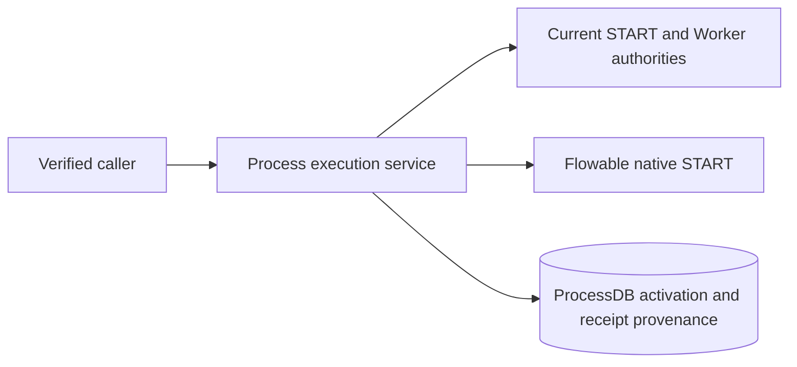
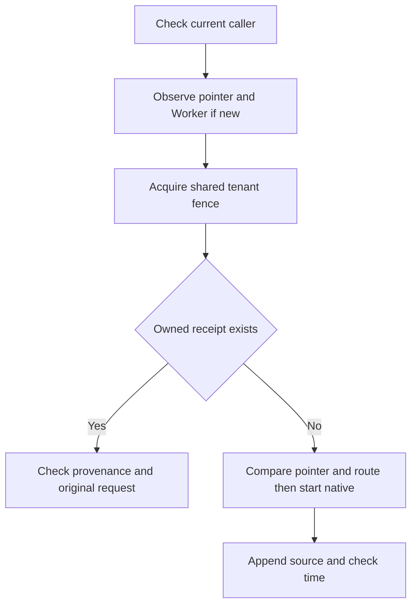
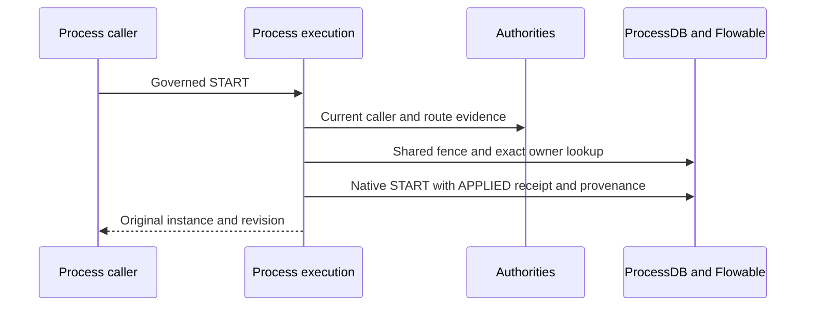
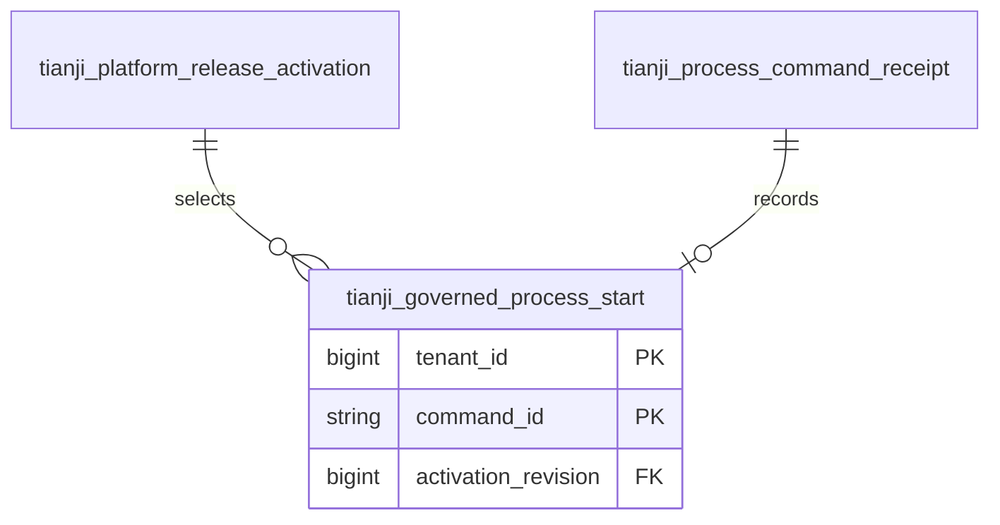

# T4-01 A5 治理 START 与原发布来源规格

| Field | Value |
| --- | --- |
| Document | docs/egon/spec/2026-11-11-15-28-governed-process-start.md |
| Template Version | 9 |
| Archetype Cleanup | Not applicable |
| Status | Review |
| Type | Feature |
| Complexity | Complex |
| Complexity Drivers | Concurrent native start and activation, historical replay and independent authority |
| Created | 2026-11-11 15:28 Asia/Shanghai |
| Updated | 2026-11-11 15:28 Asia/Shanghai |
| Owner | Tianji Process Server |
| Repository | tianji-service |
| Scope | 治理 START、原发布来源、同源事务及 V13 |
| Change Surface | PS internal execution, A4 shared fence, one V13 and finite proof |
| Affected Chapters | §7, §8, §10, §11, §13, §14, §15, §16 |
| Source Requirement | [主计划 T4-01](../../../../docs/plans/agent-framework-upgrade-plan.md) |
| Baseline Revision | e3e5603790b6e5ef51d0ec2f4583286463ad1ae8 |
| Amends | None |
| Supersedes | None |
| Depends On | [A4 §7](./2026-11-11-15-08-platform-release-activation.md#7-architecture-design) |
| Related Specs | None |
| Related Plans | [A5 Plan](../plan/2026-11-11-15-29-governed-process-start.md) |

## 1. Summary

在显式装配的 Process 内部入口中，通过当前渠道权限与独立 Worker 证据选择 A4 修订。原 START 回执、原生实例与 V13 来源在同一 ProcessDB 事务提交。精确重试读取原修订和原实例。

## 2. Background and Current State

| Evidence ID | Repository symbol | Finding |
| --- | --- | --- |
| EVD-001 | PlatformReleaseActivationStore and V12 | Latest tenant/channel revision identifies the active reviewed candidate. |
| EVD-002 | ProcessExecutionService and ProcessCommandReceiptStore | Ordinary START has one native transaction and a stable resolved-release digest. |
| EVD-003 | ApprovalVerificationService and TianjiFixedBpmnStartReceiptReader | Independent consumers verify the ordinary START digest. |
| EVD-004 | FlowableWorkerService and AgentDispatchBinding | Tenant, topic and schema select the effective Worker route. |
| EVD-005 | ProcessApiSchemaVerifier and V3/V12 | Exact catalog and full actor keys already belong to the Process source. |

### 2.4 Evidence and current-chain map

| Entry/trigger | Current path | Required extension |
| --- | --- | --- |
| A4 switch | Tenant exclusive transaction lock and activation history | New START shares its tenant lock and persists selected revision. |
| Explicit Process start | Original receipt, native instance and resolved release digest | Reuse native write and original digest. Add separate immutable provenance. |

### 2.5 Archetype example cleanup

Cleanup disposition: Not applicable

Reason: Extend existing owner code and immutable schema sequence.

## 3. Goals and Non-goals

Create a governed start which follows the active pointer, persists provenance atomically and can exactly replay after activation or rollback. Explicit production HTTP and current authority integration are separate steps.

### 3.3 Change Surface and Design Depth

| Area/layer | Disposition | Exact repository evidence | Changed or preserved behavior/contract | Required Spec treatment | Chapter(s) |
| --- | --- | --- | --- | --- |
| Process execution and provenance | Affected | EVD-001–005 | Governed transaction, original ownership and immutable revision | Runtime, SQL and finite evidence | §7, §8, §10, §11, §13, §14, §15, §16 |
| Existing Process API | Context-only | EVD-002/003 | Existing explicit contract | Compatibility | §16 |

## 4. Requirements and Acceptance Criteria

| ID | Requirement | Observable acceptance |
| --- | --- | --- |
| REQ-001 | Current explicit governed admission | Exact caller/channel/definition/command and current Worker facts match observed and locked pointer. |
| REQ-002 | Native start and exact provenance in one transaction | Preserve the ordinary START receipt, persist V13 against APPLIED receipt and A4 revision, reject partial write and expired proof. |
| REQ-003 | Original replay across pointer changes | Compare same full owner, immutable historical revision, normalized request and both digests. Legacy explicit receipt alone cannot serve governed replay. |
| REQ-004 | Compatible source and package | One V13, older migration bytes, explicit constructor behavior and current PaC. |

### 4.1 Scenario matrix

| Scenario | Input | Result |
| --- | --- | --- |
| New governed start | Exact current authority, Worker and pointer | One native process, original receipt and one source row. |
| Retry after switch | Exact existing owner and request | Same instance and original revision. |
| Pointer or route drift | Changed active revision or Worker binding | No new native instance. |
| Expiry during execution | Valid admission before start, expired before return | Roll back native and provenance writes. |

### 4.2 Use-case analysis

| Actor ID | Actor |
| --- | --- |
| ACTOR-001 | Verified Process USER or SERVICE with governed channel START permission. |
| ACTOR-002 | Independent Worker route and registration authority. |

| ID | Use case/goal | Actor | Trigger | Result |
| --- | --- | --- | --- | --- |
| UC-001 | Start or replay an instance under an activation revision | ACTOR-001 and ACTOR-002 | Valid exact command | Same-source durable instance and revision. |

## 5. Constraints, Assumptions, and Decisions

The existing explicit START entry still accepts its original resolved request, including exact ordinary replay. Governed replay requires V13, an exact caller and the original selected revision. The new entry must be explicitly constructed with real authorities. The Worker authority verifies unique effective routing across actors in the tenant and retains historical routes. Current proof windows are bounded to 30 seconds. All authority calls occur before the locked write.

## 6. Project Technology Context

Java 25, current Process Flowable, existing JdbcTemplate and Spring transactions.

### 6.2 User-mandated Java rule compliance

```text
1 类名规范，必须以 java的pojo规范命名。以dao po bo vo dto query command event等结尾
2 每层之间必须被 springboot-validation 校验，复用对象使用分组校验；基于原生和自定义约束注解、@Valid、@Validated 及 ConstraintValidator 扩展实现。ValidationUtils 只承担通用手工校验，不承载全部业务校验；电话号码复用 libphonenumber。
3 Java POJO 默认使用 class，注解为 @Data @NoArgsConstructor @AllArgsConstructor @Accessors(chain = true)，按构造目标选择 @Builder 或 @SuperBuilder；父类状态参与相等性时使用 @EqualsAndHashCode(callSuper = true)。只有不可变 value object 可以使用 record，并豁免 class 的 Lombok 规范；普通实体不能因简单而使用 record。使用 MapStruct、MapStructPlus 和 egon-cola-component-common-core 的 BaseConverter（双向）或 BaseForwardConverter（不可逆投影）进行转换。
4业务类必须使用@Slf4j注解注入log对象。如果业务类被spring管理，必须指定名称，如果是单例的情况下，参考@Service("userService")。如果需要依赖注入，必须@RequiredArgsConstructor进行修饰，不要代码中写。且属性必须被@qualify修饰。
5 工具类只允许使用jdk原生、Apache Commons(commons-lang3、commons-collections4、commons-io、commons-text、commons-codec、commons-beanutils)、Guava。针对Tika按需引入。
6 JSON 使用 Spring Boot Jackson；持久化枚举值使用 @EnumValue，向前端输出的枚举值使用 @JsonValue，禁止 ordinal 作为业务编码。
7 springboot 多环境配置文件，必须保持配置一致，但值不一定一致。
9 复杂业务必须引入设计模式，不允许硬编码
10 日期相关的必须使用java.time下的实体类，不允许使用java.util下的
11 只允许现有三层结构或当前 egon-cola-archetypes 的 DDD 结构，三层结构保持现状。必须尽量复用 egon-cola-components；持久化模块必须使用 Egon COLA MP Starter，DDL 统一由 egon-mp-sdj-ext-starter 分布式管理。业务唯一键必须组合业务列与 deletedAt（数据库 deleted_at），并验证 NULL、租户及重复软删除语义。采用 CQE（Command Query Event）；Event 必须经 egon-cola-component-transactional-outbox-starter 或 MQ 中间件投递。
```

| Literal rule | Affected? | Repository evidence | Exact design decision | Files/types/interfaces | Validation/test evidence | Status/blocker |
| --- | --- | --- | --- | --- | --- | --- |
| Rule 1 | Yes | EVD-001–005 | 内部命令、Grant、Worker 证据、Store 和只读指针值对象。 | §7/8/11 | TEST-001–005 | PASS |
| Rule 2 | Yes | EVD-001–005 | 在调用、事务和回执边界校验完整 owner、指针、请求摘要和有效期。 | §7/8/11 | TEST-001–005 | PASS |
| Rule 3 | Yes | EVD-001–005 | 复用既有回执，附加不可变来源。 | §7/8/11 | TEST-001–005 | PASS |
| Rule 4 | No | EVD-001–005 | No affected component in this Step. | §7/8/11 | TEST-001–005 | N/A |
| Rule 5 | Yes | EVD-001–005 | 现有 JDK、JDBC 及摘要工具。 | §7/8/11 | TEST-001–005 | PASS |
| Rule 6 | Yes | EVD-001–005 | 普通 START 沿用持久类型及摘要，内部来源使用固定 START。 | §7/8/11 | TEST-001–005 | PASS |
| Rule 7 | No | EVD-001–005 | No affected component in this Step. | §7/8/11 | TEST-001–005 | N/A |
| Rule 9 | Yes | EVD-001–005 | 同库 Transaction Template 和现有 Store Adapter。 | §7/8/11 | TEST-001–005 | PASS |
| Rule 10 | Yes | EVD-001–005 | UTC 主库时间，授权和 Worker 观察窗口右界排除。 | §7/8/11 | TEST-001–005 | PASS |
| Rule 11 | Yes | EVD-001–005 | 按主计划与用户 Flyway 规则使用现有同源 JDBC 和独立 V13。追加来源使用原 START 物理键与 V12 外键。 | §7/8/11 | TEST-001–005 | PASS |

### 6.3 Time semantics and conversion contract

Time contract: Required

| Time ID | Fields/symbols | Semantics | Java/runtime type | Storage policy | Wire policy | Business zone source | Display zone source | Boundary / DST rules | Precision / Clock | Compatibility | Verification |
| --- | --- | --- | --- | --- | --- | --- | --- | --- | --- | --- | --- |
| TIME-001 | createdAt, observedAt, validUntil | Occurred instant | java.time.Instant | UTC instant | Internal | Not applicable: absolute | Not applicable: no display | Lower inclusive and upper exclusive | Primary Process DB clock, microseconds | Existing receipt time and projection | Step 1 TEST-001/002 |
| TIME-002 | START grant and Worker proof lifetime | Duration | java.time.Duration | Not persisted | Internal | Not applicable: elapsed | Not applicable: no display | Maximum 30 seconds | Checked against the primary Process clock | Additive for governed START | Step 1 TEST-001/002 |

## 7. Architecture Design

### 7.0 Minimum-design baseline and element-necessity audit

| Proposed element | Change | Requirements | Need |
| --- | --- | --- | --- |
| Governed internal execution | Extend | REQ-001/002 | Consume A4 pointer with same lock and native transaction. |
| Separate append-only provenance | Add | REQ-002/003 | V2 receipt JSON is restricted to DECISION and existing readers use START. |
| Readiness and finite tests | Extend | REQ-004 | Verify role, source and ordinary behavior. |

| Path | Network calls | Client states | Decision |
| --- | --- | --- | --- |
| Authority | Explicit trusted adapters | Before write | Require same caller and exact route observation. |
| Native START | Owning ProcessDB | Read committed | Shared fence and ordinary receipt arbitration. |

### 7.1 System Architecture Design



### 7.2 High-Level Design

Read the pointer and obtain Worker proof before the transaction. After the shared tenant lock, look up original owner receipt first, then compare the same observed pointer for a new START.

#### 7.2.2 High-level decision and quality matrix

| Concern/use case | Decision | Verification |
| --- | --- | --- |
| New START follows activation | Compare observed and locked revision and verify current route. | TEST-001 |
| Native receipt atomicity | Same data source and transaction for original receipt, engine and provenance. | TEST-002 |
| Retry after rollback | Read original provenance and release before current pointer. | TEST-003 |

### 7.3 Detailed Design





#### 7.3.6 Conclusion evidence chain

| Conclusion | Evidence | Failure path |
| --- | --- | --- |
| Eligible new START | Locked revision, exact release and Worker fingerprint | Reject stale or wrong proof. |
| Durable original selection | Exact receipt, V12 and V13 under owning transaction | Roll back partial state or fail replay on mismatch. |

## 8. Package Structure and Code File Tree

| Operation | Exact path | Responsibility |
| --- | --- | --- |
| CREATE | `stellar-enclosure-tianji-process-server/src/test/java/top/egon/cola/platform/tianji/process/server/execution/GovernedProcessStartServiceTest.java` | 有限 START 与事务回归 |
| CREATE | `stellar-enclosure-tianji-process-server/src/main/resources/db/tianji-process/V13__add_governed_process_start_provenance.sql` | 唯一 V13 追加 START 来源 |
| MODIFY | `stellar-enclosure-tianji-process-server/src/main/java/top/egon/cola/platform/tianji/process/server/ProcessApiSchemaVerifier.java` | V13、V12 读取和物理权限就绪 |
| MODIFY | `stellar-enclosure-tianji-process-server/src/test/java/top/egon/cola/platform/tianji/process/server/ProcessApiSchemaVerifierTest.java` | 新旧角色和迁移前缀回归 |
| CREATE | `stellar-enclosure-tianji-process-server/src/main/java/top/egon/cola/platform/tianji/process/server/release/PlatformReleaseTenantFence.java` | 共享租户事务锁键 |
| MODIFY | `stellar-enclosure-tianji-process-server/src/main/java/top/egon/cola/platform/tianji/process/server/release/PlatformReleaseActivationStore.java` | 复用既有排他锁语义 |
| MODIFY | `stellar-enclosure-tianji-process-server/src/main/java/top/egon/cola/platform/tianji/process/server/release/PlatformReleaseActivationService.java` | 复用实际 Worker 绑定摘要 |
| CREATE | `stellar-enclosure-tianji-process-server/src/main/java/top/egon/cola/platform/tianji/process/server/execution/GovernedProcessStartStore.java` | 读取指针和写入同源来源 |
| MODIFY | `stellar-enclosure-tianji-process-server/src/main/java/top/egon/cola/platform/tianji/process/server/execution/ProcessExecutionService.java` | 激活指针接入内部新启动 |
| CREATE | `docs/egon/spec/2026-11-11-15-28-governed-process-start.md` | 明确运行行为与兼容范围 |
| CREATE | `docs/egon/plan/2026-11-11-15-29-governed-process-start.md` | 冻结范围和执行门禁 |
| CREATE | `docs/egon/evidence/2026-11-11-governed-process-start.md` | 记录实际源码与构建证据 |

## 9. Interface Definitions

The opt-in internal Java entry is ProcessExecutionService.startGoverned. It receives a verified actor and exact channel, definition key, business key, command ID, correlation ID and variables. It returns the native snapshot and original channel, activation revision and candidate hash.

## 10. POJO and Data Model Design

Use immutable command, current authorization/Worker proofs, pointer and provenance. Preserve the published native receipt and ordinary normalized digest. The governed digest domain binds channel, definition, business and correlation plus normalized inputs.

## 11. Database Design

### 11.1 Table Inventory

| Table | Change | Owner | Purpose |
| --- | --- | --- | --- |
| tianji_governed_process_start | CREATE V13 | PS | Pin original receipt to the selected activation. |

### 11.2 Per-table Detailed Design

#### tianji_governed_process_start

##### Purpose, ownership, and lifecycle

The owning Process source keeps one immutable provenance row per full START receipt key. It stays readable after the selected pointer changes.

##### Complete column design

| Column | Native type | Nullable | Collation | Meaning |
| --- | --- | --- | --- | --- |
| tenant_id | bigint | No | Native | Exact receipt, activation, audit or timestamp field. |
| subject_type | varchar(16) | No | C | Exact receipt, activation, audit or timestamp field. |
| subject_issuer | varchar(64) | No | C | Exact receipt, activation, audit or timestamp field. |
| subject_id | varchar(256) | No | C | Exact receipt, activation, audit or timestamp field. |
| command_type | varchar(32) | No | C | Exact receipt, activation, audit or timestamp field. |
| command_id | varchar(128) | No | C | Exact receipt, activation, audit or timestamp field. |
| channel | varchar(64) | No | C | Exact receipt, activation, audit or timestamp field. |
| activation_revision | bigint | No | Native | Exact receipt, activation, audit or timestamp field. |
| instance_id | varchar(255) | No | C | Exact receipt, activation, audit or timestamp field. |
| created_at | timestamptz(6) | No | Native | Exact receipt, activation, audit or timestamp field. |

##### Keys, relationships, and constraints

The primary key repeats tenant, principal type, issuer, subject, START and command ID. Foreign keys reference that exact receipt and exact tenant, channel and activation revision. Checks restrict both digest shapes and all owner identifiers.

##### Index inventory and per-index justification

| Index | Type/unique | Columns | Justification |
| --- | --- | --- | --- |
| tianji_governed_process_start_pkey | B-tree unique | Full ordinary START receipt key | One source for each command and precise replay. |

##### Access patterns and SQL shape

| Operation | Caller | SQL |
| --- | --- | --- |
| Read | PS START | Exact actor command and join immutable V12 revision. |
| Append | PS START | SELECT matched APPLIED receipt and original activation. Insert exact hash and audit. |

##### Migration and historical-data handling

V13 adds one table without data rewrite. Historical explicit START commands keep their original persisted rows and scope. A4 and older readiness continue to inspect their own schema contracts.

##### Transaction, consistency, and recovery

Governed write takes a transaction shared lock in READ COMMITTED. The existing receipt insert resolves same-command races. Native creation, receipt application and source insert share one transaction. The final primary clock check can roll the transaction back before completion.

### 11.3 Entity-relationship diagram

Relational model change: Yes



## 12. Frontend Page Design

The existing Process API and consumers continue to use their published explicit version contract. Governed control-plane exposure needs its own authority and rollout.

## 13. Design Patterns and Architecture Principles

Reuse the same native execution code and existing Transaction Template and Store Adapter. The provenance Store keeps selection and relational witness details outside the execution flow.

## 14. Test Design

| Test ID | Coverage |
| --- | --- |
| TEST-001 | New pointer, authority, exact Worker, stale revision and default constructor behavior. |
| TEST-002 | Native commit and appended provenance, expiry before final commit, schema roles and constraints. |
| TEST-003 | Historical replay, mutated request, explicit receipt conflict and ordinary caller compatibility. |
| TEST-004 | Clean archives, exact V13, previous SQL and PaC. |
| TEST-005 | Independent real Flowable/PG concurrency, authority and explicit opt-in runtime proof. |

## 15. Non-functional and Cross-cutting Design

Write path uses bounded statements and lock timeout. Retain a safe authorization digest and the provenance identifiers, with no raw bearer. Verification rechecks the short observation window immediately before returning the transaction result.

## 16. Compatibility, Migration, Rollout, and Rollback

The original three-argument execution constructor supplies existing explicit behavior. Governed starts require explicit authority and V13 readiness. Replays of governed commands stay pinned even after a later active-pointer rollback. Existing instances retain native version identity.

## 17. Alternatives and Decisions

Use a V13 source row because existing receipt payload shape and external digest are already used for approval and reconciliation. A shared tenant lock coordinates creation against A4 switches without serializing ordinary native instances.

## 18. Risks and Open Questions

Production current authority assembly, channel-aware entry exposure, isolated PG/Flowable locking and actual switch acceptance remain independent.

## 19. Traceability Matrix

| Requirement | Use case | Design | Tests |
| --- | --- | --- | --- |
| REQ-001 | UC-001 | §7/10 | TEST-001/005 |
| REQ-002 | UC-001 | §7/11 | TEST-002/005 |
| REQ-003 | UC-001 | §7/10/16 | TEST-003/005 |
| REQ-004 | UC-001 | §8/16 | TEST-004 |

## 20. Review and Acceptance

### 20.5 Blocking Manual Check

| Check ID | Applicability | Status | Evidence | Finding | Required action/exception |
| --- | --- | --- | --- | --- | --- |
| MC-ARCH-001 | Applicable | PASS | §7/8/14/16 | 同一 ProcessDB、Flowable 和事务管理器。 | None |
| MC-REUSE-001 | Applicable | PASS | §7/8/14/16 | 沿用 Process START 回执、已有 digest、VerifiedProcessModels 和 A4 锁键。 | None |
| MC-DEP-001 | Applicable | PASS | §7/8/14/16 | 现有 Java、JDBC、Flowable 和 JUnit 足够。 | None |
| MC-NAME-001 | Applicable | PASS | §7/8/14/16 | 内部命令、Grant、Worker 证据、Store 和只读指针值对象。 | None |
| MC-VALID-001 | Applicable | PASS | §7/8/14/16 | 在调用、事务和回执边界校验完整 owner、指针、请求摘要和有效期。 | None |
| MC-MODEL-001 | Applicable | PASS | §7/8/14/16 | 复用既有回执，附加不可变来源。 | None |
| MC-CONVERT-001 | Not applicable | N/A | §7/8/14/16 | 本步骤的显式技术装配未涉及该边界。 | None |
| MC-LOG-001 | Not applicable | N/A | §7/8/14/16 | 本步骤的显式技术装配未涉及该边界。 | None |
| MC-BEAN-001 | Not applicable | N/A | §7/8/14/16 | 本步骤的显式技术装配未涉及该边界。 | None |
| MC-UTIL-001 | Applicable | PASS | §7/8/14/16 | 现有 JDK、JDBC 及摘要工具。 | None |
| MC-JSON-001 | Applicable | PASS | §7/8/14/16 | 普通 START 沿用持久类型及摘要，内部来源使用固定 START。 | None |
| MC-TIME-001 | Applicable | PASS | §7/8/14/16 | UTC 主库时间，授权和 Worker 观察窗口右界排除。 | None |
| MC-CONFIG-001 | Not applicable | N/A | §7/8/14/16 | 本步骤的显式技术装配未涉及该边界。 | None |
| MC-PATTERN-001 | Applicable | PASS | §7/8/14/16 | 同库 Transaction Template 和现有 Store Adapter。 | None |
| MC-SCOPE-001 | Applicable | PASS | §7/8/14/16 | 单一 V13、内部入口及限定测试。 | None |
| MC-TEST-001 | Applicable | PASS | §7/8/14/16 | 精确反证、定向测试、干净包和旧合约检查。 | None |
| MC-BLOCKER-001 | Applicable | PASS | §7/8/14/16 | 源码行为及验证范围明确。真实主库、权限和上线后入口由独立验收覆盖。 | None |

### 20.6 Final verdict

PASS — Ready for user review
