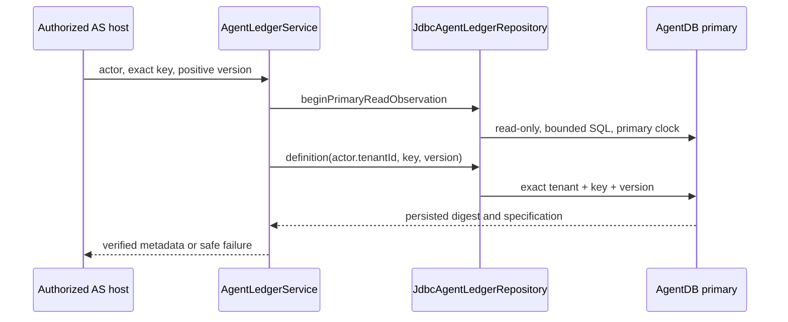

# T4-01 AS 已发布定义所有者证据规格

| Field | Value |
| --- | --- |
| Document | docs/egon/spec/2026-11-11-15-40-as-published-definition-evidence.md |
| Template Version | 9 |
| Archetype Cleanup | Not applicable |
| Status | Review |
| Type | Feature |
| Complexity | Simple |
| Complexity Drivers | One local committed publication lookup and exact content verification |
| Created | 2026-11-11 15:40 Asia/Shanghai |
| Updated | 2026-11-11 15:40 Asia/Shanghai |
| Owner | Tianji Agent Runtime |
| Repository | tianji-service |
| Scope | AS 所有者发布账本的精确本地只读证明 |
| Change Surface | AR owner query, immutable metadata projection and finite fixture |
| Affected Chapters | §7, §8, §9, §10, §14, §15, §16 |
| Source Requirement | [主计划 T4-01](../../../../docs/plans/agent-framework-upgrade-plan.md) |
| Baseline Revision | fb89f4c6d96b1aeee325ddb59937c2a9ef366c4a |
| Amends | None |
| Supersedes | None |
| Depends On | [A4 独立部署证据契约](./2026-11-11-15-08-platform-release-activation.md#9-interface-definitions) |
| Related Specs | [A5 治理 START](./2026-11-11-15-28-governed-process-start.md) |
| Related Plans | [AS 发布证据 Plan](../plan/2026-11-11-15-41-as-published-definition-evidence.md) |

## 1. Summary

提供 AS 发布账本的本地精确版本读取。已对租户、定义和版本完成授权的宿主可读取已提交的定义摘要与不可变元数据，供后续真实发布权威组合使用。

## 2. Background and Current State

| Evidence ID | Repository symbol | Finding |
| --- | --- | --- |
| EVD-001 | `AgentLedgerService#publish` and `JdbcAgentLedgerRepository#definition` | AR 以 tenant、definition key、version 记录并读取不可变版本，持久化原 canonical SHA-256。 |
| EVD-002 | `AgentJsonCodec#definitionHash` | 摘要覆盖执行方式、code ref、契约版本、依赖、策略及配置，外层 key 与 version 由数据库主键绑定。 |
| EVD-003 | `AgentLedgerService#listByCorrelation` and `JdbcAgentLedgerRepository#beginPrimaryReadObservation` | 已有同源独立只读事务及 PostgreSQL 主库观察时刻。 |
| EVD-004 | `TrustedAgentActor` and `AgentLedgerService#executionMaterial` | 前者承载已授权调用者身份，后者依赖已存在的运行，发布激活发生在启动之前。 |
| EVD-005 | `PlatformReleaseActivationService.CurrentDeploymentEvidence` and `PlatformReleaseArtifactValidator` | A4 需要独立 AS 内容证明和其他部署事实，A1 的源文件字节摘要单独记录。 |

### 2.4 Evidence and current-chain map

| Entry/trigger | Current path | Required extension |
| --- | --- | --- |
| Definition publish | Owner tenant and key/version → immutable version row → canonical digest | Reuse same exact owner lookup and digest. |
| Read by correlation | Primary transaction with physical read-only and statement timeout | Reuse observation controls for one release query. |

### 2.5 Archetype example cleanup

Cleanup disposition: Not applicable

Reason: Extend the existing ledger. No project generation or Example files are involved.

## 3. Goals and Non-goals

唯一目标是可独立复核 AR 的已提交发布版本。部署制品、模型运行时就绪、跨服务传输、授权登记、HTTP、签名撤销及真实集成验收分别交付。

### 3.3 Change Surface and Design Depth

| Area/layer | Disposition | Exact repository evidence | Changed or preserved behavior/contract | Required Spec treatment | Chapter(s) |
| --- | --- | --- | --- | --- | --- |
| AR owner publication query | Affected | EVD-001–004 | 精确查询、只读事务、摘要与安全投影 | 本地 Java 合同及有限测试 | §7, §8, §9, §10, §14, §15, §16 |
| AS HTTP, public SDK and PS authority | Context-only | EVD-004/005 | 后续接入需独立批准的精确权限及权威 | 兼容及接入边界 | §16, §18 |
| Published schema and history | Unchanged | EVD-001 | 复用既有表和 SQL | 主键和读取语义 | §11 |

## 4. Requirements and Acceptance Criteria

| ID | Requirement | Observable acceptance |
| --- | --- | --- |
| REQ-001 | 只读主库中精确取出已提交的版本 | 只读事务读取 actor 租户、key、version，缺失给出范围内的资源不可用。现有事务不得调用。 |
| REQ-002 | 校验内容摘要和内嵌身份 | 重算摘要并比对持久值。内嵌 key 和 version 分别比对。损坏、摘要或身份不符时拒绝并脱敏。 |
| REQ-003 | 安全的不可变投影和本地信任边界 | 只含 §10 所列字段。拒绝无身份或 LEGACY，键值必须精确。宿主先完成真实鉴权。 |
| REQ-004 | 可复核有限证据和最小范围 | R1 精确反证及 G1 全部有限用例通过各自预期。S1 范围、结构与 31 份基线 SQL 逐字节一致。 |

### 4.1 Scenario matrix

| Scenario | Input | Result |
| --- | --- | --- |
| Exact version | 已验证且获授权宿主，指定当前租户 key/version | 返回提交版本的安全投影。 |
| Missing or foreign | 其他租户、键或版本 | `TIANJI_RESOURCE_NOT_FOUND`。 |
| Unverified caller | null 或 LEGACY actor | `TIANJI_PERMISSION_DENIED`，无数据源 I/O。 |
| Corrupt row | 损坏 JSON、错误摘要或嵌入身份不符 | `TIANJI_DEPENDENCY_UNAVAILABLE`，错误不暴露源异常。 |
| Invalid or unavailable source | 不精确输入、已有事务、非主库或数据库错误 | 输入错误用 `TIANJI_INVALID_COMMAND`，源不可用用 `TIANJI_DEPENDENCY_UNAVAILABLE`。 |

### 4.2 Use-case analysis

| Actor ID | Actor |
| --- | --- |
| ACTOR-001 | 同一 AS 进程内已独立鉴权的宿主适配器。 |
| ACTOR-002 | Agent Runtime 所有者主库。 |

| ID | Use case/goal | Actor | Trigger | Result |
| --- | --- | --- | --- | --- |
| UC-001 | 获取精确已提交版本的安全投影 | ACTOR-001/002 | 现有发布事实需要校验 | Exact published metadata or fail closed. |

## 5. Constraints, Assumptions, and Decisions

内部 actor 是宿主已授权结果的载体。合法 issuer 指纹的形状本身无法建立身份来源或权限。宿主必须先验证身份和精确租户、键、版本的发布读取授权，再调用本地方法。方法拒绝无身份和 LEGACY，并从 actor 推出租户。发布入参的原 ContractChecks.required 使用 trim，现有已发布键按落库值查找。当前证据查询拒绝歧义和危险字符，不自动对查询键做 trim 或 Unicode 规范化。READ COMMITTED 的 publish 行在独立的 REPEATABLE READ 快照后可观察，本方法拒绝任何已绑定的事务或资源。

## 6. Project Technology Context

复用 Java 25、现有 Spring JDBC、TransactionTemplate、Jackson codec、JUnit 和 Mockito。保留 AR 现有账本包结构和普通 JDBC 事务边界。

### 6.2 User-mandated Java rule compliance

```text
1 类名规范，必须以 java的pojo规范命名。以dao po bo vo dto query command event等结尾
2 每层之间必须被 springboot-validation 校验，复用对象使用分组校验；基于原生和自定义约束注解、@Valid、@Validated 及 ConstraintValidator 扩展实现。ValidationUtils 只承担通用手工校验，不承载全部业务校验；电话号码复用 libphonenumber。
3 Java POJO 默认使用 class，注解为 @Data @NoArgsConstructor @AllArgsConstructor @Accessors(chain = true)，按构造目标选择 @Builder 或 @SuperBuilder；父类状态参与相等性时使用 @EqualsAndHashCode(callSuper = true)。只有不可变 value object 可以使用 record，并豁免 class 的 Lombok 规范；普通实体不能因简单而使用 record。使用 MapStruct、MapStructPlus 和 egon-cola-component-common-core 的 BaseConverter（双向）或 BaseForwardConverter（不可逆投影）进行转换。
4业务类必须使用@Slf4j注解注入log对象。如果业务类被spring管理，必须指定名称，如果是单例的情况下，参考@Service("userService")。如果需要依赖注入，必须@RequiredArgsConstructor进行修饰，不要代码中写。且属性必须被@qualify修饰。
5 工具类只允许使用jdk原生、Apache Commons(commons-lang3、commons-collections4、commons-io、commons-text、commons-codec、commons-beanutils)、Guava。针对Tika按需引入。
6 JSON 使用 Spring Boot Jackson；持久化枚举值使用 @EnumValue，向前端输出的枚举值使用 @JsonValue，禁止 ordinal 作为业务编码。
7 springboot 多环境配置文件，必须保持配置一致，但值不一定一致。
9 复杂业务必须引入设计模式，不允许硬编码
10 日期相关的必须使用java.time下的实体类，不允许使用java.util下的
11 只允许现有三层结构或当前 egon-cola-archetypes 的 DDD 结构，三层结构保持现状。必须尽量复用 egon-cola-components；持久化模块必须使用 Egon COLA MP Starter，DDL 统一由 egon-mp-sdj-ext-starter 分布式管理。业务唯一键必须组合业务列与 deletedAt（数据库 deleted_at），并验证 NULL、租户及重复软删除语义。采用 CQE（Command Query Event）；Event 必须经 egon-cola-component-transactional-outbox-starter 或 MQ 中间件投递。
```

| Literal rule | Affected? | Repository evidence | Exact design decision | Files/types/interfaces | Validation/test evidence | Status/blocker |
| --- | --- | --- | --- | --- | --- | --- |
| Rule 1 | Yes | EVD-001–005 | 既有账本上增加查询方法与 PublishedDefinitionEvidenceDTO。 | §7/8/10 | TEST-001–004 | PASS |
| Rule 2 | Yes | EVD-001–005 | 非 Bean 入口显式校验精确身份、key、版本及仓储返回；复用既有 DTO 构造校验。 | §7/8/10 | TEST-001–004 | PASS |
| Rule 3 | Yes | EVD-001–005 | 新投影仅为不可变 record，无可变 POJO 或 Converter。 | §7/8/10 | TEST-001–004 | PASS |
| Rule 4 | No | EVD-001–005 | 现有账本构造和装配不变，无新 Spring Bean、注入构造器或限定符。 | §7/8/10 | TEST-001–004 | N/A |
| Rule 5 | Yes | EVD-001–005 | 复用 JDK 字符校验及现有摘要和 JSON 工具。 | §7/8/10 | TEST-001–004 | PASS |
| Rule 6 | Yes | EVD-001–005 | 沿用既有 Jackson canonical 发布摘要，无枚举或序列化合同变更。 | §7/8/10 | TEST-001–004 | PASS |
| Rule 7 | No | EVD-001–005 | 无应用配置文件、属性及运行开关变更。 | §7/8/10 | TEST-001–004 | N/A |
| Rule 9 | Yes | EVD-001–005 | 沿用本地 Query、现有 Repository 与同源 TransactionTemplate。 | §7/8/10 | TEST-001–004 | PASS |
| Rule 10 | Yes | EVD-001–005 | 观察时刻使用 UTC Instant。 | §7/8/10 | TEST-001–004 | PASS |
| Rule 11 | Yes | EVD-001–005 | 按主计划 §18 AR 技术账本所有权复用既有 JDBC，零表、迁移、索引、Event 或模块改动。 | §7/8/10 | TEST-001–004 | PASS |

### 6.3 Time semantics and conversion contract

Time contract: Required

| Time ID | Fields/symbols | Semantics | Java/runtime type | Storage policy | Wire policy | Business zone source | Display zone source | Boundary / DST rules | Precision / Clock | Compatibility | Verification |
| --- | --- | --- | --- | --- | --- | --- | --- | --- | --- | --- | --- |
| TIME-001 | observedAt | Occurred instant | java.time.Instant | Not persisted | Internal | Not applicable: absolute UTC | Not applicable: no display | No time windows or calendar arithmetic | Owner PostgreSQL clock_timestamp, database precision | Additive observation of existing immutable row | Step 1 TEST-002 fixture and G1 |
| TIME-002 | Read transaction and statement timeout | Duration | Spring seconds and PostgreSQL statement_timeout | Not persisted | Internal | Not applicable: elapsed | Not applicable: no display | 2 seconds for transaction configuration and SQL limit, no end-to-end guarantee | Spring transaction budget and PostgreSQL timeout | Existing read-observation policy | Step 1 TEST-002 fixture and G1 |

## 7. Architecture Design

### 7.0 Minimum-design baseline and element-necessity audit

| Proposed element | Change | Requirements | Need |
| --- | --- | --- | --- |
| Owner query | Extend | REQ-001/002 | Source comes directly from AR primary and existing immutable row. |
| Immutable projection | Create | REQ-003 | Expose only verified public-to-host metadata. |
| Focused fixture | Create | REQ-004 | Exercises exact SQL, scope, failure and redaction. |

| Path | Network calls | Client states | Decision |
| --- | --- | --- | --- |
| AS ledger query | 仅现有 AR 数据源 | 一个结果或类型化失败 | 复用本地查询。 |
| Remote authority | 本步零跨服务调用 | 无外部入口 | 后续以真实身份与有界传输装配。 |

### 7.1 System Architecture Design

既有宿主在完成独立授权后调用账本。账本在同一已配置 DataSource 上建立独立事务，并经既有仓储读取精确版本。返回元数据供之后独立组装的发布兼容性服务消费。

### 7.2 High-Level Design

读取前校验可信调用者形状、输入与事务前置条件。物理事务切换到只读，核对实际主库并取 UTC 时刻。精确查找后重算摘要，校验内嵌身份，最后仅返回不可变标量。

### 7.3 Detailed Design



| Condition | Outcome |
| --- | --- |
| Missing identity or LEGACY | Safe permission denial before I/O. |
| Malformed key or nonpositive version | Safe command error before I/O. |
| Existing transaction or interrupt | Dependency unavailable. Preserve interrupt state. |
| Missing row | Scope-local resource not found. |
| Non-primary, invalid stored JSON, digest or embedded identity mismatch | Safe dependency unavailable. No raw source or cause returned. |
| Exact match | Return verified projection and source observation instant. |

### 7.3.6 Conclusion evidence chain

EVD-001 与 EVD-002 证明能重算已有发布身份，EVD-003 为读取提供主库只读模板，EVD-004 将宿主授权与账本查询区分开。EVD-005 说明这个投影只覆盖 A4 综合证明的 AS 内容部分。

## 8. Package Structure and Code File Tree

| Operation | Exact path | Responsibility |
| --- | --- | --- |
| CREATE | `stellar-enclosure-tianji-agent-runtime/src/test/java/top/egon/cola/platform/tianji/agent/infrastructure/persistence/AgentPublishedDefinitionEvidenceTest.java` | 精确 owner 查询、受限 SQL、摘要、内嵌键及版本的有限反证。 |
| MODIFY | `stellar-enclosure-tianji-agent-runtime/src/main/java/top/egon/cola/platform/tianji/agent/infrastructure/persistence/AgentLedgerService.java` | 既有账本扩展精确发布版本查询与不可变证据投影。 |
| CREATE | `docs/egon/spec/2026-11-11-15-40-as-published-definition-evidence.md` | 冻结所有者证明、时限与调用方身份边界。 |
| CREATE | `docs/egon/plan/2026-11-11-15-41-as-published-definition-evidence.md` | 冻结路径、摘要、有限门禁和提交范围。 |
| CREATE | `docs/egon/evidence/2026-11-11-as-published-definition-evidence.md` | 记录实际执行的本地证据和待验收事项。 |

## 9. Interface Definitions

### 9.1 Interface Inventory

| ID | Interface | Style | Scope |
| --- | --- | --- | --- |
| INT-001 | AgentLedgerService.publishedDefinitionEvidence | Internal Java Query | 已授权的同进程宿主。 |

### 9.2 Per-interface Detailed Contracts

只提供内部 Java Query `AgentLedgerService.publishedDefinitionEvidence(TrustedAgentActor actor, String definitionKey, long version)`。key 为精确非空 UTF-8 字符串，Java 长度不超过 128，无首尾空白或控制字符。版本必须为正。actor 为已完成授权的 issuer 绑定身份。返回 §10 DTO 或 §7.3 的有限错误。无 HTTP、OpenAPI、PaC、SDK 或资源权限合同变更。

## 10. POJO and Data Model Design

| Field | Type | Meaning |
| --- | --- | --- |
| tenantId | long | 从已授权 actor 派生。 |
| definitionKey, definitionVersion | String, long | 请求与持久 JSON 中一致的精确发布身份。 |
| definitionContentSha256 | String | 重算后与发布账本一致的 canonical SHA-256。 |
| executionMode | String | 已发布执行模式。 |
| inputSchemaVersion, outputSchemaVersion | String | 已声明的精确契约版本。 |
| modelRouteRef, policyVersionRef | String | 已发布的依赖引用。 |
| optionalDependenciesPresent | boolean | Prompt、Skill、Tool 三组引用中至少一组非空。 |
| observedAt | Instant | 主库校验时的数据库观察时刻。 |

DTO 是不可变 record，日志表示脱敏。字段仅供对租户及精确版本获授权的内部用途，调用方应限制传播。定义配置、策略正文、可选依赖明细及源码制品摘要均不进入投影。

## 11. Database Design

Relational model change: No. 读取现有 `tianji_agent.agent_definition_version`，按原有主键 `(tenant_id, definition_key, version)` 取 `content_sha256` 和 `specification`。零 DDL、数据写入、索引或迁移。全部 31 份既有 SQL 保持字节一致。

## 12. Frontend Page Design

本地 owner query 无 UI 入口。

## 13. Design Patterns and Architecture Principles

使用既有 Query 与 Repository，不引入新的存储实现或跨库事务。只读投影的来源证明与调用者鉴权分别在原所有者和宿主边界完成。

## 14. Test Design

| Test ID | Design |
| --- | --- |
| TEST-001 | R1 三次独立删除摘要、内嵌 key、内嵌版本校验，精确选中单方法，均应因缺失预期 AgentLedgerException 而失败。 |
| TEST-002 | G1 六个本步有限用例覆盖精确租户、key/version、观察时刻、脱敏、无身份、已有事务、只读与源故障。 |
| TEST-003 | G1 回归既有 AgentJsonCodecTest、AgentRunCorrelationLookupTest、JTokkitChatModelBudgetEstimatorTest，共 34 项。 |
| TEST-004 | S1 strict Spec/Plan、文件 SHA 与精确范围。31 份 SQL 同基线。 |

## 15. Non-functional and Cross-cutting Design

SQL 使用事务配置及物理语句的 2 秒超时。连接获取、Java 解码及摘要重算和事务清理仍须在后续实际部署证明端到端时限。本步将故障归为安全错误，并保持源异常、配置和引用正文私有。

## 16. Compatibility, Migration, Rollout, and Rollback

新增本地读取方法由已授权宿主显式调用。现有启动、发布、运行及既有错误合同继续通过原入口。部署侧尚无新增调用者。回滚为撤销单一提交，无 schema 清理。

## 17. Alternatives and Decisions

选定原发布账本的精确读取和原摘要算法。运行 snapshot 要求已有 run；从候选 envelope 读取会让候选自证；PS 直接读 AgentDB 会跨越已有数据所有权。

## 18. Risks and Open Questions

接入前需要真实调用者权限与身份传递、实际主库验证、端到端时限、独立运行时模型检查、部署签名与制品来源。JTokkit 仅能证明其实际装配的受限绑定，自定义估算器需要等效所有者检查。

## 19. Traceability Matrix

| Requirement | Use case | Design | Tests |
| --- | --- | --- | --- |
| REQ-001 | UC-001 | §7/9/11 | TEST-002/003 |
| REQ-002 | UC-001 | §7/10 | TEST-001/002/003 |
| REQ-003 | UC-001 | §5/9/10/15 | TEST-002 |
| REQ-004 | UC-001 | §8/14/16 | TEST-001–004 |

## 20. Review and Acceptance

### 20.5 Blocking Manual Check

| Check ID | Applicability | Status | Evidence | Finding | Required action/exception |
| --- | --- | --- | --- | --- | --- |
| MC-ARCH-001 | Applicable | PASS | §7/8 | 仅扩展既有 AR 所有者账本。同一事务管理器和主数据源。 | None |
| MC-REUSE-001 | Applicable | PASS | EVD-001–005 | 复用既有仓储、只读主库观察与发布摘要。 | None |
| MC-DEP-001 | Applicable | PASS | §6/8 | AR 现有 Java、Spring JDBC、Jackson、JUnit、Mockito 足够。 | None |
| MC-NAME-001 | Applicable | PASS | §8/10 | 查询行为在现有服务上，投影为不可变 PublishedDefinitionEvidenceDTO。 | None |
| MC-VALID-001 | Applicable | PASS | §5/7/9 | 在无代理本地入口拒绝无效身份、非精确键或版本以及已有事务。在仓储返回后校验摘要及内嵌身份。 | None |
| MC-MODEL-001 | Applicable | PASS | §10 | 不可变结果只含安全的标量和 UTC Instant。 | None |
| MC-CONVERT-001 | Not applicable | N/A | §8/10 | 已有账本上直接投影少量标量，无新层间 Converter 或业务实体映射。 | None |
| MC-LOG-001 | Not applicable | N/A | §7/15 | 无生产日志或新的业务日志 Bean。既有异常输出只暴露安全错误。 | None |
| MC-BEAN-001 | Not applicable | N/A | §6/7 | 现有账本构造和装配不变，无新 Spring Bean、注入构造器或限定符。 | None |
| MC-UTIL-001 | Applicable | PASS | §6/7 | 复用 JDK 字符校验和既有摘要实现。 | None |
| MC-JSON-001 | Applicable | PASS | §7/10 | 复用既有 Jackson 持久 JSON 与 canonical definitionHash。 | None |
| MC-TIME-001 | Applicable | PASS | §6.3/14 | 沿用主库 clock_timestamp，转换为 UTC Instant。 | None |
| MC-CONFIG-001 | Not applicable | N/A | §6/16 | 无应用配置文件、属性及运行开关变更。 | None |
| MC-PATTERN-001 | Applicable | PASS | §7/13 | 同源 TransactionTemplate 复用现有只读 Query 与 Repository。 | None |
| MC-SCOPE-001 | Applicable | PASS | §8/16 | 限定一个 AR 生产类、一个有限测试和三份评审文档。保留 31 份 SQL。 | None |
| MC-TEST-001 | Applicable | PASS | §14 | R1 精确三种反证、G1 有限回归、S1 结构和 SHA 检查。 | None |
| MC-BLOCKER-001 | Applicable | PASS | §14/18 | 本步为未装配的内部读，真实 PostgreSQL、调用者鉴权和完整激活证据由后续独立验收。 | None |

### 20.6 Final verdict

PASS — Ready for user review
