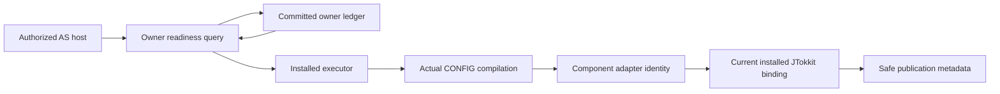

# T4-01 AS 已发布 CONFIG 本地就绪证据规格

| Field | Value |
| --- | --- |
| Document | docs/egon/spec/2026-11-11-16-12-as-published-config-readiness.md |
| Template Version | 9 |
| Archetype Cleanup | Not applicable |
| Status | Review |
| Type | Feature |
| Complexity | Simple |
| Complexity Drivers | One exact local owner read and reuse of the installed compiler and estimator |
| Created | 2026-11-11 16:12 Asia/Shanghai |
| Updated | 2026-11-11 16:12 Asia/Shanghai |
| Owner | Tianji Agent Runtime |
| Repository | tianji-service |
| Scope | A1 单叶 CONFIG 的 AS 本地编译与当前 JTokkit 绑定 |
| Change Surface | Internal owner query, shared CONFIG compilation, current JTokkit check and finite evidence |
| Affected Chapters | §7, §8, §9, §10, §14, §15, §16 |
| Source Requirement | [主计划 T4-01](../../../../docs/plans/agent-framework-upgrade-plan.md) |
| Baseline Revision | 55c8c42df600cfd46c5f6a7a5eabfcf8299ba81d |
| Amends | None |
| Supersedes | None |
| Depends On | [AS 账本发布证据](./2026-11-11-15-40-as-published-definition-evidence.md#9-interface-definitions) |
| Related Specs | None |
| Related Plans | [AS CONFIG 就绪计划](../plan/2026-11-11-16-13-as-published-config-readiness.md) |

## 1. Summary

用已提交的 AS 定义验证 A1 单叶 CONFIG 可以由当前安装的执行器装配，编译根和 JTokkit 使用同一个 ChatModel。结果仅含已验证的发布元数据。

## 2. Background and Current State

| Evidence ID | Exact source | Observed fact |
| --- | --- | --- |
| EVD-001 | AgentLedgerService#publishedDefinitionEvidence | 同租户精确读取已提交定义并重算 canonical digest，当前只返回安全投影。 |
| EVD-002 | AdkAgentRunExecutor#buildRoot and runClaimed | CONFIG 解析、校验、模型回调、实际编译、拓扑及工具校验；执行时使用注入的 estimator。 |
| EVD-003 | JTokkitChatModelBudgetEstimator#require and #current | 匹配模型和完整路由/策略引用，并检查币种、bean 和实时默认选项摘要。 |
| EVD-004 | PlatformReleaseArtifactValidator#verifyAgent and AgentDispatchStore.Intent#command | A1 接受单叶 CONFIG、零工具能力。PS 提交的策略 override 为 null。 |
| EVD-005 | Component SpringAiModelAdapterFactory#matchesCompiledModel | Components `a9539edf1c420132fff04024a51ee7f6d4faff2a` 检查实际适配器、模型名和内部对象引用。 |
| EVD-006 | AgentFlowAutoConfiguration | 默认工厂与 adapter factory 均可被宿主替换，已编译对象需要独立校验。 |

### 2.4 Evidence and current-chain map

| Entry/trigger | Current path | Required extension |
| --- | --- | --- |
| AS publication evidence | Owner primary → committed definition → canonical hash → metadata | 仅包内访问完整验证后的定义，核对候选摘要。 |
| Installed CONFIG execution | Actual executor → actual compiler → compiled root → installed JTokkit | 复用装配和当前绑定检查，零新运行。 |

### 2.5 Archetype example cleanup

Cleanup disposition: Not applicable

Reason: Extend an existing AR ledger and runtime. No archetype generation.

## 3. Goals and Non-goals

目标为 A1 定义的本地装配事实。另行交付调用者 IAM、AS linked allowlist 和 issuer、模型供应商可用性、真实请求预算、部署制品、跨副本路由、签名及激活。

### 3.3 Change Surface and Design Depth

| Area/layer | Disposition | Exact repository evidence | Changed or preserved behavior/contract | Required Spec treatment | Chapter(s) |
| --- | --- | --- | --- | --- | --- |
| AR owner and CONFIG runtime | Affected | EVD-001–005 | 新显式本地检查，复用原编译和预算路径 | 私有定义交接、精确校验及测试 | §7, §8, §9, §10, §14, §15, §16 |
| Components | Context-only | EVD-005/006 | 依赖已提交的相同坐标谓词 | 源码 reactor 与本地 JAR 的使用边界 | §16 |
| AS/PS transport and authority | Context-only | EVD-004 | 留给后续独立权威 | 接入限制 | §18 |

## 4. Requirements and Acceptance Criteria

| ID | Requirement | Observable acceptance |
| --- | --- | --- |
| REQ-001 | 读取精确已提交版本并核对候选内容摘要。 | 读取现有 AR 主库，一次精确租户、键和版本读取。摘要不同在接触运行时前失败。 |
| REQ-002 | 仅验证 A1 单叶 CONFIG 并复用实际装配。 | 没有 CODE_FIRST、工作流、Prompt、Skill、Tool 或工具预算。使用安装的编译器并匹配编译后模型身份。 |
| REQ-003 | 校验实际 JTokkit 当前版本绑定。 | 完整路由、策略、模型名、bean、币种、实例和默认选项一致。自定义估算器、外层编译器、内层适配器工厂或校验器在调用前被拒绝。 |
| REQ-004 | 只输出有限安全投影。 | 保留元数据，无配置、指令和源异常。正例无模型 call/stream；不创建 run、Session 或模拟请求。 |
| REQ-005 | 保持现有运行路径和可审查范围。 | 普通 CONFIG 与 CODE_FIRST 回归、精确五种反证、31 份 SQL 及无新增依赖。 |

### 4.1 Scenario matrix

| Scenario | Input | Result |
| --- | --- | --- |
| Exact current assembly | 已提交精确版本、A1 CONFIG、真实编译及 JTokkit | 返回安全投影。 |
| Candidate SHA differs | 已发布定义存在但候选摘要不同 | 在模型和编译器交互前拒绝。 |
| Compilation substituted model | 适配器封装另一同名同选项对象 | 拒绝。 |
| Current binding differs | JTokkit 模型实例、路由/策略、币种或默认选项不同 | 拒绝。 |
| Unsupported host assembly | 自定义估算器、派生的外层编译器、内层适配器工厂或校验器 | 拒绝本地证明。 |

### 4.2 Use-case analysis

| Actor ID | Actor |
| --- | --- |
| ACTOR-001 | 已对精确版本完成授权的同进程 AS 宿主。 |
| ACTOR-002 | AR 账本及实际已装配执行器。 |

| ID | Use case/goal | Actor | Trigger | Result |
| --- | --- | --- | --- | --- |
| UC-001 | 验证一个已提交 A1 CONFIG 的本地装配 | ACTOR-001/002 | 发布验证读取 | Exact readiness projection or typed failure. |

## 5. Constraints, Assumptions, and Decisions

宿主先认证、授权 actor 对精确版本的读取。查询必须使用执行器原有账本的同一 Java 对象。PS linked 启动现有实现使用空 override，本步使用已提交策略，不接受 override 参数。A1 定义不包含外部 prompt、skill 或 tool。本地方法对调用时装配成立，不承诺部署范围内持续有效。

## 6. Project Technology Context

Java 25、现有 Agent Flow/ADK、JTokkit、Spring JDBC、Jackson、JUnit/Mockito。组件基线 `a9539edf1c420132fff04024a51ee7f6d4faff2a` 在现有 `top.egon:stellar-enclosure-component-agent-flow-starter:0.0.2-SNAPSHOT` 提供 API。隔离编译使用 Components `c68730198f6345926c1a88e98b957781673310be` 的已检查实际 JAR，SHA-256 `c67a538fe22f862ba0f1392c6a28448b16ad6b386f8fd3141949d2bf33b6d447`。其中内建编译工厂源码 SHA-256 为 `d535829e40981b330d8457459a01a26b1d696769168ef12c868705676b089fbf`。

### 6.2 User-mandated Java rule compliance

```text
1 类名规范，必须以 java的pojo规范命名。以dao po bo vo dto query command event等结尾
2 每层之间必须被 springboot-validation 校验，复用对象使用分组校验；基于原生和自定义约束注解、@Valid、@Validated 及 ConstraintValidator 扩展实现。ValidationUtils 只承担通用手工校验，不承载全部业务校验；电话号码复用 libphonenumber。
3 Java POJO 默认使用 class，注解为 @Data @NoArgsConstructor @AllArgsConstructor @Accessors(chain = true)，按构造目标选择 @Builder 或 @SuperBuilder；父类状态参与相等性时使用 @EqualsAndHashCode(callSuper = true)。只有不可变 value object 可以使用 record，并豁免 class 的 Lombok 规范；普通实体不能因简单而使用 record。使用 MapStruct、MapStructPlus 和 egon-cola-component-common-core 的 BaseConverter（双向）或 BaseForwardConverter（不可逆投影）进行转换。
4业务类必须使用@Slf4j注解注入log对象。如果业务类被spring管理，必须指定名称，如果是单例的情况下，参考@Service("userService")。如果需要依赖注入，必须@RequiredArgsConstructor进行修饰，不要代码中写。且属性必须被@qualify修饰。
5 工具类只允许使用jdk原生、Apache Commons(commons-lang3、commons-collections4、commons-io、commons-text、commons-codec、commons-beanutils)、Guava。针对Tika按需引入。
6 JSON 使用 Spring Boot Jackson；持久化枚举值使用 @EnumValue，向前端输出的枚举值使用 @JsonValue，禁止 ordinal 作为业务编码。
7 springboot 多环境配置文件，必须保持配置一致，但值不一定一致。
9 复杂业务必须引入设计模式，不允许硬编码
10 日期相关的必须使用java.time下的实体类，不允许使用java.util下的
11 只允许现有三层结构或当前 egon-cola-archetypes 的 DDD 结构，三层结构保持现状。必须尽量复用 egon-cola-components；持久化模块必须使用 Egon COLA MP Starter，DDL 统一由 egon-mp-sdj-ext-starter 分布式管理。业务唯一键必须组合业务列与 deletedAt（数据库 deleted_at），并验证 NULL、租户及重复软删除语义。采用 CQE（Command Query Event）；Event 必须经 egon-cola-component-transactional-outbox-starter 或 MQ 中间件投递。
```

| Literal rule | Affected? | Repository evidence | Exact design decision | Files/types/interfaces | Validation/test evidence | Status/blocker |
| --- | --- | --- | --- | --- | --- | --- |
| Rule 1 | Yes | EVD-001–006 | 复用 Agent 账本和执行器命名，新增一个 QueryExe 与不可变证据 DTO。 | §7/8/10 | TEST-001–005 | PASS |
| Rule 2 | Yes | EVD-001–006 | 本地非代理查询显式拒绝无效摘要、所有者和形状，并复用现有 Config Validator。 | §7/8/10 | TEST-001–005 | PASS |
| Rule 3 | Yes | EVD-001–006 | 只新增不可变语义值，保持定义与投影封装。 | §7/8/10 | TEST-001–005 | PASS |
| Rule 4 | No | EVD-001–006 | 显式本地构造，无新 Spring Bean、日志组件或注入点。 | §7/8/10 | TEST-001–005 | N/A |
| Rule 5 | Yes | EVD-001–006 | JDK 精确比较及现有 Agent Flow/ADK 类型和 JTokkit。 | §7/8/10 | TEST-001–005 | PASS |
| Rule 6 | Yes | EVD-001–006 | 继续使用原 Jackson 配置读取和原发布摘要，没有 wire DTO 或枚举改动。 | §7/8/10 | TEST-001–005 | PASS |
| Rule 7 | No | EVD-001–006 | 没有应用配置、Profile 或新开关。 | §7/8/10 | TEST-001–005 | N/A |
| Rule 9 | Yes | EVD-001–006 | 复用现有 Config compiler、估算器 Strategy 与 owner Query。 | §7/8/10 | TEST-001–005 | PASS |
| Rule 10 | Yes | EVD-001–006 | 沿用原主库 observedAt，未赋予运行时有效期。 | §7/8/10 | TEST-001–005 | PASS |
| Rule 11 | Yes | EVD-001–006 | 仅在现有 AR 包和普通 JDBC 账本内读取，无表、事件或架构迁移。 | §7/8/10 | TEST-001–005 | PASS |

### 6.3 Time semantics and conversion contract

Time contract: Required

| Time ID | Fields/symbols | Semantics | Java/runtime type | Storage policy | Wire policy | Business zone source | Display zone source | Boundary / DST rules | Precision / Clock | Compatibility | Verification |
| --- | --- | --- | --- | --- | --- | --- | --- | --- | --- | --- | --- |
| TIME-001 | publication.observedAt | Occurred instant | java.time.Instant | Not persisted | Internal | Not applicable: UTC instant | Not applicable: no display | Records the existing primary observation, no proof TTL or calendar arithmetic | AgentDB UTC clock_timestamp | Preserve published-definition evidence semantics | Step 1 TEST-001 fixture |

## 7. Architecture Design

### 7.0 Minimum-design baseline and element-necessity audit

| Proposed element | Change | Requirements | Need |
| --- | --- | --- | --- |
| 包内已验证发布结果 | Extend | REQ-001/004 | 复用原事务和 hash，完整定义限制在内部。 |
| CONFIG 编译与绑定校验 | Extend | REQ-002/003 | 复用安装的运行时与估算器，验证真实模型身份。 |
| 显式就绪查询 | Add | REQ-001–004 | 以一条只读入口连接既有 owner 和 runtime。 |

| Path | Network calls | Client states | Decision |
| --- | --- | --- | --- |
| Local query | 原 AgentDB 读取，零模型调用 | Typed success or safe failure | 复用主库与编译器。 |
| Synthetic Run or remote model probe | 增加执行与外部交互 | 额外 Run、Session 与预算 | 本步无需运行。 |

### 7.1 System Architecture Design

显式 QueryExe 接收已授权身份、key、版本与期望摘要。其与执行器核对同一个 owner 账本，从该账本在独立只读主库事务内读取已提交数据。事务结束后执行本地编译检查。

### 7.2 High-Level Design

校验候选摘要，再校验定义形状与精确名称。解析、模型选取、回调校验及编译复用真实执行路径。使用 Components API 核对编译后的 ADK 对象确实包装执行器选中的模型。JTokkit 从当前安装的 estimator 查找完整引用、币种和原对象，随后重算实时默认值摘要。

### 7.3 Detailed Design



`AgentFlowFactory.usesBuiltInModelFactory(flowFactory)` 在调用前确认外层编译器及其私有 adapter factory 都是精确内建类型。执行器同时确认 `flowValidator.getClass() == AgentFlowConfigValidator.class` 和实际 JTokkit 类型，再读取模型元数据、校验或编译。即使宿主替换实现会正确委托，也会在调用前被拒绝。普通执行不使用这些就绪限定。宿主 `ChatModel#getOptions` 是受信本地元数据边界。正向检查与其 fixture 无 call/stream，已编译对象仍须通过实际模型身份校验。

已提交 CONFIG 须含精确四个字段和一个精确同名 leaf，其指令非空。无 codeRef、workflows、可选依赖、工具版本及工具调用预算。解析后的模型、bean 和根名称须等于原值，避免 trim 改变语义。根须为无子节点的 LlmAgent，再复用正常拓扑、工具和回调限制。

### 7.3.6 Conclusion evidence chain

EVD-001 和 EVD-004 固定发布源和零 override 语义，EVD-002 及 EVD-005 验证真实编译与模型，EVD-003 复核当前绑定。EVD-006 限定宿主扩展信任边界。

## 8. Package Structure and Code File Tree

| Operation | Exact path | Responsibility |
| --- | --- | --- |
| MODIFY | `stellar-enclosure-tianji-agent-runtime/src/test/java/top/egon/cola/platform/tianji/agent/infrastructure/persistence/AgentPublishedDefinitionEvidenceTest.java` | 复用既有主库 JDBC fixture，增加七项就绪证明用例。 |
| MODIFY | `stellar-enclosure-tianji-agent-runtime/src/main/java/top/egon/cola/platform/tianji/agent/infrastructure/persistence/AgentLedgerService.java` | 提取包内已验证发布结果，公共读取保留原投影。 |
| MODIFY | `stellar-enclosure-tianji-agent-runtime/src/main/java/top/egon/cola/platform/tianji/agent/infrastructure/adk/JTokkitChatModelBudgetEstimator.java` | 共享精确 JTokkit 绑定查找，增加执行器所选模型身份校验。 |
| MODIFY | `stellar-enclosure-tianji-agent-runtime/src/main/java/top/egon/cola/platform/tianji/agent/infrastructure/adk/AdkAgentRunExecutor.java` | 复用实际 CONFIG 装配并检查单叶及编译模型身份。 |
| CREATE | `stellar-enclosure-tianji-agent-runtime/src/main/java/top/egon/cola/platform/tianji/agent/infrastructure/persistence/AgentPublishedConfigReadinessQueryExe.java` | 按预期摘要查询已提交发布，执行本地就绪检查并返回安全投影。 |
| CREATE | `docs/egon/spec/2026-11-11-16-12-as-published-config-readiness.md` | 固定行为、信任边界与验收条件。 |
| CREATE | `docs/egon/plan/2026-11-11-16-13-as-published-config-readiness.md` | 固定依赖版本、步骤、测试选择器和文件摘要。 |
| CREATE | `docs/egon/evidence/2026-11-11-as-published-config-readiness.md` | 记录实际隔离证明和待验收范围。 |

## 9. Interface Definitions

### 9.1 Interface Inventory

| ID | Interface | Style | Scope |
| --- | --- | --- | --- |
| INT-001 | AgentPublishedConfigReadinessQueryExe#requireReady | Internal Java Query | 已授权 AS 宿主。 |

### 9.2 Per-interface Detailed Contracts

输入为现有 trusted actor、精确 key/version、签名候选的小写 64 位十六进制内容摘要。未获本地信任身份、无效输入、缺失资源沿用 owner 错误；候选摘要不同、形状或实际装配不可证明统一返回脱敏 `TIANJI_DEPENDENCY_UNAVAILABLE`。成功返回 §10 投影。

## 10. POJO and Data Model Design

`PublishedConfigReadinessEvidenceDTO` 只包装原 `PublishedDefinitionEvidenceDTO`，包含租户、版本、hash、模式、契约版本、声明引用及数据库观察时刻。包内 `VerifiedPublishedDefinition` 持有完整不可变定义，显式隐藏日志表示。编译与选项仍为当前进程内部对象。

## 11. Database Design

Relational model change: No. 复用原发布查询与事务。31 份既有迁移不变。

## 12. Frontend Page Design

无页面或传输协议变更。

## 13. Design Patterns and Architecture Principles

所有者 Query 验证 committed source，执行器复用原配置编译，估算器复用原绑定查找。组件持有真正适配器的封装身份判断。

## 14. Test Design

| Test ID | Design |
| --- | --- |
| TEST-001 | 真实 CONFIG 编译与已发布行 fixture 正例，核对一次精确读取、摘要、UTC、安全 JSON 投影及零模型 call/stream。 |
| TEST-002 | 类型、A1 形状、候选 SHA、两级工厂、实际校验器、估算器、币种、引用和默认值漂移反证。 |
| TEST-003 | 分别删除候选摘要、编译后模型身份、估算器模型实例、内建工厂和内建校验器门禁，精确单方法失败。 |
| TEST-004 | 运行原 JTokkit、原 AgentJsonCodec、普通 CONFIG governed loop 和 CODE_FIRST 完成路径回归。 |
| TEST-005 | 严格 Spec/Plan、确切文件及 31 SQL 校验和。产品包的源码 reactor 校验在执行步骤。 |

## 15. Non-functional and Cross-cutting Design

沿用原独立读取事务与 SQL 限时。检查过程仅在 AS 内部保留完整定义。无通用 profile、服务端路由、模型请求或实时有效期。默认选项校验是点观察，不能保证未来运行无漂移。

## 16. Compatibility, Migration, Rollout, and Rollback

普通 CONFIG 和 CODE_FIRST 继续使用原策略和装配。新增方法仅由宿主显式调用。撤销一个 AR 提交可移除此入口。组件已独立提交，源码 reactor 使用固定 checkout；缓存或远程 SNAPSHOT 的 API 验证另行完成。

## 17. Alternatives and Decisions

选择实际编译和 JTokkit 当前绑定。仅凭候选声明、descriptor 快照或临时替代模型无法建立实际装配身份。

## 18. Risks and Open Questions

后续需要独立授权、AS linked allowlist 与 issuer、实际主库、部署范围和跨副本一致性。具体请求的累计预算、模型提供方和真实端到端时限仍待验收。

## 19. Traceability Matrix

| Requirement | Use case | Design | Tests |
| --- | --- | --- | --- |
| REQ-001 | UC-001 | §5/7/9 | TEST-001/003 |
| REQ-002 | UC-001 | §7/9 | TEST-001–003 |
| REQ-003 | UC-001 | §7/10 | TEST-002/003 |
| REQ-004 | UC-001 | §7/10/15 | TEST-001/002 |
| REQ-005 | UC-001 | §8/14/16 | TEST-004/005 |

## 20. Review and Acceptance

### 20.5 Blocking Manual Check

| Check ID | Applicability | Status | Evidence | Finding | Required action/exception |
| --- | --- | --- | --- | --- | --- |
| MC-ARCH-001 | Applicable | PASS | §7/8 | AR 本地调用和同一 owner 账本，Components 持有适配器的身份判断。 | None |
| MC-REUSE-001 | Applicable | PASS | EVD-001–006 | 复用主库读取、Agent Flow 编译和现有模型预算绑定。 | None |
| MC-DEP-001 | Applicable | PASS | §6 | 沿用已有 Components SNAPSHOT 坐标和测试依赖。 | None |
| MC-NAME-001 | Applicable | PASS | §8/10 | 新查询类、内部 verified record 与安全 DTO。 | None |
| MC-VALID-001 | Applicable | PASS | §7/9/14 | 精确摘要、租户、A1 形状、实际模型和估算器均校验。 | None |
| MC-MODEL-001 | Applicable | PASS | §10 | 新值类型只携带既有安全投影，定义只限包内查询交接。 | None |
| MC-CONVERT-001 | Not applicable | N/A | §10 | 无新业务实体和独立层间转换器。 | None |
| MC-LOG-001 | Not applicable | N/A | §15 | 新增路径不写运行日志，失败不透出源异常或定义。 | None |
| MC-BEAN-001 | Not applicable | N/A | §7 | 只有宿主显式本地构造，无 Bean、注入或启动行为变化。 | None |
| MC-UTIL-001 | Applicable | PASS | §6 | 复用 JDK 和已安装编译器、适配器及预算估算器。 | None |
| MC-JSON-001 | Applicable | PASS | §7/10/14 | 复用现有 Jackson，fixture 检查投影序列化不含原配置和指令。 | None |
| MC-TIME-001 | Applicable | PASS | §6.3/14 | 沿用已提交发布观察时刻，分开当前装配和 TTL。 | None |
| MC-CONFIG-001 | Not applicable | N/A | §16 | 无新开关和应用配置。 | None |
| MC-PATTERN-001 | Applicable | PASS | §13 | 沿用同源 Query、编译器和预算 Strategy。 | None |
| MC-SCOPE-001 | Applicable | PASS | §8/16 | 五个 AR Java 与三份文档，31 份 SQL 保持基线。 | None |
| MC-TEST-001 | Applicable | PASS | §14 | 精确五次 R1、88 项隔离回归和后续源码包验收。 | None |
| MC-BLOCKER-001 | Applicable | PASS | §18 | 当前只交付本地证明。实际主库、授权与部署权威独立验收。 | None |

### 20.6 Final verdict

PASS — Ready for user review
