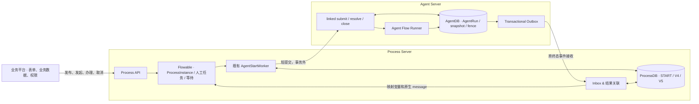
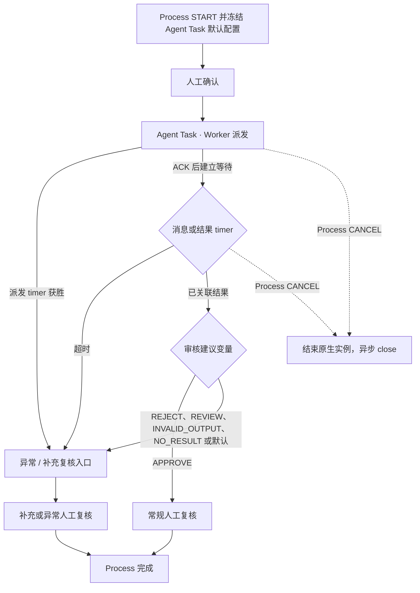
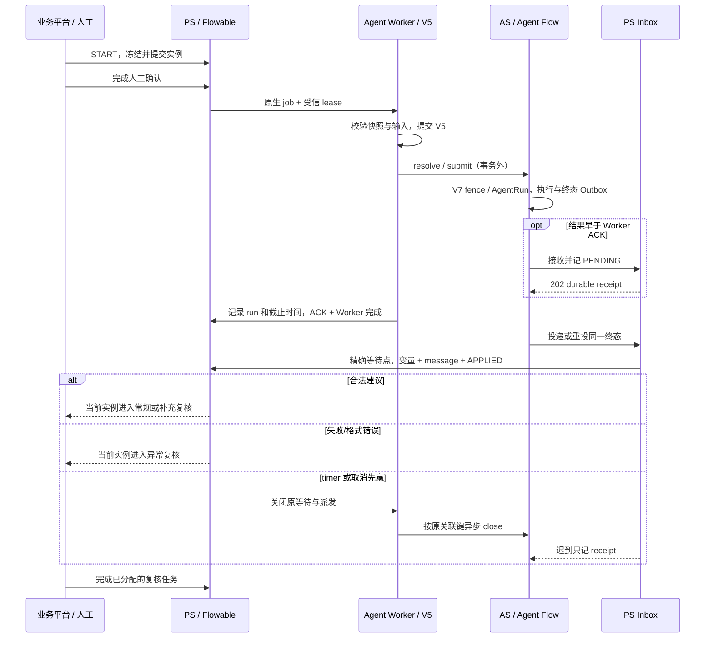

# Tianji Process 与 Agent Flow 融合规格 · Agent Task 契约及人工复核通路

| Field | Value |
| --- | --- |
| Document | docs/egon/spec/2026-11-11-16-56-process-agent-task-fusion.md |
| Template Version | 9 |
| Archetype Cleanup | Not applicable |
| Status | Review |
| Type | Architecture |
| Complexity | Complex |
| Complexity Drivers | Process/Agent 两个本地事务、持久化异步交接、流程与模板双版本、超时与结果竞争、租户及历史回放 |
| Created | 2026-11-11 16:56 Asia/Shanghai |
| Updated | 2026-11-11 17:24 Asia/Shanghai |
| Owner | Tianji 平台 |
| Repository | tianji-service |
| Scope | Agent Task 逻辑节点契约、BPMN 人工确认 → Agent 审核 → 人工复核、既有交接与结果扩展 |
| Change Surface | C 结果类型、CL 私有事件编解码、PS 发布/实例快照/Worker/等待/结果投影、AR 输出投影、AS Outbox、测试与合约文档 |
| Affected Chapters | §7, §8, §9, §10, §11, §13, §14, §15, §16, §17, §18 |
| Source Requirement | 本轮用户要求「Process 统一编排入口，Agent Flow 默认智能执行内核」及首段契约与融合通路 |
| Baseline Revision | Tianji `fa63c34ccb823353481776b6805ded7f2f8d4004`，Components `c68730198f6345926c1a88e98b957781673310be` |
| Amends | [架构升级主计划](../../../../docs/plans/agent-framework-upgrade-plan.md) §2.1、§8.1–8.3、§9、§11.2、§13.3 的目标职责与 Agent Task 首段契约 |
| Supersedes | None |
| Depends On | [架构升级主计划](../../../../docs/plans/agent-framework-upgrade-plan.md) §6.3、§10.2–10.4、§11.1–11.2、§19 T3-04/05/06 的已实现边界 |
| Related Specs | [治理 START §7](./2026-11-11-15-28-governed-process-start.md#7-architecture-design) · [AS 定义证据 §7](./2026-11-11-15-40-as-published-definition-evidence.md#7-architecture-design) · [Process owner 结果观测 §7](./2026-11-05-22-41-process-owned-agent-outcomes.md#7-architecture-design) |
| Related Plans | None |

## 1. Summary

业务平台使用现有 Process 发布、发起、人工办理和取消入口。人工、混合和纯 Agent 流程共同使用 ProcessInstance；Flowable 负责跨节点编排，Agent Flow 负责一个 Agent Task 内的推理与工具执行。首段交付一个显式、可验证的 Agent Task 发布契约，以及同一 BPMN 实例内「人工确认 → Agent 建议 → 人工复核」的完整路径。

将新节点编入现有原生 External Worker、消息等待和定时器图。PS 在 START 固定节点配置，在到达节点后将实际输入和准确的发布版本写入现有派发意图。AS 用现有 Agent Flow Runner 执行，原 Outbox 回传有界审核结果，PS 关联到原等待点并由网关路由。两端各自提交本地事务。

## 2. Background and Current State

### 2.1 Business and user context

业务平台拥有表单、业务数据、人员组织和业务权限。它以经过验证的用户或服务身份调用 Tianji，并承担业务系统外部操作的幂等责任。发布者编排 BPMN 与已发布的 Agent 模板版本。Agent Server 作为宿主持有运行授权、状态和账本，Worker 负责能力适配。

### 2.2 Repository evidence

以下为当前 Git 基线的源码证据。集成测试的存在只证明测试代码和可复用接缝。

| ID | Exact source/symbol | Observed fact |
| --- | --- | --- |
| EVD-001 | PS [ProcessController](../../../stellar-enclosure-tianji-process-server/src/main/java/top/egon/cola/platform/tianji/process/server/api/ProcessController.java) `publish/start/instance`，`ProcessExecutionService#startClaimed`，`ProcessCommandReceiptStore`，PS V1/V3/V13 | BPMN 发布按 tenant 和 release 固定原生定义与模型摘要。START 已原子提交原生实例和 APPLIED 收据。普通、受控 START 共用实际创建函数，重放使用既有归属及请求摘要。 |
| EVD-002 | PS [ProcessModelValidator](../../../stellar-enclosure-tianji-process-server/src/main/java/top/egon/cola/platform/tianji/process/server/release/ProcessModelValidator.java) `validateBpmn/validateWorkerBindings`，`VerifiedProcessModels#runningProcess`，[agent-dispatch-wait.bpmn20.xml](../../../stellar-enclosure-tianji-process-server/src/test/resources/fixtures/agent-dispatch-wait.bpmn20.xml) | 现有模型以 external-worker + event-based gateway + message/timer 表达关联。Worker 映射只接收已声明输入，回调状态目前是 AgentRun 状态。含 Worker 的 BPMN 拒绝并行网关，拓扑遍历拒绝循环。 |
| EVD-003 | PS [FlowableWorkerService](../../../stellar-enclosure-tianji-process-server/src/main/java/top/egon/cola/platform/tianji/process/server/worker/FlowableWorkerService.java) `prepareAgentDispatch/completeAgentDispatch`，`AgentStartWorker#runOnce/reconcileOnce`，`AgentDispatchStore`，PS V4/V5 | 以 tenant、原生 job 派生 occurrence；租约/已验证输入 → V5 PENDING；网络 resolve/submit/close 在事务外；确认 run 后 ACK 与 Worker 完成同一 PS 事务。注册可按 topic/schema 保存多个固定版本。 |
| EVD-004 | AS `LinkedAgentDispatchController#submit/resolve/close`，`TianjiLinkedDispatchBindings`，AR `AgentLinkedSubmissionService`，`AgentLedgerService#startLinked/verifiedSnapshot`，AR V1/V7/V8 | AS 从 SERVICE 身份及受信绑定验证精确模板 key/version/SHA、source 与接入许可。V7 独立锁定关联幂等键，关闭可封住未知提交。已准入 Run 固定模板、输入、策略、依赖和 Process link。 |
| EVD-005 | AR [AdkAgentRunExecutor](../../../stellar-enclosure-tianji-agent-runtime/src/main/java/top/egon/cola/platform/tianji/agent/infrastructure/adk/AdkAgentRunExecutor.java) `runClaimed` 的根输出、`finishOrResolve`，`AgentLedgerService#terminalReference`，C `AgentTerminalEvent`，AS `OutboxAgentTerminalEventPublisher/AgentResultDeliveryHandler` | Agent Flow Session/InMemory Runner 已接入。完成输出主要是 `agents` 与 `text`，输出 schema 版本随定义固定。现有 V1 终态事件只有状态、摘要及异常元数据。AS 在终态事务入 Outbox，投递前从同一持久结果重建并核对信封。 |
| EVD-006 | PS `AgentResultInboxController#receive`，`ProcessRequestBodyAdvice#validateAgentResult`，`AgentResultInbox#receive`，`AgentResultCorrelationService#applyInTransaction`，`FlowableAgentWaitInspector#inspect/completed`，PS V6 | 回调只登记，应用时锁定 V5→V6，并将原生 message、应用收据、Inbox APPLIED 一起提交。等待点通过 tenant/instance/definition/activity 校验唯一，历史按活动 ID 匹配，本切片须维持每个元素只执行一次。 |
| EVD-007 | PS `FlowableHumanTaskService#complete`，`ProcessControlService#cancelInTransaction`，`ProcessLinkedAgentOutcomeQuery#list`，C `ProcessAgentOutcomePageDTO.ItemDTO`，PS V7/V9 | 人工任务已有版本令牌、授权与回执。取消以本地事务删除实例并调度 V5 关闭。Owner 结果查询经过脱敏，仅返回本地阶段、活动 ID 与终态摘要，屏蔽 AgentRun ID。 |
| EVD-008 | PS [expense-review.bpmn20.xml](../../../stellar-enclosure-tianji-process-server/src/test/resources/processes/expense-review.bpmn20.xml)，`BusinessProcessAgentAcceptanceIT`，`WorkerRecoveryIT` | 已有业务 Worker、Agent 等待、人工与补偿夹具；首个步骤是 DMN 与 Worker。当前未发现“先人工确认、结构化 Agent 结果、再人工复核”整体夹具。 |
| EVD-009 | AR `AgentExecutionSnapshot`、`AgentJsonCodec`、`AdkRunBudgetPlugin`、AR V2/V9–V12/V15，Components `AgentFlowFactory/AgentFlowSessionRunner/AgentFlowInMemoryRunner` | Agent Runtime 内部仍有 Memory、模型预算、上下文与运行安全交叉依赖。Starter 已有可复用 Runner 和上下文接缝。 |
| EVD-010 | PS/AS/AR/C/CL/W `pom.xml`，PS `META-INF/tianji/openapi/process-agent-outcomes-v1.json`，`scripts/verify-source-reactor.sh` | 六个既有 Maven 模块；PS/AS 使用 MVC，静态 OpenAPI 工件已有先例。PS 和 AS 各自持有事务和数据库。C 是引擎中立契约。 |

### 2.3 Problem statement and gap

现有链路可返回 AgentRun 终态，缺少显式 Agent Task、实例配置冻结以及能被流程网关消费的结构化审核结果。现有结果定时器在 Worker 完成后才建立，需要为 Worker 迟迟拿不到确认的情况提供流程内的有界退出。现有单活动等待校验需要明确限制首段模型。

### 2.4 Evidence and current-chain map

| Entry/trigger | Current call chain | Persistent facts | Required design | Evidence |
| --- | --- | --- | --- | --- |
| 发布、启动 | Controller → Release/Execution → Flowable | 模型 SHA、START/APPLIED、原生 ProcessInstance | 验证 Agent Task 声明，START 写保护快照 | EVD-001/002 |
| 首次人工任务完成 | HumanTaskService → 原生 External Worker job | V7 receipt、Flowable task/job | 保持人工授权，在同实例到达 Agent Task | EVD-003/007 |
| Worker 执行 | V4 → V5 → linked resolve/submit → ACK | 原生 occurrence、租约、Agent V7/Run、输入摘要 | 对比冻结配置，覆盖提交前超时 | EVD-003/004 |
| 模型执行与回传 | Agent Flow → Ledger + Outbox → PS Inbox | Agent 终态、结果摘要、eventId、PS V6 | 完成事件携带有界审核投影，旧版兼容 | EVD-005/006 |
| 等待、应用、取消 | PS reconcile → Flowable → HumanTask；ProcessControl → closure | 事件应用、消息/定时器、人工回执、取消回执 | 写回允许的变量，显式异常分流，隔离迟到结果 | EVD-006/007 |

### 2.5 Archetype example cleanup

Cleanup disposition: Not applicable

Reason: Tianji 首次提交 `7c14d67` 建立平台契约，根 POM 为六个技术模块聚合。当前业务示例位于 PS 测试 fixture，例如 EVD-008，并由已存在的验收测试消费。此次扩展现有平台接缝和测试，无生成业务项目的首用样例清理。

## 3. Goals and Non-goals

### 3.1 Goals

- Process 统一编排入口及 ProcessInstance。Agent Task 具有独立、版本化的设计语义，和人工任务、业务服务任务一起发布。
- 首段以一个已发布 BPMN 和已发布 Agent 模板跑通两个人工节点之间的 Agent Task，覆盖正常建议、需人工、异常、两个等待阶段、取消、回调去重和重启。
- 契约明确模板精确版本和实例覆盖边界。先建立并证明默认快照，后续实例自定义沿用同一快照与执行链。
- 保持状态机、授权、数据库事务和审计归属。业务接入以 Process HTTP/Java 客户端和既有 Worker 协议为界。

### 3.2 Non-goals

本次 Spec 定义首段功能及后续约束。纯 Agent 三节点的并行、循环、跨节点数据流和 Agent 逻辑重跑属于下一阶段，首段发布器拒绝这些未支持图形。实例覆盖入口、图形编辑器、平台 Memory 迁移、预算退役、业务自动审批、业务系统适配、TLS 和部署均无首段实现工作。

后续 Memory 进入 `stellar-enclosure-component-agent-flow-starter` 的中立数据、读写/检索/提取契约，开发内存实现与可选持久适配各自可插拔。宿主提供可信租户、身份、会话/流程范围、授权和来源。Session 持续承载交互执行上下文，Memory 可跨会话保留；默认隔离租户、用户和实例。费用、Token 配额、定价、预占、结算和成本账本退出 Tianji 内核，由后续规格完成既有调用、数据和兼容迁移。

### 3.3 Change Surface and Design Depth

| Area/layer | Disposition | Exact repository evidence | Changed or preserved behavior/contract | Required Spec treatment | Chapter(s) |
| --- | --- | --- | --- | --- | --- |
| PS 发布、START、Worker、等待和 Inbox | Affected | EVD-001/002/003/006 | 类型、快照、前后超时和结构化回写 | 契约、状态、文件、测试、兼容 | §7, §8, §9, §10, §11, §13, §14, §15, §16, §17, §18 |
| C、CL、AR、AS 私有回传 | Affected | EVD-004/005/010 | 有界审核投影和按运行分型的终态事件 | 消息、验证、兼容、验收 | §7, §8, §9, §10, §11, §13, §14, §15, §16 |
| 既有公开实例/人工/取消 API 和 owner 观测 | Context-only | EVD-001/007 | 路由、权限、响应、既有摘要和脱敏 | 调用回归及隔离 | §9, §15 |
| 业务 Worker Starter、Components Agent Flow | Context-only | EVD-003/009 | 复用 Worker lease/receipt 与现有 Runner | 依赖和调用边界 | §8 |
| Tianji Web | Unchanged | `tianji-web/src/api/processAgentOutcomes.ts` 与 §12 | 现有 owner 观测调用 | 无页面改动，原契约回归 | §12 |

## 4. Requirements and Acceptance Criteria

| ID | Atomic requirement | Priority | Observable acceptance criteria | Source |
| --- | --- | --- | --- | --- |
| REQ-001 | 统一 Process 编排入口与显式 Agent Task | Must | 新 BPMN 能识别一个有类型的 Agent Task。两个人工节点、Worker 和等待均属于相同 ProcessInstance。发布拒绝不完整或越权的节点与图。 | 「统一模型」「引入清晰的 Agent Task」 |
| REQ-002 | 固定版本、配置和输入 | Must | START 冻结精确 Agent 模板、映射和策略。延迟到达节点后仍使用旧版本。越权或缺失的快照/绑定拒绝派发。后续覆盖契约只允许发布版本和声明参数。 | 「模板 + 实例快照」 |
| REQ-003 | 事务外异步、可恢复派发 | Must | V5 提交前没有 AS 调用，ACK 丢失后用同键找回唯一 run，重启后继续；Flowable 事务中没有远程调用或模型等待。 | 「可靠派发」「进程重启后找回」 |
| REQ-004 | 结构化结果及确定性路由 | Must | 匹配的结构化建议只写声明的变量。自然语言或错误格式进入人工异常路径。正常建议、拒绝建议和需复核均经已发布 BPMN 路由，业务最终决定来自人工。 | 「Agent 自动审核原则」 |
| REQ-005 | 有界异常、超时与取消 | Must | 未派发/未 ACK、等待结果超时、Agent 失败和取消均有可观察路径；Process 取消后原生节点不会恢复，Agent close 可持续重试。 | 「超时 / 失败 / 重试 / 取消」「迟到结果」 |
| REQ-006 | 一次应用和隔离审计 | Must | 同事件仅应用一次；同键改内容、其他 tenant/owner/source/occurrence/run 无法推进。按 ProcessInstance 在授权内部证据中核对 occurrence、run、模板、结果/异常。 | 「幂等」「审计」 |
| REQ-007 | 历史和内核职责兼容 | Must | 原 Worker、v1 回调、历史 START/Agent snapshot 含预算字段仍可读取和回放。新契约不引入 Memory/预算、外部权限或第二个入口。执行安全仍生效。 | 「Memory 下沉」「预算移除，但保留运行安全」 |
| REQ-008 | 最小功能验收 | Must | 有限回归、真实 PostgreSQL 及独立 PS/AS 的测试夹具能验证版本变更、重复、重启、超时、租户与现有业务接入；验证不依赖线上部署。 | 「交付验收」及用户收敛范围 |

### 4.1 Scenario matrix

| Scenario | Actor/trigger | Preconditions | Main path | Alternative/failure path | Data/state change | Observable result | Requirements |
| --- | --- | --- | --- | --- | --- | --- | --- |
| SC-01 | 发布者发布 | 有效模板、注册和图 | 发布新 release | 未声明变量、错误拓扑、越界参数拒绝 | model SHA 和定义固定 | 原生定义仅一份 | REQ-001/002 |
| SC-02 | 发起人、办理人 | 同一租户有效权限 | START、确认、审核、人工复核 | Agent 建议 REJECT/REVIEW 去复核 | snapshot、V5、AgentRun、V6、V7 | 唯一实例及下一人工任务 | REQ-001/003/004 |
| SC-03 | Worker/PS/AS 重启 | V5、Agent fence 或 Inbox 已提交 | 以原标识恢复 | 回调早到保持 PENDING，旧重放无副作用 | 单 run、单次应用 | 原业务输入、版本与下一人工任务一致 | REQ-002/003/006 |
| SC-04 | 模型失败或返回错误格式 | 精确绑定 | AS 生成失败终态；PS 走异常 | 已取消/过期仅留证据 | 原因及 V6 回执 | 进入人工异常复核，审批未自动发生 | REQ-004/005 |
| SC-05 | 未 ACK 或结果迟到 | Flowable 持有对应 timer | 原生超时分流 | 结果与 timer/取消竞争 | 唯一分支，V5 关闭 | 结果无法唤醒已退出节点 | REQ-005/006 |
| SC-06 | 切换模板或租户 | 旧实例等待首次人工 | 新旧 release 各走固定 route | 他租户重放被拒；旧 route 丢失后走人工 | 旧快照保持可读 | v1/v2 历史可查 | REQ-002/006/007 |

### 4.2 Use-case analysis

#### 4.2.1 Actor inventory

| Actor ID | Actor/role | Goal and responsibility | Entry/channel | Permission/tenant context | Evidence |
| --- | --- | --- | --- | --- | --- |
| ACTOR-001 | 流程发布者 | 将 Agent 模板编入经过审核的流程 | 现有 Process 发布 | RELEASE_PUBLISH + 当前 tenant | EVD-001 |
| ACTOR-002 | 业务平台发起人 | 发起及查看归属自己的实例 | 现有 Process START/GET/CANCEL | USER 或限定 SERVICE、资源权限及完整 owner | EVD-001/007 |
| ACTOR-003 | 确认人及复核人 | 办理有权限的人工任务 | HumanTask query/claim/complete | 验证用户、候选队列/归属和 expectedVersion | EVD-007 |
| ACTOR-004 | PS Worker、AS 执行/投递服务 | 可靠派发、执行及登记终态 | 租约、linked dispatch、Outbox | 分别验证 SERVICE、tenant、source 与模板/结果绑定 | EVD-003–006 |
| ACTOR-005 | 受权维护人员 | 追查完整执行证据 | 本地只读审计 | 现有 PS/AS 内部运维授权和明确 tenant | EVD-006/007 |

#### 4.2.2 Use-case artifact

| ID | Use case/goal | Primary actor | Supporting actors/systems | Trigger | Preconditions | Main success outcome | Alternatives/failures | Postconditions | Requirements | Interfaces/pages | Tests |
| --- | --- | --- | --- | --- | --- | --- | --- | --- | --- | --- | --- |
| UC-001 | 发布 Agent Task | ACTOR-001 | PS | 提交 BPMN | 精确模板、允许映射、两级等待 | 发布固定模型 | 错误拓扑/字段拒绝 | 原字节与 release 可重复验真 | REQ-001/002 | Process 发布 | TEST-001/002 |
| UC-002 | 办理混合流程 | ACTOR-002/003 | ACTOR-004 | 发起、确认 | 发布可用，人工身份有权 | Agent 建议送达对应复核 | 拒绝、需复核、异常路径 | 人工完成后结束 | REQ-001/003/004 | 原 START、HumanTask | TEST-003/004/006 |
| UC-003 | 恢复与停止 | ACTOR-004/002 | Flowable、Agent Ledger | 停机、迟到、超时或取消 | 既有精确身份/receipt | 一次恢复或关闭 | 未知提交重复 close，结果不再推进 | 原有事务和证据完整 | REQ-003/005/006/007 | linked、Inbox、取消 | TEST-005/007/008 |
| UC-004 | 验证归属和审计 | ACTOR-005 | PS、AS | 收到实例 ID | 受权 tenant 与只读来源 | 关联节点、run、版本、结果与异常 | 缺失 V5 时显示从未确认派发 | 不读取越权实例或修改业务状态 | REQ-006/008 | Owner 观测、内部证据 | TEST-008/009 |
| UC-005 | 保留模板版本 | ACTOR-001/002 | ACTOR-004 | 新发布期间存在旧实例 | 两套精确发布有效 | 旧实例使用旧快照，新实例用新版本 | 不回落到 latest | 两套历史分别可查 | REQ-002/007/008 | 原发布与 START | TEST-003/009 |

## 5. Constraints, Assumptions, and Decisions

### 5.1 Confirmed constraints

Flowable 管流程状态和跨节点；Agent Flow 管节点内状态；两库各有提交点。应用层不创建第二套流程状态、事务协调器或派发器。当前切片仅用经过验证的配置、无业务写工具的模板及业务平台已授权的必要输入。限定 release/tenant 精确选择。

### 5.2 Small-gap assumptions

| ID | Inference | Repository evidence | Why locally reversible | Impact if wrong |
| --- | --- | --- | --- | --- |
| ASM-001 | 首段以一张审核建议和一个可选证据输入引用证明契约 | EVD-002/003 支持有限标量映射；用户要求先跑通 | 固定在新 fixture 与新 schema | 新审核类型需要独立输出 schema |
| ASM-002 | 超时策略采用提交窗口与结果窗口两个持续时间 | EVD-003 的提交 deadline 与 EVD-006 的消息/定时器分别存在 | 只影响新 Agent Task 模型声明，旧发布继续解析原图 | 未来若需要一个端到端窗口，应定义独立版本 |
| ASM-003 | 默认快照随 START 创建；调用方覆盖排在用户指定后续增量 | EVD-001 已有普通和治理 START 收据；用户实施顺序 §1–4 | 先用原命令和共用快照格式验证 | 后续加字段需独立审批摘要与外部兼容 |

### 5.3 Resolved decisions

| ID | Decision | Decision owner | Evidence and rationale | Requirements |
| --- | --- | --- | --- | --- |
| D-001 | 显式 BPMN 扩展识别 Agent Task，复用受限原生图 | Tianji 规格审查 | EVD-002；保留原发布字节及一个 ProcessInstance | REQ-001 |
| D-002 | 保护性实例快照 + 原 V5/AS snapshot | Tianji 规格审查 | EVD-001/003/004；分别记录配置与真实节点输入 | REQ-002/003 |
| D-003 | 仅含持久化结构化结果的完成事件使用 schema 2，旧事件和失败事件继续使用 schema 1 | Tianji 规格审查 | EVD-005/006；既有 Outbox/Inbox 具有身份与内容栅栏 | REQ-004/006/007 |
| D-004 | 异常与超时转人工，取消尽力关闭，运行尝试一次；传输允许原键重试 | Tianji 规格审查 | EVD-003/006/007；现有模型受限于一次活动执行 | REQ-005/006 |
| D-005 | 审计明细由受权内部证据提供，现有公开 owner 观测维持脱敏 | Tianji 规格审查 | EVD-007 与相关 Spec §7；外部业务接入使用原 Process 入口 | REQ-006 |

### 5.4 Open major decisions

当前供审核的选择集中在 D-001–D-005。实例覆盖进入实现前需审核 §7.3.1 的 START 扩展和摘要兼容。并行、循环、逻辑重跑、Memory 与预算退役由后续增量各自定案。

## 6. Project Technology Context

根 Maven Reactor 管理 Flowable 8.0.0、Google ADK 1.13.0、Spring AI 2.0.2 和现有 Agent Flow、Outbox。平台父工程使用 Java 25；本地父工程源码显示 Spring Boot 4.1.2。测试沿用 JUnit、MockMvc、真实 PostgreSQL 集成接缝与 `scripts/verify-source-reactor.sh`。PS 和 AS 各持有独立 PostgreSQL 主库及事务，PS 复用 Flowable 的 JDBC 数据源。

### 6.1 Java architecture profile and capability baseline

保留现有传统分层的技术服务布局及当前模块名。PS 的传输入口在 `server.api`，发布/执行/桥接在 `server.release/execution/bridge/worker`，存取通过现有 Store/Flowable API。AS 的传输入口和集成投递在 `agent.server.api/integration`，AR 的运行/账本在 `agent.application/domain/infrastructure`。根 POM 无生成项目的 facade/domain/adapter/starter 拆分。扩展现有职责内的类，不引入新的层、模板或依赖方向。

| Existing capability | Reuse | Gap/decision |
| --- | --- | --- |
| C record/enum、CL Jackson 3，PS/AS 既有 Jackson 2 持久/Outbox | 复用构造器不变式、现有严格 JSON 边界，两个 mapper 共享同一新字段省略规则 | C 继续保持纯 JDK；新 review 字段使用不可变值、显式 wire 字符串 |
| PS native job + Worker registry + V4/V5/V6 | 复用实际业务锁、派发与事务；配置存 Flowable 已有原生变量 | 无业务 CRUD、MP 持久模块或 SQL 迁移 |
| AS 账本、Agent Flow、Transactional Outbox | 复用 Runner、发布依赖、运行权限、terminalReference、现有 CQE Event 投递 | 一个有界输出投影 |
| Shoubing/Jianshen、静态 OpenAPI | 复用当前授权与专用资源工件 | 既有 contract-first 路径，无 springdoc 运行端点引入 |

### 6.2 User-mandated Java rule compliance

```text
1 类名规范，必须以 java的pojo规范命名。以dao po bo vo dto query command event等结尾
2 每层之间必须被 springboot-validation 校验，复用对象使用分组校验；基于原生和自定义约束注解、@Valid、@Validated 及 ConstraintValidator 扩展实现。ValidationUtils 只承担通用手工校验，不承载全部业务校验；电话号码复用 libphonenumber。
3 Java POJO 默认使用 class，注解为 @Data @NoArgsConstructor @AllArgsConstructor @Accessors(chain = true)，按构造目标选择 @Builder 或 @SuperBuilder；父类状态参与相等性时使用 @EqualsAndHashCode(callSuper = true)。只有不可变 value object 可以使用 record，并豁免 class 的 Lombok 规范；普通实体不能因简单而使用 record。使用 MapStruct、MapStructPlus 和 egon-cola-component-common-core 的 BaseConverter（双向）或 BaseForwardConverter（不可逆投影）进行转换。
4业务类必须使用@Slf4j注解注入log对象。如果业务类被spring管理，必须指定名称，如果是单例的情况下，参考@Service("userService")。如果需要依赖注入，必须@RequiredArgsConstructor进行修饰，不要代码中写。且属性必须被@qualify修饰。
5 工具类只允许使用jdk原生、Apache Commons(commons-lang3、commons-collections4、commons-io、commons-text、commons-codec、commons-beanutils)、Guava。针对Tika按需引入。
6 JSON 使用 Spring Boot Jackson；持久化枚举值使用 @EnumValue，向前端输出的枚举值使用 @JsonValue，禁止 ordinal 作为业务编码。
7 springboot 多环境配置文件，必须保持配置一致，但值不一定一致。
9 复杂业务必须引入设计模式，不允许硬编码
10 日期相关的必须使用java.time下的实体类，不允许使用java.util下的
11 只允许现有三层结构或当前 egon-cola-archetypes 的 DDD 结构，三层结构保持现状。必须尽量复用 egon-cola-components；持久化模块必须使用 Egon COLA MP Starter，DDL 统一由 egon-mp-sdj-ext-starter 分布式管理。业务唯一键必须组合业务列与 deletedAt（数据库 deleted_at），并验证 NULL、租户及重复软删除语义。采用 CQE（Command Query Event）；Event 必须经 egon-cola-component-transactional-outbox-starter 或 MQ 中间件投递。
```

| Literal rule | Affected? | Repository evidence | Exact design decision | Files/types/interfaces | Validation/test evidence | Status/blocker |
| --- | --- | --- | --- | --- | --- | --- |
| Rule 1 | Yes | C/PS records，EVD-005 | Result、Event、DTO、VO 按语义 | §8、§10 | TEST-002/004 | PASS |
| Rule 2 | Yes | EVD-002/004/006，C 无运行框架依赖 | Spring 边界复用绑定与校验服务，纯 Java 记录逐字段校验。校验受信关系与跨字段不变式见 §10.3.1 | PS API/Service/Store、C、AR | TEST-002/004/008 | PASS |
| Rule 3 | Yes | EVD-001/005 | 新模型为防御复制的不可变值。同一值跨边界复用；投影是领域判定与变量键映射 | §10 | TEST-002/004 | PASS |
| Rule 4 | Yes | EVD-003/005/006 | 沿用现有装配与 Logger；新增行为为纯投影/校验函数，直接组合已有 Bean | §8、§15 | TEST-004/005 | PASS |
| Rule 5 | Yes | EVD-002/005 | 既有 JDK、Jackson、Flowable、Spring；无新工具库 | §8、§9 | TEST-002/004 | PASS |
| Rule 6 | Yes | V6、C/CL/AS codecs | 复用 Jackson，持久值和 wire 使用稳定字符串；兼容 v1 省略字段 | §9、§10、§11 | TEST-004/005 | PASS |
| Rule 7 | No | EVD-003/010 | 使用现有 bridge/route 配置契约与现有能力门 | §15、§16 | TEST-009 | N/A |
| Rule 9 | Yes | EVD-002/005/006 | 按发布节点/结果 schema 选择策略，Outbox/Inbox 保持技术状态所有权 | §7、§13 | TEST-002/004/005 | PASS |
| Rule 10 | Yes | EVD-003/005/006 | `Instant` 与 `Duration`，UTC 和数据库时间 | §6.3 | TEST-007 | PASS |
| Rule 11 | Yes | EVD-001/003/005/006/010 | 保留现有技术引擎事务和永久收据，新增负载复用原生变量及 JSONB；无表、键或 DDL 变更 | §6.1、§9、§11 | TEST-005/008/009 | PASS |

### 6.3 Time semantics and conversion contract

Time contract: Required

| Time ID | Fields/symbols | Semantics | Java/runtime type | Storage policy | Wire policy | Business zone source | Display zone source | Boundary / DST rules | Precision / Clock | Compatibility | Verification |
| --- | --- | --- | --- | --- | --- | --- | --- | --- | --- | --- | --- |
| TIME-001 | 两段 BPMN `timeDuration` | Duration | `Duration` | Duration | Duration | Not applicable: 持续时间 | Not applicable: 内部字段 | dispatch 1–900 秒、result 1–900 秒，Flowable 原生 timer | 整秒 | 仅新模型 | TEST-002/007 |
| TIME-002 | V5 `dispatchNotAfter`、受保护的 `resultNotAfter` | Occurred instant | `Instant` | UTC instant | UTC Z | Not applicable: 绝对截止 | Not applicable: 内部字段 | 达到等值即截止；日期、DST 不参与 | PG `clock_timestamp()` 微秒，结果截止以 ACK 时刻计算 | V5 原式保留，旧节点无新变量 | TEST-005/007 |
| TIME-003 | event `finishedAt`、receipt `receivedAt`、decided 时间 | Occurred instant | `Instant` | UTC instant | UTC Z | Not applicable: 绝对时刻 | 既有 owner 页面原时区转换 | AS 时间只做审计；PS 数据库决定结果资格 | 微秒 | v1 digest 及事件身份维持 | TEST-004/005/007 |


## 7. Architecture Design

### 7.0 Minimum-design baseline and element-necessity audit

| Proposed element | Change | Requirements | Existing/direct alternative | Concrete inadequacy of alternative | Added costs and failure modes | Verdict |
| --- | --- | --- | --- | --- | --- | --- |
| `agent:task` 元数据与 `ValidatedProcessModel.AgentTaskDTO` | Add | REQ-001/002 | 只发布现有 Worker 图 | 没有节点类型、模板、配置或返回契约 | 一份小型模型扩展及校验，原生图仍由 Flowable 执行 | Add |
| 两个受保护的原生实例变量 | Add | REQ-002/005 | Worker 运行时读取最新绑定或只写 V5 | 首次到达前无 V5；ACK 后需持久结果截止 | 每实例一个小 JSON 和一个时间值，事务随引擎 | Add |
| 提交阶段 boundary timer | Add | REQ-005 | 既有 wait result timer | 无 ACK 时不会创建结果 timer | 原生定时器与 Worker 完成竞争 | Add |
| 现有 Agent Worker / V5 / V7 | Expand | REQ-002/003/005 | 新队列、AS API 或新执行表 | 既有交接具备意图、租约、幂等、关闭与重放能力 | 在原 prepare/ACK 校验版本与截止时间，零额外 RTT | Keep |
| `ProcessAgentReviewResult`、AR 投影函数 | Add | REQ-004/006 | 转交完整自然语言或 raw Result | 范围、格式和权限不适合流程网关 | 有界解析、格式错误路径、严格结果型 | Add |
| 现有 Event/Outbox/Inbox | Expand | REQ-004/006/007 | PS 读取整个 AgentRun Result 或新结果通道 | 要增读权限、跨库查询状态与额外 RTT；V1 缺建议 | 两种 schema 的兼容、相同去重键、零额外 RTT | Keep |
| 共享 Jackson 字段 MixIn | Add | REQ-007 | 为多端分别定义 v1 序列化条件 | 旧 PS 严格拒绝多余字段，四处条件容易漂移 | 一个字段级注解，编解码回归 | Add |
| Process 发布、实例、任务、取消与审计 | Keep | REQ-001/005/006 | 新 Agent Workflow API 或业务读取 AS | 既有入口满足首段，审计可联结本地证据 | 只扩展发布 XML，owner 查询保留原字段与权限 | Keep |
| 既有静态 OpenAPI 工件模式 | Add | REQ-001/006/008 | 用代码注解新建文档端点 | 现有 MVC 未采用 springdoc，需求是审查和契约测试 | 两份分别面向发布者和内部服务的静态资源 | Add |
| 新表、新任务框架、模板发现/转发 API、前端适配 | Keep existing | REQ-001/003/007 | 原生变量、固定发布和原 API | 当前独立用户目标没有额外入口/表的必要 | 避免额外状态、鉴权和部署 | Keep |

| Path | Network calls | Client states | Persisted evidence | Failure boundary |
| --- | --- | --- | --- | --- |
| 旧流程 | 原 linked resolve/submit/close 和终态登记 | 原 Process 和 Worker API | 原 START、V5、v1 Inbox | 原等待路径 |
| 新 Agent Task | 原调用，成功事件含审核投影 | 原 Process 和 Worker API | 原回执、原生快照和截止、双版 V6 | 两级 timer、结果和同源事务 |
| 另读 AS Result | 每事件多一次查询 | 额外授权、超时和缓存状态 | 需要协调查询和应用时机 | 增加跨服务可用性耦合 |

### 7.1 System Architecture Design

#### 7.1.1 Architecture boundary



| Boundary | Authoritative state/data | Input/output | Transaction | Allowed dependency / forbidden responsibility | Requirements |
| --- | --- | --- | --- | --- | --- |
| Flowable/PS | ProcessDefinition、ProcessInstance、任务、流程变量、等待、取消 | Process 命令、已校验建议 → 下一节点 | ProcessDB | 对接 Worker 和 Inbox，业务数据由平台管理 | REQ-001/004/005 |
| Worker/PS | 原生任务租约、V5 occurrence、转发意图 | 可验证发布/输入 → 精确 linked command | ProcessDB 短事务，网络在外 | 受信绑定决定 SERVICE 权限，AgentFlow 不调度后继 BPMN | REQ-002/003 |
| Agent Server/AR | AgentRun、快照、执行权限、工具与结果 | 精确 linked command → 终态事件 | AgentDB，终态和 Outbox 原子 | 执行 Agent 节点内部工作，业务流程无 AS 入口依赖 | REQ-003/004/007 |
| 业务平台 | 最终审批、组织、外部副作用 | 原 Process API 与 Worker 协议 | 自有业务事务 | 负责外部写入幂等和人工补偿 | REQ-001/004/008 |

### 7.2 High-Level Design

#### 7.2.1 Critical business/control flowchart



#### 7.2.2 High-level decision and quality matrix

| Concern/use case | Required behavior | Current evidence | Mechanism | Failure/degradation behavior | Verification |
| --- | --- | --- | --- | --- | --- |
| 版本和归属 | 旧实例及其重试绑定旧模板 | EVD-001/003/004 | 发布字节、受保护快照、V5/AS 账本 | 旧注册无法用时转人工 | TEST-003/009 |
| 数据一致性 | 重启恢复，最多一个 Run/应用 | EVD-003/004/006 | V5、V7、V6 和原生单次关联 | 早到等待，冲突/迟到不推进 | TEST-005/008 |
| 安全 | 结果仅影响发布允许的标量 | EVD-002/005/006 | 有界强类型、信封匹配、闭合网关 | 格式错误或未知路径转人工 | TEST-002/004/006 |
| 可用和可观测 | 无 AS 仍可到人工；状态可审计 | EVD-003/007 | 两级 timer，close 和本地证据 | 告警和人工节点，防止模型响应卡住流程 | TEST-007/009 |

### 7.3 Detailed Design

#### 7.3.1 Detailed component collaboration

**发布契约。** 在已注册内部 Agent Worker 的 BPMN `serviceTask/extensionElements` 下增加唯一 `agent:task`，命名空间 `urn:stellar-enclosure:tianji:agent-task:1`。流程逻辑模型把该 serviceTask 的 `id` 当作 Agent Task ID。设计者编写节点声明和受限原生拓扑，发布器同时验证两者，原 XML 字节用于部署和 SHA。首段的设计入口是 BPMN 发布，后续编辑器可基于该语义展示一个节点。

| Field | Form and constraints | Semantics |
| --- | --- | --- |
| `templateKey / templateVersion / templateSha256` | 必填，原 Agent key 规则、正整数精确版本、小写 SHA-256 | AS 已发布的固定定义内容，禁止 latest/range |
| `instructionSha256` | 必填，小写 SHA-256，host 固定指令的 UTF-8 摘要 | 防止实例等待期间相同模板悄悄改变固定指令；原始指令只由受信 Worker 注册提供 |
| `input` | 复用 `flowable:externalWorkerInParameter` 及已发布 Worker schema，≤16 个 STRING/BOOLEAN/INTEGER，逐个精确来源、类型和目标 | 首段读取 START 已声明标量。输入映射可不声明 `evidenceRef`，声明时须提供一个符合 `[A-Za-z0-9][A-Za-z0-9_.:-]{0,95}` 的受权业务引用 |
| `resultSchema / reviewVariable` | `tianji.process.review.v1`，目标是已发布的 STRING 变量名 | 写入 `APPROVE / REJECT / REVIEW / INVALID_OUTPUT / NO_RESULT`。可保留已有 `tianji:statusVariable` 独立写 AgentRun status；原 Worker `runId` 仅进内部流程变量 |
| `dispatchTimerRef / resultTimerRef` | 精确各一个活动 ID，指向独立原生 timer，各 1–900 整秒 | 前者为附着 Agent Worker 的 `cancelActivity=true` boundary timer；后者为现有事件网关 timer sibling |
| `failurePolicy / timeoutPolicy` | 均为 `HUMAN_REVIEW`；默认流和两条 timer 分支均可验证到达人工作业 | 无重跑路径。完整模型不得通过异常分支跳过复核 |
| `retryPolicy / maxAgentAttempts` | `DELIVERY_ONLY` 和 `1` | 网络/租约重试沿用同一 occurrence/run。逻辑重跑需要后续可区分的新 occurrence |
| `cancelPolicy` | `CLOSE_BEST_EFFORT` | 先提交本地取消/超时，再尝试 AS close |
| `overrideMode` | `NONE` | 首段显式空允许集。后续 profile 引入受控声明与 START 输入 |

示例节点的元数据与入参/Worker 输出分工如下。样例中的 SHA 用 fixture 的真实内容摘要生成，键名是发布者审核的固定契约。

```xml
<serviceTask id="agentReview" flowable:type="external-worker"
             flowable:topic="agentStart:process-review-1" flowable:doNotIncludeVariables="true"
             tianji:topic="agentStart" tianji:schemaVersion="process-review-1"
             tianji:effectSafety="EXTERNAL_IDEMPOTENT">
  <extensionElements>
    <flowable:externalWorkerInParameter source="amount" target="amount" tianji:type="INTEGER"/>
    <flowable:externalWorkerInParameter source="documentRef" target="evidenceRef" tianji:type="STRING"/>
    <flowable:externalWorkerOutParameter source="runId" target="agentReviewRun" tianji:type="STRING"/>
    <agent:task templateKey="expenseReview" templateVersion="1"
                templateSha256="aaaaaaaaaaaaaaaaaaaaaaaaaaaaaaaaaaaaaaaaaaaaaaaaaaaaaaaaaaaaaaaa"
                instructionSha256="bbbbbbbbbbbbbbbbbbbbbbbbbbbbbbbbbbbbbbbbbbbbbbbbbbbbbbbbbbbbbbbb"
                resultSchema="tianji.process.review.v1" reviewVariable="auditRecommendation"
                dispatchTimerRef="dispatchTimeout" resultTimerRef="resultTimeout"
                failurePolicy="HUMAN_REVIEW" timeoutPolicy="HUMAN_REVIEW"
                retryPolicy="DELIVERY_ONLY" maxAgentAttempts="1"
                cancelPolicy="CLOSE_BEST_EFFORT" overrideMode="NONE"/>
  </extensionElements>
</serviceTask>
```

发布仍检查现有 Worker 注册、输入类型、唯一变量写入者和 BPMN 受限图，并校验该 release 的默认快照不超过 3072 bytes。新增校验只接受一个标记节点及其一对一 Worker、message wait 和两个 timer，且不得与本模型中的其他 linked Agent 节点、并行、循环、CMMN case source、Agent Worker 补偿或业务错误边界混用。CMMN case source 会触发现有 Process 取消限制。区分人工作业 timer 与 Agent 提交 timer，按现有隐式边规则纳入拓扑验证。提交 timer 也登记在 `timerWaits`，供 `ProcessControlNativeAccess#classify` 核验原生 timer 与 Worker 的活动证据。结果网关只能依据该节点声明的 `reviewVariable` 做有限字面量等值比较，且有人工默认分支。示例图中两条 timer 和默认分支先通过三入一出的 exclusive join 再进入同一复核任务。新模型占用保留前缀 `__tianji_agent_task_`，发布拒绝输入、Worker、人工、条件和写回映射触及该前缀或覆盖彼此。含此标记的运行中实例禁止迁移到另一模型版本，原模型允许的迁移继续沿用原规则。

**冻结与提交。** `ProcessExecutionService#startClaimed` 在已有实际创建分支，使用同一已验发布定义的模型。Flowable START 变量合并业务输入和一个受保护 STRING `__tianji_agent_task_snapshot_v1`。其 JSON 按固定键、整型和 UTF-8 规范生成，≤3072 bytes，包含版本、节点 ID、发布/model SHA、模板 key/version/SHA、固定指令 SHA、Worker topic/schema、输入/输出映射、两个 timer ID/持续时间、策略及空参数。派发前用现有实际 ProcessInstance 和相同发布内容重算并核对整个快照。历史 START 的精确重放复用原收据，已有输入摘要与普通/受控启动来源保持原算法；受保护变量只在首次创建时写入。

现有 `FlowableWorkerService#prepareAgentDispatch` 校验已验证 native job/lease、已固定模型和快照，并要求绑定的模板、指令摘要、topic/schema 与快照一致，绑定的 submissionTimeout 等于声明的提交 timer 持续时间。两者从不同的原持久化接缝计时。受信 route 提供 tenant、issuer、SERVICE、source 和凭证引用；它不从节点配置或业务变量派生。AS linked admission 在事务外经已验证凭证检查同一个已发布版本及 SHA。新版本使用新的版本化 Worker 注册，保留老实例所用旧注册和 AS 定义。绑定消失/漂移时拒绝重新解析模板，原生提交 timer 进入人工。AS 发布存在性以现有 AS 精确查验为权威；PS 发布/START 本地固定声明与版本，不执行跨库同步查询。受控发布的既有授权及证明仍适用。

Flowable 到达节点时在 ProcessDB 持久化原生活动执行、External Worker job 和提交 timer。原生活动是到达记录，job 可用同一 ID 重新获取。Worker 第一次准备时以该 job 派生的 occurrence 创建唯一 V5 intent。V5 `input_data` 固定核对后的实际输入，`seed_sha256` 及关联键沿用原函数，关联 ProcessInstance、活动元素、occurrence 与 Run。无 Worker 获取时，原生活动和 timer 仍可恢复及审计。对重复/恢复调用先按原键找 V5 与 AS fence，提交响应丢失可从原 run 恢复。冻结的是配置，节点输入在到达时由已允许来源确定并随 V5 固定。首段仅使用 START 标量。

**实例覆盖的后续输入契约。** 定义层可声明按节点选择的发布模板三元组白名单和参数的名称、STRING/INTEGER/BOOLEAN 类型、默认值、必填性、边界及是否可覆盖。实例扩展拟使用原 START 的独立字段 `agentTaskOverrides`，以已发布逻辑节点 ID 为键，每项至多有 `templateKey + templateVersion`（必须成对）及 `parameters`（只含声明键）。字段缺省或空 map 用默认配置。显式 null、未知节点/字段、超界值、未发布/未授权版本均拒绝；摘要由服务端从允许集取值。模板选项必须共享该节点的输入/结果类型。节点数及每节点参数数各至多 16，参数标量采用原 ProcessValues 的 STRING/INTEGER/BOOLEAN 边界并接受定义层更小约束。参数默认与覆盖合并后按稳定顺序冻结。未来同一 Worker topic/schema 以受信注册中的精确模板三元组选择执行绑定，所有选项共享已批准的 SERVICE/tenant/source。参数键由已发布模板消费，与业务输入命名空间隔离。受信身份、凭证、权限、工具、模型路由、Memory 和执行代码不进入覆盖模型。该输入按规范顺序参与未来版本的 START 幂等摘要。同一原命令重放仍使用当时的版本语义，包含覆盖的重放必须核对已存快照。首段仅实现 `overrideMode=NONE`；首段 START 未声明该顶层字段，按原协议处理未知字段。运行时只读取发布默认值。旧 `variables` 中注入未声明参数或保留键会被发布输入 schema 拒绝。后续启用时复用实际创建函数、持久化快照和同一派发链。

**AS 结构化输出。** 对固定发布 `outputSchemaVersion=tianji.process.review.v1` 的精确 linked run，AR 在 Runner 正常结束、根输出齐备后的结果组装点执行有界投影，终态写入由原 lease/revision 栅栏控制。首段夹具使用单 LlmAgent 根、受权模型和无业务写工具的模板。采用根终态 JSON，禁止子 Agent 输出、流式片段、自由文本包裹、Markdown fence、重复键、尾随 token 和非 JSON 类型。解析结果用 §10 的唯一 DTO，证据引用只允许本次 V5 已提供并实际传入 snapshot 的引用。成功结果持久化 `AgentExecutionResult.output.processReview`，不将原始模型文本投给 PS。格式无效以既有 AgentRun `FAILED` 提交 `TIANJI_AGENT_OUTPUT_INVALID`，保留原运行安全检查与异常生命周期。

**PS 写回与审计。** 结果到达后先验服务、tenant、source、owner、V5/link 与摘要，回执只确认入库。应用从原精确发布重读节点声明，验证同一 run、ACK、存活等待与截止。v2 成功且符合节点契约时写 `reviewVariable` 的建议；v1 COMPLETED 缺结构、已知格式失败或有界结果证据不符合配置时写 `INVALID_OUTPUT`；其他合法失败终态写 `NO_RESULT`。这两类异常写回只用于走人工默认分支。完整建议及证据引用保存在 V6 受控事件和 Agent 账本，PS 网关只取允许的标量。对 legacy node，v1 延续原状态处理；意外 v2 以原 `DEAD/DISPATCH_MISMATCH` 结案。审核建议与技术成功分开，人工在现有任务授权与版本校验下做最终业务判断。

#### 7.3.2 Critical-path Mermaid swimlane



#### 7.3.3 Transactions, consistency, concurrency, and idempotency

| Transaction/lock | Commit unit | Duplicate/race handling |
| --- | --- | --- |
| PS START | 原生实例、内部快照、APPLIED 和受控 V13（适用时） | 原 owner、commandId、摘要锁；创建失败全回滚 |
| PS Worker prepare | native job → lease → V5，冻结实际输入 | 原 occurrence 固定，V5 重复内容校验，网络始于提交后 |
| AS linked and terminal | V7 关联与现有 Agent admission，终态、结果和 Outbox | 原 fence，queued grant 按既有重放，lease/revision 防重复终态 |
| PS Worker ACK | V5 ACK、Worker receipt、原生 completion 和 `__tianji_agent_task_result_due_v1` | 使用同一 ProcessDB 事务。截止值=数据库微秒时刻+结果 duration，仅首次 ACK 写入，重放保留原值。 |
| PS result application | V5 → V6，真实 wait 校验，原生 message/变量、AGENT_RESULT 及 V6 APPLIED | 原 event ID/内容摘要、同 run 唯一约束与引擎竞争。提交未知时用原回执重试。 |
| PS cancel/timer + AS close | 原生分支/取消与本地收据；close 在两库事务之外 | 原生提交决定是否仍可写回。V5 关闭可重试，AS V7 封住未知提交。 |

Flowable 结果 timer 从原生等待建立起计时。额外的 PS 结果资格截止从 ACK 计算，覆盖 ACK 后原生完成异步入队的延迟。应用检查 `PS databaseNow < resultNotAfter`；等于或超过截止时只登记 `IGNORED_LATE/WAIT_ENDED`，原生 timer 负责进入异常分支。提交阶段 native timer 从 Worker 活动到达起计时，V5 自准备时开始的原提交 deadline 继续限制远程准入，已退出活动或过期不得 ACK。竞争导致的乐观锁、锁超时或回滚使用原 Inbox/Worker 重试。检查并写回期间 timer/取消提交时，以原生等待事务是否成功消费为准；失败必须全量回滚变量和审计。本切片先用原生一次执行模型保证 activity ID 唯一，未来循环要求等候执行或订阅与每次 occurrence 的持久绑定。

#### 7.3.4 Failure semantics, recovery, and reconciliation

| Situation | PS observation/action | AS action and invariant |
| --- | --- | --- |
| 无 Worker、未取得 ACK、提交结果未知 | 提交 timer 打断 native job，走人工；已有 V5 转 CLOSING | 原键 resolve/close 可恢复，已关闭 fence 禁止迟到 submit 新建 Run |
| 回调早于 ACK | V6 PENDING，按原观察间隔重试；截止或原生路径失效时忽略 | 同一个终态和 fingerprint |
| 有效/无效结果 | 按 §7.3.1 映射，消费一次；合法失败/格式无效也有 APPLIED 应用记录 | 非结构化根输出提交 FAILED，技术原因可追查 |
| AS timeout/cancel/failure | 在仍有效的等待内写 `NO_RESULT`，网关默认进入人工；否则忽略 | AS 保持原终态与错误码 |
| AS 在模型执行中重启 | 已提交的 Run 仍是原 occurrence 的唯一 Run；等待既有终态或原生结果 timer 后转人工 | 复用已存在的 lease/终态处理。本切片的可恢复边界为 Agent Task，不要求从模型流中间续跑。 |
| Process timeout/cancel | 原生流程胜出，结果不再推进；后续 close 对原关联可重复 | 尽力停止，调用外部副作用由业务幂等和人工处置 |
| 有冲突、临时数据库错误或消费失败 | 身份/键失配不写或 DEAD；可重试故障保留 PENDING；耗尽后结果 timer 仍生效 | Outbox 重投，原摘要一致；无需跨库回滚 |

#### 7.3.5 Observability and operational boundaries

以完整 tenant/owner + ProcessInstance 查 START、Flowable 模型/任务/定时器历史，再查 V5 `scope_id/element_id/occurrence_id`，核对 `run_id`、发布版本、模板 SHA、V6 回执/错误与 AGENT_RESULT 收据。未生成 V5 时，启动快照及实际边界定时器记录表明该节点没有确认派发。AS 运维可在自身授权下以同一 run 和 link 查结果、授权与租约。业务 owner 的现有 GET 只读脱敏摘要和可办理任务。禁止将明细联结跨库做成面向业务的默认查询。

#### 7.3.6 Conclusion evidence chain

| Conclusion | Repository/user evidence | Constraint or requirement | Design decision | Consequence and trade-off | Verification and acceptance evidence |
| --- | --- | --- | --- | --- | --- |
| 一个 ProcessInstance | EVD-002/006 | 等待按活动查；REQ-001/006 | 显式 Agent Task 与有界原生图 | 首段单 occurrence，循环再增加等待身份 | TEST-002/006/008 |
| 冻结及异步交接 | EVD-003/004 | 已有同键恢复；REQ-002/003 | 实例快照、V5 与 V7 | 同一 run，两套本地事务 | TEST-003/005/009 |
| 审核输出 | EVD-005/006 | v1 只有状态；REQ-004/007 | 同通道扩展 v2 | 双版 reader 保留历史回放 | TEST-004/005/008 |
| 受控审计 | EVD-007 | owner 观测脱敏；REQ-006 | 内部授权证据提供明细 | 业务侧使用原 Process API | TEST-008/009 |

## 8. Package Structure and Code File Tree

### 8.1 Current relevant tree

以下前缀均为仓库相对路径。`C/CL/PS/AS/AR/W` 指现有六个 Maven 模块，Java 路径以各自 `src/main/java/top/egon/cola/platform/tianji/` 为根。PS 的下列文件在 `process/server/`，AS 在 `agent/server/`，AR 在 `agent/`，C 在 `contract/`，CL 在 `client/`。测试沿同包路径的 `src/test/java`。EVD-001–010 给出各现有连接。

### 8.2 Target tree

| Module and path | Operation | Responsibility and requirements |
| --- | --- | --- |
| C `contract/orchestration/AgentTerminalEvent.java`、`ProcessAgentReviewResult.java` | Modify / Add | v1/v2 事件构造、指纹、不可变结构化建议和封闭结论值。REQ-004/006/007 |
| C `contract/agent/AgentErrorCodeEnum.java` | Modify | 固定 `TIANJI_AGENT_OUTPUT_INVALID`，状态继续为 FAILED。REQ-004 |
| CL `client/HttpAgentResultClient.java`、`client/AgentTerminalEventWireMixin.java` | Modify / Add | 同一事件 JSON 字段省略规则；原路径、token、响应和字节限制。REQ-004/007 |
| PS `release/ProcessModelValidator.java`、`release/ValidatedProcessModel.java`、`release/ProcessReleaseService.java` | Modify | 扩展发布图、验证参数/目标、防保留变量写入。发布仍固定原字节。REQ-001/002 |
| PS `execution/ProcessExecutionService.java`、`execution/ProcessAgentTaskSnapshotVO.java` | Modify / Add | 共用原生 START 生成保护快照，JSON/截止使用引擎原生字符串。REQ-002/005 |
| PS `worker/FlowableWorkerService.java` | Modify | prepare 关联真实 job 与快照，ACK 固定 cutoff；复用现有 `AgentStartWorker` 和 `AgentDispatchStore`。REQ-002/003/005 |
| PS `bridge/FlowableAgentWaitInspector.java`、`bridge/AgentResultCorrelationService.java` | Modify | 对标记节点识别额外 timer 及截止，按对应结果 schema 写回，保持旧分支。REQ-004/005/006 |
| PS `api/ProcessRequestBodyAdvice.java`、`bridge/AgentResultInbox.java` | Modify | 双版严格信封及 JSONB codec，复用原 Controller、回执/外部错误。REQ-004/006/007 |
| PS `src/main/resources/META-INF/tianji/openapi/process-agent-task-publish-v1.json`、`agent-result-inbox-v1.json`（同目录） | Add | 既有发布与私有 Inbox 规范工件。REQ-001/006/008 |
| AR `infrastructure/adk/AdkAgentRunExecutor.java`、`infrastructure/adk/ProcessAgentReviewProjection.java`、`infrastructure/persistence/AgentLedgerService.java` | Modify / Add / Modify | 在实际终态产出时强类型投影，按持久结果重建 v2，兼容旧 snapshot/事件。REQ-004/007 |
| AS `integration/process/OutboxAgentTerminalEventPublisher.java`、`integration/process/AgentResultDeliveryHandler.java` | Modify | 原 channel 增补 schema 匹配，投递前校验原账本等值。REQ-003/004/007 |
| PS `src/test/resources/processes/human-agent-human-review.bpmn20.xml`、`src/test/java/top/egon/cola/platform/tianji/process/server/acceptance/HumanAgentHumanAcceptanceIT.java` | Add | 双人工流程、故障切点、租户和版本的隔离集成夹具。REQ-001–008 |

现有模型迁移预检会拒绝该图形（§16）。测试文件增量见 §14。`stellar-enclosure-tianji-worker-starter`、Components Agent Flow Starter 与 `tianji-web` 是复用/验证面。

### 8.3 Package and file responsibilities

可审核的最小增量是默认模板从已发布 BPMN 跑通两个人工节点。按依赖划分审查边界如下，实际可执行 Plan 在本 Spec 审核后另定。

| Increment | Main modules | Observable review boundary |
| --- | --- | --- |
| 1. 契约与模型 | C、PS release、AR 投影夹具 | 公开 Agent Task、精确模板、显式异常策略，错误图拒绝；C v1 旧构造器和序列化回归 |
| 2. 异步与结构化写回 | PS execution/Worker/bridge、AR、AS、CL | START 快照、原 V5→AS→V6 贯通，正常建议和失败都只到授权人工任务 |
| 3. 恢复、隔离与兼容验收 | PS/AS/AR 测试、现有 Worker 与契约工件 | 重启、重复、早到、迟到、取消、模板版本/租户分隔，以及旧路径回归 |


## 9. Interface Definitions

原业务入口为 `ProcessController#start/instance`，`HumanTaskController#query/claim/complete`，`ProcessControlController#cancel` 和 `ProcessAgentOutcomesController#outcomes`。它们继续使用已有身份、请求、收据、响应、错误和脱敏逻辑。`LinkedAgentDispatchController#submit/resolve/close` 继续使用现有 SERVICE 身份、接入许可和 V7 fence。SDK 的 Process/Worker/HumanTask 调用无需选择 Agent 宿主。TEST-003/008/009 覆盖这些调用方边界。

### 9.0 API protocol and documentation governance

| Concern | Decision/evidence |
| --- | --- |
| Protocol selection | 现有 REST 发布命令和已认证 SERVICE 的终态登记。模型发布和事件到达各自有明确持久化目标。 |
| CQE application level | 发布为现有 Command，业务读面保持原 Query。终态为现有跨库 Event，消费登记为现有短 Command，Outbox/Inbox 提供最终一致。 |
| REST source of truth | 对两条受影响命令各有一份 checked-in OpenAPI 3.1 工件，与 Spring 映射、DTO、XML 校验和序列化做 conformance 比较。沿用 PS 静态工件模式，参考 `process-agent-outcomes-v1.json`。 |
| GraphQL source of truth | N/A。现有调用均是 REST，首段不增加 GraphQL 操作。 |
| Springdoc/OpenAPI compatibility | MVC + Spring Boot 4 系列。两个工件使用仓库现有 OAS 3.1；不增加运行时生成依赖。 |
| Legacy Swagger/Springfox status | PS/AS 的 POM 无 Springfox 或 Swagger 2 工具。 |
| Security and documentation exposure | 发布为受保护 USER/SERVICE，Inbox 为专用 SERVICE，均使用现有 Bearer + tenant guard。私有工件仅供内部构建与核对。现有应用不增加 Swagger UI、docs 路由或公开 schema。 |
| Contract publication and drift gate | PS 拥有 §8 两份工件。TEST-002/004 比较 MVC 实际状态/字段与 OAS，校验 operationId、身份、日期和 v1/v2 wire 样例。 |

### 9.1 Interface Inventory

| ID | Change/necessity verdict | Name/purpose | Kind | API style/CQE role | Consumer | Owner | Method + URL / GraphQL field / symbol / topic | Operation ID/schema source | Input | Output | Auth/tenant | Error model | Idempotency/version | Requirements |
| --- | --- | --- | --- | --- | --- | --- | --- | --- | --- | --- | --- | --- | --- | --- |
| API-001 | Modify, Keep | 发布含 Agent Task 的流程 | HTTP | REST Command | 流程发布者 | PS | `POST /api/tianji/v1/process-releases` | `publishProcessRelease` | 既有发布命令 | ReleaseDTO | 原发布权限 | OrchestrationErrorDTO | tenant + release + manifest | REQ-001/002 |
| API-002 | Modify, Keep | 持久登记 AS 终态 | HTTP | REST Command | AS 投递 | PS | `POST /api/tianji/v1/agent-result-inbox` | `receiveAgentTerminalEvent` | v1 或 v2 AgentTerminalEvent | 原 Receipt | 原 producer/owner/source | OrchestrationErrorDTO | eventId + fingerprint | REQ-004/006/007 |
| EVENT-001 | Modify / Keep | 终态事实 | Outbox | Event | PS Inbox | AS/AR | `tianji-agent-result` | `AgentTerminalEvent` v1/v2 | 持久 run/result | Inbox durable receipt | 现有精确 service route | 重试或死信 | 原 eventId 与版本指纹 | REQ-003/004/006/007 |
| INTERNAL-001 | Modify / Keep | 原生创建及默认快照 | Java | Command | 普通与受控 START | PS | `ProcessExecutionService#startClaimed` | 已发布 BPMN 声明 | verified actor、definition、inputs | APPLIED receipt | 当前 owner | 原校验/冲突/不可用 | 原命令摘要 | REQ-001/002 |
| INTERNAL-002 | Modify / Keep | 到达后的派发意图 | Java | Command | AgentStartWorker | PS | `FlowableWorkerService#prepareAgentDispatch` | 现有 V5 seed | verified job/lease/binding | Intent | 精确 SERVICE | lease lost/conflict | occurrence + seed SHA | REQ-002/003 |
| INTERNAL-003 | Modify / Keep | 确认提交及结果窗口 | Java | Command | AgentStartWorker | PS | `FlowableWorkerService#completeAgentDispatch` | 现有 V4/V5 | 已确认 runId 与 lease | Worker receipt | 精确 SERVICE | lease lost/conflict | 原 ACK/receipt | REQ-003/005 |
| INTERNAL-004 | Modify / Keep | 结果应用和变量投影 | Java | Command | 现有 Inbox poller | PS | `AgentResultCorrelationService#apply` | V5/V6/已发布模型 | producer registration、eventId | AgentResultReceipt | exact registered producer | 原有限重试 | eventId + fingerprint + wait | REQ-004/005/006 |

### 9.2 Per-interface Detailed Contracts

#### 9.2.1 API-001 — 发布含 Agent Task 的模型

##### Necessity and interaction-cost decision

| Concern | Decision |
| --- | --- |
| Change classification | Modify，接受新 BPMN 元数据和已验证图。 |
| Independent consumer goal | 发布者通过既有 Process 入口取得一个可固定运行的 release。 |
| Parameter ownership and derivation | 发布者提交模型和 release，服务器取可信 tenant，注册决定 Worker 和 Agent 能力。 |
| Direct/no-new-interface alternative | 在既有模型校验器扩展受限 schema，复用 immutable bundle。 |
| Caller use of result | 发起人使用已发布版本，发布者核对模型摘要。 |
| Round trips and failure points | 每次发布仍一次调用，无 AS RTT；格式/绑定错误在本地拒绝。 |
| Verdict | Keep，REQ-001/002，零新增发布路由。 |

##### API style and CQE semantics

| Concern | Decision/evidence |
| --- | --- |
| Protocol style | REST Command，发布不可变流程资源。 |
| CQE role | PS Command，授权后创建/复用模型发布及原生部署。 |
| Resource/task semantics | `POST /api/tianji/v1/process-releases`，保持当前 200 表示成功和重放。 |
| Read/write and side effects | 核对模型与 Worker，原子写 Process release 和引擎定义。无新业务 Event。 |
| Consistency and idempotency | 同 tenant/release/manifest 重放；换内容冲突。 |
| Why this style | 发布者当前以模型资源版本工作，额外的 Agent 模板查询不参与授权或写入。 |

##### Identity and purpose

| Concern | Definition |
| --- | --- |
| Purpose/owner/consumer | PS `ProcessController#publish`，流程发布者取得不可变发布。 |
| Protocol and endpoint | `POST /api/tianji/v1/process-releases`。 |
| Content type/version | application/json，原 v1 路由及受限 XML schema。 |
| Auth/permission/tenant | 已验证 USER 或 SERVICE，`TIANJI_PROCESS_RELEASE_PUBLISH` / `tianji:process:publish`，原 tenant guard。 |
| Timeout/retry/rate limit | 原发布限额与 body 上限，超时重放完全相同发布。 |
| Idempotency/concurrency | 同 tenant/release/manifest 复用，冲突按原事务保护。 |

##### Request parameters

| Name | Location | Type/format | Required/null | Default | Validation/range/enum | Meaning | Example | Source |
| --- | --- | --- | --- | --- | --- | --- | --- | --- |
| Authorization | Header | Bearer | Required | 无 | 既有 Shoubing 验证 | 发布者凭证，禁止日志 | Bearer token | 客户端 |
| X-Egon-Tianji-Tenant | Header | 正整数文本 | 按现有 tenant guard | 按现有已验证上下文 | 必须与权威上下文一致 | tenant 选择/校验 | 11 | 客户端+guard |
| releaseVersion | Body | string | Required | 无 | `[A-Za-z0-9][A-Za-z0-9_.-]{0,127}` | 不可变发布键 | human-review-1 | 发布者 |
| models | Body | array | Required | 无 | 1–16，按 type/key 唯一；XML 合计 ≤4 MiB | 发布包 | 一份 BPMN | 发布者 |
| models[].type | Body | enum | Required | 无 | BPMN/DMN/CMMN，现有适用开关 | 资源种类；Agent Task 仅 BPMN | BPMN | 发布者 |
| models[].definitionKey | Body | string | Required | 无 | `[A-Za-z_][A-Za-z0-9_.-]{0,127}`，与 XML 一致 | 逻辑定义 | humanReview | 发布者 |
| models[].xml | Body | string UTF-8 | Required | 无 | 每项 ≤512 KiB，受限 XML，无任意表达式；新 Agent 扩展见 §7.3.1 | 源字节纳入内容摘要 | BPMN XML | 发布者 |
| models[].inputs | Body | object | Required | 可为空 map | ≤16，键满足原变量规则，值 STRING/BOOLEAN/INTEGER。新 marker 拒绝受保护前缀 | 发布时声明的输入 | amount: INTEGER | 发布者 |

HTTP body 仍由 `ProcessRequestBodyAdvice` 限定为 9 MiB。无 path/query/cookie。新 XML 扩展拒绝未知字段、重复声明、非法边和目标；旧 JSON 字段兼容遵循原 DTO 绑定。下例是原有最小发布的完整兼容样例。新节点使用 §7.3.1 节点声明和 §14 指定的完整 BPMN 夹具。

```jsonc
{
  "releaseVersion": "human-review-1", // 同租户下的不可变发布版本。
  "models": [ // 一份 BPMN 资源。
    {
      "type": "BPMN", // BPMN 资源类型。
      "definitionKey": "humanReview", // 与 process id 一致。
      "xml": "<definitions xmlns=\"http://www.omg.org/spec/BPMN/20100524/MODEL\" targetNamespace=\"urn:tianji:example\"><process id=\"humanReview\" isExecutable=\"true\"><startEvent id=\"start\"/><endEvent id=\"end\"/><sequenceFlow id=\"finish\" sourceRef=\"start\" targetRef=\"end\"/></process></definitions>", // 完整兼容示例；实际新节点夹具见 §14。
      "inputs": {} // 此示例无需业务输入。
    }
  ]
}
```

##### Success response

`200 OK`，`Cache-Control: no-store`，JSON，无 Location 或查询游标。摘要示例为 64 位小写十六进制；实际值由原 manifest/model digest 算法计算。

```jsonc
{
  "releaseVersion": "human-review-1", // 已发布的键。
  "manifestSha256": "aaaaaaaaaaaaaaaaaaaaaaaaaaaaaaaaaaaaaaaaaaaaaaaaaaaaaaaaaaaaaaaa", // 完整发布包摘要。
  "createdAt": "2026-11-11T09:00:00Z", // 既有 UTC 创建时刻。
  "models": [ // 已发布资源的有界列表。
    {
      "type": "BPMN", // 资源类型。
      "definitionKey": "humanReview", // 逻辑定义键。
      "contentSha256": "bbbbbbbbbbbbbbbbbbbbbbbbbbbbbbbbbbbbbbbbbbbbbbbbbbbbbbbbbbbbbbbb", // 原模型字节摘要。
      "inputs": {} // 本资源已固定的输入 schema。
    }
  ]
}
```

字段与 `ProcessReleaseDTO/ProcessModelDTO` 一致，均非 null，摘要为 SHA-256，集合与入参资源一致。快照和 Agent 凭证属于内部数据。

##### Error responses

| Condition | HTTP/protocol status | Business code | Response shape | Retryable | Frontend handling |
| --- | --- | --- | --- | --- | --- |
| XML 或字段校验失败 | 400 | TIANJI_INVALID_COMMAND | OrchestrationErrorDTO | 否 | 修正发布内容 |
| 缺少有效认证 / 无权限 | 401 / 403 | TIANJI_UNAUTHENTICATED / TIANJI_PERMISSION_DENIED | 原安全响应 | 更新认证后可重试 / 否 | 保留原权限提示 |
| release 内容冲突 / tenant context 改变 | 409 | TIANJI_IDEMPOTENCY_CONFLICT / TIANJI_TENANT_CONTEXT_CHANGED | OrchestrationErrorDTO | 否 | 用正确租户或新版本 |
| body 超界 | 413 | TIANJI_REQUEST_TOO_LARGE | OrchestrationErrorDTO | 否 | 缩减资源 |
| Content-Type 非 JSON | 415 | 现有 MVC 媒体类型错误 | MVC 原错误 | 否 | 使用 application/json |
| 依赖不可用 / 意外错误 | 503 / 500 | TIANJI_DEPENDENCY_UNAVAILABLE / TIANJI_INTERNAL_ERROR | OrchestrationErrorDTO | 有界重试 | 使用相同内容和 release，避免重复定义 |

```jsonc
{
  "code": "TIANJI_INVALID_COMMAND", // Agent Task 声明或发布命令校验失败。
  "correlationId": null // 既有错误响应语义，无内部信息。
}
```

##### Interface logic for frontend and consumers

1. 发布者固定所需版本与业务映射，提交模型。
2. PS 从认证上下文建立 tenant，核对资源权限和正文界限。
3. 验证 BPMN 与节点图、目标变量和快照界限。
4. 按原发布事务核对 Worker/topic schema，计算 manifest，检查已有 release。
5. 提交一次引擎部署与 release。AgentRun 只从实例节点派发创建。
6. 超时重放原命令，部分失败回滚，变更模型需新 release。
7. 调用者取得 releaseVersion 和 digest。Web 无新增操作，SDK 按原响应处理。

##### Documentation contract

| Concern | Decision/evidence |
| --- | --- |
| Documentation authority | Contract-first。PS `META-INF/tianji/openapi/process-agent-task-publish-v1.json`，与 `ProcessController#publish` 和模型校验一致。 |
| REST OpenAPI operation / GraphQL SDL operation | operationId `publishProcessRelease`，POST 发布，tag `Process Releases`。 |
| Annotation/mapping ownership | 原 Spring MVC 映射与 permission 注解，OAS 工件持有 operation 和字段。 |
| Generated schema elements | Generated OAS effect（静态工件）为受保护 bearerAuth、tenant header、PublishProcessReleaseCommand/ProcessReleaseDTO/OrchestrationErrorDTO、实际状态及 no-store。 |
| Compatibility and drift proof | TEST-002 对新/旧 fixture 和失败案例用 MockMvc、读取同一 classpath 工件，比较路由、状态和序列化。 |

##### Compatibility and verification

已发布 v1 BPMN 及模型摘要继续有效，XML marker 是显式选择；新模型由现有相同发布操作接受。TEST-002 要求新增/旧资源响应同形、越权和错误图无落库，既有 SDK 源码不改。

#### 9.2.2 API-002 — 终态事件持久登记

##### Necessity and interaction-cost decision

| Concern | Decision |
| --- | --- |
| Change classification | Modify，现有信封新增有界 v2 成功分型。 |
| Independent consumer goal | 让 PS 有足够的建议数据和原关联以推进正确流程。 |
| Parameter ownership and derivation | AS 账本拥有 run/result/终态，PS 依据注册与 V5 重新验证。 |
| Direct/no-new-interface alternative | 在同一个 receive 契约承载最小结构化建议；旧 v1 只有摘要。 |
| Caller use of result | AS 校验 receipt，确认可停止投递；PS 依据建议路由。 |
| Round trips and failure points | 仍一次投递与原重复策略，需协调双版本读。 |
| Verdict | Keep，REQ-004/006/007，无新的 AS 查询、回调路由或权限。 |

##### API style and CQE semantics

| Concern | Decision/evidence |
| --- | --- |
| Protocol style | REST Command，登记专用 Inbox 资源。 |
| CQE role | 已发生终态为 Event；HTTP 接收是 PS 持久化登记命令。 |
| Resource/task semantics | `POST /api/tianji/v1/agent-result-inbox`，202 表示持久接收，不保证原生应用。 |
| Read/write and side effects | 先核对 V5 和注册，写一次 V6，实际应用由已有 poller 完成。 |
| Consistency and idempotency | 同 eventId、fingerprint、producer 返回同一 receipt；同键不同事件 409。 |
| Why this style | 原 Outbox、PS 接收和恢复流程已存在，可直接承载分型。 |

##### Identity and purpose

| Concern | Definition |
| --- | --- |
| Purpose/owner/consumer | PS `AgentResultInboxController#receive` 接收 AS 投递，业务平台从 Process 读状态。 |
| Protocol and endpoint | `POST /api/tianji/v1/agent-result-inbox`。 |
| Content type/version | application/json，原 v1 路由，信封区分 schema 1 和 2。 |
| Auth/permission/tenant | 专用已验证 SERVICE，`TIANJI_AGENT_RESULT_RECEIVE` / `tianji:process:agent-result:receive`，原 tenant/source/owner 匹配。 |
| Timeout/retry/rate limit | PS 接收无远程调用，耗时及退避按原 client/Outbox，诊断 header 仅诊断。 |
| Idempotency/concurrency | 同 producer/eventId/fingerprint 重复同 receipt，同键变动冲突。 |

##### Request parameters

| Name | Location | Type/format | Required/null | Default | Validation/range/enum | Meaning | Example | Source |
| --- | --- | --- | --- | --- | --- | --- | --- | --- |
| Authorization / X-Egon-Tianji-Tenant | Header | Bearer / 正整数 | 原 guard | 无 | SERVICE 与 verified tenant/producer 精确一致 | 身份与租户校验 | tenant 11 | AS transport |
| schemaVersion | Body | integer | Required | 无 | 1 或 2，v2 仅 COMPLETED | 信封版本 | 2 | AS 账本 |
| producerId / idempotencyKey | Body | string | Required | 无 | 原 command pattern，≤128 | 已注册 producer 与原派发键 | agent-fixture / ad-example | AS/V5 |
| eventId / ownerIssuerSha256 / resultSha256 | Body | SHA-256 | Required | 无 | 64 位小写十六进制；eventId 重算 | 终态身份、owner、结果摘要 | 见下例 | AgentDB |
| tenantId | Body | int64 | Required | 无 | >0，与验证 tenant 一致 | 账本租户 | 11 | AgentDB |
| ownerSubjectId | Body | string | Required | 无 | 原 bounded id ≤256，与受信 owner 一致 | AS run owner | linked-worker | AgentDB |
| link | Body | object | Required | 无 | 仅原六字段；scopeType 为 BPMN；scopeInstanceId/activityOccurrenceId ≤255 字符且 ≤512 UTF-8 bytes；sourceId 原 command；definitionContentSha256 原 SHA；dispatchNotAfter UTC 微秒 | V5/AS 精确关联 | 见下例 | AS snapshot |
| definitionKey / definitionVersion | Body | string / int64 | Required | 无 | bounded id ≤128，版本 >0，与 V5 一致 | 固定模板 | expenseReview / 1 | AS snapshot |
| runId / terminalRevision | Body | string / int64 | Required | 无 | bounded id ≤128，revision >0；应用时与 ACK run 匹配 | 终态锚点 | run-101 / 7 | AgentDB |
| status / finishedAt | Body | enum / instant | Required | 无 | COMPLETED/FAILED/CANCELLED/TIMED_OUT，UTC `Z` 微秒 | 技术终态和时间 | COMPLETED | AgentDB |
| errorCode / sideEffectOutcome | Body | string | 前者可缺省/null，后者必填 | 无 | 原 error code pattern ≤64；v2 成功 errorCode 为 null/缺省 | 技术错误/外部副作用情况 | null / UNKNOWN | AgentDB |
| processReview | Body | object | v2 必填，v1 禁止出现 | 无 | §10.3 闭合对象，≤4096 UTF-8 bytes；禁止 null、重复/未知字段 | 审核建议 | 见下例 | AR 投影 |

无 path/query/cookie。客户端 wire 上限 16 KiB，PS 保留 v1 现有入口上限与严格解析；新 v2 请求同时执行 16 KiB 上限。日期、JSON 类型和规范值进行严格校验，任一未知字段或尾随 token 拒绝。模型格式错误通过有效的 v1 失败终态表达，结构破损的信封返回 400。

```jsonc
{
  "schemaVersion": 2, // 有结构化投影的成功事件。
  "producerId": "agent-fixture", // 已注册 producer。
  "eventId": "4fd73a05d45df03eb79d079fe3d6b6e805102d6ca59c52549822421ba13dfdc5", // 由原事件身份函数计算。
  "tenantId": 11, // 与认证 tenant 一致。
  "ownerIssuerSha256": "aaaaaaaaaaaaaaaaaaaaaaaaaaaaaaaaaaaaaaaaaaaaaaaaaaaaaaaaaaaaaaaa", // AS owner issuer 摘要。
  "ownerSubjectId": "linked-worker", // 精确 SERVICE owner。
  "idempotencyKey": "ad-example", // 示例派发键，实际值须匹配 V5。
  "link": { // 来源与活动执行引用。
    "sourceId": "process-fixture", // 已注册 Process 来源。
    "scopeType": "BPMN", // 采用原生 ProcessInstance。
    "scopeInstanceId": "instance-101", // 该 tenant 下实例 ID。
    "activityOccurrenceId": "tw-example", // Worker 活动此次执行。
    "definitionContentSha256": "bbbbbbbbbbbbbbbbbbbbbbbbbbbbbbbbbbbbbbbbbbbbbbbbbbbbbbbbbbbbbbbb", // 固定 Agent 模板的摘要。
    "dispatchNotAfter": "2026-11-11T09:05:00Z" // 已保存的提交截止。
  },
  "definitionKey": "expenseReview", // 固定 Agent 模板键。
  "definitionVersion": 1, // 固定模板版本。
  "runId": "run-101", // 实际已创建的 AgentRun。
  "terminalRevision": 7, // AS 账本终态 revision。
  "status": "COMPLETED", // 技术成功。
  "finishedAt": "2026-11-11T09:04:00Z", // 终态发生时刻。
  "resultSha256": "cccccccccccccccccccccccccccccccccccccccccccccccccccccccccccccccc", // 已持久化完整结果的摘要。
  "errorCode": null, // 技术成功无错误码。
  "sideEffectOutcome": "UNKNOWN", // 仅审计，首段不据此自动执行业务。
  "processReview": { // 有界、已验证的审核建议。
    "outcome": "APPROVE", // 建议通过，最终由人工决定。
    "matchedRuleCodes": ["AMOUNT_LIMIT"], // 建议命中规则代码。
    "reasonCodes": ["POLICY_MATCH"], // 建议理由代码。
    "attentionCodes": [], // 无需额外关注项。
    "evidenceRefs": ["doc-101"] // 仅为本次输入提供的证据引用。
  }
}
```

##### Success response

`202 Accepted`，`Cache-Control: no-store`。原 `AgentResultReceipt` 的四个字段必填且非 null，状态为 RECEIVED/APPLIED/IGNORED_LATE/DEAD。响应未携带审批结果、Agent 配置或执行权限。

```jsonc
{
  "eventId": "4fd73a05d45df03eb79d079fe3d6b6e805102d6ca59c52549822421ba13dfdc5", // 对应入库的事件身份。
  "eventFingerprint": "f2771f5e9b6e6c4550f02108529ef5a843a3a65467c5aff15548d290d1fb064c", // 按 EVENT-001 的 v2 规则计算。
  "state": "RECEIVED", // 已登记，应用可稍后发生。
  "receivedAt": "2026-11-11T09:04:01Z" // ProcessDB UTC 收到时刻。
}
```

##### Error responses

| Condition | HTTP/protocol status | Business code | Response shape | Retryable | Frontend handling |
| --- | --- | --- | --- | --- | --- |
| 非法 JSON/版本/投影 | 400 | TIANJI_INVALID_COMMAND | OrchestrationErrorDTO | 否 | Outbox 标记永久拒绝 |
| 无认证 / 越权或 producer 不符 | 401 / 403 | TIANJI_UNAUTHENTICATED / TIANJI_PERMISSION_DENIED | 原安全响应 | 401 可续凭证；403 否 | AS 告警，原路由 |
| 原派发不可见 | 404（按原绑定隐藏规则） | TIANJI_RESOURCE_NOT_FOUND | OrchestrationErrorDTO | 原有界策略 | 保持原事件重投 |
| 关联/重放内容冲突 | 409 | TIANJI_IDEMPOTENCY_CONFLICT | OrchestrationErrorDTO | 否 | 保留证据，不换 eventId |
| 过大 / 媒体不符 | 413 / 415 | TIANJI_REQUEST_TOO_LARGE / 原 MVC 错误 | 原错误 | 否 | 修正生产端；无 UI |
| 原依赖不可用 / 意外异常 | 503 / 500 | TIANJI_DEPENDENCY_UNAVAILABLE / TIANJI_INTERNAL_ERROR | OrchestrationErrorDTO | 是 | 同键重投，保留持久证据 |

```jsonc
{
  "code": "TIANJI_IDEMPOTENCY_CONFLICT", // 已登记同键的事件内容不同，或关联不一致。
  "correlationId": null // 原错误契约，不暴露其他租户或执行记录。
}
```

##### Interface logic for frontend and consumers

1. AS 从持久终态核对精确 terminal reference 并发送信封。
2. PS 严格校验 JSON 版本及字段，验证 producer、tenant 与 source。
3. 在原接收事务中锁定精确 V5，核对模板和关联。
4. 登记 V6；可早于 ACK 接收，原生应用仍要求已确认 run。
5. 以原 receipt 返回 202。任何 receipt state 均可证明登记。
6. 同身份和内容重试返回已有 receipt，内容冲突拒绝；暂时错误按原 Outbox 退避。
7. PS poller 独立应用，业务方通过现有 Process 状态和人工任务观察结果。

##### Documentation contract

| Concern | Decision/evidence |
| --- | --- |
| Documentation authority | Contract-first。PS `META-INF/tianji/openapi/agent-result-inbox-v1.json`，与严格 body advice、receipt 和 Client conformance 测试一起审查。 |
| REST OpenAPI operation / GraphQL SDL operation | operationId `receiveAgentTerminalEvent`，POST Inbox，tag `Agent Result Inbox`，私有工件。 |
| Annotation/mapping ownership | 原 MVC/Security 注解；工件内使用 `oneOf`、schemaVersion 的 `const` 和封闭投影。 |
| Generated schema elements | Generated OAS effect（静态工件）为bearerAuth、原 tenant/可选诊断 header、v1/v2 联合、原 202/错误状态/缓存。 |
| Compatibility and drift proof | TEST-004 的旧构造/字节/指纹、两版 MockMvc、JSON 与 OAS 断言；TEST-005 验证重放真实入库。 |

##### Compatibility and verification

v1 字段集合、指纹、错误处理及有界 202 响应继续兼容。v2 只有已匹配的类型化节点会应用。测试覆盖新生产端到旧接收端的 v1，以及新接收端对历史 v1 JSONB 读取。新 v2 启用的先决条件是整条链路都通过本节契约。

#### 9.2.3 EVENT-001 — Agent terminal result

##### Necessity and interaction-cost decision

| Concern | Decision |
| --- | --- |
| Change classification | Modify，终态成功加入有界结果 |
| Independent consumer goal | PS 路由正确人工作业 |
| Parameter ownership and derivation | AS 已持久化运行结果，PS 重新校验 |
| Direct/no-new-interface alternative | 现有事件扩展；原 v1 只有状态 |
| Caller use of result | 写允许的变量并继续等待点 |
| Round trips and failure points | 零额外 RTT；双版编解码验证 |
| Verdict | Keep，REQ-004/006/007 |

##### Identity and purpose

`AgentLedgerService#terminalReference` → `OutboxAgentTerminalEventPublisher#publish` → `AgentResultDeliveryHandler#deliver`。原 channel `tianji-agent-result`、source 对应的现有 destination、application/json。Outbox 的字符串 schemaVersion 与事件数值版本等值，原 fingerprint header、messageId、idempotencyKey 与既有精确路由约束继续生效。

##### Request parameters

完整 payload 见 API-002。事件产生与重建仅以 verified snapshot、持久 terminal result 和原 linked fence 为来源。原 `eventIdFor` 公式维持，输入是 producer、tenant、owner issuer/subject、run/revision。v1 fingerprint 完全沿用原函数。v2 采用同一 4-byte big-endian 长度前缀 UTF-8 算法，以 `tianji-agent-terminal-event-v2` 取代域前缀，在原有全部字段之后追加结论及四组列表。列表依次是 matchedRuleCodes、reasonCodes、attentionCodes、evidenceRefs，每组先加十进制条数，再按 ASCII 升序加入唯一项。重复元素拒绝，normalize 后统一排序。原 v1 wire 省略 `processReview`。

##### Success response

同一 run 的终态提交和 Outbox 意图一起持久化。handler 在事务外确认已提交的 receipt 及准确 fingerprint 后按原 Outbox 记投递成功；处理到达或迟到由 PS Inbox 决定。

##### Error responses

事件与真实账本不一致、非法 schema/路由/指纹为永久拒绝，已有 Outbox 死信。读账本、网络、可恢复 HTTP 或持久依赖暂不可用按原限额、deadline 和退避重试，重发保留原身份。无凭证和 raw text 写到诊断。

##### Interface logic for frontend and consumers

AR 生成已固定的终态；成功且有持久化 `output.processReview` 的新精确 linked 运行选择 v2。其他历史和失败事件使用 v1。投递前按原 owner/Run 重读 ledger、比较整对象和 header，校验 schema 一致；调用现有 Inbox 后核验回执。v2 不为 v1 历史 run 补造。

##### Compatibility and verification

保留 v1 构造器、fingerprint、出站字段集合和原待投递消息。新读端兼容旧事件。TEST-004/005 覆盖固定 JSON、哈希、混合队列、相同 id 不同结果、早到、重启和双版本相同 receipt 形状。

#### 9.2.4 INTERNAL-001 — 原生 START 和默认快照

##### Necessity and interaction-cost decision

| Concern | Decision |
| --- | --- |
| Change classification | Modify，原生创建多写一次配置 |
| Independent consumer goal | 普通和受控 START 固定实际发布 |
| Parameter ownership and derivation | PS 已验证 release 与 START 收据 |
| Direct/no-new-interface alternative | 复用原创建函数和原生变量 |
| Caller use of result | 原 receipt 返回同一实例 |
| Round trips and failure points | 零 RTT；与原生创建一起回滚 |
| Verdict | Keep，REQ-001/002 |

##### Identity and purpose

`ProcessExecutionService#startClaimed(ProcessActor, Definition, businessKey, commandId, inputs)`。本地 Java 调用，已持有原 START 收据/授权的 ProcessDB 事务；原摘要及权限继续生效。

##### Request parameters

`actor` 是完整 verified owner，`binding` 是已固定 tenant/release/definition/model SHA，`inputs` 是已规范化原输入。新内部快照依靠经过校验的 release 数据构造，符合 §7.3.1，普通调用者不能提供保留变量。

##### Success response

返回原 APPLIED `ProcessCommandReceiptStore.Receipt`，唯一原生实例和受保护配置原子创建；新旧流程的 `ProcessInstanceDTO` 对外仍相同。

##### Error responses

输入无效按原 400，发布/摘要/实例不一致使用原冲突或不可用。内部快照过大/无效拒绝首次 START，旧回执重放路径维持原验证。回滚不保留部分实例。

##### Interface logic for frontend and consumers

先完成原校验、授权、精确回执占用；在确实创建时加载固定模型并生成 snapshot 变量，写 Flowable 和 APPLIED。完全相同的 START 使用已保存回执，历史无新变量时保留原重放。

##### Compatibility and verification

普通、受控和历史启动请求摘要不纳入新的隐藏字段。TEST-003 验证首次生成、回滚、精确重放、版本切换、对既有 V13 的兼容。

#### 9.2.5 INTERNAL-002 — 冻结节点执行输入

##### Necessity and interaction-cost decision

| Concern | Decision |
| --- | --- |
| Change classification | Modify，增加冻结配置校验 |
| Independent consumer goal | 原 Worker 得到可重放意图 |
| Parameter ownership and derivation | 真实 native job、lease、发布与快照 |
| Direct/no-new-interface alternative | 原 prepare 及 V5 状态 |
| Caller use of result | 准备原 linked 调用或重放 |
| Round trips and failure points | 零 RTT；原生冲突时不调用 AS |
| Verdict | Keep，REQ-002/003 |

##### Identity and purpose

`FlowableWorkerService#prepareAgentDispatch(ProcessActor, WorkerTaskDTO, AgentDispatchBinding, AgentDispatchStore)`，PS 内部短事务，原 native job → V4 lease → V5 锁序。

##### Request parameters

沿用真实 native job、activityOccurrenceId、租约、已注册 topic/schema 与 effect。校验同 tenant/actor/model、声明、保留 snapshot 和模板/指令 SHA；从现有模型映射选择有限标量。不得信任 Worker 调用者给出的变量值。

##### Success response

返回持久 `AgentDispatchStore.Intent`。新意图 PENDING；同键同 seed 重用原状态、runId 和提交截止。真实 Worker 由此构建原 linked 命令。

##### Error responses

租约不存活使用原 lease lost；冻结信息、路由或输入不符使用冲突/不可用并且不进行远程调用。原生提交 timer 继续可用，旧节点沿用原规则。

##### Interface logic for frontend and consumers

校验原租约和实际 job → 读并对比 exact release 与 snapshot → 固定 V5 seed/inputs → 再验 lease → 提交事务。现有 Worker 随后在事务外 resolve/submit，并按原逻辑找回 Run。

##### Compatibility and verification

原 V5 seed/hash、输入编码和 AS 请求保持兼容。TEST-003/005 用同键重试、重复租约、旧版本、缺失快照和丢失提交响应验证。

#### 9.2.6 INTERNAL-003 — ACK 与结果窗口

##### Necessity and interaction-cost decision

| Concern | Decision |
| --- | --- |
| Change classification | Modify，首次 ACK 固定截止 |
| Independent consumer goal | 确认唯一运行并开始等待 |
| Parameter ownership and derivation | PS 数据库时间和固定 duration |
| Direct/no-new-interface alternative | 原 ACK 事务与原生变量 |
| Caller use of result | 回执确认提交窗口关闭 |
| Round trips and failure points | 零 RTT；原生完成和截止原子 |
| Verdict | Keep，REQ-003/005 |

##### Identity and purpose

`FlowableWorkerService#completeAgentDispatch(ProcessActor, WorkerTaskDTO, AgentDispatchBinding, AgentDispatchStore, String runId)`。同原绑定的 SERVICE，在 PS 本地事务中确认派发后释放原生 Worker。

##### Request parameters

原 verified lease 和 scope/model/occurrence，runId 为 V5 记录的精确 Run。新节点要求快照和结果 duration 可再次确认；PS 数据库产生 UTC 时间，调用者不能传截止值。

##### Success response

原 `WorkerReceiptDTO`，V5 ACK、Worker 完成、结果资格截止同事务。exact replay 不刷新 deadline，不重复安排 native completion；缺少/冲突的真实 ACK 不能伪造一个窗口。

##### Error responses

run 或 lease 失配使用既有冲突/租约错误。事务中任何阶段失败全部回滚；恢复仍根据同一意图和 Run 验证，不开新 Run。

##### Interface logic for frontend and consumers

复验 prepare 结果、deadline 和 confirmed run；第一次 ACK 固定结果截止，写同事务原生完成。重复只读已完成回执或走原错误，不改旧变量。未到原生 message 等待点时 Inbox 继续等待。

##### Compatibility and verification

原 Worker HTTP 及 lease 契约无需加入字段，legacy ACK 无结果 cutoff 变量。TEST-005/007 核对首次写入、ACK 丢失、原生 completion 延迟及 timer 竞争。

#### 9.2.7 INTERNAL-004 — 关联和应用结果

##### Necessity and interaction-cost decision

| Concern | Decision |
| --- | --- |
| Change classification | Modify，增加有界输出映射 |
| Independent consumer goal | PS 对准确等待点应用一次 |
| Parameter ownership and derivation | V5/V6、精确发布和原生订阅 |
| Direct/no-new-interface alternative | 原 apply 事务和回执 |
| Caller use of result | 推进实例或记录终态 |
| Round trips and failure points | 零 RTT；竞争回滚或早到重排 |
| Verdict | Keep，REQ-004/005/006 |

##### Identity and purpose

`AgentResultCorrelationService#apply(AgentResultProducerRegistry.Registration, String eventId)`。PS 持久登记后的内部命令，无网络。注册是已验证生产者与来源权限，应用与原生引擎共享 ProcessDB 事务。

##### Request parameters

`eventId` 为原 64 位 SHA，registration 与原收据一致。服务重读 V5、Inbox 负载和精确模型，核对 snapshot、run、原生等待、timer、cutoff 和 §10.3 的映射/引用。

##### Success response

返回原 `AgentResultReceipt`。新流程合法结果或业务异常写回值与 message 一起提交，receipt APPLIED 表示已应用这次终态。已处理/已迟到返回原终态收据。

##### Error responses

原生未就绪保留 RECEIVED；租户/身份、signal 或 dispatch 不可关联时按已有拒绝或 DEAD；超时/取消或已消费为 IGNORED_LATE。存取/竞争回滚由既有有界重试处理。

##### Interface logic for frontend and consumers

以固定锁序定位意图和事件，验证原生订阅和 time eligibility；用模型声明生成最小变量 map，向真实执行发送原 message；同事务结案。沿用原 V6 decision code。前端只通过原 Process 与任务 API 观察后续状态。

##### Compatibility and verification

旧节点继续读取 v1 状态；新节点的合法失败用 v1，缺失结构进入异常。TEST-004/005/007/008 覆盖重复、迟到、失败、错误关联以及原 owner Query 解析 v2 的脱敏一致。

### 9.3 OpenAPI 3 and springdoc annotation plan

| Target | Required annotation/configuration | Exact values/source | Generated OAS effect | Verification |
| --- | --- | --- | --- | --- |
| 两条现有 MVC 路由 | 现有 Mapping、Security、BodyAdvice；不另设文档配置 | EVD-001/006/010，§9.2.1/2 的 operationId、JSON、响应和错误 | Contract-first 各用静态 3.1 工件，不增加文档路由 | TEST-002/004 |
| 工件 components | 共用已验证 bearer 与 tenant header 规则，两个工件独立 | 实际 DTO、body/XML/JSON 校验，v2 可判别分型 | response/RequestBody/oneOf，原 no-store、默认禁公开 | TEST-002/004 |
| GraphQL | N/A；未使用 | 原发布与结果均是 REST | 无 SDL 或 resolver | 静态路由边界 |

### 9.4 API contract generation and blocking gate

| Gate ID | Applicability | Status | Evidence | Finding | Required action/exception |
| --- | --- | --- | --- | --- | --- |
| API-GATE-001 | Applicable | PASS | §7.0、§9.1 | 两个既有操作各有独立持久结果 | None |
| API-GATE-002 | Applicable | PASS | §9.0、两接口语义 | Command、Event 的归属可跟踪 | None |
| API-GATE-003 | Applicable | PASS | §9.2.1/2 | 原 Method、状态、缓存和幂等清楚 | None |
| API-GATE-004 | Not applicable | N/A | §9.0 | 无 GraphQL 操作 | None |
| API-GATE-005 | Applicable | PASS | §9.2、§10.3、TEST-002/004 | v2 分型、严格正文与原 DTO 一致 | None |
| API-GATE-006 | Applicable | PASS | §9.2、§15 | 权限、租户、脱敏及文档受众明确 | None |
| API-GATE-007 | Applicable | PASS | EVD-010、§9.3 | 原静态 OAS 工件模式、MVC 验证，无运行时生成依赖 | None |
| API-GATE-008 | Applicable | PASS | §14 TEST-002/004 | 指定工件和 MockMvc/wire 契约核对 | None |
| API-GATE-009 | Applicable | PASS | §10、§11、§16、§19 | 终态、回执和旧版保留策略可交叉验证 | None |


## 10. POJO and Data Model Design

### 10.1 POJO role classification and class necessity

| Type | Owner / role | Lifecycle and necessity | Reuse |
| --- | --- | --- | --- |
| `ValidatedProcessModel.AgentTaskDTO` | PS release 的不可变发布描述 | 绑定模型元素、版本、输入/输出、图及策略。模型解析和运行都消费同一含义。 | 复用现有 `WorkerTask`/`MessageWait`，DTO 保存引用和新增字段。 |
| `ProcessAgentTaskSnapshotVO` | PS 的不可变配置值 | 原生 START 与 Worker/Inbox 核验的内部值；包含固定模型和确定的配置。 | 同一个 DTO 子对象，静态规范序列化；实例值比发布值多精确 release/model 证据。 |
| `ProcessAgentReviewResult` | C 的不可变结果值 | 同一有界结果由 AR、AS、PS 消费，业务建议有固定独立语义。 | 一种类型；附属 `OutcomeEnum` 的 wire 值固定。 |
| `AgentTerminalEvent` | C 的终态事实 | 现有完整关联和 digest；加入可选 review value。 | 保留历史构造签名、状态和旧格式。 |
| `AgentDispatchStore.Seed/Intent`、`AgentExecutionSnapshot` | PS / AR 已存在的不可变记录 | 分别固定实际输入和可执行材料，原键与读法继续有效。 | 既有记录及 Codec。 |

### 10.2 Persistence objects, ORM entities, and business data objects

技术持久化继续由现有 native Flowable、JDBC Store、AR Ledger 和 Outbox 管理。PS 的内部 VO 以有限字符串存入原生实例变量，V5 和 AS snapshot 保存其各自已有的身份与配置数据。V6 和 AS 账本使用现有 JSONB，按新运行分型读取，业务实体和 ORM 没有新类型。

### 10.3 Field design

| Value / field | Type and bounds | Missing/null/compatibility | Write use |
| --- | --- | --- | --- |
| `ProcessAgentReviewResult.outcome` | `APPROVE / REJECT / REVIEW` | 必填，大小写精确，无默认 | 仅 PS 发布定义的建议变量 |
| `matchedRuleCodes` | 0–8 个唯一代码，`[A-Z][A-Z0-9_]{0,47}` | 必填非 null；无命中为空数组 | 内部审计，表示 Agent 建议命中 |
| `reasonCodes` | 1–8 个唯一代码，同规则 | 必填非 null，缺失或空视为无效 | 内部审计，业务平台可维护代码释义 |
| `attentionCodes` | 0–8 个唯一代码，同规则 | 必填非 null，空表示无关注项 | 内部审计 |
| `evidenceRefs` | 0–1 个引用，`[A-Za-z0-9][A-Za-z0-9_.:-]{0,95}`，必须属于本次核验输入 | 必填非 null，无证据时为空数组 | 原授权范围内的审计引用，不含 URL、文件正文或授权凭证 |
| `AgentTerminalEvent.processReview` | 同一不可变值，canonical JSON ≤4096 UTF-8 bytes | v2 COMPLETED 必填，v1 禁止出现 | AgentDB 终态 JSON / Outbox / ProcessDB Inbox |
| `AgentTaskDTO` 的字段 | §7.3.1 的封闭字段、引用与策略，Worker 输入映射和 timeout 取原生图 | 模型无 marker 时按旧节点解析 | 固定发布语义 |
| `ProcessAgentTaskSnapshotVO` 的字段 | `schemaVersion=1`、`releaseVersion`、`modelSha256`、`agentTask`、`parameters={}` | 标记节点必须存在且精确匹配；无标记无需读取 | 受保护、≤3072 bytes canonical UTF-8 JSON |
| `resultNotAfter` | Microsecond UTC `Instant` 规范字符串 | 第一次 ACK 创建。原节点没有该字段；新节点已 ACK 且字段缺失为异常证据 | PS 应用资格判定 |

完整 DTO 集合防御性复制并规范排序。模型格式错误、关联证据错误与可重试存取错误分别按 §7.3 和 §9 处理。审批结论的流程变量独立于 AgentRun status 和人工实际审批决策。

### 10.3.1 Representation, construction, and validation

新增 record 只承担不可变值语义，构造时校验并防御复制集合；业务 Bean 和 PO 不新增。C 维持 JDK-only，审查的是数据不变式。PS/AS 已通过 Outbox starter 引入 Spring Boot Validation，PS 另经 Jianshen starter 获得 Spring 验证支持。PS 的新模型/快照值使用 Jakarta 约束、嵌套 `@Valid` 和已有 Common Core `ValidationUtils`/validator 对象执行校验；严格 XML/JSON、集合关系和数据库/引擎身份由各自授权边界判定。C 值的字段与跨字段规则同步用于 Host transport 绑定，不能单凭 `@Valid` 判断信封可信。无共享 create/update DTO 或电话字段。模型校验和审计类型转换包含语义选择及动态目标验证，复用同一个 Result 类型，无新增 PO/DTO 通用属性拷贝。

| Handoff | Validation and normalization | Failure | Test |
| --- | --- | --- | --- |
| Publish DTO → 模型 → `AgentTaskDTO` | 既有 transport/body 限制；新 DTO 正则、范围、非空和级联；再校验原生图、租户注册和输入/输出键 | 原 INVALID_COMMAND / 既有能力不可用 | TEST-002 |
| START / Worker → snapshot / Store | Default 组的模型值约束；运行时对完全相同的 XML、发布、tenant、lease、route 重新核验；精确值不 trim | 事务回滚或安全转人工 | TEST-003/005 |
| Runner → `ProcessAgentReviewResult` → Agent Ledger | Jackson 严格 JSON，先限制字节/字段/集合，再校验值、来源及 evidence 集合，最后按 ASCII 排序 | 既有 FAILED 流程，固定 INVALID 码 | TEST-004 |
| Outbox → HTTP → Inbox / apply | 原鉴权和严格 request advice，v1/v2 分型，C 构造不变式和全量关联验证；到达存储后重新确认状态 | 拒绝、PENDING、DEAD 或转人工，见 §7.3.4 | TEST-004/005/008 |

### 10.4 Object flow and mapping relationships

| Flow | Conversion ownership | Preserved invariant |
| --- | --- | --- |
| BPMN XML → AgentTaskDTO → ProcessAgentTaskSnapshotVO | PS release/START 验证和模型装配 | 配置来自已发布字节；不可被业务变量重写 |
| Snapshot + verified Worker lease → existing Seed/Intent → LinkedAgentStartCommand | PS Worker + AgentDispatchStore | 实际输入与 occurrence 原键持久固定，身份来自配置 |
| AS snapshot + root JSON → ProcessAgentReviewResult → AgentExecutionResult → AgentTerminalEvent | AR，AS 只投递 | 一个已持久化 DTO 投影，历史 reader 继续识别旧 output |
| AgentTerminalEvent → typed node variable map + Inbox audit | PS apply | 只写已发布的值，无法由事件指定目标键 |

### 10.5 Reuse, inheritance, and composition decisions

使用现有不可变记录、校验器和容器。结构化提取对不同 schema 选择不同投影，既有模型结果保存行为继续沿用。XML/JSON 解码、领域结果校验和 Flowable 变量映射均有明确语义，无新 Service 继承体系、通用 Mapper 或 PO 转换链。

### 10.6 State transitions and lifecycle

Process 的 ACTIVE/COMPLETED/CANCELLED 与 AS 的 QUEUED/RUNNING/终态分别由原状态所有者推进。V5 按既有 PENDING→SUBMITTED→ACKNOWLEDGED、CLOSING→CLOSED，任意经验证失活可关。V6 PENDING→APPLIED/IGNORED_LATE/DEAD；内部 receipt 对 PENDING 投影为 RECEIVED。审批建议仅作为合法终态内的流程数据。

### 10.7 Relational model consistency

无新的主键或关系。V5 继续以 occurrence 标识一次节点执行；V6 的完整关联和精确 run 唯一约束约束同一次事件应用；ProcessInstance 与 AgentRun 只通过受权的已持久化值关联。见 §11。

## 11. Database Design

### 11.1 Table Inventory

两端是各自单 PostgreSQL 主库上的普通 JDBC 技术存储。物理表位于既有 schema，属于单路由；未采用 MP-SDJ STRATEGY 或 2n 分片，tenant 是业务校验键。原技术回执按固定主键去重，无业务 CRUD 的软删除语义。既有 V5 意图、V4 lease、V1/V3 START/AGENT_RESULT、V13 来源及 AS V7 fence 是上下文邻表，SQL/约束维持原契约。下表列出改变负载内容的已有表。

| Table | Existing/new | Purpose and owner | Read/write paths | Change | DDL script | Requirements |
| --- | --- | --- | --- | --- | --- | --- |
| tianji_process.act_ru_variable | Existing | Flowable 原生实例变量 | 原生 START、ACK、结果消息 | 新内部变量及映射值 | None | REQ-002/004/005 |
| tianji_process.tianji_process_agent_result_inbox | Existing | PS V6 终态事件登记 | `AgentResultInbox#receive/read` | v2 的有界 JSON 与 hash | None，原 V6 | REQ-004/006/007 |
| tianji_agent.agent_run | Existing | AR 运行与终态结果 | `AgentLedgerService#finish/terminalReference` | 有界审核结果或固定格式错误 | None，原 AR V1 等 | REQ-004/007 |
| tianji_agent.egon_cola_outbox_message | Existing | AS 普通 JDBC Outbox | `OutboxAgentTerminalEventPublisher` 和现有 Starter | 复用原 schema_version、payload 和 header | None，原组件 JDBC schema | REQ-003/004/007 |

### 11.2 Per-table Detailed Design

#### 11.2.1 tianji_process.act_ru_variable

##### Purpose, ownership, and lifecycle

原生运行变量由 Flowable 管理，仅活动实例内存续。每个新流程至多两个新的内部 STRING 值，加一条受控建议变量。审计读取原 START 发布和 V5/V6；尚未派发即结束时可从原不可变发布重建首段默认配置。

##### Complete column design

| Column | Native type | Length/precision | Null | Default | Generated | PK/FK/unique/check | Meaning | Source/mapping | Example |
| --- | --- | --- | --- | --- | --- | --- | --- | --- | --- |
| name_ | varchar | 原生 | 按引擎 | 原生 | Flowable | 引擎所管理 | 变量名 | 保护性名字或发布映射 | __tianji_agent_task_snapshot_v1 |
| type_ | varchar | 原生 | 按引擎 | 原生 | Flowable | 引擎所管理 | 原生字符串类型 | 由类型适配确定 | string |
| text_ | varchar | 按原生 schema；新快照 ≤3072 UTF-8 bytes | 原生 nullable | 原生 | Flowable | 应用校验 | 配置、截止或建议 | 有界 STRING | APPROVE |
| proc_inst_id_ / execution_id_ | varchar | 原生 | 按引擎 | 原生 | Flowable | 原生关系 | 精确实例与执行 | runtimeService | instance-101 |

##### Keys, relationships, and constraints

仅使用原生实例/执行变量 API。tenant/definition 的权威关系来自通过已验证实例取得的原生对象，业务端无法提交保留键。

##### Index inventory and per-index justification

| Index | Type/unique | Ordered columns/expressions | Predicate/include | Query and operation | Cardinality/selectivity | Sort/coverage role | Write/storage cost | Decision |
| --- | --- | --- | --- | --- | --- | --- | --- | --- |
| Flowable 原生变量/执行索引 | 引擎维护 | 实例或执行关联 | 原生 | runtimeService 已有变量操作 | 单实例少量 | 既有引擎访问 | 每实例最多三条相关值 | Retain |

##### Access patterns and SQL shape

| Operation | Caller | Predicate/join/order | Expected rows | Index/constraint | Lock/isolation | Failure/idempotency |
| --- | --- | --- | --- | --- | --- | --- |
| start/get/set/message | PS services | 精确校验 tenant/definition/instance 和单独变量名 | 每变量一个 | 引擎原生 | 原 PS 本地事务 | 冲突回滚；ACK 重放保留时间 |

##### Migration and historical-data handling

原生 Flowable 管理其表与变量。没有新 DDL；旧流程无需保护变量。新流程已结束后，默认配置可由固定 release 重建，运行时的输入、AgentRun 和结果依赖原有 receipt/intent/inbox 证据。

##### Transaction, consistency, and recovery

START、首次 ACK 和结果应用分别与各自原生引擎操作一起提交。任一事务失败均回滚其变量写入。业务平台不查询原生变量表。

#### 11.2.2 tianji_process.tianji_process_agent_result_inbox

##### Purpose, ownership, and lifecycle

PS V6 拥有接收和处理状态。每个确认的 run 最多一个终态事件行；早到也需引用已有 V5。保存 v1/v2 和原处理审计，按原窗口重试。

##### Complete column design

| Column | Native type | Length/precision | Null | Default | Generated | PK/FK/unique/check | Meaning | Source/mapping | Example |
| --- | --- | --- | --- | --- | --- | --- | --- | --- | --- |
| event_payload | jsonb | ≤65536 bytes 的原对象约束 | No | 无 | PS | V6 check | v1 信封或 v2 成功投影 | §9 codec | schemaVersion 2 |
| event_sha256 | char | 64 | No | 无 | C/PS | 小写十六进制 | 相同终态的规范指纹 | EVENT-001 | v2 digest |
| state / decision_code | varchar | 16 / 64 | No / 允许初始 null | 原值 | PS | V6 state/字段一致性 | 结果接收和应用审计 | 原转换 | APPLIED / MESSAGE_APPLIED |

##### Keys, relationships, and constraints

原 PK `(tenant_id,event_id)`、owner/run 唯一键及完整 V5 FK 保留。结果投影通过原有负载列保存，不成为新的业务主键。

##### Index inventory and per-index justification

| Index | Type/unique | Ordered columns/expressions | Predicate/include | Query and operation | Cardinality/selectivity | Sort/coverage role | Write/storage cost | Decision |
| --- | --- | --- | --- | --- | --- | --- | --- | --- |
| V6 PK + run UNIQUE | btree / unique | tenant,event；tenant,ownerIssuer,ownerSubject,run | 原约束 | 精确重复检测、关联 | 一行 | 精确查 | 原索引 | Retain |
| tianji_agent_result_inbox_due_idx | btree | tenant,producerIssuer,producerSubject,producerId,source,nextAttempt,eventId | PENDING | due poller | 原有界 batch | 原 nextAttempt 顺序 | 原索引 | Retain |

##### Access patterns and SQL shape

| Operation | Caller | Predicate/join/order | Expected rows | Index/constraint | Lock/isolation | Failure/idempotency |
| --- | --- | --- | --- | --- | --- | --- |
| receive | PS endpoint | V5 exact link；原 tenant/event 或 owner/run | 1 | PK/UNIQUE/FK | V5 锁，原 INSERT/SELECT | 同内容返回原回执 |
| apply/reconcile | PS poller | 原 producer/source/tenant 查询和 state CAS | ≤原 batch | due index | V5→V6，SKIP LOCKED claim | 应用/审计同事务 |

##### Migration and historical-data handling

只扩展 JSON 分型并继续使用同一组持久列。v1 记录、旧 fingerprint、旧 SQL 无数据改写或 backfill。v2 生成前先证明双版读链。

##### Transaction, consistency, and recovery

接收独立短事务。应用时以 V5→V6 锁序提交引擎、原 AGENT_RESULT receipt 和 Inbox 终态。错误信封和迟到事件不会创建第二次原生变更。

#### 11.2.3 tianji_agent.agent_run

##### Purpose, ownership, and lifecycle

AR 继续拥有 run、精确快照、终态与安全策略。首段每个 occurrence 最多一个 run。数据由该服务授权控制，PS 无 AgentDB 访问。

##### Complete column design

| Column | Native type | Length/precision | Null | Default | Generated | PK/FK/unique/check | Meaning | Source/mapping | Example |
| --- | --- | --- | --- | --- | --- | --- | --- | --- | --- |
| result | jsonb | 原有结果边界；processReview ≤4096 bytes | 终态前可 null | 原 | AR | 既有 | 已提交的 AgentExecutionResult | AR 结果 codec | output.processReview |
| error_code | varchar | 80 | Yes | 原 | AR | 既有 | 运行失败码 | 原 AgentErrorCodeEnum 名 | TIANJI_AGENT_OUTPUT_INVALID |
| execution_snapshot | jsonb | 原 schema 版本/限制 | No | 原 | AR | 既有 | 原定义与运行配置 | 已有 codec | 精确版本和 Process link |

##### Keys, relationships, and constraints

沿用 `(tenant_id,run_id)` 主键、原 owner/幂等和 AS V7 关联栅栏，发布版本 FK 不变。结构化值不参与 run 状态或身份的生成。

##### Index inventory and per-index justification

| Index | Type/unique | Ordered columns/expressions | Predicate/include | Query and operation | Cardinality/selectivity | Sort/coverage role | Write/storage cost | Decision |
| --- | --- | --- | --- | --- | --- | --- | --- | --- |
| agent_run_pkey | btree / unique | tenant_id, run_id | 主键 | exact run 终态和重建 | 一行 | 精确查 | 原索引 | Retain |

##### Access patterns and SQL shape

| Operation | Caller | Predicate/join/order | Expected rows | Index/constraint | Lock/isolation | Failure/idempotency |
| --- | --- | --- | --- | --- | --- | --- |
| finish / reference | AR Ledger | tenant/run/owner + lease/revision 或只读快照 | 1 | 原 PK 与 V7 | 同库 CAS；reference 原有界读 | 终态不可重复写 |

##### Migration and historical-data handling

既有 snapshot、预算字段与结果 JSON 继续原样读取。结构化成功只在新运行写入，历史终态不会因为新的解析策略改变事件版型或摘要。

##### Transaction, consistency, and recovery

Agent 终态、结果和 Outbox 意图属于同一个 AgentDB 事务。接收丢失重试使用已保存相同的结果，PS 库不参与该事务。

#### 11.2.4 tianji_agent.egon_cola_outbox_message

##### Purpose, ownership, and lifecycle

AS 的既有普通 JDBC Outbox，实际表名见组件 `JdbcOutboxSchemaValidator` 与 Tianji `BusinessProcessAgentAcceptanceIT`。沿用投递、重试、死信与清理策略。

##### Complete column design

| Column | Native type | Length/precision | Null | Default | Generated | PK/FK/unique/check | Meaning | Source/mapping | Example |
| --- | --- | --- | --- | --- | --- | --- | --- | --- | --- |
| payload | text | 新事件原始字节 ≤16 KiB | No | 原 | AS | 原 JSON 内容约束由应用校验 | 终态信封 | EVENT-001 | schemaVersion 2 |
| schema_version | varchar | 32 | 原生 nullable | 原 | AS | 无新约束 | 明确的投递 schema | 事件版本 | 2 |
| message_id / idempotency_key | varchar | 64 / 原组件限值 | 现有必填 | 原 | C/AS | 原唯一索引 | 终态 ID，重复重投沿用 | EVENT-001 | 64 字符 SHA |

##### Keys, relationships, and constraints

原组件生成技术 PK 并检查 message/idempotency 唯一。与 run 的关联由已验证事件和 ledger reference 在投递前核对，数据不跨库建 FK。

##### Index inventory and per-index justification

| Index | Type/unique | Ordered columns/expressions | Predicate/include | Query and operation | Cardinality/selectivity | Sort/coverage role | Write/storage cost | Decision |
| --- | --- | --- | --- | --- | --- | --- | --- | --- |
| 既有 message 和幂等唯一索引 | btree / unique | message_id、idempotency_key 各自唯一 | 原组件 | 重复 enqueue/replay | 一行 | 精确查 | 原索引 | Retain |
| 原 claim/reclaim/cleanup 索引 | btree | 原状态、时间、lease | 原组件 | 原 poller | 有界 batch | 原调度 | 原索引 | Retain |

##### Access patterns and SQL shape

| Operation | Caller | Predicate/join/order | Expected rows | Index/constraint | Lock/isolation | Failure/idempotency |
| --- | --- | --- | --- | --- | --- | --- |
| enqueue/deliver/retry | AS/Outbox | 原 idempotency 和 due 规则 | 一条事实一次 enqueue | 原组件规则 | enqueue 同 AgentDB 事务，投递在外 | 稳定消息 ID |

##### Migration and historical-data handling

原 JDBC 组件验证和 schema、历史不作变更。历史 v1 继续投递；v2 只作为不同负载语义进入同 channel 与旧队列。

##### Transaction, consistency, and recovery

发布原子性由既有 OutboxTransactionGuard 与同源存储保证。成功与重复仍通过同一 PS receipt 证明；PS 应用成功无需 AS 回写。

### 11.3 Entity-relationship diagram

Relational model change: No — 本次仅扩展原生变量和已有 JSON/Outbox 负载语义。V5/V6 的完整外键、唯一性，AS run/definition/fence，以及两库之间的应用关联均沿用既有模型。

## 12. Frontend Page Design

Unchanged。`tianji-web/src/api/processAgentOutcomes.ts` 的脱敏 owner 读面及已授权 Process/HumanTask 操作仍有原响应。首段以发布资源和 Java/HTTP 夹具验收，新 Agent Task 可用已审核的 BPMN XML 发布。界面编辑和披露结果字段属于独立用户目标。TEST-008/009 核对旧 JSON 形状和错误语义。

## 13. Design Patterns and Architecture Principles

### 13.1 Selected patterns

| Pattern | Variation point | Exact owner and contract | Invariant |
| --- | --- | --- | --- |
| Adapter | 将 Flowable 实际 Worker 意图绑定到 AgentRun | 既有 `AgentStartWorker`/`FlowableWorkerService` | 通过明确的 occurrence、lease 和 service link，网络在事务外 |
| Strategy | legacy 状态结果与 Agent Task 审核投影 | AR `ProcessAgentReviewProjection` 按固定发布 schema 选择，PS `AgentResultCorrelationService` 按已发布节点选择 | 纯映射，无业务写入。策略由固定发布决定，不依赖运行时输入选择。 |
| Transactional Outbox / Inbox | 跨库终态事实可靠交接 | 既有 Starter、terminalReference、PS Inbox | 技术 lifecycle 由现有组件负责；消费按指纹和原生等待去重 |

### 13.2 Rejected patterns and simpler alternative

现有 Flowable 路由和 Agent Ledger 已各自拥有状态，无新的 Spring Statemachine 业务适配、通用流程抽象、模型编译框架或跨引擎写事务。配置是绑定值，不通过反射、动态表达式或外部代码扩展。

### 13.3 Architecture principles

业务过程、一次运行的执行及外部业务副作用各由不同已存在边界拥有。共享契约只传可核对事实；运行权限与授权决策始终在各自服务确认。复用既有 Bean 及组合关系，新增纯函数只为受限解析和投影。


## 14. Test Design

### 14.1 Unit tests

优先扩展已存在的 `ProcessModelValidatorTest`、`ProcessReleaseServiceTest`、`ProcessExecutionServiceTest`、`FlowableWorkerServiceTest`、`AgentStartWorkerTest`、`AgentResultCorrelationServiceTest`、`FlowableAgentWaitInspectorTest`、`AgentResultInboxControllerTest`、`HttpAgentResultClientTest`、`AgentResultDeliveryHandlerTest`。对 C 的新增不可变值/指纹加单元用例，对 AR `ProcessAgentReviewProjection` 加严格结构化结果测试；编译时校验所有 v1 调用点仍可构造及读取。发布与 Inbox 的新 OpenAPI 工件由 PS MockMvc/JSON conformance 测试读取，验证 route/operationId、安全、状态、字段/版本、无新文档路由。

### 14.2 Integration, contract, persistence, component, and end-to-end tests

真实 PostgreSQL 的原生引擎测试先验证两个 timer、native message 应用及两类等待时原取消 API 的版本核对。独立 PS/AS 使用两个测试库或同一 PostgreSQL 的独立数据库与角色，固定 release/tenant/服务身份，使用现有组件和受控的确定性模型测试替身。借用 `WorkerRecoveryIT` 的故障切点以及 `BusinessProcessAgentAcceptanceIT` 的关联核对，不直接复用该夹具的 TLS 装配。首段夹具可在同一隔离环境经现有 client 支持的 loopback HTTP 验证真实服务间协议。AS 实际执行 Agent Flow，PS 实际运行 Flowable，测试模型替身只负责返回可预测的根输出。验证顺序为有限源码回归、同库真实 PostgreSQL 边界、独立服务的功能夹具，均为后续实现验收命令。

```bash
scripts/verify-source-reactor.sh \
  -Dtest=ProcessModelValidatorTest,ProcessReleaseServiceTest,ProcessControllerTest,ProcessExecutionServiceTest,FlowableWorkerServiceTest,AgentStartWorkerTest,FlowableAgentWaitInspectorTest,AgentResultCorrelationServiceTest,AgentResultInboxControllerTest,ProcessAgentOutcomesControllerTest,HttpAgentResultClientTest,AgentResultDeliveryHandlerTest,ProcessAgentReviewProjectionTest,AgentTerminalEventTest \
  -Dsurefire.failIfNoSpecifiedTests=false

scripts/verify-source-reactor.sh \
  -Dtest=AgentDispatchStorePostgresTest,AgentResultInboxPostgresTest,HumanAgentHumanAcceptanceIT \
  -Dsurefire.failIfNoSpecifiedTests=false
```

第二个命令需要已授权的隔离 PostgreSQL 与真实服务夹具。测试报告逐类核验非零执行数及跳过原因，测试方法和 native jobs 用有限 deadline，任何缺少环境的跳过都不计功能通过。

### 14.3 Test cases and data

| ID | Level | Target | Scenario/input | Expected assertion | Test double/data | Tool/path | Requirements |
| --- | --- | --- | --- | --- | --- | --- | --- |
| TEST-001 | Unit | Agent Task 契约 | 正常 marker；错误模板版本、重复 marker、未知策略、保留键、图循环/并行 | 仅受限图接受，结果输出只能写唯一已发布标量 | 新 BPMN fixture + 定点变异 | PS `ProcessModelValidatorTest` | REQ-001/002/004 |
| TEST-002 | Contract | 发布与模型持久校验 | 发布旧、新资源，冲突、坏 XML、超长快照、权限、混入不支持的 Case source | 原响应形状，合法发布一次；越权/非法图无新定义；新模型及工件校验一致 | MockMvc、固定 manifest | PS `ProcessReleaseServiceTest`、`ProcessControllerTest` | REQ-001/002/007 |
| TEST-003 | Unit/PG | START/prepare | 两个发布、同命令精确重放、冻结变量/参数注入、错 key/version/SHA/提交窗口、ACK 重放 | 旧实例迟到节点仍走原 template，失败/取消无部分写入，原 V13/摘要仍可读 | 原 lease/worker fixture 与两套精确版本 | PS `ProcessExecutionServiceTest`、`FlowableWorkerServiceTest` | REQ-001/002/003/007 |
| TEST-004 | Unit/contract | AR 投影、C、CL、AS、PS 信封 | v1 黄金 JSON/v2 成功，缺键、重复/未知键、错误枚举、Markdown、错证据、极限字节、v2 replay | 稳定 v1 指纹，v2 canonical digest，格式错误写 FAILED，PS 输入与静态 OAS 一致 | 固定 root 文本、MockMvc、固定 AS result | `ProcessAgentReviewProjectionTest`、`AgentTerminalEventTest` 及现有协议测试 | REQ-004/006/007 |
| TEST-005 | PG | 可靠派发、入库和原生写回 | PS 在 V5 后/ACK 前重启，AS commit 后丢响应，早到结果，V6 后/应用前重启，提交失败 | 单 run、单 AGENT_RESULT、同 receipt；失败事务无部分变量；恢复为相同下一节点 | 独立数据库及确定性故障切点 | PS `AgentDispatchStorePostgresTest`、`AgentResultInboxPostgresTest` 与新 IT | REQ-003/004/006 |
| TEST-006 | Native/E2E | 首个融合用例 | 第一次 human confirm → Agent 的 APPROVE/REJECT/REVIEW → 指定人工 task → complete | 统一实例与任务版本，合法结果按映射，所有路径由人工结束；无副作用 | `human-agent-human-review.bpmn20.xml`，两种角色 | PS `HumanAgentHumanAcceptanceIT` | REQ-001/004/008 |
| TEST-007 | Native/PG | 失败、两个 timer 与取消 | 无 Worker、无 ACK、AS timeout、结果截止等值/超过、timer 和应用并发、取消先赢 | 流程走对应唯一人工分支或取消；原生 job/订阅退出；迟到不推进；AS close 可重试 | Flowable clock + PS PG cutoff 确定性控制、进程重启 | PS `FlowableAgentWaitInspectorTest`、`AgentResultCorrelationServiceTest` 和新 IT | REQ-005/006 |
| TEST-008 | Contract/PG | 幂等与审计 | 重复和修改事件、并发投递、他 tenant/owner/source/occurrence/run、未确认 run、v2 已处理记录 | exact replay 一次，冒用失败；授权证据完整；旧 owner 响应没有 runId 或结果投影 | 两 tenant、固定 eventId、同业务键/不同实例 | PS `AgentResultInboxPostgresTest`、`ProcessAgentOutcomesControllerTest` 和新 IT | REQ-006/007/008 |
| TEST-009 | E2E/regression | 完整接入与历史 | 老模型和新模型并跑，等待期间新模板发布，旧预算 snapshot 读取，启动与办理/取消 | 相同 Process 客户端；新旧 run/版本分离，原权限、快照、Worker/CQE 路径可用 | 两服务、两租户，legacy v1 数据 fixture | PS 新 IT、AR 既有 `AgentJsonCodecTest`，源码 reactor | REQ-002/007/008 |

## 15. Non-functional and Cross-cutting Design

- **授权与租户。** Process 入口先验当前权限。V5 从验证过的 Worker 和 native job 派生关联。AS 按 exact tenant、issuer、principal、source、template 与接入许可核验，PS 按受信 producer/owner 注册匹配 V5。业务变量和模型不能成为服务身份/凭证或授权来源。凭证正常更新仍需通过同一身份边界。
- **容量与安全。** 复用现有 Worker 租约、并发/队列限额、AS 执行权限、调用边界、执行 deadline/cancel 和 Outbox/Inbox 有界重试。首段受限模型、类型化建议、最多一个证据引用和短响应限制处理成本。没有节点为费用、Token 配额、定价、预占或结算建立配置和决策。
- **数据披露。** 只将必要标量送 AS，固定指令与 Agent 原始文本不上 PS 接收契约。PS 日志用原有脱敏字段，禁止正文、工具上下文、用户资料与凭证。证据引用不自动授权读取。AgentRun、快照、完整结果及异常只允许从现有受权证据面追查。首段用无业务写工具的 Agent 模板进行功能验收。
- **授权审计路径。** 以完整 owner 及 tenant 验证 START/APPLIED，再以已授权 `(tenant_id, source_id, scope_type='BPMN', scope_id)` 读 V5，固定 element/occurrence/template/version/SHA 与 confirmed run。只在 V6 的相同 tenant/source/scope/occurrence/owner/run 成立时投影终态及异常，并核对 APPLIED 的 AGENT_RESULT。无确认 run 的早到事件不作为已应用事实。已退出无回执的情况用原生取消/定时器历史及 V5 状态追踪。该路径复用原索引及现有内部只读权限。可选地由已授权 AS 侧按精确 runId 与 link 对照，业务 GET 维持原脱敏。
- **故障边界。** 一次 Agent Task 可多次传输同一个逻辑工作；首段不自动产生第二次模型运行。用户级人工与 Process 终止可独立于 AS 成功返回。可能发生的外部副作用需要业务系统自己的幂等键和人工补偿。MVP 恢复边界是流程节点，保留当前 AS 安全与租约约束。

## 16. Compatibility, Migration, Rollout, and Rollback

| Concern | Compatibility design | Verification |
| --- | --- | --- |
| 旧发布与在途实例 | 没有 marker 时走原路。已发布字节、release digest、旧 Workflow/Worker 语义及 START 回执不改；精确重放无新写入。 | TEST-002/003/009 |
| 固定模板与授权变更 | 新模板/固定指令使用新版本和版本化 Worker 绑定。活跃历史仍需原定义和原受信 route；撤权安全失败并转人工，无 latest 回退。 | TEST-003/007/009 |
| native migration | 现有只读 `ProcessMigrationPreflightService` 仅接受 `plainMigrationTimer` 形态，新含 Worker/Agent Task 不符合。首段无 Agent Task 实例迁移能力。 | TEST-002/009 |
| v1/v2 共存 | 新读端理解双版；旧接收端继续接收原始 v1。新活动只在各环节都具备 v2 验证能力后使用新模板与 BPMN。已有 v1 终态从持久结果重放为 v1。 | TEST-004/005 |
| 历史 Memory / budget | 原 Session、Memory、预算/usage 数据及 codecs 继续可读；首段不改运行策略检查。当前 AS 仍可能依赖既有预算插件/账本；完整融合交付前以单独规格拆出费用决策，保留安全约束和历史读取。 | TEST-009，后续独立规格 |
| 原生等待、旧读端回退 | 撤销新发布使用可停止新 typed 实例；保留可读版本处理在途。已有 v2 历史也要求能识别 v2 的 reader，不能以清除记录或降级解析修复。采用向前兼容修复，既有 SQL 无回滚。 | TEST-004/009 |

首段文档定义功能启用顺序和兼容性判定，当前评审及后续本地验收范围均不包含 TLS 和部署改动。

## 17. Alternatives and Decisions

| Alternative | Repository fit | Cost/failure behavior | Decision |
| --- | --- | --- | --- |
| 只使用原 AgentStartWorker + v1 终态 | 最大限度复用，当前已具备派发 | 无类型、冻结配置或审核数据，缺少提交超时 | 作为旧 release 路径；新节点扩展 D-001/002/003 |
| 自定义 Flowable 行为或独立 Agent Workflow 引擎 | 会重做现有发布/Worker/等待 | 新执行状态、迁移、重启及权限面 | 采用受限原生 BPMN 图和显式声明 |
| 增建实例快照表 | 可独立存配置历史 | 新 DDL/DAO/原子性；首段默认配置可由固定发布重建 | 采用受保护 Flowable 变量、原 V5/AS 快照 |
| 回调后再取 Agent 结果 | AS 有受保护 GET Result | 扩大 PS 读取权限、增加 RTT/不一致及原生事务隔离成本 | 采用同一 Outbox/Inbox 内的有限投影 |
| 首段直接支持循环、并行与逻辑重跑 | 当前 validator 和 inspector 均有实际限制 | 必须先增加 occurrence→原生订阅/分支关联及跨节点数据验证 | 首段一次活动，后续在同一 Process 模型扩展 |

## 18. Risks and Open Questions

| ID | Risk/question | Probability | Impact | Mitigation or decision owner | Status |
| --- | --- | --- | --- | --- | --- |
| R-001 | Flowable boundary timer、ACK 异步 completion 与结果竞争 | Medium | 错误完成、残留 job 或两次路由 | 用 Flowable 8 原生 timer 语义和 TEST-007 双库/原生验证，确认取消顺序与回滚 | 待实现验收 |
| R-002 | 旧 parser/节点碰到新事件或 XML | Medium | 拒收、历史查询不可用 | 显式 marker，先验证双版读链，v1 出站黄金对比，已有 v2 后使用兼容版本 | 兼容规则已定义 |
| R-003 | 旧 route/模板撤下或权限失效 | Medium | 在途实例不能使用已冻结配置 | 保留历史定义与 versioned route；当前撤权保持有效，人工 fallback | 待版本变更测试 |
| R-004 | 异常或高风险模型结果被业务误用 | Medium | 自动批准或越权写入 | 第一段只让已发布网关进入人工；结论用 enum，状态、原因和证据分别受控 | 待 TEST-004/006 |
| R-005 | 历史预算/Memory 紧耦合 | High | 后续退役破坏在途和安全 | 后续先拆运行约束与费用，保存既有解码与授权栅栏；不扩大首段 | 后续规格 |
| R-006 | 图循环/并行时仅凭 activity ID 误关联 | High（若直接扩展） | 重复推进或跨分支写回 | 首段静态拒绝；后续先证明 per-occurrence 原生等待身份和映射 | 后续规格 |

Flowable 8.0.0 源码分别实现原生任务执行、边界事件和 Timer Job。首段通过 TEST-007 验证它们在该 Worker 图上的实际组合、持久化与重启结果。 [Flowable 8.0.0 ContinueProcessOperation](https://github.com/flowable/flowable-engine/blob/flowable-8.0.0/modules/flowable-engine/src/main/java/org/flowable/engine/impl/agenda/ContinueProcessOperation.java) · [Flowable 8.0.0 BoundaryTimerEventActivityBehavior](https://github.com/flowable/flowable-engine/blob/flowable-8.0.0/modules/flowable-engine/src/main/java/org/flowable/engine/impl/bpmn/behavior/BoundaryTimerEventActivityBehavior.java)

## 19. Traceability Matrix

| Requirement | Use case | Affected area/chapter | Context-only or unchanged boundary | Interface/model/database/frontend | Tests | Acceptance evidence |
| --- | --- | --- | --- | --- | --- | --- |
| REQ-001 | UC-001、UC-002 | §7、§8、§9 | 原 Process/HumanTask | API-001、AgentTaskDTO、native 模型 | TEST-001/002/006 | 发布样例与唯一 ProcessInstance 的真实任务 |
| REQ-002 | UC-001、UC-005 | §7.3、§10、§11 | 原 START 摘要、AS 发布 | INTERNAL-001/002、snapshot、V5/AgentRun | TEST-002/003/009 | 两版本旧实例及重放证据 |
| REQ-003 | UC-002、UC-003 | §7.3、§9、§11 | 原 linked 命令及 Worker 注册 | INTERNAL-002/003、EVENT-001、V5/V7 | TEST-003/005 | 丢响应与双服务重启后唯一 run |
| REQ-004 | UC-002 | §7.3、§9、§10 | 原人工办理、AS 状态机 | API-002、EVENT-001、INTERNAL-004、typed result | TEST-001/004/006 | 正常、需复核、非法格式的不同原生路径 |
| REQ-005 | UC-003 | §6.3、§7.3、§15 | 原取消和 close 栅栏 | INTERNAL-003/004、deadline、Flowable timers | TEST-005/007 | 两段超时和竞态只有一个胜者 |
| REQ-006 | UC-003、UC-004 | §7.3、§9、§11、§15 | 原脱敏 owner API | V5/V6、AGENT_RESULT、结果关联 | TEST-005/008 | 同键一次应用、外租户拒绝、审计联结 |
| REQ-007 | UC-003、UC-005 | §3、§9、§16 | 旧预算/Memory/Worker/AgentSnapshot | v1/旧 JSON、原 SQL 与摘要 | TEST-002/004/008/009 | 历史版本与回调读写兼容 |
| REQ-008 | UC-002、UC-004、UC-005 | §8、§14、§16 | 无 TLS/部署工作 | 现有客户端，隔离 PS/AS 与 PG | TEST-005–009 | 编译、契约、PG 和独立服务功能记录 |

## 20. Review and Acceptance

### 20.1 Original-request fidelity

现有业务入口、统一实例、Agent 节点的模型与运行版本、审核结果、流程级失败/超时/取消、异步恢复、租户与审计均有首段验收。后续自定义、三节点 Agent Workflow、Memory 下沉及费用职责退役按用户顺序保留明确边界。§8.3 给出本 Spec 审核后可实施的最小增量。

### 20.2 Repository and technical fidelity

以头部 Git SHA 复核已存在的模块、路由、原生任务、PS V5/V6、AS V7、Runner、Outbox 与原 Maven 验证脚本。源码和设计评审的验收与 TEST-001–009 的执行记录分别核对。现有验证夹具证明复用点，新的端到端能力以实现时的真实记录为准。

### 20.3 Cross-section consistency

三个图、模型字段、私有回调、同库应用与审计用同一个逻辑节点 ID 和实际 occurrence。v2 只在有持久成功投影时产生，v1 失败及未知结构路由到明确人工路径。声明字段、OpenAPI、原字段兼容、无新关系数据库模式及两段时限贯穿 §§7–16。

### 20.4 Relationship and effective-design review

本 Spec 拟修订主计划中统一入口、Agent Workflow 范围、Memory/预算和新 Agent Task 的目标语义。独立 Process/Agent 事务、Worker/Outbox/Inbox、人工任务与发布固定的前置设计仍适用。旧收据、权限及脱敏读面的设计继续为现有实现依据。本文件处于 Review，由用户审查。

### 20.5 Blocking Manual Check

| Check ID | Applicability | Status | Evidence | Finding | Required action/exception |
| --- | --- | --- | --- | --- | --- |
| MC-ARCH-001 | Applicable | PASS | EVD-001–010、§6.1/7.1 | 保持既有模块分层、依赖和事务 | None |
| MC-REUSE-001 | Applicable | PASS | §6.1/7.0，API-GATE-001/007 | Worker、Flowable、Runner、Outbox 与权限均走原接缝 | None |
| MC-DEP-001 | Applicable | PASS | EVD-010、§8/9.3，API-GATE-007 | 当前依赖和静态 OAS，零新增构建/运行库 | None |
| MC-NAME-001 | Applicable | PASS | §8、§10.1 | 新结果和快照值按生命周期命名 | None |
| MC-VALID-001 | Applicable | PASS | §7.3、§9、§10.3.1，API-GATE-005/006 | 有界数据、精确绑定、权限和失败测试对应 | None |
| MC-MODEL-001 | Applicable | PASS | §10/11 | 不可变值、技术回执键、两库关联一致 | None |
| MC-CONVERT-001 | Not applicable | N/A | §10.4/10.5 | 同类型跨边界；XML/JSON 解码与业务路由无 POJO 属性拷贝需求 | None |
| MC-LOG-001 | Applicable | PASS | §7.3.5/15 | 复用现有宿主日志，禁记敏感上下文 | None |
| MC-BEAN-001 | Not applicable | N/A | §8、§13 | 新类型为值、序列化规则和纯投影，无新增 Spring Bean | None |
| MC-UTIL-001 | Applicable | PASS | §6.1/8/9 | JDK、现有 Jackson/Spring/Flowable | None |
| MC-JSON-001 | Applicable | PASS | §9/10，API-GATE-005/009 | 两版严格字段与指纹及存储兼容 | None |
| MC-TIME-001 | Applicable | PASS | §6.3/7.3，TEST-007 | 原 UTC、微秒、持续时间和截止检查闭合 | None |
| MC-CONFIG-001 | Not applicable | N/A | §8/9.3/16，API-GATE-006/007 | 原能力门、注册机制与文档暴露，无新增 profile keys | None |
| MC-PATTERN-001 | Applicable | PASS | §13 | 现有 Adapter、版本化 Strategy、Outbox/Inbox | None |
| MC-SCOPE-001 | Applicable | PASS | §2.5/3/8，API-GATE-001/009 | 当前切片聚焦契约与两个人工节点的融合 | None |
| MC-TEST-001 | Applicable | PASS | §14，API-GATE-008/009 | 有限回归、OAS、PG 和独立服务用例均有断言 | None |
| MC-BLOCKER-001 | Applicable | PASS | §5、§9.4、§18 | 当前切片边界闭合，可提交审核 | None |

### 20.6 Final verdict

PASS — Ready for user review

## Java / CQE contract review

§6.2 与 §10 分别给出值类型、校验及稳定字符串编码。§6.1/11 记录现有技术存储与主键。§9 将原发布及接收登记作为 Command、保留的读面作为 Query、Agent 终态作为原组件 Event，§7 的本地事务与有界去重对应 TEST-005/008。

## Backend generation and dependency evidence

当前变更没有 CREATE/ALTER、业务 ORM 或生成器产物。复用现有 JDBC 运行存储、Flowable 变量、现有契约与组件，相关 POM 依赖见 EVD-010 及 §6.1。当前仅交付 Spec。
