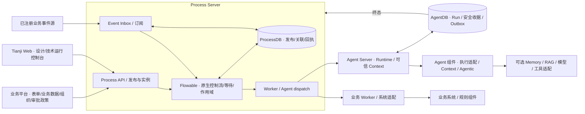
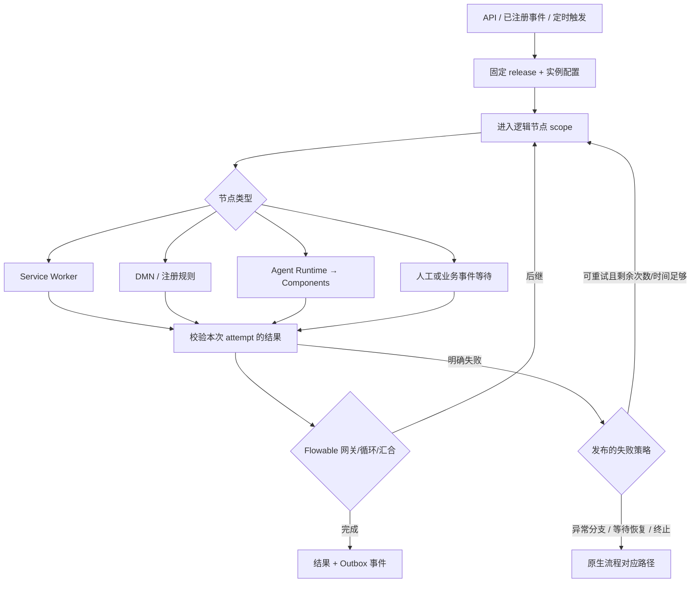
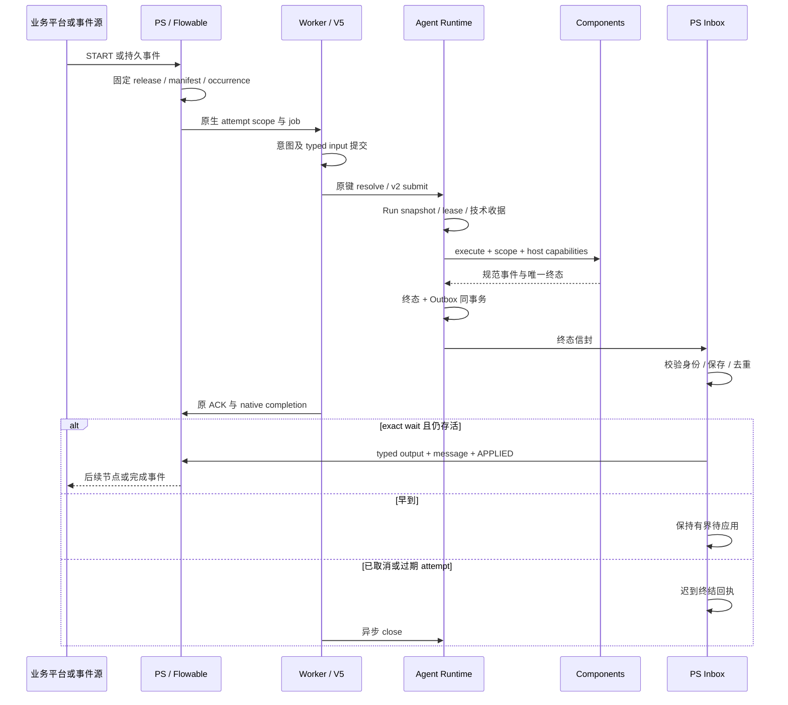
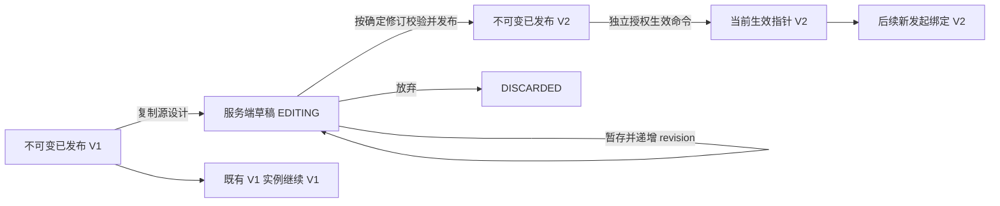
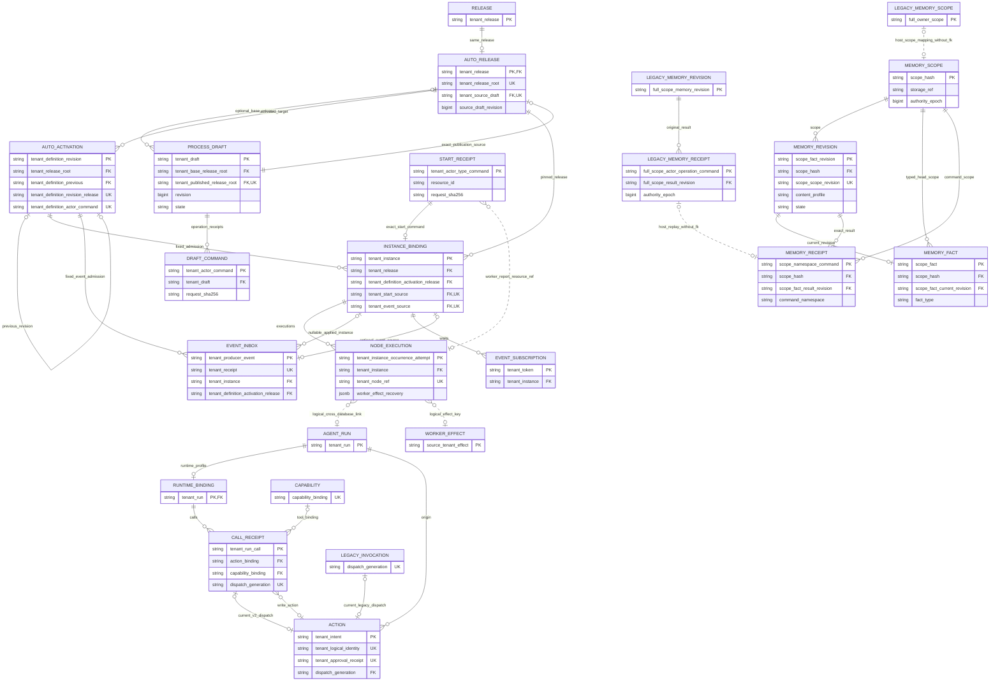

# Tianji 智能流程引擎完整规格 · Process 编排、Agent Runtime/Context 与组件下沉

| Field | Value |
| --- | --- |
| Document | docs/egon/spec/2026-11-11-18-55-intelligent-process-engine-convergence.md |
| Template Version | 9 |
| Archetype Cleanup | Not applicable |
| Status | Review |
| Type | Architecture |
| Complexity | Complex |
| Complexity Drivers | 三仓变更、两库事务、并行循环及事件关联、接口版本、存量权限与数据兼容、组件抽离和产品入口退役 |
| Created | 2026-11-11 18:55 Asia/Shanghai |
| Updated | 2026-11-15 17:20 Asia/Shanghai |
| Owner | Tianji 平台与 Components |
| Repository | tianji-service，关联 tianji-web、Stellar-Enclosure-Components |
| Scope | 智能流程引擎、引擎控制台、Agent 通用能力及可选适配 |
| Change Surface | PS 草稿/发布/生效与受控START、自动化节点/事件/Agent交接；AR/AS Runtime/Context和预算解耦；Web持久编辑与引擎控制台；Components通用能力接缝 |
| Affected Chapters | §7, §8, §9, §10, §11, §12, §13, §14, §15, §16, §17, §18 |
| Source Requirement | 用户确认三仓职责及完整Spec；2026-11-13明确授权先补齐Plan预审发现的四项契约缺口，再完成含并行subagent安排的逐文件Plan；仅文档 |
| Baseline Revision | Service `fa63c34ccb823353481776b6805ded7f2f8d4004`；Web `3a42db1bdc8d9b0974beb6307c0e003297f036b5`；Components `c68730198f6345926c1a88e98b957781673310be` |
| Amends | [主计划](../../../../docs/plans/agent-framework-upgrade-plan.md) §2、§6–13、§15–17、§19 的目标职责和新运行 profile |
| Supersedes | [首段融合规格](./2026-11-11-16-56-process-agent-task-fusion.md) §1–20全部目标设计，在本文件获批后生效 |
| Depends On | [主计划](../../../../docs/plans/agent-framework-upgrade-plan.md) §6.3、§19 T3-03/04/05 的现有独立 JDBC、Worker、Outbox/Inbox 交接 |
| Related Specs | [Process owner 观测](./2026-11-05-22-41-process-owned-agent-outcomes.md) · [受控 START](./2026-11-11-15-28-governed-process-start.md) · [检查点观察](./2026-11-06-02-18-agent-checkpoint-observation.md) |
| Related Plans | [智能流程引擎逐文件实施 Plan](../plan/2026-11-13-14-10-intelligent-process-engine-convergence.md) |

## 1. Summary

Tianji 交付统一 Process 编排入口和引擎控制台。Service Task、规则、事件、Agent Task、人工等待共同运行于 ProcessInstance。Process 负责跨节点顺序、条件、并行、循环、等待与恢复；Agent Runtime 负责一次智能节点的运行生命周期和可信 Context；通用执行、模型/工具协议、Agentic 策略、Memory 与 RAG 进入组件体系。

业务平台拥有表单、意见附件、业务签名、人员组织、审批政策、待办产品、撤回条件和业务审计产品。引擎保留技术执行事实、受权任务生命周期和必要诊断。费用、Token 配额、定价、预占与结算退出新运行路径。历史数据和在途运行通过明确版本读写适配完成过渡。

本规格覆盖完整目标和阶段依赖。既有代码与各阶段待实现能力分别列出；后续 Plan 根据本规格审核结果安排文件级执行和分仓提交。

2026-11-12审阅补充：新增REQ-019–021，重点看§7.3.7（持久草稿）、§7.3.8（发布/生效/新旧实例）、§7.3.9（Service Task三模式）、§12（编辑与恢复体验）及TEST-015–018。原20章及三仓职责范围保持。2026-11-13用户确认后授权修订：补齐Worker报工/UNKNOWN恢复、Memory无损映射、Agent专用发布权限和终态联合合同；补清现有START回执GET的v2恢复接缝。同步编写关联 Plan。2026-11-13 执行修订明确 AND_JOIN 与 MULTI_INSTANCE 合并字段的唯一位置，保留现有 v1 合同。

## 2. Background and Current State

### 2.1 Business and user context

业务系统使用 Process 发布/发起/事件/任务接口并提供业务 Worker。规则与 Agent 返回结构化事实，流程网关依据已发布规则继续执行。全自动流程允许直接结束，人工等待由业务需要选择。纯 Agent Workflow 的节点使用 Agent 能力，实例仍由 Process 管理。

### 2.2 Repository evidence

以各仓库相对路径为准。后文 `PS/AR/AS/C/CL/W` 分别表示 Service 内现有 process-server、agent-runtime、agent-server、contract、client、worker-starter 模块，名称前缀均为 `stellar-enclosure-tianji-`。`AF/RAG/RULE/OUTBOX` 表示 Components 内 `stellar-enclosure-component-agent-flow-starter/rag-starter/rule-engine-starter/transactional-outbox-starter`。

| ID | Exact source | Current fact and gap |
| --- | --- | --- |
| EVD-001 | PS `release/ProcessReleaseService`、`execution/ProcessExecutionService`、`GovernedProcessStartStore`，V1/V3/V13 | 发布固定原生 definition/model SHA；START 与实例同事务；受控 START 有独立授权和当前发布证明。 |
| EVD-002 | PS [ProcessModelValidator](../../../stellar-enclosure-tianji-process-server/src/main/java/top/egon/cola/platform/tianji/process/server/release/ProcessModelValidator.java) 及 `ValidatedProcessModel` | 平面 BPMN 白名单，含 Worker/DMN 时禁 parallel，条件分流最多一个，拓扑遍历拒环，Worker 输入只取 START schema；当前未开放通用子流程/多实例。 |
| EVD-003 | PS `worker/FlowableWorkerService`、`WorkerLeaseStore`、`bridge/AgentDispatchStore`，V4/V5 | 原生 job ID 是现有 occurrence 和业务幂等派生依据；短租约、提交意图、ACK、恢复均已有。 |
| EVD-004 | PS [FlowableAgentWaitInspector](../../../stellar-enclosure-tianji-process-server/src/main/java/top/egon/cola/platform/tianji/process/server/bridge/FlowableAgentWaitInspector.java)、`AgentResultCorrelationService`、V6 | 按 instance/definition/activity 查唯一订阅及历史，当前仅回写 AgentRun status；循环需要额外 scope/attempt 关联。 |
| EVD-005 | PS `decision/PinnedDecisionActivityBehaviorFactory`、`FlowablePinnedDecisionExecutor`、`ProcessDecisionService` | 固定版本 DMN 执行已存在；校验和变量写回仍受单 DMN、root scope 限制。 |
| EVD-006 | PS `task/FlowableHumanTaskService`、`ApprovalVerificationService`、`api/HumanTaskController`，V7 | 任务 ACTION/APPROVAL、formSchema、lane/role、申请人分离及审批证明已混入接口；其中有 AS 真实消费者。 |
| EVD-007 | PS `ProcessApiSchemaVerifier#verifyAgentDispatchColumns`、`ProcessStorageConfiguration`、`ProcessControlNativeAccess#classify` | 旧表精确列校验，生产启动验证预置 schema；MESSAGE 只识别 Agent/Case。原 V5 关闭范围最多 256 非 CLOSED intent。 |
| EVD-008 | AR `AdkAgentRunExecutor#runClaimed`、`AgentLedgerService`、`AgentLinkedSubmissionService`、AS `AgentResultDeliveryHandler` | 已有 Agent Flow Runner、Run/lease/授权及 Outbox/Inbox 跨库可靠交接；业务身份与执行宿主身份独立。 |
| EVD-019 | AS `security/TianjiAgentSecurityConfiguration`、`TianjiAgentPermissions`、`TianjiAgentAccess`，AS POM的tianji-agent-java producer；AR `AgentLedgerService.publish/readVerifiedPublication`、`JdbcAgentLedgerRepository.definition`、原V1定义表 | 现有AS定义发布只有Java入口；未登记HTTP发布权。已有tenant+key+version不可变唯一键和PAC SERVICE执行链可复用。 |
| EVD-020 | PS `AgentResultInboxController`、`ProcessRequestBodyAdvice`、`AgentResultProducerRegistry`及V6，AS `AgentResultDeliveryHandler`，C `AgentTerminalEvent/AgentResultReceipt` | 原私有API、producer绑定、JSONB、事件指纹、Outbox和四字段receipt均存在；旧V1是结果引用事件，不能承载v2 output。 |
| EVD-009 | AR [ContextProvider](../../../stellar-enclosure-tianji-agent-runtime/src/main/java/top/egon/cola/platform/tianji/agent/application/context/ContextProvider.java)、`DefaultContextAssembler`、`RagContextProvider`、`MemoryContextProvider` | 通用片段、组装与 Tianji actor/snapshot/lease/source 校验耦合。RAG 机制已复用组件。 |
| EVD-010 | AR `AdkRunBudgetPlugin`，V2/V9/V13/V14/V15，`AgentCheckpointObservationService` | 上下文、工具调用/结果访问和模型用量 FK 指向 budget reservation；checkpoint 以 no_budget 判断无进展。直接删除预算会破坏安全。 |
| EVD-011 | AR `PostgresMemoryService`、`JdbcMemoryRepository`，V10–V12；AS `integration/memory` | Memory 版本、来源、授权、索引与运行 FK/Outbox 同源有耦合，整包搬迁不可复用。 |
| EVD-012 | AF `api/AgentFlowService`、`AgentFlowExecutionCommand`、`runtime/AgentFlowFactory`、`AgentFlowRuntimeBO`、`AgentFlowSessionRunner` | 公共协议暴露 ADK Content/Event；默认 InMemoryRunner；固定 Flow 构造 Sequential/Parallel/Loop，同配置叶子共享模型/工具；取消与可插拔 Session Runner 已存在。 |
| EVD-013 | RAG `api/RagRetrievalService`、RULE `engine/RuleEngine`、OUTBOX `TransactionalOutbox/JdbcOutboxStore` | 有可复用检索、规则链/树、普通 JDBC 投递基础；不需要新建消息引擎。 |
| EVD-014 | Web `src/App.tsx`、`permissions/resources.ts`、`pages/TaskSchemaForm.tsx`、`MemoryPreferenceAction.tsx` | 导航以 Agent/Memory/Task/Case 为中心；APP 与 landing 没涵盖纯 Process 角色；审批和 Memory 管理已是实际页面。 |
| EVD-015 | Web `DefinitionReleasePage`、`ExecutionTimelinePage`、`WorkerFailuresPage`，`api/processReleases.ts` | 发布版本/关联/故障观察可复用。旧 DTO exactObject 拒绝附加字段。当前未发现 BPMN 图形编辑器依赖。 |
| EVD-016 | 根 POM、六个 Service POM、AF/RAG/RULE POM、Web `package.json`、`scripts/verify-source-reactor.sh` | Java 25、Flowable 8.0.0、ADK 1.13.0、现有 Jackson 2/3 边界、React/AntD/Router/Vitest 与源码 reactor 可复用。 |
| EVD-017 | PS `PlatformReleaseActivationService#change`、V11/V12/V13、`GovernedProcessStartStore`、`PlatformReleaseTenantFence` | 旧生效及START provenance固定单Agent/Worker candidate；可复用事务fence与授权原语，不能直接装入一般v2依赖集合。 |
| EVD-018 | PS release/api包、Web `DefinitionReleasePage`；W `WorkerEffectSafetyEnum/WorkerHandlerDescriptor/JdbcWorkerExecutionStore` | 当前未发现持久草稿接口；已有Worker三模式及handler版本，v2需保留本地事务收据而非用未知处置替代effect模式。 |

### 2.3 Problem statement and gap

目标能力缺口主要在多节点自动化、精确的每次执行关联、通用事件以及结构化输入输出。职责问题主要在业务审批语义、Memory/Agentic 实现和预算混合插件。Web 需要以 Process 的设计和技术运行为主线，组件则需能由普通应用独立使用。

### 2.4 Evidence and current-chain map

| Entry/trigger | Current chain | State owner | Target change | Evidence |
| --- | --- | --- | --- | --- |
| 发布/发起 | Process API → 固定发布 → START receipt/native instance | ProcessDB | 新 profile 和快照，原版本保留 | EVD-001/002 |
| Service/Agent | native job → V4 → Worker/V5 → AS V7/Run | 两库各自本地事务 | typed input、scope/attempt 和单节点配置 | EVD-003/008 |
| 返回结果 | AS ledger+Outbox → PS Inbox → native message | AS 事实、PS 流程 | 通用结果、准确等待、并发去重 | EVD-004/008 |
| 人工 | task API → role/assignment → V7/native task | PS 技术任务；业务决定 | 通用任务结果，审批产品迁出 | EVD-006 |
| 组件调用 | Tianji ADK 插件 → context/memory/rag/budget | 当前混合 | 中立组件、宿主 scope、安全收据 | EVD-009–013 |
| Web | 原 API → 严格 DTO → Agent/Task/Memory 页面 | Web | Process 工作台、权限与旧入口退役 | EVD-014/015 |

### 2.5 Archetype example cleanup

Cleanup disposition: Not applicable

Reason: 本次为现有平台引擎、公共技术组件和既有 Web 的职责收敛。Tianji 根 POM 是六模块技术聚合；Components 维护组件自身及必要示例。已有研究 Agent 模板按 §3 的业务模板迁移清单处理，测试夹具保留真实验收作用。无新业务项目脚手架。

## 3. Goals and Non-goals

### 3.1 Goals

统一入口与实例、通用业务自动化、纯 Agent Workflow、节点级恢复、独立组件可用性、业务能力承接、预算退役及历史可恢复是最终验收目标。默认智能执行适配使用现有 Agent Flow/ADK，实现置于组件，Tianji 持有宿主运行事实。

### 3.2 Responsibility and removal inventory

| ID | Capability | Target owner | Engine retained | Migration/removal exit |
| --- | --- | --- | --- | --- |
| OWN-04 | 流程草稿、不可变发布、生效版本、新旧实例绑定 | PS；Web提供编辑与发布操作 | 持久暂存、修订CAS、固定修订发布、独立生效和默认START选版 | 关闭页面恢复草稿、编辑不影响运行、切换后新实例新版且旧实例原版 |
| OWN-01 | 顺序/条件/并行/循环/子流程/多实例/等待 | PS/Flowable | 全部流程控制与状态 | 新模型全部通过 ProcessInstance 验收 |
| OWN-02 | Service Task/规则/业务事件 | PS + Worker/规则组件 | 版本、输入输出、派发、可靠交接 | 三种能力互相组合可恢复 |
| OWN-03 | AgentRun/可信 Context | AS/AR | 状态、调度、lease、授权、快照、Process link | 新运行经组件执行且不引用费用 |
| MOVE-01 | 表单、意见附件、业务签名、业务审计报表 | 业务平台 | 有界任务结果 schema、业务引用、技术历史 | Web 业务页面/导航/权限资源退出；业务接入契约通过 |
| MOVE-02 | 会签政策、组织选人、审批人分离、撤回政策 | 业务平台 | 多实例/汇合、候选绑定、受权完成、取消等基础操作 | 新模型无 APPROVAL 硬编码；旧证明消费者完成迁移 |
| MOVE-03 | 待办中心、审批办理 | 业务平台 | 任务 Query/claim/complete 与 TaskCreated/Completed 事件 | `TaskInboxPage/TaskDetailPage/TaskSchemaForm` 退出引擎 UI |
| MOVE-04 | Memory 读写/检索/提取/版本/索引 | Components；管理体验由业务承接 | 本次 scope、授权、run 来源与旧合同适配 | component 独立测试、纳入切换的旧 scope 完整迁移及原回放通过，旧 HTTP 新写入口按消费者和在途清单退役 |
| MOVE-05 | RAG/Embedding/向量存储 | RAG 组件与可选适配 | 当前许可和使用来源 | 核心 AR 不强制 RAG/pgvector 依赖 |
| MOVE-06 | LLM API、工具/MCP 协议、Agentic 执行算法 | AF 的适配与 agentic 包 | 技术执行限制、能力许可和副作用关联 | 新公共 API 无 ADK 类型；通用算法不依赖 Tianji |
| MOVE-07 | 研究/审核等领域 Agent 模板 | 业务模板或示例 fixture | 精确模板注册和版本 | AS 核心运行不绑定研究模板名称/业务提示词 |
| REMOVE-01 | 费用/Token 配额/定价/预占/结算/成本账本决策 | 网关或独立计费能力 | 实际用量可观测值、运行安全限制 | 新运行对费用表零写入、零决策读取；旧活跃运行按原版本完成 |
| REMOVE-02 | 并列 Agent Workflow 业务入口 | Process | 内部 linked submit/resolve/close、受权技术观察 | 新业务只由 Process 发起；旧直启入口完成兼容退役 |
| REMOVE-03 | Agent 工具内隐式跨节点编排与绕过宿主授权的调用 | Process；组件只做节点内执行 | 已注册 READ_ONLY/IDEMPOTENT_WRITE/APPROVAL_REQUIRED 工具及技术效果栅栏 | 跨节点业务步骤改为 Service Task；局部写工具仍经可信批准、固定能力与业务幂等执行 |
| KEEP-01 | 技术执行历史和最小查询 | 引擎 | 调试、故障诊断、去重及恢复证据 | 查询按 tenant/资源授权和脱敏；业务审计在上层组合 |
| KEEP-02 | 发布完整性签名、安全授权、租约、超时、取消、幂等 | 引擎及宿主安全适配 | 全部必要保障 | 组件下沉和预算退役负例持续通过 |

MOVE 表表示代码、接口和页面的明确承接职责。未知业务应用由集成契约及示例消费端承接验收，本任务不修改三仓之外的业务仓库。历史记录与已发布定义按 §16 留兼容读取。

### 3.3 Change Surface and Design Depth

| Area/layer | Disposition | Exact repository evidence | Changed or preserved behavior/contract | Required Spec treatment | Chapter(s) |
| --- | --- | --- | --- | --- | --- |
| PS/C/CL/W | Affected | EVD-001–007 | 自动化发布、scope/attempt、事件、任务协议、数据映射 | 完整设计/接口/存储/验收 | §7, §8, §9, §10, §11, §13, §14, §15, §16, §17, §18 |
| AS/AR | Affected | EVD-008–011 | 单节点宿主、组件委托、安全收据、旧预算兼容 | 完整设计/迁移/测试 | §7, §8, §9, §10, §11, §13, §14, §15, §16 |
| AF/RAG/RULE/OUTBOX 接缝 | Affected | EVD-012/013 | 中立执行、Context/Session/Memory、可选适配、复用规则和消息 | 组件契约/依赖/可插拔验证 | §7, §8, §9, §10, §11, §13, §14, §15, §16 |
| Web 页面/路由/权限/API | Affected | EVD-014/015 | 引擎工作台及业务入口退出 | 页面状态/协议/验收 | §8, §9, §12, §14, §15, §16 |
| Shoubing/Jianshen/Tianshu/Yuheng 及业务应用 | Context-only | 原 service dependency 与接入适配 | 当前授权、发布和外部能力接口 | 适配与消费契约验证 | §7, §9, §15 |
| TLS、运行部署、基础设施 | Not applicable | 本轮用户范围 | 本 Spec 仅规定代码和隔离功能验收 | 说明范围 | §16 |

### 3.4 Completion scope

新引擎 profile 支持顺序、显式 XOR、结构化 AND 分支/汇合、有界循环、顺序/并行多实例和同包固定子流程。原生 CMMN 技术观察继续可用；CMMN 业务办理不扩大。新 Web 支持 XML/结构化属性设计与只读运行图。任意脚本、任意 Java 类引用、动态工具代码、无界循环、通用拖拽 BPMN 编辑器、业务审批 UI、生产部署均在本规格之外。

## 4. Requirements and Acceptance Criteria

| ID | Atomic requirement | Priority | Observable acceptance criteria | Source |
| --- | --- | --- | --- | --- |
| REQ-001 | 统一 Process 入口/实例 | Must | 三类流程由同一发布/start/instance contract 管理，Agent 为节点类型 | 用户最终目标 |
| REQ-002 | 通用自动化控制流 | Must | Service→规则→条件→并行/汇合、有界循环/多实例、子流程输入输出可运行 | 用户业务自动化 |
| REQ-003 | 每次执行与作用域 | Must | loop occurrence、parallel branch、retry attempt 各自准确关联；旧结果不能命中新一轮 | 用户幂等恢复 |
| REQ-004 | Service Task 系统对接 | Must | 复用 Worker，合同固定版本，可靠幂等和未知副作用处置 | Service Task/系统对接 |
| REQ-005 | 固定规则执行 | Must | 多个 DMN 或注册规则节点按固定版本执行，输出用于网关 | 规则引擎 |
| REQ-006 | 通用事件驱动 | Must | 受权事件启动/唤醒/发出，去重、早到预约、迟到和跨 tenant 可验证 | 事件驱动 |
| REQ-007 | 通用 Agent Task | Must | 单节点 typed input/output，可靠异步，失败/超时/取消按流程策略 | Agent 接入 |
| REQ-008 | 实例 Agent 配置 | Must | 已发布模板精确版本与声明参数可覆盖，START 固定整个实例 manifest，恢复/重试保持 | 用户模板+实例快照 |
| REQ-009 | Runtime/Context 收敛 | Must | AS 保持运行和可信 scope，通用执行经 AF；Context 不能跨实例/用户/tenant 越界 | 用户 Agent 引擎边界 |
| REQ-010 | Agent 组件独立 | Must | 普通 Spring 应用可执行/流式/取消，公共契约无 ADK 或 Tianji 类型 | 组件下沉 |
| REQ-011 | Memory/RAG/Agentic 下沉 | Must | 内存实现可独立用；可选存储/检索加载；宿主提供授权/来源 | 用户基础能力归属 |
| REQ-012 | 预算职责退出 | Must | 新模式费用表零写/零授权依赖，安全收据替代 budget FK 用途，旧字段/运行可读可完成 | 用户预算边界 |
| REQ-013 | 人工任务通用化 | Must | 业务平台提交 schema 校验结果，任务授权/claim/complete 可用，新 profile 无审批政策 | 用户业务层承接 |
| REQ-014 | Web 引擎控制台 | Must | 纯 Process 权限可进入；设计发布、实例图/执行、事件与恢复可操作 | 三仓范围 |
| REQ-015 | 业务入口与历史退役 | Must | MOVE/REMOVE 逐项完成消费者替代、兼容和页面/权限清理 | 用户移除清单 |
| REQ-016 | 可靠性和运行安全 | Must | 两库无共享事务；去重、取消、lease、权限、并发、deadline、未知副作用有测试 | 技术边界 |
| REQ-017 | 历史和版本迁移 | Must | 旧 release/SQL/hash/快照不改写，在途与历史回调可验证，新旧 profile 明确 | 用户兼容要求 |
| REQ-018 | 三仓最终验收 | Must | 自动化/混合/纯 Agent/组件独立场景及故障矩阵通过 | 用户完整 Spec |
| REQ-019 | 已发布版编辑与持久草稿 | Must | 从v2已发布版复制源设计；未完成内容可暂存；刷新/关闭后恢复；owner隔离、revision并发不覆盖 | 2026-11-12草稿需求 |
| REQ-020 | 固定修订发布与独立生效 | Must | 草稿修订冻结为不可变release；发布不自动改指针；发布并生效分步结果与原键恢复可见 | 2026-11-12发布生命周期 |
| REQ-021 | 默认新版发起与在途旧版隔离 | Must | 正式START/新事件由服务端选择当前activation；旧实例/原命令/已接纳事件固定旧版；切换竞争有明确事务边界 | 2026-11-12Process execution需求 |

### 4.1 Scenario matrix

| Scenario | Actor/trigger | Preconditions | Main path | Alternative/failure path | Data/state change | Observable result | Requirements |
| --- | --- | --- | --- | --- | --- | --- | --- |
| SC-01 | 业务 SERVICE 发起 | 发布与授权有效 | Service→DMN→并行写系统→事件 | 未知写结果停在可处理失败 | Process/Worker/Outbox | 全自动完成 | REQ-001/002/004/005 |
| SC-02 | 外部业务事件 | source/route 固定 | 去重启动或唤醒预约等待 | 未预约、过期、冲突不推进 | EventInbox/START或native | 一次处理 | REQ-006/016 |
| SC-03 | 智能处理 | 实例已固定 Agent | Service→Agent→规则→执行或人工 | 格式错进入明确失败策略 | V5/Run/V6/node | 合同和路由一致 | REQ-007/008/013 |
| SC-04 | 纯 Agent Workflow | 同一 Process 模型 | Agent A→B→C、分支/循环 | 重试仅新 attempt，旧回调拒绝 | scope/attempt/run | 单 ProcessInstance | REQ-001/003/007 |
| SC-05 | 平台中断/版本变化 | 意图或终态已提交 | 重启原键恢复 | 旧模板不可见则有界失败，绝不 latest | 已冻结快照不变 | 可恢复可追查 | REQ-008/016/017 |
| SC-06 | 独立组件使用者 | 最小配置 | 内存 Session/Memory、模型替身 | 未配置可选 provider 给明确错误 | 本地 store | 不要求 Tianji/PG | REQ-010/011 |
| SC-07 | 存量迁移 | v1 活跃/终态并存 | v1 原分支，v2 技术收据 | 无授权不接管；未知调用不重发 | 新旧技术存储 | 安全且无新费用决策 | REQ-012/015/017 |
| SC-08 | 引擎观察者 | 当前资源许可 | 图→occurrence→attempt→脱敏诊断 | 身份切换丢弃迟到响应 | 只读观察 | 无跨 scope 数据 | REQ-014/016 |
| SC-09 | 设计者修改已发布流程 | 有READ/PUBLISH与自己的草稿 | 复制→多次暂存→重新打开→预检→发布 | 不完整内容可存；修订冲突保留本地缓冲 | Draft/命令收据/release | 在发布前不影响新旧实例 | REQ-019/020 |
| SC-10 | 发布者切换正式版本 | 当前activation revision和独立许可 | 发布V2→生效→新START | 生效失败仍保留V2；原命令未知可查重放 | Activation/固定instance binding | 旧实例V1、新实例V2 | REQ-020/021 |
| SC-11 | 事件与切版并发 | 同producer/eventId或新事件 | 准入冻结版本→内部START | 重复事件原版，未接纳新事件新版；撤权拒绝 | Inbox准入与activation FK | 不发生静默换版或重复实例 | REQ-006/021 |

### 4.2 Use-case analysis

#### 4.2.1 Actor inventory

| Actor ID | Actor | Goal/channel | Authority |
| --- | --- | --- | --- |
| ACTOR-001 | 流程设计者 | Web/API 发布固定模型 | 当前 tenant 的 release 读/发布权限 |
| ACTOR-002 | 业务平台调用者 | 发起、事件、业务任务结果 | 当前 USER 或限定 SERVICE、资源归属 |
| ACTOR-003 | Worker/AS 服务身份 | 执行与报告一次节点结果 | 注册能力、source、lease、执行授权 |
| ACTOR-004 | 引擎运维观察/恢复者 | 技术图、节点/事件、恢复操作 | 独立的 tenant 技术观察/恢复许可 |
| ACTOR-005 | 组件集成者 | 独立 Agent/Context/Memory 使用 | 宿主提供 scope 和能力回调 |

#### 4.2.2 Use-case artifact

| ID | Use case/goal | Primary actor | Supporting actors/systems | Trigger | Preconditions | Main success outcome | Alternatives/failures | Postconditions | Requirements | Interfaces/pages | Tests |
| --- | --- | --- | --- | --- | --- | --- | --- | --- | --- | --- | --- |
| UC-001 | 设计发布自动化 | ACTOR-001 | PS/DMN/注册能力 | 校验、发布 | 合法图及精确引用 | 固定 source/compiled/model manifest | 拒绝坏图或能力不符 | 一个不可变发布 | REQ-001/002/005/014 | 设计页/发布 API | TEST-001/002 |
| UC-002 | 自动化运行 | ACTOR-002 | ACTOR-003 | START/事件 | 当前许可和输入 | 所有节点按合同执行 | failure policy 或取消 | 唯一实例及执行记录 | REQ-003/004/006/016 | 实例/事件/Worker | TEST-003/004/005 |
| UC-003 | 运行智能节点 | ACTOR-002 | AS/组件 | 到达 Agent | 冻结模板及参数 | 结构化输出、继续流程 | 错格式/timeout/未知效果 | 精确 run 和一次写回 | REQ-007/008/009 | 节点配置/运行 | TEST-006/007 |
| UC-004 | 办理人工等待 | ACTOR-002 | 业务平台 | 完成任务 | 当前 assignment/版本 | 接受 typed result | 非授权/过期/重复 | 原生任务一次完成 | REQ-013/015 | 通用任务 API | TEST-006/013/014 |
| UC-005 | 组件集成 | ACTOR-005 | 模型/工具/可选存储 | 执行调用 | 合法 scope/limits | 流式/取消/Session/Memory | provider 缺失或授权拒绝 | 无平台依赖 | REQ-010/011 | Java SPI | TEST-009/010 |
| UC-006 | 退役与恢复 | ACTOR-004 | PS/AS/业务消费者 | 故障或迁移 | 原权威及明确窗口 | 可恢复且历史可查 | unknown 停止自动重试 | 新模式无费用耦合 | REQ-012/015/016/017 | 技术观察/恢复 | TEST-011/012/013 |
| UC-007 | 跨仓交付 | ACTOR-001/004 | ACTOR-002/005 | 总体验收 | 阶段输出 | 四类流程及隔离通过 | 阶段失败不得标完成 | 引擎可接业务平台 | REQ-018 | 全部目标页面/接口 | TEST-014 |
| UC-008 | 编辑并暂存流程草稿 | ACTOR-001 | PS/Web | 从空稿或已发布版编辑 | owner与发布权限 | 草稿跨页面/会话恢复并按确定修订发布 | 冲突/坏模型/提交未知可处理 | 已发布版不变 | REQ-019/020 | 草稿工作区/编辑页/发布 | TEST-015/018 |
| UC-009 | 切换生效与默认发起版本 | ACTOR-001 | ACTOR-002/003/004 | 发布完成后生效或重新启用旧版 | 独立生效权、可信证据、expectedRevision | 新首次准入绑定当前版，旧实例继续 | 指针竞争/撤权/重复命令不误选版 | activation与START来源可追查 | REQ-020/021 | 生效查询/命令/正式START | TEST-016/018 |

## 5. Constraints, Assumptions, and Decisions

### 5.1 Confirmed constraints

用户已确认现有引擎/Worker/组件复用、独立数据库事务、基础能力下沉、业务产品退出及三仓范围。采用现有平台模块与 JDBC 技术存储边界。技术事实可观察，业务数据读取由宿主权限决定。所有新外部写入使用有界命令、稳定幂等键和明确失败语义。

### 5.2 Small-gap assumptions

| ID | Inference | Repository evidence | Why locally reversible | Impact if wrong |
| --- | --- | --- | --- | --- |
| ASM-001 | Web 设计首版用 XML+节点属性，运行图只读 SVG | EVD-015/016 | 现有 React/AntD 足够，无编辑器库 | 可独立增加后续拖拽编辑器，发布契约不变 |
| ASM-002 | 中立新 API 先放现有 AF 模块，旧 facade 适配保留 | EVD-012 | 按包分职责，不增加 Maven reactor 层 | 后续可按依赖再拆库 |
| ASM-003 | 新存储采用新增 sidecar 技术表 | EVD-007/010 | 旧表精确校验和 FK 保持 | 新 profile 的旧二进制回退仍有边界 |
| ASM-004 | 业务承接以接口/事件示例验收 | 本轮只指定三仓 | 无指定业务应用仓库 | 实际产品迁移由业务方接入执行 |
| ASM-005 | 草稿为owner级持久资源，允许独立多个草稿，无实时协同或自动合并 | 本轮草稿需求及现有owner安全模式 | 不引入协作引擎；revision CAS满足多页签竞争 | 以后协作编辑另设资源授权，发布合同可保持 |

### 5.3 Resolved decisions

| ID | Decision | Decision owner | Evidence and rationale | Requirements |
| --- | --- | --- | --- | --- |
| D-001 | 新 `AUTOMATION_V2` profile使用持久草稿与正式生效入口，旧 `LEGACY_V1` 保留原语义 | 本次用户审查 | EVD-002/015，旧 DTO 和图形不宜原地变义 | REQ-001/017 |
| D-002 | 受控编译到原生 BPMN scope/job/wait，Flowable 为流程状态权威 | 本次用户审查 | EVD-001–005；逻辑节点需要每次独立执行 scope | REQ-002/003 |
| D-003 | 新外部 Process 协议使用 v2；旧 v1 按原模型继续 | 本次用户审查 | 结构化变量、覆盖及技术投影是新合同 | REQ-007/008/014/017 |
| D-004 | 对 Memory 和预算按数据版本迁移，先切新路径再退旧入口 | 本次用户审查 | EVD-010/011 的真实 FK 与消费者 | REQ-011/012/015 |
| D-005 | 技术观察与敏感数据读取分权，Process 身份不自动获得 AS 详情权限 | 本次用户审查 | EVD-008/015 | REQ-014/016 |
| D-006 | 本文件的阶段顺序用于依赖和验收，文件级执行另写 Plan | 用户 | 明确先审核 | REQ-018 |
| D-007 | 草稿/发布/生效三个对象分开；草稿可保存未完成文本 | 本次用户明确要求 | 编辑暂存不能影响运行；发布需固定修订与完整校验 | REQ-019/020 |
| D-008 | v2正式START由服务端选择当前生效版，存量绑定不变 | 本次用户明确要求 | 现有精确release START不足以保证新实例新版 | REQ-021 |
| D-009 | 新通用activation记录，复用原tenant fence/信任原语，旧V11–V13保持 | 本次用户审查 | EVD-017不允许用假单Agent证据表示纯人工/多Agent | REQ-020/021 |
| D-010 | Service能力保留现有三种effect模式，UNKNOWN独立处置 | 本次源码校正 | EVD-018与已授权的Worker复用边界 | REQ-004/016 |

### 5.4 Open major decisions

本文件提交一套完整建议供用户审查。可调整的设计选择为 D-001–D-005、D-009及ASM-001–005。具体业务页面承接仓库及生产迁移窗口不影响三仓代码设计；相关消费者迁移状态必须在旧写入口最终删除前核验。

## 6. Project Technology Context

保留 Java 25、Flowable 8.0.0、ADK 1.13.0、Spring AI 2.0.2、平台 Spring Boot 4 系列、PostgreSQL、原普通 JDBC Outbox，以及 React/AntD/Router/Vitest。各仓库使用原 Maven/npm 工作流。

### 6.1 Java architecture profile and capability baseline

保留已有传统分层技术服务的 API→执行服务→技术 Store/引擎 API 路径及 AR application/domain/infrastructure 布局。Components 延续自身 api/config/runtime/execution/autoconfigure 包。用户已确认复用既有独立 Process/Agent 技术存储，沿用主计划明确的 ordinary JDBC 事务基线；本规格不建立新的业务 CRUD 持久模块。原生 Flowable 技术表与永久执行收据的生命周期有别于业务软删除实体。

| Capability | Owner/reuse | Dependency decision |
| --- | --- | --- |
| 多节点状态、timer、job | Flowable | 原依赖，不增加并列引擎 |
| 规则 | 已有 DMN、RULE 组件通过 Worker 适配 | 不强制 PS 引入第二套规则执行器 |
| Agent 执行 | AF 现有 ADK/Spring AI/cancel 生命周期 | 新中立入口，兼容原 facade |
| JSON/校验/转换 | 各模块现有 Boot Jackson、Validation/Common Core | C 保持中立值契约，宿主边界执行约束 |
| RAG | 既有 RAG 组件 | AF 集成声明为 optional，缺失时核心可启动 |
| Memory JDBC | AF 可选适配包 | 使用已有 BOM 的 spring-jdbc/PostgreSQL，optional，不启动数据源 |
| 组件旧存储适配 | AR/AS | 引擎拥有身份/旧 FK；组件无 Tianji 依赖 |
| Web | React/AntD/原生 SVG | 无新增 npm 库 |
| DDL | 既有技术 schema history/verifier 和组件可选 SQL manifest | 新脚本、原历史不可改，运行只验证；安装由宿主现有流程负责 |

新 optional 依赖是本 Spec 的明确拟议 POM 增量，仅在审核后的 Plan 中落实坐标和现有 BOM 对应版本；不升级版本、不下载新工具。复用现有 PostgreSQL 与 Spring JDBC，不新增数据库种类或运行服务。

**编译期声明核对。** C当前POM只声明JUnit，父POM的Lombok annotation processor不等于C编译classpath。为兑现本Spec既定class/Validation/JsonValue规范，Plan须精确列出平台已使用且版本由原BOM管理的注解依赖声明：`org.projectlombok:lombok`使用provided（现父版本1.18.46）、`jakarta.validation:jakarta.validation-api`、`com.fasterxml.jackson.core:jackson-annotations`。这是已选技术的模块级显式声明，不向C引入Spring容器/数据库/ADK或Common Core整套传递依赖。PS/AR/AS的转换复用已有Common Core BaseForwardConverter，并显式配置现有MapStruct 1.6.3与Lombok处理器（结合项目既有processor链，不能覆盖PAC processor）；需要Lombok+MapStruct协同的同模块转换遵循已存在组件构建方案并验证生成实现。所有具体POM变更列入最终Plan审阅，当前不执行依赖变更。

### 6.2 User-mandated Java rule compliance

```text
1 类名规范，必须以 java的pojo规范命名。以dao po bo vo dto query command event等结尾
2 每层之间必须被 springboot-validation 校验，复用对象使用分组校验；基于原生和自定义约束注解、@Valid、@Validated 及 ConstraintValidator 扩展实现。ValidationUtils 只承担通用手工校验，不承载全部业务校验；电话号码复用 libphonenumber。
3 Java POJO 默认使用 class，注解为 @Data @NoArgsConstructor @AllArgsConstructor @Accessors(chain = true)，按构造目标选择 @Builder 或 @SuperBuilder；父类状态参与相等性时使用 @EqualsAndHashCode(callSuper = true)。只有不可变 value object 可以使用 record，并豁免 class 的 Lombok 规范；普通实体不能因简单而使用 record。使用 MapStruct、MapStructPlus 和 egon-cola-component-common-core 的 BaseConverter（双向）或 BaseForwardConverter（不可逆投影）进行转换。
4业务类必须使用@Slf4j注解注入log对象。如果业务类被spring管理，必须指定名称，如果是单例的情况下，参考@Service("userService")。如果需要依赖注入，必须@RequiredArgsConstructor进行修饰，不要代码中写。且属性必须被@qualify修饰。
5 工具类只允许使用jdk原生、Apache Commons(commons-lang3、commons-collections4、commons-io、commons-text、commons-codec、commons-beanutils)、Guava。针对Tika按需引入。
6 JSON 使用 Spring Boot Jackson；持久化枚举值使用 @EnumValue，向前端输出的枚举值使用 @JsonValue，禁止 ordinal 作为业务编码。
7 springboot 多环境配置文件，必须保持配置一致，但值不一定一致。
9 复杂业务必须引入设计模式，不允许硬编码
10 日期相关的必须使用java.time下的实体类，不允许使用java.util下的
11 只允许现有三层结构或当前 egon-cola-archetypes 的 DDD 结构，三层结构保持现状。必须尽量复用 egon-cola-components；持久化模块必须使用 Egon COLA MP Starter，DDL 统一由 egon-mp-sdj-ext-starter 分布式管理。业务唯一键必须组合业务列与 deletedAt（数据库 deleted_at），并验证 NULL、租户及重复软删除语义。采用 CQE（Command Query Event）；Event 必须经 egon-cola-component-transactional-outbox-starter 或 MQ 中间件投递。
```

| Literal rule | Affected? | Repository evidence | Exact design decision | Files/types/interfaces | Validation/test evidence | Status/blocker |
| --- | --- | --- | --- | --- | --- | --- |
| Rule 1 | Yes | EVD-001/012 | Command/Query/DTO/VO/Result/Event 按真实边界命名 | §8/10 | TEST-002/009 | PASS |
| Rule 2 | Yes | Boot Validation/Common Core | 宿主 Bean Validation 和组、级联，组件入口校验，中立值构造不变式；授权另验 | §9/10.3 | TEST-002/006/009 | PASS |
| Rule 3 | Yes | C 的不可变 record、组件 mapper | 新不可变值防御复制；有可变状态 POJO 按原 Lombok，跨类投影用 BaseForwardConverter | §10 | TEST-002/009 | PASS |
| Rule 4 | Yes | 现有 Spring 装配 | 新/修改 Bean 显式名称、Slf4j、RequiredArgsConstructor(onConstructor_=Autowired)、Qualifier；核心纯类型不注册 Bean | §8/13 | TEST-009/011 | PASS |
| Rule 5 | Yes | 原 JDK/Spring/Egon 依赖 | JDK/已有工具库，无新通用工具框架 | §6.1 | TEST-009 | PASS |
| Rule 6 | Yes | Jackson 2/3 已有边界 | 版本分派、稳定字符串枚举、显式 JsonValue 适配、旧 wire/hash 黄金样例 | §9/10 | TEST-002/012 | PASS |
| Rule 7 | Yes | 原 application 配置 | 新 profile/兼容/可选存储键各环境同结构，值可不同 | §15/16 | TEST-013 | PASS |
| Rule 9 | Yes | 跨节点/适配复杂场景 | Node Strategy、Engine Adapter、Outbox/Inbox、Context Provider | §13 | TEST-003/009 | PASS |
| Rule 10 | Yes | Instant/Duration | UTC 微秒与显式持续时间，纯日期不位移 | §6.3 | TEST-004/005 | PASS |
| Rule 11 | Yes | 主计划 ordinary JDBC 与用户确认复用现有技术引擎 | 现有技术 Store/事务扩展及版本化 schema history；组件可选表由宿主管理 SQL manifest。无业务 CRUD/软删除聚合或新 DDD 布局 | §6.1/11 | TEST-011/012 | PASS |

### 6.3 Time semantics and conversion contract

Time contract: Required

| Time ID | Fields/symbols | Semantics | Java/runtime type | Storage policy | Wire policy | Business zone source | Display zone source | Boundary / DST rules | Precision / Clock | Compatibility | Verification |
| --- | --- | --- | --- | --- | --- | --- | --- | --- | --- | --- | --- |
| TIME-001 | createdAt/occurredAt/receivedAt/deadlineAt/closedAt | Occurred instant | Instant | UTC instant | UTC Z | Not applicable: 绝对时刻 | Web 显式用户时区，缺省 Asia/Shanghai | deadline 等值即过期；producer occurredAt 不参与租约授权 | 所属库 clock_timestamp 微秒 | v1 解析与摘要保留 | TEST-004/005/012 |
| TIME-002 | node/attempt/dispatch/idle/tool timeout、retryDelay | Duration | Duration | Duration | Duration | Not applicable: 持续时间 | Not applicable: 原单位显示 | retry 不重置 node deadline；remaining=min 各层上限 | 毫秒，本地等待用 monotonic clock | 新配置不重解释旧 token 字段 | TEST-003/006/011 |
| TIME-003 | schedule startAt/endAt | Occurred instant | Instant | UTC instant | UTC Z | schedule 配置必须先指定业务时区并在客户端转换 | 用户选择时区 | 首版固定 interval 与 UTC 起止；无隐式 JVM 时区或 Cron 解析 | 微秒边界 | 新发布规范值固定 | TEST-005 |
| TIME-004 | typed data DATE | Pure date | LocalDate | Pure date | Pure date | 定义层业务日期语义 | 显示原日期 | 日期不经时区平移 | 日精度 | 独立于原 STRING | TEST-002 |

## 7. Architecture Design

### 7.0 Minimum-design baseline and element-necessity audit

| Proposed element | Change | Requirements | Existing/direct alternative | Concrete inadequacy of alternative | Added costs and failure modes | Verdict |
| --- | --- | --- | --- | --- | --- | --- |
| 持久草稿及操作收据 | Add | REQ-019/020 | 页面React状态或改写已发布模型 | 不能跨刷新恢复，或破坏在途模型 | 两个技术表、owner/CAS、明确暂存与发布状态 | Add |
| 通用v2生效历史 | Add | REQ-020/021 | 旧V12单Agent候选记录或每次取latest | 纯人工/多Agent证据不适配；latest不可审计 | 一个append-only表，复用tenant fence与原生验证 | Add |
| 自动化 profile 与受控 BPMN 扩展编译 | Expand | REQ-001/002/003 | 只放开旧 validator | 原关联/根变量无法处理多次执行 | 双 hash/版本和图校验 | Add |
| 每次 scope/attempt 的 NodeExecution 关联 | Add | REQ-003/016 | elementId + V5 jobId | 同一元素重复进入会命中旧历史 | 一个技术 sidecar，状态仅与 native 同事务投影 | Add |
| 实例配置 manifest | Add | REQ-008 | 首次派发时读当前模板或单个变量 | 多节点/覆盖/多天实例需要持久不可变配置 | 一个有界 JSON 记录 | Add |
| 通用 EventInbox/订阅 | Add | REQ-006 | 直接调用 native message 或借用 Agent Inbox | 业务事件有独立来源、去重、START 和预约规则 | 两个技术表、原 Outbox、一个消费者 | Add |
| 新外部 v2 合同 | Add | REQ-007/008/014/017 | 给 v1 DTO 加字段 | exactObject、标量和旧 digest 不兼容 | 双版本适配、迁移测试 | Add |
| 中立 AgentExecutor/Context/Session/Memory | Add | REQ-009/010/011 | 直接抽整个 AR | 带 Tianji actor/ledger/FK、ADK 协议 | 新 SPI、旧 facade 兼容适配 | Add |
| 技术调用收据及运行扩展 | Add | REQ-012/016 | 删除预算或零金额 reservation | 安全计数、工具栅栏和 context FK 会失效 | 两个技术表、旧版排空 | Add |
| Web 设计与实例技术视图 | Expand | REQ-014/015 | 旧 Agent/任务箱入口 | 缺统一 Process 导航和执行图 | 新路由/API，原业务页面退出 | Add |
| 规则执行/消息调度/运行账本 | Keep | REQ-004/005/016 | 新建引擎/调度器 | 当前能力有对应所有者 | 原事务与组件接缝 | Keep |

| Path | Network calls | Client states | Persisted evidence | Failure boundary |
| --- | --- | --- | --- | --- |
| 发起流程 | 一次 START，服务端冻结配置 | pending/unknown/已创建 | START + instance binding | 同一 ProcessDB |
| Service/Agent | 原 Worker、linked 短提交、回调 | 原租约与已知/未知结果 | 原 V4/V5/Run/V6 + occurrence | 两库独立 |
| 输入事件 | 一次受权接收 + 可选 receipt query | received/applied/failed | EventInbox、固定 route/等待 token | START 可原键补回执；SIGNAL 同库原子 |
| Web 运行 | 固定 release 图 + 分页执行 | loading/ready/stale/forbidden | 只读 projection | 不取得 AS 运行权限 |

### 7.1 System Architecture Design



| Boundary | Authoritative ownership | Input/output | Transactions | Forbidden responsibility | Requirements |
| --- | --- | --- | --- | --- | --- |
| PS | 发布、ProcessInstance、跨节点状态、node scope | 命令/事件/typed result | Flowable + 技术表同 ProcessDB | 模型同步等待、业务审批政策 | REQ-001–008 |
| AS/AR | AgentRun、lease、当前授权、Context 绑定、终态 | 内部执行合同与组件事件 | 自己的 AgentDB | 跨 BPMN 节点调度、计价结算 | REQ-009/012 |
| Components | 中立执行/上下文/Session/Memory/Agentic 及协议 | 宿主 scope、能力接口 | 内存或显式可选存储 | 依赖 Tianji run 表/业务组织 | REQ-010/011 |
| Worker/业务平台 | 业务操作、人员、审批与外部幂等 | 已声明输入、业务回执、任务结果 | 自有业务事务 | 直接改 Process/Agent 状态 | REQ-004/013 |
| Web | 设计和技术控制 | 受权投影/命令 | 无业务数据持久化权威 | 待办/审批/Memory 产品 | REQ-014/015 |

### 7.2 High-Level Design

#### 7.2.1 Critical business/control flowchart



#### 7.2.2 High-level decision and quality matrix

| Concern/use case | Required behavior | Selected mechanism | Failure/degradation behavior | Trade-off | Verification | Requirements |
| --- | --- | --- | --- | --- | --- | --- |
| 并发/循环 | 一次节点进入和尝试不混淆 | native scope + sidecar + 精确 wait | 不确定关联拒绝消费 | 新关联记录 | TEST-003/007 | REQ-003 |
| 事件 | 重复/早到/响应丢失可判定 | durable Inbox、预约 token、固定 START command | 未预约/冲突终结 | 入口/订阅表 | TEST-005 | REQ-006 |
| 组件复用 | 脱离 Tianji，按需持久化 | neutral SPI、可选 adapter | 缺 provider 明确不可用 | 新公共模型 | TEST-009/010 | REQ-010/011 |
| 费用退役 | 新运行无费用逻辑且安全约束有效 | 技术调用收据和新 snapshot profile | unknown 不自动重发 | 双版迁移 | TEST-011/012 | REQ-012/016 |
| 数据权限 | 技术观察和业务数据读取分别授权 | PS projection、current scope/data authorizer | 脱敏/403/404 | 独立权限资源 | TEST-013 | REQ-014/016 |

### 7.3 Detailed Design

#### 7.3.1 Detailed component collaboration

**模型和编译。** `AUTOMATION_V2` 发布从已保存并锁定的草稿修订产生，由源 BPMN、同包 DMN、typed schemas、逻辑节点 bindings、事件 routes 和模板允许集组成。源模型只使用允许的顺序、XOR、结构化 AND、显式有界 loop/multi-instance/call 子流程。服务器将 Service/Agent 等逻辑节点扩展为固定的原生子流程、External Worker、消息/错误/定时等待。所有生成的 listener/behavior 名称来自服务内固定实现列表，源模型不能提供任意 class、script 或 delegate 表达式。

同时保存 sourceManifestSha256、compilerVersion 和 compiledManifestSha256。原发布存储保留实际部署字节/hash；新增 automation release 记录保存 source、schemas 和映射。运行时同时验证两套摘要及 node→native ID 映射。已部署字节不能被编译器升级重新生成替换。预检与发布使用同一 compiler/validator，发布再次核验注册与当前权限。

**控制流和数据。** 新 profile 支持多处 XOR/多个规则节点，条件只访问当前 scope 已声明字段，允许 typed equality、数字比较、AND/OR/NOT；禁止反射/方法调用。每个节点输入经过路径映射复制，结果先验证后写节点本地 scope。并行分支不共同写 root 变量，join 显式指定独占目标或 COLLECT_INDEXED/ALL/ANY/SUM reducer；整数溢出使合并失败。结果排序采用定义的 branch index，重放一致。loop 必须声明 maxIterations、退出条件、初始 carry 与每轮更新 schema。multi-instance 列表输入、顺序/并行和技术完成条件固定于发布；业务会签规则由业务方提供条件。首版同包子流程精确版本，静态展开为同一个 native ProcessInstance 内的嵌入式 subprocess，节点使用 qualified ID，禁止递归和动态 latest。独立原生 child ProcessInstance 不在当前 profile，避免子 job 缺少根 START 来源。

每个实例最多 128 逻辑节点定义、10000 次激活、单 loop ≤1000 轮、同时活跃叶节点 ≤32、输入/单次输出 ≤64 KiB、单 value 深度 ≤8、数组 ≤256。服务端可收紧，实例覆盖不能放宽。资源上限触发明确失败分支，不计价。外部大对象使用业务引用，访问仍受当前授权控制。

**NodeExecution 和尝试。** 逻辑节点每次进入创建唯一 occurrenceId，循环下一轮生成新 occurrence。一次 occurrence 内的首次执行 attempt=1；仅逻辑重跑递增 attempt。网络重发、租约重领、未知提交 resolve 使用原 attempt、输入和幂等键。原生父 scope 标识该 occurrence，每个 attempt 有独立子 scope、job 及实际 wait execution/subscription。NodeExecution 是 native 状态与交接证据的同事务记录，不能绕过 Flowable 自行推进。

原生 scope entry/exit 的固定 listener 在同 ProcessDB 事务注册/更新关联。V4/V5 原 job/occurrence 键继续表示派发尝试。typed 输入/输出的完整 canonical JSON 和 hash 保存于 NodeExecution。生成的 native Worker 只传闭合标量引用信封（nodeExecutionRef、inputSha256、configurationSha256），V4/V5 原 schema、构造、hash 和列校验不变。Agent ACK 仍返回原 runId；普通 Service completion 将已存 typed 结果转换为内部 resultRef。Worker 接受结果事务仅保存结果、完成 lease receipt 并安排原生 completion job；之后的 native completion 事务验证引用并投影变量。API-016 的 COMPLETED 只表示 Worker receipt 已完成，NodeExecution 在真正应用前为 RESULT_ACCEPTED。

新 v2 Worker/Agent 接缝先按 nodeExecutionRef 验证实例 profile、scope/attempt、完整输入/config hash，再给执行者真实 typed input；回报先验证并保存真实结果后使用本次 lease 完成原 native job。sidecar 的逻辑 digest 用新 domain，包含 capability、schema、effectKey 和 canonical 数据；原 V4/V5 digest 继续只校验其实际传输的闭合引用信封。v1 HTTP acquire/submit 不允许获取标记为内部 v2 的注册。禁止把嵌套 JSON 当成 v1 业务字符串直接执行。

等待查验必须核对 tenant、ProcessInstance、固定 native definition、parent occurrence scope、attempt scope、精确 job/Run 及消息订阅的真实执行树祖先。原生 scope/订阅已结束的结果只能留回执。旧 activity 历史不能作为新轮次的完成依据。新 schema 的收到/解析/应用 reader 先于其 writer 上线，旧运行 profile 继续使用原观察逻辑。

**Agent Task 与快照。** 定义包含精确模板 key/version/contentSha、input/output schema hash、映射、允许模板集合、参数声明、node/attempt/dispatch timeout、failure/timeout policy、retry policy 和 cancel policy。实例只可选择允许的已发布模板精确版本，并覆盖声明参数。模型选项、工具或 Memory 只通过宿主预批准的版本化配置引用提供；第一版调用方只覆盖模板选择和参数，不能提交任意 Agent JSON、凭证或权限。

正式v2 START先在当前activation准入中选择固定release，校验并冻结整个实例的effective Agent manifest；编译器在所有新流程最前插入固定 async bootstrap 屏障。原生 start() 只创建该 job，在同事务持久化 instance binding/manifest 和 START APPLIED 后才可被领取，任何业务节点不得在屏障前执行。v2 START 摘要覆盖完整 typed variables、agentTaskOverrides、固定 release/compiler 及 actor；同键异配置冲突，重放读取原快照而不重新选模板。未知节点、null、未知参数、类型/范围不符或不允许版本拒绝。模板可选项必须共享节点输入输出契约，并在宿主相同 tenant/source/身份下有有效能力注册。当前权限在执行时复验，配置在途不重新选择。模板撤权可以阻止执行，模板新版本发布不替换旧内容。

Agent Task 沿现有 Worker→V5→linked submit/resolve/close→AgentRun→Outbox→V6。新 linked command 使用 v2 safety-only snapshot；旧 query link 身份可继续 resolve/close。草稿/发布/生效版本与实例版本遵循§7.3.7/8。业务侧只调用 Process。结果为通用 typed JSON，与节点发布的 output schema 对比；可返回分类、抽取、计划、内容或审核建议。格式错误是技术失败，按节点策略进入分支/重试/恢复等待/终止。单次 Event 的 output ≤8 KiB、完整信封 ≤16 KiB，较大结果以已授权 artifact 引用表达，PS 不在原生事务中取远程正文。

**模板发布与终态传输的权限边界。** API-012以专用SERVICE资源写入原Agent版本表，旧路径不获该权限。正式执行取已冻结的同profile版本与摘要，当前运行授权独立复验。API-014内部结果形态由冻结节点schema与当前固定producer/source/owner/route授权决定。内联结果和引用模式见§10.3。AS与PS的用户观察接口在各自DATA_READ策略下裁剪响应，不能修改已提交的EVT-001 payload、resultSha256或指纹。无当前传输许可拒绝投递或应用。仅引用型结果使用SPI-012查证四字段与披露许可，PS不下载正文。

**超时、失败、取消。** nodeDeadline 从 occurrence entry 固定，覆盖全部 attempt；attemptDeadline ≤nodeDeadline，dispatchDeadline ≤attemptDeadline。每次重试不刷新 nodeDeadline。Process 的 timer 驱动节点路径，AS 自己的 deadline/cancel/lease 约束单次执行。onFailure/onAttemptTimeout 可为 BRANCH、END、WAIT_RECOVERY 或受限 RETRY；onNodeTimeout 只可 BRANCH/END，节点硬截止后不允许继续等重试。发布时验证目标、次数和终止性。v2 linked command 必须携带绝对 attemptDeadlineAt，AS冻结并取 min(attemptDeadlineAt, AS databaseNow + totalTimeout)，领取和每次调用前复验。Worker响应分列 attemptDeadlineAt 与 leaseExpiresAt，执行不得超过较早者（扣除原时钟安全余量）。

**Worker未报工的attempt超时。** 对Service和Worker-backed RULE，attempt timer在同一ProcessDB事务按instance guard → 精确native scope/job → V4 lease/history → NodeExecution顺序判断。已准时持久接受的结果沿原生应用；已终结实例不能继续。若固定合同允许写入（TRANSACTIONAL_RECEIPT或EXTERNAL_IDEMPOTENT），并且该attempt曾发放任一V4租约、却无权威未执行/回滚证据，或原派发历史无法证实完整，则原子保存 `side_effect_outcome=UNKNOWN`，在nodeDeadline之前进入原生及sidecar的 `WAIT_RECOVERY`；不得执行 `onAttemptTimeout=RETRY` 或创建可领取的新attempt。V4为LEASED、EXPIRED、网络无响应或未收到API-016/017均不能证明未派发，timer也不伪造报工或成功回执。只有固定READ_ONLY，或在同一栅栏下确认精确attempt从未发放租约且原生任务不能再领取，或已有该attempt同一效果的可信未执行/回滚证据，才可按原有受限策略重试。timer不进行远端查证；未知只经API-011与SPI-011恢复。若nodeDeadline已到，按 `onNodeTimeout` 原BRANCH/END执行并保留UNKNOWN事实；cancel仍先终止并禁止后续推进。

自动重试只允许声明的retryable failure；READ_ONLY可在安全限制内重试，TRANSACTIONAL_RECEIPT须确认未执行/已回滚，EXTERNAL_IDEMPOTENT须确认未发或经权威查证未生效。已成功收据直接重放结果。UNKNOWN_SIDE_EFFECT 只能等待业务处置证据，不能自动新建 run。业务效果幂等键独立于传输和 attempt，逻辑同一操作的重试继续使用原 effectKey。W 的新效果收据按 source/tenant/effectKey 及 capability/version/schema/规范业务输入摘要核对，摘要排除 taskId/attempt/lease。已完成效果返回原业务结果，再通过当前 attempt 的 V4 lease 回填 PS。effectMode/handlerVersion/target及输入输出schema同样固定，同key更改这些内容或业务输入冲突；确认的新业务操作才产生新 effectKey。旧 JdbcWorkerExecutionStore 的 attempt-bound receipt 保留原读法。

Process 取消先提交 native 终止与本地关闭调度。AS close 是事务外尽力动作。正常结果应用也将已消费 V5 安排关闭，避免循环累计 ACKNOWLEDGED。每实例未关闭意图上限保留为 256。新 admission、结果应用、cancel 和原生作用域结束共享该实例的 transaction-scoped guard，原子检查/占用未关闭额度；不能以无锁 count 后插入。锁顺序固定为 instance guard → native scope/job → V4 lease → V5 → V6/关联行；native 内部 revision 竞争按回滚重试。新 admission 达上限时停止并由已有等待 timer 处理，历史 CLOSED 执行不计入。结果接受时在同事务检查 PS databaseNow 严格早于 attempt/node deadline；等值即过期。准时且完整验证的 RESULT_ACCEPTED 赢得 timeout 竞争，后续原生 completion 可晚于deadline应用已存结果；取消若先终止实例则应用必须被拒绝。仅 Inbox 收到未验证消息不算 RESULT_ACCEPTED。completion job 失败只重试本地应用，不再执行外部业务，永久死信保留技术故障供修复。取消事务仍有界。出现锁竞争按原 retry 处理，不伪造成功。

**Service 和规则。** 扩展 Worker 类型化映射与 occurrence 关联，租约/回执/业务幂等保留。Worker 能力由服务端 registry 的 key/version/schema/effect 分类确定。HTTP/RPC/MQ/数据库业务操作在 Worker/连接适配，引擎只保存能力引用和结果，凭证由宿主注入。DMN 继续用已有精确版本 executor，逐节点固定决策、输入和局部输出。注册 Java 规则链/树经 Worker/RULE adapter 执行，一次规则调用内的控制由规则组件完成。

**通用事件。** Event route 作为发布内容固定 source/type/schema、START 或 SIGNAL 模式、目标定义/节点、payload mapping、TTL 和允许接收身份。producer 通过受信 SERVICE 凭证确定 tenant/source，不从 body 提升授权。EventInbox 按 tenant+producer issuer/subject+eventId 去重，fingerprint 覆盖完整类型/routeVersion/correlation/payload；同键改内容冲突。

EventCommand携带definitionKey而不携带releaseVersion。新START事件在当前生效版中精确匹配routeKey/version，不能回退历史route；SIGNAL由预约固定release并核对definitionKey。首次事件接纳同事务冻结activation、route、输入/配置和由完整事件身份派生的commandId。登记提交后经内部持久事件准入入口执行受控START，使用原固定manifest并复验当前授权，不在Inbox接收事务里调用startClaimed。START 响应丢失按原 commandId 重放，再补 APPLIED 和 instanceId；两次调用仍只创建一个实例。提交未知时先用原主体/commandId/完整输入恢复已有收据及历史 provenance，并复验当前授权。确认无原START收据但有未过期且仍受权的持久准入时继续原activation；无有效准入则拒绝，不能重绑定新release。事件命令 ID 使用保留命名域 evt-v2- 加 tenant/producer issuer/subject/eventId 的 SHA-256；公开 START 拒绝调用者占用该命名域。

SIGNAL 使用已持久预约的 waitToken。token 绑定 source、routeVersion、实例、逻辑 scope 和本次等待，不能授权 caller。等待入场时绑定真实 native subscription。请求-响应场景在 outbound Worker 派发前同事务预约 token 并映射到业务请求，早到事件只能停在该预约。未预约 token 拒绝；不按 businessKey 搜索“最近实例”。消息投递、typed result、Inbox APPLIED 与订阅结案在一个 PS 事务。重复/迟到/已取消记录为终结回执。等待超时与取消结案原预约。

出站关联由可信宿主按 tenant、固定 compiledManifestSha256、Worker 逻辑节点及 capabilityKey/version 登记。登记精确指定固定发布中已验证的 SIGNAL routeKey/version、同一原生父作用域内顺序可达的 EVENT_WAIT 节点和 Worker inputSchema 中预留的可选字符串路径。流程映射不能同时赋值该路径。token 明文仅保存于宿主私有的 typed Worker 输入，用于重试复用；预约表、Inbox、生命周期事件和公开查询不记录 token 明文。PS 在写入 typed Worker 输入和创建原生 job 前，在同一根实例事务内写入随机 token 预约。相同 occurrence 的重试复用原 typed 输入和 token。入口不得通过业务键或请求正文指定宿主登记。

EVENT_WAIT 入场保存已求值的非 event 输入。接纳 SIGNAL 后，在原实例 guard 下，把已校验 payload 按固定 route.mapping 和等待节点的 event.* 输入映射写入静态输入，完整校验 inputSchema，再递归按 outputSchema 声明的同名路径投影并校验结果。发布校验拒绝重叠写入以及不能构造输入或输出的规则。类型化结果和回执在原生投递所在事务提交，通过现有 outputMapping 写父作用域。

Process/节点/人工等待的技术 lifecycle Event 通过原 PS JDBC Outbox 发出，与 native 变更同事务。消息包括不可变 eventId、tenant、instance、occurrence/attempt、release、schema 和发生时间，业务数据按订阅授权最小映射。消费端负责自己副作用幂等。

定时触发支持固定 UTC startAt、interval、endAt 或 maxOccurrences，约束至少一个终止条件；定时fire key由固定release/route配置摘要/scheduledAt生成，复用事件START去重；生效切换和不补发历史窗口见§7.3.8。复杂本地日历/Cron 另行扩展，当前 UI 必须在保存前显示 UTC 与选择时区。

**人工等待与业务承接。** 新 profile 为 HUMAN/ACTION，结果限已声明的有界标量对象和业务引用，复用现有 role-backed candidate、assignment、claim/unclaim/transfer、版本和回执。业务组织/候选选择由宿主策略提供，权限仍在 PS 验证；body 不能直接声明角色。新的 get/complete 合同去掉审批决定和 form 词义，底层委托原 ACTION 生命周期。API-009/010 使用经验证的 USER 身份，业务平台沿用用户会话及当前候选角色或受领证据。复杂业务数据通过 resultRef 传递。旧 APPROVAL 和受控工具审批证明按原合同完成存量，直到对应消费者迁走。业务签名与发布完整性签名分别归属业务和技术治理。

**Runtime 和组件。** 新组件执行入口接收 immutable template、typed input、隔离 scope、technical limits、Session handle、Context 和能力 host callbacks，返回 cancellable handle 与规范事件。组件负责编译、模型/工具适配、流式投影、根终态、取消和关闭；Tianji 负责 durable Run/lease/revision、当前授权、scope 和事件/终态存储。工具参数来自模型，工具许可由宿主确定，每次实际调用前复验。组件的 source/history 不能自行提升授权。一次执行独立状态，多个租户不能共享可变 root/session。

Context 区分三项：不可变执行范围、当前会话/输入、受权外部来源。通用片段组装/摘要/裁剪/检索在组件；宿主适配负责 source 版本/ACL、tenant/owner、当前可访问性及记录本次实际使用。Session 支持版本写入，Memory 可跨会话保留但默认 scope 与用户/实例隔离。迁出的接口不包含 Tianji DTO、ledger、Flowable 或 budget reservation。

**Memory 和可选存储。** 组件提供 scope-aware retrieve/upsert/delete、版本/幂等、提取策略和索引发布；默认内存实现。JDBC/向量/RAG 为显式可选 adapter，独立 ConditionalOnClass(name=...) 和配置；核心签名无可选类型。Tianji 先接旧存储 adapter，宿主保留 actor/issuer/成员、来源、确认、留存和模型出域判定。旧 scope 映射为不透明 HOST scope，同一共享 scope 的不同获权 actor 仍读同一事实，旧收据则按原 actor+operation 隔离。新原生命令与旧命令在不同命名域。独立组件只理解中立值和精确授权回调。

迁移限定同一 DataSource 的两 schema。组件 scope 行是唯一的 route/authorityEpoch；LEGACY 与 COMPONENT writer 均在该行加锁后验证 authority、epoch 和状态。先关闭旧 writer 的新准入并验证旧二进制已退出，冻结 scope，排空已开始的工作、将其已提交的结果计入切点，随后按 §11.2.9–12 复制全量版本、head、tombstone、完整收据与兼容元数据，核验再 CAS 切 route+epoch。旧写重放使用原身份/操作/摘要和原结果，不受当前 head 或 epoch 变化影响，但仍需当前授权。无法证明无损即拒切并恢复旧权威；保留旧权威只作为失败处理，不能计入迁移完成。新侧写入后在反向同步、权限和高水位核验完成前不得切回；存在旧模型不可表示的新写入时执行 forward-fix。

**预算退出与安全收据。** v2 policy 只有 total/node/idle/tool timeout、maxModelCalls/maxToolCalls/maxParallelism、contextWindowTokens、maxOutputTokensPerCall、工具版本与技术重试策略。旧 maxInputTokens/maxOutputTokens 是累计限额，保留原语义和 hash，不能重新解释。首个接通增量可只启用 READ_ONLY；完整交付保留已注册 IDEMPOTENT_WRITE/APPROVAL_REQUIRED。跨节点业务步骤交 Process，节点内写工具由宿主提供效果幂等、批准验证与当前授权。引擎只验证业务方可信授权证明，不决定业务审批政策或办理规则。既有 action intent 的业务效果/批准唯一约束由两版共享，新迁移增量添加新 call receipt 的互斥派发分支，不通过新表隔离来绕过全局唯一。新运行的模型/工具调用在持有 run lock、当前 lease/revision 和许可时创建 technical call receipt，并原子占用技术计数。真正发出前记录 DISPATCHED；已知结束记录 SUCCEEDED/FAILED，进程丢失或效果不明为 UNKNOWN。重复 callId 不再次发起。无占位 budget reservation。

新 receipt 保存 context/source 元数据、capability/version/grant、TOOL_RESULT_READ目的、结果摘要、已知实际 token 用量，缺失为 null，无价格/币种/费用。写动作业务身份沿旧tenant+owner+actionKey+businessKey+businessVersion，独立请求摘要固定工具/后端/参数；run/attempt不进入效果身份。批准证明绑定owner/intent/参数/策略/期限并全局单次消费，和action/call派发CAS同事务；网络在提交后调用。UNKNOWN只能凭同一效果键和目标的权威业务查询确认，不能用新callId或模型判断盲重发。旧 V9/V14/V15 与预算调用记录保留历史；V13 action表仅在新V17迁移添加互斥runtime派发分支，旧记录原值/hash/FK不变。新profile不创建旧预算调用记录；旧服务writer在兼容升级前不得接触新profile行。旧 run 在持久 profile1 的兼容路径内完成；新 snapshot 显式持久 runtimeProfile=RUNTIME_V2，Run、snapshot 和 runtime_binding 同事务；先读 profile，再验 binding及template/snapshot digest。v2 缺 binding 直接失败。只有完整符合旧格式的无v2标记快照走原解码/hash。新版兼容层保留当前安全授权，不自动切换 profile。新 checkpoint takeover 暂不开放，直到用 technical receipt 和真实执行进展证明可安全恢复；本目标以 Process 节点为恢复边界。旧 checkpoint 判定只服务旧记录。


**原生命令加锁入口。** 新 `AutomationInstanceGuardCommandInterceptor` 在实际原生命令执行前、同一 Spring/Flowable 数据库事务中获取根实例 guard。外部complete/cancel/signal/retry和async completion/timer/continuation均经过该入口；Job acquisition只领取job元数据、不等待实例guard。用只读根定位确定binding后先锁guard再允许native写；固定listener仅断言guard已取得，禁止native锁已持有后补取guard。START由bootstrap确保首个业务命令已有binding。嵌入子流程共享根guard，批量跨实例命令拆分单实例，避免反序。V6网络接收只登记消息，不取得native锁；消费再按同一锁顺序应用。TEST-007必须用真实并发timer/cancel/completion验证无死锁与单次推进。

**分支结果留存。** 每个分支/多实例child退出前同事务在NodeExecution的immutable output与parentScopeId、branchIndex、iterationIndex记录结果槽；不得依赖已删除的原生child局部变量。join依据当前parentScope固定的预期索引集合收集槽，合并结果只写父scope一次。并行集合的index来自发布分支顺序或输入数组index；上一轮parentScope不同。默认join要求所有分支成功；明确的earlyCompletion先冻结参与索引集合、取消其余分支并标记excluded，reducer只读冻结集合，不将缺失/取消当零。ALL/ANY仅接受布尔，SUM仅有界整数，COLLECT_INDEXED保留稳定index。

**旧发布元数据与typed变量。** v2业务input/output schema仅存automation source descriptor和NodeExecution。既有release_definition.input_schema保持原标量schema可解码的技术引用形状，编译后的root只接收bootstrap绑定引用；原V1 START不得直接启动AUTOMATION_V2的内部部署。v2 START先按source schema验证业务输入，再按固定内部marker创建native实例。新typed scope值采用Flowable原生JSON变量适配，拒绝Java对象序列化；Flowable与Boot Jackson由固定边界adapter转换。canonical业务摘要来自C统一codec，不取数据库jsonb文本或native序列化字节。TEST-002/003覆盖旧release reader与新typed变量重启恢复。

#### 7.3.2 Critical-path Mermaid swimlane



#### 7.3.3 Transactions, consistency, concurrency, and idempotency

| Boundary | Atomic changes | Required locks/fences | Recovery |
| --- | --- | --- | --- |
| 草稿保存/放弃 | draft内容/state/revision与command收据 | draft row锁，先原键重放再revision CAS | 原成功revision可查询，冲突不覆盖 |
| 发布 | 原定义/部署、automation source/依赖、draft封存、command收据 | tenant shared fence→draft→release/native；proof在锁外 | 固定稿修订发布一次，不自动生效 |
| 生效 | append-only activation与操作证据 | tenant exclusive fence→当前revision，原键先查 | 发布成功但生效失败可独立恢复 |
| START | 原START/APPLIED/native + instance manifest + activation/来源 | tenant shared fence→原START receipt→bootstrap/native/binding，首次核对current，重放用原来源 | 原实例/原版本，不按新指针换版 |
| 节点进入/尝试 | native scope、NodeExecution、输入 hash | instance/parent scope 与 native revision | 同 scope 重入复用记录；新 loop 新 occurrence |
| 派发/ACK | 原 V4/V5、新 codec、attempt关联 | instance guard→native job→V4→V5→sidecar | 同 attempt resolve，不改业务 effectKey |
| Agent call | 技术 receipt、计数、lease/权限条件 | AgentDB run→runtime_binding→call | DISPATCHED 未知不重复外部写 |
| 终态回写 | native message/局部变量、receipt、V6 APPLIED、node projection | instance guard→native→V4→V5→V6/sidecar，精确订阅 | 全回滚或一次提交，迟到只留证据 |
| Event START | Inbox持久准入；内部固定版START；补APPLIED | 三个PS提交点，同commandId；接纳在tenant shared fence下；内部创建/终结按shared fence→Inbox→原START receipt锁序，native独立事务 | 原准入即使切版仍用原版；撤权/过期拒绝 |
| Event SIGNAL | subscription、native message、Inbox APPLIED | instance guard→native→subscription/Inbox | 同事件一次消费 |
| 取消 | native 终止、本地关闭意图、receipt | instance guard→native→V4→V5→sidecar | AS close 在事务外重试 |

Native 状态是 Process 权威，NodeExecution 的投影有 native revision 和来源。数据库提交未知时按原记录复核，禁止靠客户端超时推断成功或失败。技术表没有跨 ProcessDB/AgentDB 的 FK 或共同事务。

#### 7.3.4 Failure semantics, recovery, and reconciliation

| Failure | Native/result outcome | Automatic action | Operator/business action |
| --- | --- | --- | --- |
| schema/配置/身份不合法 | 拒绝命令或节点 FAILURE | 无外部调用 | 修正发布/授权 |
| TRANSIENT 且幂等 | 等待 retry timer，新 attempt | 不超次数/node deadline | 超限走固定策略 |
| OUTPUT_INVALID | 失败事实，未提交业务结果 | 仅发布允许时受限重试 | 可转人工/异常分支 |
| UNKNOWN_SIDE_EFFECT | WAIT_RECOVERY | 停止自动派发；旧回报只能留技术事实 | 原API-011；PS通过SPI-011在锁外查证，只有可信APPLIED或NOT_APPLIED_FINAL才创建固定恢复尝试；W仍独立复验 |
| 早到结果/事件 | 已登记待绑定 | 原准确预约或 attempt 重试 | 超时终结 |
| 旧轮次/已取消回调 | IGNORED_LATE | 无流程推进 | 保留技术证据 |
| AS 重启 | 原 run 终态/失效 lease 处理 | 有界结束；按 Process 策略恢复 | 无模型中间态恢复承诺 |
| schema/readiness 不兼容 | 新 profile 启动/准入失败 | 保留存量兼容实例 | 安装匹配源码与 schema |

#### 7.3.5 Observability and operational boundaries

业务 owner 按原 READ/归属访问自己的流程。新增 `TIANJI_PROCESS_OBSERVE` 与 scope `tianji:process:observe` 只授予经平台策略验证的当前 tenant 技术观察者，输出图、节点状态、时间、错误码与绑定版本；无角色自动授予。实际输入/输出及 evidence 引用另需 `TIANJI_PROCESS_DATA_READ` 与当前资源数据许可。AgentRun 关联 ID 仅在 `TIANJI_PROCESS_DIAGNOSTIC_READ` 下返回，AS 详情仍校验其 own resource 权限与 owner。Web 对无许可显示技术摘要，不能借 Process 登录凭证代替桥接 SERVICE 调 AS。

新重试要求 `TIANJI_PROCESS_NODE_RETRY`，SOURCE Event 要求 `TIANJI_PROCESS_EVENT_INGEST`，模板发布使用API-012独立SERVICE资源，linked submit沿现有SERVICE权限扩展版本化资源。完整权限资源、scope 与页面映射在 §9/12；本 Spec 不授予账号权限。

#### 7.3.6 Conclusion evidence chain

| Conclusion | Repository/user evidence | Constraint or requirement | Design decision | Consequence and trade-off | Verification and acceptance evidence |
| --- | --- | --- | --- | --- | --- |
| Process 控制跨节点 | EVD-002–005 | REQ-001/002/003 | 新 profile/native scopes，旧 profile 不变义 | 编译/关联需新测试，无第二流程引擎 | TEST-001/003/007 |
| 新技术关联表 | EVD-007/010 | REQ-016/017 | sidecar + 明确 codec | 原表 verifier/历史保留，新版本回退有边界 | TEST-011/012 |
| Agent 中立能力 | EVD-009/012 | REQ-009/010/011 | 组件执行、宿主安全和持久事实 | 两层契约职责明确 | TEST-009/010 |
| 预算安全拆分 | EVD-010 | REQ-012 | 新 call receipt，v1 兼容排空 | 先新路径后删旧入口 | TEST-011/012 |
| Web 引擎定位 | EVD-014/015 | REQ-014/015 | Process 导航、权限和独立投影 | 业务页面由消费端承接 | TEST-008/013/014 |


#### 7.3.7 Persistent drafts and immutable publication

流程设计的三个对象分别为可编辑 `ProcessDraft`、不可变 `AutomationRelease`、按定义追加的 `AutomationActivation`。草稿是PS持久资源，浏览器仅保存未提交的编辑缓冲。草稿暂存不部署模型、不改变生效指针、不创建实例。

本轮同一流程允许多个相互独立的草稿，每个草稿由创建主体持有；跨主体协同编辑、分支合并和自动rebase不在本轮。草稿列表只返回当前tenant和完整owner身份可访问的记录。创建空稿仅需发布权限；从已发布版本编辑还需该版本READ权限，PS从不可变automation source descriptor复制，记录baseReleaseVersion及其source hash，不能接受客户端自报“来自某版本”的正文。旧v1没有可验证源描述时返回SOURCE_UNAVAILABLE；不得反向猜测旧编译BPMN并标成准确原稿。

DraftContentVO保留原始XML以及schema/binding/route编辑文本。暂存只校验外层结构、枚举、UTF-8大小和身份，允许空字段、不完整XML或未完成JSON文本；这些文本从不执行。正式校验将指定已保存修订解析为AutomationModelSourceVO，然后进行完整语法、图、类型、映射、能力和安全校验。预检不写“永久有效”标志；任何保存使旧预检结果失效，发布始终再次校验。

草稿状态为EDITING/PUBLISHED/DISCARDED。revision从1开始，每次保存、发布封存或放弃均加1，contentSha256仅覆盖原始DraftContent（包括空白，不自动trim）。保存带expectedRevision；零行CAS为409，不能覆盖较新的内容。publishedRevision记发布采用的旧修订，例如以revision=7发布后草稿变PUBLISHED/revision=8，内容不再编辑。继续改动从已发布版本创建新草稿。

发布命令只传draftId、expectedRevision、expectedContentSha256、releaseVersion及commandId，PS读取并冻结该修订。编译/外部依赖观察在短写事务外完成；提交时重新检查owner、权限窗口、revision/hash。在同一PS事务写native deployment、原release、automation source/compiled元数据、草稿PUBLISHED关联及命令收据。已提交的原命令重放先查收据，不能因为草稿已PUBLISHED或revision已增长而误报失败。同一draft修订只对应一个release；同键异内容、另一目标release或已被其他命令封存均明确冲突。

草稿操作收据覆盖CREATE/SAVE/DISCARD/PUBLISH，不存完整编辑正文副本。CREATE并发命令唯一冲突须回滚本次新稿后读取已提交收据，防止孤儿草稿；SAVE/DISCARD/PUBLISH在拿到草稿锁后再次查原收据，再判断revision。发布收据仅代表发布，不代表生效。放弃稿保留闭合记录与去重身份，不删除任何release或实例。



#### 7.3.8 Activation, current-version START, and in-flight compatibility

发布可用性与正式生效是两个状态维度。原release表的ACTIVE表示模型已部署可读取，不能解释为正式入口已生效。保存草稿、校验和发布均不修改activation。Web“发布并生效”顺序调用发布和生效两个独立命令；第一步成功、第二步失败时保留release，显示“已发布，本次生效失败”；当前生效版另由查询确认，不能因本次失败推断目标从未生效。第二步响应未知时用原commandId查询/重放，不重新发布。

现有V11–V13候选/生效/来源表要求单Agent、单Worker和ACCEPT candidate。新AUTOMATION_V2可为纯人工或多Agent，不能往旧列填占位Agent、空Worker证据或假ACCEPT。新增 `tianji_process_automation_activation`，主键(tenant,definitionKey,revision)，每个tenant/definition只有一个正式生效序列；最大revision为当前指针，无第二张可变pointer表。旧channel及旧profile沿原表和校验。复用 `PlatformReleaseTenantFence`、DB时钟、短期授权窗口、版本CAS和原生部署验证；v2使用独立通用证据格式和codec。

生效要求独立的TIANJI_PROCESS_RELEASE_ACTIVATE权限及当前可信USER；RELEASE_PUBLISH不隐含生效权。宿主AutomationAdmissionAuthority按SPI-009的不同purpose分别提供首次准入与历史重放证据；首次准入检查当前权限、发布完整性签名和真实依赖，重放只检查当前重放许可与已存完整性。V2签名payload绑定tenant、definitionKey、releaseVersion、source/compiled manifest hash、compilerVersion和按节点排序的完整依赖集合摘要；签名验真、受信key、有效期及trustGeneration复用现有安全原语，不能把普通hash当签名。proof来源为宿主受信注册/发布权威，不由浏览器提交、不能默认allow。

依赖集合覆盖全部Service合同与handler绑定、DMN模型、全部允许Agent模板及执行host/来源许可、人工候选策略和事件source注册。纯人工的Worker/Agent集合为空合法。权限与实际能力仍在每次执行前重验。生效前校验版本化注册保留策略，不能让新注册静默替换在途实例所需的旧版本。

生效命令先在当前入口权限与完整actor/definition/command范围内检查已提交历史，历史路径只验证当前重放许可、原请求与已存证据完整性；没有历史才在锁外取得绑定精确目标的首次ACTIVATE proof。随后独立PS写事务持tenant exclusive fence，再按完整actor/definition/command查重，再核对expectedActivationRevision、native/source/compiled摘要与proof有效窗口，追加revision+1。重新启用旧release也走同一命令并追加新revision，不修改旧activation。相同command同内容返回原收据；重放不再次切换当前指针。不同command代表新的明确操作，即使目标release相同也按CAS形成独立审计修订。

正式v2 START不接收releaseVersion或channel；body的definitionKey与可信tenant决定当前activation。所有请求先按完整actor/command检查已提交START；历史路径只验证当前入口/原资源重放许可与已存摘要，不要求原执行依赖仍在线或原签名仍处于新准入有效期。没有历史才在锁外观察当前revision并取得绑定实际effectiveConfigurationSha256的首次proof，进入shared fence事务后再次先查原START收据，再核对当前activation等于观察版本、当前授权与依赖。版本竞争返回409，不把旧schema校验结果套到新release。没有生效记录则PROCESS_NOT_ACTIVATED，不能降级为最新部署或显式旧版START。

首次创建同时提交：native实例与async bootstrap job、原START/APPLIED receipt、instance_binding中的activation revision/release、完整START key、requestSha256、resolvedStartSha256和effective Agent manifest。request摘要覆盖调用者原始definition/business/correlation/typed input/overrides，resolved摘要另含选定activation/release和配置。重放先验证当前调用者授权与原请求摘要，再读取原绑定；不按当前activation重新选版或重新选模板。v1/v2碰到同一owner/command身份但profile不一致时冲突，禁止缺v2来源时降级。

START shared fence与生效exclusive fence形成明确切换点：生效提交之前已获得准入并创建的实例保持旧版；提交之后首次准入的请求使用新版。运行中的节点、重试、timer、回调、查询和结束只读取实例固定release/模型/配置。发布或切换指针不改图、不插入新节点、不重置deadline、不迁移在途实例。旧Worker/规则/Agent版本须保留或提供兼容实现；当前授权可以撤销，撤权走明确失败，不能偷偷替换新版能力。在途实例自动迁移不在本轮。

事件START也属于正式发起。请求以definitionKey和routeKey/version定位，首次事件接纳先用EVENT_ADMIT在锁外观察可信producer/event identity/fingerprint、精确route hash、activation与effectiveConfigurationSha256的当前许可，再在shared fence下复验这些值并冻结路由、映射输入、配置、授权证据、内部commandId及admissionNotAfter。这个Inbox记录就是本次发起的持久准入，先检查相同producer/eventId的已有回执再查当前指针；重放不换版。已接纳但尚未创建实例的事件即使之后发生生效切换，也只凭原准入记录进入内部START，复验当前主体/旧路由/固定能力授权和期限，允许使用原revision；外部请求不能自报该准入证明。只有确认原START尚未提交时，撤权或过期才可终结为REJECTED，不重绑新release。新到事件选择新版，发生时间occurredAt不参与选版。SIGNAL始终由旧实例预约token确定固定版本。

有界schedule由生效记录驱动。未接纳的旧activation定时触发在切换后停止准入；已经持久接纳的触发按原事件规则完成。新生效只安排严格晚于生效时刻的下一次fire，不补发历史窗口；fire键由tenant/definition/release/route配置摘要/scheduledAt固定，同一计划时刻重启或重新调度不会生成新键。

**事件创建与过期收敛互斥。** EVENT_START内部事务和过期/撤权终结扫描固定按tenant shared fence→精确Inbox row→原START receipt顺序串行。锁后先检查同source_event_receipt_id的原START/APPLIED：已提交则补Inbox APPLIED及instanceId，即使接纳期限后来已过；这属于恢复已发生事实，公开读取仍需当前授权。只有没有START且持有同一Inbox锁时，才验证准入期限/当前许可并选择创建或REJECTED。native创建与source binding提交时仍持Inbox锁，防止过期线程同时终结；其后补APPLIED可独立重放。scanner的无锁预选/短领取不能直接写最终REJECTED。SIGNAL维持instance guard→native→subscription/Inbox锁序，START不在持native实例锁后反取tenant fence。

首次proof或发布编译/依赖观察失败前，如初查曾无收据，应在当前身份授权范围回读原command，防止另一并发请求刚提交而把成功恢复误报依赖失败。写事务内始终再次查原收据。API-002/004/023的历史重放均不重新执行编译、当前依赖准入或pointer切换。

#### 7.3.9 Service Task contract, registration, and retry evidence

Service Task分为业务能力合同、流程节点绑定、occurrence/attempt运行记录。合同定义capabilityKey/version、输入输出schema、effectMode以及服务端固定的handlerVersion/目标绑定；节点只引用合同并声明映射和NodePolicy；业务代码仍在Worker。

复用WorkerTopicProperties/WorkerTopicRegistry的operator grant，增加typed v2注册项与profile维度，不新建动态服务目录。逻辑capabilityKey沿原topic语法（字母或下划线开头，后续字母数字/下划线/点/横线，≤128），正整数version映射规范十进制schemaVersion；handlerVersion是独立operator版本串。v2物理native topic固定为tianji-v2:worker:加SHA256(domain,tenant,logical key/version,固定合同摘要)，两个冒号与旧topic:version语法域隔离。v1/v2在领取前按profile选择物理topic，禁止先跨profile领job再丢弃。编译器、acquire、native origin校验和Poller用同一函数；V4逻辑合同字段/旧digest保持，两版共用原租约与轮询基础。同profile/tenant/key/version必须拥有相同schemas、effectMode和handlerVersion/target绑定；这些内容变化需要新capabilityVersion。服务端从已验证tenant/issuer/SERVICE授予执行许可，Worker本地Descriptor声明本身不授权。领取后Worker须再次比对完整固定合同，再进入Handler。旧WorkerContractDTO/WorkerBusinessResultDTO严格限制标量，不能直接塞嵌套JSON；v2采用AutomationWorkerHandlerDescriptor与AutomationWorkerBusinessResultDTO等独立typed值，由同一RemoteWorkerPoller的profile策略分派。AutomationTransactionalWorkerHandler.execute(context,jdbc)与AutomationNonTransactionalWorkerHandler.execute(context,effectKey)沿用原事务/外部幂等约束，返回schema验证的typed output及非空receiptId。没有第二套轮询或派发队列。

effectMode只允许现有三值：

| Mode | Handler and transaction | Safe retry/replay condition |
| --- | --- | --- |
| READ_ONLY | AutomationNonTransactionalWorkerHandler，复用原算法，无业务写入 | 当前许可、错误码白名单和deadline内可重试；已存读取收据可重放 |
| TRANSACTIONAL_RECEIPT | AutomationTransactionalWorkerHandler；业务SQL必须用传入JdbcOperations与效果收据同DataSource同事务 | 确认未执行/事务回滚可原key重试；已提交则重放原结果；提交未知先查权威库 |
| EXTERNAL_IDEMPOTENT | AutomationNonTransactionalWorkerHandler；固定targetId，事务外向真实支持原子幂等/查证的目标发请求 | 已知未发或权威查证未生效可原key重试；已成功重放；STARTED/UNKNOWN先查证 |

MANUAL_ON_UNKNOWN是NodePolicy.onUnknownEffect的处置语义，固定为WAIT_RECOVERY，不是第四种effectMode。超时或Handler自报RETRYABLE不能单独证明写操作未发生。三模式都必须符合maxAttempts、retryableCodes和剩余nodeDeadline；UNKNOWN禁止盲重发或更换effectKey。

PS首次创建occurrence即固定effectKey，其生成域包含可信source/tenant/instance/occurrence，排除attempt/job/lease。单独的effect fingerprint包含固定capability/version、input/output schema hash、effectMode、handlerVersion、可信target以及规范业务输入，排除运输标识和临时correlation。同key改这些内容拒绝，不能通过重算key逃逸冲突。新attempt用原效果收据和当前lease回填；循环新occurrence才生成新效果键。所有副本共享同一权威效果store或外部target。READ_ONLY的非空businessReceiptId可以是持久读取结果的技术收据，不代表业务写入。旧v1键与含taskId的原摘要保持原语义。

**效果首写与对账CAS。** W在业务事务开始时先复用现有事务advisory锁机制，以新domain+source/tenant/effectKey取得单一效果锁；仅SELECT FOR UPDATE不存在的行不算互斥。锁后重查原receipt/fingerprint及本地可验证的lease期限、安全余量和attemptDeadline，再进入Handler；事务型提交前再次检查有效期，过期整笔回滚；外部调用出站前也复验当前派发代次和本地有效期。禁止在业务SQL事务中远程向PS校验租约，最终回报仍由PS当前lease CAS决定是否可应用。

EXTERNAL的STARTED/UNKNOWN通过宿主受信WorkerEffectOutcomeResolver在事务外查证。APPLIED证据必须精确匹配target/effectKey/fingerprint/generation和原业务receipt/result hash，锁后CAS为COMPLETED并回放。普通attempt或其重领lease只能查证并回放APPLIED；NOT_APPLIED_FINAL、PENDING、普通404、查询超时或无法证明时，仅保留UNKNOWN，并在原lease仍有效时经API-017报告UNKNOWN，不调用Handler，不递增generation。只有API-011先由PS冻结API-015的 `effectRecovery.mode=RETRY_NOT_APPLIED`、固定原代次g和未过期证明，且W再次得到同g的权威终止未生效证据，才能在效果锁内以expected revision/generation CAS到STARTED/g+1，获得一次原effectKey出站资格。APPLIED回放仍不派发；旧代次或竞争失败者不能覆盖、释放或派发，缺resolver保持人工恢复。

**报工命令回执。** API-016/017共用现有 `ProcessCommandReceiptStore`，内部分支 `WORKER_REPORT_V2`。以完整SERVICE actor（tenant/type/issuer/subject）、该kind、commandId为唯一身份。新域 `AUTOMATION_WORKER_REPORT_V2` 的规范摘要绑定操作（COMPLETE/FAIL）、完整actor、commandId、taskId、activityOccurrenceId、nodeExecutionRef、leaseToken先Base64URL解码为32字节再SHA-256（原WorkerLeaseStore.tokenHash算法）、该lease对应的taskContractSha256、固定effectKey及规范业务输出/receipt或失败kind/errorCode/可空receipt。只持久化摘要，租约原文、失败自报businessReceiptId均不持久化，不作为查证证据。原V4的逻辑合同列、原v1摘要算法和物理约束保持。

先校验当前SERVICE、资源授权及原lease身份/固定版本，按原命令只读查询成功回执；同键同内容且来源匹配，返回原V4的outcome和decidedAt，即使租约随后过期、节点已推进或实例已结束。已提交回放仍要求当前许可，且不得触发任何原生动作。无原回执才进入instance guard → native scope/job → V4 lease → command receipt/NodeExecution锁序。在仍有效的原lease下先以原命令原子占位，再写NodeExecution、V4终结、必要的原生completion/failure/恢复等待及命令APPLIED。命令resource_id等于nodeExecutionRef，release/correlation从固定instance binding取得；既有非DECISION命令的decision_result保持NULL。原lease在首次报告时已终结且缺该命令回执，或同键改内容、操作、lease，均409；已过期或失租且无原回执不能续写。并发赢家提交后用同一摘要重放，输家不得写第二份native动作。Poller在同一lease+操作确定稳定commandId，HTTP响应未知只重发完全相同的报工；新lease以新报工键承接同业务effectKey。

**失败回执投影。** v2原始1–128字符技术errorCode进入NodeExecution.error_code；V4只保存约束内固定技术码。UNKNOWN→V4(NEEDS_MANUAL,UNKNOWN,V2_EFFECT_UNKNOWN)，wire=UNKNOWN，side_effect_outcome=UNKNOWN并进入WAIT_RECOVERY。PERMANENT→V4(NEEDS_MANUAL,BUSINESS_REJECTED,V2_PERMANENT)，wire=PERMANENT，按发布失败策略执行不产生重发。RETRYABLE→V4(RETRY_SCHEDULED或NEEDS_MANUAL,RETRYABLE,V2_RETRYABLE)，wire与V4的这两个outcome一致；只有节点策略允许且Worker已确认无写/未发/回滚时可记录实际已安排的重试。失败V4.business_receipt_id始终NULL，v2可空businessReceiptId仅绑定报工指纹；其值不是API-011的查证入口。按V4三元组投影不可变的报工响应，勿从可能随后改变的NodeExecution状态推导。UNKNOWN优先于可重试错误码。

**UNKNOWN人工恢复。** 原API-011由PS持有当前资源和节点重试授权。先查已提交的同instance/command回执并验证请求摘要，历史重放不再次查证。首次请求从固定release、节点输入和实例绑定重算source/tenant、effectKey、effectFingerprint、capability/version、handlerVersion及target，调用宿主只读SPI-011。该调用发生在Process事务和实例锁之外，业务源由宿主可信注册决定；缺配置、不明结果、普通404、失效证据不创建attempt。回到同一PS写事务，先取根guard、再复查原命令，然后验证原生WAIT_RECOVERY、原节点revision及最新attempt、原绑定、当前许可和 `databaseNow < min(nodeDeadlineAt, proof.validUntil)`，按同一行锁创建一次新attempt。新attempt以V14已有retry命令列和新增worker_effect_recovery闭合证据原子提交，固定effectKey、原代次及恢复模式。原命令重放即使后来过期仍返回首次已提交的202结果。拒绝或并发失败不占用代次、不延长节点deadline。

EXTERNAL_IDEMPOTENT的APPLIED进入REPLAY_APPLIED：W先用本地已提交收据核对原代次及完整业务receipt/output/hash；若本地仍未知，SPI-010必须独立查得同代次同完整结果并CAS为COMPLETED。此路径永不调用业务Handler。NOT_APPLIED_FINAL进入RETRY_NOT_APPLIED：W只允许对PS冻结的原代次重新查证；在效果锁内，以同代次与W当前revision CAS到STARTED/generation+1才获得一次出站资格。若同一恢复attempt重领lease且已达generation+1，只能重放该代次已提交结果，或凭SPI-010查证该已派发代次APPLIED后补记，不能再从generation+1变成generation+2。W仍验证来源、时窗、lease和attempt截止；迟到代次、并发败者、过期或缺证据不发外部请求。TX提交未知仅凭同库已提交完整效果可走REPLAY_APPLIED；确认已回滚的普通安全重试按原策略处理，查无行不证明未知提交已回滚。READ_ONLY不产生写效果UNKNOWN。恢复证明过期或不匹配时，PS不授新租约，并由根guard内同一固定native attempt超时/恢复路径将该attempt终结，尚有node时间回WAIT_RECOVERY；不得通过轮询循环重新观察或延期。已领的W以固定技术码 `WORKER_RECOVERY_PROOF_EXPIRED` 或 `WORKER_RECOVERY_PROOF_MISMATCH` 报UNKNOWN，PS依据原hard deadline保留WAIT_RECOVERY或走节点超时路径。恢复尝试不自动获得另一代次。PS与W各自只在本库完成CAS，任何远端观察/请求都不持本地SQL锁。

## 8. Package Structure and Code File Tree

### 8.1 Current relevant tree

Service Java 根为各模块 `src/main/java/top/egon/cola/platform/tianji/`，PS 子根 `process/server/`，AR 子根 `agent/`，AS 子根 `agent/server/`。Components AF 子根 `src/main/java/top/egon/cola/component/agentflow/`。下表是目标文件与受影响包的责任清单，Plan 再将包内迁移拆到可编译步骤。生产改动不包含无关格式化。

### 8.2 Target tree

| Owner | Exact path or existing package | Operation | Responsibility |
| --- | --- | --- | --- |
| C/CL | `contract/orchestration/automation/draft/` 的CreateProcessDraftCommand/SaveProcessDraftCommand/ProcessDraftDTO/DraftCommandReceiptDTO；activation包的ActivationCommand/AutomationActivationDTO；CL HttpProcessDraftClient/HttpProcessActivationClient | Add | §9新增原子合同与v2 START选版 |
| PS | `release/draft/ProcessDraftService.java/ProcessDraftStore.java/ProcessDraftCommandReceiptStore.java/ProcessDraftContentCodec.java/ProcessDraftConverter.java` | Add | owner级持久编辑、CAS、原键回放和固定修订发布 |
| PS | `release/AutomationActivationService.java/AutomationActivationStore.java/AutomationAdmissionAuthority.java/AutomationReleaseTrustVerifier.java/AutomationActivationConverter.java` | Add | 通用生效历史、独立许可、当前依赖集合证据及严格签名 |
| PS | `api/ProcessDraftController.java/ProcessActivationController.java`、既有请求正文大小guard | Add/Modify | 草稿/生效API与专用5MiB限额，不放宽旧接口 |
| PS | `release/PlatformReleaseTenantFence.java`、`execution/ProcessExecutionService.java`、旧V11–V13 readers | Reuse/Adapt | tenant共享/独占边界、profile分派，保留旧收据与精确校验 |
| Web | `src/pages/ProcessDefinitionWorkspacePage.tsx/ProcessDraftEditorPage.tsx/ProcessActivationPanel.tsx`、`src/api/processDrafts.ts/processActivations.ts` | Add | 服务端草稿恢复、修订冲突、发布/生效分步状态 |
| C | `contract/orchestration/automation/` 的 `AutomationReleaseCommand/AutomationStartCommand/AutomationInstanceDTO/ProcessNodeExecutionDTO/ProcessEventCommand/ProcessEventReceiptDTO/NodeRetryCommand/EngineHumanTaskDTO` | Add | §9 v2 中立协议与版本化 typed schema |
| PS | `execution/AutomationInstanceGuardCommandInterceptor.java`、`execution/AutomationBootstrapBehavior.java` | Add | 原生命令统一guard入口及首节点异步屏障 |
| AR | `infrastructure/persistence/ToolActionIntentSql.java/ToolExecutionJsonCodec.java/ToolExecutionStorageVerifier.java/ToolResultAccessSql.java` | Modify | V16/V17严格双版校验、共用效果/批准唯一及新call分支 |
| C/PS/AS/CL | `META-INF/tianji/openapi/automation-v2.json`、`agent-runtime-v2.json`及PS私有`agent-result-inbox.json`；C错误enum | Add/Modify | §9逐操作OAS和新增稳定错误码；静态合同共测 |
| Web | `src/pages/ProcessInstanceLookupPage.tsx` | Add | Process-only实例ID查找入口，复用API-005 |
| C/CL | 原 `contract/orchestration`；CL `HttpProcessAutomationClient.java/HttpProcessEventClient.java` | Add/Adapt | v1保留，v2客户调用；无自动不安全重放 |
| PS | `release/AutomationModelCompiler.java/AutomationModelValidator.java/AutomationReleaseStore.java` | Add | 源/编译 manifest、native固定形态、类型/数据流校验 |
| PS | `release/ProcessReleaseService.java/VerifiedProcessModels.java/ProcessModelValidator.java` | Modify | 按持久 profile 分派，原 v1语义 |
| PS | `execution/ProcessExecutionService.java/ProcessInstanceBindingStore.java/ProcessNodeExecutionStore.java/ProcessNodeLifecycleListener.java/ProcessNodeRetryService.java` | Modify/Add | 实例 manifest、scope/attempt、受控恢复 |
| PS/CL/Web | 既有ProcessStartReceiptController/ProcessCommandReceiptStore/GetProcessStartReceiptQuery/ProcessStartReceiptDTO、PS process-start-receipt-v1.json与Web processStartReceipts.ts | Adapt/Reuse | API-025原GET的v2raw/resolved关联读取；字段/路由不变，未知提交跨刷新查证 |
| PS | `worker/FlowableWorkerService.java/WorkerTopicRegistry.java/WorkerLeaseStore.java`、`execution/ProcessCommandReceiptStore.java` | Modify | typed codec、原lease终结、WORKER_REPORT_V2原命令存证及安全回放 |
| PS | `bridge/AgentDispatchStore.java/AgentStartWorker.java/FlowableAgentWaitInspector.java/AgentResultInbox.java/AgentResultCorrelationService.java` | Modify | v2 seed、精确等待、通用结果及关闭 |
| PS/CL | PS `api/AgentResultInboxController.java/ProcessRequestBodyAdvice.java`、`bridge/AgentResultProducerRegistry.java/ProcessLinkedAgentOutcomeQuery.java`；CL `HttpAgentResultClient.java` | Modify | 严格V1/V2、原route许可、旧观察投影兼容、原V6回执核对 |
| PS | `event/ProcessEventInboxStore.java/ProcessEventSubscriptionStore.java/ProcessEventApplicationService.java/ProcessLifecycleEventPublisher.java` | Add | source注册、START/SIGNAL、预约、Outbox |
| PS | `decision/PinnedDecisionActivityBehaviorFactory.java/ProcessDecisionService.java` | Modify | 多决策节点和局部结果 |
| PS | `task/FlowableHumanTaskService.java`、`api/EngineTaskController.java` | Modify/Add | ACTION原生命周期与中立get/complete适配 |
| PS | `api/ProcessAutomationController.java/ProcessEventController.java/ProcessNodeExecutionController.java` | Add | §9原子操作，当前权限和DTO投影 |
| PS | `ProcessApiSchemaVerifier.java`、`execution/ProcessControlNativeAccess.java`、`ProcessSecurityConfiguration.java` | Modify | 新sidecar readiness、generic等待、权限装配 |
| PS | `release/PlatformReleaseArtifactValidator.java/PlatformReleaseSignatureVerifier.java/PlatformReleaseActivationService.java` | Reuse/Adapt | 复用信任原语；单Agent v1类型/表保持，通用v2走新codec与activation store |
| PS | `src/main/resources/db/tianji-process/V14__add_automation_execution_bindings.sql`、`V15__add_process_event_inbox.sql` | Add | §11发布/草稿/生效/实例/节点新表及事件准入，历史不可改 |
| AR | `application/run/AgentRuntimeExecutionService.java`、`infrastructure/persistence/AgentRuntimeBindingStore.java/AgentRuntimeCallReceiptStore.java` | Add | safety-only执行适配、调用收据、技术计数 |
| AR | `application/run/AgenticTemplateConverter.java` | Add | MapStruct单向转换C闭合Agentic wire到AF中立值，具名agenticTemplateConverter；无C↔AF依赖 |
| AR | `AgentLedgerService.java/AgentJsonCodec.java/JdbcAgentLedgerRepository.java` 原 persistence 包 | Modify | v1/v2快照分派、终态、同一Run账本 |
| AR | `infrastructure/adk/AdkAgentRunExecutor.java/AdkRunBudgetPlugin.java` | Extract/Retire | 通用部分下沉；旧run兼容适配；新路径零费用依赖 |
| AR | `application/context`、`infrastructure/memory/rag/adk/session` | Extract/Adapt | host身份/lease/历史授权留；`infrastructure/memory/LegacyMemoryStoreAdapter.java`、`LegacyMemoryFactConverter.java`、`MemoryScopeMigrationService.java` 复用原 `PostgresMemoryService/JdbcMemoryRepository/MemoryJsonCodec`，承接原 scope/receipt codec、旧读写转接、迁移与留存；`MemoryRetentionWork/MemoryIndexWork` 加入同一 fence |
| AR | `src/main/resources/db/tianji-agent/V17__add_runtime_safety_receipts.sql` | Add | 技术binding/call表，旧budget FK保留 |
| AS | `api/AgentRuntimeTemplateController.java/LinkedAgentRuntimeController.java`；`integration/process/AgentResultDeliveryHandler.java/OutboxAgentTerminalEventPublisher.java` | Add/Modify | 内部v2模板/submit、双版Event；resolve/close复用 |
| AS | `security/TianjiAgentPermissions.java/TianjiAgentSecurityConfiguration.java`、`api/AgentRequestBodyAdvice.java/AgentApiErrors.java` | Modify | API-012精确SERVICE路由与scope、PAC producer归属、严格模板请求和原稳定错误映射 |
| C/AR | C `contract/orchestration/automation/AgentRuntimeTemplateCommand.java/AgentRuntimeTemplateDTO.java/AgentTerminalEventV2.java/AgentResultArtifactRefVO.java`、原AgentResultClient；AR `application/run/AgentResultArtifactVerifier.java/AgentResultArtifactQuery.java/AgentResultArtifactEvidenceVO.java/AgentTerminalEventPublisher.java`及`infrastructure/persistence/AgentPublishedConfigReadinessQueryExe.java` | Add/Modify | 模板版本回执、独立v2事件、引用证据SPI、Outbox与兼容reader的精确接缝 |
| AS | `context/`、`integration/memory/`、`agenttemplate/`、`security/` | Adapt/Retire | 组件host适配、能力grant；业务管理与研究模板退出核心 |
| W | `WorkerEffectOutcomeResolver.java/WorkerEffectReconcileQuery.java/WorkerEffectEvidenceVO.java` | Add | 宿主可信target查证及revision/generation CAS证据，不接收任意外部地址 |
| PS | `worker/WorkerEffectRecoveryAuthority.java/WorkerEffectRecoveryQuery.java/WorkerEffectRecoveryProofVO.java` | Add | 仅在原API-011首次UNKNOWN恢复调用的受信只读宿主端口，缺Bean禁止建新attempt |
| C | `contract/orchestration/automation/worker/WorkerEffectRecoveryVO.java`及API-015既定v2任务DTO | Add/Modify | 只传已冻结恢复指令和完整taskContractSha256；闭合编解码，v1不变 |
| W/C | W `AutomationWorkerHandlerDescriptor/AutomationWorkerHandlerRegistration/AutomationTransactionalWorkerHandler/AutomationNonTransactionalWorkerHandler/AutomationWorkerExecutionContextVO`；C `AutomationWorkerBusinessResultDTO` | Add | typed v2边界适配，复用同一Poller/本地事务/外部幂等算法，旧标量DTO不变 |
| W | `RemoteWorkerPoller.java/WorkerDigests.java/WorkerExecutionStore.java/JdbcWorkerExecutionStore.java/WorkerExecutionReceipt.java` | Modify | typed input、effectKey、新效果receipt及v1兼容 |
| W | `src/main/resources/db/tianji-worker/V3__add_worker_effect_receipt.sql`、`WorkerEffectReceiptStore.java` | Add | 跨attempt稳定业务效果收据，与业务事务/外部幂等绑定 |
| AF | `api/execution/`、`api/context/`、`api/session/`、`api/memory/`、`api/capability/` | Add | 中立值和SPI，详见§9/10 |
| AF | `execution/DefaultAgentExecutor.java/context/DefaultContextAssembler.java/session/memory/agentic/adapter/adk/adapter/springai/adapter/mcp/` | Add/Move | 组件算法、内存实现、协议适配；旧runtime实现复用 |
| AF | `memory/jdbc/JdbcMemoryStore.java`、`MemoryStoreStorageVerifier.java`、`integration/rag/`、`autoconfigure/`、`pom.xml` | Add/Modify | 中立内部 scope guard、原子 Store、HOST 兼容导入/读者和有界重建；可选依赖与条件装配；host数据源显式选择 |
| AF | `src/main/resources/db/egon-agent-memory/manifest.json`、`V1__create_memory_store.sql` | Add | 中立可选存储契约 |
| RAG/RULE/OUTBOX | 现有 api/executor/store | Reuse | 本轮无第二套检索/规则/消息服务；必要适配优先放AF/Worker |
| Web | `src/pages/ProcessDesignerPage.tsx/ProcessInstancePage.tsx/ProcessNodeExecutionPanel.tsx/ProcessEventReceiptPanel.tsx` | Add | §12页面和技术观察 |
| Web | `src/components/process/ProcessGraph.tsx/ProcessGraphList.tsx` | Add | 受控projection只读图与可访问回退 |
| Web | `src/api/processAutomation.ts/processEvents.ts` | Add | v2严格DTO与身份epoch |
| Web | `src/App.tsx、src/permissions/{permissions,resources,messages,references}.ts、permission-manifest.config.json` | Modify | Process入口、APP/landing、菜单/按钮权限 |
| Web | `src/pages/DefinitionReleasePage.tsx/ExecutionTimelinePage.tsx/WorkerFailuresPage.tsx/AgentRunDetailPage.tsx` | Modify | 复用技术能力、节点导航、去除Memory内嵌动作 |
| Web | `TaskInboxPage.tsx/TaskDetailPage.tsx/TaskSchemaForm.tsx/MemoryCandidatesPage.tsx/MemoryMergeDialog.tsx/MemoryPreferenceAction.tsx/MemoryPreferenceIntentStatus.tsx` 原pages包 | Remove after handoff | MOVE-01/03/04对应页面、测试、导航和无消费者API代码一并收敛 |

### 8.3 Package and file responsibilities

新 Service/Store 按既有层组合，Controller 不直接 SQL。新 DTO 不引用 Flowable、ADK、数据库实体。组件不能引用 `top.egon.cola.platform.tianji`，Tianji 的运行适配可以引用组件。旧 API/codec 与新 API 使用独立类型和明确分派，禁止在同名字段上改变语义。

迁移文件以 OWN/MOVE/REMOVE ID 追踪。公共旧类型只在消费者迁移验证后删除；历史 reader 包与最小兼容处理保留。Web 页面退出不会删除底层原生人工任务能力，Memory 页面退出不会删除历史 Memory 数据。

## 9. Interface Definitions

### 9.0 API protocol and documentation governance

新Process/Worker协议为v2。原v1继续原profile。人工get/complete委托原ACTION，claim/unclaim/transfer及Process control/cancel沿用原授权与版本算法。内部linked resolve/close保留原link身份。

| Concern | Decision/evidence |
| --- | --- |
| Protocol selection | REST资源命令/查询，组件Java SPI，Event经原Outbox/Inbox |
| CQE application level | Command本地事务，Query只观察，Event记录已发生事实 |
| REST source of truth | Contract-first，PS/CL的META-INF/tianji/openapi/automation-v2.json，AS的agent-runtime-v2.json，私有Inbox工件双版共测 |
| GraphQL source of truth | N/A，当前没有GraphQL操作 |
| Springdoc/OpenAPI compatibility | 原静态OAS 3.1模式和Boot MVC，无新文档端点 |
| Legacy Swagger/Springfox status | 不引入Swagger 2/Springfox |
| Security and documentation exposure | 原Bearer/tenant guard及Web BFF Cookie/CSRF，私有工件仅执行服务，逐操作当前许可 |
| Contract publication and drift gate | TEST-002/006/013比较MVC、DTO、permission、wire和OAS工件 |

ID按原1–128规则，原生资源ID至多255；SHA为小写hex64。JSON拒绝重复键、尾随token、未知字段/枚举。GET无body且no-store。业务写命令以完整actor、固定commandId和规范内容去重，重放仍需当前授权；Worker acquire为租约轮询例外，不保证相同请求返回相同任务。同键改内容409，未知提交查询或原键重放。错误沿原PS OrchestrationErrorDTO或AS AgentErrorDTO。

节点列表使用keyset分页。limit默认20、最大100，nodeId/cursor可选。游标为有界Base64URL编码的闭合JSON，包含actor/tenant/instance/release/filter摘要、首屏startedAt上界及上一项排序键，排序(startedAt,occurrenceId,attempt)。每页按当前请求重新验证范围和授权；cursor不是访问凭据，篡改只能改变合法分页位置，不能改变数据范围。响应标observedAt，状态允许更新，新执行刷新第一页后可见；不新增签名密钥或服务端游标表。

JSONC为各操作独立的完整字段样例，ID/时刻是示例值，SHA须由真实内容计算；端到端运行需按TEST-014–018构造相互一致的发布、路由、schema和实例，不能将不同操作样例直接当作同一账本。

### 9.1 Interface Inventory

| ID | Change/necessity verdict | Name/purpose | Kind | API style/CQE role | Consumer | Owner | Method + URL / GraphQL field / symbol / topic | Operation ID/schema source | Input | Output | Auth/tenant | Error model | Idempotency/version | Requirements |
| --- | --- | --- | --- | --- | --- | --- | --- | --- | --- | --- | --- | --- | --- | --- |
| API-001 | New, Add | 校验已保存设计修订 | HTTP | REST Query | 业务平台或Web | PS | POST /api/tianji/v2/process-model-validations | validateProcessModel | 本节请求 | 本节结果 | 当前身份和资源授权 | 原PS错误DTO | 本节版本及原键规则 | REQ-002/019/020 |
| API-002 | New, Add | 发布确定的草稿修订 | HTTP | REST Command | 业务平台或Web | PS | POST /api/tianji/v2/process-releases | publishAutomationRelease | 本节请求 | 本节结果 | 当前身份和资源授权 | 原PS错误DTO | 本节版本及原键规则 | REQ-001/002/020 |
| API-003 | New, Add | 读取发布设计 | HTTP | REST Query | 业务平台或Web | PS | GET /api/tianji/v2/process-releases/{releaseVersion} | getAutomationRelease | 本节请求 | 本节结果 | 当前资源许可 | 原错误DTO | 本节版本与键 | REQ-014/017 |
| API-004 | New, Add | 按当前生效版本发起流程 | HTTP | REST Command | 业务平台或Web | PS | POST /api/tianji/v2/process-instances | startAutomationProcess | 本节请求 | 本节结果 | 当前身份和资源授权 | 原PS错误DTO | 本节版本及原键规则 | REQ-001/008/021 |
| API-005 | New, Add | 读取实例状态 | HTTP | REST Query | 业务平台或Web | PS | GET /api/tianji/v2/process-instances/{instanceId} | getAutomationInstance | 本节请求 | 本节结果 | 当前资源许可 | 原错误DTO | 本节版本与键 | REQ-014/016 |
| API-006 | New, Add | 分页读取节点执行 | HTTP | REST Query | 业务平台或Web | PS | GET /api/tianji/v2/process-instances/{instanceId}/node-executions | listProcessNodeExecutions | 本节请求 | 本节结果 | 当前资源许可 | 原错误DTO | 本节版本与键 | REQ-003/014/016 |
| API-007 | New, Add | 接收按正式版本准入的业务事件 | HTTP | REST Command | 业务平台或Web | PS | POST /api/tianji/v2/process-events | receiveProcessEvent | 本节请求 | 本节结果 | 当前身份和资源授权 | 原PS错误DTO | 本节版本及原键规则 | REQ-006/021 |
| API-008 | New, Add | 查询事件回执 | HTTP | REST Query | 业务平台或Web | PS | GET /api/tianji/v2/process-event-receipts/{receiptId} | getProcessEventReceipt | 本节请求 | 本节结果 | 当前资源许可 | 原错误DTO | 本节版本与键 | REQ-006/014 |
| API-009 | New, Add | 读取人工等待 | HTTP | REST Query | 业务平台或Web | PS | GET /api/tianji/v2/process-tasks/{taskId} | getEngineHumanTask | 本节请求 | 本节结果 | 当前资源许可 | 原错误DTO | 本节版本与键 | REQ-013/015 |
| API-010 | New, Add | 完成人工等待 | HTTP | REST Command | 业务平台或Web | PS | POST /api/tianji/v2/process-tasks/{taskId}/completions | completeEngineHumanTask | 本节请求 | 本节结果 | 当前资源许可 | 原错误DTO | 本节版本与键 | REQ-013/016 |
| API-011 | New, Add | 请求节点重试 | HTTP | REST Command | 业务平台或Web | PS | POST /api/tianji/v2/process-instances/{instanceId}/node-retries | retryProcessNode | 本节请求 | 本节结果 | 当前资源许可 | 原错误DTO | 本节版本与键 | REQ-003/016 |
| API-012 | New, Add | 注册单节点Agent模板 | HTTP | REST Command | 执行服务 | AS | POST /api/tianji/v2/agent-definitions | publishAgentRuntimeTemplate | 本节请求 | 本节结果 | SERVICE专用发布许可与注册资源校验 | 原错误DTO | 本节版本与键 | REQ-008/009/012 |
| API-013 | New, Add | 提交内部Agent执行 | HTTP | REST Command | 执行服务 | AS | POST /api/tianji/v2/agent-process-dispatches/submit | submitAgentRuntimeNode | 本节请求 | 本节结果 | 当前资源许可 | 原错误DTO | 本节版本与键 | REQ-007/008/016 |
| API-014 | Modify, Keep | 接收Agent终态 | HTTP | REST Command | 执行服务 | PS | POST /api/tianji/v1/agent-result-inbox | receiveAgentTerminalEvent | 本节请求 | 本节结果 | 原SERVICE接收权+当前producer/source/owner授权 | 原错误DTO | 本节版本与键 | REQ-007/016/017 |
| API-015 | New, Add | 获取类型化Worker任务 | HTTP | REST Command | 执行服务 | PS | POST /api/tianji/v2/worker-tasks/acquire | acquireAutomationWorkerTask | 本节请求 | 本节结果 | 当前资源许可 | 原错误DTO | 本节版本与键 | REQ-003/004/016 |
| API-016 | New, Add | 完成类型化Worker任务 | HTTP | REST Command | 执行服务 | PS | POST /api/tianji/v2/worker-tasks/complete | completeAutomationWorkerTask | 本节请求 | 本节结果 | 当前资源许可 | 原错误DTO | 本节版本与键 | REQ-004/016 |
| API-017 | New, Add | 报告类型化Worker失败 | HTTP | REST Command | 执行服务 | PS | POST /api/tianji/v2/worker-tasks/fail | failAutomationWorkerTask | 本节请求 | 本节结果 | 当前资源许可 | 原错误DTO | 本节版本与键 | REQ-004/016 |
| EVT-001 | New, Add | AgentTerminalEventV2 | Event | Event | AS → PS | AS/PS | `OutboxAgentTerminalEventPublisher.publish(AgentTerminalEventV2)` | AgentTerminalEventV2 | 本节输入 | 本节输出 | 原固定路由；v2表示由冻结schema与当前数据许可决定 | 本节错误 | 稳定键与版本 | REQ-007/016/017 |
| EVT-002 | New, Add | ProcessLifecycleEventV2 | Event | Event | PS → 业务消费者 | AS/PS | `TransactionalOutbox.enqueue(ProcessLifecycleEventV2)` | ProcessLifecycleEventV2 | 本节输入 | 本节输出 | 显式scope与当前许可 | 本节错误 | 稳定键与版本 | REQ-005/013/016 |
| SPI-001 | New, Add | AgentExecutor.execute | Internal | Internal | 宿主 → AF | AF/host | `AgentExecutionHandle execute(AgentExecutionCommand, AgentExecutionContextVO)` | AgentExecutor.execute | 本节输入 | 本节输出 | 显式scope与当前许可 | 本节错误 | 稳定键与版本 | REQ-009/010/011 |
| SPI-002 | New, Add | ContextSource.resolve | Internal | Internal | AF → 宿主上下文源 | AF/host | `ContextFragmentResult resolve(ContextQuery, ContextScopeVO, CallPermitVO)` | ContextSource.resolve | 本节输入 | 本节输出 | 显式scope与当前许可 | 本节错误 | 稳定键与版本 | REQ-009/010/011 |
| SPI-003 | New, Add | SessionStore.read | Internal | Internal | AF → 组件存储 | AF/host | `SessionStateResult read(ContextScopeVO, String sessionId)` | SessionStore.read | 本节输入 | 本节输出 | 显式scope与当前许可 | 本节错误 | 稳定键与版本 | REQ-010/011 |
| SPI-004 | New, Add | SessionStore.compareAndSet | Internal | Internal | AF → 组件存储 | AF/host | `SessionStateResult compareAndSet(SessionWriteCommand, ContextScopeVO, CallPermitVO)` | SessionStore.compareAndSet | 本节输入 | 本节输出 | 显式scope与当前许可 | 本节错误 | 稳定键与版本 | REQ-010/011/016 |
| SPI-005 | New, Add | MemoryStore.retrieve | Internal | Internal | 应用/AF → Memory组件 | AF/host | `MemoryRetrievalResult retrieve(MemoryQuery, MemoryScopeVO, CallPermitVO)` | MemoryStore.retrieve | 本节输入 | 本节输出 | 显式scope与当前许可 | 本节错误 | 稳定键与版本 | REQ-011/016 |
| SPI-006 | New, Add | MemoryStore.upsert | Internal | Internal | 应用/AF → Memory组件 | AF/host | `MemoryWriteResult upsert(MemoryWriteCommand, MemoryScopeVO, CallPermitVO)` | MemoryStore.upsert | 本节输入 | 本节输出 | 显式scope与当前许可 | 本节错误 | 稳定键与版本 | REQ-011/016 |
| SPI-007 | New, Add | MemoryStore.delete | Internal | Internal | 应用/AF → Memory组件 | AF/host | `MemoryWriteResult delete(MemoryDeleteCommand, MemoryScopeVO, CallPermitVO)` | MemoryStore.delete | 本节输入 | 本节输出 | 显式scope与当前许可 | 本节错误 | 稳定键与版本 | REQ-011/016/017 |
| SPI-008 | New, Add | MemoryExtractionStrategy.extract | Internal | Internal | 应用/AF → Memory组件 | AF/host | `MemoryCandidateResult extract(MemoryExtractionCommand, MemoryScopeVO, CallPermitVO)` | MemoryExtractionStrategy.extract | 本节输入 | 本节输出 | 显式scope与当前许可 | 本节错误 | 稳定键与版本 | REQ-011 |
| API-018 | New, Add | 创建空稿或从发布版复制草稿 | HTTP | REST Command | 业务平台或Web | PS | POST /api/tianji/v2/process-definitions/{definitionKey}/drafts | createProcessDraft | 本节请求 | 本节结果 | 当前身份和资源授权 | 原PS错误DTO | 本节版本及原键规则 | REQ-019 |
| API-019 | New, Add | 读取草稿和本人的操作结果 | HTTP | REST Query | 业务平台或Web | PS | GET /api/tianji/v2/process-drafts/{draftId} | getProcessDraft | 本节请求 | 本节结果 | 当前身份和资源授权 | 原PS错误DTO | 本节版本及原键规则 | REQ-019/020 |
| API-020 | New, Add | 暂存草稿 | HTTP | REST Command | 业务平台或Web | PS | PUT /api/tianji/v2/process-drafts/{draftId} | saveProcessDraft | 本节请求 | 本节结果 | 当前身份和资源授权 | 原PS错误DTO | 本节版本及原键规则 | REQ-019 |
| API-021 | New, Add | 查询自己的草稿工作区 | HTTP | REST Query | 业务平台或Web | PS | GET /api/tianji/v2/process-drafts | listProcessDrafts | 本节请求 | 本节结果 | 当前身份和资源授权 | 原PS错误DTO | 本节版本及原键规则 | REQ-019 |
| API-022 | New, Add | 放弃编辑稿 | HTTP | REST Command | 业务平台或Web | PS | POST /api/tianji/v2/process-drafts/{draftId}/discard-commands | discardProcessDraft | 本节请求 | 本节结果 | 当前身份和资源授权 | 原PS错误DTO | 本节版本及原键规则 | REQ-019 |
| API-023 | New, Add | 设定流程正式生效版本 | HTTP | REST Command | 业务平台或Web | PS | POST /api/tianji/v2/process-definitions/{definitionKey}/activations | activateAutomationRelease | 本节请求 | 本节结果 | 当前身份和资源授权 | 原PS错误DTO | 本节版本及原键规则 | REQ-020/021 |
| API-024 | New, Add | 查询当前生效版本及生效命令历史 | HTTP | REST Query | 业务平台或Web | PS | GET /api/tianji/v2/process-definitions/{definitionKey}/activations | listAutomationActivations | 本节请求 | 本节结果 | 当前身份和资源授权 | 原PS错误DTO | 本节版本及原键规则 | REQ-020/021 |
| SPI-009 | New, Add | 通用发布/START准入观察 | Internal | Internal | PS生命周期服务 | PS host authority | AutomationAdmissionAuthority.observe(AutomationAdmissionQuery) | AutomationAdmissionProofVO | 固定目标及可信actor | 当前权限/签名/依赖proof | 当前scope | 明确拒绝/不可用 | query/hash/窗口绑定 | REQ-020/021 |
| SPI-010 | New, Add | 业务效果权威查证 | Internal | Internal | W效果恢复 | Worker host adapter | WorkerEffectOutcomeResolver.resolve(WorkerEffectReconcileQuery) | WorkerEffectEvidenceVO | 固定target/effect/generation | 受信效果证据 | 当前tenant/scope | 不可证保持UNKNOWN | revision/generation CAS | REQ-004/016 |
| SPI-011 | New, Add | 查询原Worker效果恢复证据 | Internal | Query | PS节点重试 | PS宿主可信只读adapter | WorkerEffectRecoveryAuthority.observe(WorkerEffectRecoveryQuery) | WorkerEffectRecoveryProofVO | 固定效果、受权主体及节点版本 | 只读权威证明 | 当前tenant/owner及固定来源 | 缺配置或未证实继续WAIT_RECOVERY | 独立于租约；锁内以原节点revision与短窗口验收 | REQ-003/004/016 |
| SPI-012 | New, Add | Agent引用结果元数据验证 | Internal | Internal | AR/AS终态准备、AS结果重投 | 宿主制品适配 | AgentResultArtifactVerifier.verify(AgentResultArtifactQuery) | AgentResultArtifactEvidenceVO | 冻结route、Run与候选四字段 | 有效期内的精确许可和元数据证明 | 可信tenant/source/owner/route | 缺配置/拒绝/不可用分开处理 | 只读、原引用 | REQ-007/016 |

| API-025 | Expand, Reuse | 查询原START成功回执 | HTTP | REST Query | Web/Java原owner | PS | GET /api/tianji/v1/process-start-receipts | 原getProcessStartReceipt | commandId/requestSha256 | 原ProcessStartReceiptDTO | 原owner与PROCESS_READ | 原PS错误DTO | v1原摘要；v2原始摘要+固定resolved关联 | REQ-016/017/021 |

### 9.2 Per-interface Detailed Contracts

#### 9.2.1 API-001 — 校验已保存设计修订

##### Necessity and interaction-cost decision

| Concern | Decision |
| --- | --- |
| Change classification | New v2 design，校验已保存设计修订 |
| Independent consumer goal | 草稿编辑者定位错误和预览；发布仍必须重新验证 |
| Parameter ownership and derivation | caller只提交稳定选择/编辑内容/并发前提，PS派生tenant、owner、固定源与实际生效版本 |
| Direct/no-new-interface alternative | 现有v1/页面内存状态无法提供本操作的持久与版本边界；复用原Store/native/权限基础 |
| Caller use of result | 草稿编辑者定位错误和预览；发布仍必须重新验证 |
| Round trips and failure points | 本操作一次请求；发布与生效独立；失败/未知按本节规则恢复，不通过新增上下文接口取值再原样转发 |
| Verdict | Add，REQ-002/019/020；旧profile合同保持 |

##### API style and CQE semantics

| Concern | Decision/evidence |
| --- | --- |
| Protocol style | REST Query |
| CQE role | 读取/预检，无持久变更 |
| Resource/task semantics | POST /api/tianji/v2/process-model-validations，成功200，no-store |
| Read/write and side effects | 读取并核对指定保存修订及摘要，解析编辑文本后完整编译/校验；无效模型返回valid=false和issues，零发布/指针写入 |
| Consistency and idempotency | 只读预检，无commandId；revision/hash改变返回409，结果只代表被检查的修订及观察时权限 |
| Why this style | 当前REST消费者直接完成本操作；不引入GraphQL或新调度系统 |

##### Identity and purpose

| Concern | Definition |
| --- | --- |
| Purpose/owner/consumer | PS拥有校验已保存设计修订，草稿编辑者定位错误和预览；发布仍必须重新验证 |
| Protocol and endpoint | POST /api/tianji/v2/process-model-validations |
| Content type/version | application/json，AUTOMATION_V2新合同 |
| Auth/permission/tenant | RELEASE_PUBLISH及草稿完整owner匹配 |
| Timeout/retry/rate limit | 原HTTP时限及技术容量限制；草稿正文只在保存路由允许5MiB请求，其他按原合同；GET不缓存 |
| Idempotency/concurrency | 只读预检，无commandId；revision/hash改变返回409，结果只代表被检查的修订及观察时权限 |

##### Request parameters

| Name | Location | Type/format | Required/null | Default | Validation/range/enum | Meaning | Example | Source |
| --- | --- | --- | --- | --- | --- | --- | --- | --- |
| Authorization | Header | Bearer或原Web会话 | Required | 无 | 当前actor，Web沿原CSRF | 可信身份来源 | 脱敏凭据 | host |
| X-Egon-Tianji-Tenant | Header | 原tenant声明 | 按原guard | 验证scope | 必须与身份一致 | 不从body授权tenant | 11 | guard |
| draftId | Body | string | Required | 无 | 服务端草稿标识，创建后稳定，当前tenant与owner限定 | 服务端草稿标识，创建后稳定，当前tenant与owner限定 | 下方完整JSON | caller；权限不取自body |
| expectedRevision | Body | integer | Required | 无 | 必须匹配的草稿修订，正整数，最大999999999999999 | 必须匹配的草稿修订，正整数，最大999999999999999 | 下方完整JSON | caller；权限不取自body |
| expectedContentSha256 | Body | string | Required | 无 | 必须匹配的已保存DraftContent摘要，lowercase hex64 | 必须匹配的已保存DraftContent摘要，lowercase hex64 | 下方完整JSON | caller；权限不取自body |

```jsonc
{
  "draftId": "pd-101", // 服务端草稿标识，创建后稳定，当前tenant与owner限定
  "expectedRevision": 7, // 必须匹配的草稿修订，正整数，最大999999999999999
  "expectedContentSha256": "aaaaaaaaaaaaaaaaaaaaaaaaaaaaaaaaaaaaaaaaaaaaaaaaaaaaaaaaaaaaaaaa" // 必须匹配的已保存DraftContent摘要，lowercase hex64
}
```

##### Success response

HTTP 200，application/json，Cache-Control: no-store。返回本次确定结果或当前只读观察，不把已发布解释为已生效。 全部字段如下，hash示例仅示格式，类型/null/状态按§10。

```jsonc
{
  "draftId": "pd-101", // 服务端草稿标识，创建后稳定，当前tenant与owner限定
  "revision": 7, // 本对象修订号；草稿、activation各自独立
  "contentSha256": "aaaaaaaaaaaaaaaaaaaaaaaaaaaaaaaaaaaaaaaaaaaaaaaaaaaaaaaaaaaaaaaa", // 原始DraftContent规范编码摘要，保留文本空白
  "valid": true, // 被检查的草稿修订是否通过完整预检
  "compilerVersion": "automation-bpmn-2", // 固定编译器版本
  "sourceManifestSha256": "aaaaaaaaaaaaaaaaaaaaaaaaaaaaaaaaaaaaaaaaaaaaaaaaaaaaaaaaaaaaaaaa", // 解析后的发布源描述摘要，和原始草稿摘要不同
  "graph": { // 实例或校验授权下的固定安全逻辑图
    "definitionKey": "autoFlow", // 稳定流程定义key；正式START由服务端按该key选当前生效版
    "nodes": [ // §10的nodes字段，按所属闭合类型/状态规则校验
      {
        "id": "start", // §10的id字段，按所属闭合类型/状态规则校验
        "kind": "START", // §10的kind字段，按所属闭合类型/状态规则校验
        "name": "开始" // §10的name字段，按所属闭合类型/状态规则校验
      },
      {
        "id": "end", // §10的id字段，按所属闭合类型/状态规则校验
        "kind": "END", // §10的kind字段，按所属闭合类型/状态规则校验
        "name": "结束" // §10的name字段，按所属闭合类型/状态规则校验
      }
    ],
    "edges": [ // §10的edges字段，按所属闭合类型/状态规则校验
      {
        "id": "done", // §10的id字段，按所属闭合类型/状态规则校验
        "source": "start", // §10的source字段，按所属闭合类型/状态规则校验
        "target": "end", // §10的target字段，按所属闭合类型/状态规则校验
        "label": null // §10的label字段，按所属闭合类型/状态规则校验
      }
    ]
  },
  "issues": [] // 结构化校验问题；最多128项，成功为[]
}
```

##### Error responses

| Condition | HTTP/protocol status | Business code | Response shape | Retryable | Frontend handling |
| --- | --- | --- | --- | --- | --- |
| envelope/参数非法或超限 | 400/413 | TIANJI_INVALID_COMMAND / TIANJI_REQUEST_TOO_LARGE | 原PS错误DTO | No | 保留编辑内容并定位错误 |
| 无认证/当前权限不足 | 401/403 | TIANJI_UNAUTHENTICATED / TIANJI_PERMISSION_DENIED | 原安全/PS响应 | 当前身份重新验证 | 丢弃旧身份响应，禁止继续原mutation |
| 不存在或无资源归属 | 404 | TIANJI_RESOURCE_NOT_FOUND | 原PS错误DTO | No | 隐藏跨tenant/owner存在性 |
| 命令/修订/生效冲突 | 409 | TIANJI_IDEMPOTENCY_CONFLICT / TIANJI_PROCESS_VERSION_CONFLICT / §10稳定细分码 | 原PS错误DTO | 核对当前状态后显式处理 | 不换键自动覆盖，不静默换release |
| 当前依赖不可验证 | 503 | TIANJI_DEPENDENCY_UNAVAILABLE | 原PS错误DTO | 有界重试 | 保留已发布或已保存成果 |
| 本操作特有条件 | 本节规定 | §10稳定错误/回执原因 | 原PS错误DTO或正常查询结果 | 依本节 | 当前草稿不可读404；修订冲突409；模型不完整200 valid=false；依赖无法验证503 |

```jsonc
{
  "code": "TIANJI_PROCESS_VERSION_CONFLICT", // 稳定技术错误码
  "correlationId": "corr-101" // 关联标识；错误响应无可用关联时null
}
```

##### Interface logic for frontend and consumers

1. 调用者保持当前身份epoch，准备本操作输入和必要的原命令键；GET不生成mutation键。
2. PS核验当前身份、tenant、资源许可和owner；严格解析外层请求。
3. 只读预检，无commandId；revision/hash改变返回409，结果只代表被检查的修订及观察时权限。
4. 读取并核对指定保存修订及摘要，解析编辑文本后完整编译/校验；无效模型返回valid=false和issues，零发布/指针写入。
5. 本地事务全部提交才返回成功；外部proof观察不占用native数据库事务，失败全回滚。
6. 当前草稿不可读404；修订冲突409；模型不完整200 valid=false；依赖无法验证503。
7. UI按响应确认保存/发布/生效各自状态；revision/epoch不匹配的迟到响应不得覆盖当前编辑；未知结果按原键查询或重放。

##### Documentation contract

| Concern | Decision/evidence |
| --- | --- |
| Documentation authority | Contract-first，PS/CL的META-INF/tianji/openapi/automation-v2.json |
| REST OpenAPI operation / GraphQL SDL operation | operationId validateProcessModel，POST /api/tianji/v2/process-model-validations |
| Annotation/mapping ownership | §8对应Controller/DTO/PermissionResource；Jackson和Bean Validation是运行校验权威 |
| Generated schema elements | Generated OAS effect为本节path/query/body/status/security/no-store及§10闭合schema/null/enum |
| Compatibility and drift proof | TEST-002/015/016/018核对MockMvc、客户端、Web fixtures和静态OAS，旧v1黄金样例保持 |

##### Compatibility and verification

修改尚未实施的v2设计合同，原v1校验/发布保持。TEST-015验证非法文本可保存、不能发布及迟到预检丢弃。 新合同属于本Review设计修订，不把尚未实施的旧稿示例当已上线版本；真实功能证据在实施阶段执行。

#### 9.2.2 API-002 — 发布确定的草稿修订

##### Necessity and interaction-cost decision

| Concern | Decision |
| --- | --- |
| Change classification | New v2 design，发布确定的草稿修订 |
| Independent consumer goal | 获得固定发布版本及可追溯草稿修订；独立决定是否发起生效 |
| Parameter ownership and derivation | caller只提交稳定选择/编辑内容/并发前提，PS派生tenant、owner、固定源与实际生效版本 |
| Direct/no-new-interface alternative | 现有v1/页面内存状态无法提供本操作的持久与版本边界；复用原Store/native/权限基础 |
| Caller use of result | 获得固定发布版本及可追溯草稿修订；独立决定是否发起生效 |
| Round trips and failure points | 本操作一次请求；发布与生效独立；失败/未知按本节规则恢复，不通过新增上下文接口取值再原样转发 |
| Verdict | Add，REQ-001/002/020；旧profile合同保持 |

##### API style and CQE semantics

| Concern | Decision/evidence |
| --- | --- |
| Protocol style | REST Command |
| CQE role | 有明确幂等键和事务边界的命令 |
| Resource/task semantics | POST /api/tianji/v2/process-releases，成功200，no-store |
| Read/write and side effects | 先恢复原命令收据；否则从指定已保存内容编译并重验，事务内写native deployment/release/source及依赖快照、草稿PUBLISHED和操作收据；不会生效 |
| Consistency and idempotency | 完整actor+commandId+规范请求；同稿同修订只能发布到一个release；重放先于PUBLISHED/revision检查 |
| Why this style | 当前REST消费者直接完成本操作；不引入GraphQL或新调度系统 |

##### Identity and purpose

| Concern | Definition |
| --- | --- |
| Purpose/owner/consumer | PS拥有发布确定的草稿修订，获得固定发布版本及可追溯草稿修订；独立决定是否发起生效 |
| Protocol and endpoint | POST /api/tianji/v2/process-releases |
| Content type/version | application/json，AUTOMATION_V2新合同 |
| Auth/permission/tenant | RELEASE_PUBLISH及草稿完整owner匹配，当前发布信任检查 |
| Timeout/retry/rate limit | 原HTTP时限及技术容量限制；草稿正文只在保存路由允许5MiB请求，其他按原合同；GET不缓存 |
| Idempotency/concurrency | 完整actor+commandId+规范请求；同稿同修订只能发布到一个release；重放先于PUBLISHED/revision检查 |

##### Request parameters

| Name | Location | Type/format | Required/null | Default | Validation/range/enum | Meaning | Example | Source |
| --- | --- | --- | --- | --- | --- | --- | --- | --- |
| Authorization | Header | Bearer或原Web会话 | Required | 无 | 当前actor，Web沿原CSRF | 可信身份来源 | 脱敏凭据 | host |
| X-Egon-Tianji-Tenant | Header | 原tenant声明 | 按原guard | 验证scope | 必须与身份一致 | 不从body授权tenant | 11 | guard |
| draftId | Body | string | Required | 无 | 服务端草稿标识，创建后稳定，当前tenant与owner限定 | 服务端草稿标识，创建后稳定，当前tenant与owner限定 | 下方完整JSON | caller；权限不取自body |
| expectedRevision | Body | integer | Required | 无 | 必须匹配的草稿修订，正整数，最大999999999999999 | 必须匹配的草稿修订，正整数，最大999999999999999 | 下方完整JSON | caller；权限不取自body |
| expectedContentSha256 | Body | string | Required | 无 | 必须匹配的已保存DraftContent摘要，lowercase hex64 | 必须匹配的已保存DraftContent摘要，lowercase hex64 | 下方完整JSON | caller；权限不取自body |
| releaseVersion | Body | string | Required | 无 | 不可变release标识；正式START响应为服务端实际选择值 | 不可变release标识；正式START响应为服务端实际选择值 | 下方完整JSON | caller；权限不取自body |
| commandId | Body | string | Required | 无 | 本次稳定命令键，1–128字符，同意图重放不换键 | 本次稳定命令键，1–128字符，同意图重放不换键 | 下方完整JSON | caller；权限不取自body |

```jsonc
{
  "draftId": "pd-101", // 服务端草稿标识，创建后稳定，当前tenant与owner限定
  "expectedRevision": 7, // 必须匹配的草稿修订，正整数，最大999999999999999
  "expectedContentSha256": "aaaaaaaaaaaaaaaaaaaaaaaaaaaaaaaaaaaaaaaaaaaaaaaaaaaaaaaaaaaaaaaa", // 必须匹配的已保存DraftContent摘要，lowercase hex64
  "releaseVersion": "auto-2", // 不可变release标识；正式START响应为服务端实际选择值
  "commandId": "publish-101" // 本次稳定命令键，1–128字符，同意图重放不换键
}
```

##### Success response

HTTP 200，application/json，Cache-Control: no-store。返回本次确定结果或当前只读观察，不把已发布解释为已生效。 全部字段如下，hash示例仅示格式，类型/null/状态按§10。

```jsonc
{
  "draftId": "pd-101", // 服务端草稿标识，创建后稳定，当前tenant与owner限定
  "publishedRevision": 7, // 被发布的草稿原修订；与封存后draftRevision区分
  "draftRevision": 8, // 发布封存后的当前草稿修订
  "releaseVersion": "auto-2", // 不可变release标识；正式START响应为服务端实际选择值
  "sourceManifestSha256": "aaaaaaaaaaaaaaaaaaaaaaaaaaaaaaaaaaaaaaaaaaaaaaaaaaaaaaaaaaaaaaaa", // 解析后的发布源描述摘要，和原始草稿摘要不同
  "compiledManifestSha256": "aaaaaaaaaaaaaaaaaaaaaaaaaaaaaaaaaaaaaaaaaaaaaaaaaaaaaaaaaaaaaaaa", // 固定编译产物摘要
  "dependencyManifestSha256": "aaaaaaaaaaaaaaaaaaaaaaaaaaaaaaaaaaaaaaaaaaaaaaaaaaaaaaaaaaaaaaaa", // 固定的完整依赖集合摘要
  "compilerVersion": "automation-bpmn-2", // 固定编译器版本
  "publishedAt": "2026-11-12T08:30:00Z", // UTC微秒Instant，以Z结尾；可空条件见§10
  "commandId": "publish-101" // 本次稳定命令键，1–128字符，同意图重放不换键
}
```

##### Error responses

| Condition | HTTP/protocol status | Business code | Response shape | Retryable | Frontend handling |
| --- | --- | --- | --- | --- | --- |
| envelope/参数非法或超限 | 400/413 | TIANJI_INVALID_COMMAND / TIANJI_REQUEST_TOO_LARGE | 原PS错误DTO | No | 保留编辑内容并定位错误 |
| 无认证/当前权限不足 | 401/403 | TIANJI_UNAUTHENTICATED / TIANJI_PERMISSION_DENIED | 原安全/PS响应 | 当前身份重新验证 | 丢弃旧身份响应，禁止继续原mutation |
| 不存在或无资源归属 | 404 | TIANJI_RESOURCE_NOT_FOUND | 原PS错误DTO | No | 隐藏跨tenant/owner存在性 |
| 命令/修订/生效冲突 | 409 | TIANJI_IDEMPOTENCY_CONFLICT / TIANJI_PROCESS_VERSION_CONFLICT / §10稳定细分码 | 原PS错误DTO | 核对当前状态后显式处理 | 不换键自动覆盖，不静默换release |
| 当前依赖不可验证 | 503 | TIANJI_DEPENDENCY_UNAVAILABLE | 原PS错误DTO | 有界重试 | 保留已发布或已保存成果 |
| 本操作特有条件 | 本节规定 | §10稳定错误/回执原因 | 原PS错误DTO或正常查询结果 | 依本节 | 未完成/不合法模型400；修订/hash或已封存/目标冲突409；发布失败全回滚；响应未知查草稿命令回执 |

```jsonc
{
  "code": "TIANJI_PROCESS_VERSION_CONFLICT", // 稳定技术错误码
  "correlationId": "corr-101" // 关联标识；错误响应无可用关联时null
}
```

##### Interface logic for frontend and consumers

1. 调用者保持当前身份epoch，准备本操作输入和必要的原命令键；GET不生成mutation键。
2. PS核验当前身份、tenant、资源许可和owner；严格解析外层请求。
3. 完整actor+commandId+规范请求；同稿同修订只能发布到一个release；重放先于PUBLISHED/revision检查。
4. 先恢复原命令收据；否则从指定已保存内容编译并重验，事务内写native deployment/release/source及依赖快照、草稿PUBLISHED和操作收据；不会生效。
5. 本地事务全部提交才返回成功；外部proof观察不占用native数据库事务，失败全回滚。
6. 未完成/不合法模型400；修订/hash或已封存/目标冲突409；发布失败全回滚；响应未知查草稿命令回执。
7. UI按响应确认保存/发布/生效各自状态；revision/epoch不匹配的迟到响应不得覆盖当前编辑；未知结果按原键查询或重放。

##### Documentation contract

| Concern | Decision/evidence |
| --- | --- |
| Documentation authority | Contract-first，PS/CL的META-INF/tianji/openapi/automation-v2.json |
| REST OpenAPI operation / GraphQL SDL operation | operationId publishAutomationRelease，POST /api/tianji/v2/process-releases |
| Annotation/mapping ownership | §8对应Controller/DTO/PermissionResource；Jackson和Bean Validation是运行校验权威 |
| Generated schema elements | Generated OAS effect为本节path/query/body/status/security/no-store及§10闭合schema/null/enum |
| Compatibility and drift proof | TEST-002/015/016/018核对MockMvc、客户端、Web fixtures和静态OAS，旧v1黄金样例保持 |

##### Compatibility and verification

替换未实施v2的原始全文发布输入，源正文由服务端草稿读取。TEST-015/018验证重复、原子性及发布成功但生效失败。 新合同属于本Review设计修订，不把尚未实施的旧稿示例当已上线版本；真实功能证据在实施阶段执行。

#### 9.2.3 API-003 — 读取发布设计

##### Necessity and interaction-cost decision

| Concern | Decision |
| --- | --- |
| Change classification | New，读取发布设计 |
| Independent consumer goal | 当前tenant下读取固定source和规范graph，隐藏内部部署ID |
| Parameter ownership and derivation | caller提交本操作数据，PS核验tenant和资源 |
| Direct/no-new-interface alternative | 原v1缺结构或该操作，独立v2保护旧严格DTO |
| Caller use of result | 确认本操作或观察实际资源状态 |
| Round trips and failure points | 一次操作，202观察对应资源，沿用原限时/身份失效处理 |
| Verdict | Add，REQ-014/017 |

##### API style and CQE semantics

| Concern | Decision/evidence |
| --- | --- |
| Protocol style | REST Query |
| CQE role | 纯读取/校验，无持久业务变更 |
| Resource/task semantics | GET /api/tianji/v2/process-releases/{releaseVersion}，成功200，no-store |
| Read/write and side effects | 当前tenant下读取固定source和规范graph，隐藏内部部署ID |
| Consistency and idempotency | 纯读取/校验，无持久业务变更，事务恢复按§7.3 |
| Why this style | PS直接拥有结果，当前消费目标可独立验证 |

##### Identity and purpose

| Concern | Definition |
| --- | --- |
| Purpose/owner/consumer | PS处理读取发布设计，受众按当前操作授权 |
| Protocol and endpoint | GET /api/tianji/v2/process-releases/{releaseVersion} |
| Content type/version | application/json，v2新profile |
| Auth/permission/tenant | RELEASE_READ，body不授权tenant |
| Timeout/retry/rate limit | 原HTTP限时，body按§10，容量仅限制技术资源 |
| Idempotency/concurrency | 纯读取/校验，无持久业务变更，409刷新，未知提交按原键查询 |

##### Request parameters

| Name | Location | Type/format | Required/null | Default | Validation/range/enum | Meaning | Example | Source |
| --- | --- | --- | --- | --- | --- | --- | --- | --- |
| Authorization | Header | Bearer或原Web会话 | Required | 无 | 当前actor及SERVICE限制 | 调用者身份 | 脱敏凭证 | host |
| X-Egon-Tianji-Tenant | Header | 原tenant声明 | 按原guard | 已验证scope | 与权威身份一致 | scope核对 | 11 | guard |

| releaseVersion | Path | string | Required | 无 | 原ID规则与资源许可 | 不可变发布版本 | resource-101 | caller |

None。此操作无body；选择来自路径、白名单query与当前已验证身份。

##### Success response

HTTP 200，application/json，Cache-Control no-store。完整字段如下，null/状态规则见§10.3。SHA示例仅示格式，实际值按规范内容计算。202表示接受/登记，最终状态观察对应资源。

```jsonc
{
  "releaseVersion": "auto-1", // 不可变发布版本
  "sourceManifestSha256": "aaaaaaaaaaaaaaaaaaaaaaaaaaaaaaaaaaaaaaaaaaaaaaaaaaaaaaaaaaaaaaaa", // 对应规范内容的SHA-256，实际值由服务计算
  "compiledManifestSha256": "aaaaaaaaaaaaaaaaaaaaaaaaaaaaaaaaaaaaaaaaaaaaaaaaaaaaaaaaaaaaaaaa", // 对应规范内容的SHA-256，实际值由服务计算
  "compilerVersion": "automation-bpmn-2", // §10.3中compilerVersion字段，按对应类型与交叉条件处理
  "artifact": { // 原发布设计安全表示
    "profile": "AUTOMATION_V2", // 显式流程profile
    "models": [ // §10.3中models字段，按对应类型与交叉条件处理
      {
        "type": "BPMN", // §10.3中type字段，按对应类型与交叉条件处理
        "definitionKey": "autoFlow", // §10.3中definitionKey字段，按对应类型与交叉条件处理
        "xml": "<definitions xmlns=\"http://www.omg.org/spec/BPMN/20100524/MODEL\" targetNamespace=\"urn:tianji\"><process id=\"autoFlow\" isExecutable=\"true\"><startEvent id=\"start\"/><endEvent id=\"end\"/><sequenceFlow id=\"done\" sourceRef=\"start\" targetRef=\"end\"/></process></definitions>" // www.omg.org/spec/BPMN/20100524/MODEL\" targetNamespace=\"urn:tianji\"><process id=\"autoFlow\" isExecutable=\"true\"><startEvent id=\"start\"/><endEvent id=\"end\"/><sequenceFlow id=\"done\" sourceRef=\"start\" targetRef=\"end\"/></process></definitions>" // §10.3中xml字段，按对应类型与交叉条件处理
      }
    ],
    "inputSchema": { // §10.3中inputSchema字段，按对应类型与交叉条件处理
      "type": "object", // §10.3中type字段，按对应类型与交叉条件处理
      "properties": {}, // §10.3中properties字段，按对应类型与交叉条件处理
      "required": [], // §10.3中required字段，按对应类型与交叉条件处理
      "additionalProperties": false // §10.3中additionalProperties字段，按对应类型与交叉条件处理
    },
    "outputSchema": { // §10.3中outputSchema字段，按对应类型与交叉条件处理
      "type": "object", // §10.3中type字段，按对应类型与交叉条件处理
      "properties": {}, // §10.3中properties字段，按对应类型与交叉条件处理
      "required": [], // §10.3中required字段，按对应类型与交叉条件处理
      "additionalProperties": false // §10.3中additionalProperties字段，按对应类型与交叉条件处理
    },
    "nodeBindings": [], // §10.3中nodeBindings字段，按对应类型与交叉条件处理
    "eventRoutes": [] // §10.3中eventRoutes字段，按对应类型与交叉条件处理
  },
  "graph": { // 安全逻辑节点与边
    "definitionKey": "autoFlow", // §10.3中definitionKey字段，按对应类型与交叉条件处理
    "nodes": [ // §10.3中nodes字段，按对应类型与交叉条件处理
      {
        "id": "start", // §10.3中id字段，按对应类型与交叉条件处理
        "kind": "START", // §10.3中kind字段，按对应类型与交叉条件处理
        "name": "开始" // §10.3中name字段，按对应类型与交叉条件处理
      },
      {
        "id": "end", // §10.3中id字段，按对应类型与交叉条件处理
        "kind": "END", // §10.3中kind字段，按对应类型与交叉条件处理
        "name": "结束" // §10.3中name字段，按对应类型与交叉条件处理
      }
    ],
    "edges": [ // §10.3中edges字段，按对应类型与交叉条件处理
      {
        "id": "done", // §10.3中id字段，按对应类型与交叉条件处理
        "source": "start", // §10.3中source字段，按对应类型与交叉条件处理
        "target": "end", // §10.3中target字段，按对应类型与交叉条件处理
        "label": null // §10.3中label字段，按对应类型与交叉条件处理
      }
    ]
  },
  "sourceDraftId": "pd-101", // §10.8对应固定字段；按当前资源权限与版本规则返回
  "sourceDraftRevision": 7, // §10.8对应固定字段；按当前资源权限与版本规则返回
  "dependencyManifestSha256": "aaaaaaaaaaaaaaaaaaaaaaaaaaaaaaaaaaaaaaaaaaaaaaaaaaaaaaaaaaaaaaaa" // §10.8对应固定字段；按当前资源权限与版本规则返回
}
```

##### Error responses

| Condition | HTTP/protocol status | Business code | Response shape | Retryable | Frontend handling |
| --- | --- | --- | --- | --- | --- |
| 类型/schema/未知字段 | 400 | TIANJI_INVALID_COMMAND | 原错误DTO | No | 修正输入 |
| 无认证/当前权限不足 | 401/403 | TIANJI_UNAUTHENTICATED / TIANJI_PERMISSION_DENIED | 原安全响应 | 401可续凭证 | 清理失效状态 |
| 当前scope无资源 | 404 | TIANJI_RESOURCE_NOT_FOUND | 原错误DTO | 按原语义 | 隐藏外租户存在性 |
| 键/版本/恢复条件冲突 | 409 | TIANJI_IDEMPOTENCY_CONFLICT / TIANJI_PROCESS_VERSION_CONFLICT 或§10错误 | 原错误DTO | 先查原结果 | 不自动换commandId |
| 正文或媒体错误 | 413/415 | TIANJI_REQUEST_TOO_LARGE / 原MVC映射 | 原安全响应 | No | 合法JSON/大小 |
| 容量/依赖/意外错误 | 429/503/500 | TIANJI_CAPACITY_EXCEEDED / TIANJI_DEPENDENCY_UNAVAILABLE / TIANJI_INTERNAL_ERROR（新增稳定技术码） | 原错误DTO | 有界重试并复核提交 | 保留原意图 |

```jsonc
{
  "code": "TIANJI_INVALID_COMMAND", // §10.3中code字段，按对应类型与交叉条件处理
  "correlationId": null // §10.3中correlationId字段，按对应类型与交叉条件处理
}
```

##### Interface logic for frontend and consumers

1. caller确定资源选择和稳定命令或事件ID。
2. PS核验当前身份、tenant、操作与资源许可，严格解析。
3. 当前tenant下读取固定source和规范graph，隐藏内部部署ID。
4. 使用§7.3本地事务/只读观察，原生事务内不等待模型。
5. 返回安全投影/持久回执，必要Event通过原Outbox。
6. 重复/冲突/未知提交按原键和当前版本处理，部分失败回滚。
7. Web按身份epoch和目标版本丢弃迟到结果；SERVICE核验回执，202观察真实资源。

##### Documentation contract

| Concern | Decision/evidence |
| --- | --- |
| Documentation authority | Contract-first，PS的META-INF/tianji/openapi/automation-v2.json，私有Inbox与CL共测 |
| REST OpenAPI operation / GraphQL SDL operation | operationId getAutomationRelease，GET /api/tianji/v2/process-releases/{releaseVersion} |
| Annotation/mapping ownership | 原MVC/PermissionResource风格，DTO/validator与工件共同验证 |
| Generated schema elements | Generated OAS effect为本节parameters/requestBody/responses/security/no-store和§10闭合类型 |
| Compatibility and drift proof | TEST-002/006/013核对MockMvc、C/CL/Web wire、OAS及v1黄金样例 |

##### Compatibility and verification

原v1严格DTO和持久profile按原协议处理，v2不向旧响应追加字段或改变旧字段意义。 验证正例、必填/null/未知字段、授权/外租户、重复并发、依赖异常和原键恢复，§14提供跨层验收。

#### 9.2.4 API-004 — 按当前生效版本发起流程

##### Necessity and interaction-cost decision

| Concern | Decision |
| --- | --- |
| Change classification | New v2 design，按当前生效版本发起流程 |
| Independent consumer goal | 业务直接按definitionKey发起，响应给出实际releaseVersion/activationRevision；不需先查版本再转发 |
| Parameter ownership and derivation | caller只提交稳定选择/编辑内容/并发前提，PS派生tenant、owner、固定源与实际生效版本 |
| Direct/no-new-interface alternative | 现有v1/页面内存状态无法提供本操作的持久与版本边界；复用原Store/native/权限基础 |
| Caller use of result | 业务直接按definitionKey发起，响应给出实际releaseVersion/activationRevision；不需先查版本再转发 |
| Round trips and failure points | 本操作一次请求；发布与生效独立；失败/未知按本节规则恢复，不通过新增上下文接口取值再原样转发 |
| Verdict | Add，REQ-001/008/021；旧profile合同保持 |

##### API style and CQE semantics

| Concern | Decision/evidence |
| --- | --- |
| Protocol style | REST Command |
| CQE role | 有明确幂等键和事务边界的命令 |
| Resource/task semantics | POST /api/tianji/v2/process-instances，成功200，no-store |
| Read/write and side effects | 锁外先判定原command历史；已提交只验证当前重放许可并用原binding，首次才取得绑定实际配置的proof；tenant shared fence内再查重与current，冻结manifest并同事务创建bootstrap/native/receipt/binding |
| Consistency and idempotency | 原始requestSha不含客户端release；resolved摘要含服务器选定activation；跨profile同键冲突；当前指针切换不改变原命令结果 |
| Why this style | 当前REST消费者直接完成本操作；不引入GraphQL或新调度系统 |

##### Identity and purpose

| Concern | Definition |
| --- | --- |
| Purpose/owner/consumer | PS拥有按当前生效版本发起流程，业务直接按definitionKey发起，响应给出实际releaseVersion/activationRevision；不需先查版本再转发 |
| Protocol and endpoint | POST /api/tianji/v2/process-instances |
| Content type/version | application/json，AUTOMATION_V2新合同 |
| Auth/permission/tenant | 原START权限、当前资源准入及AutomationAdmissionAuthority；tenant来自可信身份 |
| Timeout/retry/rate limit | 原HTTP时限及技术容量限制；草稿正文只在保存路由允许5MiB请求，其他按原合同；GET不缓存 |
| Idempotency/concurrency | 原始requestSha不含客户端release；resolved摘要含服务器选定activation；跨profile同键冲突；当前指针切换不改变原命令结果 |

##### Request parameters

| Name | Location | Type/format | Required/null | Default | Validation/range/enum | Meaning | Example | Source |
| --- | --- | --- | --- | --- | --- | --- | --- | --- |
| Authorization | Header | Bearer或原Web会话 | Required | 无 | 当前actor，Web沿原CSRF | 可信身份来源 | 脱敏凭据 | host |
| X-Egon-Tianji-Tenant | Header | 原tenant声明 | 按原guard | 验证scope | 必须与身份一致 | 不从body授权tenant | 11 | guard |
| definitionKey | Body | string | Required | 无 | 稳定流程定义key；正式START由服务端按该key选当前生效版 | 稳定流程定义key；正式START由服务端按该key选当前生效版 | 下方完整JSON | caller；权限不取自body |
| businessKey | Body | string | Required | 无 | §10精确类型、范围和交叉约束 | 当前操作的闭合字段 | 下方完整JSON | caller；权限不取自body |
| commandId | Body | string | Required | 无 | 本次稳定命令键，1–128字符，同意图重放不换键 | 本次稳定命令键，1–128字符，同意图重放不换键 | 下方完整JSON | caller；权限不取自body |
| correlationId | Body | string | Required | 无 | 关联标识；错误响应无可用关联时null | 关联标识；错误响应无可用关联时null | 下方完整JSON | caller；权限不取自body |
| variables | Body | object | Required | 无 | 按当前选定release输入schema校验的业务数据 | 按当前选定release输入schema校验的业务数据 | 下方完整JSON | caller；权限不取自body |
| agentTaskOverrides | Body | object | Optional，默认{} | {} | 仅允许模板精确版本及声明参数；默认{} | 仅允许模板精确版本及声明参数；默认{} | 下方完整JSON | caller；权限不取自body |

```jsonc
{
  "definitionKey": "autoFlow", // 稳定流程定义key；正式START由服务端按该key选当前生效版
  "businessKey": "order-101", // §10的businessKey字段，按所属闭合类型/状态规则校验
  "commandId": "start-101", // 本次稳定命令键，1–128字符，同意图重放不换键
  "correlationId": "corr-101", // 关联标识；错误响应无可用关联时null
  "variables": {}, // 按当前选定release输入schema校验的业务数据
  "agentTaskOverrides": {} // 仅允许模板精确版本及声明参数；默认{}
}
```

##### Success response

HTTP 200，application/json，Cache-Control: no-store。返回本次确定结果或当前只读观察，不把已发布解释为已生效。 全部字段如下，hash示例仅示格式，类型/null/状态按§10。

```jsonc
{
  "instanceId": "pi-101", // §10的instanceId字段，按所属闭合类型/状态规则校验
  "definitionKey": "autoFlow", // 稳定流程定义key；正式START由服务端按该key选当前生效版
  "releaseVersion": "auto-2", // 不可变release标识；正式START响应为服务端实际选择值
  "activationRevision": 2, // 实例或事件准入时冻结的生效修订
  "profile": "AUTOMATION_V2", // §10的profile字段，按所属闭合类型/状态规则校验
  "businessKey": "order-101", // §10的businessKey字段，按所属闭合类型/状态规则校验
  "correlationId": "corr-101", // 关联标识；错误响应无可用关联时null
  "state": "ACTIVE", // 当前资源状态，按§10有限集合解码，不能混淆已发布与已生效
  "version": "aaaaaaaaaaaaaaaaaaaaaaaaaaaaaaaaaaaaaaaaaaaaaaaaaaaaaaaaaaaaaaaa", // 当前实例不透明版本令牌
  "configurationSha256": "aaaaaaaaaaaaaaaaaaaaaaaaaaaaaaaaaaaaaaaaaaaaaaaaaaaaaaaaaaaaaaaa", // 对应规范内容的lowercase SHA-256摘要
  "submittedAt": "2026-11-12T08:40:00Z", // UTC微秒Instant，以Z结尾；可空条件见§10
  "finishedAt": null, // UTC微秒Instant，以Z结尾；可空条件见§10
  "output": null, // 完成且有数据读取权限时返回；否则null
  "availableActions": [ // 当前资源许可与状态共同允许的动作
    "CANCEL"
  ],
  "graph": { // 实例或校验授权下的固定安全逻辑图
    "definitionKey": "autoFlow", // 稳定流程定义key；正式START由服务端按该key选当前生效版
    "nodes": [ // §10的nodes字段，按所属闭合类型/状态规则校验
      {
        "id": "start", // §10的id字段，按所属闭合类型/状态规则校验
        "kind": "START", // §10的kind字段，按所属闭合类型/状态规则校验
        "name": "开始" // §10的name字段，按所属闭合类型/状态规则校验
      },
      {
        "id": "end", // §10的id字段，按所属闭合类型/状态规则校验
        "kind": "END", // §10的kind字段，按所属闭合类型/状态规则校验
        "name": "结束" // §10的name字段，按所属闭合类型/状态规则校验
      }
    ],
    "edges": [ // §10的edges字段，按所属闭合类型/状态规则校验
      {
        "id": "done", // §10的id字段，按所属闭合类型/状态规则校验
        "source": "start", // §10的source字段，按所属闭合类型/状态规则校验
        "target": "end", // §10的target字段，按所属闭合类型/状态规则校验
        "label": null // §10的label字段，按所属闭合类型/状态规则校验
      }
    ]
  }
}
```

##### Error responses

| Condition | HTTP/protocol status | Business code | Response shape | Retryable | Frontend handling |
| --- | --- | --- | --- | --- | --- |
| envelope/参数非法或超限 | 400/413 | TIANJI_INVALID_COMMAND / TIANJI_REQUEST_TOO_LARGE | 原PS错误DTO | No | 保留编辑内容并定位错误 |
| 无认证/当前权限不足 | 401/403 | TIANJI_UNAUTHENTICATED / TIANJI_PERMISSION_DENIED | 原安全/PS响应 | 当前身份重新验证 | 丢弃旧身份响应，禁止继续原mutation |
| 不存在或无资源归属 | 404 | TIANJI_RESOURCE_NOT_FOUND | 原PS错误DTO | No | 隐藏跨tenant/owner存在性 |
| 命令/修订/生效冲突 | 409 | TIANJI_IDEMPOTENCY_CONFLICT / TIANJI_PROCESS_VERSION_CONFLICT / §10稳定细分码 | 原PS错误DTO | 核对当前状态后显式处理 | 不换键自动覆盖，不静默换release |
| 当前依赖不可验证 | 503 | TIANJI_DEPENDENCY_UNAVAILABLE | 原PS错误DTO | 有界重试 | 保留已发布或已保存成果 |
| 本操作特有条件 | 本节规定 | §10稳定错误/回执原因 | 原PS错误DTO或正常查询结果 | 依本节 | 无生效版本409 PROCESS_NOT_ACTIVATED；观察与事务指针冲突409；输入/schema400；权限失效403；未知提交原键恢复 |

```jsonc
{
  "code": "TIANJI_PROCESS_VERSION_CONFLICT", // 稳定技术错误码
  "correlationId": "corr-101" // 关联标识；错误响应无可用关联时null
}
```

##### Interface logic for frontend and consumers

1. 调用者保持当前身份epoch，准备本操作输入和必要的原命令键；GET不生成mutation键。
2. PS核验当前身份、tenant、资源许可和owner；严格解析外层请求。
3. 原始requestSha不含客户端release；resolved摘要含服务器选定activation；跨profile同键冲突；当前指针切换不改变原命令结果。
4. 锁外先判定原command历史；已提交只验证当前重放许可并用原binding，首次才取得绑定实际配置的proof；tenant shared fence内再查重与current，冻结manifest并同事务创建bootstrap/native/receipt/binding。
5. 本地事务全部提交才返回成功；外部proof观察不占用native数据库事务，失败全回滚。
6. 无生效版本409 PROCESS_NOT_ACTIVATED；观察与事务指针冲突409；输入/schema400；权限失效403；未知提交原键恢复。
7. UI按响应确认保存/发布/生效各自状态；revision/epoch不匹配的迟到响应不得覆盖当前编辑；未知结果按原键查询或重放。

##### Documentation contract

| Concern | Decision/evidence |
| --- | --- |
| Documentation authority | Contract-first，PS/CL的META-INF/tianji/openapi/automation-v2.json |
| REST OpenAPI operation / GraphQL SDL operation | operationId startAutomationProcess，POST /api/tianji/v2/process-instances |
| Annotation/mapping ownership | §8对应Controller/DTO/PermissionResource；Jackson和Bean Validation是运行校验权威 |
| Generated schema elements | Generated OAS effect为本节path/query/body/status/security/no-store及§10闭合schema/null/enum |
| Compatibility and drift proof | TEST-002/015/016/018核对MockMvc、客户端、Web fixtures和静态OAS，旧v1黄金样例保持 |

##### Compatibility and verification

原v1显式版接口语义保留，但v1不得启动AUTOMATION_V2内部部署。TEST-016覆盖切换、重启、重复和在途旧版。 新合同属于本Review设计修订，不把尚未实施的旧稿示例当已上线版本；真实功能证据在实施阶段执行。

#### 9.2.5 API-005 — 读取实例状态

##### Necessity and interaction-cost decision

| Concern | Decision |
| --- | --- |
| Change classification | New，读取实例状态 |
| Independent consumer goal | 核对START/manifest/native状态，按当前许可投影动作与结果 |
| Parameter ownership and derivation | caller提交本操作数据，PS核验tenant和资源 |
| Direct/no-new-interface alternative | 原v1缺结构或该操作，独立v2保护旧严格DTO |
| Caller use of result | 确认本操作或观察实际资源状态 |
| Round trips and failure points | 一次操作，202观察对应资源，沿用原限时/身份失效处理 |
| Verdict | Add，REQ-014/016 |

##### API style and CQE semantics

| Concern | Decision/evidence |
| --- | --- |
| Protocol style | REST Query |
| CQE role | 纯读取/校验，无持久业务变更 |
| Resource/task semantics | GET /api/tianji/v2/process-instances/{instanceId}，成功200，no-store |
| Read/write and side effects | 核对START/manifest/native状态，按当前许可投影动作与结果 |
| Consistency and idempotency | 纯读取/校验，无持久业务变更，事务恢复按§7.3 |
| Why this style | PS直接拥有结果，当前消费目标可独立验证 |

##### Identity and purpose

| Concern | Definition |
| --- | --- |
| Purpose/owner/consumer | PS处理读取实例状态，受众按当前操作授权 |
| Protocol and endpoint | GET /api/tianji/v2/process-instances/{instanceId} |
| Content type/version | application/json，v2新profile |
| Auth/permission/tenant | owner+READ或PROCESS_OBSERVE；output另需DATA_READ，body不授权tenant |
| Timeout/retry/rate limit | 原HTTP限时，body按§10，容量仅限制技术资源 |
| Idempotency/concurrency | 纯读取/校验，无持久业务变更，409刷新，未知提交按原键查询 |

##### Request parameters

| Name | Location | Type/format | Required/null | Default | Validation/range/enum | Meaning | Example | Source |
| --- | --- | --- | --- | --- | --- | --- | --- | --- |
| Authorization | Header | Bearer或原Web会话 | Required | 无 | 当前actor及SERVICE限制 | 调用者身份 | 脱敏凭证 | host |
| X-Egon-Tianji-Tenant | Header | 原tenant声明 | 按原guard | 已验证scope | 与权威身份一致 | scope核对 | 11 | guard |

| instanceId | Path | string | Required | 无 | 原ID规则与资源许可 | 已授权流程实例 | resource-101 | caller |

None。此操作无body；选择来自路径、白名单query与当前已验证身份。

##### Success response

HTTP 200，application/json，Cache-Control no-store。完整字段如下，null/状态规则见§10.3。SHA示例仅示格式，实际值按规范内容计算。202表示接受/登记，最终状态观察对应资源。

```jsonc
{
  "instanceId": "pi-101", // 已授权流程实例
  "definitionKey": "autoFlow", // §10.3中definitionKey字段，按对应类型与交叉条件处理
  "releaseVersion": "auto-2", // 不可变发布版本
  "activationRevision": 2, // §10.8对应固定字段；按当前资源权限与版本规则返回
  "profile": "AUTOMATION_V2", // 显式流程profile
  "businessKey": "order-101", // §10.3中businessKey字段，按对应类型与交叉条件处理
  "correlationId": "corr-101", // §10.3中correlationId字段，按对应类型与交叉条件处理
  "state": "ACTIVE", // 本资源有限状态
  "version": "aaaaaaaaaaaaaaaaaaaaaaaaaaaaaaaaaaaaaaaaaaaaaaaaaaaaaaaaaaaaaaaa", // 服务端版本令牌
  "configurationSha256": "aaaaaaaaaaaaaaaaaaaaaaaaaaaaaaaaaaaaaaaaaaaaaaaaaaaaaaaaaaaaaaaa", // 对应规范内容的SHA-256，实际值由服务计算
  "submittedAt": "2026-11-12T08:40:00Z", // UTC微秒时刻，nullable规则见§10.3
  "finishedAt": null, // UTC微秒时刻，nullable规则见§10.3
  "output": null, // 结构化结果，无数据权限为null
  "availableActions": [ // 当前授权和状态允许的操作
    "CANCEL"
  ],
  "graph": { // 实例权限下的固定逻辑图字段，见GraphVO
    "definitionKey": "autoFlow", // §10.3中definitionKey字段，按对应类型与交叉条件处理
    "nodes": [ // 实例权限下的固定逻辑图字段，见GraphVO
      {
        "id": "start", // 实例权限下的固定逻辑图字段，见GraphVO
        "kind": "START", // 实例权限下的固定逻辑图字段，见GraphVO
        "name": "开始" // 实例权限下的固定逻辑图字段，见GraphVO
      },
      {
        "id": "end", // 实例权限下的固定逻辑图字段，见GraphVO
        "kind": "END", // 实例权限下的固定逻辑图字段，见GraphVO
        "name": "结束" // 实例权限下的固定逻辑图字段，见GraphVO
      }
    ],
    "edges": [ // 实例权限下的固定逻辑图字段，见GraphVO
      {
        "id": "done", // 实例权限下的固定逻辑图字段，见GraphVO
        "source": "start", // 实例权限下的固定逻辑图字段，见GraphVO
        "target": "end", // 实例权限下的固定逻辑图字段，见GraphVO
        "label": null // 实例权限下的固定逻辑图字段，见GraphVO
      }
    ]
  }
}
```

##### Error responses

| Condition | HTTP/protocol status | Business code | Response shape | Retryable | Frontend handling |
| --- | --- | --- | --- | --- | --- |
| 类型/schema/未知字段 | 400 | TIANJI_INVALID_COMMAND | 原错误DTO | No | 修正输入 |
| 无认证/当前权限不足 | 401/403 | TIANJI_UNAUTHENTICATED / TIANJI_PERMISSION_DENIED | 原安全响应 | 401可续凭证 | 清理失效状态 |
| 当前scope无资源 | 404 | TIANJI_RESOURCE_NOT_FOUND | 原错误DTO | 按原语义 | 隐藏外租户存在性 |
| 键/版本/恢复条件冲突 | 409 | TIANJI_IDEMPOTENCY_CONFLICT / TIANJI_PROCESS_VERSION_CONFLICT 或§10错误 | 原错误DTO | 先查原结果 | 不自动换commandId |
| 正文或媒体错误 | 413/415 | TIANJI_REQUEST_TOO_LARGE / 原MVC映射 | 原安全响应 | No | 合法JSON/大小 |
| 容量/依赖/意外错误 | 429/503/500 | TIANJI_CAPACITY_EXCEEDED / TIANJI_DEPENDENCY_UNAVAILABLE / TIANJI_INTERNAL_ERROR（新增稳定技术码） | 原错误DTO | 有界重试并复核提交 | 保留原意图 |

```jsonc
{
  "code": "TIANJI_INVALID_COMMAND", // §10.3中code字段，按对应类型与交叉条件处理
  "correlationId": null // §10.3中correlationId字段，按对应类型与交叉条件处理
}
```

##### Interface logic for frontend and consumers

1. caller确定资源选择和稳定命令或事件ID。
2. PS核验当前身份、tenant、操作与资源许可，严格解析。
3. 核对START/manifest/native状态，按当前许可投影动作与结果。
4. 使用§7.3本地事务/只读观察，原生事务内不等待模型。
5. 返回安全投影/持久回执，必要Event通过原Outbox。
6. 重复/冲突/未知提交按原键和当前版本处理，部分失败回滚。
7. Web按身份epoch和目标版本丢弃迟到结果；SERVICE核验回执，202观察真实资源。

##### Documentation contract

| Concern | Decision/evidence |
| --- | --- |
| Documentation authority | Contract-first，PS的META-INF/tianji/openapi/automation-v2.json，私有Inbox与CL共测 |
| REST OpenAPI operation / GraphQL SDL operation | operationId getAutomationInstance，GET /api/tianji/v2/process-instances/{instanceId} |
| Annotation/mapping ownership | 原MVC/PermissionResource风格，DTO/validator与工件共同验证 |
| Generated schema elements | Generated OAS effect为本节parameters/requestBody/responses/security/no-store和§10闭合类型 |
| Compatibility and drift proof | TEST-002/006/013核对MockMvc、C/CL/Web wire、OAS及v1黄金样例 |

##### Compatibility and verification

原v1严格DTO和持久profile按原协议处理，v2不向旧响应追加字段或改变旧字段意义。 验证正例、必填/null/未知字段、授权/外租户、重复并发、依赖异常和原键恢复，§14提供跨层验收。

#### 9.2.6 API-006 — 分页读取节点执行

##### Necessity and interaction-cost decision

| Concern | Decision |
| --- | --- |
| Change classification | New，分页读取节点执行 |
| Independent consumer goal | 按nodeId和稳定keyset返回每次occurrence/attempt与native来源 |
| Parameter ownership and derivation | caller提交本操作数据，PS核验tenant和资源 |
| Direct/no-new-interface alternative | 原v1缺结构或该操作，独立v2保护旧严格DTO |
| Caller use of result | 确认本操作或观察实际资源状态 |
| Round trips and failure points | 一次操作，202观察对应资源，沿用原限时/身份失效处理 |
| Verdict | Add，REQ-003/014/016 |

##### API style and CQE semantics

| Concern | Decision/evidence |
| --- | --- |
| Protocol style | REST Query |
| CQE role | 纯读取/校验，无持久业务变更 |
| Resource/task semantics | GET /api/tianji/v2/process-instances/{instanceId}/node-executions，成功200，no-store |
| Read/write and side effects | 按nodeId和稳定keyset返回每次occurrence/attempt与native来源 |
| Consistency and idempotency | 纯读取/校验，无持久业务变更，事务恢复按§7.3 |
| Why this style | PS直接拥有结果，当前消费目标可独立验证 |

##### Identity and purpose

| Concern | Definition |
| --- | --- |
| Purpose/owner/consumer | PS处理分页读取节点执行，受众按当前操作授权 |
| Protocol and endpoint | GET /api/tianji/v2/process-instances/{instanceId}/node-executions |
| Content type/version | application/json，v2新profile |
| Auth/permission/tenant | 实例观察；agentRunId另需DIAGNOSTIC_READ，body不授权tenant |
| Timeout/retry/rate limit | 原HTTP限时，body按§10，容量仅限制技术资源 |
| Idempotency/concurrency | 纯读取/校验，无持久业务变更，409刷新，未知提交按原键查询 |

##### Request parameters

| Name | Location | Type/format | Required/null | Default | Validation/range/enum | Meaning | Example | Source |
| --- | --- | --- | --- | --- | --- | --- | --- | --- |
| Authorization | Header | Bearer或原Web会话 | Required | 无 | 当前actor及SERVICE限制 | 调用者身份 | 脱敏凭证 | host |
| X-Egon-Tianji-Tenant | Header | 原tenant声明 | 按原guard | 已验证scope | 与权威身份一致 | scope核对 | 11 | guard |

| instanceId | Path | string | Required | 无 | 原ID规则与资源许可 | 已授权流程实例 | resource-101 | caller |
| nodeId / cursor / limit | Query | string/string/integer | Optional | 无/无/20 | 本章keyset约束，limit≤100 | 有界执行观察 | limit=20 | caller |

None。此操作无body；选择来自路径、白名单query与当前已验证身份。

##### Success response

HTTP 200，application/json，Cache-Control no-store。完整字段如下，null/状态规则见§10.3。SHA示例仅示格式，实际值按规范内容计算。202表示接受/登记，最终状态观察对应资源。

```jsonc
{
  "instanceId": "pi-101", // 已授权流程实例
  "releaseVersion": "auto-1", // 不可变发布版本
  "observedAt": "2026-11-11T11:00:00Z", // UTC微秒时刻，nullable规则见§10.3
  "items": [ // 本页记录
    {
      "nodeId": "extract", // 逻辑节点ID
      "occurrenceId": "occ-101", // 节点本轮进入ID
      "attempt": 1, // 从1开始的逻辑尝试
      "nodeExecutionRef": "nx-101", // 精确执行引用
      "kind": "AGENT", // §10.3中kind字段，按对应类型与交叉条件处理
      "state": "WAITING", // 本资源有限状态
      "inputSha256": "aaaaaaaaaaaaaaaaaaaaaaaaaaaaaaaaaaaaaaaaaaaaaaaaaaaaaaaaaaaaaaaa", // 对应规范内容的SHA-256，实际值由服务计算
      "outputSchemaSha256": "aaaaaaaaaaaaaaaaaaaaaaaaaaaaaaaaaaaaaaaaaaaaaaaaaaaaaaaaaaaaaaaa", // 对应规范内容的SHA-256，实际值由服务计算
      "startedAt": "2026-11-11T11:00:00Z", // UTC微秒时刻，nullable规则见§10.3
      "finishedAt": null, // UTC微秒时刻，nullable规则见§10.3
      "deadlineAt": "2026-11-11T11:02:00Z", // UTC微秒时刻，nullable规则见§10.3
      "errorCode": null, // 稳定技术错误码，正常为null
      "sideEffectOutcome": "NONE", // NONE/CONFIRMED/UNKNOWN
      "agentRunId": null, // §10.3中agentRunId字段，按对应类型与交叉条件处理
      "output": null, // 结构化结果，无数据权限为null
      "eventReceiptIds": [], // §10.3中eventReceiptIds字段，按对应类型与交叉条件处理
      "version": "aaaaaaaaaaaaaaaaaaaaaaaaaaaaaaaaaaaaaaaaaaaaaaaaaaaaaaaaaaaaaaaa", // 服务端版本令牌
      "availableActions": [] // 当前授权和状态允许的操作
    }
  ],
  "nextCursor": null // 无后续页为null
}
```

##### Error responses

| Condition | HTTP/protocol status | Business code | Response shape | Retryable | Frontend handling |
| --- | --- | --- | --- | --- | --- |
| 类型/schema/未知字段 | 400 | TIANJI_INVALID_COMMAND | 原错误DTO | No | 修正输入 |
| 无认证/当前权限不足 | 401/403 | TIANJI_UNAUTHENTICATED / TIANJI_PERMISSION_DENIED | 原安全响应 | 401可续凭证 | 清理失效状态 |
| 当前scope无资源 | 404 | TIANJI_RESOURCE_NOT_FOUND | 原错误DTO | 按原语义 | 隐藏外租户存在性 |
| 键/版本/恢复条件冲突 | 409 | TIANJI_IDEMPOTENCY_CONFLICT / TIANJI_PROCESS_VERSION_CONFLICT 或§10错误 | 原错误DTO | 先查原结果 | 不自动换commandId |
| 正文或媒体错误 | 413/415 | TIANJI_REQUEST_TOO_LARGE / 原MVC映射 | 原安全响应 | No | 合法JSON/大小 |
| 容量/依赖/意外错误 | 429/503/500 | TIANJI_CAPACITY_EXCEEDED / TIANJI_DEPENDENCY_UNAVAILABLE / TIANJI_INTERNAL_ERROR（新增稳定技术码） | 原错误DTO | 有界重试并复核提交 | 保留原意图 |

```jsonc
{
  "code": "TIANJI_INVALID_COMMAND", // §10.3中code字段，按对应类型与交叉条件处理
  "correlationId": null // §10.3中correlationId字段，按对应类型与交叉条件处理
}
```

##### Interface logic for frontend and consumers

1. caller确定资源选择和稳定命令或事件ID。
2. PS核验当前身份、tenant、操作与资源许可，严格解析。
3. 按nodeId和稳定keyset返回每次occurrence/attempt与native来源。
4. 使用§7.3本地事务/只读观察，原生事务内不等待模型。
5. 返回安全投影/持久回执，必要Event通过原Outbox。
6. 重复/冲突/未知提交按原键和当前版本处理，部分失败回滚。
7. Web按身份epoch和目标版本丢弃迟到结果；SERVICE核验回执，202观察真实资源。

##### Documentation contract

| Concern | Decision/evidence |
| --- | --- |
| Documentation authority | Contract-first，PS的META-INF/tianji/openapi/automation-v2.json，私有Inbox与CL共测 |
| REST OpenAPI operation / GraphQL SDL operation | operationId listProcessNodeExecutions，GET /api/tianji/v2/process-instances/{instanceId}/node-executions |
| Annotation/mapping ownership | 原MVC/PermissionResource风格，DTO/validator与工件共同验证 |
| Generated schema elements | Generated OAS effect为本节parameters/requestBody/responses/security/no-store和§10闭合类型 |
| Compatibility and drift proof | TEST-002/006/013核对MockMvc、C/CL/Web wire、OAS及v1黄金样例 |

##### Compatibility and verification

原v1严格DTO和持久profile按原协议处理，v2不向旧响应追加字段或改变旧字段意义。 验证正例、必填/null/未知字段、授权/外租户、重复并发、依赖异常和原键恢复，§14提供跨层验收。

#### 9.2.7 API-007 — 接收按正式版本准入的业务事件

##### Necessity and interaction-cost decision

| Concern | Decision |
| --- | --- |
| Change classification | New v2 design，接收按正式版本准入的业务事件 |
| Independent consumer goal | 收到可查询的回执；202仅代表持久接纳，已选版本可见，最终用receipt查询 |
| Parameter ownership and derivation | caller只提交稳定选择/编辑内容/并发前提，PS派生tenant、owner、固定源与实际生效版本 |
| Direct/no-new-interface alternative | 现有v1/页面内存状态无法提供本操作的持久与版本边界；复用原Store/native/权限基础 |
| Caller use of result | 收到可查询的回执；202仅代表持久接纳，已选版本可见，最终用receipt查询 |
| Round trips and failure points | 本操作一次请求；发布与生效独立；失败/未知按本节规则恢复，不通过新增上下文接口取值再原样转发 |
| Verdict | Add，REQ-006/021；旧profile合同保持 |

##### API style and CQE semantics

| Concern | Decision/evidence |
| --- | --- |
| Protocol style | REST Command |
| CQE role | 有明确幂等键和事务边界的命令 |
| Resource/task semantics | POST /api/tianji/v2/process-events，成功202，no-store |
| Read/write and side effects | 先按producer/eventId查重并核对fingerprint。新START先取得EVENT_ADMIT proof，再在shared fence下固定当前activation及admission；SIGNAL按预约固定旧实例版；后续EVENT_START与过期扫描按shared fence→Inbox→START receipt串行，已提交事实优先补APPLIED |
| Consistency and idempotency | fingerprint覆盖definitionKey/route/version/类型/发生时刻/correlation/token/payload，不含后来解析的activation；同事件重放保持原准入 |
| Why this style | 当前REST消费者直接完成本操作；不引入GraphQL或新调度系统 |

##### Identity and purpose

| Concern | Definition |
| --- | --- |
| Purpose/owner/consumer | PS拥有接收按正式版本准入的业务事件，收到可查询的回执；202仅代表持久接纳，已选版本可见，最终用receipt查询 |
| Protocol and endpoint | POST /api/tianji/v2/process-events |
| Content type/version | application/json，AUTOMATION_V2新合同 |
| Auth/permission/tenant | SERVICE PROCESS_EVENT_INGEST；可信source/route允许集和当前START或预约许可 |
| Timeout/retry/rate limit | 原HTTP时限及技术容量限制；草稿正文只在保存路由允许5MiB请求，其他按原合同；GET不缓存 |
| Idempotency/concurrency | fingerprint覆盖definitionKey/route/version/类型/发生时刻/correlation/token/payload，不含后来解析的activation；同事件重放保持原准入 |

##### Request parameters

| Name | Location | Type/format | Required/null | Default | Validation/range/enum | Meaning | Example | Source |
| --- | --- | --- | --- | --- | --- | --- | --- | --- |
| Authorization | Header | Bearer或原Web会话 | Required | 无 | 当前actor，Web沿原CSRF | 可信身份来源 | 脱敏凭据 | host |
| X-Egon-Tianji-Tenant | Header | 原tenant声明 | 按原guard | 验证scope | 必须与身份一致 | 不从body授权tenant | 11 | guard |
| eventId | Body | string | Required | 无 | 生产者稳定事件ID，和完整身份一起去重 | 生产者稳定事件ID，和完整身份一起去重 | 下方完整JSON | caller；权限不取自body |
| definitionKey | Body | string | Required | 无 | 稳定流程定义key；正式START由服务端按该key选当前生效版 | 稳定流程定义key；正式START由服务端按该key选当前生效版 | 下方完整JSON | caller；权限不取自body |
| routeKey | Body | string | Required | 无 | 固定事件路由key | 固定事件路由key | 下方完整JSON | caller；权限不取自body |
| routeVersion | Body | integer | Required | 无 | 路由合同版本，必须匹配选定release或预约 | 路由合同版本，必须匹配选定release或预约 | 下方完整JSON | caller；权限不取自body |
| type | Body | string | Required | 无 | 1–128字符，大小写敏感，语法 `[A-Za-z_][A-Za-z0-9_.:-]{0,127}`；精确匹配已发布EventRouteVO.type | 业务事件类型 | OrderCreated | 调用方原业务事件；服务端按固定route核对 |
| occurredAt | Body | string | Required | 无 | §10精确类型、范围和交叉约束 | 当前操作的闭合字段 | 下方完整JSON | caller；权限不取自body |
| correlationKey | Body | string | Required | 无 | §10精确类型、范围和交叉约束 | 当前操作的闭合字段 | 下方完整JSON | caller；权限不取自body |
| waitToken | Body | string/null | Required | 无 | START为null；SIGNAL为精确预约token | START为null；SIGNAL为精确预约token | 下方完整JSON | caller；权限不取自body |
| payload | Body | object | Required | 无 | 按该路由schema校验的有界业务payload | 按该路由schema校验的有界业务payload | 下方完整JSON | caller；权限不取自body |

```jsonc
{
  "eventId": "evt-101", // 生产者稳定事件ID，和完整身份一起去重
  "definitionKey": "autoFlow", // 稳定流程定义key；正式START由服务端按该key选当前生效版
  "routeKey": "order-created", // 固定事件路由key
  "routeVersion": 1, // 路由合同版本，必须匹配选定release或预约
  "type": "OrderCreated", // 业务事件类型，精确匹配当前准入或预约固定的EventRouteVO.type
  "occurredAt": "2026-11-12T08:39:00Z", // UTC微秒Instant，以Z结尾；可空条件见§10
  "correlationKey": "order-101", // §10的correlationKey字段，按所属闭合类型/状态规则校验
  "waitToken": null, // START为null；SIGNAL为精确预约token
  "payload": { // 按该路由schema校验的有界业务payload
    "orderId": "order-101" // §10的orderId字段，按所属闭合类型/状态规则校验
  }
}
```

##### Success response

HTTP 202，application/json，Cache-Control: no-store。仅证明持久接纳，最终结果查receipt。 全部字段如下，hash示例仅示格式，类型/null/状态按§10。

```jsonc
{
  "receiptId": "er-101", // §10的receiptId字段，按所属闭合类型/状态规则校验
  "eventId": "evt-101", // 生产者稳定事件ID，和完整身份一起去重
  "state": "RECEIVED", // 当前资源状态，按§10有限集合解码，不能混淆已发布与已生效
  "releaseVersion": "auto-2", // 不可变release标识；正式START响应为服务端实际选择值
  "activationRevision": 2, // 实例或事件准入时冻结的生效修订
  "admittedAt": "2026-11-12T08:40:00Z", // UTC微秒Instant，以Z结尾；可空条件见§10
  "instanceId": null, // §10的instanceId字段，按所属闭合类型/状态规则校验
  "nodeExecutionRef": null, // §10的nodeExecutionRef字段，按所属闭合类型/状态规则校验
  "receivedAt": "2026-11-12T08:40:00Z", // UTC微秒Instant，以Z结尾；可空条件见§10
  "decidedAt": null, // UTC微秒Instant，以Z结尾；可空条件见§10
  "decisionCode": null // §10的decisionCode字段，按所属闭合类型/状态规则校验
}
```

##### Error responses

| Condition | HTTP/protocol status | Business code | Response shape | Retryable | Frontend handling |
| --- | --- | --- | --- | --- | --- |
| envelope/参数非法或超限 | 400/413 | TIANJI_INVALID_COMMAND / TIANJI_REQUEST_TOO_LARGE | 原PS错误DTO | No | 保留编辑内容并定位错误 |
| 无认证/当前权限不足 | 401/403 | TIANJI_UNAUTHENTICATED / TIANJI_PERMISSION_DENIED | 原安全/PS响应 | 当前身份重新验证 | 丢弃旧身份响应，禁止继续原mutation |
| 不存在或无资源归属 | 404 | TIANJI_RESOURCE_NOT_FOUND | 原PS错误DTO | No | 隐藏跨tenant/owner存在性 |
| 命令/修订/生效冲突 | 409 | TIANJI_IDEMPOTENCY_CONFLICT / TIANJI_PROCESS_VERSION_CONFLICT / §10稳定细分码 | 原PS错误DTO | 核对当前状态后显式处理 | 不换键自动覆盖，不静默换release |
| 当前依赖不可验证 | 503 | TIANJI_DEPENDENCY_UNAVAILABLE | 原PS错误DTO | 有界重试 | 保留已发布或已保存成果 |
| 本操作特有条件 | 本节规定 | §10稳定错误/回执原因 | 原PS错误DTO或正常查询结果 | 依本节 | 新事件无active或routeVersion不匹配409；同键改内容409；未预约/错source拒绝；已接纳事件过期/撤权形成终结回执而不改版 |

```jsonc
{
  "code": "TIANJI_PROCESS_VERSION_CONFLICT", // 稳定技术错误码
  "correlationId": "corr-101" // 关联标识；错误响应无可用关联时null
}
```

##### Interface logic for frontend and consumers

1. 调用者保持当前身份epoch，准备本操作输入和必要的原命令键；GET不生成mutation键。
2. PS核验当前身份、tenant、资源许可和owner；严格解析外层请求。
3. fingerprint覆盖definitionKey/route/version/类型/发生时刻/correlation/token/payload，不含后来解析的activation；同事件重放保持原准入。
4. 先按producer/eventId查重并核对fingerprint。新START先取得EVENT_ADMIT proof，再在shared fence下固定当前activation及admission；SIGNAL按预约固定旧实例版；后续EVENT_START与过期扫描按shared fence→Inbox→START receipt串行，已提交事实优先补APPLIED。
5. 本地事务全部提交才返回成功；外部proof观察不占用native数据库事务，失败全回滚。
6. 新事件无active或routeVersion不匹配409；同键改内容409；未预约/错source拒绝；已接纳事件过期/撤权形成终结回执而不改版。
7. UI按响应确认保存/发布/生效各自状态；revision/epoch不匹配的迟到响应不得覆盖当前编辑；未知结果按原键查询或重放。

##### Documentation contract

| Concern | Decision/evidence |
| --- | --- |
| Documentation authority | Contract-first，PS/CL的META-INF/tianji/openapi/automation-v2.json |
| REST OpenAPI operation / GraphQL SDL operation | operationId receiveProcessEvent，POST /api/tianji/v2/process-events |
| Annotation/mapping ownership | §8对应Controller/DTO/PermissionResource；Jackson和Bean Validation是运行校验权威 |
| Generated schema elements | Generated OAS effect为本节path/query/body/status/security/no-store及§10闭合schema/null/enum |
| Compatibility and drift proof | TEST-002/015/016/018核对MockMvc、客户端、Web fixtures和静态OAS，旧v1黄金样例保持 |

##### Compatibility and verification

当前尚未实施v2事件合同改用definitionKey选择；原Agent私有Inbox不变。TEST-005/016覆盖接纳前后切版、重投和旧SIGNAL。 新合同属于本Review设计修订，不把尚未实施的旧稿示例当已上线版本；真实功能证据在实施阶段执行。

#### 9.2.8 API-008 — 查询事件回执

##### Necessity and interaction-cost decision

| Concern | Decision |
| --- | --- |
| Change classification | New，查询事件回执 |
| Independent consumer goal | 读取本地接收和应用状态，隐藏原payload |
| Parameter ownership and derivation | caller提交本操作数据，PS核验tenant和资源 |
| Direct/no-new-interface alternative | 原v1缺结构或该操作，独立v2保护旧严格DTO |
| Caller use of result | 确认本操作或观察实际资源状态 |
| Round trips and failure points | 一次操作，202观察对应资源，沿用原限时/身份失效处理 |
| Verdict | Add，REQ-006/014 |

##### API style and CQE semantics

| Concern | Decision/evidence |
| --- | --- |
| Protocol style | REST Query |
| CQE role | 纯读取/校验，无持久业务变更 |
| Resource/task semantics | GET /api/tianji/v2/process-event-receipts/{receiptId}，成功200，no-store |
| Read/write and side effects | 读取本地接收和应用状态，隐藏原payload |
| Consistency and idempotency | 纯读取/校验，无持久业务变更，事务恢复按§7.3 |
| Why this style | PS直接拥有结果，当前消费目标可独立验证 |

##### Identity and purpose

| Concern | Definition |
| --- | --- |
| Purpose/owner/consumer | PS处理查询事件回执，受众按当前操作授权 |
| Protocol and endpoint | GET /api/tianji/v2/process-event-receipts/{receiptId} |
| Content type/version | application/json，v2新profile |
| Auth/permission/tenant | 原producer或绑定实例的当前观察者；未绑定仅producer，body不授权tenant |
| Timeout/retry/rate limit | 原HTTP限时，body按§10，容量仅限制技术资源 |
| Idempotency/concurrency | 纯读取/校验，无持久业务变更，409刷新，未知提交按原键查询 |

##### Request parameters

| Name | Location | Type/format | Required/null | Default | Validation/range/enum | Meaning | Example | Source |
| --- | --- | --- | --- | --- | --- | --- | --- | --- |
| Authorization | Header | Bearer或原Web会话 | Required | 无 | 当前actor及SERVICE限制 | 调用者身份 | 脱敏凭证 | host |
| X-Egon-Tianji-Tenant | Header | 原tenant声明 | 按原guard | 已验证scope | 与权威身份一致 | scope核对 | 11 | guard |

| receiptId | Path | string | Required | 无 | 原ID规则与资源许可 | §10.3中receiptId字段，按对应类型与交叉条件处理 | resource-101 | caller |

None。此操作无body；选择来自路径、白名单query与当前已验证身份。

##### Success response

HTTP 200，application/json，Cache-Control no-store。完整字段如下，null/状态规则见§10.3。SHA示例仅示格式，实际值按规范内容计算。202表示接受/登记，最终状态观察对应资源。

```jsonc
{
  "receiptId": "er-101", // §10.3中receiptId字段，按对应类型与交叉条件处理
  "eventId": "evt-101", // 稳定生产者事件ID
  "state": "RECEIVED", // 本资源有限状态
  "releaseVersion": "auto-2", // §10.8对应固定字段；按当前资源权限与版本规则返回
  "activationRevision": 2, // §10.8对应固定字段；按当前资源权限与版本规则返回
  "admittedAt": "2026-11-12T08:40:00Z", // §10.8对应固定字段；按当前资源权限与版本规则返回
  "instanceId": null, // 已授权流程实例
  "nodeExecutionRef": null, // 精确执行引用
  "receivedAt": "2026-11-12T08:40:00Z", // UTC微秒时刻，nullable规则见§10.3
  "decidedAt": null, // UTC微秒时刻，nullable规则见§10.3
  "decisionCode": null // §10.3中decisionCode字段，按对应类型与交叉条件处理
}
```

##### Error responses

| Condition | HTTP/protocol status | Business code | Response shape | Retryable | Frontend handling |
| --- | --- | --- | --- | --- | --- |
| 类型/schema/未知字段 | 400 | TIANJI_INVALID_COMMAND | 原错误DTO | No | 修正输入 |
| 无认证/当前权限不足 | 401/403 | TIANJI_UNAUTHENTICATED / TIANJI_PERMISSION_DENIED | 原安全响应 | 401可续凭证 | 清理失效状态 |
| 当前scope无资源 | 404 | TIANJI_RESOURCE_NOT_FOUND | 原错误DTO | 按原语义 | 隐藏外租户存在性 |
| 键/版本/恢复条件冲突 | 409 | TIANJI_IDEMPOTENCY_CONFLICT / TIANJI_PROCESS_VERSION_CONFLICT 或§10错误 | 原错误DTO | 先查原结果 | 不自动换commandId |
| 正文或媒体错误 | 413/415 | TIANJI_REQUEST_TOO_LARGE / 原MVC映射 | 原安全响应 | No | 合法JSON/大小 |
| 容量/依赖/意外错误 | 429/503/500 | TIANJI_CAPACITY_EXCEEDED / TIANJI_DEPENDENCY_UNAVAILABLE / TIANJI_INTERNAL_ERROR（新增稳定技术码） | 原错误DTO | 有界重试并复核提交 | 保留原意图 |

```jsonc
{
  "code": "TIANJI_INVALID_COMMAND", // §10.3中code字段，按对应类型与交叉条件处理
  "correlationId": null // §10.3中correlationId字段，按对应类型与交叉条件处理
}
```

##### Interface logic for frontend and consumers

1. caller确定资源选择和稳定命令或事件ID。
2. PS核验当前身份、tenant、操作与资源许可，严格解析。
3. 读取本地接收和应用状态，隐藏原payload。
4. 使用§7.3本地事务/只读观察，原生事务内不等待模型。
5. 返回安全投影/持久回执，必要Event通过原Outbox。
6. 重复/冲突/未知提交按原键和当前版本处理，部分失败回滚。
7. Web按身份epoch和目标版本丢弃迟到结果；SERVICE核验回执，202观察真实资源。

##### Documentation contract

| Concern | Decision/evidence |
| --- | --- |
| Documentation authority | Contract-first，PS的META-INF/tianji/openapi/automation-v2.json，私有Inbox与CL共测 |
| REST OpenAPI operation / GraphQL SDL operation | operationId getProcessEventReceipt，GET /api/tianji/v2/process-event-receipts/{receiptId} |
| Annotation/mapping ownership | 原MVC/PermissionResource风格，DTO/validator与工件共同验证 |
| Generated schema elements | Generated OAS effect为本节parameters/requestBody/responses/security/no-store和§10闭合类型 |
| Compatibility and drift proof | TEST-002/006/013核对MockMvc、C/CL/Web wire、OAS及v1黄金样例 |

##### Compatibility and verification

原v1严格DTO和持久profile按原协议处理，v2不向旧响应追加字段或改变旧字段意义。 验证正例、必填/null/未知字段、授权/外租户、重复并发、依赖异常和原键恢复，§14提供跨层验收。

#### 9.2.9 API-009 — 读取人工等待

##### Necessity and interaction-cost decision

| Concern | Decision |
| --- | --- |
| Change classification | New，读取人工等待 |
| Independent consumer goal | 复用ACTION观察和版本算法，返回业务无关result schema |
| Parameter ownership and derivation | caller提交本操作数据，PS核验tenant和资源 |
| Direct/no-new-interface alternative | 原v1缺结构或该操作，独立v2保护旧严格DTO |
| Caller use of result | 确认本操作或观察实际资源状态 |
| Round trips and failure points | 一次操作，202观察对应资源，沿用原限时/身份失效处理 |
| Verdict | Add，REQ-013/015 |

##### API style and CQE semantics

| Concern | Decision/evidence |
| --- | --- |
| Protocol style | REST Query |
| CQE role | 纯读取/校验，无持久业务变更 |
| Resource/task semantics | GET /api/tianji/v2/process-tasks/{taskId}，成功200，no-store |
| Read/write and side effects | 复用ACTION观察和版本算法，返回业务无关result schema |
| Consistency and idempotency | 纯读取/校验，无持久业务变更，事务恢复按§7.3 |
| Why this style | PS直接拥有结果，当前消费目标可独立验证 |

##### Identity and purpose

| Concern | Definition |
| --- | --- |
| Purpose/owner/consumer | PS处理读取人工等待，受众按当前操作授权 |
| Protocol and endpoint | GET /api/tianji/v2/process-tasks/{taskId} |
| Content type/version | application/json，v2新profile |
| Auth/permission/tenant | USER 的 TASK_READ 及当前 candidate/assignment，body不授权tenant |
| Timeout/retry/rate limit | 原HTTP限时，body按§10，容量仅限制技术资源 |
| Idempotency/concurrency | 纯读取/校验，无持久业务变更，409刷新，未知提交按原键查询 |

##### Request parameters

| Name | Location | Type/format | Required/null | Default | Validation/range/enum | Meaning | Example | Source |
| --- | --- | --- | --- | --- | --- | --- | --- | --- |
| Authorization | Header | Bearer或原Web会话 | Required | 无 | 经验证的 USER、当前角色及受领限制 | 调用者身份 | 脱敏凭证 | host |
| X-Egon-Tianji-Tenant | Header | 原tenant声明 | 按原guard | 已验证scope | 与权威身份一致 | scope核对 | 11 | guard |

| taskId | Path | string | Required | 无 | 原ID规则与资源许可 | §10.3中taskId字段，按对应类型与交叉条件处理 | resource-101 | caller |

None。此操作无body；选择来自路径、白名单query与当前已验证身份。

##### Success response

HTTP 200，application/json，Cache-Control no-store。完整字段如下，null/状态规则见§10.3。SHA示例仅示格式，实际值按规范内容计算。202表示接受/登记，最终状态观察对应资源。

```jsonc
{
  "taskId": "task-101", // §10.3中taskId字段，按对应类型与交叉条件处理
  "instanceId": "pi-101", // 已授权流程实例
  "nodeId": "review", // 逻辑节点ID
  "state": "READY", // 本资源有限状态
  "assignedToMe": false, // §10.3中assignedToMe字段，按对应类型与交叉条件处理
  "version": "aaaaaaaaaaaaaaaaaaaaaaaaaaaaaaaaaaaaaaaaaaaaaaaaaaaaaaaaaaaaaaaa", // 服务端版本令牌
  "resultSchema": { // §10.3中resultSchema字段，按对应类型与交叉条件处理
    "type": "object", // §10.3中type字段，按对应类型与交叉条件处理
    "properties": { // §10.3中properties字段，按对应类型与交叉条件处理
      "resultRef": { // §10.3中resultRef字段，按对应类型与交叉条件处理
        "type": "string", // §10.3中type字段，按对应类型与交叉条件处理
        "maxLength": 256 // §10.3中maxLength字段，按对应类型与交叉条件处理
      }
    },
    "required": [ // §10.3中required字段，按对应类型与交叉条件处理
      "resultRef"
    ],
    "additionalProperties": false // §10.3中additionalProperties字段，按对应类型与交叉条件处理
  },
  "availableActions": [ // 当前授权和状态允许的操作
    "CLAIM"
  ],
  "dueAt": null // UTC微秒时刻，nullable规则见§10.3
}
```

##### Error responses

| Condition | HTTP/protocol status | Business code | Response shape | Retryable | Frontend handling |
| --- | --- | --- | --- | --- | --- |
| 类型/schema/未知字段 | 400 | TIANJI_INVALID_COMMAND | 原错误DTO | No | 修正输入 |
| 无认证/当前权限不足 | 401/403 | TIANJI_UNAUTHENTICATED / TIANJI_PERMISSION_DENIED | 原安全响应 | 401可续凭证 | 清理失效状态 |
| 当前scope无资源 | 404 | TIANJI_RESOURCE_NOT_FOUND | 原错误DTO | 按原语义 | 隐藏外租户存在性 |
| 键/版本/恢复条件冲突 | 409 | TIANJI_IDEMPOTENCY_CONFLICT / TIANJI_PROCESS_VERSION_CONFLICT 或§10错误 | 原错误DTO | 先查原结果 | 不自动换commandId |
| 正文或媒体错误 | 413/415 | TIANJI_REQUEST_TOO_LARGE / 原MVC映射 | 原安全响应 | No | 合法JSON/大小 |
| 容量/依赖/意外错误 | 429/503/500 | TIANJI_CAPACITY_EXCEEDED / TIANJI_DEPENDENCY_UNAVAILABLE / TIANJI_INTERNAL_ERROR（新增稳定技术码） | 原错误DTO | 有界重试并复核提交 | 保留原意图 |

```jsonc
{
  "code": "TIANJI_INVALID_COMMAND", // §10.3中code字段，按对应类型与交叉条件处理
  "correlationId": null // §10.3中correlationId字段，按对应类型与交叉条件处理
}
```

##### Interface logic for frontend and consumers

1. caller确定资源选择和稳定命令或事件ID。
2. PS核验当前身份、tenant、操作与资源许可，严格解析。
3. 复用ACTION观察和版本算法，返回业务无关result schema。
4. 使用§7.3本地事务/只读观察，原生事务内不等待模型。
5. 返回安全投影/持久回执，必要Event通过原Outbox。
6. 重复/冲突/未知提交按原键和当前版本处理，部分失败回滚。
7. Web按身份epoch和目标版本丢弃迟到结果；SERVICE核验回执，202观察真实资源。

##### Documentation contract

| Concern | Decision/evidence |
| --- | --- |
| Documentation authority | Contract-first，PS的META-INF/tianji/openapi/automation-v2.json，私有Inbox与CL共测 |
| REST OpenAPI operation / GraphQL SDL operation | operationId getEngineHumanTask，GET /api/tianji/v2/process-tasks/{taskId} |
| Annotation/mapping ownership | 原MVC/PermissionResource风格，DTO/validator与工件共同验证 |
| Generated schema elements | Generated OAS effect为本节parameters/requestBody/responses/security/no-store和§10闭合类型 |
| Compatibility and drift proof | TEST-002/006/013核对MockMvc、C/CL/Web wire、OAS及v1黄金样例 |

##### Compatibility and verification

原v1严格DTO和持久profile按原协议处理，v2不向旧响应追加字段或改变旧字段意义。 验证正例、必填/null/未知字段、授权/外租户、重复并发、依赖异常和原键恢复，§14提供跨层验收。

#### 9.2.10 API-010 — 完成人工等待

##### Necessity and interaction-cost decision

| Concern | Decision |
| --- | --- |
| Change classification | New，完成人工等待 |
| Independent consumer goal | 校验标量结果并委托原ACTION原子完成；APPROVAL仍由原v1处理 |
| Parameter ownership and derivation | caller提交本操作数据，PS核验tenant和资源 |
| Direct/no-new-interface alternative | 原v1缺结构或该操作，独立v2保护旧严格DTO |
| Caller use of result | 确认本操作或观察实际资源状态 |
| Round trips and failure points | 一次操作，202观察对应资源，沿用原限时/身份失效处理 |
| Verdict | Add，REQ-013/016 |

##### API style and CQE semantics

| Concern | Decision/evidence |
| --- | --- |
| Protocol style | REST Command |
| CQE role | 固定命令/事件/模板键与规范摘要 |
| Resource/task semantics | POST /api/tianji/v2/process-tasks/{taskId}/completions，成功200，no-store |
| Read/write and side effects | 校验标量结果并委托原ACTION原子完成；APPROVAL仍由原v1处理 |
| Consistency and idempotency | 固定命令/事件/模板键与规范摘要，事务恢复按§7.3 |
| Why this style | PS直接拥有结果，当前消费目标可独立验证 |

##### Identity and purpose

| Concern | Definition |
| --- | --- |
| Purpose/owner/consumer | PS处理完成人工等待，受众按当前操作授权 |
| Protocol and endpoint | POST /api/tianji/v2/process-tasks/{taskId}/completions |
| Content type/version | application/json，v2新profile |
| Auth/permission/tenant | USER 的 TASK_COMPLETE 及当前受领/role/version，body不授权tenant |
| Timeout/retry/rate limit | 原HTTP限时，body按§10，容量仅限制技术资源 |
| Idempotency/concurrency | 固定命令/事件/模板键与规范摘要，409刷新，未知提交按原键查询 |

##### Request parameters

| Name | Location | Type/format | Required/null | Default | Validation/range/enum | Meaning | Example | Source |
| --- | --- | --- | --- | --- | --- | --- | --- | --- |
| Authorization | Header | Bearer或原Web会话 | Required | 无 | 经验证的 USER、当前角色及受领限制 | 调用者身份 | 脱敏凭证 | host |
| X-Egon-Tianji-Tenant | Header | 原tenant声明 | 按原guard | 已验证scope | 与权威身份一致 | scope核对 | 11 | guard |

| taskId | Path | string | Required | 无 | 原ID规则与资源许可 | §10.3中taskId字段，按对应类型与交叉条件处理 | resource-101 | caller |
| commandId | Body | string | Required | 无 | §10.3及当前操作条件 | 稳定幂等命令ID | 下方完整JSON | caller或原账本 |
| expectedVersion | Body | string | Required | 无 | §10.3及当前操作条件 | 必须匹配的当前版本 | 下方完整JSON | caller或原账本 |
| result | Body | object | Required | 无 | §10.3及当前操作条件 | §10.3中result字段，按对应类型与交叉条件处理 | 下方完整JSON | caller或原账本 |

```jsonc
{
  "commandId": "complete-101", // 稳定幂等命令ID
  "expectedVersion": "aaaaaaaaaaaaaaaaaaaaaaaaaaaaaaaaaaaaaaaaaaaaaaaaaaaaaaaaaaaaaaaa", // 必须匹配的当前版本
  "result": { // §10.3中result字段，按对应类型与交叉条件处理
    "resultRef": "business-result-101" // §10.3中resultRef字段，按对应类型与交叉条件处理
  }
}
```

##### Success response

HTTP 200，application/json，Cache-Control no-store。完整字段如下，null/状态规则见§10.3。SHA示例仅示格式，实际值按规范内容计算。202表示接受/登记，最终状态观察对应资源。

```jsonc
{
  "taskId": "task-101", // §10.3中taskId字段，按对应类型与交叉条件处理
  "commandId": "complete-101", // 稳定幂等命令ID
  "state": "COMPLETED", // 本资源有限状态
  "completedAt": "2026-11-11T11:00:00Z" // UTC微秒时刻，nullable规则见§10.3
}
```

##### Error responses

| Condition | HTTP/protocol status | Business code | Response shape | Retryable | Frontend handling |
| --- | --- | --- | --- | --- | --- |
| 类型/schema/未知字段 | 400 | TIANJI_INVALID_COMMAND | 原错误DTO | No | 修正输入 |
| 无认证/当前权限不足 | 401/403 | TIANJI_UNAUTHENTICATED / TIANJI_PERMISSION_DENIED | 原安全响应 | 401可续凭证 | 清理失效状态 |
| 当前scope无资源 | 404 | TIANJI_RESOURCE_NOT_FOUND | 原错误DTO | 按原语义 | 隐藏外租户存在性 |
| 键/版本/恢复条件冲突 | 409 | TIANJI_IDEMPOTENCY_CONFLICT / TIANJI_PROCESS_VERSION_CONFLICT 或§10错误 | 原错误DTO | 先查原结果 | 不自动换commandId |
| 正文或媒体错误 | 413/415 | TIANJI_REQUEST_TOO_LARGE / 原MVC映射 | 原安全响应 | No | 合法JSON/大小 |
| 容量/依赖/意外错误 | 429/503/500 | TIANJI_CAPACITY_EXCEEDED / TIANJI_DEPENDENCY_UNAVAILABLE / TIANJI_INTERNAL_ERROR（新增稳定技术码） | 原错误DTO | 有界重试并复核提交 | 保留原意图 |

```jsonc
{
  "code": "TIANJI_INVALID_COMMAND", // §10.3中code字段，按对应类型与交叉条件处理
  "correlationId": null // §10.3中correlationId字段，按对应类型与交叉条件处理
}
```

##### Interface logic for frontend and consumers

1. caller确定资源选择和稳定命令或事件ID。
2. PS核验当前身份、tenant、操作与资源许可，严格解析。
3. 校验标量结果并委托原ACTION原子完成；APPROVAL仍由原v1处理。
4. 使用§7.3本地事务/只读观察，原生事务内不等待模型。
5. 返回安全投影/持久回执，必要Event通过原Outbox。
6. 重复/冲突/未知提交按原键和当前版本处理，部分失败回滚。
7. Web按身份epoch和目标版本丢弃迟到结果；SERVICE核验回执，202观察真实资源。

##### Documentation contract

| Concern | Decision/evidence |
| --- | --- |
| Documentation authority | Contract-first，PS的META-INF/tianji/openapi/automation-v2.json，私有Inbox与CL共测 |
| REST OpenAPI operation / GraphQL SDL operation | operationId completeEngineHumanTask，POST /api/tianji/v2/process-tasks/{taskId}/completions |
| Annotation/mapping ownership | 原MVC/PermissionResource风格，DTO/validator与工件共同验证 |
| Generated schema elements | Generated OAS effect为本节parameters/requestBody/responses/security/no-store和§10闭合类型 |
| Compatibility and drift proof | TEST-002/006/013核对MockMvc、C/CL/Web wire、OAS及v1黄金样例 |

##### Compatibility and verification

原v1严格DTO和持久profile按原协议处理，v2不向旧响应追加字段或改变旧字段意义。 验证正例、必填/null/未知字段、授权/外租户、重复并发、依赖异常和原键恢复，§14提供跨层验收。

#### 9.2.11 API-011 — 请求节点重试

##### Necessity and interaction-cost decision

| Concern | Decision |
| --- | --- |
| Change classification | New，请求节点重试 |
| Independent consumer goal | 仅原生WAIT_RECOVERY和未过期node内新建attempt，unknown要求业务处理证明 |
| Parameter ownership and derivation | caller提交本操作数据，PS核验tenant和资源 |
| Direct/no-new-interface alternative | 原v1缺结构或该操作，独立v2保护旧严格DTO |
| Caller use of result | 确认本操作或观察实际资源状态 |
| Round trips and failure points | 一次操作，202观察对应资源，沿用原限时/身份失效处理 |
| Verdict | Add，REQ-003/016 |

##### API style and CQE semantics

| Concern | Decision/evidence |
| --- | --- |
| Protocol style | REST Command |
| CQE role | 固定命令/事件/模板键与规范摘要 |
| Resource/task semantics | POST /api/tianji/v2/process-instances/{instanceId}/node-retries，成功202，no-store |
| Read/write and side effects | 仅原生WAIT_RECOVERY和未过期node内新建attempt；UNKNOWN必须先用SPI-011只读权威查证，PS与W各自复验 |
| Consistency and idempotency | 固定命令/事件/模板键与规范摘要，事务恢复按§7.3 |
| Why this style | PS直接拥有结果，当前消费目标可独立验证 |

##### Identity and purpose

| Concern | Definition |
| --- | --- |
| Purpose/owner/consumer | PS处理请求节点重试，受众按当前操作授权 |
| Protocol and endpoint | POST /api/tianji/v2/process-instances/{instanceId}/node-retries |
| Content type/version | application/json，v2新profile |
| Auth/permission/tenant | PROCESS_NODE_RETRY及当前实例许可，body不授权tenant |
| Timeout/retry/rate limit | 原HTTP限时，body按§10，容量仅限制技术资源 |
| Idempotency/concurrency | 固定命令/事件/模板键与规范摘要，409刷新，未知提交按原键查询 |

##### Request parameters

| Name | Location | Type/format | Required/null | Default | Validation/range/enum | Meaning | Example | Source |
| --- | --- | --- | --- | --- | --- | --- | --- | --- |
| Authorization | Header | Bearer或原Web会话 | Required | 无 | 当前actor及SERVICE限制 | 调用者身份 | 脱敏凭证 | host |
| X-Egon-Tianji-Tenant | Header | 原tenant声明 | 按原guard | 已验证scope | 与权威身份一致 | scope核对 | 11 | guard |

| instanceId | Path | string | Required | 无 | 原ID规则与资源许可 | 已授权流程实例 | resource-101 | caller |
| commandId | Body | string | Required | 无 | §10.3及当前操作条件 | 稳定幂等命令ID | 下方完整JSON | caller或原账本 |
| nodeExecutionRef | Body | string | Required | 无 | §10.3及当前操作条件 | 精确执行引用 | 下方完整JSON | caller或原账本 |
| expectedVersion | Body | string | Required | 无 | §10.3及当前操作条件 | 必须匹配的当前版本 | 下方完整JSON | caller或原账本 |
| reason | Body | string | Required | 无 | §10.3及当前操作条件 | §10.3中reason字段，按对应类型与交叉条件处理 | 下方完整JSON | caller或原账本 |
| businessReceiptRef | Body | string | 可null | null | 1–255字符，拒绝控制字符；可信adapter仅作定位 | 不能代替证明，也不必为已能按固定effectKey查证的恢复填写 | 下方完整JSON | caller提供，PS核验来源 |

```jsonc
{
  "commandId": "retry-101", // 稳定幂等命令ID
  "nodeExecutionRef": "nx-101", // 精确执行引用
  "expectedVersion": "aaaaaaaaaaaaaaaaaaaaaaaaaaaaaaaaaaaaaaaaaaaaaaaaaaaaaaaaaaaaaaaa", // 必须匹配的当前版本
  "reason": "已确认外部操作可幂等重放", // §10.3中reason字段，按对应类型与交叉条件处理
  "businessReceiptRef": null // §10.3中businessReceiptRef字段，按对应类型与交叉条件处理
}
```

##### Success response

HTTP 202，application/json，Cache-Control no-store。完整字段如下，null/状态规则见§10.3。SHA示例仅示格式，实际值按规范内容计算。202表示接受/登记，最终状态观察对应资源。

```jsonc
{
  "commandId": "retry-101", // 稳定幂等命令ID
  "instanceId": "pi-101", // 已授权流程实例
  "occurrenceId": "occ-101", // 节点本轮进入ID
  "attempt": 2, // 从1开始的逻辑尝试
  "nodeExecutionRef": "nx-102", // 精确执行引用
  "state": "SCHEDULED" // 本资源有限状态
}
```

##### Error responses

| Condition | HTTP/protocol status | Business code | Response shape | Retryable | Frontend handling |
| --- | --- | --- | --- | --- | --- |
| 类型/schema/未知字段 | 400 | TIANJI_INVALID_COMMAND | 原错误DTO | No | 修正输入 |
| 无认证/当前权限不足 | 401/403 | TIANJI_UNAUTHENTICATED / TIANJI_PERMISSION_DENIED | 原安全响应 | 401可续凭证 | 清理失效状态 |
| 当前scope无资源 | 404 | TIANJI_RESOURCE_NOT_FOUND | 原错误DTO | 按原语义 | 隐藏外租户存在性 |
| 键/版本/恢复条件冲突 | 409 | TIANJI_IDEMPOTENCY_CONFLICT / TIANJI_PROCESS_VERSION_CONFLICT 或§10错误 | 原错误DTO | 先查原结果 | 不自动换commandId |
| 正文或媒体错误 | 413/415 | TIANJI_REQUEST_TOO_LARGE / 原MVC映射 | 原安全响应 | No | 合法JSON/大小 |
| 容量/依赖/意外错误 | 429/503/500 | TIANJI_CAPACITY_EXCEEDED / TIANJI_DEPENDENCY_UNAVAILABLE / TIANJI_INTERNAL_ERROR（新增稳定技术码） | 原错误DTO | 有界重试并复核提交 | 保留原意图 |

```jsonc
{
  "code": "TIANJI_INVALID_COMMAND", // §10.3中code字段，按对应类型与交叉条件处理
  "correlationId": null // §10.3中correlationId字段，按对应类型与交叉条件处理
}
```

##### Interface logic for frontend and consumers

1. caller确定资源选择和稳定命令或事件ID。
2. PS核验当前身份、tenant、操作与资源许可，严格解析。
3. 先在当前授权下按tenant/instance/原commandId查询已提交结果，并比较绑定完整actor的规范摘要；同键异actor或异内容409，原命令历史重放返回原202。首次仅针对真实WAIT_RECOVERY和未过期节点。UNKNOWN在PS写事务外调用SPI-011并按§7.3.9验真；businessReceiptRef只是可选定位，服务端从固定绑定构造可信查询。
3a. 持instance guard后复查原命令、原生等待、原节点revision及最新attempt、当前许可和证据时窗；原子创建唯一新attempt并冻结恢复指令。APPLIED只安排原结果重放，NOT_APPLIED_FINAL只允许Worker在旧代次复核后竞争一次新派发资格，任何证据不足均409 TIANJI_NODE_RETRY_BLOCKED，保持WAIT_RECOVERY。
3b. 返回已提交attempt的技术引用，依赖不可用也不得创建可派发attempt或在原生事务内等待远端。
4. 使用§7.3本地事务/只读观察，原生事务内不等待模型。
5. 返回安全投影/持久回执，必要Event通过原Outbox。
6. 重复/冲突/未知提交按原键和当前版本处理，部分失败回滚。
7. Web按身份epoch和目标版本丢弃迟到结果；SERVICE核验回执，202观察真实资源。

##### Documentation contract

| Concern | Decision/evidence |
| --- | --- |
| Documentation authority | Contract-first，PS的META-INF/tianji/openapi/automation-v2.json，私有Inbox与CL共测 |
| REST OpenAPI operation / GraphQL SDL operation | operationId retryProcessNode，POST /api/tianji/v2/process-instances/{instanceId}/node-retries |
| Annotation/mapping ownership | 原MVC/PermissionResource风格，DTO/validator与工件共同验证 |
| Generated schema elements | Generated OAS effect为本节parameters/requestBody/responses/security/no-store和§10闭合类型 |
| Compatibility and drift proof | TEST-002/006/013核对MockMvc、C/CL/Web wire、OAS及v1黄金样例 |

##### Compatibility and verification

原v1严格DTO和持久profile按原协议处理，v2不向旧响应追加字段或改变旧字段意义。 验证正例、必填/null/未知字段、授权/外租户、重复并发、依赖异常和原键恢复，§14提供跨层验收。

#### 9.2.12 API-012 — 注册单节点Agent模板

##### Necessity and interaction-cost decision

| Concern | Decision |
| --- | --- |
| Change classification | New，注册单节点Agent模板 |
| Independent consumer goal | 校验固定依赖/safety schema后写原定义账本v2，key/version同内容回放 |
| Parameter ownership and derivation | 发布SERVICE提交精确模板键、版本与内容。AS从已验证身份取tenant/issuer/subject，按当前发布资源及租户注册的依赖校验 |
| Direct/no-new-interface alternative | 原AgentLedgerService.publish只有Java内部入口，不能提供受权HTTP操作；复用原定义版本账本与JDBC事务 |
| Caller use of result | 确认本操作或观察实际资源状态 |
| Round trips and failure points | 一次POST完成不可变发布并返回200。提交未知时按原templateKey/version和同一内容重放本POST |
| Verdict | Add，REQ-008/009/012 |

##### API style and CQE semantics

| Concern | Decision/evidence |
| --- | --- |
| Protocol style | REST Command |
| CQE role | Command，唯一资源键为(tenant,templateKey,templateVersion)，服务端计算v2模板内容摘要 |
| Resource/task semantics | POST /api/tianji/v2/agent-definitions，成功200，no-store |
| Read/write and side effects | 校验固定依赖/safety schema后写原定义账本v2，key/version同内容回放 |
| Consistency and idempotency | 原定义族/版本表的一个AgentDB事务。两profile共用同一PK。原v2键和同规范内容返回原publication，跨profile或异内容冲突 |
| Why this style | AS直接拥有结果，当前消费目标可独立验证 |

##### Identity and purpose

| Concern | Definition |
| --- | --- |
| Purpose/owner/consumer | AS拥有租户级单节点Agent模板目录，调用者是宿主明确授予发布资源的发布SERVICE |
| Protocol and endpoint | POST /api/tianji/v2/agent-definitions |
| Content type/version | application/json，v2新profile |
| Auth/permission/tenant | SERVICE专用资源 tianji.api.agent.template.publish.v2，权限 TIANJI_AGENT_TEMPLATE_PUBLISH，OAuth scope tianji:agent:template:publish。已验证身份决定tenant/issuer/subject，规则见§15 |
| Timeout/retry/rate limit | 原HTTP限时，body按§10，容量仅限制技术资源 |
| Idempotency/concurrency | 无另设commandId或查询接口；同tenant/key/version跨profile或异内容409 TIANJI_DEFINITION_VERSION_CONFLICT；同v2内容回放原publishedAt |

##### Request parameters

| Name | Location | Type/format | Required/null | Default | Validation/range/enum | Meaning | Example | Source |
| --- | --- | --- | --- | --- | --- | --- | --- | --- |
| Authorization | Header | Bearer | Required | 无 | Shoubing验证的租户SERVICE token；要求正确受众和tianji:agent:template:publish | 已配置发布服务的身份 | 脱敏凭证 | host |
| X-Egon-Tianji-Tenant | Header | 正整数十进制 | Optional；非空时仅一个 | 已验证tenant | 与TianjiAgentAccess已验证tenant精确相等；不匹配或重复409 TIANJI_TENANT_CONTEXT_CHANGED | 期望tenant | 11 | 调用方防混租户断言 |

| templateKey | Body | string | Required；非null | 无 | §10.3默认ID正则，1–128；不裁剪、不忽略大小写 | 租户内模板键 | extract | caller |
| templateVersion | Body | integer(int64) | Required；非null | 无 | 1..999999999999999；不接受数字字符串、浮点或超上限值，不能先由JS四舍五入 | 显式不可变版本，和v1共用键空间 | 1 | caller |
| runtimeProfile | Body | string enum | Required；非null | 无 | 仅RUNTIME_V2；拒绝旧profile/未知值 | 单节点运行profile | RUNTIME_V2 | caller选择此协议 |
| executorRef | Body | string | Required | 无 | §10.3及当前操作条件 | §10.3中executorRef字段，按对应类型与交叉条件处理 | 下方完整JSON | caller或原账本 |
| inputSchema | Body | object | Required | 无 | §10.3及当前操作条件 | §10.3中inputSchema字段，按对应类型与交叉条件处理 | 下方完整JSON | caller或原账本 |
| outputSchema | Body | object | Required | 无 | §10.3及当前操作条件 | §10.3中outputSchema字段，按对应类型与交叉条件处理 | 下方完整JSON | caller或原账本 |
| parameterSchema | Body | object | Required | 无 | §10.3及当前操作条件 | §10.3中parameterSchema字段，按对应类型与交叉条件处理 | 下方完整JSON | caller或原账本 |
| configuration | Body | closed object | Required；非null | 无 | instructionRef、modelRef、toolRefs必填；agenticPlan可省略、显式null拒绝；闭合子类型、默认和策略组合见§10.3 | 固定宿主能力引用及可选单节点Agentic编排 | 原下方示例保持；Agentic示例见§10.3 | caller提供引用，AS核验当前注册和许可 |
| limits | Body | object | Required | 无 | §10.3及当前操作条件 | 技术执行约束 | 下方完整JSON | caller或原账本 |

```jsonc
{
  "templateKey": "extract", // §10.3中templateKey字段，按对应类型与交叉条件处理
  "templateVersion": 1, // §10.3中templateVersion字段，按对应类型与交叉条件处理
  "runtimeProfile": "RUNTIME_V2", // 单节点运行profile
  "executorRef": "adk-default", // §10.3中executorRef字段，按对应类型与交叉条件处理
  "inputSchema": { // §10.3中inputSchema字段，按对应类型与交叉条件处理
    "type": "object", // §10.3中type字段，按对应类型与交叉条件处理
    "properties": { // §10.3中properties字段，按对应类型与交叉条件处理
      "text": { // §10.3中text字段，按对应类型与交叉条件处理
        "type": "string", // §10.3中type字段，按对应类型与交叉条件处理
        "maxLength": 2048 // §10.3中maxLength字段，按对应类型与交叉条件处理
      }
    },
    "required": [ // §10.3中required字段，按对应类型与交叉条件处理
      "text"
    ],
    "additionalProperties": false // §10.3中additionalProperties字段，按对应类型与交叉条件处理
  },
  "outputSchema": { // §10.3中outputSchema字段，按对应类型与交叉条件处理
    "type": "object", // §10.3中type字段，按对应类型与交叉条件处理
    "properties": { // §10.3中properties字段，按对应类型与交叉条件处理
      "category": { // §10.3中category字段，按对应类型与交叉条件处理
        "type": "string", // §10.3中type字段，按对应类型与交叉条件处理
        "enum": [ // §10.3中enum字段，按对应类型与交叉条件处理
          "A",
          "B"
        ]
      }
    },
    "required": [ // §10.3中required字段，按对应类型与交叉条件处理
      "category"
    ],
    "additionalProperties": false // §10.3中additionalProperties字段，按对应类型与交叉条件处理
  },
  "parameterSchema": { // §10.3中parameterSchema字段，按对应类型与交叉条件处理
    "type": "object", // §10.3中type字段，按对应类型与交叉条件处理
    "properties": {}, // §10.3中properties字段，按对应类型与交叉条件处理
    "required": [], // §10.3中required字段，按对应类型与交叉条件处理
    "additionalProperties": false // §10.3中additionalProperties字段，按对应类型与交叉条件处理
  },
  "configuration": { // §10.3中configuration字段，按对应类型与交叉条件处理
    "instructionRef": { // §10.3中instructionRef字段，按对应类型与交叉条件处理
      "key": "extract-prompt", // §10.3中key字段，按对应类型与交叉条件处理
      "version": 1, // 服务端版本令牌
      "contentSha256": "aaaaaaaaaaaaaaaaaaaaaaaaaaaaaaaaaaaaaaaaaaaaaaaaaaaaaaaaaaaaaaaa" // 对应规范内容的SHA-256，实际值由服务计算
    },
    "modelRef": "registered-model-1", // §10.3中modelRef字段，按对应类型与交叉条件处理
    "toolRefs": [] // §10.3中toolRefs字段，按对应类型与交叉条件处理
  },
  "limits": { // 技术执行约束
    "totalTimeout": "PT2M", // §10.3中totalTimeout字段，按对应类型与交叉条件处理
    "modelIdleTimeout": "PT20S", // §10.3中modelIdleTimeout字段，按对应类型与交叉条件处理
    "toolTimeout": "PT10S", // §10.3中toolTimeout字段，按对应类型与交叉条件处理
    "maxModelCalls": 10, // §10.3中maxModelCalls字段，按对应类型与交叉条件处理
    "maxToolCalls": 10, // §10.3中maxToolCalls字段，按对应类型与交叉条件处理
    "maxParallelism": 2, // §10.3中maxParallelism字段，按对应类型与交叉条件处理
    "contextWindowTokens": 8192, // §10.3中contextWindowTokens字段，按对应类型与交叉条件处理
    "maxOutputTokensPerCall": 1024 // §10.3中maxOutputTokensPerCall字段，按对应类型与交叉条件处理
  }
}
```

示例省略 `agenticPlan`，走原单executor运行路径。显式提供时按§10.3展开有效默认后再计算v2发布摘要。未知字段、显式null违约、非法策略组合、条件和引用格式错误返回400 `TIANJI_INVALID_COMMAND`。依赖是否可使用由原租户SERVICE发布许可及宿主注册规则决定。重复发布按有效规范内容比对，省略某个plan默认字段与显式提供同一默认值回放同一首次publishedAt；省略整个plan与添加显式plan仍是两种规范内容。TEST-002/008/009/012覆盖静态OAS与MVC闭合字段、默认规范化、当前授权、同键原收据、跨profile冲突、组件执行分支与旧reader；Web不登记API-012。

##### Success response

HTTP 200，application/json，Cache-Control: no-store。首次和同内容重放返回同一五字段回执，publishedAt取不可变版本行原created_at。SHA示例仅示格式。

```jsonc
{
  "templateKey": "extract", // §10.3中templateKey字段，按对应类型与交叉条件处理
  "templateVersion": 1, // §10.3中templateVersion字段，按对应类型与交叉条件处理
  "contentSha256": "aaaaaaaaaaaaaaaaaaaaaaaaaaaaaaaaaaaaaaaaaaaaaaaaaaaaaaaaaaaaaaaa", // 对应规范内容的SHA-256，实际值由服务计算
  "runtimeProfile": "RUNTIME_V2", // 单节点运行profile
  "publishedAt": "2026-11-11T11:00:00Z" // UTC微秒时刻，nullable规则见§10.3
}
```

##### Error responses

| Condition | HTTP/protocol status | Business code | Response shape | Retryable | Frontend handling |
| --- | --- | --- | --- | --- | --- |
| 类型/schema/未知字段 | 400 | TIANJI_INVALID_COMMAND | 原错误DTO | No | 修正输入 |
| 无认证/当前权限不足 | 401/403 | TIANJI_UNAUTHENTICATED / TIANJI_PERMISSION_DENIED | 原安全响应 | 401可续凭证 | 清理失效状态 |
| 固定依赖注册对当前tenant/发布主体不存在或不可见 | 404 | TIANJI_RESOURCE_NOT_FOUND | AgentErrorDTO | No | 修复依赖注册，避免泄露外租户存在性 |
| 同键异内容或已由另一profile占用 | 409 | TIANJI_DEFINITION_VERSION_CONFLICT | AgentErrorDTO | No | 保留原发布；改内容需经调用方另选未占用版本，不自动升版 |
| 重复tenant断言或与身份不匹配 | 409 | TIANJI_TENANT_CONTEXT_CHANGED | AgentErrorDTO | No | 重新取得正确tenant凭据与断言 |
| 正文或媒体错误 | 413/415 | TIANJI_REQUEST_TOO_LARGE / 原MVC映射 | 原安全响应 | No | 合法JSON/大小 |
| 容量/依赖/意外错误 | 429/503/500 | TIANJI_CAPACITY_EXCEEDED / TIANJI_DEPENDENCY_UNAVAILABLE / TIANJI_INTERNAL_ERROR（新增稳定技术码） | 原错误DTO | 有界重试并复核提交 | 保留原意图 |

```jsonc
{
  "code": "TIANJI_INVALID_COMMAND", // §10.3中code字段，按对应类型与交叉条件处理
  "message": "TIANJI_INVALID_COMMAND", // AS原稳定脱敏消息
  "correlationId": null, // §10.3中correlationId字段，按对应类型与交叉条件处理
  "decisionId": null, // §10.3中decisionId字段，按对应类型与交叉条件处理
  "retryAfter": null // §10.3中retryAfter字段，按对应类型与交叉条件处理
}
```

##### Interface logic for frontend and consumers

1. 发布SERVICE确定不可变templateKey/version与完整配置，按原键恢复未知提交；不预取服务器可以直接派生的actor/tenant/proof，不使用浏览器代调用。
2. Spring精确POST白名单、IdpEndpointAuthenticationPolicy和PAC采用SERVICE-only。TianjiAgentAccess复验当前资源许可和tenant，随后按原2 MiB网络/1 MiB规范规格上限严格解析九字段，校验schema/类型/technical limits；这一步不进行可能失效的首次依赖准入。USER、仅READ/START/Process发布权限或错tenant先拒绝。
3. 在完整tenant/key/version范围查已提交版本；同profile、同规范内容和摘要直接返回原行/原时间。跨profile或同键异内容409；损坏/未知profile503，禁止fallback或重写。重放仍要求当前发布权，但不因原依赖已变而重新发布。
4. 只有未找到原行才在AgentDB事务外有界验证固定executor/instruction/model/tool注册及发布SERVICE对各依赖的当前许可，并检查runtime-v2首次准入。外部失败或竞争先在当前授权范围回读原键；不得误报已提交的原发布失败。
5. AR原账本短事务中再查原键、复核依赖证据/当前授权和有效时窗，原子写定义族/版本；同一PK竞争者读原赢家。v1/v2共用键空间，不改active_version；不在本地锁内等待外部依赖。
6. AS仅由已提交版本行投影原五字段回执，publishedAt取created_at。调用方核对key/version/runtimeProfile/contentSha256，无有效回执不宣称发布成功。
7. 网络未知只重放同键同内容，不自动升版。linked执行读取该版本时独立检查当前执行许可、预期profile和精确hash，不因模板另有新版替换实例快照；Web无API-012按钮/引用。

##### Documentation contract

| Concern | Decision/evidence |
| --- | --- |
| Documentation authority | Contract-first，AS的META-INF/tianji/openapi/agent-runtime-v2.json，私有Inbox与CL共测 |
| REST OpenAPI operation / GraphQL SDL operation | operationId publishAgentRuntimeTemplate，POST /api/tianji/v2/agent-definitions |
| Annotation/mapping ownership | AS AgentRuntimeTemplateController的PermissionResource允许SERVICE、oauthScopes绑定发布scope，RequiresPermissions引用专用权限；TianjiAgentAccess执行原PAC资源链。现有tianji-agent-java producer拥有该资源 |
| Generated schema elements | Generated OAS effect: OAS 3.1闭合请求/五字段回执、可选tenant断言、200/400/401/403/404/409/413/415/429/503和500、no-store；oauth2仅clientCredentials，要求tianji:agent:template:publish。区分filter短错误与AgentErrorDTO |
| Compatibility and drift proof | TEST-002/008/012验证MVC/PAC/OAS、SDK、两版主键竞争与旧reader分派；Web无API-012引用 |

##### Compatibility and verification

旧Java publish及旧模板/Run的读取、快照/hash保留。新版旧路径只能读取完整v1行。旧内部publish碰撞到v2行返回原409冲突；旧启动/就绪证据入口遇另一profile时使用原未找到语义，禁止fallback。v2入口不读v1模板。部署先安装双读器后启用v2写入，不能让原始仅支持v1的二进制读取混合数据。

#### 9.2.13 API-013 — 提交内部Agent执行

##### Necessity and interaction-cost decision

| Concern | Decision |
| --- | --- |
| Change classification | New，提交内部Agent执行 |
| Independent consumer goal | 原linked fence锁后写Run/v2 snapshot/runtime binding，queued grant沿原恢复 |
| Parameter ownership and derivation | caller提交本操作数据，AS核验tenant和资源 |
| Direct/no-new-interface alternative | 原v1缺结构或该操作，独立v2保护旧严格DTO |
| Caller use of result | 确认本操作或观察实际资源状态 |
| Round trips and failure points | 一次操作，202观察对应资源，沿用原限时/身份失效处理 |
| Verdict | Add，REQ-007/008/016 |

##### API style and CQE semantics

| Concern | Decision/evidence |
| --- | --- |
| Protocol style | REST Command |
| CQE role | 固定命令/事件/模板键与规范摘要 |
| Resource/task semantics | POST /api/tianji/v2/agent-process-dispatches/submit，成功202，no-store |
| Read/write and side effects | 原linked fence锁后写Run/v2 snapshot/runtime binding，queued grant沿原恢复 |
| Consistency and idempotency | 固定命令/事件/模板键与规范摘要，事务恢复按§7.3 |
| Why this style | AS直接拥有结果，当前消费目标可独立验证 |

##### Identity and purpose

| Concern | Definition |
| --- | --- |
| Purpose/owner/consumer | AS处理提交内部Agent执行，受众按当前操作授权 |
| Protocol and endpoint | POST /api/tianji/v2/agent-process-dispatches/submit |
| Content type/version | application/json，v2新profile |
| Auth/permission/tenant | 原LINKED_SUBMIT SERVICE/source/template/current grant，body不授权tenant |
| Timeout/retry/rate limit | 原HTTP限时，body按§10，容量仅限制技术资源 |
| Idempotency/concurrency | 固定命令/事件/模板键与规范摘要，409刷新，未知提交按原键查询 |

##### Request parameters

| Name | Location | Type/format | Required/null | Default | Validation/range/enum | Meaning | Example | Source |
| --- | --- | --- | --- | --- | --- | --- | --- | --- |
| Authorization | Header | Bearer或原Web会话 | Required | 无 | 当前actor及SERVICE限制 | 调用者身份 | 脱敏凭证 | host |
| X-Egon-Tianji-Tenant | Header | 原tenant声明 | 按原guard | 已验证scope | 与权威身份一致 | scope核对 | 11 | guard |

| idempotencyKey | Body | string | Required | 无 | §10.3及当前操作条件 | §10.3中idempotencyKey字段，按对应类型与交叉条件处理 | 下方完整JSON | caller或原账本 |
| link | Body | object | Required | 无 | §10.3及当前操作条件 | §10.3中link字段，按对应类型与交叉条件处理 | 下方完整JSON | caller或原账本 |
| nodeExecutionRef | Body | string | Required | 无 | §10.3及当前操作条件 | 精确执行引用 | 下方完整JSON | caller或原账本 |
| templateKey | Body | string | Required | 无 | §10.3及当前操作条件 | §10.3中templateKey字段，按对应类型与交叉条件处理 | 下方完整JSON | caller或原账本 |
| templateVersion | Body | integer | Required | 无 | §10.3及当前操作条件 | §10.3中templateVersion字段，按对应类型与交叉条件处理 | 下方完整JSON | caller或原账本 |
| templateSha256 | Body | string | Required | 无 | §10.3及当前操作条件 | 对应规范内容的SHA-256，实际值由服务计算 | 下方完整JSON | caller或原账本 |
| configurationSha256 | Body | string | Required | 无 | §10.3及当前操作条件 | 对应规范内容的SHA-256，实际值由服务计算 | 下方完整JSON | caller或原账本 |
| inputSchemaSha256 | Body | string | Required | 无 | §10.3及当前操作条件 | 对应规范内容的SHA-256，实际值由服务计算 | 下方完整JSON | caller或原账本 |
| outputSchemaSha256 | Body | string | Required | 无 | §10.3及当前操作条件 | 对应规范内容的SHA-256，实际值由服务计算 | 下方完整JSON | caller或原账本 |
| input | Body | object | Required | 无 | §10.3及当前操作条件 | 规范节点输入 | 下方完整JSON | caller或原账本 |
| parameters | Body | object | Required | 无 | §10.3及当前操作条件 | §10.3中parameters字段，按对应类型与交叉条件处理 | 下方完整JSON | caller或原账本 |
| limits | Body | object | Required | 无 | §10.3及当前操作条件 | 技术执行约束 | 下方完整JSON | caller或原账本 |
| attemptDeadlineAt | Body | string(UTC Instant) | Required | 无 | 必须<=节点硬截止且晚于提交时DB now；纳入digest/snapshot | 绝对attempt截止，AS不得重新延长 | 2026-11-11T11:02:00Z | PS冻结值 |
| correlationId | Body | string | Required | 无 | §10.3及当前操作条件 | §10.3中correlationId字段，按对应类型与交叉条件处理 | 下方完整JSON | caller或原账本 |

```jsonc
{
  "idempotencyKey": "dispatch-101", // §10.3中idempotencyKey字段，按对应类型与交叉条件处理
  "link": { // §10.3中link字段，按对应类型与交叉条件处理
    "sourceId": "ps-main", // §10.3中sourceId字段，按对应类型与交叉条件处理
    "scopeType": "BPMN", // §10.3中scopeType字段，按对应类型与交叉条件处理
    "scopeInstanceId": "pi-101", // §10.3中scopeInstanceId字段，按对应类型与交叉条件处理
    "activityOccurrenceId": "job-101", // §10.3中activityOccurrenceId字段，按对应类型与交叉条件处理
    "definitionContentSha256": "aaaaaaaaaaaaaaaaaaaaaaaaaaaaaaaaaaaaaaaaaaaaaaaaaaaaaaaaaaaaaaaa", // 对应规范内容的SHA-256，实际值由服务计算
    "dispatchNotAfter": "2026-11-11T11:00:30Z" // UTC微秒时刻，nullable规则见§10.3
  },
  "nodeExecutionRef": "nx-101", // 精确执行引用
  "templateKey": "extract", // §10.3中templateKey字段，按对应类型与交叉条件处理
  "templateVersion": 1, // §10.3中templateVersion字段，按对应类型与交叉条件处理
  "templateSha256": "aaaaaaaaaaaaaaaaaaaaaaaaaaaaaaaaaaaaaaaaaaaaaaaaaaaaaaaaaaaaaaaa", // 对应规范内容的SHA-256，实际值由服务计算
  "configurationSha256": "aaaaaaaaaaaaaaaaaaaaaaaaaaaaaaaaaaaaaaaaaaaaaaaaaaaaaaaaaaaaaaaa", // 对应规范内容的SHA-256，实际值由服务计算
  "inputSchemaSha256": "aaaaaaaaaaaaaaaaaaaaaaaaaaaaaaaaaaaaaaaaaaaaaaaaaaaaaaaaaaaaaaaa", // 对应规范内容的SHA-256，实际值由服务计算
  "outputSchemaSha256": "aaaaaaaaaaaaaaaaaaaaaaaaaaaaaaaaaaaaaaaaaaaaaaaaaaaaaaaaaaaaaaaa", // 对应规范内容的SHA-256，实际值由服务计算
  "input": { // 规范节点输入
    "text": "示例数据" // §10.3中text字段，按对应类型与交叉条件处理
  },
  "parameters": {}, // §10.3中parameters字段，按对应类型与交叉条件处理
  "limits": { // 技术执行约束
    "totalTimeout": "PT2M", // §10.3中totalTimeout字段，按对应类型与交叉条件处理
    "modelIdleTimeout": "PT20S", // §10.3中modelIdleTimeout字段，按对应类型与交叉条件处理
    "toolTimeout": "PT10S", // §10.3中toolTimeout字段，按对应类型与交叉条件处理
    "maxModelCalls": 10, // §10.3中maxModelCalls字段，按对应类型与交叉条件处理
    "maxToolCalls": 10, // §10.3中maxToolCalls字段，按对应类型与交叉条件处理
    "maxParallelism": 2, // §10.3中maxParallelism字段，按对应类型与交叉条件处理
    "contextWindowTokens": 8192, // §10.3中contextWindowTokens字段，按对应类型与交叉条件处理
    "maxOutputTokensPerCall": 1024 // §10.3中maxOutputTokensPerCall字段，按对应类型与交叉条件处理
  },
  "attemptDeadlineAt": "2026-11-11T11:02:00Z", // 绝对attempt截止，AS调用前复验
  "correlationId": "corr-101" // §10.3中correlationId字段，按对应类型与交叉条件处理
}
```

##### Success response

HTTP 202，application/json，Cache-Control no-store。完整字段如下，null/状态规则见§10.3。SHA示例仅示格式，实际值按规范内容计算。202表示接受/登记，最终状态观察对应资源。

```jsonc
{
  "runId": "run-101", // §10.3中runId字段，按对应类型与交叉条件处理
  "nodeExecutionRef": "nx-101", // 精确执行引用
  "state": "QUEUED", // 本资源有限状态
  "revision": 1, // §10.3中revision字段，按对应类型与交叉条件处理
  "idempotencyKey": "dispatch-101" // §10.3中idempotencyKey字段，按对应类型与交叉条件处理
}
```

##### Error responses

| Condition | HTTP/protocol status | Business code | Response shape | Retryable | Frontend handling |
| --- | --- | --- | --- | --- | --- |
| 类型/schema/未知字段 | 400 | TIANJI_INVALID_COMMAND | 原错误DTO | No | 修正输入 |
| 无认证/当前权限不足 | 401/403 | TIANJI_UNAUTHENTICATED / TIANJI_PERMISSION_DENIED | 原安全响应 | 401可续凭证 | 清理失效状态 |
| 当前scope无资源 | 404 | TIANJI_RESOURCE_NOT_FOUND | 原错误DTO | 按原语义 | 隐藏外租户存在性 |
| 键/版本/恢复条件冲突 | 409 | TIANJI_IDEMPOTENCY_CONFLICT / TIANJI_REVISION_CONFLICT 或§10错误 | 原错误DTO | 先查原结果 | 不自动换commandId |
| 正文或媒体错误 | 413/415 | TIANJI_REQUEST_TOO_LARGE / 原MVC映射 | 原安全响应 | No | 合法JSON/大小 |
| 容量/依赖/意外错误 | 429/503/500 | TIANJI_CAPACITY_EXCEEDED / TIANJI_DEPENDENCY_UNAVAILABLE / TIANJI_INTERNAL_ERROR（新增稳定技术码） | 原错误DTO | 有界重试并复核提交 | 保留原意图 |

```jsonc
{
  "code": "TIANJI_INVALID_COMMAND", // §10.3中code字段，按对应类型与交叉条件处理
  "message": "Request is invalid", // §10.3中message字段，按对应类型与交叉条件处理
  "correlationId": null, // §10.3中correlationId字段，按对应类型与交叉条件处理
  "decisionId": null, // §10.3中decisionId字段，按对应类型与交叉条件处理
  "retryAfter": null // §10.3中retryAfter字段，按对应类型与交叉条件处理
}
```

##### Interface logic for frontend and consumers

1. caller确定资源选择和稳定命令或事件ID。
2. AS核验当前身份、tenant、操作与资源许可，严格解析。
3. 原linked fence锁后写Run/v2 snapshot/runtime binding，queued grant沿原恢复。
4. 使用§7.3本地事务/只读观察，原生事务内不等待模型。
5. 返回安全投影/持久回执，必要Event通过原Outbox。
6. 重复/冲突/未知提交按原键和当前版本处理，部分失败回滚。
7. Web按身份epoch和目标版本丢弃迟到结果；SERVICE核验回执，202观察真实资源。

##### Documentation contract

| Concern | Decision/evidence |
| --- | --- |
| Documentation authority | Contract-first，AS的META-INF/tianji/openapi/agent-runtime-v2.json，私有Inbox与CL共测 |
| REST OpenAPI operation / GraphQL SDL operation | operationId submitAgentRuntimeNode，POST /api/tianji/v2/agent-process-dispatches/submit |
| Annotation/mapping ownership | 原MVC/PermissionResource风格，DTO/validator与工件共同验证 |
| Generated schema elements | Generated OAS effect为本节parameters/requestBody/responses/security/no-store和§10闭合类型 |
| Compatibility and drift proof | TEST-002/006/013核对MockMvc、C/CL/Web wire、OAS及v1黄金样例 |

##### Compatibility and verification

原v1严格DTO和持久profile按原协议处理，v2不向旧响应追加字段或改变旧字段意义。 验证正例、必填/null/未知字段、授权/外租户、重复并发、依赖异常和原键恢复，§14提供跨层验收。

#### 9.2.14 API-014 — 接收Agent终态

##### Necessity and interaction-cost decision

| Concern | Decision |
| --- | --- |
| Change classification | Modify，接收Agent终态 |
| Independent consumer goal | 按schemaVersion分派；v2核对sidecar、run、input/config/schema和fingerprint |
| Parameter ownership and derivation | caller提交本操作数据，PS核验tenant和资源 |
| Direct/no-new-interface alternative | 原地址按信封版本分派 |
| Caller use of result | 确认本操作或观察实际资源状态 |
| Round trips and failure points | 一次操作，202观察对应资源，沿用原限时/身份失效处理 |
| Verdict | Keep，REQ-007/016/017 |

##### API style and CQE semantics

| Concern | Decision/evidence |
| --- | --- |
| Protocol style | REST Command |
| CQE role | 固定命令/事件/模板键与规范摘要 |
| Resource/task semantics | POST /api/tianji/v1/agent-result-inbox，成功202，no-store |
| Read/write and side effects | 按schemaVersion分派；v2核对sidecar、run、input/config/schema和fingerprint |
| Consistency and idempotency | 固定命令/事件/模板键与规范摘要，事务恢复按§7.3 |
| Why this style | PS直接拥有结果，当前消费目标可独立验证 |

##### Identity and purpose

| Concern | Definition |
| --- | --- |
| Purpose/owner/consumer | PS处理接收Agent终态，受众按当前操作授权 |
| Protocol and endpoint | POST /api/tianji/v1/agent-result-inbox |
| Content type/version | application/json，路由v1信封1或2 |
| Auth/permission/tenant | 原TIANJI_AGENT_RESULT_RECEIVE、scope tianji:process:agent-result:receive、资源tianji.api.process.agent.result.receive；SERVICE专用，当前注册精确绑定producer、tenant、source和派发owner |
| Timeout/retry/rate limit | 原HTTP限时，body按§10，容量仅限制技术资源 |
| Idempotency/concurrency | 固定命令/事件/模板键与规范摘要，409刷新，未知提交按原键查询 |

##### Request parameters

| Name | Location | Type/format | Required/null | Default | Validation/range/enum | Meaning | Example | Source |
| --- | --- | --- | --- | --- | --- | --- | --- | --- |
| Authorization | Header | Bearer | Required | 无 | 已验证的tenant SERVICE token及当前原接收资源许可；接受前再查精确producer绑定 | 投递SERVICE | 脱敏凭证 | 固定AS投递路由 |
| X-Egon-Tianji-Tenant | Header | 原tenant声明 | 按原guard | 已验证scope | 与权威身份一致 | scope核对 | 11 | guard |

| schemaVersion | Body | integer | Required；非null | 无 | 1走原严格合同，2走下列严格合同；未知版本拒绝且不回退 | 事件形状判别项 | 2 | AS账本 |
| producerId | Body | string | Required | 无 | §10.3及当前操作条件 | §10.3中producerId字段，按对应类型与交叉条件处理 | 下方完整JSON | caller或原账本 |
| eventId | Body | string | Required | 无 | §10.3及当前操作条件 | 稳定生产者事件ID | 下方完整JSON | caller或原账本 |
| tenantId | Body | integer | Required | 无 | §10.3及当前操作条件 | 必须等于已验证tenant | 下方完整JSON | caller或原账本 |
| ownerIssuerSha256 | Body | string | Required | 无 | §10.3及当前操作条件 | 对应规范内容的SHA-256，实际值由服务计算 | 下方完整JSON | caller或原账本 |
| ownerSubjectId | Body | string | Required | 无 | §10.3及当前操作条件 | §10.3中ownerSubjectId字段，按对应类型与交叉条件处理 | 下方完整JSON | caller或原账本 |
| idempotencyKey | Body | string | Required | 无 | §10.3及当前操作条件 | §10.3中idempotencyKey字段，按对应类型与交叉条件处理 | 下方完整JSON | caller或原账本 |
| link | Body | object | Required | 无 | §10.3及当前操作条件 | §10.3中link字段，按对应类型与交叉条件处理 | 下方完整JSON | caller或原账本 |
| definitionKey | Body | string | Required | 无 | §10.3及当前操作条件 | §10.3中definitionKey字段，按对应类型与交叉条件处理 | 下方完整JSON | caller或原账本 |
| definitionVersion | Body | integer | Required | 无 | §10.3及当前操作条件 | §10.3中definitionVersion字段，按对应类型与交叉条件处理 | 下方完整JSON | caller或原账本 |
| runId | Body | string | Required | 无 | §10.3及当前操作条件 | §10.3中runId字段，按对应类型与交叉条件处理 | 下方完整JSON | caller或原账本 |
| terminalRevision | Body | integer | Required | 无 | §10.3及当前操作条件 | §10.3中terminalRevision字段，按对应类型与交叉条件处理 | 下方完整JSON | caller或原账本 |
| nodeExecutionRef | Body | string | Required | 无 | §10.3及当前操作条件 | 精确执行引用 | 下方完整JSON | caller或原账本 |
| configurationSha256 | Body | string | Required | 无 | §10.3及当前操作条件 | 对应规范内容的SHA-256，实际值由服务计算 | 下方完整JSON | caller或原账本 |
| inputSha256 | Body | string | Required | 无 | §10.3及当前操作条件 | 对应规范内容的SHA-256，实际值由服务计算 | 下方完整JSON | caller或原账本 |
| outputSchemaSha256 | Body | string | Required | 无 | §10.3及当前操作条件 | 对应规范内容的SHA-256，实际值由服务计算 | 下方完整JSON | caller或原账本 |
| status | Body | string | Required | 无 | §10.3及当前操作条件 | 技术终态或获取状态 | 下方完整JSON | caller或原账本 |
| finishedAt | Body | string | Required | 无 | §10.3及当前操作条件 | UTC微秒时刻，nullable规则见§10.3 | 下方完整JSON | caller或原账本 |
| resultSha256 | Body | string | Required；非null | 无 | lowercase hex64；v2精确摘要见§10.3 | 不可变终态结果摘要 | 下方完整JSON | AS原终态账本，PS复算 |
| output | Body | object/null | Required；可null | 无，字段不可省略 | COMPLETED且artifactRef=null时非空object，冻结schema与8 KiB上限；其他为null | 内联事实；查询脱敏不适用于该信封 | 下方完整JSON | AS原终态账本 |
| artifactRef | Body | object/null | Required；可null | 无，字段不可省略 | COMPLETED且output=null时非空闭合对象；只接受固定引用型schema和SPI-012验证的引用 | 四字段不透明制品引用，不附地址、访问令牌或正文 | §10.3引用例 | AS原终态账本 |
| errorCode | Body | string/null | Required；可null | 无，字段不可省略 | COMPLETED为null；FAILED/CANCELLED/TIMED_OUT非空稳定码，匹配[A-Z][A-Z0-9_]{0,63} | 失败技术分类 | 下方完整JSON | AS原终态账本 |
| sideEffectOutcome | Body | string | Required | 无 | §10.3及当前操作条件 | NONE/CONFIRMED/UNKNOWN | 下方完整JSON | caller或原账本 |

```jsonc
{
  "schemaVersion": 2, // §10.3中schemaVersion字段，按对应类型与交叉条件处理
  "producerId": "as-main", // §10.3中producerId字段，按对应类型与交叉条件处理
  "eventId": "aaaaaaaaaaaaaaaaaaaaaaaaaaaaaaaaaaaaaaaaaaaaaaaaaaaaaaaaaaaaaaaa", // 稳定生产者事件ID
  "tenantId": 11, // 必须等于已验证tenant
  "ownerIssuerSha256": "aaaaaaaaaaaaaaaaaaaaaaaaaaaaaaaaaaaaaaaaaaaaaaaaaaaaaaaaaaaaaaaa", // 对应规范内容的SHA-256，实际值由服务计算
  "ownerSubjectId": "ps-agent-worker", // §10.3中ownerSubjectId字段，按对应类型与交叉条件处理
  "idempotencyKey": "dispatch-101", // §10.3中idempotencyKey字段，按对应类型与交叉条件处理
  "link": { // §10.3中link字段，按对应类型与交叉条件处理
    "sourceId": "ps-main", // §10.3中sourceId字段，按对应类型与交叉条件处理
    "scopeType": "BPMN", // §10.3中scopeType字段，按对应类型与交叉条件处理
    "scopeInstanceId": "pi-101", // §10.3中scopeInstanceId字段，按对应类型与交叉条件处理
    "activityOccurrenceId": "job-101", // §10.3中activityOccurrenceId字段，按对应类型与交叉条件处理
    "definitionContentSha256": "aaaaaaaaaaaaaaaaaaaaaaaaaaaaaaaaaaaaaaaaaaaaaaaaaaaaaaaaaaaaaaaa", // 对应规范内容的SHA-256，实际值由服务计算
    "dispatchNotAfter": "2026-11-11T11:00:30Z" // UTC微秒时刻，nullable规则见§10.3
  },
  "definitionKey": "extract", // §10.3中definitionKey字段，按对应类型与交叉条件处理
  "definitionVersion": 1, // §10.3中definitionVersion字段，按对应类型与交叉条件处理
  "runId": "run-101", // §10.3中runId字段，按对应类型与交叉条件处理
  "terminalRevision": 7, // §10.3中terminalRevision字段，按对应类型与交叉条件处理
  "nodeExecutionRef": "nx-101", // 精确执行引用
  "configurationSha256": "aaaaaaaaaaaaaaaaaaaaaaaaaaaaaaaaaaaaaaaaaaaaaaaaaaaaaaaaaaaaaaaa", // 对应规范内容的SHA-256，实际值由服务计算
  "inputSha256": "aaaaaaaaaaaaaaaaaaaaaaaaaaaaaaaaaaaaaaaaaaaaaaaaaaaaaaaaaaaaaaaa", // 对应规范内容的SHA-256，实际值由服务计算
  "outputSchemaSha256": "aaaaaaaaaaaaaaaaaaaaaaaaaaaaaaaaaaaaaaaaaaaaaaaaaaaaaaaaaaaaaaaa", // 对应规范内容的SHA-256，实际值由服务计算
  "status": "COMPLETED", // 技术终态或获取状态
  "finishedAt": "2026-11-11T11:00:20Z", // UTC微秒时刻，nullable规则见§10.3
  "resultSha256": "aaaaaaaaaaaaaaaaaaaaaaaaaaaaaaaaaaaaaaaaaaaaaaaaaaaaaaaaaaaaaaaa", // 对应规范内容的SHA-256，实际值由服务计算
  "output": { // 内联模式成功事实，匹配冻结schema
    "category": "A" // §10.3中category字段，按对应类型与交叉条件处理
  },
  "artifactRef": null, // 内联模式显式null；引用模式为§10.3定义的对象
  "errorCode": null, // 稳定技术错误码，正常为null
  "sideEffectOutcome": "NONE" // NONE/CONFIRMED/UNKNOWN
}
```

##### Success response

HTTP 202，application/json，Cache-Control no-store。完整字段如下，null/状态规则见§10.3。SHA示例仅示格式，实际值按规范内容计算。202表示接受/登记，最终状态观察对应资源。

```jsonc
{
  "eventId": "aaaaaaaaaaaaaaaaaaaaaaaaaaaaaaaaaaaaaaaaaaaaaaaaaaaaaaaaaaaaaaaa", // 稳定生产者事件ID
  "eventFingerprint": "aaaaaaaaaaaaaaaaaaaaaaaaaaaaaaaaaaaaaaaaaaaaaaaaaaaaaaaaaaaaaaaa", // 对应规范内容的SHA-256，实际值由服务计算
  "state": "RECEIVED", // 本资源有限状态
  "receivedAt": "2026-11-11T11:00:21Z" // UTC微秒时刻，nullable规则见§10.3
}
```

##### Error responses

| Condition | HTTP/protocol status | Business code | Response shape | Retryable | Frontend handling |
| --- | --- | --- | --- | --- | --- |
| 类型/schema/未知字段 | 400 | TIANJI_INVALID_COMMAND | 原错误DTO | No | 修正输入 |
| 无认证/当前路由披露权限拒绝 | 401/403 | TIANJI_UNAUTHENTICATED / TIANJI_PERMISSION_DENIED | 原安全响应或PS错误DTO | 401可刷新固定凭据；403终结自动投递 | 拒绝时不写V6，保护原Run与Outbox事实 |
| 当前身份不在精确producer/source/owner登记，或不可见派发 | 404 | TIANJI_RESOURCE_NOT_FOUND | 原PS错误DTO | v2仅在剩余投递窗口有界重试原字节 | 隐藏外租户存在性，不尝试其他route |
| 同eventId/Run变更fingerprint、换profile或派发/attempt绑定冲突 | 409 | TIANJI_IDEMPOTENCY_CONFLICT | 原PS错误DTO | No | 结束本次发送，诊断原事件，禁止换ID或改信封 |
| 正文或媒体错误 | 413/415 | TIANJI_REQUEST_TOO_LARGE / 原MVC映射 | 原安全响应 | No | 合法JSON/大小 |
| 容量/依赖/意外错误 | 429/503/500 | TIANJI_CAPACITY_EXCEEDED / TIANJI_DEPENDENCY_UNAVAILABLE / TIANJI_INTERNAL_ERROR（新增稳定技术码） | 原错误DTO | 有界重试并复核提交 | 保留原意图 |

```jsonc
{
  "code": "TIANJI_INVALID_COMMAND", // §10.3中code字段，按对应类型与交叉条件处理
  "correlationId": null // §10.3中correlationId字段，按对应类型与交叉条件处理
}
```

##### Interface logic for frontend and consumers

1. AS从已提交终态和固定Outbox路由取得原事件，核对当前发送许可，引用型结果额外按SPI-012查询当前元数据/披露资格。消息不来自公开观察投影，不改已提交payload或hash。
2. PS仅允许已授权SERVICE，按已验证tenant、producer/source/owner登记和派发绑定核对接收范围；body不能扩大许可。当前拒绝不记录正文，任何当前检查不把客户端hash当作授权。
3. 有界严格识别schemaVersion后只走对应codec；v1原64 KiB网络边界与规则不变；v2≤16 KiB，内联output≤8 KiB。复核必填/null/status、eventId/resultSha256、冻结schema和无URL制品引用。未知版本或混形拒绝，不fallback。
4. 原V6 Inbox事务登记精确派发/版本/摘要，保留原PK和tenant/owner/run唯一性。提交后返回202；同键同内容在当前授权通过后返回原ID/fingerprint/receivedAt及当前receipt状态。不同profile/内容409；结果早于ACK可登记但不能自证runId或推进native。
5. 独立应用事务按§7.3锁序复核当前route/producer、原attempt、冻结schema和准时接纳证据。旧轮次或closed记IGNORED_LATE；当前许可撤销不消费。native推进、局部结果与V6状态同提交；瞬态错误只重试本地应用，PS不读artifact正文。
6. AS仅在202的eventId和eventFingerprint与原消息相等时确认投递。错回执或未提交不能记成功；公开查询的DATA_READ裁剪只影响查询响应，不影响内部原事实。
7. 网络异常/408/429/5xx或可刷新401在剩余Outbox期限内重投原字节；结构错误、明确403、同键冲突或错回执终结并保留技术证据。403后仅在当前许可恢复后受控重放同一事实，不换route、不换ID、不重跑节点业务。

##### Documentation contract

| Concern | Decision/evidence |
| --- | --- |
| Documentation authority | Contract-first，PS META-INF/tianji/openapi/agent-result-inbox.json为私有OAS 3.1工件，CL用同一语义契约对照；非Web入口 |
| REST OpenAPI operation / GraphQL SDL operation | operationId receiveAgentTerminalEvent，POST /api/tianji/v1/agent-result-inbox |
| Annotation/mapping ownership | 原MVC/PermissionResource风格，DTO/validator与工件共同验证 |
| Generated schema elements | Generated OAS effect: 同一POST，requestBody oneOf v1/v2，各schemaVersion const，additionalProperties=false。v2按status及output/artifactRef互斥分支，三个字段列入required。四字段202与原状态enum，错误/no-store，oauth2 clientCredentials原接收scope |
| Compatibility and drift proof | TEST-002/006/012比较C/CL、PS MVC、AS Outbox、私有OAS和v1黄金wire；Web只验证独立的实例/节点观察投影 |

##### Compatibility and verification

同一地址先部署双版reader，后启用v2 writer。v1原类、入参校验、错误/重试分类、指纹及已入Outbox的payload字节保持。持久JSONB按信封版本严格分派；V6列、索引、约束与回执字段无需迁移。前一未实施稿的审核专用v2没有存量协议。

#### 9.2.15 API-015 — 获取类型化Worker任务

##### Necessity and interaction-cost decision

| Concern | Decision |
| --- | --- |
| Change classification | New，获取类型化Worker任务 |
| Independent consumer goal | 领取前按profile隔离的native topic查job，原native job/lease与sidecar核验后返回真实typed input/effectKey及固定handlerVersion/effectMode/target/schema/effectFingerprint；Worker必须核对本地typed Descriptor |
| Parameter ownership and derivation | caller提交本操作数据，PS核验tenant和资源 |
| Direct/no-new-interface alternative | 原v1缺结构或该操作，独立v2保护旧严格DTO |
| Caller use of result | 确认本操作或观察实际资源状态 |
| Round trips and failure points | 一次操作，202观察对应资源，沿用原限时/身份失效处理 |
| Verdict | Add，REQ-003/004/016 |

##### API style and CQE semantics

| Concern | Decision/evidence |
| --- | --- |
| Protocol style | REST Command |
| CQE role | 固定命令/事件/模板键与规范摘要 |
| Resource/task semantics | POST /api/tianji/v2/worker-tasks/acquire，成功200，no-store |
| Read/write and side effects | 原native job/lease与sidecar核验后返回真实typed input/effectKey及固定handlerVersion/effectMode/target/schema/effectFingerprint；Worker必须核对本地typed Descriptor |
| Consistency and idempotency | 固定命令/事件/模板键与规范摘要，事务恢复按§7.3 |
| Why this style | PS直接拥有结果，当前消费目标可独立验证 |

##### Identity and purpose

| Concern | Definition |
| --- | --- |
| Purpose/owner/consumer | PS处理获取类型化Worker任务，受众按当前操作授权 |
| Protocol and endpoint | POST /api/tianji/v2/worker-tasks/acquire |
| Content type/version | application/json，v2新profile |
| Auth/permission/tenant | 原WORKER_ACQUIRE SERVICE及注册能力，body不授权tenant |
| Timeout/retry/rate limit | 原HTTP限时，body按§10，容量仅限制技术资源 |
| Idempotency/concurrency | 固定命令/事件/模板键与规范摘要，409刷新，未知提交按原键查询 |

##### Request parameters

| Name | Location | Type/format | Required/null | Default | Validation/range/enum | Meaning | Example | Source |
| --- | --- | --- | --- | --- | --- | --- | --- | --- |
| Authorization | Header | Bearer或原Web会话 | Required | 无 | 当前actor及SERVICE限制 | 调用者身份 | 脱敏凭证 | host |
| X-Egon-Tianji-Tenant | Header | 原tenant声明 | 按原guard | 已验证scope | 与权威身份一致 | scope核对 | 11 | guard |

| capabilityKey | Body | string | Required | 无 | §10.3及当前操作条件 | §10.3中capabilityKey字段，按对应类型与交叉条件处理 | 下方完整JSON | caller或原账本 |
| capabilityVersion | Body | integer | Required | 无 | §10.3及当前操作条件 | §10.3中capabilityVersion字段，按对应类型与交叉条件处理 | 下方完整JSON | caller或原账本 |

```jsonc
{
  "capabilityKey": "customer.lookup", // §10.3中capabilityKey字段，按对应类型与交叉条件处理
  "capabilityVersion": 1 // §10.3中capabilityVersion字段，按对应类型与交叉条件处理
}
```

##### Success response

HTTP 200，application/json，Cache-Control no-store。完整字段如下，null/状态规则见§10.3。此操作是非幂等租约轮询，未知响应不按原请求恢复leaseToken。SHA示例仅示格式，实际值按规范内容计算。202表示接受/登记，最终状态观察对应资源。

```jsonc
{
  "status": "ACQUIRED", // 技术终态或获取状态
  "task": { // 无任务为null，其他情况为任务投影
    "taskId": "job-101", // §10.3中taskId字段，按对应类型与交叉条件处理
    "activityOccurrenceId": "job-101", // §10.3中activityOccurrenceId字段，按对应类型与交叉条件处理
    "nodeExecutionRef": "nx-101", // 精确执行引用
    "leaseToken": "AAAAAAAAAAAAAAAAAAAAAAAAAAAAAAAAAAAAAAAAAAA", // 不透明租约，禁止日志
    "capabilityKey": "customer.lookup", // §10.3中capabilityKey字段，按对应类型与交叉条件处理
    "capabilityVersion": 1, // §10.3中capabilityVersion字段，按对应类型与交叉条件处理
    "input": { // 规范节点输入
      "customerId": "c-101" // §10.3中customerId字段，按对应类型与交叉条件处理
    },
    "inputSha256": "aaaaaaaaaaaaaaaaaaaaaaaaaaaaaaaaaaaaaaaaaaaaaaaaaaaaaaaaaaaaaaaa", // 对应规范内容的SHA-256，实际值由服务计算
    "effectKey": "effect-101", // 逻辑业务操作跨attempt稳定键
    "attemptDeadlineAt": "2026-11-11T11:01:00Z", // 绝对本次执行截止
    "leaseExpiresAt": "2026-11-11T11:00:30Z", // UTC微秒时刻，nullable规则见§10.3
    "handlerVersion": "customer-read-v1", // §10.8对应固定字段；按当前资源权限与版本规则返回
    "effectMode": "READ_ONLY", // §10.8对应固定字段；按当前资源权限与版本规则返回
    "targetId": "customer-system", // §10.8对应固定字段；按当前资源权限与版本规则返回
    "inputSchemaSha256": "aaaaaaaaaaaaaaaaaaaaaaaaaaaaaaaaaaaaaaaaaaaaaaaaaaaaaaaaaaaaaaaa", // §10.8对应固定字段；按当前资源权限与版本规则返回
    "outputSchemaSha256": "aaaaaaaaaaaaaaaaaaaaaaaaaaaaaaaaaaaaaaaaaaaaaaaaaaaaaaaaaaaaaaaa", // §10.8对应固定字段；按当前资源权限与版本规则返回
    "effectFingerprint": "aaaaaaaaaaaaaaaaaaaaaaaaaaaaaaaaaaaaaaaaaaaaaaaaaaaaaaaaaaaaaaaa", // §10.8对应固定字段；按当前资源权限与版本规则返回
    "effectRecovery": null, // 首次/普通尝试为null；UNKNOWN恢复为固定对象，字段见§10.3
    "taskContractSha256": "bbbbbbbbbbbbbbbbbbbbbbbbbbbbbbbbbbbbbbbbbbbbbbbbbbbbbbbbbbbbbbbb" // 绑定此租约和effectRecovery的完整任务摘要
  }
}
```

##### Error responses

| Condition | HTTP/protocol status | Business code | Response shape | Retryable | Frontend handling |
| --- | --- | --- | --- | --- | --- |
| 类型/schema/未知字段 | 400 | TIANJI_INVALID_COMMAND | 原错误DTO | No | 修正输入 |
| 无认证/当前权限不足 | 401/403 | TIANJI_UNAUTHENTICATED / TIANJI_PERMISSION_DENIED | 原安全响应 | 401可续凭证 | 清理失效状态 |
| 当前scope无资源 | 404 | TIANJI_RESOURCE_NOT_FOUND | 原错误DTO | 按原语义 | 隐藏外租户存在性 |
| 键/版本/恢复条件冲突 | 409 | TIANJI_IDEMPOTENCY_CONFLICT / TIANJI_PROCESS_VERSION_CONFLICT 或§10错误 | 原错误DTO | 先查原结果 | 不自动换commandId |
| 正文或媒体错误 | 413/415 | TIANJI_REQUEST_TOO_LARGE / 原MVC映射 | 原安全响应 | No | 合法JSON/大小 |
| 容量/依赖/意外错误 | 429/503/500 | TIANJI_CAPACITY_EXCEEDED / TIANJI_DEPENDENCY_UNAVAILABLE / TIANJI_INTERNAL_ERROR（新增稳定技术码） | 原错误DTO | 有界重试并复核提交 | 无token不执行，继续有界轮询 |

```jsonc
{
  "code": "TIANJI_INVALID_COMMAND", // §10.3中code字段，按对应类型与交叉条件处理
  "correlationId": null // §10.3中correlationId字段，按对应类型与交叉条件处理
}
```

##### Interface logic for frontend and consumers

1. Worker准备已注册capability/version并开始有界租约轮询；本操作不携带业务commandId。
2. PS核验当前身份、tenant、操作与资源许可，严格解析。
3. 原native job/lease与sidecar核验后返回真实typed input、effectKey、固定合同、effectRecovery和taskContractSha256。Worker验证闭合字段、本地固定tenant/source及typed Descriptor，重算taskContractSha256后再按§7.3.9执行；proof到期或格式错配不授可执行租约。
4. 使用§7.3本地事务/只读观察，原生事务内不等待模型。
5. 返回安全投影/持久回执，必要Event通过原Outbox。
6. acquire超时未知且无leaseToken时不得执行任何业务；可继续轮询，遗失的旧lease自然到期。相同请求可得到另一job，不承诺重放原token。后续业务/报告分别用effectKey和原transport键去重。
7. Web按身份epoch和目标版本丢弃迟到结果；SERVICE核验回执，仅ACQUIRED且有完整leaseToken才能执行。

##### Documentation contract

| Concern | Decision/evidence |
| --- | --- |
| Documentation authority | Contract-first，PS的META-INF/tianji/openapi/automation-v2.json，私有Inbox与CL共测 |
| REST OpenAPI operation / GraphQL SDL operation | operationId acquireAutomationWorkerTask，POST /api/tianji/v2/worker-tasks/acquire |
| Annotation/mapping ownership | 原MVC/PermissionResource风格，DTO/validator与工件共同验证 |
| Generated schema elements | Generated OAS effect为本节parameters/requestBody/responses/security/no-store和§10闭合类型 |
| Compatibility and drift proof | TEST-002/006/013核对MockMvc、C/CL/Web wire、OAS及v1黄金样例 |

##### Compatibility and verification

原v1严格DTO和持久profile按原协议处理，v2不向旧响应追加字段或改变旧字段意义。 验证正例、必填/null/未知字段、授权/外租户、重复并发、依赖异常和原键恢复，§14提供跨层验收。

#### 9.2.16 API-016 — 完成类型化Worker任务

##### Necessity and interaction-cost decision

| Concern | Decision |
| --- | --- |
| Change classification | New，完成类型化Worker任务 |
| Independent consumer goal | typed输出/效果收据校验并落sidecar，闭合引用完成当前native job |
| Parameter ownership and derivation | caller提交本操作数据，PS核验tenant和资源 |
| Direct/no-new-interface alternative | 原v1缺结构或该操作，独立v2保护旧严格DTO |
| Caller use of result | 确认本操作或观察实际资源状态 |
| Round trips and failure points | 一次操作，202观察对应资源，沿用原限时/身份失效处理 |
| Verdict | Add，REQ-004/016 |

##### API style and CQE semantics

| Concern | Decision/evidence |
| --- | --- |
| Protocol style | REST Command |
| CQE role | 固定命令/事件/模板键与规范摘要 |
| Resource/task semantics | POST /api/tianji/v2/worker-tasks/complete，成功200，no-store |
| Read/write and side effects | typed输出/效果收据校验并落sidecar，闭合引用完成当前native job |
| Consistency and idempotency | 固定命令/事件/模板键与规范摘要，事务恢复按§7.3 |
| Why this style | PS直接拥有结果，当前消费目标可独立验证 |

##### Identity and purpose

| Concern | Definition |
| --- | --- |
| Purpose/owner/consumer | PS处理完成类型化Worker任务，受众按当前操作授权 |
| Protocol and endpoint | POST /api/tianji/v2/worker-tasks/complete |
| Content type/version | application/json，v2新profile |
| Auth/permission/tenant | 原WORKER_REPORT和真实lease/source，body不授权tenant |
| Timeout/retry/rate limit | 原HTTP限时，body按§10，容量仅限制技术资源 |
| Idempotency/concurrency | 当前SERVICE完整身份+WORKER_REPORT_V2+commandId；同键/同原lease/同内容返回原V4终结时间和结果；跨动作、跨lease或改内容409；未知提交按同一POST原键重放 |

##### Request parameters

| Name | Location | Type/format | Required/null | Default | Validation/range/enum | Meaning | Example | Source |
| --- | --- | --- | --- | --- | --- | --- | --- | --- |
| Authorization | Header | Bearer或原Web会话 | Required | 无 | 当前actor及SERVICE限制 | 调用者身份 | 脱敏凭证 | host |
| X-Egon-Tianji-Tenant | Header | 原tenant声明 | 按原guard | 已验证scope | 与权威身份一致 | scope核对 | 11 | guard |

| taskId | Body | string | Required | 无 | §10.3及当前操作条件 | §10.3中taskId字段，按对应类型与交叉条件处理 | 下方完整JSON | caller或原账本 |
| activityOccurrenceId | Body | string | Required | 无 | §10.3及当前操作条件 | §10.3中activityOccurrenceId字段，按对应类型与交叉条件处理 | 下方完整JSON | caller或原账本 |
| nodeExecutionRef | Body | string | Required | 无 | §10.3及当前操作条件 | 精确执行引用 | 下方完整JSON | caller或原账本 |
| leaseToken | Body | string | Required | 无 | §10.3及当前操作条件 | 不透明租约，禁止日志 | 下方完整JSON | caller或原账本 |
| commandId | Body | string | Required | 无 | 1–128字符，遵循原命令ID语法；同lease同报工重放沿用 | 当前SERVICE报工命令键，两报工操作共享唯一域 | 下方完整JSON | Worker确定并复用 |
| effectKey | Body | string | Required | 无 | §10.3及当前操作条件 | 逻辑业务操作跨attempt稳定键 | 下方完整JSON | caller或原账本 |
| businessReceiptId | Body | string | Required | 无 | §10.3及当前操作条件 | §10.3中businessReceiptId字段，按对应类型与交叉条件处理 | 下方完整JSON | caller或原账本 |
| output | Body | object | Required | 无 | schema闭合、非null对象（允许schema合法的{}）、canonical UTF-8≤64KiB；原APPLIED重放必须精确匹配已冻结的resultSha256 | 原业务结果 | 下方完整JSON | 受权Worker |

```jsonc
{
  "taskId": "job-101", // §10.3中taskId字段，按对应类型与交叉条件处理
  "activityOccurrenceId": "job-101", // §10.3中activityOccurrenceId字段，按对应类型与交叉条件处理
  "nodeExecutionRef": "nx-101", // 精确执行引用
  "leaseToken": "AAAAAAAAAAAAAAAAAAAAAAAAAAAAAAAAAAAAAAAAAAA", // 不透明租约，禁止日志
  "commandId": "worker-complete-101", // 稳定幂等命令ID
  "effectKey": "effect-101", // 逻辑业务操作跨attempt稳定键
  "businessReceiptId": "business-receipt-101", // §10.3中businessReceiptId字段，按对应类型与交叉条件处理
  "output": { // 结构化结果，无数据权限为null
    "customerId": "c-101" // §10.3中customerId字段，按对应类型与交叉条件处理
  }
}
```

READ_ONLY也必须提供非空businessReceiptId，由Worker从稳定transport执行记录生成可重放技术收据ID，不代表业务写操作；保持V4原COMPLETED CHECK与CompleteWorkerTaskCommand约束。

##### Success response

HTTP 200，application/json，Cache-Control: no-store。outcome=COMPLETED表示Worker回执已接受并安排native completion；节点真实终态另查API-006。原键重放返回首次V4的decidedAt，准时接受后重启只恢复本地应用。PS对REPLAY_APPLIED比较原业务receipt、schema合规output的canonical hash及冻结结果哈希；对RETRY_NOT_APPLIED只接受当前精确attempt/lease的正常报工。

```jsonc
{
  "taskId": "job-101", // §10.3中taskId字段，按对应类型与交叉条件处理
  "activityOccurrenceId": "job-101", // §10.3中activityOccurrenceId字段，按对应类型与交叉条件处理
  "outcome": "COMPLETED", // §10.3中outcome字段，按对应类型与交叉条件处理
  "decidedAt": "2026-11-11T11:00:00Z" // UTC微秒时刻，nullable规则见§10.3
}
```

##### Error responses

| Condition | HTTP/protocol status | Business code | Response shape | Retryable | Frontend handling |
| --- | --- | --- | --- | --- | --- |
| 类型/schema/未知字段 | 400 | TIANJI_INVALID_COMMAND | 原错误DTO | No | 修正输入 |
| 无认证/当前权限不足 | 401/403 | TIANJI_UNAUTHENTICATED / TIANJI_PERMISSION_DENIED | 原安全响应 | 401可续凭证 | 清理失效状态 |
| 当前scope无资源 | 404 | TIANJI_RESOURCE_NOT_FOUND | 原错误DTO | 按原语义 | 隐藏外租户存在性 |
| 键/版本/恢复条件冲突 | 409 | TIANJI_IDEMPOTENCY_CONFLICT / TIANJI_PROCESS_VERSION_CONFLICT 或§10错误 | 原错误DTO | 先查原结果 | 不自动换commandId |
| 正文或媒体错误 | 413/415 | TIANJI_REQUEST_TOO_LARGE / 原MVC映射 | 原安全响应 | No | 合法JSON/大小 |
| 容量/依赖/意外错误 | 429/503/500 | TIANJI_CAPACITY_EXCEEDED / TIANJI_DEPENDENCY_UNAVAILABLE / TIANJI_INTERNAL_ERROR（新增稳定技术码） | 原错误DTO | 有界重试并复核提交 | 保留原意图 |

```jsonc
{
  "code": "TIANJI_INVALID_COMMAND", // §10.3中code字段，按对应类型与交叉条件处理
  "correlationId": null // §10.3中correlationId字段，按对应类型与交叉条件处理
}
```

##### Interface logic for frontend and consumers

1. caller确定资源选择和稳定命令或事件ID。
2. PS核验当前身份、tenant、操作与资源许可，严格解析。
3. typed输出/效果收据校验并落sidecar，闭合引用完成当前native job。
4. 使用§7.3本地事务/只读观察，原生事务内不等待模型。
5. 返回安全投影/持久回执，必要Event通过原Outbox。
6. 重复/冲突/未知提交按原键和当前版本处理，部分失败回滚。
7. SERVICE核验HTTP 200报工回执及原decidedAt；原生节点实际状态与终态由有权限的调用者经API-006观察。

##### Documentation contract

| Concern | Decision/evidence |
| --- | --- |
| Documentation authority | Contract-first，PS的META-INF/tianji/openapi/automation-v2.json，私有Inbox与CL共测 |
| REST OpenAPI operation / GraphQL SDL operation | operationId completeAutomationWorkerTask，POST /api/tianji/v2/worker-tasks/complete |
| Annotation/mapping ownership | 原MVC/PermissionResource风格，DTO/validator与工件共同验证 |
| Generated schema elements | Generated OAS effect为本节parameters/requestBody/responses/security/no-store和§10闭合类型 |
| Compatibility and drift proof | TEST-002/006/013核对MockMvc、C/CL/Web wire、OAS及v1黄金样例 |

##### Compatibility and verification

原v1严格DTO和持久profile按原协议处理，v2不向旧响应追加字段或改变旧字段意义。 验证正例、必填/null/未知字段、授权/外租户、重复并发、依赖异常和原键恢复，§14提供跨层验收。

#### 9.2.17 API-017 — 报告类型化Worker失败

##### Necessity and interaction-cost decision

| Concern | Decision |
| --- | --- |
| Change classification | New，报告类型化Worker失败 |
| Independent consumer goal | 记录本次failure，UNKNOWN不自动重发效果，重复报告不创建attempt |
| Parameter ownership and derivation | caller提交本操作数据，PS核验tenant和资源 |
| Direct/no-new-interface alternative | 原v1缺结构或该操作，独立v2保护旧严格DTO |
| Caller use of result | 确认本操作或观察实际资源状态 |
| Round trips and failure points | 一次操作，202观察对应资源，沿用原限时/身份失效处理 |
| Verdict | Add，REQ-004/016 |

##### API style and CQE semantics

| Concern | Decision/evidence |
| --- | --- |
| Protocol style | REST Command |
| CQE role | 固定命令/事件/模板键与规范摘要 |
| Resource/task semantics | POST /api/tianji/v2/worker-tasks/fail，成功200，no-store |
| Read/write and side effects | 记录本次failure，UNKNOWN不自动重发效果，重复报告不创建attempt |
| Consistency and idempotency | 固定命令/事件/模板键与规范摘要，事务恢复按§7.3 |
| Why this style | PS直接拥有结果，当前消费目标可独立验证 |

##### Identity and purpose

| Concern | Definition |
| --- | --- |
| Purpose/owner/consumer | PS处理报告类型化Worker失败，受众按当前操作授权 |
| Protocol and endpoint | POST /api/tianji/v2/worker-tasks/fail |
| Content type/version | application/json，v2新profile |
| Auth/permission/tenant | 原WORKER_REPORT和真实lease/source，body不授权tenant |
| Timeout/retry/rate limit | 原HTTP限时，body按§10，容量仅限制技术资源 |
| Idempotency/concurrency | 当前SERVICE完整身份+WORKER_REPORT_V2+commandId；同键/同原lease/同内容返回原V4终结时间和结果；跨动作、跨lease或改内容409；未知提交按同一POST原键重放 |

##### Request parameters

| Name | Location | Type/format | Required/null | Default | Validation/range/enum | Meaning | Example | Source |
| --- | --- | --- | --- | --- | --- | --- | --- | --- |
| Authorization | Header | Bearer或原Web会话 | Required | 无 | 当前actor及SERVICE限制 | 调用者身份 | 脱敏凭证 | host |
| X-Egon-Tianji-Tenant | Header | 原tenant声明 | 按原guard | 已验证scope | 与权威身份一致 | scope核对 | 11 | guard |

| taskId | Body | string | Required | 无 | §10.3及当前操作条件 | §10.3中taskId字段，按对应类型与交叉条件处理 | 下方完整JSON | caller或原账本 |
| activityOccurrenceId | Body | string | Required | 无 | §10.3及当前操作条件 | §10.3中activityOccurrenceId字段，按对应类型与交叉条件处理 | 下方完整JSON | caller或原账本 |
| nodeExecutionRef | Body | string | Required | 无 | §10.3及当前操作条件 | 精确执行引用 | 下方完整JSON | caller或原账本 |
| leaseToken | Body | string | Required | 无 | §10.3及当前操作条件 | 不透明租约，禁止日志 | 下方完整JSON | caller或原账本 |
| commandId | Body | string | Required | 无 | 1–128字符，遵循原命令ID语法；同lease同报工重放沿用 | 当前SERVICE报工命令键，两报工操作共享唯一域 | 下方完整JSON | Worker确定并复用 |
| kind | Body | string | Required | 无 | §10.3及当前操作条件 | §10.3中kind字段，按对应类型与交叉条件处理 | 下方完整JSON | caller或原账本 |
| errorCode | Body | string | Required | 无 | `[A-Z][A-Z0-9_]{0,127}` | v2原始技术码入NodeExecution；V4保存§7.3.9的短技术投影 | 下方完整JSON | 受权Worker |
| businessReceiptId | Body | string | 可null | null | 1–255字符，拒绝控制字符；仅绑定失败报工摘要 | 可选关联值，不作为已生效或未生效证明，不写V4失败列 | 下方完整JSON | 受权Worker |

```jsonc
{
  "taskId": "job-101", // §10.3中taskId字段，按对应类型与交叉条件处理
  "activityOccurrenceId": "job-101", // §10.3中activityOccurrenceId字段，按对应类型与交叉条件处理
  "nodeExecutionRef": "nx-101", // 精确执行引用
  "leaseToken": "AAAAAAAAAAAAAAAAAAAAAAAAAAAAAAAAAAAAAAAAAAA", // 不透明租约，禁止日志
  "commandId": "worker-fail-101", // 稳定幂等命令ID
  "kind": "UNKNOWN", // §10.3中kind字段，按对应类型与交叉条件处理
  "errorCode": "EXTERNAL_RESULT_UNKNOWN", // 非空原始失败技术码，PS保真保存于NodeExecution
  "businessReceiptId": null // §10.3中businessReceiptId字段，按对应类型与交叉条件处理
}
```

##### Success response

HTTP 200，application/json，Cache-Control: no-store。outcome为UNKNOWN、PERMANENT、RETRY_SCHEDULED或NEEDS_MANUAL，按§7.3.9的不可变V4三元组投影。decidedAt为首次提交的V4时刻，精确原键重放保持不变。 此回执表示报工已提交；原生节点实际状态和终态另查API-006。

```jsonc
{
  "taskId": "job-101", // §10.3中taskId字段，按对应类型与交叉条件处理
  "activityOccurrenceId": "job-101", // §10.3中activityOccurrenceId字段，按对应类型与交叉条件处理
  "outcome": "UNKNOWN", // §10.3中outcome字段，按对应类型与交叉条件处理
  "decidedAt": "2026-11-11T11:00:00Z" // UTC微秒时刻，nullable规则见§10.3
}
```

##### Error responses

| Condition | HTTP/protocol status | Business code | Response shape | Retryable | Frontend handling |
| --- | --- | --- | --- | --- | --- |
| 类型/schema/未知字段 | 400 | TIANJI_INVALID_COMMAND | 原错误DTO | No | 修正输入 |
| 无认证/当前权限不足 | 401/403 | TIANJI_UNAUTHENTICATED / TIANJI_PERMISSION_DENIED | 原安全响应 | 401可续凭证 | 清理失效状态 |
| 当前scope无资源 | 404 | TIANJI_RESOURCE_NOT_FOUND | 原错误DTO | 按原语义 | 隐藏外租户存在性 |
| 键/版本/恢复条件冲突 | 409 | TIANJI_IDEMPOTENCY_CONFLICT / TIANJI_PROCESS_VERSION_CONFLICT 或§10错误 | 原错误DTO | 先查原结果 | 不自动换commandId |
| 正文或媒体错误 | 413/415 | TIANJI_REQUEST_TOO_LARGE / 原MVC映射 | 原安全响应 | No | 合法JSON/大小 |
| 容量/依赖/意外错误 | 429/503/500 | TIANJI_CAPACITY_EXCEEDED / TIANJI_DEPENDENCY_UNAVAILABLE / TIANJI_INTERNAL_ERROR（新增稳定技术码） | 原错误DTO | 有界重试并复核提交 | 保留原意图 |

```jsonc
{
  "code": "TIANJI_INVALID_COMMAND", // §10.3中code字段，按对应类型与交叉条件处理
  "correlationId": null // §10.3中correlationId字段，按对应类型与交叉条件处理
}
```

##### Interface logic for frontend and consumers

1. caller确定资源选择和稳定命令或事件ID。
2. PS核验当前身份、tenant、操作与资源许可，严格解析。
3. 按§7.3.9原命令恢复与V4短技术投影，持久保存真实v2 errorCode和side_effect_outcome；UNKNOWN进入WAIT_RECOVERY，不自动派发，重复报告不创建attempt。
4. 使用§7.3本地事务/只读观察，原生事务内不等待模型。
5. 返回安全投影/持久回执，必要Event通过原Outbox。
6. 重复/冲突/未知提交按原键和当前版本处理，部分失败回滚。
7. SERVICE核验HTTP 200报工回执及原decidedAt；原生节点实际状态与终态由有权限的调用者经API-006观察。

##### Documentation contract

| Concern | Decision/evidence |
| --- | --- |
| Documentation authority | Contract-first，PS的META-INF/tianji/openapi/automation-v2.json，私有Inbox与CL共测 |
| REST OpenAPI operation / GraphQL SDL operation | operationId failAutomationWorkerTask，POST /api/tianji/v2/worker-tasks/fail |
| Annotation/mapping ownership | 原MVC/PermissionResource风格，DTO/validator与工件共同验证 |
| Generated schema elements | Generated OAS effect为本节parameters/requestBody/responses/security/no-store和§10闭合类型 |
| Compatibility and drift proof | TEST-002/006/013核对MockMvc、C/CL/Web wire、OAS及v1黄金样例 |

##### Compatibility and verification

原v1严格DTO和持久profile按原协议处理，v2不向旧响应追加字段或改变旧字段意义。 验证正例、必填/null/未知字段、授权/外租户、重复并发、依赖异常和原键恢复，§14提供跨层验收。

#### 9.2.18 EVT-001 — AgentTerminalEventV2

##### Necessity and interaction-cost decision

| Concern | Decision/evidence |
| --- | --- |
| Current consumer and user goal | AS → PS；REQ-007/016/017要求可独立消费的AgentTerminalEventV2能力 |
| Existing/direct alternative | 原Tianji专用对象及ADK facade无法表达中立范围；事件原V1不表达新结果 |
| Why the alternative is insufficient | 跨节点交接或普通应用独立使用必须固定字段与失败边界，不能依赖Tianji数据库 |
| Added interaction/state cost | 复用一次Outbox交接及去重收据，无新消息引擎 |
| Failure and compatibility cost | 原 V1 编解码、指纹及 Outbox 历史 payload 保持，混合记录可连续消费。 |
| Necessity verdict | Add，旧实现作为适配器复用，职责闭合后退役重复实现 |
| Verification | TEST-006/008/009/010/011/014覆盖本节正常、并发、取消与隔离 |

##### Identity and purpose

EVT-001，Event。精确操作：`OutboxAgentTerminalEventPublisher.publish(AgentTerminalEventV2)`。发布者/实现者负责当前scope校验与生命周期，调用者不能从未验证请求构造宿主权限。

##### Request parameters

唯一V2 wire由API-014与§10.3共同定义，AS Outbox payload和HTTP body使用同一闭合信封。保留显式null及固定引用四字段。Outbox schemaVersion="2"、contentType="application/json"、messageId=eventId，保留tianji-event-fingerprint header并匹配规范指纹。Outbox schemaVersion与信封schemaVersion必须一致。冻结固定destination与精确producer/source/owner；无URL或凭据字段。

##### Success response

PS 返回原四字段 Inbox receipt，只有 fingerprint 一致才确认投递；终态不匹配进入拒绝记录，已关闭 occurrence 的迟到结果记录 IGNORED_LATE。 协议只暴露已提交或精确标记的观察事实，不把已受理当作流程已完成。

##### Error responses

本地提交失败不发布。暂时无法验证路由/引用许可时，只重试有界验证或投递，不再运行模型/工具或变更原事实。明确权限拒绝、格式错误、同键异摘要或错误回执按API-014终结自动投递，日志只记录稳定code、eventId/runId及关联摘要。

##### Interface logic for frontend and consumers

1. AR在Run终态提交前从当前可信固定路由和节点schema确定INLINE或ARTIFACT。对于ARTIFACT先按SPI-012在事务外验证不透明引用；不读取制品正文。AS保留事实输出，不能套用Web观察裁剪。若引用不能确定获准，不能生成缺失结果的COMPLETED。明确无权限/不合schema为稳定的失败事实，暂时不可用仅允许对原引用元数据有界重验。失去整体传输许可时不投递该事实，PS按现有deadline/恢复路径处置。
2. AR短事务重验run/lease/revision/attempt、固定路由及证据期限，原终态与原Outbox一起提交。生成§10.3定义的eventId和两个摘要。回滚两者均不留。对同一终态Run只生成一条事件，禁止先提交旧形态再改另一形态。
3. Delivery按Outbox版本读原payload，验证messageId、指纹、固定路由和AgentDB原终态完全匹配。在事务外重验当前投递许可。ARTIFACT可用同一引用通过SPI-012刷新现行权限证据，重投仍用原字节。暂停/拒绝不转换输出、不替换引用、不另造事件ID。
4. PS按API-014先受理入V6，后在独立流程事务按原精确等待与当前授权应用。AS以原202的匹配指纹为durable接收确认，流程状态只由PS当前结果/状态观察确定。

##### Compatibility and verification

原 V1 编解码、指纹及 Outbox 历史 payload 保持，混合记录可连续消费。 契约测试同时覆盖独立使用、无可选依赖、重复命令、scope冲突和故障注入；结果证据与运行验收分开记录。

#### 9.2.19 EVT-002 — ProcessLifecycleEventV2

##### Necessity and interaction-cost decision

| Concern | Decision/evidence |
| --- | --- |
| Current consumer and user goal | PS → 业务消费者；REQ-005/013/016要求可独立消费的ProcessLifecycleEventV2能力 |
| Existing/direct alternative | 原Tianji专用对象及ADK facade无法表达中立范围；事件原V1不表达新结果 |
| Why the alternative is insufficient | 跨节点交接或普通应用独立使用必须固定字段与失败边界，不能依赖Tianji数据库 |
| Added interaction/state cost | 复用一次Outbox交接及去重收据，无新消息引擎 |
| Failure and compatibility cost | 新增 topic/channel schema，不修改旧事件；消费者版本识别测试须涵盖重放和乱序。 |
| Necessity verdict | Add，旧实现作为适配器复用，职责闭合后退役重复实现 |
| Verification | TEST-006/008/009/010/011/014覆盖本节正常、并发、取消与隔离 |

##### Identity and purpose

EVT-002，Event。精确操作：`TransactionalOutbox.enqueue(ProcessLifecycleEventV2)`。发布者/实现者负责当前scope校验与生命周期，调用者不能从未验证请求构造宿主权限。

##### Request parameters

schemaVersion=2,eventId,tenantId,sourceId,instanceId,releaseVersion,type,occurredAt,occurrenceId?,attempt?,taskId?,resultRef?；无明文变量、身份凭证和审批意见。 所有输入须以§10中立DTO和Bean Validation校验；未知字段/版本不自动降级，大小为UTF-8序列化后的限制。

##### Success response

type 为 INSTANCE_STARTED/NODE_WAITING/NODE_COMPLETED/INSTANCE_COMPLETED/INSTANCE_CANCELLED/TASK_CREATED/TASK_COMPLETED；消费者用 producer/tenant/eventId 去重，收到事件后按自身权限查询。 协议只暴露已提交或精确标记的观察事实，不把已受理当作流程已完成。

##### Error responses

消费者处理超时由现有 Outbox 重试；未知类型进入可观察拒绝队列；不把消费者成功当作 Process 提交条件。 错误携带稳定code、executionId/correlationId与retryable标记；禁止异常message包含凭据或完整上下文。

##### Interface logic for frontend and consumers

1. 调用方准备已验证身份/授权范围和稳定命令或事件标识。
2. 实现核验类型、大小、版本、scope与当前权限。
3. 与对应 native transition 同一本地事务落 Outbox；eventId 固定于 native transition receipt/revision 与 type，不依赖投递次数。订阅由现有可信 channel 配置确定。
4. 提交或观察当前结果并保留可核验摘要。
5. 超时未知采用原键查询/重放；不擅自生成新业务键。
6. 取消和授权变化阻止新外部调用，迟到结果不覆盖终态。
7. 消费者按具体状态继续，保留原始关联用于技术诊断。

##### Compatibility and verification

新增 topic/channel schema，不修改旧事件；消费者版本识别测试须涵盖重放和乱序。 契约测试同时覆盖独立使用、无可选依赖、重复命令、scope冲突和故障注入；结果证据与运行验收分开记录。

#### 9.2.20 SPI-001 — AgentExecutor.execute

##### Necessity and interaction-cost decision

| Concern | Decision/evidence |
| --- | --- |
| Current consumer and user goal | 宿主 → AF；REQ-009/010/011要求可独立消费的AgentExecutor.execute能力 |
| Existing/direct alternative | 原Tianji专用对象及ADK facade无法表达中立范围；事件原V1不表达新结果 |
| Why the alternative is insufficient | 跨节点交接或普通应用独立使用必须固定字段与失败边界，不能依赖Tianji数据库 |
| Added interaction/state cost | 一次进程内操作，存储/模型仅按选定adapter产生I/O |
| Failure and compatibility cost | 旧 AgentFlowService 保留 deprecated facade，适配现有 ADK 类型；新 API 不含 ADK/Spring AI/HTTP/Tianji 类型。 |
| Necessity verdict | Add，旧实现作为适配器复用，职责闭合后退役重复实现 |
| Verification | TEST-006/008/009/010/011/014覆盖本节正常、并发、取消与隔离 |

##### Identity and purpose

SPI-001，Internal。精确操作：`AgentExecutionHandle execute(AgentExecutionCommand, AgentExecutionContextVO)`。发布者/实现者负责当前scope校验与生命周期，调用者不能从未验证请求构造宿主权限。

##### Request parameters

command 含 executionId、template、input、parameters、limits；context 含 scope、deadline、cancellation、contextSource、sessionStore、callPermitProvider，均为中立类型。 所有输入须以§10中立DTO和Bean Validation校验；未知字段/版本不自动降级，大小为UTF-8序列化后的限制。

##### Success response

handle 暴露 Flow.Publisher<AgentExecutionEvent> events、CompletionStage<AgentExecutionResult> completion、idempotent cancel(reason)；根终态一次。每订阅缓冲最多64事件，超过则明确 BACKPRESSURE_LIMIT 并取消，禁止无界内存。 协议只暴露已提交或精确标记的观察事实，不把已受理当作流程已完成。

##### Error responses

输入无效同步拒绝；运行错误通过 completion 终态表达；取消传播模型/工具，不能承诺外部请求已撤回；调用结果未知标 UNKNOWN。 错误携带稳定code、executionId/correlationId与retryable标记；禁止异常message包含凭据或完整上下文。

##### Interface logic for frontend and consumers

1. 调用方准备已验证身份/授权范围和稳定命令或事件标识。
2. 实现核验类型、大小、版本、scope与当前权限。
3. 执行前校验 snapshot/schema/scope，取得当前宿主 permit；每次模型/工具调用重新核验。单个 executionId 不共享可变 agent root。运行图只存在于本节点内。
4. 提交或观察当前结果并保留可核验摘要。
5. 超时未知采用原键查询/重放；不擅自生成新业务键。
6. 取消和授权变化阻止新外部调用，迟到结果不覆盖终态。
7. 消费者按具体状态继续，保留原始关联用于技术诊断。

##### Compatibility and verification

旧 AgentFlowService 保留 deprecated facade，适配现有 ADK 类型；新 API 不含 ADK/Spring AI/HTTP/Tianji 类型。 契约测试同时覆盖独立使用、无可选依赖、重复命令、scope冲突和故障注入；结果证据与运行验收分开记录。

#### 9.2.21 SPI-002 — ContextSource.resolve

##### Necessity and interaction-cost decision

| Concern | Decision/evidence |
| --- | --- |
| Current consumer and user goal | AF → 宿主上下文源；REQ-009/010/011要求可独立消费的ContextSource.resolve能力 |
| Existing/direct alternative | 原Tianji专用对象及ADK facade无法表达中立范围；事件原V1不表达新结果 |
| Why the alternative is insufficient | 跨节点交接或普通应用独立使用必须固定字段与失败边界，不能依赖Tianji数据库 |
| Added interaction/state cost | 一次进程内操作，存储/模型仅按选定adapter产生I/O |
| Failure and compatibility cost | Tianji host 保留 actor/tenant/AgentRun/source grants；组件不提供 Tianji 授权数据库。 |
| Necessity verdict | Add，旧实现作为适配器复用，职责闭合后退役重复实现 |
| Verification | TEST-006/008/009/010/011/014覆盖本节正常、并发、取消与隔离 |

##### Identity and purpose

SPI-002，Internal。精确操作：`ContextFragmentResult resolve(ContextQuery, ContextScopeVO, CallPermitVO)`。发布者/实现者负责当前scope校验与生命周期，调用者不能从未验证请求构造宿主权限。

##### Request parameters

query 含 sourceRef、purpose、maxCharacters、maxFragments；scope 为宿主构造的显式授权范围，permit 含当前 revision/deadline 和能力。 所有输入须以§10中立DTO和Bean Validation校验；未知字段/版本不自动降级，大小为UTF-8序列化后的限制。

##### Success response

返回有序 fragments，每项 fragmentId,sourceRef,revision,content,digest,observedAt；默认最多32项，每项8192字符，总量受context window与64KiB限额约束。 协议只暴露已提交或精确标记的观察事实，不把已受理当作流程已完成。

##### Error responses

拒绝授权、超时、未知 sourceRef 显式失败；可选源缺失返回带原因的不可用结果，禁止把越权当空数据继续。 错误携带稳定code、executionId/correlationId与retryable标记；禁止异常message包含凭据或完整上下文。

##### Interface logic for frontend and consumers

1. 调用方准备已验证身份/授权范围和稳定命令或事件标识。
2. 实现核验类型、大小、版本、scope与当前权限。
3. 按 scope 与当前许可读取片段，检验 provenance 和 revision，再在有界 token window 里组装。组件只消费宿主返回的许可，不能根据模型文字扩大 scope。
4. 提交或观察当前结果并保留可核验摘要。
5. 超时未知采用原键查询/重放；不擅自生成新业务键。
6. 取消和授权变化阻止新外部调用，迟到结果不覆盖终态。
7. 消费者按具体状态继续，保留原始关联用于技术诊断。

##### Compatibility and verification

Tianji host 保留 actor/tenant/AgentRun/source grants；组件不提供 Tianji 授权数据库。 契约测试同时覆盖独立使用、无可选依赖、重复命令、scope冲突和故障注入；结果证据与运行验收分开记录。

#### 9.2.22 SPI-003 — SessionStore.read

##### Necessity and interaction-cost decision

| Concern | Decision/evidence |
| --- | --- |
| Current consumer and user goal | AF → 组件存储；REQ-010/011要求可独立消费的SessionStore.read能力 |
| Existing/direct alternative | 原Tianji专用对象及ADK facade无法表达中立范围；事件原V1不表达新结果 |
| Why the alternative is insufficient | 跨节点交接或普通应用独立使用必须固定字段与失败边界，不能依赖Tianji数据库 |
| Added interaction/state cost | 一次进程内操作，存储/模型仅按选定adapter产生I/O |
| Failure and compatibility cost | 提供内存实现与可插拔 SPI；持久化Session由宿主选择，不强迫 starter 引入数据库。 |
| Necessity verdict | Add，旧实现作为适配器复用，职责闭合后退役重复实现 |
| Verification | TEST-006/008/009/010/011/014覆盖本节正常、并发、取消与隔离 |

##### Identity and purpose

SPI-003，Internal。精确操作：`SessionStateResult read(ContextScopeVO, String sessionId)`。发布者/实现者负责当前scope校验与生命周期，调用者不能从未验证请求构造宿主权限。

##### Request parameters

scope 为全字段明确的执行隔离键，sessionId 1–128字符；Session仅含当前对话轮次和可恢复的局部执行上下文。 所有输入须以§10中立DTO和Bean Validation校验；未知字段/版本不自动降级，大小为UTF-8序列化后的限制。

##### Success response

不存在返回 found=false,revision=0,state=null；存在返回 found=true,revision>=1,state。state 最大256KiB，消息项最多512。 协议只暴露已提交或精确标记的观察事实，不把已受理当作流程已完成。

##### Error responses

存储不可用与不存在严格区分；未知 payloadVersion 明确 INCOMPATIBLE_STATE，不创建空Session覆盖。 错误携带稳定code、executionId/correlationId与retryable标记；禁止异常message包含凭据或完整上下文。

##### Interface logic for frontend and consumers

1. 调用方准备已验证身份/授权范围和稳定命令或事件标识。
2. 实现核验类型、大小、版本、scope与当前权限。
3. 读取精确 scope/session 键，限制大小；读取发生在当前宿主授权之后；不能按用户模糊查最新会话。
4. 提交或观察当前结果并保留可核验摘要。
5. 超时未知采用原键查询/重放；不擅自生成新业务键。
6. 取消和授权变化阻止新外部调用，迟到结果不覆盖终态。
7. 消费者按具体状态继续，保留原始关联用于技术诊断。

##### Compatibility and verification

提供内存实现与可插拔 SPI；持久化Session由宿主选择，不强迫 starter 引入数据库。 契约测试同时覆盖独立使用、无可选依赖、重复命令、scope冲突和故障注入；结果证据与运行验收分开记录。

#### 9.2.23 SPI-004 — SessionStore.compareAndSet

##### Necessity and interaction-cost decision

| Concern | Decision/evidence |
| --- | --- |
| Current consumer and user goal | AF → 组件存储；REQ-010/011/016要求可独立消费的SessionStore.compareAndSet能力 |
| Existing/direct alternative | 原Tianji专用对象及ADK facade无法表达中立范围；事件原V1不表达新结果 |
| Why the alternative is insufficient | 跨节点交接或普通应用独立使用必须固定字段与失败边界，不能依赖Tianji数据库 |
| Added interaction/state cost | 一次进程内操作，存储/模型仅按选定adapter产生I/O |
| Failure and compatibility cost | 存储 SPI 实现必须通过公共 conformance suite；无 durable store 时不承诺进程重启恢复Session。 |
| Necessity verdict | Add，旧实现作为适配器复用，职责闭合后退役重复实现 |
| Verification | TEST-006/008/009/010/011/014覆盖本节正常、并发、取消与隔离 |

##### Identity and purpose

SPI-004，Internal。精确操作：`SessionStateResult compareAndSet(SessionWriteCommand, ContextScopeVO, CallPermitVO)`。发布者/实现者负责当前scope校验与生命周期，调用者不能从未验证请求构造宿主权限。

##### Request parameters

command 含 sessionId,expectedRevision,commandId,state；expectedRevision=0 只允许不存在时创建，commandId绑定完整内容指纹。 所有输入须以§10中立DTO和Bean Validation校验；未知字段/版本不自动降级，大小为UTF-8序列化后的限制。

##### Success response

返回新 revision 和精确 state；command receipt 与状态更新必须在实现的一次原子写内完成。 协议只暴露已提交或精确标记的观察事实，不把已受理当作流程已完成。

##### Error responses

VERSION_CONFLICT/COMMAND_CONFLICT/PERMIT_EXPIRED 为明确结果；失去租约的旧执行不能覆盖新上下文。 错误携带稳定code、executionId/correlationId与retryable标记；禁止异常message包含凭据或完整上下文。

##### Interface logic for frontend and consumers

1. 调用方准备已验证身份/授权范围和稳定命令或事件标识。
2. 实现核验类型、大小、版本、scope与当前权限。
3. 核验当前 lease/revision/授权再 CAS；同键同内容返回原修订，同键异内容冲突；Session版本不等则由 executor 失败，不用最后写入覆盖。
4. 提交或观察当前结果并保留可核验摘要。
5. 超时未知采用原键查询/重放；不擅自生成新业务键。
6. 取消和授权变化阻止新外部调用，迟到结果不覆盖终态。
7. 消费者按具体状态继续，保留原始关联用于技术诊断。

##### Compatibility and verification

存储 SPI 实现必须通过公共 conformance suite；无 durable store 时不承诺进程重启恢复Session。 契约测试同时覆盖独立使用、无可选依赖、重复命令、scope冲突和故障注入；结果证据与运行验收分开记录。

#### 9.2.24 SPI-005 — MemoryStore.retrieve

##### Necessity and interaction-cost decision

| Concern | Decision/evidence |
| --- | --- |
| Current consumer and user goal | 应用/AF → Memory组件；REQ-011/016要求可独立消费的MemoryStore.retrieve能力 |
| Existing/direct alternative | 原Tianji专用对象及ADK facade无法表达中立范围；事件原V1不表达新结果 |
| Why the alternative is insufficient | 跨节点交接或普通应用独立使用必须固定字段与失败边界，不能依赖Tianji数据库 |
| Added interaction/state cost | 一次进程内操作，存储/模型仅按选定adapter产生I/O |
| Failure and compatibility cost | 核心默认内存实现；RAG/JDBC适配显式启用。Session记录不会自动变成长期Memory。 |
| Necessity verdict | Add，旧实现作为适配器复用，职责闭合后退役重复实现 |
| Verification | TEST-006/008/009/010/011/014覆盖本节正常、并发、取消与隔离 |

##### Identity and purpose

SPI-005，Internal。精确操作：`MemoryRetrievalResult retrieve(MemoryQuery, MemoryScopeVO, CallPermitVO)`。发布者/实现者负责当前scope校验与生命周期，调用者不能从未验证请求构造宿主权限。

##### Request parameters

query 含 text（可空，非空最多8192字符）、limit（1–50）、types（必填，最多3项，不重复，闭合集合 FACT/PREFERENCE/EXPERIENCE）；空集合表示全部已获权类型。scope 按§10.3 的 SESSION/INSTANCE/USER/HOST 互斥形状，HOST 必须由注册宿主及当前许可构造。所有输入用中立 DTO/Bean Validation 校验，未知类型/字段/版本拒绝，限制按实际 UTF-8。

##### Success response

每个命中返回 factId,type,revision,content,provenance,score?,observedAt；score 可 null。HOST 历史内容读取允许§11.2.10的兼容载体范围，但进入模型仍需当前来源、敏感和留存许可，以及 Context 片段和窗口限制。单 scope 检索，跨会话只能由宿主选定已授权范围。

##### Error responses

无结果为正常空列表；索引/权威库失败为 MEMORY_UNAVAILABLE；不得把数据库不可用当无记忆。 错误携带稳定code、executionId/correlationId与retryable标记；禁止异常message包含凭据或完整上下文。

##### Interface logic for frontend and consumers

1. 调用方准备已验证身份/授权范围和稳定命令或事件标识。
2. 实现核验类型、大小、版本、scope与当前权限。
3. 先验证宿主授权、scope/epoch；向量/普通检索在 limit/topK 前应用 scope、types、时效、确认、敏感/留存许可的候选约束，再以当前权威 head/revision 复核。只返回 ACTIVE、confirmed、未删除、满足 effectiveAt ≤ DB now 且 expiresAt 为 null 或 DB now < expiresAt 的同类型项；旧向量与旧代次证据不能作权威。无法保证先过滤的语义 adapter 返回 MEMORY_UNAVAILABLE，不能先召回外域数据。
4. 提交或观察当前结果并保留可核验摘要。
5. 超时未知采用原键查询/重放；不擅自生成新业务键。
6. 取消和授权变化阻止新外部调用，迟到结果不覆盖终态。
7. 消费者按具体状态继续，保留原始关联用于技术诊断。

##### Compatibility and verification

核心默认内存实现；RAG/JDBC适配显式启用。Session记录不会自动变成长期Memory。 契约测试同时覆盖独立使用、无可选依赖、重复命令、scope冲突和故障注入；结果证据与运行验收分开记录。

#### 9.2.25 SPI-006 — MemoryStore.upsert

##### Necessity and interaction-cost decision

| Concern | Decision/evidence |
| --- | --- |
| Current consumer and user goal | 应用/AF → Memory组件；REQ-011/016要求可独立消费的MemoryStore.upsert能力 |
| Existing/direct alternative | 原Tianji专用对象及ADK facade无法表达中立范围；事件原V1不表达新结果 |
| Why the alternative is insufficient | 跨节点交接或普通应用独立使用必须固定字段与失败边界，不能依赖Tianji数据库 |
| Added interaction/state cost | 一次进程内操作，存储/模型仅按选定adapter产生I/O |
| Failure and compatibility cost | 索引可由权威版本全量重建；历史迁移必须保存原来源引用、版本和删除状态。 |
| Necessity verdict | Add，旧实现作为适配器复用，职责闭合后退役重复实现 |
| Verification | TEST-006/008/009/010/011/014覆盖本节正常、并发、取消与隔离 |

##### Identity and purpose

SPI-006，Internal。精确操作：`MemoryWriteResult upsert(MemoryWriteCommand, MemoryScopeVO, CallPermitVO)`。发布者/实现者负责当前scope校验与生命周期，调用者不能从未验证请求构造宿主权限。

##### Request parameters

command 含 factId,expectedRevision,commandId,type,content,provenance；type 必填 FACT/PREFERENCE/EXPERIENCE，创建后不变，更新 type 不符拒绝。原生写入的规范 content JSON≤16KiB；provenance 为中立引用，无宿主 run FK。HOST 由宿主当前许可给出确认、敏感/留存、时效与来源约束。已映射旧 scope 的新中立写保持 NATIVE 命令域，但正文/来源必须经已注册适配器无损符合 §11.2.10 的 HOST_V1 表示；无法保真显式拒绝，不能选用另一范围来绕过权限。调用者不得指定导入模式、旧命令域或凭证。

##### Success response

返回 factId,revision,commandId,contentSha256,updatedAt；相同命令重放返回原结果。 协议只暴露已提交或精确标记的观察事实，不把已受理当作流程已完成。

##### Error responses

版本冲突/同键异内容拒绝；原子提交失败不得发布新索引版本；索引异步不可改变事实提交结果。 错误携带稳定code、executionId/correlationId与retryable标记；禁止异常message包含凭据或完整上下文。

##### Interface logic for frontend and consumers

1. 调用方准备已验证身份/授权范围和稳定命令或事件标识。
2. 实现核验类型、大小、版本、scope与当前权限。
3. 核验当前 scope authorityEpoch/权限后，用 (scopeHash,NATIVE,commandId) 查原回执；原生规范指纹含 scopeHash、NATIVE、操作、commandId、expectedRevision、type、content、provenance 和宿主已固定的写入元数据，不含当前 epoch/授权票据。未命中时 CAS；新事实 expectedRevision=0。版本、head、收据及索引更新责任同事务。HOST 旧 UPSERT/CORRECT/FORGET 只由授权适配器按 §11.2.12 的旧身份处理，永不由 AF 公共 SPI 回退到旧命名域。
4. 提交或观察当前结果并保留可核验摘要。
5. 超时未知采用原键查询/重放；不擅自生成新业务键。
6. 取消和授权变化阻止新外部调用，迟到结果不覆盖终态。
7. 消费者按具体状态继续，保留原始关联用于技术诊断。

##### Compatibility and verification

索引可由权威版本全量重建；历史迁移必须保存原来源引用、版本和删除状态。 契约测试同时覆盖独立使用、无可选依赖、重复命令、scope冲突和故障注入；结果证据与运行验收分开记录。

#### 9.2.26 SPI-007 — MemoryStore.delete

##### Necessity and interaction-cost decision

| Concern | Decision/evidence |
| --- | --- |
| Current consumer and user goal | 应用/AF → Memory组件；REQ-011/016/017要求可独立消费的MemoryStore.delete能力 |
| Existing/direct alternative | 原Tianji专用对象及ADK facade无法表达中立范围；事件原V1不表达新结果 |
| Why the alternative is insufficient | 跨节点交接或普通应用独立使用必须固定字段与失败边界，不能依赖Tianji数据库 |
| Added interaction/state cost | 一次进程内操作，存储/模型仅按选定adapter产生I/O |
| Failure and compatibility cost | 旧删除记录迁移为tombstone；历史审计保留由host数据策略控制，本次不引入清理产品。 |
| Necessity verdict | Add，旧实现作为适配器复用，职责闭合后退役重复实现 |
| Verification | TEST-006/008/009/010/011/014覆盖本节正常、并发、取消与隔离 |

##### Identity and purpose

SPI-007，Internal。精确操作：`MemoryWriteResult delete(MemoryDeleteCommand, MemoryScopeVO, CallPermitVO)`。发布者/实现者负责当前scope校验与生命周期，调用者不能从未验证请求构造宿主权限。

##### Request parameters

command 含 factId,expectedRevision,commandId，scope与写入相同；删除对象必须属于精确scope。 所有输入须以§10中立DTO和Bean Validation校验；未知字段/版本不自动降级，大小为UTF-8序列化后的限制。

##### Success response

返回新的revision、commandId和tombstone内容摘要。重复同命令返回原结果，不重复递增revision。 协议只暴露已提交或精确标记的观察事实，不把已受理当作流程已完成。

##### Error responses

错误scope与无权限均不得泄露内容；未知ID返回NOT_FOUND，失配revision返回VERSION_CONFLICT。 错误携带稳定code、executionId/correlationId与retryable标记；禁止异常message包含凭据或完整上下文。

##### Interface logic for frontend and consumers

1. 调用方准备已验证身份/授权范围和稳定命令或事件标识。
2. 实现核验类型、大小、版本、scope与当前权限。
3. 先按当前授权及 epoch 检查 (scopeHash,NATIVE,commandId) 原键；原生 DELETE 指纹含 scopeHash、NATIVE、操作、factId、commandId、expectedRevision，不含 epoch/票据。未命中时按当前 revision 追加 tombstone，继承不可变 type，更新 head 并写 receipt。HOST 对原旧数据执行旧已批准的遗忘/留存脱敏时清除所有先前版本正文/来源明文，保留键、digest 和审计字段；向量检索复核权威状态，不因延迟复活。
4. 提交或观察当前结果并保留可核验摘要。
5. 超时未知采用原键查询/重放；不擅自生成新业务键。
6. 取消和授权变化阻止新外部调用，迟到结果不覆盖终态。
7. 消费者按具体状态继续，保留原始关联用于技术诊断。

##### Compatibility and verification

旧删除记录迁移为tombstone；历史审计保留由host数据策略控制，本次不引入清理产品。 契约测试同时覆盖独立使用、无可选依赖、重复命令、scope冲突和故障注入；结果证据与运行验收分开记录。

#### 9.2.27 SPI-008 — MemoryExtractionStrategy.extract

##### Necessity and interaction-cost decision

| Concern | Decision/evidence |
| --- | --- |
| Current consumer and user goal | 应用/AF → Memory组件；REQ-011要求可独立消费的MemoryExtractionStrategy.extract能力 |
| Existing/direct alternative | 原Tianji专用对象及ADK facade无法表达中立范围；事件原V1不表达新结果 |
| Why the alternative is insufficient | 跨节点交接或普通应用独立使用必须固定字段与失败边界，不能依赖Tianji数据库 |
| Added interaction/state cost | 一次进程内操作，存储/模型仅按选定adapter产生I/O |
| Failure and compatibility cost | 候选治理/审批UI由宿主实现；Tianji旧候选来源证据通过adapter迁移，不搬业务HTTP控制器。 |
| Necessity verdict | Add，旧实现作为适配器复用，职责闭合后退役重复实现 |
| Verification | TEST-006/008/009/010/011/014覆盖本节正常、并发、取消与隔离 |

##### Identity and purpose

SPI-008，Internal。精确操作：`MemoryCandidateResult extract(MemoryExtractionCommand, MemoryScopeVO, CallPermitVO)`。发布者/实现者负责当前scope校验与生命周期，调用者不能从未验证请求构造宿主权限。

##### Request parameters

command 含有界sourceFragments、strategyRef及精确版本；sourceFragments单次最多64KiB；模型策略也受同一call permit约束。 所有输入须以§10中立DTO和Bean Validation校验；未知字段/版本不自动降级，大小为UTF-8序列化后的限制。

##### Success response

返回至多32候选，每项 proposedFactId?,type,content,sourceRefs,confidence?；type 为 FACT/PREFERENCE/EXPERIENCE，缺失或未知返回 INVALID_OUTPUT。候选经宿主确认前不能进入可召回事实；策略输出不能写入或选择权限/留存。

##### Error responses

格式错误为INVALID_OUTPUT，策略未注册拒绝；取消/超时终止；无候选可以正常成功。 错误携带稳定code、executionId/correlationId与retryable标记；禁止异常message包含凭据或完整上下文。

##### Interface logic for frontend and consumers

1. 调用方准备已验证身份/授权范围和稳定命令或事件标识。
2. 实现核验类型、大小、版本、scope与当前权限。
3. 解析来源、执行确定性或模型策略、验证候选schema，保留来源引用和不确定性；组件不自动批准长期写入。
4. 提交或观察当前结果并保留可核验摘要。
5. 超时未知采用原键查询/重放；不擅自生成新业务键。
6. 取消和授权变化阻止新外部调用，迟到结果不覆盖终态。
7. 消费者按具体状态继续，保留原始关联用于技术诊断。

##### Compatibility and verification

候选治理/审批UI由宿主实现；Tianji旧候选来源证据通过adapter迁移，不搬业务HTTP控制器。 契约测试同时覆盖独立使用、无可选依赖、重复命令、scope冲突和故障注入；结果证据与运行验收分开记录。

#### 9.2.28 API-018 — 创建空稿或从发布版复制草稿

##### Necessity and interaction-cost decision

| Concern | Decision |
| --- | --- |
| Change classification | New v2 design，创建空稿或从发布版复制草稿 |
| Independent consumer goal | 获得草稿ID并导航编辑页；复制正文由服务端完成，无需前端抓取再提交整份源定义 |
| Parameter ownership and derivation | caller只提交稳定选择/编辑内容/并发前提，PS派生tenant、owner、固定源与实际生效版本 |
| Direct/no-new-interface alternative | 现有v1/页面内存状态无法提供本操作的持久与版本边界；复用原Store/native/权限基础 |
| Caller use of result | 获得草稿ID并导航编辑页；复制正文由服务端完成，无需前端抓取再提交整份源定义 |
| Round trips and failure points | 本操作一次请求；发布与生效独立；失败/未知按本节规则恢复，不通过新增上下文接口取值再原样转发 |
| Verdict | Add，REQ-019；旧profile合同保持 |

##### API style and CQE semantics

| Concern | Decision/evidence |
| --- | --- |
| Protocol style | REST Command |
| CQE role | 有明确幂等键和事务边界的命令 |
| Resource/task semantics | POST /api/tianji/v2/process-definitions/{definitionKey}/drafts，成功200，no-store |
| Read/write and side effects | 先按actor/command恢复CREATE收据；baseRelease为空则建空DraftContent，否则PS复制精确v2 source、记录base release/hash；创建EDITING/revision1与操作收据同事务 |
| Consistency and idempotency | 完整actor+commandId，payload包含path definitionKey/title/base；并发唯一冲突回滚新建稿后读取胜出收据 |
| Why this style | 当前REST消费者直接完成本操作；不引入GraphQL或新调度系统 |

##### Identity and purpose

| Concern | Definition |
| --- | --- |
| Purpose/owner/consumer | PS拥有创建空稿或从发布版复制草稿，获得草稿ID并导航编辑页；复制正文由服务端完成，无需前端抓取再提交整份源定义 |
| Protocol and endpoint | POST /api/tianji/v2/process-definitions/{definitionKey}/drafts |
| Content type/version | application/json，AUTOMATION_V2新合同 |
| Auth/permission/tenant | RELEASE_PUBLISH；复制时另需原release READ；完整tenant/owner来自身份 |
| Timeout/retry/rate limit | 原HTTP时限及技术容量限制；草稿正文只在保存路由允许5MiB请求，其他按原合同；GET不缓存 |
| Idempotency/concurrency | 完整actor+commandId，payload包含path definitionKey/title/base；并发唯一冲突回滚新建稿后读取胜出收据 |

##### Request parameters

| Name | Location | Type/format | Required/null | Default | Validation/range/enum | Meaning | Example | Source |
| --- | --- | --- | --- | --- | --- | --- | --- | --- |
| Authorization | Header | Bearer或原Web会话 | Required | 无 | 当前actor，Web沿原CSRF | 可信身份来源 | 脱敏凭据 | host |
| X-Egon-Tianji-Tenant | Header | 原tenant声明 | 按原guard | 验证scope | 必须与身份一致 | 不从body授权tenant | 11 | guard |
| definitionKey | Path | string | Required | 无 | 1–128字符，§10原key规则 | 稳定流程定义key；正式START由服务端按该key选当前生效版 | autoFlow | 路由 |
| title | Body | string | Required | 无 | 草稿标题，1–128字符，不自动trim；无控制字符 | 草稿标题，1–128字符，不自动trim；无控制字符 | 下方完整JSON | caller；权限不取自body |
| baseReleaseVersion | Body | string/null | Optional/null | null | 复制来源的精确v2发布版本；空稿为null | 复制来源的精确v2发布版本；空稿为null | 下方完整JSON | caller；权限不取自body |
| commandId | Body | string | Required | 无 | 本次稳定命令键，1–128字符，同意图重放不换键 | 本次稳定命令键，1–128字符，同意图重放不换键 | 下方完整JSON | caller；权限不取自body |

```jsonc
{
  "title": "订单处理流程", // 草稿标题，1–128字符，不自动trim；无控制字符
  "baseReleaseVersion": null, // 复制来源的精确v2发布版本；空稿为null
  "commandId": "draft-create-101" // 本次稳定命令键，1–128字符，同意图重放不换键
}
```

##### Success response

HTTP 200，application/json，Cache-Control: no-store。返回本次确定结果或当前只读观察，不把已发布解释为已生效。 全部字段如下，hash示例仅示格式，类型/null/状态按§10。

```jsonc
{
  "draftId": "pd-101", // 服务端草稿标识，创建后稳定，当前tenant与owner限定
  "definitionKey": "autoFlow", // 稳定流程定义key；正式START由服务端按该key选当前生效版
  "title": "订单处理流程", // 草稿标题，1–128字符，不自动trim；无控制字符
  "baseReleaseVersion": null, // 复制来源的精确v2发布版本；空稿为null
  "state": "EDITING", // 当前资源状态，按§10有限集合解码，不能混淆已发布与已生效
  "revision": 1, // 本对象修订号；草稿、activation各自独立
  "contentSha256": "aaaaaaaaaaaaaaaaaaaaaaaaaaaaaaaaaaaaaaaaaaaaaaaaaaaaaaaaaaaaaaaa", // 原始DraftContent规范编码摘要，保留文本空白
  "publishedReleaseVersion": null, // 已封存产生的release；未发布为null
  "createdAt": "2026-11-12T08:00:00Z", // UTC微秒Instant，以Z结尾；可空条件见§10
  "updatedAt": "2026-11-12T08:00:00Z", // UTC微秒Instant，以Z结尾；可空条件见§10
  "availableActions": [ // 当前资源许可与状态共同允许的动作
    "SAVE",
    "VALIDATE",
    "PUBLISH",
    "DISCARD"
  ]
}
```

##### Error responses

| Condition | HTTP/protocol status | Business code | Response shape | Retryable | Frontend handling |
| --- | --- | --- | --- | --- | --- |
| envelope/参数非法或超限 | 400/413 | TIANJI_INVALID_COMMAND / TIANJI_REQUEST_TOO_LARGE | 原PS错误DTO | No | 保留编辑内容并定位错误 |
| 无认证/当前权限不足 | 401/403 | TIANJI_UNAUTHENTICATED / TIANJI_PERMISSION_DENIED | 原安全/PS响应 | 当前身份重新验证 | 丢弃旧身份响应，禁止继续原mutation |
| 不存在或无资源归属 | 404 | TIANJI_RESOURCE_NOT_FOUND | 原PS错误DTO | No | 隐藏跨tenant/owner存在性 |
| 命令/修订/生效冲突 | 409 | TIANJI_IDEMPOTENCY_CONFLICT / TIANJI_PROCESS_VERSION_CONFLICT / §10稳定细分码 | 原PS错误DTO | 核对当前状态后显式处理 | 不换键自动覆盖，不静默换release |
| 当前依赖不可验证 | 503 | TIANJI_DEPENDENCY_UNAVAILABLE | 原PS错误DTO | 有界重试 | 保留已发布或已保存成果 |
| 本操作特有条件 | 本节规定 | §10稳定错误/回执原因 | 原PS错误DTO或正常查询结果 | 依本节 | 不存在/不可读基版404；v1缺准确源描述409 SOURCE_UNAVAILABLE；基版root与path不同400；同键异内容409 |

```jsonc
{
  "code": "TIANJI_PROCESS_VERSION_CONFLICT", // 稳定技术错误码
  "correlationId": "corr-101" // 关联标识；错误响应无可用关联时null
}
```

##### Interface logic for frontend and consumers

1. 调用者保持当前身份epoch，准备本操作输入和必要的原命令键；GET不生成mutation键。
2. PS核验当前身份、tenant、资源许可和owner；严格解析外层请求。
3. 完整actor+commandId，payload包含path definitionKey/title/base；并发唯一冲突回滚新建稿后读取胜出收据。
4. 先按actor/command恢复CREATE收据；baseRelease为空则建空DraftContent，否则PS复制精确v2 source、记录base release/hash；创建EDITING/revision1与操作收据同事务。
5. 本地事务全部提交才返回成功；外部proof观察不占用native数据库事务，失败全回滚。
6. 不存在/不可读基版404；v1缺准确源描述409 SOURCE_UNAVAILABLE；基版root与path不同400；同键异内容409。
7. UI按响应确认保存/发布/生效各自状态；revision/epoch不匹配的迟到响应不得覆盖当前编辑；未知结果按原键查询或重放。

##### Documentation contract

| Concern | Decision/evidence |
| --- | --- |
| Documentation authority | Contract-first，PS/CL的META-INF/tianji/openapi/automation-v2.json |
| REST OpenAPI operation / GraphQL SDL operation | operationId createProcessDraft，POST /api/tianji/v2/process-definitions/{definitionKey}/drafts |
| Annotation/mapping ownership | §8对应Controller/DTO/PermissionResource；Jackson和Bean Validation是运行校验权威 |
| Generated schema elements | Generated OAS effect为本节path/query/body/status/security/no-store及§10闭合schema/null/enum |
| Compatibility and drift proof | TEST-002/015/016/018核对MockMvc、客户端、Web fixtures和静态OAS，旧v1黄金样例保持 |

##### Compatibility and verification

新增能力，原已发布正文和实例不变。TEST-015验证空稿、复制、重复CREATE和tenant隔离。 新合同属于本Review设计修订，不把尚未实施的旧稿示例当已上线版本；真实功能证据在实施阶段执行。

#### 9.2.29 API-019 — 读取草稿和本人的操作结果

##### Necessity and interaction-cost decision

| Concern | Decision |
| --- | --- |
| Change classification | New v2 design，读取草稿和本人的操作结果 |
| Independent consumer goal | 刷新/跨会话恢复最后保存内容；提交未知后确认保存/发布/放弃是否成功 |
| Parameter ownership and derivation | caller只提交稳定选择/编辑内容/并发前提，PS派生tenant、owner、固定源与实际生效版本 |
| Direct/no-new-interface alternative | 现有v1/页面内存状态无法提供本操作的持久与版本边界；复用原Store/native/权限基础 |
| Caller use of result | 刷新/跨会话恢复最后保存内容；提交未知后确认保存/发布/放弃是否成功 |
| Round trips and failure points | 本操作一次请求；发布与生效独立；失败/未知按本节规则恢复，不通过新增上下文接口取值再原样转发 |
| Verdict | Add，REQ-019/020；旧profile合同保持 |

##### API style and CQE semantics

| Concern | Decision/evidence |
| --- | --- |
| Protocol style | REST Query |
| CQE role | 读取/预检，无持久变更 |
| Resource/task semantics | GET /api/tianji/v2/process-drafts/{draftId}，成功200，no-store |
| Read/write and side effects | 在只读一致观察中读取当前草稿和publication关联；有commandId时按完整actor/键查操作收据，返回其原result metadata，不把当前草稿revision当原结果 |
| Consistency and idempotency | 查询无写入；当前草稿可比某操作的resultRevision更高，两者分别展示 |
| Why this style | 当前REST消费者直接完成本操作；不引入GraphQL或新调度系统 |

##### Identity and purpose

| Concern | Definition |
| --- | --- |
| Purpose/owner/consumer | PS拥有读取草稿和本人的操作结果，刷新/跨会话恢复最后保存内容；提交未知后确认保存/发布/放弃是否成功 |
| Protocol and endpoint | GET /api/tianji/v2/process-drafts/{draftId} |
| Content type/version | application/json，AUTOMATION_V2新合同 |
| Auth/permission/tenant | RELEASE_PUBLISH及草稿完整owner匹配 |
| Timeout/retry/rate limit | 原HTTP时限及技术容量限制；草稿正文只在保存路由允许5MiB请求，其他按原合同；GET不缓存 |
| Idempotency/concurrency | 查询无写入；当前草稿可比某操作的resultRevision更高，两者分别展示 |

##### Request parameters

| Name | Location | Type/format | Required/null | Default | Validation/range/enum | Meaning | Example | Source |
| --- | --- | --- | --- | --- | --- | --- | --- | --- |
| Authorization | Header | Bearer或原Web会话 | Required | 无 | 当前actor，Web沿原CSRF | 可信身份来源 | 脱敏凭据 | host |
| X-Egon-Tianji-Tenant | Header | 原tenant声明 | 按原guard | 验证scope | 必须与身份一致 | 不从body授权tenant | 11 | guard |
| draftId | Path | string | Required | 无 | 1–128字符，§10原key规则 | 服务端草稿标识，创建后稳定，当前tenant与owner限定 | pd-101 | 路由 |
| commandId | Query | string | Optional | 可选，1–128 | 仅查询当前完整actor且属于本draft的操作收据；未找到commandReceipt=null | 仅查询当前完整actor且属于本draft的操作收据；未找到commandReceipt=null | §10合法值 | UI筛选/原命令 |

无请求body。只接受上述Path/Query和当前可信身份，未知Query字段、重复参数及越界cursor均拒绝。

##### Success response

HTTP 200，application/json，Cache-Control: no-store。返回本次确定结果或当前只读观察，不把已发布解释为已生效。 全部字段如下，hash示例仅示格式，类型/null/状态按§10。

```jsonc
{
  "draftId": "pd-101", // 服务端草稿标识，创建后稳定，当前tenant与owner限定
  "definitionKey": "autoFlow", // 稳定流程定义key；正式START由服务端按该key选当前生效版
  "title": "订单处理流程", // 草稿标题，1–128字符，不自动trim；无控制字符
  "baseReleaseVersion": null, // 复制来源的精确v2发布版本；空稿为null
  "state": "EDITING", // 当前资源状态，按§10有限集合解码，不能混淆已发布与已生效
  "revision": 1, // 本对象修订号；草稿、activation各自独立
  "contentSha256": "aaaaaaaaaaaaaaaaaaaaaaaaaaaaaaaaaaaaaaaaaaaaaaaaaaaaaaaaaaaaaaaa", // 原始DraftContent规范编码摘要，保留文本空白
  "publishedReleaseVersion": null, // 已封存产生的release；未发布为null
  "createdAt": "2026-11-12T08:00:00Z", // UTC微秒Instant，以Z结尾；可空条件见§10
  "updatedAt": "2026-11-12T08:00:00Z", // UTC微秒Instant，以Z结尾；可空条件见§10
  "availableActions": [ // 当前资源许可与状态共同允许的动作
    "SAVE",
    "VALIDATE",
    "PUBLISH",
    "DISCARD"
  ],
  "baseSourceManifestSha256": null, // 复制来源摘要，空稿为null；由服务端计算
  "content": { // 可暂存的编辑内容，完整结构见DraftContentVO
    "models": [ // 编辑模型列表0–64项；未完成XML可保存
      {
        "type": "BPMN", // 模型类型BPMN或DMN；校验issue中的type另由其DTO确定
        "definitionKey": "autoFlow", // 稳定流程定义key；正式START由服务端按该key选当前生效版
        "xml": "<definitions xmlns=\"http://www.omg.org/spec/BPMN/20100524/MODEL\" targetNamespace=\"urn:tianji\"><process id=\"autoFlow\" isExecutable=\"true\"><startEvent id=\"start\"/><endEvent id=\"end\"/><sequenceFlow id=\"done\" sourceRef=\"start\" targetRef=\"end\"/></process></definitions>" // 原始XML编辑文本，允许未完成；发布才完整校验
      }
    ],
    "inputSchemaSource": "{\"type\":\"object\",\"properties\":{},\"required\":[],\"additionalProperties\":false}", // 输入schema原始JSON文本；未完成文本允许暂存
    "outputSchemaSource": "{\"type\":\"object\",\"properties\":{},\"required\":[],\"additionalProperties\":false}", // 输出schema原始JSON文本；未完成文本允许暂存
    "nodeBindingsSource": "[]", // 节点绑定原始JSON数组文本；发布须解析为闭合绑定
    "eventRoutesSource": "[]" // 事件路由原始JSON数组文本；发布须完整校验
  },
  "lastCommandId": "draft-create-101", // 当前草稿最近一次已提交变更命令ID
  "publication": null, // 发布成功关联；未发布为null
  "commandReceipt": null // commandId查询匹配的本人操作回执；没有或未指定时null
}
```

##### Error responses

| Condition | HTTP/protocol status | Business code | Response shape | Retryable | Frontend handling |
| --- | --- | --- | --- | --- | --- |
| envelope/参数非法或超限 | 400/413 | TIANJI_INVALID_COMMAND / TIANJI_REQUEST_TOO_LARGE | 原PS错误DTO | No | 保留编辑内容并定位错误 |
| 无认证/当前权限不足 | 401/403 | TIANJI_UNAUTHENTICATED / TIANJI_PERMISSION_DENIED | 原安全/PS响应 | 当前身份重新验证 | 丢弃旧身份响应，禁止继续原mutation |
| 不存在或无资源归属 | 404 | TIANJI_RESOURCE_NOT_FOUND | 原PS错误DTO | No | 隐藏跨tenant/owner存在性 |
| 命令/修订/生效冲突 | 409 | TIANJI_IDEMPOTENCY_CONFLICT / TIANJI_PROCESS_VERSION_CONFLICT / §10稳定细分码 | 原PS错误DTO | 核对当前状态后显式处理 | 不换键自动覆盖，不静默换release |
| 当前依赖不可验证 | 503 | TIANJI_DEPENDENCY_UNAVAILABLE | 原PS错误DTO | 有界重试 | 保留已发布或已保存成果 |
| 本操作特有条件 | 本节规定 | §10稳定错误/回执原因 | 原PS错误DTO或正常查询结果 | 依本节 | 越权和不存在统一404；无当前发布许可403；资源可读但command未知为200 commandReceipt=null |

```jsonc
{
  "code": "TIANJI_PROCESS_VERSION_CONFLICT", // 稳定技术错误码
  "correlationId": "corr-101" // 关联标识；错误响应无可用关联时null
}
```

##### Interface logic for frontend and consumers

1. 调用者保持当前身份epoch，准备本操作输入和必要的原命令键；GET不生成mutation键。
2. PS核验当前身份、tenant、资源许可和owner；严格解析外层请求。
3. 查询无写入；当前草稿可比某操作的resultRevision更高，两者分别展示。
4. 在只读一致观察中读取当前草稿和publication关联；有commandId时按完整actor/键查操作收据，返回其原result metadata，不把当前草稿revision当原结果。
5. 本地事务全部提交才返回成功；外部proof观察不占用native数据库事务，失败全回滚。
6. 越权和不存在统一404；无当前发布许可403；资源可读但command未知为200 commandReceipt=null。
7. UI按响应确认保存/发布/生效各自状态；revision/epoch不匹配的迟到响应不得覆盖当前编辑；未知结果按原键查询或重放。

##### Documentation contract

| Concern | Decision/evidence |
| --- | --- |
| Documentation authority | Contract-first，PS/CL的META-INF/tianji/openapi/automation-v2.json |
| REST OpenAPI operation / GraphQL SDL operation | operationId getProcessDraft，GET /api/tianji/v2/process-drafts/{draftId} |
| Annotation/mapping ownership | §8对应Controller/DTO/PermissionResource；Jackson和Bean Validation是运行校验权威 |
| Generated schema elements | Generated OAS effect为本节path/query/body/status/security/no-store及§10闭合schema/null/enum |
| Compatibility and drift proof | TEST-002/015/016/018核对MockMvc、客户端、Web fixtures和静态OAS，旧v1黄金样例保持 |

##### Compatibility and verification

新增只读合同，返回原始编辑文本但不返回凭证/他人稿。TEST-015/018验证unknown恢复及迟到响应epoch。 新合同属于本Review设计修订，不把尚未实施的旧稿示例当已上线版本；真实功能证据在实施阶段执行。

#### 9.2.30 API-020 — 暂存草稿

##### Necessity and interaction-cost decision

| Concern | Decision |
| --- | --- |
| Change classification | New v2 design，暂存草稿 |
| Independent consumer goal | 明确保存到服务器，保留当前未提交缓冲直到确认；冲突不自动覆盖 |
| Parameter ownership and derivation | caller只提交稳定选择/编辑内容/并发前提，PS派生tenant、owner、固定源与实际生效版本 |
| Direct/no-new-interface alternative | 现有v1/页面内存状态无法提供本操作的持久与版本边界；复用原Store/native/权限基础 |
| Caller use of result | 明确保存到服务器，保留当前未提交缓冲直到确认；冲突不自动覆盖 |
| Round trips and failure points | 本操作一次请求；发布与生效独立；失败/未知按本节规则恢复，不通过新增上下文接口取值再原样转发 |
| Verdict | Add，REQ-019；旧profile合同保持 |

##### API style and CQE semantics

| Concern | Decision/evidence |
| --- | --- |
| Protocol style | REST Command |
| CQE role | 有明确幂等键和事务边界的命令 |
| Resource/task semantics | PUT /api/tianji/v2/process-drafts/{draftId}，成功200，no-store |
| Read/write and side effects | 只验证外层编辑结构和总量，允许未完成文本；锁稿后先查原收据，再检查EDITING/expectedRevision；原子写content/hash/revision+1、更新时间和操作收据 |
| Consistency and idempotency | 同command同内容返回原revision，即使后来已编辑或发布；异内容409；不同command但旧expectedRevision409 |
| Why this style | 当前REST消费者直接完成本操作；不引入GraphQL或新调度系统 |

##### Identity and purpose

| Concern | Definition |
| --- | --- |
| Purpose/owner/consumer | PS拥有暂存草稿，明确保存到服务器，保留当前未提交缓冲直到确认；冲突不自动覆盖 |
| Protocol and endpoint | PUT /api/tianji/v2/process-drafts/{draftId} |
| Content type/version | application/json，AUTOMATION_V2新合同 |
| Auth/permission/tenant | RELEASE_PUBLISH及草稿完整owner匹配 |
| Timeout/retry/rate limit | 原HTTP时限及技术容量限制；草稿正文只在保存路由允许5MiB请求，其他按原合同；GET不缓存 |
| Idempotency/concurrency | 同command同内容返回原revision，即使后来已编辑或发布；异内容409；不同command但旧expectedRevision409 |

##### Request parameters

| Name | Location | Type/format | Required/null | Default | Validation/range/enum | Meaning | Example | Source |
| --- | --- | --- | --- | --- | --- | --- | --- | --- |
| Authorization | Header | Bearer或原Web会话 | Required | 无 | 当前actor，Web沿原CSRF | 可信身份来源 | 脱敏凭据 | host |
| X-Egon-Tianji-Tenant | Header | 原tenant声明 | 按原guard | 验证scope | 必须与身份一致 | 不从body授权tenant | 11 | guard |
| draftId | Path | string | Required | 无 | 1–128字符，§10原key规则 | 服务端草稿标识，创建后稳定，当前tenant与owner限定 | pd-101 | 路由 |
| commandId | Body | string | Required | 无 | 本次稳定命令键，1–128字符，同意图重放不换键 | 本次稳定命令键，1–128字符，同意图重放不换键 | 下方完整JSON | caller；权限不取自body |
| expectedRevision | Body | integer | Required | 无 | 必须匹配的草稿修订，正整数，最大999999999999999 | 必须匹配的草稿修订，正整数，最大999999999999999 | 下方完整JSON | caller；权限不取自body |
| title | Body | string | Required | 无 | 草稿标题，1–128字符，不自动trim；无控制字符 | 草稿标题，1–128字符，不自动trim；无控制字符 | 下方完整JSON | caller；权限不取自body |
| content | Body | object | Required | 无 | 可暂存的编辑内容，完整结构见DraftContentVO | 可暂存的编辑内容，完整结构见DraftContentVO | 下方完整JSON | caller；权限不取自body |

```jsonc
{
  "commandId": "draft-save-101", // 本次稳定命令键，1–128字符，同意图重放不换键
  "expectedRevision": 1, // 必须匹配的草稿修订，正整数，最大999999999999999
  "title": "订单处理流程", // 草稿标题，1–128字符，不自动trim；无控制字符
  "content": { // 可暂存的编辑内容，完整结构见DraftContentVO
    "models": [ // 编辑模型列表0–64项；未完成XML可保存
      {
        "type": "BPMN", // 模型类型BPMN或DMN；校验issue中的type另由其DTO确定
        "definitionKey": "autoFlow", // 稳定流程定义key；正式START由服务端按该key选当前生效版
        "xml": "<definitions xmlns=\"http://www.omg.org/spec/BPMN/20100524/MODEL\" targetNamespace=\"urn:tianji\"><process id=\"autoFlow\" isExecutable=\"true\"><startEvent id=\"start\"/><endEvent id=\"end\"/><sequenceFlow id=\"done\" sourceRef=\"start\" targetRef=\"end\"/></process></definitions>" // 原始XML编辑文本，允许未完成；发布才完整校验
      }
    ],
    "inputSchemaSource": "{\"type\":\"object\",\"properties\":{},\"required\":[],\"additionalProperties\":false}", // 输入schema原始JSON文本；未完成文本允许暂存
    "outputSchemaSource": "{\"type\":\"object\",\"properties\":{},\"required\":[],\"additionalProperties\":false}", // 输出schema原始JSON文本；未完成文本允许暂存
    "nodeBindingsSource": "[]", // 节点绑定原始JSON数组文本；发布须解析为闭合绑定
    "eventRoutesSource": "[]" // 事件路由原始JSON数组文本；发布须完整校验
  }
}
```

##### Success response

HTTP 200，application/json，Cache-Control: no-store。返回本次确定结果或当前只读观察，不把已发布解释为已生效。 全部字段如下，hash示例仅示格式，类型/null/状态按§10。

```jsonc
{
  "draftId": "pd-101", // 服务端草稿标识，创建后稳定，当前tenant与owner限定
  "state": "EDITING", // 当前资源状态，按§10有限集合解码，不能混淆已发布与已生效
  "revision": 2, // 本对象修订号；草稿、activation各自独立
  "contentSha256": "aaaaaaaaaaaaaaaaaaaaaaaaaaaaaaaaaaaaaaaaaaaaaaaaaaaaaaaaaaaaaaaa", // 原始DraftContent规范编码摘要，保留文本空白
  "updatedAt": "2026-11-12T08:10:00Z", // UTC微秒Instant，以Z结尾；可空条件见§10
  "commandId": "draft-save-101" // 本次稳定命令键，1–128字符，同意图重放不换键
}
```

##### Error responses

| Condition | HTTP/protocol status | Business code | Response shape | Retryable | Frontend handling |
| --- | --- | --- | --- | --- | --- |
| envelope/参数非法或超限 | 400/413 | TIANJI_INVALID_COMMAND / TIANJI_REQUEST_TOO_LARGE | 原PS错误DTO | No | 保留编辑内容并定位错误 |
| 无认证/当前权限不足 | 401/403 | TIANJI_UNAUTHENTICATED / TIANJI_PERMISSION_DENIED | 原安全/PS响应 | 当前身份重新验证 | 丢弃旧身份响应，禁止继续原mutation |
| 不存在或无资源归属 | 404 | TIANJI_RESOURCE_NOT_FOUND | 原PS错误DTO | No | 隐藏跨tenant/owner存在性 |
| 命令/修订/生效冲突 | 409 | TIANJI_IDEMPOTENCY_CONFLICT / TIANJI_PROCESS_VERSION_CONFLICT / §10稳定细分码 | 原PS错误DTO | 核对当前状态后显式处理 | 不换键自动覆盖，不静默换release |
| 当前依赖不可验证 | 503 | TIANJI_DEPENDENCY_UNAVAILABLE | 原PS错误DTO | 有界重试 | 保留已发布或已保存成果 |
| 本操作特有条件 | 本节规定 | §10稳定错误/回执原因 | 原PS错误DTO或正常查询结果 | 依本节 | 已PUBLISHED/DISCARDED或revision失配409；外层JSON非法400；内容超限413；XML/schema不完整仍可保存 |

```jsonc
{
  "code": "TIANJI_PROCESS_VERSION_CONFLICT", // 稳定技术错误码
  "correlationId": "corr-101" // 关联标识；错误响应无可用关联时null
}
```

##### Interface logic for frontend and consumers

1. 调用者保持当前身份epoch，准备本操作输入和必要的原命令键；GET不生成mutation键。
2. PS核验当前身份、tenant、资源许可和owner；严格解析外层请求。
3. 同command同内容返回原revision，即使后来已编辑或发布；异内容409；不同command但旧expectedRevision409。
4. 只验证外层编辑结构和总量，允许未完成文本；锁稿后先查原收据，再检查EDITING/expectedRevision；原子写content/hash/revision+1、更新时间和操作收据。
5. 本地事务全部提交才返回成功；外部proof观察不占用native数据库事务，失败全回滚。
6. 已PUBLISHED/DISCARDED或revision失配409；外层JSON非法400；内容超限413；XML/schema不完整仍可保存。
7. UI按响应确认保存/发布/生效各自状态；revision/epoch不匹配的迟到响应不得覆盖当前编辑；未知结果按原键查询或重放。

##### Documentation contract

| Concern | Decision/evidence |
| --- | --- |
| Documentation authority | Contract-first，PS/CL的META-INF/tianji/openapi/automation-v2.json |
| REST OpenAPI operation / GraphQL SDL operation | operationId saveProcessDraft，PUT /api/tianji/v2/process-drafts/{draftId} |
| Annotation/mapping ownership | §8对应Controller/DTO/PermissionResource；Jackson和Bean Validation是运行校验权威 |
| Generated schema elements | Generated OAS effect为本节path/query/body/status/security/no-store及§10闭合schema/null/enum |
| Compatibility and drift proof | TEST-002/015/016/018核对MockMvc、客户端、Web fixtures和静态OAS，旧v1黄金样例保持 |

##### Compatibility and verification

覆盖原仅React内存草稿的设计；不部署模型或改变active。TEST-015验证两个页签竞争与刷新恢复。 新合同属于本Review设计修订，不把尚未实施的旧稿示例当已上线版本；真实功能证据在实施阶段执行。

#### 9.2.31 API-021 — 查询自己的草稿工作区

##### Necessity and interaction-cost decision

| Concern | Decision |
| --- | --- |
| Change classification | New v2 design，查询自己的草稿工作区 |
| Independent consumer goal | 重新打开工作区找到已暂存或已发布的稿；无须记住draftId |
| Parameter ownership and derivation | caller只提交稳定选择/编辑内容/并发前提，PS派生tenant、owner、固定源与实际生效版本 |
| Direct/no-new-interface alternative | 现有v1/页面内存状态无法提供本操作的持久与版本边界；复用原Store/native/权限基础 |
| Caller use of result | 重新打开工作区找到已暂存或已发布的稿；无须记住draftId |
| Round trips and failure points | 本操作一次请求；发布与生效独立；失败/未知按本节规则恢复，不通过新增上下文接口取值再原样转发 |
| Verdict | Add，REQ-019；旧profile合同保持 |

##### API style and CQE semantics

| Concern | Decision/evidence |
| --- | --- |
| Protocol style | REST Query |
| CQE role | 读取/预检，无持久变更 |
| Resource/task semantics | GET /api/tianji/v2/process-drafts，成功200，no-store |
| Read/write and side effects | 普通模式按当前owner/filter及稳定创建时间keyset查询；creationCommandId模式只查本人的CREATE收据并返回关联稿摘要；不扫描其他owner |
| Consistency and idempotency | 只读，状态过滤为当前观察，稿被发布后可离开EDITING列表；新增稿刷新首屏可见 |
| Why this style | 当前REST消费者直接完成本操作；不引入GraphQL或新调度系统 |

##### Identity and purpose

| Concern | Definition |
| --- | --- |
| Purpose/owner/consumer | PS拥有查询自己的草稿工作区，重新打开工作区找到已暂存或已发布的稿；无须记住draftId |
| Protocol and endpoint | GET /api/tianji/v2/process-drafts |
| Content type/version | application/json，AUTOMATION_V2新合同 |
| Auth/permission/tenant | RELEASE_PUBLISH，仅当前完整owner和tenant |
| Timeout/retry/rate limit | 原HTTP时限及技术容量限制；草稿正文只在保存路由允许5MiB请求，其他按原合同；GET不缓存 |
| Idempotency/concurrency | 只读，状态过滤为当前观察，稿被发布后可离开EDITING列表；新增稿刷新首屏可见 |

##### Request parameters

| Name | Location | Type/format | Required/null | Default | Validation/range/enum | Meaning | Example | Source |
| --- | --- | --- | --- | --- | --- | --- | --- | --- |
| Authorization | Header | Bearer或原Web会话 | Required | 无 | 当前actor，Web沿原CSRF | 可信身份来源 | 脱敏凭据 | host |
| X-Egon-Tianji-Tenant | Header | 原tenant声明 | 按原guard | 验证scope | 必须与身份一致 | 不从body授权tenant | 11 | guard |
| definitionKey | Query | string | Optional | 可选，原definitionKey约束 | 按流程过滤 | 按流程过滤 | §10合法值 | UI筛选/原命令 |
| state | Query | enum | 按规则 | 默认EDITING | EDITING/PUBLISHED/DISCARDED | EDITING/PUBLISHED/DISCARDED | §10合法值 | UI筛选/原命令 |
| limit | Query | integer | 按规则 | 默认20，1–100 | 不返回正文 | 不返回正文 | §10合法值 | UI筛选/原命令 |
| cursor | Query | string | Optional | 可选，≤2048字符 | 绑定当前actor/tenant/filter及createdAt上界，keyset(createdAt,draftId) DESC | 绑定当前actor/tenant/filter及createdAt上界，keyset(createdAt,draftId) DESC | §10合法值 | UI筛选/原命令 |
| creationCommandId | Query | string | Optional | 可选，1–128 | 用于CREATE响应丢失后定位；有此项不得同时指定definitionKey/state/cursor，最多返回一条且不受默认EDITING过滤 | 用于CREATE响应丢失后定位；有此项不得同时指定definitionKey/state/cursor，最多返回一条且不受默认EDITING过滤 | §10合法值 | UI筛选/原命令 |

无请求body。只接受上述Path/Query和当前可信身份，未知Query字段、重复参数及越界cursor均拒绝。

##### Success response

HTTP 200，application/json，Cache-Control: no-store。返回本次确定结果或当前只读观察，不把已发布解释为已生效。 全部字段如下，hash示例仅示格式，类型/null/状态按§10。

```jsonc
{
  "observedAt": "2026-11-12T08:10:00Z", // UTC微秒Instant，以Z结尾；可空条件见§10
  "items": [ // 本页可访问记录，空结果为[]
    {
      "draftId": "pd-101", // 服务端草稿标识，创建后稳定，当前tenant与owner限定
      "definitionKey": "autoFlow", // 稳定流程定义key；正式START由服务端按该key选当前生效版
      "title": "订单处理流程", // 草稿标题，1–128字符，不自动trim；无控制字符
      "baseReleaseVersion": null, // 复制来源的精确v2发布版本；空稿为null
      "state": "EDITING", // 当前资源状态，按§10有限集合解码，不能混淆已发布与已生效
      "revision": 1, // 本对象修订号；草稿、activation各自独立
      "contentSha256": "aaaaaaaaaaaaaaaaaaaaaaaaaaaaaaaaaaaaaaaaaaaaaaaaaaaaaaaaaaaaaaaa", // 原始DraftContent规范编码摘要，保留文本空白
      "publishedReleaseVersion": null, // 已封存产生的release；未发布为null
      "createdAt": "2026-11-12T08:00:00Z", // UTC微秒Instant，以Z结尾；可空条件见§10
      "updatedAt": "2026-11-12T08:00:00Z", // UTC微秒Instant，以Z结尾；可空条件见§10
      "availableActions": [ // 当前资源许可与状态共同允许的动作
        "SAVE",
        "VALIDATE",
        "PUBLISH",
        "DISCARD"
      ]
    }
  ],
  "nextCursor": null // 有界下一页游标；末页为null
}
```

##### Error responses

| Condition | HTTP/protocol status | Business code | Response shape | Retryable | Frontend handling |
| --- | --- | --- | --- | --- | --- |
| envelope/参数非法或超限 | 400/413 | TIANJI_INVALID_COMMAND / TIANJI_REQUEST_TOO_LARGE | 原PS错误DTO | No | 保留编辑内容并定位错误 |
| 无认证/当前权限不足 | 401/403 | TIANJI_UNAUTHENTICATED / TIANJI_PERMISSION_DENIED | 原安全/PS响应 | 当前身份重新验证 | 丢弃旧身份响应，禁止继续原mutation |
| 不存在或无资源归属 | 404 | TIANJI_RESOURCE_NOT_FOUND | 原PS错误DTO | No | 隐藏跨tenant/owner存在性 |
| 命令/修订/生效冲突 | 409 | TIANJI_IDEMPOTENCY_CONFLICT / TIANJI_PROCESS_VERSION_CONFLICT / §10稳定细分码 | 原PS错误DTO | 核对当前状态后显式处理 | 不换键自动覆盖，不静默换release |
| 当前依赖不可验证 | 503 | TIANJI_DEPENDENCY_UNAVAILABLE | 原PS错误DTO | 有界重试 | 保留已发布或已保存成果 |
| 本操作特有条件 | 本节规定 | §10稳定错误/回执原因 | 原PS错误DTO或正常查询结果 | 依本节 | 无发布许可403；cursor范围/组合参数无效400；没有记录返回空items，不返回404 |

```jsonc
{
  "code": "TIANJI_PROCESS_VERSION_CONFLICT", // 稳定技术错误码
  "correlationId": "corr-101" // 关联标识；错误响应无可用关联时null
}
```

##### Interface logic for frontend and consumers

1. 调用者保持当前身份epoch，准备本操作输入和必要的原命令键；GET不生成mutation键。
2. PS核验当前身份、tenant、资源许可和owner；严格解析外层请求。
3. 只读，状态过滤为当前观察，稿被发布后可离开EDITING列表；新增稿刷新首屏可见。
4. 普通模式按当前owner/filter及稳定创建时间keyset查询；creationCommandId模式只查本人的CREATE收据并返回关联稿摘要；不扫描其他owner。
5. 本地事务全部提交才返回成功；外部proof观察不占用native数据库事务，失败全回滚。
6. 无发布许可403；cursor范围/组合参数无效400；没有记录返回空items，不返回404。
7. UI按响应确认保存/发布/生效各自状态；revision/epoch不匹配的迟到响应不得覆盖当前编辑；未知结果按原键查询或重放。

##### Documentation contract

| Concern | Decision/evidence |
| --- | --- |
| Documentation authority | Contract-first，PS/CL的META-INF/tianji/openapi/automation-v2.json |
| REST OpenAPI operation / GraphQL SDL operation | operationId listProcessDrafts，GET /api/tianji/v2/process-drafts |
| Annotation/mapping ownership | §8对应Controller/DTO/PermissionResource；Jackson和Bean Validation是运行校验权威 |
| Generated schema elements | Generated OAS effect为本节path/query/body/status/security/no-store及§10闭合schema/null/enum |
| Compatibility and drift proof | TEST-002/015/016/018核对MockMvc、客户端、Web fixtures和静态OAS，旧v1黄金样例保持 |

##### Compatibility and verification

新增工作区入口；TEST-015/018验证分页、权限和CREATE未知恢复。 新合同属于本Review设计修订，不把尚未实施的旧稿示例当已上线版本；真实功能证据在实施阶段执行。

#### 9.2.32 API-022 — 放弃编辑稿

##### Necessity and interaction-cost decision

| Concern | Decision |
| --- | --- |
| Change classification | New v2 design，放弃编辑稿 |
| Independent consumer goal | 用户确认放弃后回工作区；保留已发布成果 |
| Parameter ownership and derivation | caller只提交稳定选择/编辑内容/并发前提，PS派生tenant、owner、固定源与实际生效版本 |
| Direct/no-new-interface alternative | 现有v1/页面内存状态无法提供本操作的持久与版本边界；复用原Store/native/权限基础 |
| Caller use of result | 用户确认放弃后回工作区；保留已发布成果 |
| Round trips and failure points | 本操作一次请求；发布与生效独立；失败/未知按本节规则恢复，不通过新增上下文接口取值再原样转发 |
| Verdict | Add，REQ-019；旧profile合同保持 |

##### API style and CQE semantics

| Concern | Decision/evidence |
| --- | --- |
| Protocol style | REST Command |
| CQE role | 有明确幂等键和事务边界的命令 |
| Resource/task semantics | POST /api/tianji/v2/process-drafts/{draftId}/discard-commands，成功200，no-store |
| Read/write and side effects | 锁稿后查原收据；EDITING且revision匹配时标DISCARDED并递增revision，保留正文/命令身份，不改任何已发布版或实例 |
| Consistency and idempotency | 同键重放返回原结果；已封存的新命令或旧revision409；不物理删除释放去重键 |
| Why this style | 当前REST消费者直接完成本操作；不引入GraphQL或新调度系统 |

##### Identity and purpose

| Concern | Definition |
| --- | --- |
| Purpose/owner/consumer | PS拥有放弃编辑稿，用户确认放弃后回工作区；保留已发布成果 |
| Protocol and endpoint | POST /api/tianji/v2/process-drafts/{draftId}/discard-commands |
| Content type/version | application/json，AUTOMATION_V2新合同 |
| Auth/permission/tenant | RELEASE_PUBLISH及草稿完整owner匹配 |
| Timeout/retry/rate limit | 原HTTP时限及技术容量限制；草稿正文只在保存路由允许5MiB请求，其他按原合同；GET不缓存 |
| Idempotency/concurrency | 同键重放返回原结果；已封存的新命令或旧revision409；不物理删除释放去重键 |

##### Request parameters

| Name | Location | Type/format | Required/null | Default | Validation/range/enum | Meaning | Example | Source |
| --- | --- | --- | --- | --- | --- | --- | --- | --- |
| Authorization | Header | Bearer或原Web会话 | Required | 无 | 当前actor，Web沿原CSRF | 可信身份来源 | 脱敏凭据 | host |
| X-Egon-Tianji-Tenant | Header | 原tenant声明 | 按原guard | 验证scope | 必须与身份一致 | 不从body授权tenant | 11 | guard |
| draftId | Path | string | Required | 无 | 1–128字符，§10原key规则 | 服务端草稿标识，创建后稳定，当前tenant与owner限定 | pd-101 | 路由 |
| commandId | Body | string | Required | 无 | 本次稳定命令键，1–128字符，同意图重放不换键 | 本次稳定命令键，1–128字符，同意图重放不换键 | 下方完整JSON | caller；权限不取自body |
| expectedRevision | Body | integer | Required | 无 | 必须匹配的草稿修订，正整数，最大999999999999999 | 必须匹配的草稿修订，正整数，最大999999999999999 | 下方完整JSON | caller；权限不取自body |

```jsonc
{
  "commandId": "draft-discard-101", // 本次稳定命令键，1–128字符，同意图重放不换键
  "expectedRevision": 2 // 必须匹配的草稿修订，正整数，最大999999999999999
}
```

##### Success response

HTTP 200，application/json，Cache-Control: no-store。返回本次确定结果或当前只读观察，不把已发布解释为已生效。 全部字段如下，hash示例仅示格式，类型/null/状态按§10。

```jsonc
{
  "draftId": "pd-101", // 服务端草稿标识，创建后稳定，当前tenant与owner限定
  "state": "DISCARDED", // 当前资源状态，按§10有限集合解码，不能混淆已发布与已生效
  "revision": 3, // 本对象修订号；草稿、activation各自独立
  "contentSha256": "aaaaaaaaaaaaaaaaaaaaaaaaaaaaaaaaaaaaaaaaaaaaaaaaaaaaaaaaaaaaaaaa", // 原始DraftContent规范编码摘要，保留文本空白
  "updatedAt": "2026-11-12T08:15:00Z", // UTC微秒Instant，以Z结尾；可空条件见§10
  "commandId": "draft-discard-101" // 本次稳定命令键，1–128字符，同意图重放不换键
}
```

##### Error responses

| Condition | HTTP/protocol status | Business code | Response shape | Retryable | Frontend handling |
| --- | --- | --- | --- | --- | --- |
| envelope/参数非法或超限 | 400/413 | TIANJI_INVALID_COMMAND / TIANJI_REQUEST_TOO_LARGE | 原PS错误DTO | No | 保留编辑内容并定位错误 |
| 无认证/当前权限不足 | 401/403 | TIANJI_UNAUTHENTICATED / TIANJI_PERMISSION_DENIED | 原安全/PS响应 | 当前身份重新验证 | 丢弃旧身份响应，禁止继续原mutation |
| 不存在或无资源归属 | 404 | TIANJI_RESOURCE_NOT_FOUND | 原PS错误DTO | No | 隐藏跨tenant/owner存在性 |
| 命令/修订/生效冲突 | 409 | TIANJI_IDEMPOTENCY_CONFLICT / TIANJI_PROCESS_VERSION_CONFLICT / §10稳定细分码 | 原PS错误DTO | 核对当前状态后显式处理 | 不换键自动覆盖，不静默换release |
| 当前依赖不可验证 | 503 | TIANJI_DEPENDENCY_UNAVAILABLE | 原PS错误DTO | 有界重试 | 保留已发布或已保存成果 |
| 本操作特有条件 | 本节规定 | §10稳定错误/回执原因 | 原PS错误DTO或正常查询结果 | 依本节 | 已发布稿不能放弃409；owner不匹配404；保存竞争409后保留本地内容 |

```jsonc
{
  "code": "TIANJI_PROCESS_VERSION_CONFLICT", // 稳定技术错误码
  "correlationId": "corr-101" // 关联标识；错误响应无可用关联时null
}
```

##### Interface logic for frontend and consumers

1. 调用者保持当前身份epoch，准备本操作输入和必要的原命令键；GET不生成mutation键。
2. PS核验当前身份、tenant、资源许可和owner；严格解析外层请求。
3. 同键重放返回原结果；已封存的新命令或旧revision409；不物理删除释放去重键。
4. 锁稿后查原收据；EDITING且revision匹配时标DISCARDED并递增revision，保留正文/命令身份，不改任何已发布版或实例。
5. 本地事务全部提交才返回成功；外部proof观察不占用native数据库事务，失败全回滚。
6. 已发布稿不能放弃409；owner不匹配404；保存竞争409后保留本地内容。
7. UI按响应确认保存/发布/生效各自状态；revision/epoch不匹配的迟到响应不得覆盖当前编辑；未知结果按原键查询或重放。

##### Documentation contract

| Concern | Decision/evidence |
| --- | --- |
| Documentation authority | Contract-first，PS/CL的META-INF/tianji/openapi/automation-v2.json |
| REST OpenAPI operation / GraphQL SDL operation | operationId discardProcessDraft，POST /api/tianji/v2/process-drafts/{draftId}/discard-commands |
| Annotation/mapping ownership | §8对应Controller/DTO/PermissionResource；Jackson和Bean Validation是运行校验权威 |
| Generated schema elements | Generated OAS effect为本节path/query/body/status/security/no-store及§10闭合schema/null/enum |
| Compatibility and drift proof | TEST-002/015/016/018核对MockMvc、客户端、Web fixtures和静态OAS，旧v1黄金样例保持 |

##### Compatibility and verification

新增中止编辑命令，无删除历史发布能力。TEST-015验证不影响V1/V2和在途实例。 新合同属于本Review设计修订，不把尚未实施的旧稿示例当已上线版本；真实功能证据在实施阶段执行。

#### 9.2.33 API-023 — 设定流程正式生效版本

##### Necessity and interaction-cost decision

| Concern | Decision |
| --- | --- |
| Change classification | New v2 design，设定流程正式生效版本 |
| Independent consumer goal | 发布后的生效或重新启用旧release；操作失败不回滚发布，响应只证明该命令生效记录，当前状态另查询 |
| Parameter ownership and derivation | caller只提交稳定选择/编辑内容/并发前提，PS派生tenant、owner、固定源与实际生效版本 |
| Direct/no-new-interface alternative | 现有v1/页面内存状态无法提供本操作的持久与版本边界；复用原Store/native/权限基础 |
| Caller use of result | 发布后的生效或重新启用旧release；操作失败不回滚发布，响应只证明该命令生效记录，当前状态另查询 |
| Round trips and failure points | 本操作一次请求；发布与生效独立；失败/未知按本节规则恢复，不通过新增上下文接口取值再原样转发 |
| Verdict | Add，REQ-020/021；旧profile合同保持 |

##### API style and CQE semantics

| Concern | Decision/evidence |
| --- | --- |
| Protocol style | REST Command |
| CQE role | 有明确幂等键和事务边界的命令 |
| Resource/task semantics | POST /api/tianji/v2/process-definitions/{definitionKey}/activations，成功200，no-store |
| Read/write and side effects | 先按当前actor/definition/command判定历史并验证重放许可；仅新命令锁外验证精确release/依赖/签名；独立事务tenant exclusive fence下再次查重，再核对expectedRevision/proof窗口并追加revision |
| Consistency and idempotency | 同键同内容返回原activation收据，不再次切当前指针；同键异内容或expectedRevision过期409；当前release相同的新明确命令仍是新CAS修订 |
| Why this style | 当前REST消费者直接完成本操作；不引入GraphQL或新调度系统 |

##### Identity and purpose

| Concern | Definition |
| --- | --- |
| Purpose/owner/consumer | PS拥有设定流程正式生效版本，发布后的生效或重新启用旧release；操作失败不回滚发布，响应只证明该命令生效记录，当前状态另查询 |
| Protocol and endpoint | POST /api/tianji/v2/process-definitions/{definitionKey}/activations |
| Content type/version | application/json，AUTOMATION_V2新合同 |
| Auth/permission/tenant | 当前可信USER，RELEASE_READ及新增RELEASE_ACTIVATE，宿主完整性/依赖/当前授权proof |
| Timeout/retry/rate limit | 原HTTP时限及技术容量限制；草稿正文只在保存路由允许5MiB请求，其他按原合同；GET不缓存 |
| Idempotency/concurrency | 同键同内容返回原activation收据，不再次切当前指针；同键异内容或expectedRevision过期409；当前release相同的新明确命令仍是新CAS修订 |

##### Request parameters

| Name | Location | Type/format | Required/null | Default | Validation/range/enum | Meaning | Example | Source |
| --- | --- | --- | --- | --- | --- | --- | --- | --- |
| Authorization | Header | Bearer或原Web会话 | Required | 无 | 当前actor，Web沿原CSRF | 可信身份来源 | 脱敏凭据 | host |
| X-Egon-Tianji-Tenant | Header | 原tenant声明 | 按原guard | 验证scope | 必须与身份一致 | 不从body授权tenant | 11 | guard |
| definitionKey | Path | string | Required | 无 | 1–128字符，§10原key规则 | 稳定流程定义key；正式START由服务端按该key选当前生效版 | autoFlow | 路由 |
| releaseVersion | Body | string | Required | 无 | 不可变release标识；正式START响应为服务端实际选择值 | 不可变release标识；正式START响应为服务端实际选择值 | 下方完整JSON | caller；权限不取自body |
| expectedActivationRevision | Body | integer | Required | 无 | 调用者确认的当前生效修订；首次为0，CAS不符409 | 调用者确认的当前生效修订；首次为0，CAS不符409 | 下方完整JSON | caller；权限不取自body |
| commandId | Body | string | Required | 无 | 本次稳定命令键，1–128字符，同意图重放不换键 | 本次稳定命令键，1–128字符，同意图重放不换键 | 下方完整JSON | caller；权限不取自body |

```jsonc
{
  "releaseVersion": "auto-2", // 不可变release标识；正式START响应为服务端实际选择值
  "expectedActivationRevision": 1, // 调用者确认的当前生效修订；首次为0，CAS不符409
  "commandId": "activate-101" // 本次稳定命令键，1–128字符，同意图重放不换键
}
```

##### Success response

HTTP 200，application/json，Cache-Control: no-store。返回本次确定结果或当前只读观察，不把已发布解释为已生效。 全部字段如下，hash示例仅示格式，类型/null/状态按§10。

```jsonc
{
  "definitionKey": "autoFlow", // 稳定流程定义key；正式START由服务端按该key选当前生效版
  "revision": 2, // 本对象修订号；草稿、activation各自独立
  "releaseVersion": "auto-2", // 不可变release标识；正式START响应为服务端实际选择值
  "previousRevision": 1, // 本次切换前修订；首次为null
  "commandId": "activate-101", // 本次稳定命令键，1–128字符，同意图重放不换键
  "expectedActivationRevision": 1, // 调用者确认的当前生效修订；首次为0，CAS不符409
  "sourceManifestSha256": "aaaaaaaaaaaaaaaaaaaaaaaaaaaaaaaaaaaaaaaaaaaaaaaaaaaaaaaaaaaaaaaa", // 解析后的发布源描述摘要，和原始草稿摘要不同
  "compiledManifestSha256": "aaaaaaaaaaaaaaaaaaaaaaaaaaaaaaaaaaaaaaaaaaaaaaaaaaaaaaaaaaaaaaaa", // 固定编译产物摘要
  "dependencyManifestSha256": "aaaaaaaaaaaaaaaaaaaaaaaaaaaaaaaaaaaaaaaaaaaaaaaaaaaaaaaaaaaaaaaa", // 固定的完整依赖集合摘要
  "activatedAt": "2026-11-12T08:35:00Z" // UTC微秒Instant，以Z结尾；可空条件见§10
}
```

##### Error responses

| Condition | HTTP/protocol status | Business code | Response shape | Retryable | Frontend handling |
| --- | --- | --- | --- | --- | --- |
| envelope/参数非法或超限 | 400/413 | TIANJI_INVALID_COMMAND / TIANJI_REQUEST_TOO_LARGE | 原PS错误DTO | No | 保留编辑内容并定位错误 |
| 无认证/当前权限不足 | 401/403 | TIANJI_UNAUTHENTICATED / TIANJI_PERMISSION_DENIED | 原安全/PS响应 | 当前身份重新验证 | 丢弃旧身份响应，禁止继续原mutation |
| 不存在或无资源归属 | 404 | TIANJI_RESOURCE_NOT_FOUND | 原PS错误DTO | No | 隐藏跨tenant/owner存在性 |
| 命令/修订/生效冲突 | 409 | TIANJI_IDEMPOTENCY_CONFLICT / TIANJI_PROCESS_VERSION_CONFLICT / §10稳定细分码 | 原PS错误DTO | 核对当前状态后显式处理 | 不换键自动覆盖，不静默换release |
| 当前依赖不可验证 | 503 | TIANJI_DEPENDENCY_UNAVAILABLE | 原PS错误DTO | 有界重试 | 保留已发布或已保存成果 |
| 本操作特有条件 | 本节规定 | §10稳定错误/回执原因 | 原PS错误DTO或正常查询结果 | 依本节 | 缺独立许可403；proof缺失/撤权拒绝；无release404；不匹配定义400；指针竞争409；未知提交按原command查询或重放 |

```jsonc
{
  "code": "TIANJI_PROCESS_VERSION_CONFLICT", // 稳定技术错误码
  "correlationId": "corr-101" // 关联标识；错误响应无可用关联时null
}
```

##### Interface logic for frontend and consumers

1. 调用者保持当前身份epoch，准备本操作输入和必要的原命令键；GET不生成mutation键。
2. PS核验当前身份、tenant、资源许可和owner；严格解析外层请求。
3. 同键同内容返回原activation收据，不再次切当前指针；同键异内容或expectedRevision过期409；当前release相同的新明确命令仍是新CAS修订。
4. 先按当前actor/definition/command判定历史并验证重放许可；仅新命令锁外验证精确release/依赖/签名；独立事务tenant exclusive fence下再次查重，再核对expectedRevision/proof窗口并追加revision。
5. 本地事务全部提交才返回成功；外部proof观察不占用native数据库事务，失败全回滚。
6. 缺独立许可403；proof缺失/撤权拒绝；无release404；不匹配定义400；指针竞争409；未知提交按原command查询或重放。
7. UI按响应确认保存/发布/生效各自状态；revision/epoch不匹配的迟到响应不得覆盖当前编辑；未知结果按原键查询或重放。

##### Documentation contract

| Concern | Decision/evidence |
| --- | --- |
| Documentation authority | Contract-first，PS/CL的META-INF/tianji/openapi/automation-v2.json |
| REST OpenAPI operation / GraphQL SDL operation | operationId activateAutomationRelease，POST /api/tianji/v2/process-definitions/{definitionKey}/activations |
| Annotation/mapping ownership | §8对应Controller/DTO/PermissionResource；Jackson和Bean Validation是运行校验权威 |
| Generated schema elements | Generated OAS effect为本节path/query/body/status/security/no-store及§10闭合schema/null/enum |
| Compatibility and drift proof | TEST-002/015/016/018核对MockMvc、客户端、Web fixtures和静态OAS，旧v1黄金样例保持 |

##### Compatibility and verification

v2通用记录不写旧V12单Agent表，不开启旧显式START绕过。TEST-016/018覆盖纯人工/多Agent、生效并发和回退。 新合同属于本Review设计修订，不把尚未实施的旧稿示例当已上线版本；真实功能证据在实施阶段执行。

#### 9.2.34 API-024 — 查询当前生效版本及生效命令历史

##### Necessity and interaction-cost decision

| Concern | Decision |
| --- | --- |
| Change classification | New v2 design，查询当前生效版本及生效命令历史 |
| Independent consumer goal | 展示当前生效版、历史切换、发布后未生效与提交未知状态；不是START必须先调用的参数接口 |
| Parameter ownership and derivation | caller只提交稳定选择/编辑内容/并发前提，PS派生tenant、owner、固定源与实际生效版本 |
| Direct/no-new-interface alternative | 现有v1/页面内存状态无法提供本操作的持久与版本边界；复用原Store/native/权限基础 |
| Caller use of result | 展示当前生效版、历史切换、发布后未生效与提交未知状态；不是START必须先调用的参数接口 |
| Round trips and failure points | 本操作一次请求；发布与生效独立；失败/未知按本节规则恢复，不通过新增上下文接口取值再原样转发 |
| Verdict | Add，REQ-020/021；旧profile合同保持 |

##### API style and CQE semantics

| Concern | Decision/evidence |
| --- | --- |
| Protocol style | REST Query |
| CQE role | 读取/预检，无持久变更 |
| Resource/task semantics | GET /api/tianji/v2/process-definitions/{definitionKey}/activations，成功200，no-store |
| Read/write and side effects | 在同一只读快照读取当前最大revision和有界历史；commandId可确认原命令，即使其后又切换版本；当前无activation返回current=null/items=[] |
| Consistency and idempotency | 只读；command历史不可变，current每次查询为新观察；cursor不授予权限 |
| Why this style | 当前REST消费者直接完成本操作；不引入GraphQL或新调度系统 |

##### Identity and purpose

| Concern | Definition |
| --- | --- |
| Purpose/owner/consumer | PS拥有查询当前生效版本及生效命令历史，展示当前生效版、历史切换、发布后未生效与提交未知状态；不是START必须先调用的参数接口 |
| Protocol and endpoint | GET /api/tianji/v2/process-definitions/{definitionKey}/activations |
| Content type/version | application/json，AUTOMATION_V2新合同 |
| Auth/permission/tenant | RELEASE_READ及当前definition资源访问；commandId过滤仅查当前actor的命令 |
| Timeout/retry/rate limit | 原HTTP时限及技术容量限制；草稿正文只在保存路由允许5MiB请求，其他按原合同；GET不缓存 |
| Idempotency/concurrency | 只读；command历史不可变，current每次查询为新观察；cursor不授予权限 |

##### Request parameters

| Name | Location | Type/format | Required/null | Default | Validation/range/enum | Meaning | Example | Source |
| --- | --- | --- | --- | --- | --- | --- | --- | --- |
| Authorization | Header | Bearer或原Web会话 | Required | 无 | 当前actor，Web沿原CSRF | 可信身份来源 | 脱敏凭据 | host |
| X-Egon-Tianji-Tenant | Header | 原tenant声明 | 按原guard | 验证scope | 必须与身份一致 | 不从body授权tenant | 11 | guard |
| definitionKey | Path | string | Required | 无 | 1–128字符，§10原key规则 | 稳定流程定义key；正式START由服务端按该key选当前生效版 | autoFlow | 路由 |
| commandId | Query | string | Optional | 可选，1–128 | 指定时只查当前actor的该命令，items最多1，不接受cursor | 指定时只查当前actor的该命令，items最多1，不接受cursor | §10合法值 | UI筛选/原命令 |
| limit | Query | integer | 按规则 | 默认20，1–100 | 普通模式历史分页 | 普通模式历史分页 | §10合法值 | UI筛选/原命令 |
| cursor | Query | string | Optional | 可选，≤2048字符 | 绑定tenant/definition和首屏revision上界，revision DESC | 绑定tenant/definition和首屏revision上界，revision DESC | §10合法值 | UI筛选/原命令 |

无请求body。只接受上述Path/Query和当前可信身份，未知Query字段、重复参数及越界cursor均拒绝。

##### Success response

HTTP 200，application/json，Cache-Control: no-store。返回本次确定结果或当前只读观察，不把已发布解释为已生效。 全部字段如下，hash示例仅示格式，类型/null/状态按§10。

```jsonc
{
  "definitionKey": "autoFlow", // 稳定流程定义key；正式START由服务端按该key选当前生效版
  "observedAt": "2026-11-12T08:36:00Z", // UTC微秒Instant，以Z结尾；可空条件见§10
  "current": { // 当前生效版观察；尚未生效为null
    "revision": 2, // 本对象修订号；草稿、activation各自独立
    "releaseVersion": "auto-2", // 不可变release标识；正式START响应为服务端实际选择值
    "activatedAt": "2026-11-12T08:35:00Z" // UTC微秒Instant，以Z结尾；可空条件见§10
  },
  "items": [ // 本页可访问记录，空结果为[]
    {
      "definitionKey": "autoFlow", // 稳定流程定义key；正式START由服务端按该key选当前生效版
      "revision": 2, // 本对象修订号；草稿、activation各自独立
      "releaseVersion": "auto-2", // 不可变release标识；正式START响应为服务端实际选择值
      "previousRevision": 1, // 本次切换前修订；首次为null
      "commandId": "activate-101", // 本次稳定命令键，1–128字符，同意图重放不换键
      "expectedActivationRevision": 1, // 调用者确认的当前生效修订；首次为0，CAS不符409
      "sourceManifestSha256": "aaaaaaaaaaaaaaaaaaaaaaaaaaaaaaaaaaaaaaaaaaaaaaaaaaaaaaaaaaaaaaaa", // 解析后的发布源描述摘要，和原始草稿摘要不同
      "compiledManifestSha256": "aaaaaaaaaaaaaaaaaaaaaaaaaaaaaaaaaaaaaaaaaaaaaaaaaaaaaaaaaaaaaaaa", // 固定编译产物摘要
      "dependencyManifestSha256": "aaaaaaaaaaaaaaaaaaaaaaaaaaaaaaaaaaaaaaaaaaaaaaaaaaaaaaaaaaaaaaaa", // 固定的完整依赖集合摘要
      "activatedAt": "2026-11-12T08:35:00Z" // UTC微秒Instant，以Z结尾；可空条件见§10
    }
  ],
  "nextCursor": null // 有界下一页游标；末页为null
}
```

##### Error responses

| Condition | HTTP/protocol status | Business code | Response shape | Retryable | Frontend handling |
| --- | --- | --- | --- | --- | --- |
| envelope/参数非法或超限 | 400/413 | TIANJI_INVALID_COMMAND / TIANJI_REQUEST_TOO_LARGE | 原PS错误DTO | No | 保留编辑内容并定位错误 |
| 无认证/当前权限不足 | 401/403 | TIANJI_UNAUTHENTICATED / TIANJI_PERMISSION_DENIED | 原安全/PS响应 | 当前身份重新验证 | 丢弃旧身份响应，禁止继续原mutation |
| 不存在或无资源归属 | 404 | TIANJI_RESOURCE_NOT_FOUND | 原PS错误DTO | No | 隐藏跨tenant/owner存在性 |
| 命令/修订/生效冲突 | 409 | TIANJI_IDEMPOTENCY_CONFLICT / TIANJI_PROCESS_VERSION_CONFLICT / §10稳定细分码 | 原PS错误DTO | 核对当前状态后显式处理 | 不换键自动覆盖，不静默换release |
| 当前依赖不可验证 | 503 | TIANJI_DEPENDENCY_UNAVAILABLE | 原PS错误DTO | 有界重试 | 保留已发布或已保存成果 |
| 本操作特有条件 | 本节规定 | §10稳定错误/回执原因 | 原PS错误DTO或正常查询结果 | 依本节 | 无READ403；不可访问definition404；无生效记录但存在可读发布为200 current=null；未知command200空items |

```jsonc
{
  "code": "TIANJI_PROCESS_VERSION_CONFLICT", // 稳定技术错误码
  "correlationId": "corr-101" // 关联标识；错误响应无可用关联时null
}
```

##### Interface logic for frontend and consumers

1. 调用者保持当前身份epoch，准备本操作输入和必要的原命令键；GET不生成mutation键。
2. PS核验当前身份、tenant、资源许可和owner；严格解析外层请求。
3. 只读；command历史不可变，current每次查询为新观察；cursor不授予权限。
4. 在同一只读快照读取当前最大revision和有界历史；commandId可确认原命令，即使其后又切换版本；当前无activation返回current=null/items=[]。
5. 本地事务全部提交才返回成功；外部proof观察不占用native数据库事务，失败全回滚。
6. 无READ403；不可访问definition404；无生效记录但存在可读发布为200 current=null；未知command200空items。
7. UI按响应确认保存/发布/生效各自状态；revision/epoch不匹配的迟到响应不得覆盖当前编辑；未知结果按原键查询或重放。

##### Documentation contract

| Concern | Decision/evidence |
| --- | --- |
| Documentation authority | Contract-first，PS/CL的META-INF/tianji/openapi/automation-v2.json |
| REST OpenAPI operation / GraphQL SDL operation | operationId listAutomationActivations，GET /api/tianji/v2/process-definitions/{definitionKey}/activations |
| Annotation/mapping ownership | §8对应Controller/DTO/PermissionResource；Jackson和Bean Validation是运行校验权威 |
| Generated schema elements | Generated OAS effect为本节path/query/body/status/security/no-store及§10闭合schema/null/enum |
| Compatibility and drift proof | TEST-002/015/016/018核对MockMvc、客户端、Web fixtures和静态OAS，旧v1黄金样例保持 |

##### Compatibility and verification

新增通用v2历史观察，旧平台channel查询不改。TEST-018验证部分成功、后续切版后原command仍可确认。 新合同属于本Review设计修订，不把尚未实施的旧稿示例当已上线版本；真实功能证据在实施阶段执行。


#### 9.2.35 SPI-009 — AutomationAdmissionAuthority.observe

##### Necessity and interaction-cost decision

| Concern | Decision |
| --- | --- |
| Change classification | New，PS宿主当前准入观察 |
| Independent consumer goal | 为通用人工/Service/多Agent发布与发起提供精确当前权限和依赖证据 |
| Parameter ownership and derivation | PS由可信actor、固定release/activation及命令构造query；浏览器不提交proof |
| Direct/no-new-interface alternative | 旧GovernedStartAuthority/PlatformReleaseActivation候选强制唯一Agent/Worker，不能伪造占位 |
| Caller use of result | 锁外取得短期证据，锁内验证精确目标/窗口和当前指针，不执行网络调用 |
| Round trips and failure points | 复用已有身份/注册/信任来源，最多一次有界集合观察；缺证据fail closed |
| Verdict | Add，REQ-020/021，EVD-017；不新建业务审批产品 |

##### Identity and purpose

内部Java操作 `AutomationAdmissionProofVO observe(AutomationAdmissionQuery query)`，归PS release包的宿主接口及adapter。调用方只有受控发布/START/事件准入服务；实现复用当前权限、可信签名和注册观察原语。默认缺provider时拒绝新生效/准入，不使用allow-all实现。

##### Request parameters

query字段全必填，标明例外：purpose=ACTIVATE/REPLAY_ACTIVATION/START/REPLAY_START/EVENT_ADMIT/EVENT_START；actor为可信ProcessActor；definitionKey、releaseVersion、sourceManifestSha256、compiledManifestSha256、dependencyManifestSha256、commandId、requestSha256；activationRevision为ACTIVATE的expected当前revision或其他操作固定修订。effectiveConfigurationSha256在START/EVENT_ADMIT/EVENT_START必填，其他null；eventIdentity={producerIssuer,producerSubject,eventId,eventFingerprint}及routeSha256在两个EVENT目的必填，其他null；admissionReceiptId仅EVENT_START必填。ACTIVATE/REPLAY_ACTIVATION只允许可信USER；EVENT_ADMIT尚无Inbox行，EVENT_START必须从PS持久Inbox查出完全匹配的准入，不能由body声明。

##### Success response

proof包含querySha256、authorizationDecisionId、authorizationSha256、observedAt、validUntil、trustGeneration、releaseSignatureEnvelopeSha256、signedPayloadSha256、dependencyEvidenceSha256以及verificationAudit（闭合JSON≤64KiB，仅来源引用/版本/hash，无凭据）。有效窗口必须覆盖实际提交时DB时刻。签名payload为AUTOMATION_RELEASE_V2域，精确绑定tenant/definition/release/source/compiled/compiler/dependency摘要；使用当前受信key和既有密码学校验，不接受仅一个hash作为签名证明。

##### Error responses

权限拒绝/撤权、签名错误/过期、来源版本不符、依赖缺失或不可观察都明确拒绝；宿主错误映射403/409/503，原稿或release保留。REPLAY_START/REPLAY_ACTIVATION只重验当前API入口及原资源读取/重放许可和已存来源完整性；不重新要求新准入签名窗口、当前active或执行依赖在线。重放不能创建新实例、改变pointer或发出外部调用；签名历史只按归档验证记录/原摘要核验完整性。

##### Interface logic for frontend and consumers

1. PS先在当前身份范围判定原成功收据；已有结果使用REPLAY目的，无结果才使用首次准入目的。EVENT_ADMIT绑定尚未持久化的精确事件身份，EVENT_START加载原admission。
2. 宿主验证actor当前许可，ACTIVATE与发布权限分离。
3. 首次ACTIVATE/START/EVENT_ADMIT/EVENT_START核验固定发布及对应当前信任/许可窗口；REPLAY仅核验原证据完整性与当前重放许可，不以新准入条件否决历史。实际无Worker/Agent时依赖空集合合法。
4. ACTIVATE观察完整声明依赖；START/EVENT_ADMIT/EVENT_START绑定实际effectiveConfigurationSha256及当前许可；EVENT_START还验证持久准入hash/期限；REPLAY目的只返回原已提交事实。
5. 返回绑定query的短期proof，不在Flowable事务中进行远程读取。
6. PS事务内核对query/hash/窗口及对应fence下的activation或持久admission，再提交。
7. 任一证据不符回滚/终结明确失败，不自动选择另一release，也不降低为旧profile。

##### Compatibility and verification

旧V11–V13的候选、ACCEPT review、channel和来源校验保持；新格式独立严格codec。新authority是引擎准入扩展，不实施业务审批规则。TEST-016/018使用真签名验证原语及受控host fixture覆盖纯人工空集合、多Agent完整集合、伪造proof、过期窗口、撤权、当前版竞争和原命令重放。


#### 9.2.36 SPI-010 — WorkerEffectOutcomeResolver.resolve

##### Necessity and interaction-cost decision

| Concern | Decision |
| --- | --- |
| Change classification | New，v2 Worker宿主受信效果查证回调 |
| Independent consumer goal | 为STARTED/UNKNOWN提供可核验的已生效或已终止未生效事实，避免盲重发 |
| Parameter ownership and derivation | W从可信任务、固定registry和本地效果行构造query；客户端只可提供定位用receiptRef |
| Direct/no-new-interface alternative | 超时、普通404或Handler自报RETRYABLE都不能证明原操作未生效 |
| Caller use of result | 在本地效果锁/CAS下重放成功或取得一次重发资格；无证明保持WAIT_RECOVERY |
| Round trips and failure points | 一次有界业务适配查询，事务外执行；缺provider/不可用为UNVERIFIABLE |
| Verdict | Add，REQ-004/016；可插拔业务适配，不新增派发系统或通用连接器产品 |

##### Identity and purpose

W内部SDK回调 `WorkerEffectEvidenceVO resolve(WorkerEffectReconcileQuery query)`，由受信operator为capability/target注册业务适配。只作用于当前租户与精确effect，不接收任意URL、凭据或模型给出的“已成功”结论。非事务远端未知需要该查证能力；没有适配保持明确人工恢复。

##### Request parameters

query含sourceId、tenantId、effectKey、effectFingerprint、capabilityKey/version、handlerVersion、targetId、dispatchGeneration、businessReceiptRef?。全部来自已验证任务/效果行和固定注册，receiptRef只定位，不授权。schema/输入摘要由fingerprint约束，target不能在查证时切换。读取当前scope许可由宿主适配复验。

##### Success response

返回status=APPLIED/NOT_APPLIED_FINAL/PENDING/UNVERIFIABLE；并带effectKey、effectFingerprint、targetId、dispatchGeneration、authorityRef、observedAt、validUntil、evidenceSha256。APPLIED还须非空businessReceiptId、schema合规output和resultSha256；其他状态这三项为null。NOT_APPLIED_FINAL明确证明原派发已终止且未产生效果，不能由普通404推出。proof仅来自受信适配对业务权威事实的验证。

##### Error responses

网络超时、权限不足、身份/target/fingerprint不匹配、未知业务状态均不得放行新调用；映射为UNVERIFIABLE或明确拒绝并保持WAIT_RECOVERY。已确认APPLIED但输出schema/hash不合规仍为需人工核验，不能以空结果完成流程。

##### Interface logic for frontend and consumers

1. W加载本地effect行并验证当前scope/固定Descriptor，记录revision/generation。
2. 在业务SQL事务外调用注册resolver，不持有数据库锁等待远端。
3. 核对证据来源、query绑定、有效期和状态语义。
4. 进入本地事务，取得完整effectKey的advisory锁，再读行并核对expected revision/generation和本地截止。
5. APPLIED写COMPLETED与原receipt/result并回放。NOT_APPLIED_FINAL本身不授予派发资格；仅在当前有效API-015任务携带PS冻结的RETRY_NOT_APPLIED、查询和行均匹配原代次g、W复验成功时，CAS到STARTED/generation+1。普通attempt及重领lease无此冻结授权，只报告UNKNOWN，不递增generation。
6. PENDING/UNVERIFIABLE保留UNKNOWN，旧generation或竞争失败不能重发。
7. 恢复attempt仅执行API-015已冻结的effectRecovery。REPLAY_APPLIED在原代次用本地已提交收据或同代次SPI-010/APPLIED核对原业务receipt/output/resultSha256后回填，不调用Handler。RETRY_NOT_APPLIED只有冻结代次g的现行proof可CAS到g+1；若重领lease发现已到g+1，只能从该代次获取并回放APPLIED；即使观察到未生效，也不能从同一个恢复attempt再次派发。任何其它代次拒绝。
8. 成功结果通过当前attempt/lease报告PS；旧尝试/已结束实例的结果不推进流程。

##### Compatibility and verification

旧v1 Worker接口和digest不变，v2在同一Poller/Store路径添加typed策略。TEST-017验证两个首写/两个恢复者、普通404、过期proof、错target、迟到旧generation、同库回滚与READ_ONLY无写。此接口不负责跨节点恢复决策，最终重试/结束仍由Process策略控制。

#### 9.2.37 SPI-011 — WorkerEffectRecoveryAuthority.observe

##### Necessity and interaction-cost decision

| Concern | Decision/evidence |
| --- | --- |
| Change classification | New，PS宿主内部只读效果观察 |
| Independent consumer goal | 让原API-011在新attempt/lease出现之前证实原业务效果 |
| Parameter ownership and derivation | PS从固定实例、发布注册、节点输入和可信actor生成查询；caller的receiptRef仅定位 |
| Direct/no-new-interface alternative | V4、V14和旧PS恢复只描述本地调度；W的SPI-010依赖本地代次。盲建attempt或共享业务库越过已批准边界 |
| Caller use of result | PS在guard内验证原节点和时窗并冻结恢复指令；无证据保持WAIT_RECOVERY |
| Round trips and failure points | 仅首次UNKNOWN恢复增加一次有界宿主查询；原键重放与其它节点不调用。宿主不可用或无法证明时安全失败 |
| Verdict | Add，复用现有API-011、PS权限和W独立效果权威；无新公开路由、后台轮询或数据库 |

##### Identity and purpose

`WorkerEffectRecoveryProofVO observe(@Valid WorkerEffectRecoveryQuery query)`。接口放在PS `process/server/worker`，唯一可选Bean由可信宿主明确注册为 `workerEffectRecoveryAuthority`，PS的 `ProcessNodeRetryService` 通过该Qualifier和ObjectProvider取用。宿主按固定source/capability/version/handlerVersion/target查对应的业务或W权威，远端地址、凭据、来源与可查询租户来自operator配置，既有Bean可本地实现。客户端无法选择适配器、地址或凭据。无默认provider或allow实现；没配置仍允许正常运行，但UNKNOWN恢复失败关闭。不得令PS直接连Worker业务库或让远端读取参与PS事务。

##### Request parameters

| Field | Type / nullability | Source and validation |
| --- | --- | --- |
| actor | verified ProcessActor, required | 含tenant/issuer/type/subject，当前API-011及原实例许可；只在宿主调用边界，不能由body反序列化 |
| sourceId, capabilityKey, handlerVersion | string, required | 固定注册引用，1–128字符；targetId由固定注册提供，TX为null，EXTERNAL必填 |
| capabilityVersion | positive long | 固定已发布版本 |
| instanceId, nodeExecutionRef, attempt, nodeRevision | string/string/positive int/positive long | 精确原WAIT_RECOVERY节点及观察版本 |
| effectKey, effectFingerprint | string/hash, required | 原稳定effectKey、canonical effect fingerprint |
| outputSchemaSha256, nodeDeadlineAt | hash/Instant, required | 来自固定节点；时间UTC微秒 |
| businessReceiptRef | string/null | API-011可选不透明定位；不能授权或替代证明 |

##### Success response

proof字段均存在。status为APPLIED/NOT_APPLIED_FINAL/PENDING/UNVERIFIABLE。可执行证据包含querySha256、authorityRef（固定允许集合内、≤128字符）、effectKey/effectFingerprint/targetId、observedGeneration（1..999999999999999）、observedAt、validUntil和evidenceSha256（均使用§10.3规范规则；摘要用于绑定及审计，信任来自已配置宿主及其验证的权威来源）。APPLIED另包含完整非空businessReceiptId、规范业务output及resultSha256，必须通过固定schema、64KiB及摘要比对。NOT_APPLIED_FINAL只允许外部模式；必须以同一代次的权威终止并且未生效证明，业务结果三字段为空。PENDING/UNVERIFIABLE只回显querySha256及身份组，authorityRef、代次、时刻、证据及业务结果均为null。proof窗口要求 `observedAt <= PS databaseNow < validUntil`，validUntil≤nodeDeadlineAt且不晚于observedAt+PT60S；等值过期，无隐式补宽。

##### Error responses

缺provider、普通404、证据不足/来源错配、scope或授权不匹配、过期、超时和不可验证结果都不产生可执行proof。没有可信事实时API-011返回409 TIANJI_NODE_RETRY_BLOCKED；已验证查询依赖不可用时可明确返回503 TIANJI_DEPENDENCY_UNAVAILABLE；权限/资源错误沿API-011。任一失败保持旧WAIT_RECOVERY及原deadline，不建立可派发attempt。

##### Interface logic for frontend and consumers

1. API-011恢复已有同键事实优先；首次请求在PS事务外构造query，固定主体、原effect和节点revision。宿主只读取得权威事实；不得以查询改变W generation或授予派发资格。
2. PS核对完整query/hash/来源/结果/时限。在instance guard下复核原节点和当前授权，CAS创建新attempt并冻结最小证明，保存结果摘要及receipt引用，业务output仍由W独立取得后通过API-016回填。
3. W复验同代次及lease。APPLIED只重放；NOT_APPLIED_FINAL仅在W重新取得有效权威证据并CAS时可出站。两个所有者不共享事务，过期证明或代次变化不会转成新的派发资格。

##### Compatibility and verification

无HTTP/OAS资源；只更新API-011/015–017的已有OAS字段/行为。旧PS v1 recovery、V4、W V1–V2不变。TEST-017使用真实独立PS/W数据库、宿主adapter和可计数外部幂等替身，证明查询无锁、两侧竞态、查证失效及无配置均无额外业务副作用。

#### 9.2.38 API-025 — 查询原START成功回执（复用既有接口）

##### Necessity and interaction-cost decision

| Concern | Decision |
| --- | --- |
| Change classification | Expand既有GET的v2绑定读取分支；不新增路由或DTO |
| Independent consumer goal | START响应丢失或页面刷新后，凭原命令和独立预期摘要确认已创建的实例 |
| Parameter ownership and derivation | caller持原commandId与提交前计算的原请求摘要；actor/tenant来自当前身份 |
| Direct/no-new-interface alternative | 复用原ProcessStartReceiptClient和Web processStartReceiptsApi；只接受原receipt.request_sha256不能处理v2服务端resolved摘要 |
| Caller use of result | 仅APPLIED返回后导航实例；404不授权重新START |
| Round trips and failure points | 正常START无额外请求；未知时一次只读查证，可有界重查 |
| Verdict | Adapt；不新增receipt表、预取参数接口或浏览器业务正文持久化 |

##### API style and CQE semantics

| Concern | Decision/evidence |
| --- | --- |
| Protocol style | REST Query |
| CQE role | 只读原START/APPLIED及固定instance binding |
| Resource/task semantics | GET /api/tianji/v1/process-start-receipts；原query/response不变，200/no-store |
| Read/write and side effects | 不创建实例、不重新选activation、不调用当前模型/Worker依赖 |
| Consistency and idempotency | 当前完整owner、稳定commandId与原请求摘要精确查证 |
| Why this style | 当前已存在的独立结果确认能力，复用其安全语义 |

##### Identity and purpose

| Concern | Definition |
| --- | --- |
| Purpose/owner/consumer | PS向原START owner提供正向成功证据；Web或Java客户端使用 |
| Protocol and endpoint | GET /api/tianji/v1/process-start-receipts |
| Content type/version | 无请求body；application/json原v1 DTO |
| Auth/permission/tenant | 原TIANJI_PROCESS_READ、tianji:process:read、tianji.api.process.startReceipt.get；完整owner绑定，不扩为任意observer查询 |
| Timeout/retry/rate limit | 原有界查询时限/限流；未知不触发写入 |
| Idempotency/concurrency | 只读，响应丢失可用同commandId/hash查询；404只表示此刻无可确认成功证据 |

##### Request parameters

| Name | Location | Type/format | Required/null | Default | Validation/range/enum | Meaning | Example | Source |
| --- | --- | --- | --- | --- | --- | --- | --- | --- |
| Authorization | Header | Bearer或原Web会话 | Required | 无 | 当前合法owner身份 | 认证 | 脱敏凭证 | host |
| X-Egon-Tianji-Tenant | Header | 原tenant声明 | 按原guard | 已验证scope | 与权威身份一致 | 租户核对 | 11 | guard |
| commandId | Query | string | Required | 无 | 原GetProcessStartReceiptQuery.command约束，1–128 | 原START命令 | start-101 | caller原操作记录 |
| requestSha256 | Query | lowercase hex64 | Required | 无 | 独立于服务器响应计算 | v1原请求摘要；v2为instance_binding.start_request_sha256 | 64位hex | caller原操作记录 |

v2原请求摘要域固定 `AUTOMATION_START_REQUEST_V2`，在发布schema校验及decimal归一化之前，按§10.3长度前缀和闭合JSON规范编码依次覆盖实际发送的definitionKey、businessKey、correlationId、variables、agentTaskOverrides；省略overrides仅按请求合同归一为{}。保留字符串字面值（如decimal的"1.0"与"1.00"原请求摘要不同），其余不trim、不改变Unicode或精确整数。commandId是独立幂等身份，不进入内容摘要。该摘要不含服务器选择的release/activation/配置或resolved摘要。Java与TypeScript用同组golden验证；客户端不能从成功回包补造“独立预期摘要”。服务器另在typed校验后按固定scale形成有效输入与resolved摘要；客户端计算原始摘要无需先读取当前release/schema。TEST-016/018覆盖最高允许版本、超2^53输入拒绝与两个decimal字面原键冲突。

##### Success response

HTTP 200，application/json，Cache-Control:no-store。沿用 `ProcessStartReceiptDTO` 的闭合形态，不增加profile、hash或业务正文。

```jsonc
{
  "instanceId": "pi-101", // 原命令已原子创建的实例ID
  "status": "APPLIED", // 唯一可返回的正向成功证据
  "recordedAt": "2026-11-13T06:00:00Z" // 原收据时间，UTC微秒，不返回当前观察时间
}
```

##### Error responses

| Condition | HTTP/protocol status | Business code | Response shape | Retryable | Frontend handling |
| --- | --- | --- | --- | --- | --- |
| 缺参数/非法hash | 400 | TIANJI_INVALID_COMMAND | 原PS错误DTO | No | 保留原操作，修正查询记录 |
| 无当前认证/权限 | 401/403 | 原认证/权限码 | 原安全响应 | 仅重新认证 | 清身份失效缓存 |
| 无匹配APPLIED、摘要不同或非owner | 404 | TIANJI_RESOURCE_NOT_FOUND | 原PS错误DTO | 有界只读重查 | 保持未知；不能换键重发START |
| v2来源损坏、绑定/收据摘要不一致、依赖库查询失败 | 503 | TIANJI_DEPENDENCY_UNAVAILABLE | 原PS错误DTO | 只读有界重查 | 不显示成功，不降级为v1 |

```jsonc
{
  "code": "TIANJI_RESOURCE_NOT_FOUND", // 未取得可确认成功证据，不证明START未发生
  "correlationId": null // 原错误响应关联值，允许null
}
```

##### Interface logic for frontend and consumers

1. Web或Java调用方持原commandId和提交前独立计算的原请求摘要，当前身份只读查询；不从返回值倒推“预期摘要”。Web只保存身份隔离的command/hash指针，业务正文仅在页面内存。
2. PS沿原当前owner认证/PROCESS_READ资源许可，校验参数/tenant，按完整tenant/type/issuer/subject、START、commandId定位收据，不查询当前activation或业务数据。
3. v1继续按原receipt.request_sha256匹配；v2在同一只读事务关联完整START身份的instance_binding，比较caller raw hash=start_request_sha256、instance_id=resource_id、resolved_start_sha256=receipt.request_sha256及合法profile/source。
4. 仅完整一致的APPLIED投影原三字段回执/原recordedAt。旧v1必须有可信v1发布profile；v2发布缺binding或来源损坏503，禁止按旧版猜测。无匹配APPLIED/错hash/外owner按原404隐藏规则。
5. 实例已结束或指针切版不改变成功事实；当前读取许可仍要通过。读取不要求原模型/Worker依赖在线，不产生补发/创建/授权副作用。
6. Web只在有效APPLIED后导航API-005；身份epoch改变丢弃旧回包并清指针。404/超时/损坏指针保持UNKNOWN，不把它当作未创建，不自动换键或重建body。
7. 同页仍有完全未改的原body时可按API-004原键重放；刷新后正文已丢失则仅查证。清理本地指针不撤销服务器命令，也不授权将重新输入的内容当作原请求。

##### Documentation contract

| Concern | Decision/evidence |
| --- | --- |
| Documentation authority | PS现有META-INF/tianji/openapi/process-start-receipt-v1.json，operationId=getOwnedProcessStartReceipt；CL测试使用同一语义合同，不复制第二份旧OAS，不改既有schemas/字段 |
| REST OpenAPI operation / GraphQL SDL operation | 原GET和operationId保持；新增v2原始/已解析摘要关系与404边界说明 |
| Annotation/mapping ownership | ProcessStartReceiptController/GetProcessStartReceiptQuery/ProcessExecutionService/ProcessCommandReceiptStore |
| Generated schema elements | Generated OAS effect: 原参数/DTO/状态/资源许可不变；仅完整语义描述更新 |
| Compatibility and drift proof | 原ProcessStartReceiptHttpTest/前端processStartReceipts.test加v2raw/resolved分支；保留全部v1样例 |

##### Compatibility and verification

TEST-016/018覆盖START已提交但回包丢失→刷新→只凭原command/hash取得原instance；原raw hash不得被当前版本/请求替换，伪造hash/外owner404，v2绑定缺失503，v1原样，未提交404禁止产生第二次START。`stellar.tianji.process.automation.enabled=true`且Process HTTP启用时，必须同时启用现有`stellar.tianji.process.api.start-receipt-read-enabled`；装配检查拒绝缺少该恢复读面的组合。之后关闭automation新准入不关闭该读面，原Process API总开关和当前授权边界保持。

#### 9.2.39 SPI-012 — AgentResultArtifactVerifier.verify

##### Necessity and interaction-cost decision

| Concern | Decision/evidence |
| --- | --- |
| Current consumer and user goal | AR/AS须验证固定引用型节点的结果可交付，满足REQ-007/016 |
| Existing/direct alternative | 复用已有宿主source/ACL适配和固定投递路由。TianshuContextProvider读取输入片段，AgentResultProducerRegistry仅授权producer/source/owner，均不能直接证明一个新终态制品四字段及披露对象 |
| Why the alternative is insufficient | 仅语法/哈希或路由认证不能证明artifact实际存在、归属或能向固定接收方披露；不读取正文也需验证元数据 |
| Added interaction/state cost | 每次引用准备和实际重投只读一次可信元数据/授权。无新公共API、存储、远程正文下载或自报URL |
| Failure and compatibility cost | 缺适配器时引用型结果失败关闭；内联和v1仍用自己的既定路径 |
| Necessity verdict | Add，内部宿主接口，不把Tianji或业务artifact定义下沉至AF |
| Verification | TEST-006/008验证固定引用、错误元数据、撤权、过期、适配缺失及无正文读取 |

##### Identity and purpose

SPI-012，Internal。精确操作 `AgentResultArtifactEvidenceVO verify(AgentResultArtifactQuery query)`。接口、Query与证据值在AR application/run，宿主可在AS以现有可信制品源实现具名Bean。AS固定路由和运行上下文构造Query。实现须验证当前归属与接收许可，既有适配能提供这两项及全部元数据时复用其权威读取能力。

##### Request parameters

| Name | Location | Type/format | Required/null | Default | Validation/range/enum | Meaning | Example | Source |
| --- | --- | --- | --- | --- | --- | --- | --- | --- |
| purpose | Query | enum | Required | 无 | PREPARE_TERMINAL或DELIVER_TERMINAL | 提交前或已提交投递 | PREPARE_TERMINAL | AR/AS |
| owner | Query | TrustedAgentActor | Required | 无 | 已验证SERVICE，tenant正整数，issuer/subject与原Run一致 | 固定运行所有者 | 已验证Run owner | Run账本 |
| sourceId/producerId/destinationId | Query | string | 三项必填 | 无 | 现有注册ID，逐项精确匹配已绑定路由，无URI | 固定源、发布者和接收方 | ps-main/as-main/process-main | link、路由注册 |
| runId/nodeExecutionRef/outputSchemaSha256 | Query | string | 三项必填 | 无 | §10.3精确固定键/hash | 结果适用的唯一Run、attempt和引用schema | run-101/nx-101/hex64 | Run/绑定 |
| artifactRef | Query | AgentResultArtifactRefVO | Required | 无 | §10.3闭合四字段，均必填；先校验引用schema | 待验证的不透明制品引用 | §10.3例 | 已生成的结果或原Outbox |
| deadlineAt | Query | Instant | Required | 无 | 严格晚于当前时刻，UTC微秒 | 此次验证的最大期限 | UTC Z | PREPARE取当前lease/attempt/host budget最早值，DELIVER取剩余Outbox投递预算 |

##### Success response

返回 `AgentResultArtifactEvidenceVO(decision,authorityRef,querySha256,checkedAt,validUntil)`。decision只有ALLOW/DENY/UNAVAILABLE。ALLOW必带其余四字段。authorityRef由可信宿主适配注册，querySha256为§10.3按独立domain `tianji-agent-artifact-query-v2` 摘要，覆盖上述精确Query字段及已验证owner的tenant/type/issuerFingerprint/subject，绑定本次purpose和deadline。checkedAt和validUntil为UTC微秒，checkedAt≤当前验证时钟，当前时刻<validUntil≤deadlineAt；任何不一致或已过期不得作为ALLOW。非ALLOW的四项均为空，不输出细节或正文。服务端可信返回只用于当次提交/发送，证据不进客户端请求，也不进入终态wire/hash。

##### Error responses

不匹配的制品key/hash/mediaType/size、非同tenant或固定接收方无权取得引用均为DENY。不确定、依赖故障、超时为UNAVAILABLE。缺Bean时引用型模板不能通过首次发布/readiness，存量引用失败关闭。不得以未配置、空结果、普通404或网络失败推断已授权。

##### Interface logic for frontend and consumers

1. PREPARE只接受原Run当前有效scope/lease下的结果候选，DELIVER只接受已提交不可变事实。输入不得从浏览器或事件自报授权构造。
2. 对固定已注册制品源执行有界、只读元数据与授权查询，返回无正文的证据。网络在AgentDB事务外，不切换source、credential或destination。
3. PREPARE短事务在记录终态前重新对比Run/lease/revision、节点schema和证据窗口。DELIVER紧邻实际发送复验同一原引用和当前route，禁止以新证据改原payload。权威明确拒绝只影响运行失败分类或投递，不篡改已提交终态。
4. UNAVAILABLE只允许在原deadline内重验同一候选或重投，禁止借此重跑节点业务。条件不满足时按EVT-001和API-014处置。PS只接收可信AS发送并验证固定schema/route，引用使用方以自身当前许可读取。

##### Compatibility and verification

v1和INLINE不调用本SPI。测试覆盖无配置、错误固定scope/四字段、重复投递、过期/撤权、无隐式下载、提交回滚与旧Outbox黄金样例。新增接口没有HTTP/OAS端点。以宿主适配fixture证明授权语义，生产配置由宿主管理。

### 9.3 OpenAPI 3 and springdoc annotation plan

| Target | Required annotation/configuration | Exact values/source | Generated OAS effect | Verification |
| --- | --- | --- | --- | --- |
| PS/CL static OAS | Contract-first，复用现有classpath工件发布方式 | `src/main/resources/META-INF/tianji/openapi/automation-v2.json`；OAS3.1 | API-001–011、015–024路径/组件schema及Bearer安全定义 | TEST-002/013比较两份工件、MockMvc、客户端和Web fixtures |
| AS static OAS | Contract-first | `META-INF/tianji/openapi/agent-runtime-v2.json` | API-012/013及SERVICE oauth2 clientCredentials精确scope声明 | TEST-006/008 |
| Inbox private OAS | Add独立PS私有工件，保留原其他静态OAS | META-INF/tianji/openapi/agent-result-inbox.json；API-014 schemaVersion整数const判别 | 同一POST以oneOf精确支持V1/V2；V1保持原字段、状态和指纹；V2独立状态约束 | TEST-002/006/012 golden bytes与严格分派 |
| MVC Controllers | 现有路由与PermissionResource，静态工件为权威 | 每操作operationId固定为§9.2标识；无需新增springdoc starter | 已列出Method/URL、状态、字段、nullable和security一致 | 每operation契约测试，拒绝无文档新路由 |
| DTO/validation | Jackson + Jakarta约束为运行权威；如当前类使用Swagger注解，只用io.swagger.v3 | §10字段、enum、UTC和schema封闭边界 | schema required/type/format/additionalProperties/maxLength | 校验与序列化/OAS对照 |
| 文档暴露 | 复用已有静态资源及构建产物 | 不添加公开swagger-ui/docs端点，不变更BFF代理安全边界 | 无新的文档网络入口 | 原安全回归 |

当前仓库使用静态OpenAPI工件，故不为生成文档增加Springdoc/Springfox依赖。若以后选code-first须另行审核Boot版本匹配；本Spec不依赖该变更。所有环境的工件相同，身份与服务来源由既有可信配置决定。

### 9.4 API contract generation and blocking gate

| Gate ID | Applicability | Status | Evidence | Finding | Required action/exception |
| --- | --- | --- | --- | --- | --- |
| API-GATE-001 | Applicable | PASS | §9.1/9.2逐操作必要性；§7.0复用审计 | 新接口分别完成独立业务目标，输入由服务端派生/校验 | None |
| API-GATE-002 | Applicable | PASS | §9.0及每操作CQE表 | REST、Event、Java SPI职责明确 | None |
| API-GATE-003 | Applicable | PASS | API-001–024完整字段及§10类型 | 方法、状态、幂等、分页和版本闭合 | None |
| API-GATE-004 | Not applicable | N/A | 当前仓库与本Spec均无GraphQL | 无新增GraphQL契约 | None |
| API-GATE-005 | Applicable | PASS | §9 JSONC、§10有界schema/规范哈希 | wire与校验/数据模型一致 | None |
| API-GATE-006 | Applicable | PASS | §7授权边界、§15权限矩阵 | 当前资源检查、tenant、敏感投影明确 | None |
| API-GATE-007 | Applicable | PASS | §9.3静态OAS与EVD-016 | 无新文档依赖，原生成/发布模式可复用 | None |
| API-GATE-008 | Applicable | PASS | §14验证命令及TEST-002/006/013 | 有可执行契约漂移验证路径 | None |
| API-GATE-009 | Applicable | PASS | §19逐需求追踪、§7.3.7–9及§20一致性审查 | 字段、状态及消费者责任相符 | None |

PASS表示设计完整可审核；实际接口、数据与运行测试必须在实施阶段执行。

## 10. POJO and Data Model Design

### 10.1 POJO role classification and class necessity

| Object/path | Selected role | Owner/boundary and consumers | Why a distinct class is necessary or reuse is safe | Mapping owner | Requirements |
| --- | --- | --- | --- | --- | --- |
| C `AutomationReleaseCommand/AutomationStartCommand/AutomationInstanceDTO/ProcessNodeExecutionDTO` | Command/DTO | PS、CL、Web | v2嵌套值与旧标量协议不兼容，显式分版 | PS converters | REQ-001/007/008/014 |
| C `AutomationNodeBindingVO/AgentTaskBindingVO/ProcessSchemaVO/NodePolicyVO` | immutable VO | 发布与快照 | 固定节点配置和边界，不能在执行时修改 | 无冗余层转换 | REQ-002/004/007 |
| C `ProcessEventCommand/ProcessEventReceiptDTO/ProcessLifecycleEventV2` | Command/DTO/Event | 外部生产者和消费者 | 入口、回执、已发生事实分属不同生命周期 | EventService | REQ-006 |
| C `AgentRuntimeTemplateCommand/AgentRuntimeTemplateDTO/LinkedAgentRuntimeCommand/AgentTerminalEventV2` | Command/DTO/Event | PS、AS | neutral typed执行与终态，明确版本；AgentResultArtifactRefVO是可共享的闭合不可变值 | AS adapter | REQ-007/009/016 |
| C `AutomationWorkerTaskDTO/AutomationWorkerCompletionCommand/AutomationWorkerFailureCommand` | DTO/Command | PS、W | 租约与业务效果标识分离 | PS worker projection | REQ-004/016 |
| PS `AutomationInstanceBindingBO/ProcessNodeExecutionBO/EventInboxBO/EventSubscriptionBO` | BO | 技术存储/application | 内部不可暴露的owner、native ID和状态 | JDBC row decoder；公开投影converter | REQ-003/006/016 |
| AR `RuntimeBindingBO/RuntimeCallReceiptBO` | BO | Run宿主 | 技术许可、调用证据与费用无关 | JDBC row decoder | REQ-009/012 |
| AF `AgentExecutionCommand/AgentExecutionContextVO/AgentExecutionEvent/AgentExecutionResult/ContextScopeVO/MemoryScopeVO` | Command/immutable VO/Event/Result | 中立组件API | 普通应用不依赖Tianji、Flowable和ADK | TianjiHostContextConverter | REQ-010/011 |
| AF `SessionWriteCommand/MemoryQuery/MemoryWriteCommand/MemoryDeleteCommand/MemoryExtractionCommand` 及对应Result | Command/Query/Result | SPI-003–008 | 读写、修订、提取候选生命周期不同 | 同类型通过组件内部，不增空mapper链 | REQ-011 |

`AgentExecutionContextVO` 含宿主回调，是执行作用域对象；不序列化，不从HTTP直接绑定。数据库表只保存不可变scope快照/证据引用。所有路径以§8模块包为根。

### 10.2 Persistence objects, ORM entities, and business data objects

| Model | Kind | Ownership/lifecycle | Validation and state rules | Persistence | Requirements |
| --- | --- | --- | --- | --- | --- |
| AutomationInstanceBindingBO | 技术BO | 一个ProcessInstance一个固定manifest | tenant/owner/release/hash不可变 | §11 instance_binding | REQ-008 |
| ProcessNodeExecutionBO | 技术BO | occurrence/attempt绑定一个原生scope | input/config immutable；结果一次接受；native派生状态 | §11 node_execution | REQ-003/016 |
| EventInboxBO/EventSubscriptionBO | 技术BO | durable消息及精确等待 | token单次消费；当前版本CAS | §11两张event表 | REQ-006 |
| RuntimeBindingBO/RuntimeCallReceiptBO | 技术BO | 一个Run及各次真实调用 | lease/许可当前有效；UNKNOWN不自行重发 | §11 runtime两表 | REQ-009/012 |
| 既有ToolActionIntent | 既有不可变值/技术存储 | 跨Run业务效果身份 | 原唯一约束与原逻辑身份算法不变；两版派发互斥 | §11受影响action列/约束 | REQ-012/016 |
| 中立Memory版本/head/receipt | 技术记录 | scope内版本、tombstone和幂等 | 不硬删除释放旧命令键 | §11可选组件存储 | REQ-011/017 |

这些是既有普通JDBC技术账本的扩展，按用户确认的复用边界保留事务和SQL runner；不新建业务领域、业务CRUD或混入MP业务实体。新的业务平台实体仍由业务仓库遵守其MP/SDJ规范，本Spec不设计这些实体。

API-012只扩展原定义version JSONB内容的profile，不新建模板表或DDL。API-014在原V6 event_payload JSONB保存v2闭合信封，event_sha256保存对应v2指纹。原PK (tenant_id,event_id)、唯一键 (tenant_id,owner_issuer,owner_subject,run_id) 与派发FK不变。V1/V2 reader均先验证版本及原列身份一致，禁止混读或原地迁移历史行。

### 10.3 Field design

**通用wire规则。** 下表未声明可空的字段必填且不能null；响应中的可空字段必须出现且值可null，不能省略。请求可选字段省略采用表中默认；显式null仅在明确允许时有效。ID默认正则 `[A-Za-z][A-Za-z0-9_.:-]{0,127}`，业务key/外部receipt最长255，原生ID最长255；引用型runId最长64。原协议的实际限制优先于该默认。hash为lowercase hex64；version为不可解析的不透明字符串（示例恰为64字符），客户端不得加一。新v2对外可编辑的数值版本/修订（templateVersion、TemplateRefVO.version、capabilityVersion、routeVersion及revision/expectedRevision）统一上限999999999999999，下限按各字段的0或1语义；底层仍用long/bigint。该上限不改变既有v1合法版本、tenant/主体身份域或不透明releaseVersion；新v2拒绝超限而不截断/舍入，不新增前端任意精度JSON库。

| Model.field | Type | Required/null/default | Validation and semantics | Source/mapping | Requirements |
| --- | --- | --- | --- | --- | --- |
| Release.profile/releaseVersion | enum/string | 必填 | profile在解析源描述，releaseVersion在发布命令；AUTOMATION_V2，发布版本1–128且不可变 | API-002/003 | REQ-001 |
| Release.models | list<Model> | 1–64 | 每项type=BPMN/DMN,definitionKey,xml；第一个BPMN为唯一公共root，其他BPMN仅允许同包静态嵌入；key全包唯一 | compiler input | REQ-002 |
| Model.xml | string | 必填 | UTF-8全包≤4MiB，禁DOCTYPE/外部实体/任意脚本；仅白名单XML | 原XML安全parser | REQ-002 |
| Release.inputSchema/outputSchema | ProcessSchemaVO | 必填 | root输入/结束输出，均为object；其他scope独立schema来自binding | typed validator | REQ-004/007 |
| Release.nodeBindings | list<AutomationNodeBindingVO> | 必填，可空数组 | 每个可执行逻辑节点恰一项；start/end无需binding；nodeId唯一qualified ID | compiler node map | REQ-003 |
| Release.eventRoutes | list<EventRouteVO> | 必填，可空数组 | ≤32项；routeKey+version唯一；见下方路由字段 | event registry projection | REQ-006 |
| Binding.nodeId/kind | string/enum | 必填 | HUMAN/SERVICE/RULE/AGENT/EVENT_WAIT/TIMER/SUBPROCESS/LOOP/MULTI_INSTANCE/AND_JOIN；AND_JOIN 仅匹配汇合并行网关，纯分流并行网关不配置 binding | source XML | REQ-002 |
| Binding.inputSchema/outputSchema/inputMapping/outputMapping | schema/schema/list<MappingVO>/list<MappingVO> | 必填 | mapping={target,source}；source仅`input.字段路径`、`scope.字段路径`、`nodes.<nodeId>.output.字段路径`、`event.字段路径`，target为本scope已声明路径；禁止通用表达式 | compile-time dataflow + runtime value | REQ-004/007 |
| Mapping路径 | string | 1–256 | 标识符点路径，可用固定整数数组index；最多8段；禁止wildcard/动态属性/跨未完成分支 | 类型检查 | REQ-002 |
| Binding.policy | NodePolicyVO | 必填 | 下面完整策略；Human/Event也必须有确定的终止/超时设计 | fixed config | REQ-003/016 |
| Binding.service | CapabilityRefVO | SERVICE/RULE外部规则必填，其余不得出现 | capabilityKey/version/inputSchemaSha256/outputSchemaSha256/effectMode；effectMode=READ_ONLY/TRANSACTIONAL_RECEIPT/EXTERNAL_IDEMPOTENT | 可信registry重新核验 | REQ-004/005 |
| Binding.rule | DecisionRefVO | RULE-DMN必填，与service二选一 | definitionKey/modelSha256/inputMapping/outputMapping；只引用同release固定DMN | 原pinned executor | REQ-005 |
| Binding.agent | AgentTaskBindingVO | AGENT必填 | defaultTemplate、allowedTemplates、parameterSchema、parameterDefaults、overridableParameters、configurationRef；禁止其他kind夹带 | template registry | REQ-007/008 |
| TemplateRefVO | object | key/version/contentSha256全必填 | version为1..999999999999999的精确整数（Java long/DB bigint）；已发布且同host授权；候选≤16且I/O schema相同 | AS固定模板目录 | REQ-008 |
| Agent.parameterDefaults/overridableParameters | object/list<string> | 必填 | defaults按parameterSchema；允许覆盖名单≤16，无未知参数；模板转换后仍须兼容 | server freeze | REQ-008 |
| Agent.configurationRef | object | 可省略 | 固定key/version/contentSha256，承载model/tool/Memory的预批准选择，不承载账号凭据 | host registry | REQ-008 |
| Binding.human | object | HUMAN必填 | candidateBindingRef、resultSchema、dueAfter；candidateBindingRef指向可信宿主策略，resultSchema只允许有界标量object；dueAfter正duration | 业务候选适配/原ACTION | REQ-013 |
| Binding.control | tagged object | LOOP/MULTI_INSTANCE/SUBPROCESS必填 | LOOP={maxIterations,condition,carrySchema,initialCarry,carryMapping}；MI={itemsSource,sequential,maxItems,completionCondition}；SUBPROCESS={definitionKey,modelSha256} | 编译受控结构 | REQ-002 |
| Binding.merge | list<MergeVO> | AND_JOIN/MULTI_INSTANCE 必填，其余 kind 不出现 | 每项 target、sourceNodeIds、reducer。reducer=EXCLUSIVE/COLLECT_INDEXED/ALL/ANY/SUM。单 target 唯一。AND_JOIN 不出现 service、rule、agent、human 或 control。MULTI_INSTANCE 的合并规则只出现在本字段。 | durable child slots | REQ-002 |
| ConditionVO | tagged AST | 使用条件时必填 | {op,args}；op=EQ/NE/GT/GE/LT/LE/AND/OR/NOT；叶为{path}或{literal}，每个对象按tag互斥封闭，最多64节点深度8，无EL/script | compiler安全解释器 | REQ-002 |
| NodePolicy.timeouts | duration | 全必填 | nodeTimeout>0≤P30D；attemptTimeout>0≤nodeTimeout；dispatchTimeout>0≤attemptTimeout | elapsed duration | REQ-016 |
| NodePolicy.onFailure/onAttemptTimeout/onNodeTimeout | enum+branchTarget? | 全必填 | 前两者BRANCH/END/WAIT_RECOVERY/RETRY；hard timeout只BRANCH/END；BRANCH指定同scope target | native边界事件/网关 | REQ-016 |
| NodePolicy.retry | object | 必填 | maxAttempts1–10、backoff≥PT0S≤PT1H、retryableCodes≤16；不可隐式重试未知副作用 | native timer | REQ-016 |
| NodePolicy.cancel | enum | 必填 | BEST_EFFORT_STOP；停止派发，close异步，取消流程不等待远端 | native取消+V5 | REQ-016 |
| EventRouteVO | object | 全字段必填，以下例外 | routeKey,version,type（同API-007业务事件类型规则）,mode,sourceRef,payloadSchema,mapping,ttl；mode START或SIGNAL；START targetDefinitionKey必填，SIGNAL targetNodeId必填；另一个字段不出现 | 发布后不可变 | REQ-006 |
| Route.sourceRef | string | 必填 | 可信producer身份/route允许集引用，无URL/凭据；producer不能自报source升级许可 | current host authorizer | REQ-006 |
| Route.schedule | object | 可省略 | 仅START；startAt UTC、interval>0、endAt或maxOccurrences至少一个；MAX10000；两者都有按先到终止 | 原生timer与稳定fire key | REQ-006 |
| Start.definitionKey/businessKey/commandId/correlationId | string | 必填 | 正式START不接收releaseVersion，服务端选当前activation；root精确definition；businessKey最长255不充当实例唯一键；保留evt-v2-命名域禁止公开使用 | 原START+v2摘要 | REQ-001/016 |
| Start.variables | JSON object | 必填 | root schema校验，≤64KiB | 初始root scope | REQ-004 |
| Start.agentTaskOverrides | map<nodeId,OverrideVO> | 默认{} | value仅templateRef?、parameters?；至少一项；templateRef精确匹配允许集；参数合并只允许声明字段 | freeze effective manifest | REQ-008 |
| InstanceDTO | object | 例外列在右侧 | instanceId,definitionKey,releaseVersion,activationRevision,profile,businessKey,correlationId,state,version,configurationSha256,submittedAt,finishedAt?,output?,availableActions,graph | current native+binding projection | REQ-014 |
| Instance.state | enum | 必填 | ACTIVE/SUSPENDED/COMPLETED/FAILED/CANCELLED；finishedAt仅终态非null；output完成且具DATA_READ才有，否则null | native历史 | REQ-014 |
| NodeDTO | object | 例外列在右侧 | nodeId,occurrenceId,attempt,nodeExecutionRef,kind,state,inputSha256,outputSchemaSha256,startedAt,finishedAt?,deadlineAt,errorCode?,sideEffectOutcome,agentRunId?,output?,eventReceiptIds,version,availableActions | sidecar+native验证 | REQ-003/014 |
| Node.state | enum | 必填 | SCHEDULED/RUNNING/WAITING/RESULT_ACCEPTED/WAIT_RECOVERY/COMPLETED/FAILED/TIMED_OUT/CANCELLED；不能由UI自行推导 | §10.6 | REQ-003 |
| Node.attempt/sideEffectOutcome | integer/enum | 必填 | attempt≥1；NONE/CONFIRMED/UNKNOWN；UNKNOWN不表示失败可重发 | runtime evidence | REQ-016 |
| Node.deadlineAt | Instant | 必填 | 当前attempt硬截止；内部另存nodeDeadlineAt | 当前attempt | REQ-016 |
| Retry.reason/businessReceiptRef | string/string? | reason必填，ref默认null | reason1–512；ref只作查证定位，服务器用可信业务adapter核验，不相信客户端“已解决” | API-011 | REQ-016 |
| EventCommand | object | waitToken可null | eventId,definitionKey,routeKey,routeVersion,type,occurredAt,correlationKey,waitToken,payload；payload≤64KiB；waitToken为32随机字节的43字符Base64URL，不适用普通key首字符规则；START waitToken=null，SIGNAL有效token必填 | API-007 | REQ-006 |
| EventReceiptDTO | object | 后四项按条件null | receiptId,eventId,state,releaseVersion,activationRevision,admittedAt,instanceId?,nodeExecutionRef?,receivedAt,decidedAt?,decisionCode?；APPLIED须instanceId；非终态decidedAt=null | Inbox | REQ-006 |
| HumanTaskDTO | object | dueAt可null | taskId,instanceId,nodeId,state,assignedToMe,version,resultSchema,availableActions,dueAt；state READY/CLAIMED/COMPLETED/CANCELLED | 原ACTION投影 | REQ-013 |
| HumanCompletionCommand/DTO | object/object | 全必填 | commandId,expectedVersion,result；返回taskId,commandId,state=COMPLETED,completedAt；业务意见附件仅在业务resultRef中 | API-010 | REQ-013 |
| AgentRuntimeTemplateCommand | object | §9.2.12九字段必填 | templateKey精确ID，templateVersion为1..999999999999999精确整数；runtimeProfile=RUNTIME_V2，executorRef为注册执行器ID，三个schema均为§10.3闭合object | 发布SERVICE/宿主注册 | REQ-008/009 |
| AgentRuntimeTemplateDTO | object | 五字段必填 | templateKey/templateVersion/contentSha256/runtimeProfile/publishedAt；原行created_at投影UTC微秒 | AR不可变版本行 | REQ-008 |
| Template.configuration | object | instructionRef/modelRef/toolRefs必填；agenticPlan可省略，显式null拒绝 | 精确闭合四字段；instructionRef为TemplateDependencyRefVO；modelRef为宿主注册的精确ID；toolRefs可为[]、最多32项。注册项可含固定options，模型温度等不能由未声明参数改写 | 可信host registry | REQ-009 |
| TemplateDependencyRefVO | object | key/version/contentSha256全必填、非null | 严格闭合；key按§10.3默认ID，保持原字面；version精确整数1..999999999999999；contentSha256为lowercase hex64。模板、叶子上的instructionRef及toolRefs项采用同一形状；risk、backend、grant由宿主注册解析 | C wire；宿主注册 | REQ-009/016 |
| TechnicalLimits | object | 所有示例字段必填 | totalTimeout≤nodeTimeout、modelIdleTimeout/toolTimeout≤totalTimeout；maxModelCalls/maxToolCalls1–1000,maxParallelism1–32；contextWindowTokens1–1048576,maxOutputTokensPerCall1–65536且≤contextWindowTokens | 能力上限与provider能力取较小值 | REQ-012 |
| LinkedAgentRuntimeCommand | object | 全必填 | §9 API-013全部字段及新增attemptDeadlineAt；nodeRef固定attempt，input/parameters按schema；link只接受原BPMN source身份；idempotencyKey不可变 | PS→AS | REQ-007/016 |
| AgentTerminalEventV2 | object | API-014全部字段均必须出现，output/artifactRef/errorCode允许显式null | COMPLETED时output或artifactRef恰一非null且errorCode=null。FAILED/CANCELLED/TIMED_OUT时output和artifactRef均null且errorCode匹配[A-Z][A-Z0-9_]{0,63}。sideEffectOutcome固定NONE/CONFIRMED/UNKNOWN，独立于status | AS→PS，EVT-001 | REQ-007/016 |
| Agent.artifactRef | AgentResultArtifactRefVO/null | Required；可null，无默认 | 闭合{resourceKey,contentSha256,mediaType,sizeBytes}。resourceKey为§10.3默认ID，禁止URL/路径/令牌。contentSha256为lowercase hex64。mediaType为ASCII小写type/subtype各1–63字符，各段字符为字母数字及点、加号、横线，无参数。sizeBytes精确整数0..999999999999999。仅冻结引用型schema及当前许可成立时接受 | SPI-012/固定路由 | REQ-007/016 |
| WorkerTaskDTO | object | ACQUIRED时必填 | taskId,activityOccurrenceId,nodeExecutionRef,leaseToken,capabilityKey,capabilityVersion,handlerVersion,effectMode,targetId?,inputSchemaSha256,outputSchemaSha256,effectFingerprint,input,inputSha256,effectKey,attemptDeadlineAt,leaseExpiresAt,effectRecovery?,taskContractSha256；可空字段必须出现；移除歧义deadlineAt | API-015 | REQ-004/016 |
| WorkerEffectRecoveryVO | closed immutable object | 普通attempt为null；恢复attempt全字段出现 | mode=REPLAY_APPLIED/RETRY_NOT_APPLIED、observedGeneration正整数≤999999999999999、observedAt/validUntil UTC微秒、authorityRef≤128、evidenceSha256、businessReceiptId≤255?、resultSha256?；结果两字段仅REPLAY_APPLIED且均非空；证据与业务结果分离 | PS V14和API-015 | REQ-003/004/016 |
| WorkerTaskDTO.taskContractSha256 | lowercase hex64 | 必填 | `AUTOMATION_WORKER_TASK_V2` 域含经宿主配置绑定的tenant/source和完整任务canonical字段，排除本字段且以原WorkerLeaseStore.tokenHash的32字节解码后SHA-256代替明文；含effectRecovery全字段和显式null。W在执行前重算；凭证和信任仍由原可信HTTP边界负责。独立于跨attempt固定的effectFingerprint和V4旧物理hash | API-015与§7.3.9 | REQ-004/016 |
| WorkerEffectRecoveryQuery/WorkerEffectRecoveryProofVO | class Query / immutable VO | SPI-011规定 | 当前可信actor与原节点revision精确绑定；闭合、无URL/凭据；外部回复由宿主验证后才能成为VO | PS宿主接口 | REQ-003/004/016 |
| WorkerAcquireDTO | object | 全必填 | status=ACQUIRED/EMPTY；EMPTY时task=null，ACQUIRED时task非null | 轮询原退避机制 | REQ-004 |
| WorkerCompletionCommand | object | 全必填，包括businessReceiptId | §9 API-016字段；output≤64KiB；effectKey必须与本次任务固定值相等 | 业务receipt+当前lease | REQ-004 |
| WorkerFailureCommand | object | businessReceiptId可null | §9 API-017字段；kind=RETRYABLE/PERMANENT/UNKNOWN；errorCode `[A-Z][A-Z0-9_]{0,127}`，完整保存于NodeExecution，V4使用稳定技术投影；可空businessReceiptId只进入报工摘要 | NodePolicy与报工回执 | REQ-016 |
| ValidationResult/issue | object/list | issues必填 | draftId,revision,contentSha256,valid,compilerVersion,sourceManifestSha256?,graph?,issues；无效时两可空字段null；issue={path,code,message,nodeId?}；最多128条 | API-001 | REQ-002 |
| GraphVO | object | 全必填 | definitionKey,nodes,edges；node={id,kind,name}；edge={id,source,target,label}，label字段必须出现且可为null；只含逻辑ID与展示文案，无任意SVG/脚本/内部类名 | compiler安全投影 | REQ-014 |
| Component.ContextScopeVO | immutable value | 全字段显式 | namespace,tenantKey,principalKey,instanceKey,sessionKey,purpose；1–128字符；standalone应用可显式配置single/app值，不能空值自动全局共享 | host构造 | REQ-010/011 |
| Component.MemoryScopeVO | immutable value | 显式互斥形状 | namespace/tenantKey/retentionScope 必填；普通 SESSION/INSTANCE/USER 另需 principalKey 并保持原 instance/session 互斥规则，默认 INSTANCE，hostScopeKey=null。HOST 需 hostScopeKey（ASCII 可逆载体≤2048字节），principalKey/instanceKey/sessionKey 均为null；只从受信宿主映射获得。scopeHash 是 §10.3 规范前缀与完整范围的 SHA-256，比较同一 canonical_scope，排除 epoch、actor 与授权票据。 | Memory授权边界 | REQ-011/017 |
| Component.CallPermitVO | opaque immutable value | 按操作校验 | permitId,capabilityRef,scopeHash,revision,authorityEpoch,notAfter,cancelState 和 host 重验回调；Memory authorityEpoch 必填且>0，其他操作为null。HOST 的当前许可还给出适用的读/模型出域约束、已批准写元数据，不能由请求或模型构造；许可不持有可输出凭据。 | 当前宿主授权 | REQ-010/011/016/017 |
| Component.AgentExecutionResult/Event | immutable values | 全必填，按tag | result={executionId,status,output?,errorCode?,sideEffectOutcome,finishedAt}；event={executionId,sequence,type,occurredAt,payload}；type=PROGRESS/TOOL_STARTED/TOOL_FINISHED/OUTPUT/TERMINAL | neutral API | REQ-010 |
| Component.SessionState/MemoryFact | bounded JSON | 按SPI-003–008 | session 含 schemaVersion/messages/localState；MemoryFactVO 含 factId,type,revision,content,provenance,tombstone，type 为不可变 FACT/PREFERENCE/EXPERIENCE。原生 provenance 项={sourceRef,sourceRevision,contentSha256,observedAt}，≤32项。HOST 历史字段由受权的宿主 compatibility codec 保真，不作为 AF 公共身份或许可。 | pluggable stores | REQ-011/017 |

**Schema子集与精度。** ProcessSchemaVO采用受控JSON Schema形状：`type` 仅object/array/string/integer/boolean/null；object只准properties/required/additionalProperties=false，array必须items/maxItems≤256，string可enum/maxLength/pattern/format，integer使用minimum/maximum且范围±999999999999999。禁止number（二进制浮点）、远程ref、任意组合求值、运行脚本与额外keyword；decimal采用string加声明scale的受控format，不能自动转double。schema自身≤32KiB，值深度≤8。纯日期用年-月-日，发生时刻严格UTC Z；decimal字符串按固定scale规范化，不接受科学计数法。Human结果收窄为object的string/integer/boolean字段。所有schema既发布校验又在输入/输出边界执行。

**字符串格式与匹配。** `format` 仅允许 `date`、`date-time`、`decimal:<scale>`，其中 scale 为 0–18 的十进制整数且无前导零。`date` 使用以连字符分隔的四位年、两位月和两位日，且为有效 ISO 日历日期，按纯日期保留。`date-time` 使用四位年、秒必填、0–6 位小数秒和大写 UTC `Z`，拒绝本地时间、偏移及闰秒。decimal 业务值为可选负号、整数部分和可选小数部分组成的字符串，拒绝前导零（零本身除外）、正号、指数和超过声明 scale 的小数位。按声明 scale 精确补零，无舍入，零值规范化为正零。API-025 原始请求仍按实际发送字符串计算摘要。

`pattern` 使用 JSON Schema 的搜索语义，允许可选首尾锚点，锚点分别匹配绝对开头与绝对结尾。发布只接受 ASCII 字面字符、对元字符的字面转义、非取反 ASCII 字符类与范围，以及 `?`、`{n}`、`{m,n}`；最多 128 个 ASCII 字符，展开最大匹配宽度 128 个字符，多个可变次数项按有界状态集合匹配，每个输入位置推进一次，禁止对次数分配进行回溯。此规则覆盖本节 ARTIFACT 的 mediaType 表达式。拒绝任意字符通配、字符类缩写、无界量词、分组、分支、反向引用、环视、内联选项和非法字符范围。Java 和 Web 使用同一子集及绝对边界，并验证换行、Unicode 字符串中的 ASCII 子串、匹配和拒绝样例。

**规范摘要。** 新typed JSON用排序object键、保留array顺序、精确整数十进制、固定scale decimal string、UTF-8、不自动Unicode归一、区分缺省与null的编码。API-025所用START原请求摘要是明确的前置例外：尚无发布schema时按实际请求字符串编码，不提前按scale重写，只有已校验的effective/resolved业务值才执行固定scale规则。禁止重复key/非法Unicode/NaN/尾随token；时间最多微秒，编码为UTC。摘要以明确版本domain及各段字节长度前缀隔开。instance配置/业务输入/结果/事件分别使用不同domain，测试固定golden。V1 digest函数与旧payload字节不修改；不得把new logical digest装进旧physical envelope hash字段。工具effect的既有logical identity算法继续共用，不能换domain逃逸原唯一键。

**跨语言规范编码。** object键按未转义UTF-16 code unit字典序（Java String.compareTo与JavaScript字符串默认sort同序）排列，然后直接发射每个排序成员；禁止先重建JS普通对象再JSON.stringify，因为数字样式键会被重排。array保持原序；整数用无前导零十进制（负零写0），超出本字段已规定范围拒绝。string只转义双引号/反斜线及控制字符：\b、\f、\n、\r、\t用短转义，其余U+0001..001F用小写四位\u；solidus、中文、U+2028/U+2029与合法补充平面字符直接UTF-8。拒绝未配对surrogate及U+0000，不能替换或删除后继续；草稿保留原文本也须在外层存储校验拒绝U+0000。固定golden包括数字样式键、中文/补充平面键、转义字符、空对象、缺省/显式null及版本边界。H(domain,segments...)对domain和各段UTF-8字节分别写无符号32位大端长度再取SHA-256小写hex；不含BOM/尾随空白。

**Worker v2业务结果摘要。** `tianji_worker_effect_receipt.result_json`只保存schema-valid业务output（非null object，允许{}）；business_receipt_id在既定独立列。W表result_sha256、SPI-010/011的APPLIED.resultSha256、effectRecovery.resultSha256统一为 `H("AUTOMATION_WORKER_RESULT_V2", effectFingerprint, businessReceiptId, canonical(output))`。当前task已固定的effectFingerprint含可信目标/模式/合同/输入，不由报工body替换。PS在接受API-016时可按同一共享算法复算供恢复核对。NodeExecution.output_sha256另用 `H("AUTOMATION_NODE_OUTPUT_V2", outputSchemaSha256, canonical(output))`，只证明节点数据；V4原result_sha256仍按旧物理报工算法保存闭合引用的结果，三者不得互相填充。租约摘要在taskContract和报工域中均使用原WorkerLeaseStore.tokenHash（规范Base64URL解码后的32字节SHA-256），不hash可变文字编码。业务receipt为空、输出不合schema或任一摘要不一致拒绝；{}本身不是失败。

**v2模板持久内容。** 输入严格解析后，如果存在 `configuration.agenticPlan`，先展开为下方九字段的有效默认对象，再形成规范 `specification` 及 `content_sha256`。省略整个字段时，持久 `configuration` 仍省略该字段并沿原单executor路径；旧legacy规格、摘要与reader分派规则保持。版本行`specification`存放API-012闭合九字段对象，`content_sha256=H("tianji-agent-template-v2", canonical(specification))`。H采用上段长度前缀约定。tenant+definition_key+version取原PK，嵌入templateKey/version必须与行键一致。没有runtimeProfile字段且严格通过完整旧规格和旧摘要校验的行才是LEGACY_V1。显式RUNTIME_V2只用v2 codec，未知/混合/损坏直接拒绝。原created_at只在首次insert确定。v2模板候选必须使用同一冻结输出schema。

**结果形态与引用映射。** 冻结节点outputSchema按§10.3规范化后完全等于以下闭合schema时选择ARTIFACT。其他schema选择INLINE。编译器禁止将ARTIFACT候选与INLINE候选混用，判断源于已发布schema，不加第二套表示allowlist。形态在Run创建前固定，不能以大小、ACL或HTTP重试为由临时切换。ARTIFACT的已授权四字段对象本身是Process的typed output，校验后通过NodeExecution及原结果映射投影，不返回正文。INLINE不合schema或超过8 KiB时生成稳定失败事实；如业务需要大正文，发布时显式选用ARTIFACT schema。

```jsonc
{
  "type": "object", // 冻结引用型结果
  "properties": { // 四个固定字段
    "resourceKey": {"type":"string","maxLength":128,"pattern":"^[A-Za-z][A-Za-z0-9_.:-]{0,127}$"}, // 不透明注册键
    "contentSha256": {"type":"string","maxLength":64,"pattern":"^[0-9a-f]{64}$"}, // 实际制品内容摘要
    "mediaType": {"type":"string","maxLength":127,"pattern":"^[a-z0-9.+-]{1,63}/[a-z0-9.+-]{1,63}$"}, // 无参数小写媒体类型
    "sizeBytes": {"type":"integer","minimum":0,"maximum":999999999999999} // 制品字节数
  },
  "required": ["resourceKey","contentSha256","mediaType","sizeBytes"], // 四字段都必须出现
  "additionalProperties": false // 禁止地址、凭据或额外元数据
}
```

**v2终态三段摘要。** 每段用无符号32位大端长度加UTF-8字节，H为SHA-256小写hex。eventId为`H("tianji-agent-terminal-id-v2",producerId,tenant十进制,ownerIssuerSha256,ownerSubjectId,runId,terminalRevision十进制)`。resultSha256为`H("tianji-agent-terminal-result-v2",canonical({status,output,artifactRef,errorCode,sideEffectOutcome}))`，包含显式null和完整四字段；它不是artifactRef.contentSha256。eventFingerprint为`H("tianji-agent-terminal-event-v2",canonical(API-014的完整v2信封))`，包含eventId和resultSha256，字段排序，不包含外部trace/header。复算时按冻结schema保留数组顺序、精确数字和§10.3 UTC规范。黄金fixture必须包含三种形态，改任一字段应在对应摘要或身份检测失败。旧V1摘要、序列化字节和4字段回执严格保留。

**稳定错误。** PS沿用`{code,correlationId}`，AS沿用`{code,message,correlationId,decisionId,retryAfter}`及原字段nullable。400 `TIANJI_INVALID_COMMAND`；401/403原身份/资源拒绝；404原NOT_FOUND（隐藏资源存在性）；409 PS `TIANJI_PROCESS_VERSION_CONFLICT`、AS `TIANJI_REVISION_CONFLICT`；新增409 `TIANJI_NODE_RETRY_BLOCKED/TIANJI_EVENT_CONFLICT/TIANJI_EVENT_ROUTE_CHANGED`；模型语义预检失败以200 valid=false返回，真正发布不合法为400；503 `TIANJI_DEPENDENCY_UNAVAILABLE`。事件业务终结原因放decisionCode=APPLIED/LATE/RELEASE_CHANGED/ROUTE_REVOKED/INVALID_PAYLOAD/EXPIRED。组件稳定code与HTTP无关，宿主负责映射，禁止把stack传到前端。


**组件Agentic模型。** `configuration.agenticPlan` 可省略，出现时必须为闭合对象。除表中允许的两个可空成员和ConditionVO的合法null字面外，下表、叶子、边和终止分支拒绝显式null、额外字段和未知枚举。省略的可选成员在发布前填入有效默认。输入数组顺序保持，规范对象按§10.3统一编码。

| AgenticTemplatePlanVO字段 | Wire类型 | 是否必填与默认 | 约束及意义 |
| --- | --- | --- | --- |
| strategy | enum | 可省略；默认REASONING | REASONING、SEQUENTIAL、PARALLEL、BOUNDED_LOOP、HANDOFF |
| agents | array of AgenticTemplateLeafVO | 必填 | 1–16项，agentKey唯一；REASONING恰好1项；顺序固定 |
| links | array of AgenticTemplateLinkVO | 可省略；默认[] | 仅HANDOFF可非空，最多64条；相同有向边拒绝，两端必须是不同的已声明agentKey |
| maxRounds | integer/null | BOUNDED_LOOP/HANDOFF必填且为1–32；其他策略可省略或null | 其他策略出现非null拒绝；无值的有效对象写null |
| maxParallelism | integer | 可省略；默认1 | 1–32；非PARALLEL必须为1，PARALLEL实际并发不超过该值和Run上限的较小值 |
| outputAgentKey | string/null | OUTPUT_AGENT必须给已声明agentKey；COLLECT_BY_AGENT只允许省略或null | 无值的有效对象写null |
| merge | enum | 可省略；默认OUTPUT_AGENT | OUTPUT_AGENT或COLLECT_BY_AGENT；后者只允许SEQUENTIAL/PARALLEL |
| sharedFields | array of string | 可省略；默认[] | ≤32项且不重复；仅模板输入或已完成叶子输出的固定点路径 |
| termination | AgenticTemplateTerminationVO | 可省略；默认{mode:ROOT_TERMINAL} | ROOT_TERMINAL分支只有mode；PREDICATE分支恰有mode/condition，只用于BOUNDED_LOOP/HANDOFF |

叶子闭合形状为 `{agentKey,instructionRef,modelRef,toolRefs}`，全必填。agentKey为单路径段，严格匹配 `[A-Za-z][A-Za-z0-9_-]{0,63}`（覆盖普通ID默认）；modelRef仍为普通精确ID；instructionRef为TemplateDependencyRefVO，toolRefs为相同引用的必填数组，可为空、最多32项。每个叶子按自己冻结的指令、模型和工具执行。边闭合形状为 `{source,target}`，两成员为必填的已声明agentKey。HANDOFF从agents第一项开始，只有已完成的当前叶子能经可信adapter提交其声明出边的typed transfer；客户端配置、任意模型文本及未声明目标均不能产生新的转移许可。

sharedFields只能引用 `input.<字段路径>` 或 `agents.<agentKey>.output.<字段路径>`。从已声明agentKey精确解析引用，路径总长≤256字符、≤8段，沿§10.3固定点路径和固定数组下标语法；禁止通配、计算属性、动态路径和未完成叶子的值。已声明路径仍须逐来源复核当前宿主许可；只传播允许的结构化值，工具token、凭据及未获权来源不会进入共享或条件上下文。

PREDICATE.condition采用§10.3 ConditionVO闭合 `{op,args}`、`{path}`、`{literal}` 语法，最多64节点、深度8；literal为§10.3精确typed值，保留ConditionVO允许的显式null字面；该值不是可空的配置成员。path范围与sharedFields相同，另可读 `round`，其值为从1开始的精确整数，分别表示已完成的loop轮次或handoff叶子次数。条件仅使用当前已完成且获准的路径，不执行脚本，不读取凭据、不做类型强制或把缺失值当作null。合法路径所指叶子尚未完成或其值缺失时，本次判定不命中；缺失不能转换成null字面。只有明确布尔true表示命中，执行期实际条件类型不匹配返回FAILED和已有INVALID_OUTPUT。

REASONING只运行唯一叶子。SEQUENTIAL按agents数组顺序，PARALLEL按各自固定叶子并发，二者均等待全部指定叶子完成后才合并。BOUNDED_LOOP每轮按agents顺序执行并于轮末判断，HANDOFF每次叶子完成后判断。每轮或每次叶子结束先判终态，再判maxRounds耗尽，最后才可安排下一轮或typed transfer；显式失败、超时及取消沿原节点终态。ROOT_TERMINAL只采信组件adapter确认的根结构化终态，叶子完成、模型文字或一次transfer本身不构成根成功。BOUNDED_LOOP/HANDOFF达到maxRounds仍无适用终态时返回FAILED和 `AGENTIC_LIMIT_EXCEEDED`；HANDOFF未满足终态且未耗尽maxRounds时，缺少有效typed transfer则返回FAILED和INVALID_OUTPUT；不会等待未知目标或选择默认边。整个plan沿原节点绝对deadline、取消、host许可和隔离上下文，不包含人工等待、跨天事件等待或跨节点恢复。

OUTPUT_AGENT仅投影固定outputAgentKey的最后一个已完成结构化output；缺失该结果不能成功。COLLECT_BY_AGENT以agents数组顺序组装agentKey到该叶子最后一个已完成结构化output的闭合对象，须具备每个agents成员结果，不填空对象或null。规范序列化仍使用§10.3对象键序；API语义不依赖JSON对象遍历顺序。两种结果均须通过冻结模板outputSchema和原节点大小限制。限制COLLECT_BY_AGENT只用于要求全部叶子完成的策略，使循环或动态转移无需额外约定哪些叶子必须产出。

下例是配置中的 `agenticPlan` 值，省略成员按上述有效默认补齐：

```json
{
  "agents": [
    {
      "agentKey": "extract",
      "instructionRef": {
        "key": "extract-prompt",
        "version": 1,
        "contentSha256": "aaaaaaaaaaaaaaaaaaaaaaaaaaaaaaaaaaaaaaaaaaaaaaaaaaaaaaaaaaaaaaaa"
      },
      "modelRef": "registered-model-1",
      "toolRefs": []
    }
  ],
  "outputAgentKey": "extract"
}
```

该值等价于同时显式提供 `strategy=REASONING`、`links=[]`、`maxRounds=null`、`maxParallelism=1`、`merge=OUTPUT_AGENT`、`sharedFields=[]` 和 `termination={mode:ROOT_TERMINAL}`。同一请求若改为 `strategy=HANDOFF` 而仍缺 `maxRounds`，或改为 `termination:null`，则返回400。默认不改变原省略整个plan的九字段发布示例。

HANDOFF未命中终态且未耗尽上限时，若没有合法typed transfer则失败 `INVALID_OUTPUT`，不等待未知外部输入、不猜默认边。达到maxRounds时先判断本次已完成结果是否满足终态，满足则正常完成，否则返回 `AGENTIC_LIMIT_EXCEEDED`。


模型/工具/MCP协议与流式事件转换归AF adapter；模型credentials/provider endpoint由宿主注册提供，模板只引用版本化能力。Context组装将来源内容标记为数据，模型文本不能改变授权、加载任意工具或覆盖tenant。RAG沿现有RagRetrievalService，由AF可选adapter实现ContextSource；检索、embedding、rerank/向量store机制不迁到AR。MemoryExtractionStrategy是可选模型/确定性策略，输出候选后由host决定写入。

**结构化审核示例。** 通用引擎不硬编码审批枚举，验收fixture声明下列闭合输出合同：decision枚举PASS/REJECT/REVIEW，matchedRules数组（每项ruleKey/reason），concerns字符串数组，evidenceRefs数组（每项sourceRef/sourceRevision/contentSha256）。字段全必填，数组可空且有最大项数，文本与总量受Agent8KiB输出限额。Process网关和已发布规则根据decision、证据缺失和业务风险决定自动继续/拒绝分支/转人工；自然语言reason本身不触发业务操作。格式错误、未知枚举、缺证据所要求字段进入INVALID_OUTPUT或声明的人工复核路径。

### 10.3.1 Representation, construction, and validation

| Type | Record / class / immutable class | Lombok annotations or compact constructor | Validation annotations/groups | Normalization | Framework/ORM reason | Tests |
| --- | --- | --- | --- | --- | --- | --- |
| HTTP Command/DTO、内部BO | class | @Data @NoArgsConstructor @AllArgsConstructor @Accessors(chain=true)，按构造选择@Builder；继承状态时@EqualsAndHashCode(callSuper=true) | @NotNull/@NotBlank/@Size/@Positive/@Valid；发布/执行分组及自定义@ValidAutomationBinding | ID不静默trim；时间UTC；enum固定code | Jackson/Bean Validation，非ORM实体 | TEST-001/002/006 |
| 固定配置、Scope、hash和permit值 | immutable record | compact constructor校验并深复制集合 | 构造不变量+边界@Valid；permit不反序列化 | 无身份“默认猜测” | 真不可变值，符合record例外 | TEST-008/009 |
| 持久化enum与前端enum | enum | 显式code字段 | 持久化code @EnumValue；wire code @JsonValue | 禁ordinal | 两版有限状态不得混读 | TEST-002/012 |
| Spring Service/adapter | service class | @Slf4j、@RequiredArgsConstructor(onConstructor_=@Autowired)、显式@Service/Bean名称及final @Qualifier注入；验证Qualifier传播到生成构造参数 | application入口@Validated；跨层分组复验 | 原验证基础复用 | 不引入任意beanName执行 | TEST-007/009 |

### 10.4 Object flow and mapping relationships

| Source → Target | Converter contract/Bean | Field policy | Validation |
| --- | --- | --- | --- |
| AutomationInstanceBindingBO + native事实 → AutomationInstanceDTO | `BaseForwardConverter<AutomationInstanceProjectionBO,AutomationInstanceDTO>`；automationInstanceConverter | derived state/time；owner/native IDs不输出；output经单独DATA_READ过滤 | source授权后映射、target schema |
| ProcessNodeExecutionBO → ProcessNodeExecutionDTO | `BaseForwardConverter<ProcessNodeExecutionBO,ProcessNodeExecutionDTO>`；processNodeExecutionConverter | hash/time保留，runId/数据由已授权projection屏蔽；无默认可用操作 | TEST-013 |
| TianjiHostContextBO → AgentExecutionContextVO | `BaseForwardConverter<TianjiHostContextBO,AgentExecutionContextVO>`；tianjiHostContextConverter | 脱离Tianji DTO的scope/limits；回调由adapter组合，不复制secret | TEST-009 |
| C AgentRuntimeTemplateCommand.AgenticTemplatePlanVO → AF AgenticPlanVO | `BaseForwardConverter<AgenticTemplatePlanVO,AgenticPlanVO>`；AR `agenticTemplateConverter`，MapStruct生成实现 | 仅从已规范化和验证的C有效plan映射策略、叶子引用、有向边、限额、输出/共享与终止值；按下游宿主注册和当前来源许可构造执行绑定。C只拥有闭合wire，AF只拥有中立执行值；原省略plan路径不调用此映射 | TEST-002/009；无C→AF或AF→C依赖 |
| Memory旧record → MemoryFactVO | `BaseForwardConverter<LegacyMemoryFactBO,MemoryFactVO>`；legacyMemoryFactConverter | 经宿主验证后映射 memoryId/type/revision/content/provenance/tombstone；旧 source/actor/digest/回执以 §11 的受控载体持久化及旧 codec 回放；中立投影不能反推旧身份、状态或权限。 | TEST-010/012 |

MapStruct生成实现，接口继承现有Egon converter；禁止JSON roundtrip、BeanUtils或Service手工set/get拷贝。JDBC行解码与协议解析不是POJO跨层复制，不为其添加空converter。组件普通调用直接复用同一中立值。

### 10.5 Reuse, inheritance, and composition decisions

不新增Entity继承或业务BaseService。Controllers组合application服务，application组合native adapter与technical store；组件executor组合模型、工具、上下文与存储能力。旧接口保留facade，不让新公共API继承ADK类型。

### 10.6 State transitions and lifecycle

| Owner | Allowed transitions | Guard and side effects | Invalid/concurrent outcome |
| --- | --- | --- | --- |
| Node/native scope | SCHEDULED→RUNNING/WAITING→RESULT_ACCEPTED→COMPLETED；失败→WAIT_RECOVERY/FAILED/TIMED_OUT | 每步exact occurrence/attempt；准时接受赢timeout；取消仍可终止待应用 | 完成状态不可覆盖；retry新attempt，旧attempt终态 |
| EventInbox | RECEIVED→APPLIED/IGNORED_LATE/REJECTED/DEAD | APPLIED需精确native提交或已存在START receipt；DEAD为重试耗尽 | 同键异内容冲突，已终结不自动复活 |
| EventSubscription | RESERVED→BOUND→CONSUMED；RESERVED/BOUND→CLOSED | 预约先于outbound；绑定真实native wait；token只一次消费 | 无预约不缓存、不同scope拒绝 |
| Worker effect | 首次STARTED→COMPLETED/UNKNOWN；UNKNOWN经权威APPLIED→COMPLETED，或NOT_APPLIED_FINAL→STARTED且generation+1 | advisory effect锁+revision/generation CAS；普通404不等于未生效 | 旧代次/竞争失败不派发，PENDING/不可证保持恢复等待 |
| Runtime call | PREPARED→DISPATCHED→SUCCEEDED/FAILED/UNKNOWN；PREPARED→FAILED未发出 | current permit/lease/CAS计数；网络在事务外 | UNKNOWN仅WRITE权威对账可改SUCCEEDED/FAILED，不再DISPATCHED |
| Memory | 原生 CANDIDATE/ACTIVE→以当前授权更新为 CANDIDATE/ACTIVE 或变为 DELETED；HOST CANDIDATE→ACTIVE、ACTIVE→SUPERSEDED（旧版本）、CANDIDATE/ACTIVE→FORGOTTEN/EXPIRED；每次当前变更 revision n→n+1；scope ACTIVE/LEGACY→FROZEN/LEGACY→ACTIVE/COMPONENT（epoch+1），失败 FROZEN/LEGACY→ACTIVE/LEGACY（epoch+1） | exact scope、expectedRevision、许可、时效、原收据；HOST 保留历史脱敏/回放。 | 非当前 head、旧 epoch、未来/过期、未确认和 tombstone 不可召回；禁止竞争失败者重放写入 |
| Tool action | 保留现有PREPARED/AWAITING_APPROVAL/DISPATCHING/APPLIED/REJECTED/FAILED_KNOWN/UNKNOWN/EXPIRED状态语义 | 旧代码真实枚举与§11既有CHECK为权威；新dispatchProfile仅选择receipt路径 | v1/v2共享业务效果与批准唯一性，未知禁止重发 |

具体Tool action状态字符串以现有V13闭合集合为准，实施不得按本表解释性中文阶段添加同义枚举；§11明确精确字符串。

调用PREPARED在取消/过期/失租时可转FAILED：dispatched_at和dispatch组保持NULL，finished_at/error_code必填，一次CAS释放active_calls。已DISPATCHED超时转UNKNOWN只释放一次。UNKNOWN的WRITE若取得原effect/target/epoch对应的可信receipt，可在一个事务内同步call/action变为SUCCEEDED/APPLIED或FAILED/FAILED_KNOWN；不再释放并发计数、不重发调用、不推进已终止Run。MODEL/READ_ONLY的UNKNOWN不据猜测改成功。

### 10.7 Relational model consistency

§11全部新表归各自DB，Process节点和AgentRun只通过带hash的逻辑引用关联，无跨库FK。技术表无deleted_at软删除或释放唯一键的业务语义；历史删除必须保留dedup/effect/tombstone最小证据。Memory scope是中立宿主边界，Tianji run来源仅为host验证的provenance，不作为组件FK。


### 10.8 Draft, activation, and version-pinning models

本节补齐设计态和运行准入的数据合同。DraftContent与发布源描述是不同边界：前者可含未完成文本，后者是解析、校验、规范化后的不可变模型。未列可空的字段必填；响应可空字段必须出现。revision与expectedRevision为整数0或正数按下表，最大999999999999999，禁止浮点/科学计数法。草稿ID为服务端生成的pd前缀不透明标识，1–128字符。

| Model.field | Type | Required/null/default | Validation and semantics | Source/mapping | Requirements |
| --- | --- | --- | --- | --- | --- |
| CreateProcessDraftCommand | class Command | title/commandId必填，baseReleaseVersion默认null | definitionKey在Path；title1–128且无控制字符；base精确版本匹配同definition | API-018 | REQ-019 |
| DraftContentVO.models | list<DraftModelSourceVO> | 必填，可空，≤64 | 每项type=BPMN/DMN、definitionKey、xml必填string；definitionKey可空以支持未完成稿，xml可未闭合；发布时严格解析与root匹配 | 草稿JSONB | REQ-019 |
| DraftContentVO.inputSchemaSource/outputSchemaSource/nodeBindingsSource/eventRoutesSource | string | 必填，可空 | 原始编辑文本，可为未完成JSON；不执行、不自动trim。完整DraftContent序列化UTF-8≤4MiB，保存请求≤5MiB | UI文本/结构化编辑器 | REQ-019 |
| SaveProcessDraftCommand | class Command | 全必填 | commandId、expectedRevision≥1、title、content；不接收owner/state/release或activation修改 | API-020 | REQ-019 |
| ProcessDraftDTO | class DTO | 下面列出的字段全出现 | DraftSummary全部字段，另baseSourceManifestSha256?、content、lastCommandId、publication?、commandReceipt? | API-019 | REQ-019/020 |
| DraftSummaryDTO | class DTO | base/publishedRelease可null | draftId,definitionKey,title,baseReleaseVersion,state,revision,contentSha256,publishedReleaseVersion,createdAt,updatedAt,availableActions | API-018/021 | REQ-019 |
| Draft.state/revision | enum/integer | 必填 | EDITING/PUBLISHED/DISCARDED；每次保存/封存/放弃递增；只有EDITING可保存/发布/放弃 | draft store | REQ-019/020 |
| Draft.baseReleaseVersion/baseSourceManifestSha256 | string/hash | 同为空或同非空 | 空稿为null；复制来源不可变；不把当前active变化写回base | automation release | REQ-019 |
| DraftPublicationVO | immutable VO | 发布后非null | draftId,publishedRevision,draftRevision,releaseVersion,sourceManifestSha256,compiledManifestSha256,dependencyManifestSha256,compilerVersion,publishedAt,commandId；同API-002结果 | 发布收据/auto release | REQ-020 |
| DraftCommandReceiptDTO | class DTO | 仅查询命中时非null | commandId,operation,requestSha256,resultRevision,resultContentSha256,releaseVersion?,completedAt；operation=CREATE/SAVE/DISCARD/PUBLISH；结果指原命令，不等于当前稿修订 | draft_command_receipt | REQ-019/020 |
| DraftMutationResultDTO | class DTO | 全必填 | draftId,state,revision,contentSha256,updatedAt,commandId；SAVE/DISCARD响应，不复制大正文 | API-020/022 | REQ-019 |
| ValidateProcessDraftQuery | class Query | 全必填 | draftId,expectedRevision≥1,expectedContentSha256；只校验指定已保存稿 | API-001 | REQ-019/020 |
| DraftValidationResultDTO | class DTO | source hash/graph可null | draftId,revision,contentSha256,valid,compilerVersion,sourceManifestSha256?,graph?,issues；issue={path,code,message,nodeId?}，≤128；前端按revision+hash应用 | API-001 | REQ-019 |
| PublishProcessDraftCommand | class Command | 全必填 | draftId,expectedRevision≥1,expectedContentSha256,releaseVersion,commandId；不提交正文或“校验已通过”标记 | API-002 | REQ-020 |
| AutomationModelSourceVO | immutable VO | 全必填 | profile=AUTOMATION_V2、models、inputSchema、outputSchema、nodeBindings、eventRoutes；无releaseVersion；由DraftContent解析，遵循§10.3严格schema | 编译/发布artifact | REQ-002/020 |
| AutomationReleaseDTO.sourceDraftId/sourceDraftRevision/dependencyManifestSha256 | string/integer/hash | 必填 | 记录真正发布来源及固定依赖摘要；sourceDraftRevision是封存前修订，不能以当前草稿revision替代 | API-003/automation release | REQ-020 |
| ActivationCommand | class Command | 全必填 | Path definitionKey；body releaseVersion、expectedActivationRevision≥0、commandId；不提交签名/proof/actor | API-023 | REQ-020/021 |
| AutomationActivationDTO | class DTO | previousRevision首次null，其余必填 | definitionKey,revision≥1,releaseVersion,previousRevision?,commandId,expectedActivationRevision,sourceManifestSha256,compiledManifestSha256,dependencyManifestSha256,activatedAt | activation事实 | REQ-020/021 |
| ActivationPageDTO | class DTO | current/nextCursor可null | definitionKey,observedAt,current?,items,nextCursor；current={revision,releaseVersion,activatedAt}；items为ActivationDTO；无activation但可读定义返回空页 | API-024 | REQ-020 |
| AutomationStartCommand | class Command | overrides默认{}，其余必填 | definitionKey,businessKey,commandId,correlationId,variables,agentTaskOverrides；拒绝releaseVersion/channel/activationRevision等未知字段 | API-004 | REQ-021 |
| AutomationInstanceDTO.activationRevision | integer | 必填≥1 | 创建时固定的准入修订，后续不跟当前pointer变化 | instance_binding | REQ-021 |
| EventCommand.definitionKey | string | 必填 | START在当前active内校验route；SIGNAL必须等于预约实例definition；不接收releaseVersion | API-007 | REQ-006/021 |
| EventReceiptDTO.releaseVersion/activationRevision/admittedAt | string/integer/Instant | 必填 | 新START是第一次持久接纳时选定值；SIGNAL是原实例绑定值；重投保持原准入 | API-007/008 | REQ-021 |
| EventAdmissionVO | immutable internal VO | START非null，SIGNAL不得有 | receiptId,definitionKey,activationRevision,releaseVersion,routeSha256,originalRequestSha256,mappedStartInput,effectiveConfiguration,configurationSha256,authorizationSha256,admittedAt,admissionNotAfter；mappedStartInput={variables,agentTaskOverrides}；配置≤256KiB | event_inbox闭合JSON | REQ-021 |
| NodePolicy.onUnknownEffect | enum | 必填 | WAIT_RECOVERY；是副作用未知处置，不参与Worker effectMode枚举 | 固定节点配置 | REQ-004/016 |
| WorkerTaskDTO.handlerVersion/effectMode/targetId/inputSchemaSha256/outputSchemaSha256/effectFingerprint | string/enum/string?/hash/hash/hash | target仅事务型可null，其余必填 | 服务端固定合同；READ_ONLY与EXTERNAL都沿NonTransactionalRegistration要求稳定targetId；Worker须比对本地Descriptor后执行 | API-015/typed registry | REQ-004 |
| ServiceCapabilityBindingVO | immutable VO | 按kind闭合 | capabilityKey/version、input/output schema hash、effectMode、handlerVersion、targetId?、sourceRef、bindingSha256；不含凭据；版本变化用新capabilityVersion | 发布dependency_manifest/节点snapshot | REQ-004/021 |
| WorkerEffectReconcileQuery/WorkerEffectEvidenceVO | Query/immutable VO | SPI-010定义全字段 | 查证绑定target/effect/generation；APPLIED才有receipt/output/hash；其他保持未知或明确未生效；W只用PS原冻结代次竞争一次重新派发 | W host resolver | REQ-004/016 |
| AutomationAdmissionQuery/ProofVO | Query/immutable VO | SPI-009精确字段 | PS构造可信actor与所选release/activation；外部请求不能提交该Proof | host authority | REQ-020/021 |

`ProcessDraftBO/ProcessDraftCommandReceiptBO/AutomationActivationBO` 是PS技术存储模型；Controller不直接SQL。新增普通Command/DTO/BO遵循§10.3.1 Lombok和分组校验；DraftSave组只校验编辑结构/大小，DraftPublish组与自定义validator完整解析校验；DraftContent等真不可变值可用record并深复制。解析编辑文本属于显式codec，不用JSON roundtrip复制对象。新增 `ProcessDraftConverter extends BaseForwardConverter<ProcessDraftBO,ProcessDraftDTO>` 与 `AutomationActivationConverter extends BaseForwardConverter<AutomationActivationBO,AutomationActivationDTO>`，分别命名Bean processDraftConverter/automationActivationConverter；owner/proof原文不输出，publication与可用动作由授权后的projection组合。

新增稳定错误：409 `TIANJI_DRAFT_VERSION_CONFLICT/TIANJI_DRAFT_STATE_CONFLICT/TIANJI_DRAFT_SOURCE_UNAVAILABLE/TIANJI_PROCESS_NOT_ACTIVATED/TIANJI_PROCESS_ACTIVATION_CONFLICT/TIANJI_EVENT_ROUTE_VERSION_CONFLICT`；权限仍403/隐藏资源404；发布语义不合法400，校验接口返回200 valid=false。事件admission过期/撤权使用回执decisionCode=EXPIRED/ROUTE_REVOKED，不能以RELEASE_CHANGED重新选版。

草稿content hash保留字符串空白；解析后的sourceManifest hash覆盖语义源描述，两者不能互换。发布源hash不包含releaseVersion，release identity及compiled/dependency manifest分别绑定真实版本。新START保存原始request与已解析resolved两个domain摘要；原v1 START、原v1 Worker及工具效果摘要函数完全不变。

## 11. Database Design

数据库变更仅限技术状态与兼容。PS沿现有专用PostgreSQL DataSource/search_path建未限定schema名的表；AR使用`tianji_agent`；Worker使用宿主选定DataSource/schema；可选Memory使用`egon_agent_memory`。所有表是普通JDBC单权威主库技术表，STRATEGY=N/A、shard key=N/A、2n拓扑=N/A。本Spec不引入ShardingSphere、多主或跨库事务。

**PS/W/AR迁移权威与制品审计。** PS V14/V15由operator沿现有外部Flyway安装路径应用到PS DataSource的配置schema，以 `tianji_process_schema_history` 为权威；W V3应用到宿主明确的Worker业务schema，以同schema `tianji_worker_schema_history` 为权威；AR V17/V18应用到 `tianji_agent`，以 `tianji_agent.flyway_schema_history` 为权威。保留各自classPath location、Flyway版本号、SQL类型、脚本名、success及既有checksum；保留应用版本的原文件与历史内容。兼容reader先能严格辨别允许的旧/新schema前缀，随后operator用专用DDL凭据安装并验证；应用进程使用既有最低权限凭据，只核验历史、脚本和真实PG目录对象，缺失/漂移时相应v2 writer拒绝。禁止运行时自动建表、填历史或自动repair；失败按该唯一历史表和真实catalog复核，未成功脚本走原operator修复流程，已存在v2事实只forward-fix。

各模块同SQL目录新建只读审计文件 `db/tianji-process/manifest.json`、`db/tianji-worker/manifest.json`、`db/tianji-agent/manifest.json`，只登记本次新增版本，闭合结构 `{"schemaVersion":1,"scripts":[{"version":14,"file":"V14__add_automation_execution_bindings.sql","sha256":"<64 lowercase hex>"}]}`；脚本项按version升序且唯一，file为同classpath目录的实际文件名，不接受路径跳转。源码/打包验收以实际资源字节逐项重算SHA-256，确认PS恰为V14/V15、W为V3、AR为V17/V18；运行时迁移历史/校验仍由既有Flyway权威及本模块schema verifier承担。该审计文件不被DDL runner执行，不创建第二份数据库历史表，也不作为判断脚本已应用的依据。AF可选Memory安装单独见该组件的表设计。

所有ID和hash按§10精确校验、区分大小写（varchar使用COLLATE "C"）；时间timestamptz为UTC Instant。无业务软删除/费用列，唯一键不因历史清理释放。默认除表中明确写DEFAULT外均无数据库default，由服务显式赋值；技术时间取当前权威DB时钟。每个JSON除DB形状/字节CHECK外仍通过严格版本codec，SQL CHECK不代表真实授权。

### 11.1 Table Inventory

| Table | Existing/new | Purpose and owner | Read/write paths | Change | DDL script | Requirements |
| --- | --- | --- | --- | --- | --- | --- |
| tianji_agent.agent_memory_command_receipt | Existing | LEGACY Memory 原收据与提交 epoch | AR 同一 AF scope guard 下写；切换时逐行导入 | 增加可空 authority_epoch，无默认值/回填，非空时 >0 | V18__record_legacy_memory_receipt_epoch.sql | REQ-011/015/016/017 |
| tianji_process_automation_release | New | PS技术事实 | §8对应Store | Create | V14__add_automation_execution_bindings.sql | REQ-001/002/007 |
| tianji_process_instance_binding | New | PS技术事实 | §8对应Store | Create | V14__add_automation_execution_bindings.sql | REQ-001/008/016 |
| tianji_process_node_execution | New | PS技术事实及不可变Worker恢复证据 | §8对应Store；API-011建attempt，API-015读固定证据 | Create | V14__add_automation_execution_bindings.sql | REQ-003/004/007/016 |
| tianji_process_event_inbox | New | PS技术事实 | §8对应Store | Create | V15__add_process_event_inbox.sql | REQ-006/016 |
| tianji_process_event_subscription | New | PS技术事实 | §8对应Store | Create | V15__add_process_event_inbox.sql | REQ-006/016 |
| tianji_agent.agent_runtime_binding | New | AR技术事实 | §8对应Store | Create | V17__add_runtime_safety_receipts.sql | REQ-009/012/016 |
| tianji_agent.agent_runtime_call_receipt | New | AR技术事实 | §8对应Store | Create | V17__add_runtime_safety_receipts.sql | REQ-009/012/016 |
| tianji_worker_effect_receipt | New | W技术事实 | §8对应Store | Create | V3__add_worker_effect_receipt.sql | REQ-004/016 |
| egon_agent_memory.scope | New optional | AF技术范围/唯一权威 | AF Scope Guard；AR host 仅经相同 guard 冻结、验证、切换 | Create | V1__create_memory_store.sql | REQ-011/017 |
| egon_agent_memory.revision | New optional | AF事实版本/旧状态与脱敏 | AF MemoryStore；AR旧来源经受权迁移 | Create | V1__create_memory_store.sql | REQ-011/017 |
| egon_agent_memory.fact | New optional | AF事实head和不可变type | AF scoped typed retrieval/head CAS | Create | V1__create_memory_store.sql | REQ-011/017 |
| egon_agent_memory.receipt | New optional | AF原生与host独立命令域 | 原生 SPI/AR旧 reader 按各自闭合契约精确回放 | Create | V1__create_memory_store.sql | REQ-011/016/017 |
| tianji_agent.agent_tool_action_intent | Existing | AR共享业务效果与批准栅栏 | ToolActionIntentSql/新call adapter | Alter两列/两CHECK/一FK | V17__add_runtime_safety_receipts.sql | REQ-012/016/017 |
| tianji_process_draft | New | PS设计态/生效技术元数据 | §8对应Store | Create | V14__add_automation_execution_bindings.sql | REQ-019/020 |
| tianji_process_draft_command | New | PS设计态/生效技术元数据 | §8对应Store | Create | V14__add_automation_execution_bindings.sql | REQ-019/020 |
| tianji_process_automation_activation | New | PS设计态/生效技术元数据 | §8对应Store | Create | V14__add_automation_execution_bindings.sql | REQ-020/021 |

V10 的 `tianji_agent.agent_memory_scope/entry/revision/command_receipt/index_manifest/vector_v1` 是迁移源及失败回退保留区，V11 的 grant 与 V12 的 preference intent 是宿主授权/恢复证据。源表 SQL、FK、索引、旧 SHA 均保持；reader/writer 的路由在组件 scope 行统一校验。

### 11.2 Per-table Detailed Design

#### 11.2.1 tianji_process_automation_release

##### Purpose, ownership, and lifecycle

每个release一份源描述与编译证据；发布事务唯一写，永久随release保留。 权威writer为PS，其他模块只按合同读或通过owner命令写；敏感正文读取需scope/data许可。规模随已批准的运行/事件/记忆写入增长，容量测试使用§14固定数据集，不把估算宣称为实测。

##### Complete column design

| Column | Native type | Length/precision | Null | Default | Generated | PK/FK/unique/check | Meaning | Source/mapping | Example |
| --- | --- | --- | --- | --- | --- | --- | --- | --- | --- |
| tenant_id | bigint | 原生 | No | None | 服务显式赋值 | >0 | 租户 | §10/owner Store | 1 |
| release_key | varchar(128) | 128 | No | None | 服务显式赋值 | PK part | 对外releaseVersion | §10/owner Store | §9合法示例/生成值 |
| root_definition_key | varchar(128) | 128 | No | None | 服务显式赋值 | 注册key | 唯一公共root | §10/owner Store | §9合法示例/生成值 |
| source_descriptor | jsonb | 原生 | No | None | 服务显式赋值 | object, UTF8≤4194304 | 规范源模型、schema、bindings、routes | §10/owner Store | 按闭合codec |
| source_sha256 | char(64) | 64 | No | None | 服务显式赋值 | hex64 | 源manifest摘要 | §10/owner Store | §9合法示例/生成值 |
| compiler_version | varchar(64) | 64 | No | None | 服务显式赋值 | 非空 | 固定编译器版本 | §10/owner Store | §9合法示例/生成值 |
| compiled_sha256 | char(64) | 64 | No | None | 服务显式赋值 | hex64 | 实际部署manifest摘要 | §10/owner Store | §9合法示例/生成值 |
| created_at | timestamptz | 原生 | No | None | 服务显式赋值 | UTC微秒 | 发布创建时间 | §10/owner Store | 2026-11-11T11:00:00Z |
| source_draft_id | varchar(128) | 128 | No | None | 服务派生 | FK tenant/draft，UNIQUE tenant/source_draft | 准确发布源稿 | §10.8 | pd-101 |
| source_draft_revision | bigint | 原生 | No | None | 服务派生 | >0 | 封存前确定修订，不FK到稿的可变revision | publication | 7 |
| draft_content_sha256 | char(64) | 64 | No | None | 服务派生 | hex64 | 原始保存内容摘要 | 草稿内容 | hex64 |
| dependency_manifest | jsonb | 原生 | No | None | 服务解析 | 闭合类型化集合≤262144 | 固定Service/Agent/规则/人工/事件依赖，无凭据 | 发布校验 | 闭合集合 |
| dependency_sha256 | char(64) | 64 | No | None | 服务计算 | hex64 | 完整固定依赖集合摘要 | canonical codec | hex64 |

NULL仅表示上述未到达阶段或不适用，不表示授权失败/未知金额/空字符串。状态/组字段必须完整匹配§10.6；原生ID与逻辑节点ID不混用。tenant值来自已验证主体或可信内部绑定。

##### Keys, relationships, and constraints

主键 (tenant_id,release_key)。(tenant_id,release_key) → tianji_process_release 同键，NO ACTION；root_definition_key由应用验证同release BPMN定义。 新增FK(tenant_id,source_draft_id)→draft(tenant_id,draft_id)，同一稿只发布一次；UNIQUE(tenant_id,source_draft_id)。新增UNIQUE(tenant_id,release_key,root_definition_key)供草稿base/activation精确定义FK。source_draft_revision由发布事务核对而不引用后续增长的draft revision。所有FK包含相同tenant或完整scope，不做级联删除。跨库/原生逻辑关联由服务在当前事务重新验证，不能伪装成数据库外键。

##### Index inventory and per-index justification

| Index | Type/unique | Ordered columns/expressions | Predicate/include | Query and operation | Cardinality/selectivity | Sort/coverage role | Write/storage cost | Decision |
| --- | --- | --- | --- | --- | --- | --- | --- | --- |
| tianji_process_automation_release_pkey | btree UNIQUE | tenant_id,release_key | None | 精确身份读写/CAS/去重 | 完整键一行 | 主定位；不另加重复前缀索引 | 每INSERT一项，更新键禁止 | Add |
| automation_release_draft_uq | btree UNIQUE | tenant_id,source_draft_id | 无 | 防同稿再次发布及按源稿查发布 | 1行 | origin唯一 | 每发布一项 | Add |
| automation_release_root_uq | btree UNIQUE | tenant_id,release_key,root_definition_key | 无 | base/activation复合FK目标 | 1行 | 精确root绑定 | 每发布一项 | Add |

索引名在实现时不得超过PostgreSQL63字节；过长的自动PK名用表缩写，列顺序/语义不变。使用真实PG EXPLAIN与并发用例证明按上述谓词命中；无全文/GIN索引，因为当前没有对应无界JSON搜索需求。

##### Access patterns and SQL shape

| Operation | Caller | Predicate/join/order | Expected rows | Index/constraint | Lock/isolation | Failure/idempotency |
| --- | --- | --- | --- | --- | --- | --- |
| 本表读写 | PS Store | 按tenant/release精确查询1行；发布INSERT ON CONFLICT后比较全部摘要，异内容409。 | 点查1；分页≤100；scope批次有界 | 上述PK/针对性索引 | READ COMMITTED，指定行锁/CAS | 重放相同内容，异内容拒绝 |

##### Migration and historical-data handling

新增classpath脚本 V14__add_automation_execution_bindings.sql，属于PS现有Flyway classpath目录。新表为空，无伪造旧记录或填默认快照的backfill。先核验`tianji_process_schema_history`及当前schema，再执行新DDL、FK/索引、CHECK，按§11模块审计manifest登记新增SQL的SHA-256；原历史文件和校验和一字节不改。启动只verify/readiness，不能静默建表。失败未提交可回滚；已有新写入后保留表并forward-fix，禁止drop后回到旧二进制读取新profile。

##### Transaction, consistency, and recovery

release锁后部署/native记录+本表同事务；失败全回滚，没有只见metadata的假发布。 不引入跨DB事务或缓存权威；观察缓存必须绑定当前身份epoch/版本，失败读取不能返回假成功。网络响应丢失只按原稳定键恢复。

#### 11.2.2 tianji_process_instance_binding

##### Purpose, ownership, and lifecycle

每个v2实例一个技术绑定，同时作为实例guard；输入和配置快照不随模板升级变化。 权威writer为PS，其他模块只按合同读或通过owner命令写；敏感正文读取需scope/data许可。规模随已批准的运行/事件/记忆写入增长，容量测试使用§14固定数据集，不把估算宣称为实测。

##### Complete column design

| Column | Native type | Length/precision | Null | Default | Generated | PK/FK/unique/check | Meaning | Source/mapping | Example |
| --- | --- | --- | --- | --- | --- | --- | --- | --- | --- |
| tenant_id | bigint | 原生 | No | None | 服务显式赋值 | >0 | 租户 | §10/owner Store | 1 |
| instance_id | varchar(255) | 255 | No | None | 服务显式赋值 | PK part | native根实例 | §10/owner Store | §9合法示例/生成值 |
| release_key | varchar(128) | 128 | No | None | 服务显式赋值 | FK | 固定发布 | §10/owner Store | §9合法示例/生成值 |
| definition_key | varchar(128) | 128 | No | None | 服务显式赋值 | 等于release root | 逻辑definition | §10/owner Store | §9合法示例/生成值 |
| owner_type | varchar(16) | 16 | No | None | 服务显式赋值 | USER/SERVICE | 可信发起者类型 | §10/owner Store | §9合法示例/生成值 |
| owner_issuer | varchar(64) | 64 | No | None | 服务显式赋值 | hex64 | 可信issuer摘要 | §10/owner Store | §9合法示例/生成值 |
| owner_id | varchar(256) | 256 | No | None | 服务显式赋值 | 非空 | 可信主体 | §10/owner Store | §9合法示例/生成值 |
| profile | varchar(16) | 16 | No | None | 服务显式赋值 | AUTOMATION_V2 | 流程profile | §10/owner Store | §9合法示例/生成值 |
| configuration | jsonb | 原生 | No | None | 服务显式赋值 | object,≤262144 | effective模板与参数manifest | §10/owner Store | 按闭合codec |
| configuration_sha256 | char(64) | 64 | No | None | 服务显式赋值 | hex64 | 配置摘要 | §10/owner Store | §9合法示例/生成值 |
| start_request_sha256 | char(64) | 64 | No | None | 服务显式赋值 | hex64 | 原始START请求摘要，含overrides但不含后来选择的activation | §10/owner Store | §9合法示例/生成值 |
| created_at | timestamptz | 原生 | No | None | 服务显式赋值 | UTC | 实例创建时间 | §10/owner Store | 2026-11-11T11:00:00Z |
| activation_revision | bigint | 原生 | No | None | 服务派生 | >0、精确activation FK | 首次准入版本 | 当前/事件固定准入 | 2 |
| source_command_type | varchar(32) | 32 | No | None | 服务派生 | CHECK='START' | 原收据类型 | START | START |
| source_command_id | varchar(128) | 128 | No | None | 服务派生 | 完整START key FK/UNIQUE | 原发起命令 | API-004或事件派生 | start-101 |
| resolved_start_sha256 | char(64) | 64 | No | None | 服务计算 | hex64 | 含activation/release/配置的resolved摘要 | 原START receipt.request hash | hex64 |
| admission_kind | varchar(8) | 8 | No | None | 服务派生 | DIRECT/EVENT | 首次准入来源 | 内部调用路径 | DIRECT |
| source_event_receipt_id | varchar(128) | 128 | Yes | None | 服务派生 | EVENT非空，DIRECT为空；V15添加FK | 原持久事件准入 | EventInbox | er-101 |
| admission_evidence | jsonb | 原生 | No | None | 宿主验证 | 闭合proof≤65536 | 当前授权/来源证据，不含凭据 | SPI-009 | 闭合证据 |
| admitted_at | timestamptz(6) | 6 | No | None | DB时钟 | <=created_at | 首次准入时点，事件可早于native创建 | START或Inbox | UTC Z |

NULL仅表示上述未到达阶段或不适用，不表示授权失败/未知金额/空字符串。状态/组字段必须完整匹配§10.6；原生ID与逻辑节点ID不混用。tenant值来自已验证主体或可信内部绑定。

##### Keys, relationships, and constraints

主键 (tenant_id,instance_id)。(tenant_id,release_key) → automation_release，NO ACTION；Flowable原生ID仍应用验证；START改为引用原收据完整PK，不引用partial unique。 新增FK(tenant_id,definition_key,activation_revision,release_key)→activation四列UNIQUE；完整(tenant_id,owner_type,owner_issuer,owner_id,source_command_type,source_command_id)→原command_receipt六列PK并UNIQUE；receipt.resource_id及resolved hash与本行由事务再验。EVENT来源FK(tenant_id,source_event_receipt_id)在V15事件表创建后添加，DIRECT不填；事件来源非空还需UNIQUE，防一次准入生成两实例。所有FK包含相同tenant或完整scope，不做级联删除。跨库/原生逻辑关联由服务在当前事务重新验证，不能伪装成数据库外键。

##### Index inventory and per-index justification

| Index | Type/unique | Ordered columns/expressions | Predicate/include | Query and operation | Cardinality/selectivity | Sort/coverage role | Write/storage cost | Decision |
| --- | --- | --- | --- | --- | --- | --- | --- | --- |
| tianji_process_instance_binding_pkey | btree UNIQUE | tenant_id,instance_id | None | 精确身份读写/CAS/去重 | 完整键一行 | 主定位；不另加重复前缀索引 | 每INSERT一项，更新键禁止 | Add |
| instance_start_source_uq | btree UNIQUE | tenant_id,owner_type,owner_issuer,owner_id,source_command_type,source_command_id | 无 | 原START只对应一个v2 binding | 1行 | FK对应唯一来源 | 每START一项 | Add |
| instance_event_source_uq | btree UNIQUE | tenant_id,source_event_receipt_id | WHERE source_event_receipt_id IS NOT NULL | 一次事件准入只生成一实例 | 1行 | 去重 | 每事件START一项 | Add |

索引名在实现时不得超过PostgreSQL63字节；过长的自动PK名用表缩写，列顺序/语义不变。使用真实PG EXPLAIN与并发用例证明按上述谓词命中；无全文/GIN索引，因为当前没有对应无界JSON搜索需求。

##### Access patterns and SQL shape

| Operation | Caller | Predicate/join/order | Expected rows | Index/constraint | Lock/isolation | Failure/idempotency |
| --- | --- | --- | --- | --- | --- | --- |
| 本表读写 | PS Store | 按tenant/instance SELECT FOR UPDATE拿guard；不在本表维护另一套流程状态，native状态和V5待关闭数在持锁后检查。 | 点查1；分页≤100；scope批次有界 | 上述PK/针对性索引 | READ COMMITTED，指定行锁/CAS | 重放相同内容，异内容拒绝 |

##### Migration and historical-data handling

新增classpath脚本 V14__add_automation_execution_bindings.sql，属于PS现有Flyway classpath目录。新表为空，无伪造旧记录或填默认快照的backfill。先核验`tianji_process_schema_history`及当前schema，再执行新DDL、FK/索引、CHECK，按§11模块审计manifest登记新增SQL的SHA-256；原历史文件和校验和一字节不改。启动只verify/readiness，不能静默建表。失败未提交可回滚；已有新写入后保留表并forward-fix，禁止drop后回到旧二进制读取新profile。

##### Transaction, consistency, and recovery

原START事务在async bootstrap job创建后、提交前插入；所有v2原生命令先取得本行锁，profile确认无binding必须失败。 不引入跨DB事务或缓存权威；观察缓存必须绑定当前身份epoch/版本，失败读取不能返回假成功。网络响应丢失只按原稳定键恢复。

#### 11.2.3 tianji_process_node_execution

##### Purpose, ownership, and lifecycle

每次逻辑激活/attempt一行，保存typed数据与native关联以及分支结果槽。增长上界是激活次数乘maxAttempts。 权威writer为PS，其他模块只按合同读或通过owner命令写；敏感正文读取需scope/data许可。规模随已批准的运行/事件/记忆写入增长，容量测试使用§14固定数据集，不把估算宣称为实测。

##### Complete column design

| Column | Native type | Length/precision | Null | Default | Generated | PK/FK/unique/check | Meaning | Source/mapping | Example |
| --- | --- | --- | --- | --- | --- | --- | --- | --- | --- |
| tenant_id | bigint | 原生 | No | None | 服务显式赋值 | FK part | 租户 | §10/owner Store | 1 |
| instance_id | varchar(255) | 255 | No | None | 服务显式赋值 | FK part | 根实例 | §10/owner Store | §9合法示例/生成值 |
| occurrence_id | varchar(128) | 128 | No | None | 服务显式赋值 | PK part | 每次激活 | §10/owner Store | §9合法示例/生成值 |
| attempt | integer | 原生 | No | None | 服务显式赋值 | 1..10 | 逻辑尝试 | §10/owner Store | 1 |
| node_execution_ref | varchar(128) | 128 | No | None | 服务显式赋值 | UNIQUE tenant+ref | 不透明执行引用 | §10/owner Store | §9合法示例/生成值 |
| node_id | varchar(255) | 255 | No | None | 服务显式赋值 | 已发布qualified ID | 逻辑节点 | §10/owner Store | §9合法示例/生成值 |
| kind | varchar(32) | 32 | No | None | 服务显式赋值 | §10 Binding种类 | 节点类型 | §10/owner Store | §9合法示例/生成值 |
| parent_scope_id | varchar(255) | 255 | No | None | 服务显式赋值 | native精确祖先 | 本轮父scope/分支槽分组 | §10/owner Store | §9合法示例/生成值 |
| attempt_scope_id | varchar(255) | 255 | No | None | 服务显式赋值 | native scope | 精确尝试作用域 | §10/owner Store | §9合法示例/生成值 |
| branch_index | integer | 原生 | Yes | None | 服务显式赋值 | >=0 | 非并行null；稳定分支索引 | §10/owner Store | 1 |
| iteration_index | integer | 原生 | Yes | None | 服务显式赋值 | >=0 | 非循环null；轮次 | §10/owner Store | 1 |
| excluded | boolean | 原生 | No | false | 服务显式赋值 | DEFAULT false | earlyCompletion排除标识 | §10/owner Store | false |
| native_job_id | varchar(255) | 255 | Yes | None | 服务显式赋值 | native ID | 派发前可null | §10/owner Store | §9合法示例/生成值 |
| native_subscription_id | varchar(255) | 255 | Yes | None | 服务显式赋值 | native ID | 绑定等待前可null | §10/owner Store | §9合法示例/生成值 |
| capability_key | varchar(128) | 128 | Yes | None | 服务显式赋值 | 注册key | 外部执行时必有 | §10/owner Store | §9合法示例/生成值 |
| capability_version | bigint | 原生 | Yes | None | 服务显式赋值 | >0，与key成组 | 固定能力版本 | §10/owner Store | 1 |
| effect_key | varchar(128) | 128 | Yes | None | 服务显式赋值 | 外部效果必有 | 跨attempt稳定 | §10/owner Store | §9合法示例/生成值 |
| input_json | jsonb | 原生 | No | None | 服务显式赋值 | object,≤65536 | 规范节点输入 | §10/owner Store | 按闭合codec |
| input_sha256 | char(64) | 64 | No | None | 服务显式赋值 | hex64 | 输入摘要 | §10/owner Store | §9合法示例/生成值 |
| input_schema_sha256 | char(64) | 64 | No | None | 服务显式赋值 | hex64 | 输入schema | §10/owner Store | §9合法示例/生成值 |
| output_schema_sha256 | char(64) | 64 | No | None | 服务显式赋值 | hex64 | 输出schema | §10/owner Store | §9合法示例/生成值 |
| configuration_sha256 | char(64) | 64 | No | None | 服务显式赋值 | hex64 | 节点快照摘要 | §10/owner Store | §9合法示例/生成值 |
| state | varchar(32) | 32 | No | None | 服务显式赋值 | §10.6有限状态 | native投影/交接状态 | §10/owner Store | §9合法示例/生成值 |
| revision | bigint | 原生 | No | None | 服务显式赋值 | >0 | 投影CAS版本 | §10/owner Store | 1 |
| output_json | jsonb | 原生 | Yes | None | 服务显式赋值 | object,≤65536 | 完整接受前null | §10/owner Store | 按闭合codec |
| output_sha256 | char(64) | 64 | Yes | None | 服务显式赋值 | 与output成组 | 结果摘要 | §10/owner Store | §9合法示例/生成值 |
| agent_run_id | varchar(64) | 64 | Yes | None | 服务显式赋值 | 逻辑跨库引用 | Agent时关联 | §10/owner Store | §9合法示例/生成值 |
| side_effect_outcome | varchar(16) | 16 | No | None | 服务显式赋值 | NONE/CONFIRMED/UNKNOWN | 副作用证据 | §10/owner Store | §9合法示例/生成值 |
| error_code | varchar(128) | 128 | Yes | None | 服务显式赋值 | 大写技术码 | 失败原因 | §10/owner Store | §9合法示例/生成值 |
| started_at | timestamptz | 原生 | No | None | 服务显式赋值 | UTC | attempt创建 | §10/owner Store | 2026-11-11T11:00:00Z |
| node_deadline_at | timestamptz | 原生 | No | None | 服务显式赋值 | >started_at首次冻结 | 全occurrence截止 | §10/owner Store | 2026-11-11T11:00:00Z |
| attempt_deadline_at | timestamptz | 原生 | No | None | 服务显式赋值 | <=node_deadline | 本次截止 | §10/owner Store | 2026-11-11T11:00:00Z |
| accepted_at | timestamptz | 原生 | Yes | None | 服务显式赋值 | <attempt_deadline | 准时接受证据 | §10/owner Store | 2026-11-11T11:00:00Z |
| finished_at | timestamptz | 原生 | Yes | None | 服务显式赋值 | 终态非null | native完成 | §10/owner Store | 2026-11-11T11:00:00Z |
| retry_command_id | varchar(128) | 128 | Yes | None | 服务显式赋值 | 原键 | 手工retry去重 | §10/owner Store | §9合法示例/生成值 |
| retry_request_sha256 | char(64) | 64 | Yes | None | 服务显式赋值 | 与retry command成组 | 完整重试请求摘要 | §10/owner Store | §9合法示例/生成值 |
| worker_effect_recovery | jsonb | 原生 | Yes | None | PS在创建恢复attempt时一次冻结 | object，闭合§10.3，`octet_length(worker_effect_recovery::text) <= 4096`；非空须外部SERVICE或Worker-backed RULE且effect_key、retry_command_id、retry_request_sha256非空、attempt≥2；APPLIED两结果字段均非空，其它均为JSON null | SPI-011确认的固定原代次、结果摘要与时窗；新lease读取原对象 | §7.3.9 / API-015 | mode=REPLAY_APPLIED |

NULL仅表示上述未到达阶段或不适用，不表示授权失败/未知金额/空字符串。状态/组字段必须完整匹配§10.6；原生ID与逻辑节点ID不混用。tenant值来自已验证主体或可信内部绑定。

##### Keys, relationships, and constraints

主键 (tenant_id,instance_id,occurrence_id,attempt)。(tenant_id,instance_id) → instance_binding，NO ACTION；V4/V5与原生scope/job以完整身份应用验证。worker_effect_recovery为不可变授权观察快照，只有该次原子重试插入时可填，旧行及普通尝试保持SQL NULL；精确键已覆盖读取，无额外索引，无跨W数据库FK。DB CHECK验证模式、对象字段集合、大小、可空组及外部节点前提；应用复验generation、hash、UTC窗口及来源，禁止恢复元数据进入output_json。原WORKER_REPORT_V2命令的resource_id由应用在同一事务核对nodeExecutionRef，原命令表结构与原V4列保持。

##### Index inventory and per-index justification

| Index | Type/unique | Ordered columns/expressions | Predicate/include | Query and operation | Cardinality/selectivity | Sort/coverage role | Write/storage cost | Decision |
| --- | --- | --- | --- | --- | --- | --- | --- | --- |
| tianji_process_node_execution_pkey | btree UNIQUE | tenant_id,instance_id,occurrence_id,attempt | None | 精确身份读写/CAS/去重 | 完整键一行 | 主定位；不另加重复前缀索引 | 每INSERT一项，更新键禁止 | Add |
| node_execution_ref_uq | UNIQUE | tenant_id,node_execution_ref | 无 | 精确Worker/Agent回写定位 | tenant/scope有选择性，需实测 | 与查询顺序一致 | 每符合predicate写维护一项 | Add |
| node_execution_page_idx | btree | tenant_id,instance_id,started_at,occurrence_id,attempt | 无 | 节点列表keyset | tenant/scope有选择性，需实测 | 与查询顺序一致 | 每符合predicate写维护一项 | Add |
| node_execution_scope_idx | btree | tenant_id,instance_id,parent_scope_id,branch_index,iteration_index | 无 | join读取持久分支结果 | tenant/scope有选择性，需实测 | 与查询顺序一致 | 每符合predicate写维护一项 | Add |
| node_retry_command_uq | UNIQUE | tenant_id,instance_id,retry_command_id | WHERE retry_command_id IS NOT NULL | 同command重试至多一次 | tenant/scope有选择性，需实测 | 与查询顺序一致 | 每符合predicate写维护一项 | Add |

索引名在实现时不得超过PostgreSQL63字节；过长的自动PK名用表缩写，列顺序/语义不变。使用真实PG EXPLAIN与并发用例证明按上述谓词命中；无全文/GIN索引，因为当前没有对应无界JSON搜索需求。

##### Access patterns and SQL shape

| Operation | Caller | Predicate/join/order | Expected rows | Index/constraint | Lock/isolation | Failure/idempotency |
| --- | --- | --- | --- | --- | --- | --- |
| 本表读写 | PS Store | 查询列表按started_at/occurrence/attempt；结果UPDATE带revision与scope匹配；retry在guard下按command查询/插入新attempt；join按parentScope取冻结索引。 | 点查1；分页≤100；scope批次有界 | 上述PK/针对性索引 | READ COMMITTED，指定行锁/CAS | 重放相同内容，异内容拒绝 |

##### Migration and historical-data handling

新增classpath脚本 V14__add_automation_execution_bindings.sql，属于PS现有Flyway classpath目录。新表为空，无伪造旧记录或填默认快照的backfill。先核验`tianji_process_schema_history`及当前schema，再执行新DDL、FK/索引、CHECK，按§11模块审计manifest登记新增SQL的SHA-256；原历史文件和校验和一字节不改。启动只verify/readiness，不能静默建表。失败未提交可回滚；已有新写入后保留表并forward-fix，禁止drop后回到旧二进制读取新profile。

##### Transaction, consistency, and recovery

guard→native→V4/V5→本表；RESULT_ACCEPTED与Worker回执/native completion job同提交，后续native推进另事务。失败不重执行业务。 不引入跨DB事务或缓存权威；观察缓存必须绑定当前身份epoch/版本，失败读取不能返回假成功。网络响应丢失只按原稳定键恢复。

#### 11.2.4 tianji_process_event_inbox

##### Purpose, ownership, and lifecycle

可信事件入口事实与派发结论；每个生产者事件一行，至少保留去重键和终结证据，不以TTL删除键。 权威writer为PS，其他模块只按合同读或通过owner命令写；敏感正文读取需scope/data许可。规模随已批准的运行/事件/记忆写入增长，容量测试使用§14固定数据集，不把估算宣称为实测。

##### Complete column design

| Column | Native type | Length/precision | Null | Default | Generated | PK/FK/unique/check | Meaning | Source/mapping | Example |
| --- | --- | --- | --- | --- | --- | --- | --- | --- | --- |
| tenant_id | bigint | 原生 | No | None | 服务显式赋值 | >0 | 租户 | §10/owner Store | 1 |
| producer_issuer | char(64) | 64 | No | None | 服务显式赋值 | hex64 | 验证issuer | §10/owner Store | §9合法示例/生成值 |
| producer_subject | varchar(256) | 256 | No | None | 服务显式赋值 | 非空 | 验证SERVICE主体 | §10/owner Store | §9合法示例/生成值 |
| event_id | varchar(128) | 128 | No | None | 服务显式赋值 | PK part | 稳定事件键 | §10/owner Store | §9合法示例/生成值 |
| receipt_id | varchar(128) | 128 | No | None | 服务显式赋值 | UNIQUE tenant+receipt | 查询引用 | §10/owner Store | §9合法示例/生成值 |
| fingerprint | char(64) | 64 | No | None | 服务显式赋值 | hex64 | 完整规范请求 | §10/owner Store | §9合法示例/生成值 |
| route_key | varchar(128) | 128 | No | None | 服务显式赋值 | 已注册 | 固定路由 | §10/owner Store | §9合法示例/生成值 |
| route_version | bigint | 原生 | No | None | 服务显式赋值 | >0 | 路由版本 | §10/owner Store | 1 |
| route_sha256 | char(64) | 64 | No | None | 服务显式赋值 | hex64 | 完整允许集/映射摘要 | §10/owner Store | §9合法示例/生成值 |
| release_key | varchar(128) | 128 | No | None | 服务显式赋值 | 当前接收时固定 | 目标发布 | §10/owner Store | §9合法示例/生成值 |
| mode | varchar(8) | 8 | No | None | 服务显式赋值 | START/SIGNAL | 行为 | §10/owner Store | §9合法示例/生成值 |
| command_id | varchar(128) | 128 | Yes | None | 服务显式赋值 | START必有 | 派生evt-v2键 | §10/owner Store | §9合法示例/生成值 |
| wait_token_sha256 | char(64) | 64 | Yes | None | 服务显式赋值 | SIGNAL必有 | 等待预约 | §10/owner Store | §9合法示例/生成值 |
| payload | jsonb | 原生 | No | None | 服务显式赋值 | object,≤65536 | 规范业务payload | §10/owner Store | 按闭合codec |
| correlation_key | varchar(255) | 255 | No | None | 服务显式赋值 | 非空 | 业务关联 | §10/owner Store | §9合法示例/生成值 |
| state | varchar(24) | 24 | No | None | 服务显式赋值 | RECEIVED/APPLIED/IGNORED_LATE/REJECTED/DEAD | 入口状态 | §10/owner Store | §9合法示例/生成值 |
| instance_id | varchar(255) | 255 | Yes | None | 服务显式赋值 | FK | 处理后实例 | §10/owner Store | §9合法示例/生成值 |
| node_execution_ref | varchar(128) | 128 | Yes | None | 服务显式赋值 | SIGNAL处理后关联 | 本次等待 | §10/owner Store | §9合法示例/生成值 |
| occurred_at | timestamptz | 原生 | No | None | 服务显式赋值 | UTC | 生产者声明发生时刻 | §10/owner Store | 2026-11-11T11:00:00Z |
| received_at | timestamptz | 原生 | No | None | 服务显式赋值 | DB UTC | 接收时间 | §10/owner Store | 2026-11-11T11:00:00Z |
| expires_at | timestamptz | 原生 | No | None | 服务显式赋值 | >received_at | 服务器ttl | §10/owner Store | 2026-11-11T11:00:00Z |
| decided_at | timestamptz | 原生 | Yes | None | 服务显式赋值 | 终结必有 | 处理结论 | §10/owner Store | 2026-11-11T11:00:00Z |
| next_retry_at | timestamptz | 原生 | Yes | None | 服务显式赋值 | RECEIVED必有 | 重试调度 | §10/owner Store | 2026-11-11T11:00:00Z |
| attempts | integer | 原生 | No | None | 服务显式赋值 | >=0 | 处理尝试 | §10/owner Store | 1 |
| decision_code | varchar(64) | 64 | Yes | None | 服务显式赋值 | 终结结果码 | 不含stack | §10/owner Store | §9合法示例/生成值 |
| definition_key | varchar(128) | 128 | No | None | 请求经校验 | 匹配固定activation/root | 稳定事件目标 | EventCommand | autoFlow |
| activation_revision | bigint | 原生 | No | None | 服务派生 | 精确activation FK | 首次START或SIGNAL实例的固定修订 | 准入/预约 | 2 |
| admitted_at | timestamptz(6) | 6 | No | None | DB时钟 | =received_at | 首次持久接纳时点 | shared fence事务 | UTC Z |
| admission_not_after | timestamptz(6) | 6 | Yes | None | 服务计算 | START非空>admitted_at；SIGNAL为空 | START待创建有效期，≤min(route TTL,P1D) | 准入政策 | UTC Z |
| admission_json | jsonb | 原生 | Yes | None | 服务冻结 | START闭合EventAdmission≤524288；SIGNAL为空 | 固定输入、配置、内部命令和授权证据 | §10.8 | 闭合对象 |

NULL仅表示上述未到达阶段或不适用，不表示授权失败/未知金额/空字符串。状态/组字段必须完整匹配§10.6；原生ID与逻辑节点ID不混用。tenant值来自已验证主体或可信内部绑定。

##### Keys, relationships, and constraints

主键 (tenant_id,producer_issuer,producer_subject,event_id)。可空(tenant_id,instance_id) → instance_binding，NO ACTION；START未产生实例时为空；新增(tenant_id,definition_key,activation_revision,release_key)→automation_activation精确四列FK；route/hash仍从固定descriptor验证。 本V15在event表创建后为instance_binding.source_event_receipt_id添加(tenant_id,receipt_id)引用；创建顺序是事件准入→内部START/binding→补Inbox.instance_id，避免FK循环插入问题。所有FK包含相同tenant或完整scope，不做级联删除。跨库/原生逻辑关联由服务在当前事务重新验证，不能伪装成数据库外键。

##### Index inventory and per-index justification

| Index | Type/unique | Ordered columns/expressions | Predicate/include | Query and operation | Cardinality/selectivity | Sort/coverage role | Write/storage cost | Decision |
| --- | --- | --- | --- | --- | --- | --- | --- | --- |
| tianji_process_event_inbox_pkey | btree UNIQUE | tenant_id,producer_issuer,producer_subject,event_id | None | 精确身份读写/CAS/去重 | 完整键一行 | 主定位；不另加重复前缀索引 | 每INSERT一项，更新键禁止 | Add |
| process_event_receipt_uq | UNIQUE | tenant_id,receipt_id | 无 | 单回执查询 | tenant/scope有选择性，需实测 | 与查询顺序一致 | 每符合predicate写维护一项 | Add |
| process_event_pending_idx | btree | next_retry_at,tenant_id,receipt_id | WHERE state='RECEIVED' | 有界扫描待处理 | tenant/scope有选择性，需实测 | 与查询顺序一致 | 每符合predicate写维护一项 | Add |
| process_event_wait_idx | btree | tenant_id,wait_token_sha256,received_at | WHERE mode='SIGNAL' AND state='RECEIVED' | 精确预约早到回调 | tenant/scope有选择性，需实测 | 与查询顺序一致 | 每符合predicate写维护一项 | Add |

索引名在实现时不得超过PostgreSQL63字节；过长的自动PK名用表缩写，列顺序/语义不变。使用真实PG EXPLAIN与并发用例证明按上述谓词命中；无全文/GIN索引，因为当前没有对应无界JSON搜索需求。

##### Access patterns and SQL shape

| Operation | Caller | Predicate/join/order | Expected rows | Index/constraint | Lock/isolation | Failure/idempotency |
| --- | --- | --- | --- | --- | --- | --- |
| 本表读写 | PS Store | 接收INSERT冲突比较fingerprint；scanner批量≤100 FOR UPDATE SKIP LOCKED只短暂领取，再释放事务；START创建/终结按tenant shared fence→Inbox→原START receipt，SIGNAL按instance guard→native→subscription/Inbox。先补已提交START事实再判断期限，预选阶段不能直接终结。 | 点查1；分页≤100；scope批次有界 | 上述PK/针对性索引 | READ COMMITTED，指定行锁/CAS | 重放相同内容，异内容拒绝 |

##### Migration and historical-data handling

新增classpath脚本 V15__add_process_event_inbox.sql，属于PS现有Flyway classpath目录。新表为空，无伪造旧记录或填默认快照的backfill。先核验`tianji_process_schema_history`及当前schema，再执行新DDL、FK/索引、CHECK，按§11模块审计manifest登记新增SQL的SHA-256；原历史文件和校验和一字节不改。启动只verify/readiness，不能静默建表。失败未提交可回滚；已有新写入后保留表并forward-fix，禁止drop后回到旧二进制读取新profile。

##### Transaction, consistency, and recovery

接收START在tenant shared fence下冻结准入，不锁native；完整三提交点和原command重放见§7.3.8。准入proof只证明当时接纳，实际创建仍重新授权固定目标；不要求旧activation仍为current。SIGNAL同native message/订阅消费提交。不能在持Inbox锁时再取instance guard。 不引入跨DB事务或缓存权威；观察缓存必须绑定当前身份epoch/版本，失败读取不能返回假成功。网络响应丢失只按原稳定键恢复。

#### 11.2.5 tianji_process_event_subscription

##### Purpose, ownership, and lifecycle

每个预约等待一行，token只作精确关联，不授予权限；保留关闭记录阻止迟到误触发。 权威writer为PS，其他模块只按合同读或通过owner命令写；敏感正文读取需scope/data许可。规模随已批准的运行/事件/记忆写入增长，容量测试使用§14固定数据集，不把估算宣称为实测。

##### Complete column design

| Column | Native type | Length/precision | Null | Default | Generated | PK/FK/unique/check | Meaning | Source/mapping | Example |
| --- | --- | --- | --- | --- | --- | --- | --- | --- | --- |
| tenant_id | bigint | 原生 | No | None | 服务显式赋值 | >0 | 租户 | §10/owner Store | 1 |
| token_sha256 | char(64) | 64 | No | None | 服务显式赋值 | PK part | 随机256bit token摘要 | §10/owner Store | §9合法示例/生成值 |
| instance_id | varchar(255) | 255 | No | None | 服务显式赋值 | FK | 根实例 | §10/owner Store | §9合法示例/生成值 |
| parent_scope_id | varchar(255) | 255 | No | None | 服务显式赋值 | 精确scope | 预约归属 | §10/owner Store | §9合法示例/生成值 |
| target_node_id | varchar(255) | 255 | No | None | 服务显式赋值 | 已发布节点 | 未来等待 | §10/owner Store | §9合法示例/生成值 |
| reservation_id | uuid | 原生 | No | None | 服务显式赋值 | UNIQUE tenant+reservation | 一次预约身份 | §10/owner Store | UUID v4 |
| route_key | varchar(128) | 128 | No | None | 服务显式赋值 | 固定路由 | 来源约束 | §10/owner Store | §9合法示例/生成值 |
| route_version | bigint | 原生 | No | None | 服务显式赋值 | >0 | 版本 | §10/owner Store | 1 |
| source_ref | varchar(128) | 128 | No | None | 服务显式赋值 | 可信注册 | 允许producer | §10/owner Store | §9合法示例/生成值 |
| native_execution_id | varchar(255) | 255 | Yes | None | 服务显式赋值 | BOUND后必有 | 真实wait执行 | §10/owner Store | §9合法示例/生成值 |
| native_subscription_id | varchar(255) | 255 | Yes | None | 服务显式赋值 | BOUND后必有 | 真实订阅 | §10/owner Store | §9合法示例/生成值 |
| node_execution_ref | varchar(128) | 128 | Yes | None | 服务显式赋值 | BOUND后必有 | 精确attempt | §10/owner Store | §9合法示例/生成值 |
| state | varchar(16) | 16 | No | None | 服务显式赋值 | RESERVED/BOUND/CONSUMED/CLOSED | 等待状态 | §10/owner Store | §9合法示例/生成值 |
| revision | bigint | 原生 | No | None | 服务显式赋值 | >0 | CAS | §10/owner Store | 1 |
| deadline_at | timestamptz | 原生 | No | None | 服务显式赋值 | >created_at | 原生timer截止 | §10/owner Store | 2026-11-11T11:00:00Z |
| created_at | timestamptz | 原生 | No | None | 服务显式赋值 | UTC | 预约时间 | §10/owner Store | 2026-11-11T11:00:00Z |
| closed_at | timestamptz | 原生 | Yes | None | 服务显式赋值 | 终结必有 | 消费/关闭时间 | §10/owner Store | 2026-11-11T11:00:00Z |

NULL仅表示上述未到达阶段或不适用，不表示授权失败/未知金额/空字符串。状态/组字段必须完整匹配§10.6；原生ID与逻辑节点ID不混用。tenant值来自已验证主体或可信内部绑定。

##### Keys, relationships, and constraints

主键 (tenant_id,token_sha256)。(tenant_id,instance_id) → instance_binding；原生subscription只应用校验，NO ACTION。 所有FK包含相同tenant或完整scope，不做级联删除。跨库/原生逻辑关联由服务在当前事务重新验证，不能伪装成数据库外键。

##### Index inventory and per-index justification

| Index | Type/unique | Ordered columns/expressions | Predicate/include | Query and operation | Cardinality/selectivity | Sort/coverage role | Write/storage cost | Decision |
| --- | --- | --- | --- | --- | --- | --- | --- | --- |
| tianji_process_event_subscription_pkey | btree UNIQUE | tenant_id,token_sha256 | None | 精确身份读写/CAS/去重 | 完整键一行 | 主定位；不另加重复前缀索引 | 每INSERT一项，更新键禁止 | Add |
| event_reservation_uq | UNIQUE | tenant_id,reservation_id | 无 | 预约幂等 | tenant/scope有选择性，需实测 | 与查询顺序一致 | 每符合predicate写维护一项 | Add |
| event_subscription_scope_idx | btree | tenant_id,instance_id,parent_scope_id,target_node_id | WHERE state IN ('RESERVED','BOUND') | 入等待绑定和取消收敛 | tenant/scope有选择性，需实测 | 与查询顺序一致 | 每符合predicate写维护一项 | Add |

索引名在实现时不得超过PostgreSQL63字节；过长的自动PK名用表缩写，列顺序/语义不变。使用真实PG EXPLAIN与并发用例证明按上述谓词命中；无全文/GIN索引，因为当前没有对应无界JSON搜索需求。

##### Access patterns and SQL shape

| Operation | Caller | Predicate/join/order | Expected rows | Index/constraint | Lock/isolation | Failure/idempotency |
| --- | --- | --- | --- | --- | --- | --- |
| 本表读写 | PS Store | guard下精确token/预约绑定；先检查source、route、deadline与native祖先再consume CAS；同一reservation不可重绑第二个wait。 | 点查1；分页≤100；scope批次有界 | 上述PK/针对性索引 | READ COMMITTED，指定行锁/CAS | 重放相同内容，异内容拒绝 |

##### Migration and historical-data handling

新增classpath脚本 V15__add_process_event_inbox.sql，属于PS现有Flyway classpath目录。新表为空，无伪造旧记录或填默认快照的backfill。先核验`tianji_process_schema_history`及当前schema，再执行新DDL、FK/索引、CHECK，按§11模块审计manifest登记新增SQL的SHA-256；原历史文件和校验和一字节不改。启动只verify/readiness，不能静默建表。失败未提交可回滚；已有新写入后保留表并forward-fix，禁止drop后回到旧二进制读取新profile。

##### Transaction, consistency, and recovery

预约与outbound派发同事务；bind与native wait创建同事务；consume与Inbox APPLIED/native signal同事务；网络交付token只能出现在已授权请求中。 不引入跨DB事务或缓存权威；观察缓存必须绑定当前身份epoch/版本，失败读取不能返回假成功。网络响应丢失只按原稳定键恢复。

#### 11.2.6 tianji_agent.agent_runtime_binding

##### Purpose, ownership, and lifecycle

每个RUNTIME_V2 Run一个binding，安全上限及技术计数随Run保留；绝不包含费用/累计Token配额。 权威writer为AR，其他模块只按合同读或通过owner命令写；敏感正文读取需scope/data许可。规模随已批准的运行/事件/记忆写入增长，容量测试使用§14固定数据集，不把估算宣称为实测。

##### Complete column design

| Column | Native type | Length/precision | Null | Default | Generated | PK/FK/unique/check | Meaning | Source/mapping | Example |
| --- | --- | --- | --- | --- | --- | --- | --- | --- | --- |
| tenant_id | bigint | 原生 | No | None | 服务显式赋值 | >0 | 租户 | §10/owner Store | 1 |
| run_id | varchar(64) | 64 | No | None | 服务显式赋值 | FK/PK | 运行 | §10/owner Store | §9合法示例/生成值 |
| runtime_profile | varchar(16) | 16 | No | None | 服务显式赋值 | RUNTIME_V2 | 双版读选择 | §10/owner Store | §9合法示例/生成值 |
| snapshot_sha256 | char(64) | 64 | No | None | 服务显式赋值 | hex64 | 原Run快照 | §10/owner Store | §9合法示例/生成值 |
| configuration_sha256 | char(64) | 64 | No | None | 服务显式赋值 | hex64 | Process最终配置 | §10/owner Store | §9合法示例/生成值 |
| template_sha256 | char(64) | 64 | No | None | 服务显式赋值 | hex64 | 固定模板 | §10/owner Store | §9合法示例/生成值 |
| safety_policy | jsonb | 原生 | No | None | 服务显式赋值 | object,≤16384 | TechnicalLimits | §10/owner Store | 按闭合codec |
| node_execution_ref | varchar(128) | 128 | No | None | 服务显式赋值 | 逻辑跨库引用 | 精确Process尝试 | §10/owner Store | §9合法示例/生成值 |
| attempt_deadline_at | timestamptz | 原生 | No | None | 服务显式赋值 | UTC | 绝对上限 | §10/owner Store | 2026-11-11T11:00:00Z |
| model_calls | integer | 原生 | No | None | 服务显式赋值 | >=0 | 累计技术次数 | §10/owner Store | 1 |
| tool_calls | integer | 原生 | No | None | 服务显式赋值 | >=0 | 累计技术次数 | §10/owner Store | 1 |
| active_calls | integer | 原生 | No | None | 服务显式赋值 | >=0 | 当前并发占用 | §10/owner Store | 1 |
| revision | bigint | 原生 | No | None | 服务显式赋值 | >0 | 计数CAS | §10/owner Store | 1 |
| created_at | timestamptz | 原生 | No | None | 服务显式赋值 | UTC | 创建 | §10/owner Store | 2026-11-11T11:00:00Z |

NULL仅表示上述未到达阶段或不适用，不表示授权失败/未知金额/空字符串。状态/组字段必须完整匹配§10.6；原生ID与逻辑节点ID不混用。tenant值来自已验证主体或可信内部绑定。

##### Keys, relationships, and constraints

主键 (tenant_id,run_id)。(tenant_id,run_id) → agent_run，NO ACTION；同Run snapshot中的RUNTIME_V2标记与摘要必须匹配。 所有FK包含相同tenant或完整scope，不做级联删除。跨库/原生逻辑关联由服务在当前事务重新验证，不能伪装成数据库外键。

##### Index inventory and per-index justification

| Index | Type/unique | Ordered columns/expressions | Predicate/include | Query and operation | Cardinality/selectivity | Sort/coverage role | Write/storage cost | Decision |
| --- | --- | --- | --- | --- | --- | --- | --- | --- |
| tianji_agent_agent_runtime_binding_pkey | btree UNIQUE | tenant_id,run_id | None | 精确身份读写/CAS/去重 | 完整键一行 | 主定位；不另加重复前缀索引 | 每INSERT一项，更新键禁止 | Add |

索引名在实现时不得超过PostgreSQL63字节；过长的自动PK名用表缩写，列顺序/语义不变。使用真实PG EXPLAIN与并发用例证明按上述谓词命中；无全文/GIN索引，因为当前没有对应无界JSON搜索需求。

##### Access patterns and SQL shape

| Operation | Caller | Predicate/join/order | Expected rows | Index/constraint | Lock/isolation | Failure/idempotency |
| --- | --- | --- | --- | --- | --- | --- |
| 本表读写 | AR Store | Run领取/调用前run→binding FOR UPDATE，核验当前lease/许可及deadline，原子占用次数/并发；重复call不重复扣计数。 | 点查1；分页≤100；scope批次有界 | 上述PK/针对性索引 | READ COMMITTED，指定行锁/CAS | 重放相同内容，异内容拒绝 |

##### Migration and historical-data handling

新增classpath脚本 V17__add_runtime_safety_receipts.sql，属于AR现有Flyway classpath目录。新表为空，无伪造旧记录或填默认快照的backfill。先核验`tianji_agent.flyway_schema_history`及当前schema，再执行新DDL、FK/索引、CHECK，按§11模块审计manifest登记新增SQL的SHA-256；原历史文件和校验和一字节不改。启动只verify/readiness，不能静默建表。失败未提交可回滚；已有新写入后保留表并forward-fix，禁止drop后回到旧二进制读取新profile。

##### Transaction, consistency, and recovery

与Run/snapshot同事务；call完成释放active一次。崩溃后PREPARED按当前lease/期限转FAILED（未发出），DISPATCHED转UNKNOWN；CAS只在首次离开活跃状态时释放active_calls，权威对账不再释放，无成本补账。 不引入跨DB事务或缓存权威；观察缓存必须绑定当前身份epoch/版本，失败读取不能返回假成功。网络响应丢失只按原稳定键恢复。

#### 11.2.7 tianji_agent.agent_runtime_call_receipt

##### Purpose, ownership, and lifecycle

每次模型/工具/受权结果访问一条技术事实；PREPARED不等于外部已发出，DISPATCHED未知禁止盲重发。 权威writer为AR，其他模块只按合同读或通过owner命令写；敏感正文读取需scope/data许可。规模随已批准的运行/事件/记忆写入增长，容量测试使用§14固定数据集，不把估算宣称为实测。

##### Complete column design

| Column | Native type | Length/precision | Null | Default | Generated | PK/FK/unique/check | Meaning | Source/mapping | Example |
| --- | --- | --- | --- | --- | --- | --- | --- | --- | --- |
| tenant_id | bigint | 原生 | No | None | 服务显式赋值 | FK/PK | 租户 | §10/owner Store | 1 |
| run_id | varchar(64) | 64 | No | None | 服务显式赋值 | FK/PK | 运行 | §10/owner Store | §9合法示例/生成值 |
| call_id | uuid | 原生 | No | None | 服务显式赋值 | PK | 逻辑调用键 | §10/owner Store | UUID v4 |
| kind | varchar(24) | 24 | No | None | 服务显式赋值 | MODEL/TOOL/TOOL_RESULT_READ | 真实调用种类 | §10/owner Store | §9合法示例/生成值 |
| owner_type | varchar(16) | 16 | No | None | 服务显式赋值 | USER/SERVICE | 可信owner | §10/owner Store | §9合法示例/生成值 |
| owner_issuer | char(64) | 64 | No | None | 服务显式赋值 | hex64 | 可信issuer | §10/owner Store | §9合法示例/生成值 |
| owner_id | varchar(256) | 256 | No | None | 服务显式赋值 | 非空 | 可信主体 | §10/owner Store | §9合法示例/生成值 |
| lease_epoch | bigint | 原生 | No | None | 服务显式赋值 | >0 | 发出时运行租约 | §10/owner Store | 1 |
| capability_id | uuid | 原生 | Yes | None | 服务显式赋值 | TOOL类必有 | 已注册能力 | §10/owner Store | UUID v4 |
| capability_binding_sha256 | char(64) | 64 | Yes | None | 服务显式赋值 | TOOL类必有 | 能力binding | §10/owner Store | §9合法示例/生成值 |
| capability_issue_epoch | bigint | 原生 | Yes | None | 服务显式赋值 | TOOL类>0 | 授权代次 | §10/owner Store | 1 |
| grant_id | varchar(63) | 63 | Yes | None | 服务显式赋值 | 有grant时必有 | 受权凭证引用，不存明文 | §10/owner Store | §9合法示例/生成值 |
| tool_key | varchar(128) | 128 | Yes | None | 服务显式赋值 | TOOL类必有 | 能力key | §10/owner Store | §9合法示例/生成值 |
| tool_version | bigint | 原生 | Yes | None | 服务显式赋值 | TOOL类>0 | 能力version | §10/owner Store | 1 |
| tool_sha256 | char(64) | 64 | Yes | None | 服务显式赋值 | TOOL类必有 | 精确工具定义 | §10/owner Store | §9合法示例/生成值 |
| backend_binding_sha256 | char(64) | 64 | Yes | None | 服务显式赋值 | TOOL类必有 | 真实backend | §10/owner Store | §9合法示例/生成值 |
| risk | varchar(32) | 32 | Yes | None | 服务显式赋值 | READ_ONLY/IDEMPOTENT_WRITE/APPROVAL_REQUIRED | 工具风险 | §10/owner Store | §9合法示例/生成值 |
| input_sha256 | char(64) | 64 | No | None | 服务显式赋值 | hex64 | 规范模型/参数输入 | §10/owner Store | §9合法示例/生成值 |
| context_metadata | jsonb | 原生 | No | None | 服务显式赋值 | object,≤65536 | 本次source/provenance与固定模型引用 | §10/owner Store | 按闭合codec |
| intent_id | uuid | 原生 | Yes | None | 服务显式赋值 | WRITE/TOOL_RESULT_READ必有 | 共用业务动作 | §10/owner Store | UUID v4 |
| dispatch_epoch | bigint | 原生 | Yes | None | 服务显式赋值 | WRITE发出时>0 | 动作派发代次 | §10/owner Store | 1 |
| dispatch_nonce_sha256 | char(64) | 64 | Yes | None | 服务显式赋值 | WRITE发出时必有 | 派发nonce摘要 | §10/owner Store | §9合法示例/生成值 |
| executor_issuer | char(64) | 64 | Yes | None | 服务显式赋值 | WRITE发出时必有 | 真实SERVICE issuer | §10/owner Store | §9合法示例/生成值 |
| executor_id | varchar(256) | 256 | Yes | None | 服务显式赋值 | WRITE发出时必有 | 真实执行者 | §10/owner Store | §9合法示例/生成值 |
| source_action_revision | bigint | 原生 | Yes | None | 服务显式赋值 | RESULT_READ必有 | 读取动作版本 | §10/owner Store | 1 |
| source_result_sha256 | char(64) | 64 | Yes | None | 服务显式赋值 | RESULT_READ必有 | 授权结果摘要 | §10/owner Store | §9合法示例/生成值 |
| state | varchar(16) | 16 | No | None | 服务显式赋值 | PREPARED/DISPATCHED/SUCCEEDED/FAILED/UNKNOWN | 调用状态 | §10/owner Store | §9合法示例/生成值 |
| revision | bigint | 原生 | No | None | 服务显式赋值 | >0 | CAS | §10/owner Store | 1 |
| deadline_at | timestamptz | 原生 | No | None | 服务显式赋值 | <=attempt deadline | 调用有效期 | §10/owner Store | 2026-11-11T11:00:00Z |
| result_sha256 | char(64) | 64 | Yes | None | 服务显式赋值 | 确认结果时必有 | 结果摘要 | §10/owner Store | §9合法示例/生成值 |
| input_tokens | bigint | 原生 | Yes | None | 服务显式赋值 | >=0 | 已知实际观测值 | §10/owner Store | 1 |
| output_tokens | bigint | 原生 | Yes | None | 服务显式赋值 | >=0 | 已知实际观测值 | §10/owner Store | 1 |
| error_code | varchar(128) | 128 | Yes | None | 服务显式赋值 | FAILED/UNKNOWN必有 | 技术错误 | §10/owner Store | §9合法示例/生成值 |
| created_at | timestamptz | 原生 | No | None | 服务显式赋值 | UTC | 准备时间 | §10/owner Store | 2026-11-11T11:00:00Z |
| dispatched_at | timestamptz | 原生 | Yes | None | 服务显式赋值 | 发出后必有 | 提交意图时间 | §10/owner Store | 2026-11-11T11:00:00Z |
| finished_at | timestamptz | 原生 | Yes | None | 服务显式赋值 | 终态必有 | 完成/未知时间 | §10/owner Store | 2026-11-11T11:00:00Z |

NULL仅表示上述未到达阶段或不适用，不表示授权失败/未知金额/空字符串。状态/组字段必须完整匹配§10.6；原生ID与逻辑节点ID不混用。tenant值来自已验证主体或可信内部绑定。

##### Keys, relationships, and constraints

主键 (tenant_id,run_id,call_id)。FK runtime_binding；TOOL类复用现有agent_tool_capability八列binding FK；WRITE/TOOL_RESULT_READ以精确action binding反向FK，均NO ACTION。 所有FK包含相同tenant或完整scope，不做级联删除。跨库/原生逻辑关联由服务在当前事务重新验证，不能伪装成数据库外键。

##### Index inventory and per-index justification

| Index | Type/unique | Ordered columns/expressions | Predicate/include | Query and operation | Cardinality/selectivity | Sort/coverage role | Write/storage cost | Decision |
| --- | --- | --- | --- | --- | --- | --- | --- | --- |
| tianji_agent_agent_runtime_call_receipt_pkey | btree UNIQUE | tenant_id,run_id,call_id | None | 精确身份读写/CAS/去重 | 完整键一行 | 主定位；不另加重复前缀索引 | 每INSERT一项，更新键禁止 | Add |
| runtime_call_dispatch_uq | UNIQUE | tenant_id,run_id,call_id,intent_id,dispatch_epoch,dispatch_nonce_sha256,executor_issuer,executor_id | 无 | action新复合FK目标 | tenant/scope有选择性，需实测 | 与查询顺序一致 | 每符合predicate写维护一项 | Add |
| runtime_call_pending_idx | btree | tenant_id,run_id,state,deadline_at | WHERE state IN ('PREPARED','DISPATCHED') | Run恢复/技术并发核对 | tenant/scope有选择性，需实测 | 与查询顺序一致 | 每符合predicate写维护一项 | Add |

索引名在实现时不得超过PostgreSQL63字节；过长的自动PK名用表缩写，列顺序/语义不变。使用真实PG EXPLAIN与并发用例证明按上述谓词命中；无全文/GIN索引，因为当前没有对应无界JSON搜索需求。

##### Access patterns and SQL shape

| Operation | Caller | Predicate/join/order | Expected rows | Index/constraint | Lock/isolation | Failure/idempotency |
| --- | --- | --- | --- | --- | --- | --- |
| 本表读写 | AR Store | 所有调用run→binding→action(若有)→capability→call锁序；WRITE准备可intent存在但dispatch组空，DISPATCHED须完整组；APPROVAL消费和call/action派发同一事务。 | 点查1；分页≤100；scope批次有界 | 上述PK/针对性索引 | READ COMMITTED，指定行锁/CAS | 重放相同内容，异内容拒绝 |

##### Migration and historical-data handling

新增classpath脚本 V17__add_runtime_safety_receipts.sql，属于AR现有Flyway classpath目录。新表为空，无伪造旧记录或填默认快照的backfill。先核验`tianji_agent.flyway_schema_history`及当前schema，再执行新DDL、FK/索引、CHECK，按§11模块审计manifest登记新增SQL的SHA-256；原历史文件和校验和一字节不改。启动只verify/readiness，不能静默建表。失败未提交可回滚；已有新写入后保留表并forward-fix，禁止drop后回到旧二进制读取新profile。

##### Transaction, consistency, and recovery

网络提交前先持久DISPATCHED；UNIQUE call阻止二次发送；WRITE结果需匹配epoch/nonce/executor及业务receipt。RESULT_READ限已成功IDEMPOTENT_WRITE且当前许可，不扩大旧V14披露。 不引入跨DB事务或缓存权威；观察缓存必须绑定当前身份epoch/版本，失败读取不能返回假成功。网络响应丢失只按原稳定键恢复。

#### 11.2.8 tianji_worker_effect_receipt

##### Purpose, ownership, and lifecycle

稳定业务效果与attempt transport receipt分离；每个逻辑效果最多一行，由Worker业务事务或受权外部幂等适配写。 权威writer为W，其他模块只按合同读或通过owner命令写；敏感正文读取需scope/data许可。规模随已批准的运行/事件/记忆写入增长，容量测试使用§14固定数据集，不把估算宣称为实测。

##### Complete column design

| Column | Native type | Length/precision | Null | Default | Generated | PK/FK/unique/check | Meaning | Source/mapping | Example |
| --- | --- | --- | --- | --- | --- | --- | --- | --- | --- |
| source_id | varchar(128) | 128 | No | None | 服务显式赋值 | PK part | 可信PS来源 | §10/owner Store | §9合法示例/生成值 |
| tenant_id | bigint | 原生 | No | None | 服务显式赋值 | >0 | 租户 | §10/owner Store | 1 |
| effect_key | varchar(128) | 128 | No | None | 服务显式赋值 | PK part | 跨attempt效果 | §10/owner Store | §9合法示例/生成值 |
| capability_key | varchar(128) | 128 | No | None | 服务显式赋值 | 固定registry | 业务能力 | §10/owner Store | §9合法示例/生成值 |
| capability_version | bigint | 原生 | No | None | 服务显式赋值 | >0 | 版本 | §10/owner Store | 1 |
| input_schema_sha256 | char(64) | 64 | No | None | 服务显式赋值 | hex64 | 固定输入schema | §10/owner Store | §9合法示例/生成值 |
| business_input_sha256 | char(64) | 64 | No | None | 服务显式赋值 | hex64 | 排除task/attempt/lease的规范输入 | §10/owner Store | §9合法示例/生成值 |
| state | varchar(16) | 16 | No | None | 服务显式赋值 | STARTED/COMPLETED/UNKNOWN | 业务事实 | §10/owner Store | §9合法示例/生成值 |
| result_json | jsonb | 原生 | Yes | None | 服务显式赋值 | object≤65536 | 已完成结果 | §10/owner Store | 按闭合codec |
| business_receipt_id | varchar(255) | 255 | Yes | None | 服务显式赋值 | COMPLETED必有 | 可信业务收据 | §10/owner Store | §9合法示例/生成值 |
| revision | bigint | 原生 | No | None | 服务显式赋值 | >0 | CAS | §10/owner Store | 1 |
| created_at | timestamptz | 原生 | No | None | 服务显式赋值 | UTC | 首准备 | §10/owner Store | 2026-11-11T11:00:00Z |
| updated_at | timestamptz | 原生 | No | None | 服务显式赋值 | >=created_at | 最后更新 | §10/owner Store | 2026-11-11T11:00:00Z |
| output_schema_sha256 | char(64) | 64 | No | None | 注册冻结 | hex64 | 输出合同摘要 | typed registry | hex64 |
| effect_mode | varchar(32) | 32 | No | None | 注册冻结 | READ_ONLY/TRANSACTIONAL_RECEIPT/EXTERNAL_IDEMPOTENT | 真实效果安全模式 | contract | TRANSACTIONAL_RECEIPT |
| handler_version | varchar(128) | 128 | No | None | 注册冻结 | 与Descriptor精确匹配 | 本地operator Handler版本 | registry | handler-v1 |
| target_id | varchar(128) | 128 | Yes | None | 注册冻结 | 事务型为空，其他非空 | 可信固定外部/只读目标 | NonTransactional注册 | customer-system |
| effect_fingerprint | char(64) | 64 | No | None | 服务计算 | hex64 | capability/schema/mode/handler/target/业务输入全摘要 | typed新domain | hex64 |
| result_sha256 | char(64) | 64 | Yes | None | 服务计算 | COMPLETED与result同时非空 | 重放时校验结果完整性 | canonical result | hex64 |
| dispatch_generation | bigint | 原生 | No | None | Store赋值 | >=1，只在取得新派发资格时递增 | 当前外部派发代次，排除effect fingerprint | 本地CAS | 1 |
| last_reconciliation | jsonb | 原生 | Yes | None | 受信resolver | 闭合证据元数据≤16384，含被观察generation | 最后查证来源/状态/hash/窗口，不含完整output或凭据 | SPI-010 | 受信证据 |
| reconciled_at | timestamptz(6) | 6 | Yes | None | DB时钟 | 与last_reconciliation同时空/非空 | 查证提交时间 | Store | UTC Z |

NULL仅表示上述未到达阶段或不适用，不表示授权失败/未知金额/空字符串。状态/组字段必须完整匹配§10.6；原生ID与逻辑节点ID不混用。tenant值来自已验证主体或可信内部绑定。

##### Keys, relationships, and constraints

主键 (source_id,tenant_id,effect_key)。不与ProcessDB跨库FK；同一个Worker权威store负责本source与capability效果，网络操作依赖外部幂等。 所有FK包含相同tenant或完整scope，不做级联删除。跨库/原生逻辑关联由服务在当前事务重新验证，不能伪装成数据库外键。

##### Index inventory and per-index justification

| Index | Type/unique | Ordered columns/expressions | Predicate/include | Query and operation | Cardinality/selectivity | Sort/coverage role | Write/storage cost | Decision |
| --- | --- | --- | --- | --- | --- | --- | --- | --- |
| tianji_worker_effect_receipt_pkey | btree UNIQUE | source_id,tenant_id,effect_key | None | 精确身份读写/CAS/去重 | 完整键一行 | 主定位；不另加重复前缀索引 | 每INSERT一项，更新键禁止 | Add |

索引名在实现时不得超过PostgreSQL63字节；过长的自动PK名用表缩写，列顺序/语义不变。使用真实PG EXPLAIN与并发用例证明按上述谓词命中；无全文/GIN索引，因为当前没有对应无界JSON搜索需求。

##### Access patterns and SQL shape

| Operation | Caller | Predicate/join/order | Expected rows | Index/constraint | Lock/isolation | Failure/idempotency |
| --- | --- | --- | --- | --- | --- | --- |
| 本表读写 | W Store | 先按新domain+source/tenant/effectKey取事务advisory锁（复用lockBusinessKey机制），再读行；不存在行也必须互斥。锁后复查完整fingerprint、本地租约期限/安全余量和attemptDeadline；不在业务事务中向PS发网络请求。同内容COMPLETED返回原结果供新attempt回填；同key异输入冲突。READ_ONLY允许不落该表但仍受transport receipt保护。 | 点查1；分页≤100；scope批次有界 | 上述PK/针对性索引 | READ COMMITTED，指定行锁/CAS | 重放相同内容，异内容拒绝 |

##### Migration and historical-data handling

新增classpath脚本 V3__add_worker_effect_receipt.sql，属于W现有Flyway classpath目录。新表为空，无伪造旧记录或填默认快照的backfill。先核验`tianji_worker_schema_history`及当前schema，再执行新DDL、FK/索引、CHECK，按§11模块审计manifest登记新增SQL的SHA-256；原历史文件和校验和一字节不改。启动只verify/readiness，不能静默建表。失败未提交可回滚；已有新写入后保留表并forward-fix，禁止drop后回到旧二进制读取新profile。

##### Transaction, consistency, and recovery

TRANSACTIONAL_RECEIPT必须在传入的同一DataSource事务内锁effect、执行业务SQL并写COMPLETED/result hash；回滚连收据一起回滚。EXTERNAL_IDEMPOTENT先写STARTED后事务外请求带effectKey；提交未知或远端UNKNOWN先经SPI-010查权威效果，不能仅凭超时重发。APPLIED在当前generation CAS为COMPLETED；NOT_APPLIED_FINAL只有在PS经API-011冻结的RETRY_NOT_APPLIED仍有效且W确认同一原代次已终止未生效时，才能锁后以expected revision/generation改STARTED并generation+1，获得一次原key重发资格；无冻结授权的普通attempt或重领lease只回放APPLIED或报告UNKNOWN；PENDING/普通404/查不到不改为可重试。旧generation结果或竞争失败者不得覆盖/重发。不能把STARTED按租约超时删掉重发。对显式恢复attempt，把API-015冻结代次g作为最多一次g→g+1的前置，重领同attempt只回放已提交g+1结果或独立查证g+1已生效并补记，不能再次派发。APPLIED模式不取得派发资格。 不引入跨DB事务或缓存权威；观察缓存必须绑定当前身份epoch/版本，失败读取不能返回假成功。网络响应丢失只按原稳定键恢复。

#### 11.2.9 egon_agent_memory.scope

##### Purpose, ownership, and lifecycle

可选中立Memory持久authority与revision高水位；默认内存实现不创建表。AF 提供同库 scope guard，AR 仅经该 guard 操作 HOST scope；LEGACY/COMPONENT 一次只有一个事实writer。技术单主，STRATEGY/shard key/2n 均 N/A。scope 行数量随隔离范围增长，正文读取仍受宿主授权。

##### Complete column design

| Column | Native type | Length/precision | Null | Default | Generated | PK/FK/unique/check | Meaning | Source/mapping | Example |
| --- | --- | --- | --- | --- | --- | --- | --- | --- | --- |
| scope_hash | char(64) | 64 | No | None | 服务显式赋值 | PK,hex64 | 完整中立范围 | §10/owner Store | §9合法示例/生成值 |
| canonical_scope | jsonb | 原生 | No | None | 服务显式赋值 | object≤4096 | 闭合范围形状，含 HOST opaque key | §10/owner Store | 按闭合codec |
| authority_epoch | bigint | 原生 | No | None | 服务显式赋值 | >0 | 唯一写权威代次 | §10/owner Store | 1 |
| storage_ref | varchar(128) | 128 | No | None | 服务显式赋值 | 可信宿主注册 | 当前LEGACY/COMPONENT存储引用 | §10/owner Store | §9合法示例/生成值 |
| state | varchar(16) | 16 | No | None | 服务显式赋值 | ACTIVE/FROZEN | 迁移封写状态 | §10/owner Store | §9合法示例/生成值 |
| high_water_revision | bigint | 原生 | No | None | 服务显式赋值 | >=0 | 该scope总修订序号 | §10/owner Store | 1 |
| created_at | timestamptz | 原生 | No | None | 服务显式赋值 | UTC | 创建 | §10/owner Store | 2026-11-11T11:00:00Z |
| updated_at | timestamptz | 原生 | No | None | 服务显式赋值 | >=created_at | 切换/写入 | §10/owner Store | 2026-11-11T11:00:00Z |

NULL仅表示上述未到达阶段或不适用，不表示授权失败/未知金额/空字符串。状态/组字段必须完整匹配§10.6；原生ID与逻辑节点ID不混用。scope字段和当前authorityEpoch一并验证。

##### Keys, relationships, and constraints

主键 (scope_hash)。无 Tianji FK。中立摘要使用域 EGON_AGENT_MEMORY_SCOPE_V1 及规范 JSON 的带长度 UTF-8；每次以 canonical_scope 闭合对象复核同一 scope，摘要相同而元组不同拒绝。Tianji 宿主用固定 namespace=tianji-memory-v10、tenantKey=原 tenant_id 正十进制，retentionScope=HOST，hostScopeKey=对 [版本 TIANJI_MEMORY_SCOPE_V10, tenant_id 十进制, owner_issuer, owner_type, owner_id, scope_id] 逐项 4 字节大端 UTF-8 长度前缀拼接后无填充 Base64URL，不能 trim 或归一化。载体为不透明标识，只有 AR 解释旧字段；不进入用户/模型/日志。原 USER/TEAM/APPLICATION 三类及最长 Unicode owner/scope 可逆，两个同 scope 受权 actor 共享同一 canonical_scope。V10 `MemoryChecks.identifier` 按 Java UTF-16 单位限制 ownerId/actorId 256、scopeId/commandId 128，每单位至多3 UTF-8 字节；HOST scope 二进制含 6 个长度前缀时≤1293B，无填充 Base64URL≤1724B，低于2048B载体限制。映射前后严格复用旧 tenant/issuer/owner/成员、授权目的与来源绑定；namespace 不授予权限。

##### Index inventory and per-index justification

| Index | Type/unique | Ordered columns/expressions | Predicate/include | Query and operation | Cardinality/selectivity | Sort/coverage role | Write/storage cost | Decision |
| --- | --- | --- | --- | --- | --- | --- | --- | --- |
| egon_agent_memory_scope_pkey | btree UNIQUE | scope_hash | None | 精确身份读写/CAS/去重 | 完整键一行 | 主定位；不另加重复前缀索引 | 每INSERT一项，更新键禁止 | Add |

索引名在实现时不得超过PostgreSQL63字节；过长的自动PK名用表缩写，列顺序/语义不变。使用真实PG EXPLAIN与并发用例证明按上述谓词命中；无全文/GIN索引，因为当前没有对应无界JSON搜索需求。

##### Access patterns and SQL shape

| Operation | Caller | Predicate/join/order | Expected rows | Index/constraint | Lock/isolation | Failure/idempotency |
| --- | --- | --- | --- | --- | --- | --- |
| 本表读写 | AF Store | 每次事实写先精确 FOR UPDATE scope 并核验 epoch/storage；读核验同一 scope/current authority，在出域前复验；迁移每批持同一行锁与 frozen epoch。 | 点查1；分页≤100；scope批次有界 | 上述PK/针对性索引 | READ COMMITTED，指定行锁/CAS | 重放相同内容，异内容拒绝 |

##### Migration and historical-data handling

四张表由 §8 的同一 AF V1 文件建立。独立新 scope 从 COMPONENT/ACTIVE/epoch=1 起步；已有旧 scope 从 LEGACY/ACTIVE/epoch=1 起步，禁止凭组件行不存在绕过原库。有合法首次旧 scope 创建时，先在同一事务以 canonical identity 建 LEGACY guard 行，再走旧范围写入。V10–V12 历史不改，验证两 schema 与同一 DataSource。启用 HOST guard 写入前，AR V18 只给旧收据加可空 `authority_epoch bigint`、非空时大于零、无默认值/回填。先部署兼容 V18 尾版本的已有 Tool reader，再由 operator 安装 V18，最后启用受 guard 的旧写者。启动门禁验证原 Flyway history、V18 CHECK、列类型/空值/默认值。兼容 reader 可核验现有 V10–V17；使用 guard 的 legacy writer 必须要求 V18。迁移操作由受权内部宿主执行，无新 HTTP/job、独立路由表或双写。

##### Transaction, consistency, and recovery

**锁与切换。** 先升级所有旧写者并确认旧二进制退出。任何事实变更按 AF scope→旧 scope（LEGACY，或COMPONENT对非权威副本执行限定红改时）→fact/head→receipt/索引意图顺序；绝不反序。覆盖 PostgresMemoryService 的 upsert/correct/forget、留存 expire、preference work 写入以及 index activate/delete 的权威再核验。旧授权/来源 IO 在锁外完成，入事务和返回/出域前复验当前许可、冻结状态和 DB deadline，不在行锁内等待 embedding/Outbox 网络。COMPONENT 模式由同一 guard 唯一授权新写；旧 read/receipt/recovery 只能由宿主适配，原表不成为第二读写权威。切换后的旧副本更新只允许本节明确的隐私红改，不通过旧writer，也不允许旧正文/索引参与检索或授予访问。

1. 以预期 epoch 锁 scope，CAS ACTIVE/LEGACY→FROZEN/LEGACY 并 epoch+1，记录这一冻结 epoch 为本次复制栅栏。已取得同 scope 写锁的旧事务先提交或回滚；新写返回可重试不可用；只读可沿冻结的旧权威，不能提前读 shadow。索引 worker 的旧工作只允许完成源端 drain，必须在更新权威 manifest/调用向量前后复验同一 scope；切换后迟到 BUILD 不得写旧向量/manifest 或影响新索引。冻结后先允许已有索引工作在旧权威完成 drain，再停止旧 Memory index 消费/重试准入并确认已进入的网络调用已退出；必须以运行中的处理器停机/等待完成的证据核验，无此证据、仅租约过期或请求结果未知不能切换。重启只有新 epoch 允许的处理器能发起索引工作。V12 preference 已提交或仍待办的恢复，由同一 scope fencing 分为原提交回执补记、已停止未派发；无安全证据拒切。
2. 同库读取冻结后稳定源。以旧 index_manifest 精确 scope 行与旧消息稳定 ID 核对 Outbox；历史 V1 无 scope 索引键，必要时在受权迁移专用窗口按既有 outbox PK `id` keyset 分页扫描固定上界（冻结后记录 `max(id)`，每批≤100），严格解码固定 Memory channel/destination 并匹配完整旧 scope。只接受已成功终结或可按权威 head/索引事实验证为无影响的 DEAD；PENDING/PROCESSING/RETRY_WAIT 必须排空，无法证实即拒切。扫描是迁移校验，普通查询不读取 outbox；不改原组件 SQL 或向量合同。
3. 冻结期按 `(memory_id COLLATE "C",revision)`、再按 `(actor_type,actor_id,operation,command_id)` 旧 PK keyset 分批≤100。复制 revision→head→receipt，保持原 fact revision；按完整源排序确定性从 1 分配 scope_revision，不按可能并列的时间戳分配。每批在同一 AF scope row、expected frozen epoch 下提交；重启可从头对账相同键与完整内容，重复只验证不覆盖，不需另建进度表。旧 scope 的上界取冻结后各表末键、数量与规范行 digest；新影子行须全量匹配（含旧 hash、内容/时间/状态、head/receipt引用、空值、边界授权与派生 type）；校验使用冻结 epoch 同一源与稳定读取。未知状态、坏 digest、碰撞、缺行或超出合法 legacy 载体时拒切。出域索引重新按新 authority/head 构建，不复制旧向量为权威。
4. 复核冻结 epoch、全量验证上界、Outbox drain 及旧索引处理器停止后，在最终切换的同一本地事务内退役该精确旧 scope 的全部旧派生向量。在完整旧scope谓词下按旧 index_manifest 主键每批≤100查所有 revision/model（含 PENDING/ACTIVE/DELETED），以原模型注册的物理表、稳定 documentId 和完整 metadata 归属验证复用既有物理删除；只有权威主库精确查询证实已不存在的向量可作幂等。不可凭 manifest 标记、普通404、网络失败、过期租约或未扫描的 model/table 推断删除。对宿主允许的所有旧物理向量表用 exact scope 的 JSONB metadata 条件核验剩余行，独立于 manifest；有未归属/孤儿、未知表或不能证明零行即拒绝切换。保留 manifest 的键/hash/引用，统一标 DELETED 并保留或写入 UTC deleted_at。只有物理 content/embedding 零残留、manifest 非DELETED零行且其它条件均成立时，更新 high_water_revision、state=ACTIVE、storage_ref=COMPONENT、epoch+1。只允许权限明确的同一 DataSource 事务，设置沿用的有界超时；删除、标记、证明或 CAS 任一失败整笔回滚，原向量不因失败而丢失。
5. 失败时只允许在同一冻结 epoch 下清理未权威 shadow（receipt→head→revision），保持原表及旧收据，CAS 恢复 ACTIVE/LEGACY 并 epoch+1；提交未知先按 scope/epoch 查实，不能在确认已切时清影子。新 COMPONENT 有写后仅经完整反向核验切回；反向校验涵盖原scope全部已遗忘/到期的红改证据和tombstone，禁止恢复旧明文或旧派生向量。需要旧索引时只从回切后当前有权、非tombstone的head按原协议重建；旧模型不可表示或核验失败则forward-fix。任何失败 scope 都需修复并重做才能计入全量验收。

#### 11.2.10 egon_agent_memory.revision

##### Purpose, ownership, and lifecycle

不可变事实版本与删除证据，权威writer为AF；HOST 保留 V10 的显式旧版本状态与经授权的强制红改，更新仅允许既定 SUPERSEDED/脱敏过渡，不释放任何版本键、digest、收据。技术单主，STRATEGY/shard key/2n 均 N/A。增长随真实写入和历史版本。

##### Complete column design

| Column | Native type | Length/precision | Null | Default | Generated | PK/FK/unique/check | Meaning | Source/mapping | Example |
| --- | --- | --- | --- | --- | --- | --- | --- | --- | --- |
| scope_hash | char(64) | 64 | No | None | 服务显式赋值 | FK/PK | 范围 | §10/owner Store | §9合法示例/生成值 |
| fact_id | varchar(128) | 128 | No | None | 服务显式赋值 | PK part | 事实ID | §10/owner Store | §9合法示例/生成值 |
| revision | bigint | 原生 | No | None | 服务显式赋值 | >0 | 该fact版本 | §10/owner Store | 1 |
| scope_revision | bigint | 原生 | No | None | 服务显式赋值 | >0 | scope高水位 | §10/owner Store | 1 |
| content_profile | varchar(16) | 16 | No | None | 服务显式 | NATIVE/HOST_V1 | 决定闭合编码和大小 | 原生SPI或受信宿主适配 | HOST_V1 |
| content | jsonb | 原生 | Yes | None | 服务显式 | object; NATIVE≤16KiB规范编码，DB JSONB text≤128KiB；HOST_V1 DB JSONB text≤128KiB，按原codec核对≤64KiB规范编码 | 删除/红改为null；旧 `{text,facts}` 原样 | V10 content_json；AF 原生规范内容 | 旧内容可有转义扩张 |
| provenance | jsonb | 原生 | Yes | None | 服务显式 | array≤32；NATIVE≤16KiB规范编码，DB JSONB text≤128KiB；HOST_V1 原明文只在元数据载体 | 旧 HOST 来源由宿主适配投影，红改/删除为null | 原生来源数组 | [] |
| state | varchar(16) | 16 | No | None | 服务显式 | CANDIDATE/ACTIVE/SUPERSEDED/FORGOTTEN/EXPIRED/DELETED | FORGOTTEN/EXPIRED/DELETED 是不可召回删除状态；tombstone由state派生 | 旧 revision.state 无损映射；原生 CANDIDATE/ACTIVE/DELETED | FORGOTTEN |
| confirmed | boolean | 原生 | No | None | 服务显式 | ACTIVE=true,CANDIDATE=false | 原确认位，其他状态保持原值 | V10 confirmed；原生写采用宿主批准的确认位，普通默认 true | true |
| effective_at | timestamptz | 微秒 | No | None | 服务显式 | UTC | 生效等值包含 | V10 effective_at；原生缺显式政策时首次提交 DB now | 2026-11-11T11:00:00Z |
| expires_at | timestamptz | 微秒 | Yes | None | 服务显式 | 非空>effective_at；HOST_V1必有 | 到期等值排除；null仅无明确原生期限 | V10 expires_at；宿主政策 | 2026-12-11T11:00:00Z |
| redacted_at | timestamptz | 微秒 | Yes | None | 服务显式 | HOST_V1 FORGOTTEN/EXPIRED 时必有，其他为null | 证明旧明文已红改；不能填造正文 | V10 redacted_at；旧迁移后的忘记/留存 | 2026-11-12T11:00:00Z |
| host_metadata | jsonb | 原生 | Yes | None | 服务显式 | NATIVE=null；HOST_V1闭合object，规范≤16KiB、DB JSONB text≤32KiB | 仅已注册的宿主兼容/授权回调解释，不作为通用内容 | 旧 V10 codec 及字段表 | 见映射 |
| native_metadata | jsonb | 原生 | Yes | None | 服务显式 | NATIVE 必填闭合 object，物理≤4096B；HOST_V1=null | 保存敏感级别、留存策略及原生修改/收据保护位 | 当前宿主许可与原 head；下列闭合 codec | 见映射 |
| content_sha256 | char(64) | 64 | No | None | 服务显式 | hex64 | 该版本内容摘要；删除红改保留原hash | V10 content_sha256 原样，原生按 §10.3 规范摘要 | hex64 |
| created_at | timestamptz | 微秒 | No | None | 服务显式 | UTC | 该版本原提交时刻 | V10 written_at 或权威DB now | 2026-11-11T11:00:00Z |

HOST_V1 的 host_metadata 由 Tianji 适配器以严格版本键解释。字段固定为 schemaVersion=1, source（原闭合 source_json 或 null）, sourceEvidenceSha256, sourceActorSha256, confidence（精确十进制字符串，scale≤6，数值0–1）, sensitivity（PUBLIC/INTERNAL/CONFIDENTIAL/RESTRICTED）, retentionPolicyRef, indexModelRef, supersedesRevision（原可null）, reasonCode。保留原 source 中 reference/evidenceSha256/sourceRunId/sourceEventId 字段及 null（MemoryJsonCodec与V10实际分别限制规范/物理源JSON≤8192B）；其他 metadata 固定字段，retentionPolicyRef/indexModelRef各≤256个旧UTF-16单位，旧标识禁止控制字符，合计保守预留额外4KiB，16KiB规范与32KiB物理足够；不合成不存在的来源版本/发生时刻。授权后向中立接口提供 opaque sourceRef，sourceRevision、observedAt 在原证据未声明时为 null（仅 HOST 历史投影允许），证据 hash 取原值；Context 要求精确来源版本的调用若无法由宿主查证即不可注入。FORGOTTEN/EXPIRED 保留原 hash、metadata审计字段、红改时间，`content/provenance/host_metadata.source` 全为 null。HOST 原旧 GET/candidate/replay 通过宿主 reader，不从 neutral result 反向猜测旧字段。迁移后同一 HOST scope 的中立写继续使用 NATIVE 命令域/新摘要，但由 Tianji host 适配器把已许可的正文、来源和元数据投影为 HOST_V1。正文必须可无损表示为旧 `{text,facts}` 形状，来源必须能经原授权验证并表示为原闭合 Source，确认/敏感级别/政策/有效期和旧 source/actor 证据必须存在；格式或当前授权不满足则分别拒绝，不为已有 scope 新造默认宽权限。同一事实维持原 type 和留存/脱敏语义；中立 delete 对 HOST 采用 FORGOTTEN，定期留存采用 EXPIRED，历史读者仍可输出旧 DTO。中立写结果的 contentSha256 取已提交的精确版本（HOST_V1 用原内容 codec）。新普通 SESSION/INSTANCE/USER scope 仍按 NATIVE 内容格式独立工作。

NATIVE 的 `native_metadata` 精确包含 `sensitivity`、`retentionPolicyRef`、`protectedMutation`、`protectedReceipt` 四个非空字段。前两项用公共 `WriteMetadataVO` 的标识规则并保留宿主批准值，后两项为 boolean，`protectedMutation=true` 蕴含 `protectedReceipt=true`。新 UPSERT 的 `protectedMutation` 由批准的元数据是否偏离原生默认策略确定，`protectedReceipt` 还纳入原 head 的 `protectedMutation`。DELETED 继承原 head 的敏感级别、留存策略和修改保护位，其收据保护位取该原修改保护位。回放直接查原收据指向的 revision 及该行的 `protectedReceipt`，无需当前 head 或已删除正文。通过当前授权写入未确认的事实为 CANDIDATE，确认后新修订为 ACTIVE，CANDIDATE 不得召回。NATIVE 的 `host_metadata` 仍为 null。此字段仅用于 AF 技术存储，不进入 Memory SPI wire、原生内容摘要或 HOST_V1 格式。

新原生写只接受当前 native 协议的16KiB 规范正文；HOST_V1 导入与兼容 reader 保留旧字节边界，不能由公共 command 选用。V10 `MemoryContentDTO` 对未转义正文聚合限16KiB，但合法规范 JSON 转义可超过16KiB，原 `MemoryJsonCodec` 规范序列化上限64KiB、V10 物理上限128KiB；按原 codec 读回内容 hash，禁止截断、重编码换域或因大于16KiB丢弃。

##### Keys, relationships, and constraints

主键 (scope_hash,fact_id,revision)。scope_hash → scope(scope_hash)，NO ACTION；允许先插 revision 再设 head。CANDIDATE/ACTIVE/SUPERSEDED 必须有正文，删除态正文必须为 null；HOST_V1 的来源明文必须随红改清除，NATIVE provenance 在删除态为 null。scope profile/host codec 和红改组在写入、复制与验证时严格核验。

##### Index inventory and per-index justification

| Index | Type/unique | Ordered columns/expressions | Predicate/include | Query and operation | Cardinality/selectivity | Sort/coverage role | Write/storage cost | Decision |
| --- | --- | --- | --- | --- | --- | --- | --- | --- |
| egon_agent_memory_revision_pkey | btree UNIQUE | scope_hash,fact_id,revision | None | 精确身份读写/CAS/去重 | 完整键一行 | 主定位；不另加重复前缀索引 | 每INSERT一项，更新键禁止 | Add |
| memory_scope_revision_uq | UNIQUE | scope_hash,scope_revision | 无 | 按scope高水位分页迁移与索引重建 | tenant/scope有选择性，需实测 | 与查询顺序一致 | 每符合predicate写维护一项 | Add |

索引名在实现时不得超过PostgreSQL63字节；过长的自动PK名用表缩写，列顺序/语义不变。使用真实PG EXPLAIN与并发用例证明按上述谓词命中；无全文/GIN索引，因为当前没有对应无界JSON搜索需求。

##### Access patterns and SQL shape

| Operation | Caller | Predicate/join/order | Expected rows | Index/constraint | Lock/isolation | Failure/idempotency |
| --- | --- | --- | --- | --- | --- | --- |
| 本表读写 | AF Store | INSERT版本；HOST 前版只允许变为SUPERSEDED或按旧规则红改；按scope_revision keyset扫描索引重建；读取只经精确head关联及state/confirmed/effective/expiry过滤。 | 点查1；分页≤100；scope批次有界 | 上述PK/针对性索引 | READ COMMITTED，指定行锁/CAS | 重放相同内容，异内容拒绝 |

##### Migration and historical-data handling

用 §11.2.9 的冻结源和 §11.2.10 的完整 mapping 复制。迁移不调用普通 upsert 伪造历史，不修改旧版本键、原内容 hash、UTC 时间或旧状态。

##### Transaction, consistency, and recovery

持 scope 锁分配 scope_revision；版本、head、receipt 与派生索引更新责任同事务。HOST FORGOTTEN/EXPIRED 在新权威同事务写 tombstone，清除该fact在组件全部历史版本的正文/来源明文；持同一 scope guard/epoch，以原 tenant、owner issuer/type/id、scopeId、memoryId 定位旧 V10 非权威副本，按 AF scope→旧 scope→旧 entry/revision 的顺序锁定和红改。旧副本存在时，全部 V10 revision 的 content_json/source_json=NULL，state=FORGOTTEN 或 EXPIRED，redacted_at 取本次 DB UTC；旧 entry 的 state、retired_at/updated_at 同步，并保持其原 current_revision 指针及其对应旧 revision 的 written_at 与 updated_at 一致。保留旧版本键、content/source hash、receipt和非正文证据，不在旧库追加新事实、旧命令、索引意图或生成第二个head。重复红改对已为空的原内容幂等，旧 replay 仍返回原 result_state/outcome/created_at。

旧副本不存在只能用同一主库完整键实查，证明 entry、revision、原索引 manifest 的该fact引用及物理向量均无残留才视为已退役；数据库不可用/权限不足、shape异常、存在孤儿或缺列均失败，不能依据普通404。若旧副本存在，必须证明该完整范围的旧向量仍为零，发现旧向量迟到/状态不明回滚并恢复处置，不能以新tombstone遮盖旧物理泄露。新索引仍按新权威tombstone过滤与现有 Outbox/reconcile 更新，旧本地向量必须已物理删除。隐私红改、校验、原receipt和新索引意图任一失败，整个事务回滚，禁止成功回执或单边红改。授权由宿主给定此精确scope/fact与操作；迁移角色仅有本动作必要的目录/Outbox读取、旧 manifest 指定列更新与已注册向量表的 scoped delete；运行红改角色仅有相应旧 entry/revision 的 scoped 读取和必要列更新，不允许 DDL、任意表/ID、旧事实插入或旧vector写。普通 AF JDBC 独立应用无这些宿主访问权。

#### 11.2.11 egon_agent_memory.fact

##### Purpose, ownership, and lifecycle

每个fact一行head；不可变 type 与当前 revision 指针共同构成检索权威。AF 为权威writer，删除不删head，敏感读取由宿主授权。技术单主，STRATEGY/shard key/2n 均 N/A。规模与 scope 中不同 factId 数一致。

##### Complete column design

| Column | Native type | Length/precision | Null | Default | Generated | PK/FK/unique/check | Meaning | Source/mapping | Example |
| --- | --- | --- | --- | --- | --- | --- | --- | --- | --- |
| scope_hash | char(64) | 64 | No | None | 服务显式赋值 | PK/FK part | 范围 | §10/owner Store | §9合法示例/生成值 |
| fact_id | varchar(128) | 128 | No | None | 服务显式赋值 | PK/FK part | 事实ID | §10/owner Store | §9合法示例/生成值 |
| fact_type | varchar(16) | 16 | No | None | 服务显式 | FACT/PREFERENCE/EXPERIENCE，建后不可改 | 类型筛选 | V10 entry.kind 或 SPI-006 type | PREFERENCE |
| created_at | timestamptz | 微秒 | No | None | 服务显式 | UTC | 首次创建时间 | V10 entry.created_at 或 DB now | 2026-11-11T11:00:00Z |
| current_revision | bigint | 原生 | No | None | 服务显式赋值 | >0 FK | 当前版本 | §10/owner Store | 1 |
| updated_at | timestamptz | 原生 | No | None | 服务显式赋值 | UTC | 当前更新 | §10/owner Store | 2026-11-11T11:00:00Z |

NULL仅表示上述未到达阶段或不适用，不表示授权失败/未知金额/空字符串。状态/组字段必须完整匹配§10.6；原生ID与逻辑节点ID不混用。scope字段和当前authorityEpoch一并验证。

##### Keys, relationships, and constraints

主键 (scope_hash,fact_id)；独立 scope_hash→scope；(scope_hash,fact_id,current_revision)→revision 同键，两条FK均 NO ACTION。type 由初次已授权写入确定，更新不改；V10 memory_id/current_revision/kind/created_at/updated_at 逐项拷贝。旧 entry.state/hash/confirmed/sensitivity/retentionPolicyRef/indexModelRef/effectiveAt/expiresAt 与当前 revision 逐项相等，entry.retired_at 与当前 revision.redacted_at 必须相等并由该字段复原；head 不另存一份状态或退休时间。

##### Index inventory and per-index justification

| Index | Type/unique | Ordered columns/expressions | Predicate/include | Query and operation | Cardinality/selectivity | Sort/coverage role | Write/storage cost | Decision |
| --- | --- | --- | --- | --- | --- | --- | --- | --- |
| egon_agent_memory_fact_pkey | btree UNIQUE | scope_hash,fact_id | None | 精确身份读写/CAS/全类型 keyset | 完整键一行 | scope/factId有序 | 每INSERT一项 | Add |
| memory_fact_scope_type_id_idx | btree | scope_hash,fact_type,fact_id | None | 每个指定 type 同scope keyset | 每scope最多3类，真实PG实测 | 按类型后按ID有序，多个有权类别合并 | 每INSERT一项，type不可改 | Add |

索引名在实现时不得超过PostgreSQL63字节；过长的自动PK名用表缩写，列顺序/语义不变。使用真实PG EXPLAIN与并发用例证明按上述谓词命中；无全文/GIN索引，因为当前没有对应无界JSON搜索需求。

##### Access patterns and SQL shape

| Operation | Caller | Predicate/join/order | Expected rows | Index/constraint | Lock/isolation | Failure/idempotency |
| --- | --- | --- | --- | --- | --- | --- |
| 本表读写 | AF Store | 按scope/fact读取head再join精确revision；类型查询在limit之前按scope/type过滤，空types按PK，全局稳定顺序由按factId合并各type有界候选；再校验state、confirmed、时效、当前授权和head。upsert先插revision，再以expectedRevision设置head，首次expected0；同ID异type拒绝。 | 点查1；分页≤100；scope批次有界 | 上述PK/针对性索引 | READ COMMITTED，指定行锁/CAS | 重放相同内容，异内容拒绝 |

##### Migration and historical-data handling

冻结复制每个旧 entry 的当前 head/type，验证完整旧状态、有效期、敏感/留存约束与对应 revision。旧向量分数/索引派生记录不复制为事实，旧派生向量依 §11.2.9 在切换前物理删除并保留退役证据，重建前语义查询不得假称无结果。

迁移后同一 scope 锁内继续执行 PostgresMemoryService 的旧 UPSERT/CORRECT/FORGET 算法。UPSERT 先查原收据，已存在同 ID 仅在旧 live/类型/摘要条件相符时 DEDUPLICATED；否则用 head join revision 按完整 scope、fact_type、content_sha256、CANDIDATE/ACTIVE 查询，匹配条件都在 LIMIT 2 之前。单条未过期返回原 factId/revision 的 DEDUPLICATED 并写本次收据，单条过期先走原 EXPIRED/红改再按原配额和时效规则创建；两条或以上为坏数据拒绝。CORRECT 先核对原 expectedRevision/live、来源、旧 retention policy，按相同去重查其他 ID，未过期异 ID 冲突，已过期先退休；原 ID 的前版变 SUPERSEDED，新版 ACTIVE。FORGET 按原版本/已遗忘限制追加 tombstone，和留存 EXPIRED 一样按 §11.2.10 同事务清除两 schema 的旧正文/来源，保留原回执和精确红改证据。保留旧授权、过期、已确认/候选与索引意图分支；v2 HOST 写入亦在此 scope 锁内防止破坏同 scope/type/hash 旧去重不变量。不引入第二账本或专用重复键表。真实PG用 §14 固定数据量 EXPLAIN 复核 scope/type索引和精确revision join。

##### Transaction, consistency, and recovery

scope guard串行化当前scope写，事务内FK验证；新版本失败不移动head；检索必须始终检查head指向版本是否tombstone。 不引入跨DB事务或缓存权威；观察缓存必须绑定当前身份epoch/版本，失败读取不能返回假成功。网络响应丢失只按原稳定键恢复。

#### 11.2.12 egon_agent_memory.receipt

##### Purpose, ownership, and lifecycle

每个scope/命令域/commandId一条操作结论，原键重放不重新提取或写入。AF Store 保存并约束命令记录，AR 仅经 host compatibility reader 解释旧域；技术单主，STRATEGY/shard key/2n 均 N/A。规模随已批准的实际命令增长。

##### Complete column design

| Column | Native type | Length/precision | Null | Default | Generated | PK/FK/unique/check | Meaning | Source/mapping | Example |
| --- | --- | --- | --- | --- | --- | --- | --- | --- | --- |
| scope_hash | char(64) | 64 | No | None | 服务显式赋值 | PK/FK part | 范围 | §10/owner Store | §9合法示例/生成值 |
| command_namespace | varchar(1280) COLLATE "C" | 1280 ASCII | No | None | 服务显式 | PK part；NATIVE 或 HOST_V1:<opaque> | 分离原生和宿主历史命令域 | §11.2.12规则 | NATIVE |
| command_id | varchar(128) | 128 | No | None | 服务显式赋值 | PK part | 幂等写入键 | §10/owner Store | §9合法示例/生成值 |
| request_sha256 | char(64) | 64 | No | None | 服务显式赋值 | hex64 | 规范命令 | §10/owner Store | §9合法示例/生成值 |
| operation | varchar(16) | 16 | No | None | 服务显式 | NATIVE=UPSERT/DELETE；HOST_V1=UPSERT/CORRECT/FORGET | 原操作 | 原生 SPI 或 V10 operation | FORGET |
| result_outcome | varchar(16) | 16 | Yes | None | 服务显式 | HOST_V1 必填 CREATED/DEDUPLICATED/CORRECTED/FORGOTTEN；NATIVE=null | 回放原结果 | V10 result_outcome | DEDUPLICATED |
| result_state | varchar(16) | 16 | Yes | None | 服务显式 | HOST_V1 必填 CANDIDATE/ACTIVE/FORGOTTEN；NATIVE=null | 回放原变更时状态，不读当前head | V10 result_state | ACTIVE |
| fact_id | varchar(128) | 128 | No | None | 服务显式赋值 | FK part | 效果对象 | §10/owner Store | §9合法示例/生成值 |
| result_revision | bigint | 原生 | No | None | 服务显式赋值 | >0 FK | 固定结果版本 | §10/owner Store | 1 |
| authority_epoch | bigint | 原生 | Yes | None | 服务显式 | 非空>0；历史导入未知可为null，NATIVE必有 | 原提交时代次，非当前许可 | 没有原epoch的V10历史保留null；启用guard后的新写记真实epoch | 1 |
| created_at | timestamptz | 原生 | No | None | 服务显式赋值 | UTC | 提交 | §10/owner Store | 2026-11-11T11:00:00Z |

NULL仅表示上述未到达阶段或不适用，不表示授权失败/未知金额/空字符串。状态/组字段必须完整匹配§10.6；原生ID与逻辑节点ID不混用。scope字段和当前authorityEpoch一并验证。

##### Keys, relationships, and constraints

主键 (scope_hash,command_namespace,command_id)，scope_hash → scope；(scope_hash,fact_id,result_revision) → revision，均 NO ACTION。NATIVE 的 operation/结果字段组严格闭合。HOST_V1 操作结果组按 V10 保留，UPSERT→CREATED/DEDUPLICATED 且 CANDIDATE/ACTIVE，CORRECT→CORRECTED+ACTIVE，FORGET→FORGOTTEN+FORGOTTEN。

旧命令域是 `HOST_V1:` 加无填充 Base64URL，编码 [actor_type, actor_id, operation] 各项的4字节大端 UTF-8 长度与字节；tenant/issuer/owner/scope 由 §11.2.9 的完整 scope 绑定，原仓库本就要求 actor issuer 与 scope issuer 一致。保留原 `command_id`，两个授权 actor 或同 actor 的不同 operation 使用同 ID 不冲突，也不与原生命令域相碰；不根据 caller body 产生旧域。权威读者解析后与受权原 actor/operation/范围逐项核对；未知格式或不同身份拒绝。普通公共命令只能使用 NATIVE。按同一 Java UTF-16 边界，旧 [actor_type,actor_id,operation] 含三个长度前缀≤794B，Base64URL≤1059B，含 HOST_V1: 前缀≤1067B。命令ID≤384B，PK payload 至多64+1067+384=1515B（DDL保守1280+512+64仍为1856B），在默认8KiB PostgreSQL btree 元组上限内；schema preflight和真实边界 fixture 核验。

旧 `request_sha256` 原值不改；旧 `MemoryJsonCodec.commandSha256` 仍按 `TIANJI_MEMORY_COMMAND_V1:operation:canonical-old-command` 验证。完整旧收据指纹由 scope_hash、command_namespace、command_id、旧 request_sha256 的 §10.3 长度前缀编码绑定（用于导入/核对，不替换原摘要或另建账本）；原生请求摘要直接覆盖 namespace。authorityEpoch 只用于当前 fence，两个版本的命令摘要与稳定键均排除 epoch。

##### Index inventory and per-index justification

| Index | Type/unique | Ordered columns/expressions | Predicate/include | Query and operation | Cardinality/selectivity | Sort/coverage role | Write/storage cost | Decision |
| --- | --- | --- | --- | --- | --- | --- | --- | --- |
| egon_agent_memory_receipt_pkey | btree UNIQUE | scope_hash,command_namespace,command_id | None | 原生或宿主域精确读写/CAS/去重 | 完整键一行 | 主定位；不另加重复前缀索引 | 每INSERT一项，更新键禁止 | Add |

索引名在实现时不得超过PostgreSQL63字节；过长的自动PK名用表缩写，列顺序/语义不变。使用真实PG EXPLAIN与并发用例证明按上述谓词命中；无全文/GIN索引，因为当前没有对应无界JSON搜索需求。

##### Access patterns and SQL shape

| Operation | Caller | Predicate/join/order | Expected rows | Index/constraint | Lock/isolation | Failure/idempotency |
| --- | --- | --- | --- | --- | --- | --- |
| 本表读写 | AF Store | 当前授权/epoch后按完整PK查询，再以所属版本验证摘要；返回原 factId/revision、命令标识和原时间。旧 reader 按旧 owner/scope、memoryId、resultRevision、resultOutcome、resultState、createdAt 构造原 MemoryMutationResultDTO；NATIVE 返回原 receipt 指向的 revision/hash 和原时间。重放不读当前正文、不升级状态、不二次写。 | 点查1；分页≤100；scope批次有界 | 上述PK/针对性索引 | READ COMMITTED，指定行锁/CAS | 重放相同内容，异内容拒绝 |

##### Migration and historical-data handling

冻结后逐行核验旧 PK/digest、结果引用/状态/时间，使用无损 namespace 和原 key 导入。启用 guard 前的 V10 收据未记录 authority epoch，V18 保持原行为与 null。此后 LEGACY 持原 AF scope 锁写入旧 receipt 时记录锁内实际 epoch，COMPONENT 写在 AF receipt 记录对应值。迁移原样复制可空 epoch，不用切换 epoch 推断。切换后重放必须有新当前许可，旧 receipt 保存的 epoch 不是授权。

##### Transaction, consistency, and recovery

与 revision/head 同事务提交；相同完整键、相同所属版本摘要重放原返回，摘要不同返回 COMMAND_CONFLICT（旧合同仍 TIANJI_IDEMPOTENCY_CONFLICT）。新 HOST scope 若还处在过渡期，旧 HTTP 入口仅转同一 Store 已批准的旧语义，退出后仅对保留消费者的原命令恢复；不得 fallback 到旧 writer。


#### 11.2.13 tianji_agent.agent_tool_action_intent

##### Purpose, ownership, and lifecycle

既有技术动作栅栏跨v1/v2共用，仍由AR控制。只扩展派发收据来源，保持业务效果、批准单次消费、owner和授权语义。旧表当前43列、11个CHECK及精确schema verifier；新迁移不是让旧二进制兼容未知列。增长与真实写动作数相关，状态终结后保留逻辑唯一键。

##### Complete column design

本表为精确局部Alter，原43列类型/含义由V13及现有codec原文约束，不重复设计；下表列出全部新列和所有语义受影响列。其他列保持不变，§11.3列出直接关系。

| Column | Native type | Length/precision | Null | Default | Generated | PK/FK/unique/check | Meaning | Source/mapping | Example |
| --- | --- | --- | --- | --- | --- | --- | --- | --- | --- |
| action_profile | varchar(16) COLLATE "C" | 16 | No | LEGACY_V1 | 新建按originRun固定，禁止更新 | LEGACY_V1/RUNTIME_V2 | 解码及派发模式 | Origin snapshot | RUNTIME_V2 |
| dispatch_call_id | uuid | 原生 | Yes | None | 当前runtime call | 新复合FK | v2派发引用 | call receipt | UUID v4 |
| dispatch_invocation_id | uuid | 原生 | Yes | None | 原语义 | 原复合FK保留 | 仅legacy派发引用 | V13旧invocation | UUID v4 |
| dispatch_epoch/nonce/run/executor组 | 原V13类型 | 原值 | 条件 | 原值 | 原CAS算法 | 替换dispatch_group CHECK | epoch=0两种引用皆空；>0按profile恰一引用且公共组完整 | ToolActionIntentSql | epoch=1 |
| result | jsonb | ≤131072 bytes | Yes | None | 可信结果codec | 替换outcome CHECK | legacy仍5键含actualCost；v2只status/output/businessReceiptId/errorCode四键，禁止财务字段 | versioned ToolExecutionJsonCodec | 状态闭合object |

原state精确集合仍为`PREPARED/AWAITING_APPROVAL/DISPATCHING/APPLIED/REJECTED/FAILED_KNOWN/UNKNOWN/EXPIRED`。结果status在APPLIED时为SUCCEEDED，其余按原状态；不是添加CONFIRMED新状态。

##### Keys, relationships, and constraints

保留PK `(tenant_id,intent_id)`、`agent_tool_action_logical_key(tenant_id,logical_identity_sha256)`、binding复合UNIQUE和批准消费唯一索引。逻辑摘要保留原 `TIANJI_TOOL_ACTION_LOGICAL_IDENTITY_V1`、owner fingerprint、actionKey/businessKey/businessVersion；不加入profile/run/tool以绕开唯一性。

保留旧8列dispatch FK。新增 `(tenant_id,dispatch_run_id,dispatch_call_id,intent_id,dispatch_epoch,dispatch_nonce_sha256,executor_issuer,executor_id)` 指向call receipt对应8列UNIQUE。两FK MATCH SIMPLE，CHECK强制互斥完整组，NO ACTION。call WRITE的反向FK沿原binding key：tenant,intent,owner type/issuer/id,tool key/version/sha,backend binding,risk；call的backend_binding_sha256对应原action.binding_sha256。创建顺序为action PREPARED→call记录→action新派发CAS，同事务避免循环FK插入困难。

Tool call复用能力表FK字段`tenant,run,capability_id,capability_binding_sha256,tool_key,tool_version,tool_sha256,backend_binding_sha256`对应原能力binding UNIQUE；issueEpoch和grant有效性仍须当前查询。来源run FK不变。批准proof消费沿原authority namespace，不能把tool/policy/profile纳入namespace规避复用冲突。

##### Index inventory and per-index justification

| Index | Type/unique | Ordered columns/expressions | Predicate/include | Query and operation | Cardinality/selectivity | Sort/coverage role | Write/storage cost | Decision |
| --- | --- | --- | --- | --- | --- | --- | --- | --- |
| agent_tool_action_intent_pkey | btree UNIQUE | tenant_id,intent_id | 无 | 精确动作读锁 | 1行 | CAS | 既有 | Retain |
| agent_tool_action_logical_key | btree UNIQUE | tenant_id,logical_identity_sha256 | 无 | 跨profile业务效果防重 | 1行 | 唯一性 | 既有 | Retain |
| agent_tool_action_binding_key | btree UNIQUE | 原V13十列binding | 无 | 新旧receipt复合FK | 精确身份 | FK目标 | 既有 | Retain |
| agent_tool_approval_consumed_idx | btree UNIQUE | tenant_id,approval_source_namespace_sha256,approval_receipt_id | receipt非null | 单次批准消费 | 单凭据1行 | 跨profile共享 | 既有 | Retain |
| agent_tool_action_owner_idx | btree | 原V13 owner/createdAt/intent列 | 无 | 原技术查询 | owner限定 | 分页 | 既有 | Retain |
| agent_tool_action_reconcile_idx | btree | tenant_id,state,updated_at,intent_id | DISPATCHING/UNKNOWN | 对账扫描 | 未决子集 | 稳定扫描 | 既有 | Retain |

新外键的目标索引在call表，action不添加无查询需要的profile全表索引。

##### Access patterns and SQL shape

| Operation | Caller | Predicate/join/order | Expected rows | Index/constraint | Lock/isolation | Failure/idempotency |
| --- | --- | --- | --- | --- | --- | --- |
| prepare/dispatch/reconcile/read | AR versioned ToolActionIntentSql | 精确owner+intent先读profile；所有CAS含profile/revision；legacy join旧invocation，v2 join新call | 点查1；未决有界 | 原共享唯一+新旧FK | run→binding→action→capability→call；READ COMMITTED | 跨profile竞争同动作只有一行，另一方明确冲突/待处置，不改profile |

##### Migration and historical-data handling

V17在同schema迁移中先建runtime表及其约束，再为action加两列，历史行统一LEGACY_V1；替换两项CHECK并增新FK，其他9项CHECK/原FK/索引不变。预检43列、11CHECK和旧历史SHA；后验45列、新profile约束、全部FK与原唯一键未丢。`ToolExecutionStorageVerifier`、codec、lock/read/CAS先升级为依据`tianji_agent.flyway_schema_history`严格验证V16/V17两套形状的兼容版本，排空旧writer后才应用V17。不得混跑旧二进制和新schema；本Spec只定义兼容条件，不执行部署。

##### Transaction, consistency, and recovery

当前授权、lease、技术计数、批准消费及call/action CAS一起提交，外部调用在事务外。V1/V2共享逻辑效果/批准防重，同效果跨profile请求不能新建第二行。UNKNOWN只能按原target/effect权威查询对账，迟到结果须匹配原dispatch epoch/nonce/executor。旧decoder只处理LEGACY；新decoder去掉费用仍严格验证结果。TOOL_RESULT_READ必须intent_id和完整action binding，dispatch组全空、source_action_revision/source_result_sha256非空；按来源action profile解码，context_metadata.authorization固定记录decisionId、checkedAt、expiresAt、scopeSha256与允许结论（≤16KiB）。RUNTIME_V2 的 TOOL_RESULT_READ 仅披露成功的 IDEMPOTENT_WRITE，并复验当前授权。LEGACY_V1 保留 V14 原有的成功幂等动作及已批准 START 历史终态读取条件。此兼容路径不扩展到新 profile。已写v2后回退为停v2准入并保留双版读/处置，不回退旧binary。

#### 11.2.14 tianji_process_draft

##### Purpose, ownership, and lifecycle

PS持久编辑稿，完整owner拥有读写。EDITING可保存；发布后PUBLISHED封存；放弃后DISCARDED保留最小来源和命令证据。草稿不进入Flowable运行。STRATEGY/shard key/2n均N/A，沿现有专用PostgreSQL普通JDBC。 增长随实际草稿变更/生效命令增加；本轮不引入清理任务，正文和操作证据按资源授权读取，不在日志打印。

##### Complete column design

| Column | Native type | Length/precision | Null | Default | Generated | PK/FK/unique/check | Meaning | Source/mapping | Example |
| --- | --- | --- | --- | --- | --- | --- | --- | --- | --- |
| tenant_id | bigint | 原生 | No | None | 服务显式赋值 | >0 | 可信tenant | §10.8/对应Store | 1 |
| draft_id | varchar(128) | 128 | No | None | 服务显式赋值 | PK | 服务端pd前缀ID | §10.8/对应Store | §9合法示例 |
| definition_key | varchar(128) | 128 | No | None | 服务显式赋值 | 原definition key规则 | 不可变逻辑流程 | §10.8/对应Store | §9合法示例 |
| title | varchar(128) | 128 | No | None | 服务显式赋值 | 非空且无控制字符 | 用户编辑标题 | §10.8/对应Store | §9合法示例 |
| owner_type | varchar(16) | 16 | No | None | 服务显式赋值 | USER/SERVICE | 创建主体类型 | §10.8/对应Store | §9合法示例 |
| owner_issuer | char(64) | 64 | No | None | 服务显式赋值 | hex64 | 可信issuer摘要 | §10.8/对应Store | §9合法示例 |
| owner_id | varchar(256) | 256 | No | None | 服务显式赋值 | 非空 | 完整owner主体 | §10.8/对应Store | §9合法示例 |
| base_release_key | varchar(128) | 128 | Yes | None | 服务显式赋值 | 与base hash同时空/非空 | 复制源，空稿为null | §10.8/对应Store | §9合法示例 |
| base_source_sha256 | char(64) | 64 | Yes | None | 服务显式赋值 | hex64；base存在必有 | 复制时固定源摘要 | §10.8/对应Store | §9合法示例 |
| state | varchar(16) | 16 | No | None | 服务显式赋值 | EDITING/PUBLISHED/DISCARDED | 编辑生命周期 | §10.8/对应Store | §9合法示例 |
| revision | bigint | 原生 | No | None | 服务显式赋值 | 1..999999999999999 | 所有已提交变更CAS | §10.8/对应Store | 1 |
| content_json | jsonb | 原生 | No | None | 服务显式赋值 | 闭合DraftContent；DB文本≤5MiB，应用规范值≤4MiB | 原始XML和JSON编辑文本，不执行 | §10.8/对应Store | 闭合codec对象 |
| content_sha256 | char(64) | 64 | No | None | 服务显式赋值 | hex64 | 保留原始文本空白的规范摘要 | §10.8/对应Store | §9合法示例 |
| published_release_key | varchar(128) | 128 | Yes | None | 服务显式赋值 | PUBLISHED恰非空 | 发布结果 | §10.8/对应Store | §9合法示例 |
| published_revision | bigint | 原生 | Yes | None | 服务显式赋值 | PUBLISHED时=revision-1 | 发布采用的旧修订 | §10.8/对应Store | 1 |
| publish_command_id | varchar(128) | 128 | Yes | None | 服务显式赋值 | PUBLISHED恰非空 | 原发布命令 | §10.8/对应Store | §9合法示例 |
| published_at | timestamptz(6) | 6 | Yes | None | 服务显式赋值 | PUBLISHED恰非空且=updated_at | 封存时间 | §10.8/对应Store | 2026-11-12T08:00:00Z |
| last_command_id | varchar(128) | 128 | No | None | 服务显式赋值 | 原命令规则 | 最近已提交变更 | §10.8/对应Store | §9合法示例 |
| created_at | timestamptz(6) | 6 | No | None | 服务显式赋值 | UTC | 创建时间 | §10.8/对应Store | 2026-11-12T08:00:00Z |
| updated_at | timestamptz(6) | 6 | No | None | 服务显式赋值 | >=created_at | 最近变更 | §10.8/对应Store | 2026-11-12T08:00:00Z |

非空字段不以空字符串代替缺失；上述nullable组必须由CHECK和codec同时约束。全部文本key区分大小写、COLLATE "C"，UTC发生时刻与草稿持续时间不混用。无业务软删除键、无费用字段。

##### Keys, relationships, and constraints

PK(tenant_id,draft_id)。base FK (tenant_id,base_release_key,definition_key)→automation_release(tenant_id,release_key,root_definition_key)，MATCH SIMPLE并以CHECK约束base hash组；published FK使用同一目标三列。PUBLISHED组全部非空，其他状态全部空；PUBLISHED的last_command_id=publish_command_id。所有FK NO ACTION，不能物理删除已发布源稿。DraftContent严格外层codec保留空/坏编辑文本，拒绝NUL、无效Unicode与超量。

##### Index inventory and per-index justification

| Index | Type/unique | Ordered columns/expressions | Predicate/include | Query and operation | Cardinality/selectivity | Sort/coverage role | Write/storage cost | Decision |
| --- | --- | --- | --- | --- | --- | --- | --- | --- |
| process_draft_pkey | btree UNIQUE | tenant_id,draft_id | 无 | 详情/CAS及receipt FK | 1行 | 精确谓词/排序或FK目标 | 每符合条件写维护一项；无额外GIN | Add |
| process_draft_published_uq | btree UNIQUE | tenant_id,published_release_key | WHERE published_release_key IS NOT NULL | 一个release只能由一个稿封存 | 唯一 | 精确谓词/排序或FK目标 | 每符合条件写维护一项；无额外GIN | Add |
| process_draft_owner_state_idx | btree | tenant_id,owner_type,owner_issuer,owner_id,state,created_at DESC,draft_id DESC | 无 | 工作区默认状态分页 | 单owner/state | 精确谓词/排序或FK目标 | 每符合条件写维护一项；无额外GIN | Add |
| process_draft_owner_definition_idx | btree | tenant_id,owner_type,owner_issuer,owner_id,definition_key,state,created_at DESC,draft_id DESC | 无 | 按definition筛选的同序分页 | 单owner/definition/state | 精确谓词/排序或FK目标 | 每符合条件写维护一项；无额外GIN | Add |

逐索引以真实PG EXPLAIN和并发测试核验，当前没有全文/正文搜索要求。状态修改更新对应owner索引；不可变created_at/activation revision用于稳定keyset，不把updated_at当跨页位置。

##### Access patterns and SQL shape

| Operation | Caller | Predicate/join/order | Expected rows | Index/constraint | Lock/isolation | Failure/idempotency |
| --- | --- | --- | --- | --- | --- | --- |
| GET/list | ProcessDraftService | tenant+full owner+draftId；列表按state及可选definition、(created_at,draft_id)<cursor DESC | 1或≤100 | PK/两种owner索引 | READ COMMITTED读；列表首次固定createdAt上界 | 空列表正常；越权404 |
| SAVE/DISCARD | ProcessDraftService | 先原command；lock draft后重查command；UPDATE WHERE revision=:expected AND state='EDITING' | 1 | PK+receipt PK | 短事务FOR UPDATE/CAS | 冲突不写；同键回原结果 |
| PUBLISH | ProcessReleaseService | 锁外编译指定内容；tenant shared fence→draft锁→原生release/source→receipt | 1+原生模型 | PK/published UQ | 同ProcessDB事务 | 任何失败原稿/发布状态全回滚 |

##### Migration and historical-data handling

纳入本Spec尚未实施的PS新脚本 `V14__add_automation_execution_bindings.sql` 及§11的PS classpath审计manifest；数据库版本以同schema `tianji_process_schema_history` 为权威，旧V1–V13一字节不改。先建automation_release/draft/command/activation/instance/node空表，待相关表存在后添加循环来源/结果FK和全部索引/CHECK；没有旧在途行的伪造backfill。源码readiness必须完整核验V14以及事件启用所需V15后才允许v2 writer。实际SHA由实施时真实SQL计算。脚本失败回滚；存在新行后保留双版reader并forward-fix，不drop历史来回退。

##### Transaction, consistency, and recovery

CREATE的draft与receipt同事务，唯一命令竞争失败整笔回滚再读原收据；保存/放弃/封存均带状态和revision。旧编辑缓冲不能覆盖新修订，校验结果不持久成永久有效标志。草稿原文权限仅限owner，发布后的源模型按release READ独立授权。 所有外部能力/签名观察与SQL短事务分离，未提交的消息或页面状态不能当作成功证据。TEST-015/016/018以真实PG、并发连接及响应丢失故障切点验收。

#### 11.2.15 tianji_process_draft_command

##### Purpose, ownership, and lifecycle

PS追加式草稿操作成功收据，覆盖CREATE/SAVE/DISCARD/PUBLISH。只记录已完成短事务，不维护另一套任务调度状态。完整actor+command永久去重，保留发布/放弃后原键确认。STRATEGY/shard key/2n均N/A。 增长随实际草稿变更/生效命令增加；本轮不引入清理任务，正文和操作证据按资源授权读取，不在日志打印。

##### Complete column design

| Column | Native type | Length/precision | Null | Default | Generated | PK/FK/unique/check | Meaning | Source/mapping | Example |
| --- | --- | --- | --- | --- | --- | --- | --- | --- | --- |
| tenant_id | bigint | 原生 | No | None | 服务显式赋值 | >0 | 可信tenant | §10.8/对应Store | 1 |
| actor_type | varchar(16) | 16 | No | None | 服务显式赋值 | USER/SERVICE | 命令主体类型 | §10.8/对应Store | §9合法示例 |
| actor_issuer | char(64) | 64 | No | None | 服务显式赋值 | hex64 | 可信issuer摘要 | §10.8/对应Store | §9合法示例 |
| actor_id | varchar(256) | 256 | No | None | 服务显式赋值 | 非空 | 命令主体 | §10.8/对应Store | §9合法示例 |
| command_id | varchar(128) | 128 | No | None | 服务显式赋值 | PK part | 单意图稳定键 | §10.8/对应Store | §9合法示例 |
| operation | varchar(16) | 16 | No | None | 服务显式赋值 | CREATE/SAVE/DISCARD/PUBLISH | 参与request hash | §10.8/对应Store | §9合法示例 |
| draft_id | varchar(128) | 128 | No | None | 服务显式赋值 | FK | 原命令的草稿 | §10.8/对应Store | §9合法示例 |
| request_sha256 | char(64) | 64 | No | None | 服务显式赋值 | hex64 | 完整path/operation/body规范摘要 | §10.8/对应Store | §9合法示例 |
| result_json | jsonb | 原生 | No | None | 服务显式赋值 | 闭合结果元数据≤8192 | 原revision/hash/state/publication，无大正文 | §10.8/对应Store | 闭合codec对象 |
| completed_at | timestamptz(6) | 6 | No | None | 服务显式赋值 | UTC | 事务完成事实 | §10.8/对应Store | 2026-11-12T08:00:00Z |

非空字段不以空字符串代替缺失；上述nullable组必须由CHECK和codec同时约束。全部文本key区分大小写、COLLATE "C"，UTC发生时刻与草稿持续时间不混用。无业务软删除键、无费用字段。

##### Keys, relationships, and constraints

PK(tenant_id,actor_type,actor_issuer,actor_id,command_id)，operation不进入PK以拒绝同键跨操作。FK(tenant_id,draft_id)→draft同键，NO ACTION。result_json按operation严格codec，包含draftId/resultRevision/resultContentSha256及相应发布元数据；不得缓存草稿正文或凭据。创建先插draft再receipt，冲突必须全事务回滚，无已提交孤儿稿。

##### Index inventory and per-index justification

| Index | Type/unique | Ordered columns/expressions | Predicate/include | Query and operation | Cardinality/selectivity | Sort/coverage role | Write/storage cost | Decision |
| --- | --- | --- | --- | --- | --- | --- | --- | --- |
| process_draft_command_pkey | btree UNIQUE | tenant_id,actor_type,actor_issuer,actor_id,command_id | 无 | 原键重放/CREATE未知查询/GET commandReceipt | 1行 | 精确谓词/排序或FK目标 | 每符合条件写维护一项；无额外GIN | Add |

逐索引以真实PG EXPLAIN和并发测试核验，当前没有全文/正文搜索要求。状态修改更新对应owner索引；不可变created_at/activation revision用于稳定keyset，不把updated_at当跨页位置。

##### Access patterns and SQL shape

| Operation | Caller | Predicate/join/order | Expected rows | Index/constraint | Lock/isolation | Failure/idempotency |
| --- | --- | --- | --- | --- | --- | --- |
| insert/replay | ProcessDraftCommandReceiptStore | 精确完整actor+command；冲突比较operation/path/request_sha256和draft归属 | 0或1 | PK | 随草稿变更同事务；已提交收据不可变 | 同键异内容409，当前权限仍需重验 |
| read own command | Draft GET/list | GET draft带commandId；CREATE未知由creationCommandId查询 | 0或1 | PK | 只读 | 未找到返回null/空列表，不能据此猜测在途请求失败 |

##### Migration and historical-data handling

纳入本Spec尚未实施的PS新脚本 `V14__add_automation_execution_bindings.sql` 及§11的PS classpath审计manifest；数据库版本以同schema `tianji_process_schema_history` 为权威，旧V1–V13一字节不改。先建automation_release/draft/command/activation/instance/node空表，待相关表存在后添加循环来源/结果FK和全部索引/CHECK；没有旧在途行的伪造backfill。源码readiness必须完整核验V14以及事件启用所需V15后才允许v2 writer。实际SHA由实施时真实SQL计算。脚本失败回滚；存在新行后保留双版reader并forward-fix，不drop历史来回退。

##### Transaction, consistency, and recovery

命令成功结果与实际草稿/发布一次提交，响应丢失查询或原键重放。某一保存收据可以早于当前草稿revision，API必须分别显示。失败事务不产生成功receipt，也不自动换键。 所有外部能力/签名观察与SQL短事务分离，未提交的消息或页面状态不能当作成功证据。TEST-015/016/018以真实PG、并发连接及响应丢失故障切点验收。

#### 11.2.16 tianji_process_automation_activation

##### Purpose, ownership, and lifecycle

AUTOMATION_V2每tenant/definition的追加式生效序列，最大revision唯一表示当前正式版本。旧V12 channel记录继续只服务legacy。此表是发布准入元数据，不是并列流程状态机。STRATEGY/shard key/2n均N/A。 增长随实际草稿变更/生效命令增加；本轮不引入清理任务，正文和操作证据按资源授权读取，不在日志打印。

##### Complete column design

| Column | Native type | Length/precision | Null | Default | Generated | PK/FK/unique/check | Meaning | Source/mapping | Example |
| --- | --- | --- | --- | --- | --- | --- | --- | --- | --- |
| tenant_id | bigint | 原生 | No | None | 服务显式赋值 | >0 | 可信tenant | §10.8/对应Store | 1 |
| definition_key | varchar(128) | 128 | No | None | 服务显式赋值 | 原definition key规则 | 正式入口范围 | §10.8/对应Store | §9合法示例 |
| revision | bigint | 原生 | No | None | 服务显式赋值 | 1..999999999999999 | 生效修订 | §10.8/对应Store | 1 |
| release_key | varchar(128) | 128 | No | None | 服务显式赋值 | FK固定root | 目标已发布版本 | §10.8/对应Store | §9合法示例 |
| previous_revision | bigint | 原生 | Yes | None | 服务显式赋值 | 首项null；其余revision-1 | 连续来源 | §10.8/对应Store | 1 |
| actor_type | varchar(16) | 16 | No | None | 服务显式赋值 | USER | 当前受权发布操作者 | §10.8/对应Store | §9合法示例 |
| actor_issuer | char(64) | 64 | No | None | 服务显式赋值 | hex64 | 可信issuer | §10.8/对应Store | §9合法示例 |
| actor_id | varchar(256) | 256 | No | None | 服务显式赋值 | 非空 | 主体 | §10.8/对应Store | §9合法示例 |
| command_id | varchar(128) | 128 | No | None | 服务显式赋值 | 原键规则 | 一次明确切换命令 | §10.8/对应Store | §9合法示例 |
| request_sha256 | char(64) | 64 | No | None | 服务显式赋值 | hex64 | 含expectedRevision/target/path/actor | §10.8/对应Store | §9合法示例 |
| source_sha256 | char(64) | 64 | No | None | 服务显式赋值 | hex64 | 固定发布源摘要 | §10.8/对应Store | §9合法示例 |
| compiled_sha256 | char(64) | 64 | No | None | 服务显式赋值 | hex64 | 实际编译部署摘要 | §10.8/对应Store | §9合法示例 |
| dependency_sha256 | char(64) | 64 | No | None | 服务显式赋值 | hex64 | 固定依赖集合摘要 | §10.8/对应Store | §9合法示例 |
| authorization_sha256 | char(64) | 64 | No | None | 服务显式赋值 | hex64 | 当前授权证据摘要 | §10.8/对应Store | §9合法示例 |
| dependency_evidence_sha256 | char(64) | 64 | No | None | 服务显式赋值 | hex64 | 当前依赖观察证据 | §10.8/对应Store | §9合法示例 |
| release_signature_sha256 | char(64) | 64 | No | None | 服务显式赋值 | hex64 | 可信签名信封摘要 | §10.8/对应Store | §9合法示例 |
| trust_generation | bigint | 原生 | No | None | 服务显式赋值 | >0 | 信任注册代次 | §10.8/对应Store | 1 |
| admission_proof | jsonb | 原生 | No | None | 服务显式赋值 | 闭合SPI-009 audit≤65536 | 精确query/hash/引用证据，无secret | §10.8/对应Store | 闭合codec对象 |
| observed_at | timestamptz(6) | 6 | No | None | 服务显式赋值 | <=activated_at | proof观察时间 | §10.8/对应Store | 2026-11-12T08:00:00Z |
| proof_valid_until | timestamptz(6) | 6 | No | None | 服务显式赋值 | >activated_at | 提交时proof仍有效 | §10.8/对应Store | 2026-11-12T08:00:00Z |
| activated_at | timestamptz(6) | 6 | No | None | 服务显式赋值 | DB UTC | 切换事实 | §10.8/对应Store | 2026-11-12T08:00:00Z |

非空字段不以空字符串代替缺失；上述nullable组必须由CHECK和codec同时约束。全部文本key区分大小写、COLLATE "C"，UTC发生时刻与草稿持续时间不混用。无业务软删除键、无费用字段。

##### Keys, relationships, and constraints

PK(tenant_id,definition_key,revision)。FK(tenant_id,release_key,definition_key)→automation_release(tenant_id,release_key,root_definition_key)。self FK(tenant_id,definition_key,previous_revision)→本表PK；CHECK首项revision1/prev null，其余prev=revision-1，阻止断链。UNIQUE(tenant_id,definition_key,revision,release_key)作为instance/event精确版本FK目标；UNIQUE(tenant_id,definition_key,actor_type,actor_issuer,actor_id,command_id)保证命令去重。NO ACTION，无覆盖/物理删除当前指针操作。

##### Index inventory and per-index justification

| Index | Type/unique | Ordered columns/expressions | Predicate/include | Query and operation | Cardinality/selectivity | Sort/coverage role | Write/storage cost | Decision |
| --- | --- | --- | --- | --- | --- | --- | --- | --- |
| automation_activation_pkey | btree UNIQUE | tenant_id,definition_key,revision | 无 | 最大revision当前指针与历史revision DESC分页 | scope内顺序 | 精确谓词/排序或FK目标 | 每符合条件写维护一项；无额外GIN | Add |
| automation_activation_command_uq | btree UNIQUE | tenant_id,definition_key,actor_type,actor_issuer,actor_id,command_id | 无 | 当前主体的原生效命令重放/查询 | 1行 | 精确谓词/排序或FK目标 | 每符合条件写维护一项；无额外GIN | Add |
| automation_activation_binding_uq | btree UNIQUE | tenant_id,definition_key,revision,release_key | 无 | 实例/事件精确准入FK | 1行 | 精确谓词/排序或FK目标 | 每符合条件写维护一项；无额外GIN | Add |

逐索引以真实PG EXPLAIN和并发测试核验，当前没有全文/正文搜索要求。状态修改更新对应owner索引；不可变created_at/activation revision用于稳定keyset，不把updated_at当跨页位置。

##### Access patterns and SQL shape

| Operation | Caller | Predicate/join/order | Expected rows | Index/constraint | Lock/isolation | Failure/idempotency |
| --- | --- | --- | --- | --- | --- | --- |
| activate | AutomationActivationService | tenant exclusive fence；先按actor/definition/command查重；读取max revision；expected匹配后INSERT max+1 | 1 | PK/command UQ | 独立短事务；READ COMMITTED | 先查重再版本检查；失败不改旧指针 |
| current/history/command | AutomationActivationStore | tenant/definition；ORDER BY revision DESC；command模式加完整当前actor | 1或≤100 | PK backwards/command UQ | 同一只读快照读取current与history | 无activation current=null；无command items=[] |
| START admission | AutomationStartService/EventService | tenant shared fence；精确current或已存receipt的revision/release | 1 | PK/binding UQ | 同START或事件首次准入事务 | 当前首次指针竞争409，已有准入不重新选版 |

##### Migration and historical-data handling

纳入本Spec尚未实施的PS新脚本 `V14__add_automation_execution_bindings.sql` 及§11的PS classpath审计manifest；数据库版本以同schema `tianji_process_schema_history` 为权威，旧V1–V13一字节不改。先建automation_release/draft/command/activation/instance/node空表，待相关表存在后添加循环来源/结果FK和全部索引/CHECK；没有旧在途行的伪造backfill。源码readiness必须完整核验V14以及事件启用所需V15后才允许v2 writer。实际SHA由实施时真实SQL计算。脚本失败回滚；存在新行后保留双版reader并forward-fix，不drop历史来回退。

##### Transaction, consistency, and recovery

签名/授权/依赖proof先锁外取得，锁内核验精确query及有效期。exclusive生效与shared首次准入共用现有PlatformReleaseTenantFence，无第二pointer缓存。原命令重放只返回历史收据，不再次生效。v2无active不能走旧显式START；旧实例按FK绑定旧revision。 所有外部能力/签名观察与SQL短事务分离，未提交的消息或页面状态不能当作成功证据。TEST-015/016/018以真实PG、并发连接及响应丢失故障切点验收。

#### 11.2.17 tianji_agent.agent_memory_command_receipt

##### Purpose, ownership, and lifecycle

AR 持有 LEGACY Memory 命令的不可变回执。切换前按原 owner scope、actor、operation 和命令键恢复，切换时在冻结的 scope 内按原行复制，由 AF 的 HOST_V1 receipt 继续回放。V18 只保存旧权威提交时已经持有的 scope epoch。单库单权威，分片、分表和双写均不适用。

##### Complete column design

| Column | Native type | Length/precision | Null | Default | Generated | PK/FK/unique/check | Meaning | Source/mapping | Example |
| --- | --- | --- | --- | --- | --- | --- | --- | --- | --- |
| tenant_id | bigint | 原生 | No | None | 服务显式赋值 | PK/FK | 租户 | 原旧命令 scope | 1 |
| owner_issuer | char(64) COLLATE "C" | 64 | No | None | 服务显式赋值 | PK/FK | owner issuer 摘要 | 原旧命令 scope | 原 scope issuer 摘要 |
| owner_type | varchar(16) COLLATE "C" | 16 | No | None | 服务显式赋值 | PK/FK | owner 类型 | 原旧命令 scope | USER |
| owner_id | varchar(256) COLLATE "C" | 256 | No | None | 服务显式赋值 | PK/FK | owner 标识 | 原旧命令 scope | owner-1 |
| scope_id | varchar(128) COLLATE "C" | 128 | No | None | 服务显式赋值 | PK/FK | 留存范围 | 原旧命令 scope | preferences |
| actor_type | varchar(16) COLLATE "C" | 16 | No | None | 服务显式赋值 | PK，USER/SERVICE | 操作主体类型 | 当前受权 actor | USER |
| actor_id | varchar(256) COLLATE "C" | 256 | No | None | 服务显式赋值 | PK，非空 | 操作主体标识 | 当前受权 actor | actor-1 |
| operation | varchar(16) COLLATE "C" | 16 | No | None | 服务显式赋值 | PK，UPSERT/CORRECT/FORGET | 命令种类 | 原 Memory 操作 | UPSERT |
| command_id | varchar(128) COLLATE "C" | 128 | No | None | 服务显式赋值 | PK，非空 | 原重放键 | 原命令 | memory-1 |
| request_sha256 | char(64) COLLATE "C" | 64 | No | None | 服务显式赋值 | lowercase hex64 | 原内容摘要 | 当前命令的旧 codec | 原命令摘要 |
| result_memory_id | varchar(128) COLLATE "C" | 128 | No | None | 服务显式赋值 | FK | 原结果标识 | 同事务结果 revision | fact-1 |
| result_revision | bigint | 原生 | No | None | 服务显式赋值 | FK，>0 | 原结果修订号 | 同事务结果 revision | 1 |
| result_outcome | varchar(16) | 16 | No | None | 服务显式赋值 | 见结果组合 CHECK | 原操作结果 | 同事务结果 revision | CREATED |
| result_state | varchar(16) | 16 | No | None | 服务显式赋值 | 见结果组合 CHECK | 原结果发生时状态 | 同事务结果 revision | CANDIDATE |
| created_at | timestamptz | 原生 | No | None | 服务显式赋值 | UTC 发生时刻 | 原提交时间 | 同事务原回执 | 2026-11-11T11:00:00Z |
| authority_epoch | bigint | 原生 | Yes | None | 服务显式赋值 | 非空时 >0 | 原提交使用的 scope 权威代次 | 同事务 AF guard；历史不可确定时保留 NULL | 2 |

##### Keys, relationships, and constraints

V10 主键由原 scope 五项和 actor_type、actor_id、operation、command_id 组成。复合 FK 以原 scope 五项、result_memory_id、result_revision 指向同库的 tianji_agent.agent_memory_revision，删除和更新规则维持 NO ACTION。UPSERT 的结果限定 CREATED/DEDUPLICATED 与 CANDIDATE/ACTIVE，CORRECT 限定 CORRECTED/ACTIVE，FORGET 限定 FORGOTTEN/FORGOTTEN。V18 CHECK 使用 authority_epoch > 0，允许历史 NULL。AF 目标以原键和摘要按宿主 codec 验证，无到 AF 表的数据库 FK。

##### Index inventory and per-index justification

| Index | Type/unique | Ordered columns/expressions | Predicate/include | Query and operation | Cardinality/selectivity | Sort/coverage role | Write/storage cost | Decision |
| --- | --- | --- | --- | --- | --- | --- | --- | --- |
| agent_memory_command_receipt_pkey | btree UNIQUE | tenant_id,owner_issuer,owner_type,owner_id,scope_id,actor_type,actor_id,operation,command_id | None | 原命令点查和冻结 scope 内分批复制 | 点查最多1；scope前缀定位 | 依主键顺序进展 | 每新回执一项 | 维持 V10 |

##### Access patterns and SQL shape

| Operation | Caller | Predicate/join/order | Expected rows | Index/constraint | Lock/isolation | Failure/idempotency |
| --- | --- | --- | --- | --- | --- | --- |
| 写入并恢复原回执 | AR LEGACY Memory Store | 完整主键点查/插入并验证原 request_sha256 | 每命令1 | 原 V10 PK 和结果 FK | 写入须已确认 AF guard 的同一事务 | 同键同内容回放，异内容拒绝 |
| 迁移 | AR Memory migration | 按同 scope 查原键和原结果，冻结后逐行复制 epoch | 按迁移批次 | 原 V10 PK 前缀及原结果 FK | AF scope 冻结期保持一致快照 | 可重复核验已导入原键；禁止以当前 epoch 补算 |

##### Migration and historical-data handling

V10 建表及相关历史保留原字节。V18 只加无默认值的可空列和正数 CHECK，不回填。同一个原回执从旧表到 HOST_V1 原样传递真实 epoch 或 NULL。兼容读取原尾版本，启用 guard 的旧 writer 在 V18 校验成功后运行。

##### Transaction, consistency, and recovery

先取得 AF scope guard，再进行旧事实/修订、原回执和索引意图写入。启用 guard 后从同事务的 guard 取 epoch。任何一步失败整笔回滚。相同原键恢复依照最初保存的结果和 epoch；重新开放 LEGACY 后，新命令使用新 epoch。迁移故障恢复的 authority 规则见 §11.2.9，真实 V17→V18 和 HOST 迁移分别归 Step 38 与 Step 39。

### 11.3 Entity-relationship diagram

Relational model change: Yes

下图实体名映射精确物理表。实线为本地数据库FK；虚线只表达应用关联，不能跨DB强制。所有FK均NO ACTION。业务主体与原生引擎表不新增伪外键。

| ER entity | Physical table | Scope/change | Authoritative owner | Notes |
| --- | --- | --- | --- | --- |
| PROCESS_DRAFT | tianji_process_draft | New | PS | owner级可编辑源，发布后封存 |
| DRAFT_COMMAND | tianji_process_draft_command | New | PS | full actor/command操作回执 |
| AUTO_ACTIVATION | tianji_process_automation_activation | New | PS | append-only当前revision与历史 |
| START_RECEIPT | tianji_process_command_receipt | Existing reuse | PS | 原V3完整PK、旧结构及START用途保持；v2报工复用现有命令行，resource_id逻辑关联NodeExecution |
| RELEASE | tianji_process_release | Read-only neighbor | PS | 原发布 |
| AUTO_RELEASE | tianji_process_automation_release | New | PS | PK tenant/release |
| INSTANCE_BINDING | tianji_process_instance_binding | New | PS | PK tenant/instance |
| NODE_EXECUTION | tianji_process_node_execution | New | PS | PK tenant/instance/occurrence/attempt |
| EVENT_INBOX | tianji_process_event_inbox | New | PS | PK tenant/producer/event |
| EVENT_SUBSCRIPTION | tianji_process_event_subscription | New | PS | PK tenant/token |
| AGENT_RUN | tianji_agent.agent_run | Read-only neighbor | AR | 原Run |
| RUNTIME_BINDING | tianji_agent.agent_runtime_binding | New | AR | PK tenant/run |
| CALL_RECEIPT | tianji_agent.agent_runtime_call_receipt | New | AR | PK tenant/run/call |
| ACTION | tianji_agent.agent_tool_action_intent | Alter | AR | 原动作、全局效果/批准唯一 |
| CAPABILITY | tianji_agent.agent_tool_capability | Read-only neighbor | AR | 无预算FK，复用 |
| LEGACY_INVOCATION | tianji_agent.agent_tool_invocation | Read-only neighbor | AR | 旧预算调用链保持 |
| WORKER_EFFECT | tianji_worker_effect_receipt | New | W | 业务store，不与PS FK |
| MEMORY_SCOPE | egon_agent_memory.scope | New optional | AF | 唯一scope/authority，含不透明HOST范围 |
| MEMORY_REVISION | egon_agent_memory.revision | New optional | AF | 版本/状态/脱敏证据，独立宿主格式 |
| MEMORY_FACT | egon_agent_memory.fact | New optional | AF | 当前head及不可变type |
| MEMORY_RECEIPT | egon_agent_memory.receipt | New optional | AF | 原生/旧命令域和稳定返回 |
| LEGACY_MEMORY_SCOPE | tianji_agent.agent_memory_scope | Migration source, unchanged schema | AR | 旧 owner scope，应用层映射；无AF外键 |
| LEGACY_MEMORY_RECEIPT | tianji_agent.agent_memory_command_receipt | Alter V18 | AR | 原 V10 回执和提交 epoch |
| LEGACY_MEMORY_REVISION | tianji_agent.agent_memory_revision | Read-only neighbor | AR | 原结果的同库复合 FK 目标 |



图中的PROCESS_DRAFT↔AUTO_RELEASE还由draft.published_release三列FK反向校验同一发布结果，基版与发布结果是不同关系。INSTANCE_BINDING的原START FK引用完整V3主键；EVENT来源FK在V15增加。EVENT_INBOX到INSTANCE_BINDING的既有instance FK与反向source_event FK分阶段填入，均NO ACTION，不能通过级联删除清理历史。

Memory 首轮在同宿主 DataSource 两 schema，ER 中旧 scope 到新 scope 是一一宿主映射，无物理 FK。§11.2.9 的冻结、排空、完整搬迁和 epoch CAS 是唯一切换边界。新组件用户可显式选自己的 DataSource 或内存；索引通过现有 Outbox 触发或按 scope_revision 高水位重建，查询仍核验 authority/head/tombstone，索引不可用明确报错。

新增SQL的SHA由实施时真实文件计算，Spec不预编造校验和。PS新V14包含发布/草稿/命令/activation/实例/节点六表，V15包含事件表及instance事件来源FK；AR新增V17和V18，W新增V3，组件新增可选manifest/V1；各自沿当前SQL runner所有权管理，不改历史DDL，不由普通starter启动强制安装基础设施。

## 12. Frontend Page Design

tianji-web定位为引擎设计、草稿暂存、发布、生效与技术运行控制台。业务发起表单/待办办理由业务平台使用API实现。控制台保留受权技术启动/取消/重试能力和JSON/结构化节点配置，不能承载业务审批产品。

### 12.1 Route, navigation, permission, and page ownership

| Page | Route/deep link | Navigation entry | Owner | Permission/tenant guard | Unauthorized/missing behavior | Requirements |
| --- | --- | --- | --- | --- | --- | --- |
| ProcessDefinitionWorkspacePage | /process-definitions | Process→流程设计 | Web | RELEASE_PUBLISH及当前owner/tenant | 列出自己的草稿；无权限403 | REQ-019 |
| 创建入口 | /process-definitions/new | 工作区→新建 | Web | RELEASE_PUBLISH；复制另需RELEASE_READ | 创建成功导航到服务器draftId；未知提交可按creationCommandId恢复 | REQ-019 |
| ProcessDraftEditorPage | /process-definitions/drafts/:draftId | 工作区→继续编辑；发布页→复制为草稿 | Web | RELEASE_PUBLISH及完整owner；tenant epoch | 他人/外tenant与不存在统一404；已封存稿只读 | REQ-002/007/014/019/020 |
| ProcessActivationPanel | 发布详情或草稿发布成功区域 | 查看当前生效/生效历史；确认生效 | Web | 查询RELEASE_READ；操作另需RELEASE_ACTIVATE和可信USER | 无独立权限无生效按钮；无法读取不显示假“未生效” | REQ-020/021 |
| DefinitionReleasePage | 现有发布运维路由，保持原书签 | Process→发布版本 | Web | 原RELEASE_READ/PUBLISH/治理权限 | 只读主体无publish按钮；错误不清空已审模型 | REQ-014 |
| ProcessInstanceLookupPage | /process-instances | Process→实例查找 | Web | READ或PROCESS_OBSERVE | 输入已知ID复用API-005，不新增跨tenant列表 | REQ-014 |
| ProcessInstancePage | /process-instances/:instanceId | Process→实例技术观察；原timeline跳转 | Web | owner READ或PROCESS_OBSERVE | 隐藏存在性404；当前tenant切换清空旧数据 | REQ-014/016 |
| ProcessNodeExecutionPanel | 实例页nodeId/occurrence/attempt查询参数 | 运行图/列表选择 | Web | 同实例；DATA_READ/DIAGNOSTIC_READ独立 | 无数据权只显示状态/hash；无AS权不提供可点击详情跳转 | REQ-014 |
| ProcessEventReceiptPanel | 实例页receiptId面板；生产者可API查未关联receipt | 实例→事件关联 | Web | 原生产者或关联实例observer | 未关联事件不向任意observer开放 | REQ-006/014 |
| WorkerFailuresPage | 原worker失败运维路由 | Process→技术故障 | Web | 原worker查询/恢复权限，节点重试独立许可 | UNKNOWN显示需业务核验；不得提供“强制成功” | REQ-004/016 |
| ExecutionTimelinePage / AgentRunDetailPage | 原技术路由 | 实例节点→关联执行 | Web | 各自原权限/owner，不继承PS观察权 | 跨服务无权时保留原页面状态摘要 | REQ-009/014 |
| 原TaskInbox/TaskDetail/Memory管理页面 | 原路径过渡提示后退出导航 | 无新业务入口 | 业务平台承接 | 不把删除菜单当撤权；API独立迁移 | 书签显示“此能力由业务平台提供”；仅可信host配置可给接入链接 | REQ-013/015 |

新增第一层导航以Process为主；技术Agent运行观察、Case既有能力可放“执行诊断/兼容能力”。既有CMMN模型与实例接口保持历史兼容，本轮不把Case重新定义为业务审批产品，不新增Case领域能力。APP访问判断和landing允许仅拥有Process许可的主体进入；不要求附带AGENT_READ/MEMORY_READ/TASK_READ。

APP/landing固定顺序按当前可访问页面选择：RELEASE_PUBLISH→/process-definitions工作区，RELEASE_READ→/operations/process-releases，owner PROCESS_READ→/operations/process-correlations，PROCESS_OBSERVE→/process-instances。仅RELEASE_ACTIVATE且没有RELEASE_READ不获得页面准入。DATA_READ/DIAGNOSTIC_READ/NODE_RETRY单独存在不能给APP准入。ProcessInstanceLookupPage只有实例ID输入、查询和明确受限状态，提交导航到深链并调用API-005。API-005直接返回按实例权限裁剪的固定graph，观察者无需RELEASE_READ；源XML/完整binding仍只由API-003授权提供。TEST-013覆盖每种单权限主体、无可访问页和跨服务owner。

**旧书签交接。** `/tasks`、`/tasks/:taskId`、`/memory`保留App内的纯静态交接Result，说明此能力由业务平台提供。该精确路由在SessionRoutes/APP准入门禁之前匹配，不显示URL中的任务ID、身份或业务数据，不调用旧Task/Memory API，无菜单和权限资源，不提供未确认的业务跳转地址。这样仅有旧TASK_READ/MEMORY_READ的用户也能看到交接说明，但不能因此进入console；“返回控制台”仅在已有APP许可时显示。不是保留旧业务办理页面或给旧角色新的Process权。其它路由保持当前认证/权限流程。

### 12.2 Layout and component tree

```text
ProcessDefinitionWorkspacePage
  CreateDraftForm / PublishedReleaseCopyAction
  OwnerDraftTable (definition/state/createdAt游标)

ProcessDraftEditorPage
  PageHeader / draftId / saved revision / dirty status
  SaveDraftAction / DiscardDraftAction / PublishedOrigin
  ModelSourceEditor (现有AntD TextArea，BPMN/DMN XML)
  NodeBindingEditor (kind、能力版本、I/O、policy、Agent allowed overrides)
  EventRouteEditor (source/schema/START或SIGNAL、预约关系)
  ValidationIssuesPanel (按nodeId/path定位)
  ProcessGraph + ProcessGraphList (验证后的逻辑图，只读)
  ValidateSavedRevisionAction (固定revision/content hash)
  PublishAction (精确保存稿→不可变release)
  ProcessActivationPanel (已发布/当前生效/生效未知分别显示)

ProcessInstancePage
  InstanceHeader (state/release/hash/time/actions)
  ProcessGraph + ProcessGraphList (节点状态与活动次数)
  NodeExecutionsTable (keyset分页、轮次/attempt/状态)
  ProcessNodeExecutionPanel (安全输入输出、版本、错误、Agent link)
  ProcessEventReceiptPanel (接收/应用状态)
  RetryDialog / CancelDialog (当前version、稳定commandId、reason)
```

使用现有React、AntD、React Router、i18next和requestJson；虽已有TanStack Query依赖，本轮不新增QueryClient/Provider。SVG只从服务端安全GraphVO生成，禁止innerHTML/远程SVG；图不执行BPMN。布局用可滚动层级坐标：顺序流按拓扑/显式loop折返，分支按稳定index分列；节点类型用图标与文本，循环/子流程可折叠。GraphList始终提供相同节点/边和执行状态，可键盘操作；不引入BPMN编辑器或自动布局依赖。

服务端ProcessDraft是已保存内容的权威；本页React只持有saved snapshot和未提交editor buffer。刷新/重新打开通过GET draft恢复最后成功保存稿；本轮不提供任意草稿历史正文回滚，已发布版本可随时复制为新稿。原始XML/JSON不写共享缓存或localStorage。发请求前必须在按actor fingerprint/tenant隔离的sessionStorage写入小型恢复引用：operation、commandId、draftId（已知时）、expectedRevision/hash、目标release/expectedActivationRevision；CREATE还保存definitionKey/title/baseReleaseVersion以定位或原样重放，不保存XML/JSON正文或凭据。刷新先用API-021的creationCommandId或API-019的commandId查证；无回执不代表失败。SAVE只有仍持完整原请求buffer时才能原样重放，刷新丢失buffer时保留未知并核对服务端稿/有界查询，禁止用当前内容冒充原请求；切换身份/tenant时清除。选择节点/轮次存在URL和本页state，数据请求沿requestJson+AbortController及页面hook管理。无新增全局Store/Provider。

### 12.3 User flows, forms, and validation

| Flow/action | Preconditions | Ordered interaction | Client validation | Server outcome | Success behavior | Failure/recovery behavior | Contract |
| --- | --- | --- | --- | --- | --- | --- | --- |
| 新建/复制 | 发布许可；复制有原release READ | 输入definition/title或选精确已发布版→CREATE→导航draftId | 基本key/title约束；不提交复制正文 | EDITING/revision1 | 编辑工作区可再次查找 | CREATE未知用creationCommandId查原稿，不能直接新键再建 | API-018/021 |
| 暂存 | 当前EDITING稿 | 编辑→点击暂存→固定command+expectedRevision→确认结果 | 只检查外层/大小；允许不完整XML/JSON文本 | revision+1/contentSha | 更新saved snapshot；若请求期间继续编辑，未提交buffer仍dirty | 409保留buffer，显示服务器revision并明确重载；禁止自动覆盖 | API-020/019 |
| 校验保存稿 | 无dirty且有saved revision | 校验→按revision/hash显示issues和图 | 基本请求约束；不在本地宣称完整合法 | valid/graph/issues | 仅当前revision/hash/epoch匹配时标valid | 保存后旧预检失效；迟到回包丢弃；先暂存再校验 | API-001 |
| 放弃草稿 | EDITING、当前revision | 确认只放弃稿→提交→回工作区 | 不允许对PUBLISHED稿操作 | DISCARDED，发布版不变 | 从默认编辑中列表移出 | 未知原键查证；并发保存冲突不自动放弃新版 | API-022 |
| 发布 | 无dirty、已保存且预检通过、发布许可 | 确认releaseVersion及稿revision/hash→发布 | 版本合法；不能转发未保存正文 | 服务端重新校验、原子发布并封稿 | 显示已发布及来源修订；生效状态由API-024单独读取 | 原command查draft.commandReceipt或重放；不因未知重新发布 | API-002/019/003 |
| 发布并生效/稍后生效 | 已发布、RELEASE_READ+RELEASE_ACTIVATE、可信USER | 发布成功→查看当前revision及目标→确认→独立生效命令 | 若base与当前版不同提示差异和替换影响；expectedActivationRevision必填 | 新activation或明确冲突 | 查询current确认当前生效版；旧实例继续原版 | 第二步失败保留发布成果；未知按原command查询历史/重放，409后重新确认才能新键 | API-023/024 |
| 观察实例 | 授权instance | 主信息（含授权图）→节点首屏→选择轮次→按需查询事件 | URL ID合法；越权不先请求AS | typed projection | 状态和固定版本可见 | 403清敏感缓存；503保留脱敏旧观察并标过期 | API-005/006/008 |
| 技术重试 | WAIT_RECOVERY、可retry、尚有node时间 | 查看副作用状态→填写reason与可选定位ref→确认→提交 | reason必填；UNKNOWN必须有服务端可信效果证明，可按固定effectKey查询，无需客户自证 | 202 SCHEDULED新attempt | 刷新节点页和实例version | 409保持原等待并显示不可核验/过期，提交未知使用原键重放 | API-011 |
| 取消 | 当前可cancel | 显示影响→确认→原取消API→刷新 | current expectedVersion | 本地native已取消；远端stop可仍进行中 | 展示Process已取消及Agent停止状态分别观察 | 迟到结果不更新已取消节点 | 原v1 Process control/cancel |
| 业务任务接入 | 业务方自身页面/权限 | Query/claim→业务填写→保存业务数据→complete(resultRef) | 业务自有表单；引擎只校验resultSchema | 原ACTION事务 | TaskCompleted供业务更新待办 | 返回409处理并发，业务数据幂等由业务方 | API-009/010及原claim等 |

所有节点编辑字段直接映射§10 Binding表：key/version控件为精确值输入或可信已注册选项，版本无“latest”；schema与mapping可用结构化JSON TextArea，校验错误显示path；timeouts显示duration单位且服务端保留精确ISO 8601；retry次数为1–10整数；branchTarget仅允许同scope已有节点；Agent覆盖名单只列parameterSchema字段。字段不自动trim改hash，空字符串按类型验证，不把清空当null。敏感模型凭据、服务身份、工具后端URL不出现在表单。

路由来源、模型与工具选项只能引用服务端注册值；本轮不新建连接凭据管理UI。技术启动入口使用definitionKey、typed variables和允许的节点覆盖，调用API-004；服务器选择当前生效版，成功后明确显示实际releaseVersion/activationRevision；业务申请表单属于消费平台。请求未知时，同页保留原commandId和完整body，重新点击不得换键。提交前计算并保存独立原始请求摘要；跨刷新仅保留身份隔离的commandId/摘要指针，通过API-025复用既有START回执GET查证，浏览器不持久保存业务正文。只在取得APPLIED后导航原实例；404/超时不证明未创建，无原body时不再发送START。

原DefinitionReleasePage的既有/operations/process-releases路由保留v1元数据功能，并增加明确的v2已知版本查询：用API-003读发布源/definitionKey，再用API-024查看该定义current与历史，READ+ACTIVATE用户可调用API-023，无需草稿owner权限。没有草稿上下文时不显示baseRelease差异提示；只显示目标release与当前生效版本差异。工作区不对每行发activation查询，选中详情后按权限加载。已有发布页的“复制为草稿”由API-018在服务端复制。

### 12.4 UI state and API/data mapping

| Page/component | Route/entry | User action | API/contract | State/error behavior | Permission | Requirements |
| --- | --- | --- | --- | --- | --- | --- |
| 工作区 | /process-definitions | create/copy/resume/filter | API-018/021 | owner草稿列表/空/分页/错误 | RELEASE_PUBLISH，复制加READ | REQ-019 |
| 草稿编辑 | /process-definitions/drafts/:draftId | load/save/validate/publish/discard | API-019/020/001/002/022 | saved/dirty/saving/conflict/closed；预检按revision失效 | RELEASE_PUBLISH+owner | REQ-019/020 |
| 生效面板 | 草稿发布成功区域或原/operations/process-releases详情 | observe/activate/replay | API-003/023/024 | published/not-current/activating/unknown/current分开 | READ，操作加ACTIVATE | REQ-020/021 |
| Instance | /process-instances/:id | refresh/open node | API-005/006 | 主信息含graph，与node分页独立 | READ/OBSERVE | REQ-014 |
| Node panel | node query | view result/retry | API-006/011 | null按权限/状态分别解释 | DATA_READ/DIAGNOSTIC_READ/NODE_RETRY | REQ-016 |
| Event panel | receipt query | inspect | API-008 | 未关联无权；终态不自动刷新 | producer/instance observer | REQ-006 |
| 兼容诊断 | 原路由 | worker recovery/run timeline | 原API | 保持旧exactObject decoder | 原资源许可 | REQ-017 |

| UI state | Entry condition | Visible components/copy | Enabled actions | Data/cache state | Exit transition | Test |
| --- | --- | --- | --- | --- | --- | --- |
| Initial/Loading | 首请求 | 标题、骨架、加载说明 | 仅退出/取消本地请求 | 无其他tenant旧数据 | success/error | TEST-013 |
| Empty | 无节点/事件结果 | “暂无执行记录”，保留instance信息 | refresh | 空列表是真实成功 | 新执行后刷新 | TEST-013 |
| Populated/Read-only | 数据成功，可能无操作许可 | 图+列表+当前状态；无权动作隐藏 | 当前availableActions与本地权限交集 | key含tenant/actor epoch/instance/filter | version变化刷新 | TEST-013 |
| Partial/Stale | 子面板失败/刷新失败 | 主数据保留，“观察已过期”及时间 | refresh；危险操作禁用直到current version | 不以旧结果判成功 | 成功后恢复 | TEST-013 |
| Validation error | 本地/400/valid=false | 错误摘要和字段path；焦点回首错 | 编辑/重新校验 | 草稿已保存内容和本地buffer保留 | 新预检 | TEST-013 |
| Denied/Not found | 401/403/404或身份切换 | 受限/不存在状态，不泄露output | 登录/返回 | 清敏感缓存，abort旧请求 | 新身份成功 | TEST-013 |
| Submitting/Unknown | mutation未完成/网络超时 | 防双击；“提交结果待确认” | 原键核对/重试 | commandId和请求指纹固定 | 回执确认或明确冲突 | TEST-013 |
| Draft conflict | 保存或发布返回修订冲突 | 保留本地buffer，显示服务器最新修订和重载入口 | 显式重载/复制本地内容；不自动覆盖 | 旧command与输入不得修改后复用 | 用户处理后重新保存 | TEST-015/018 |
| Published, activation pending/failed | 发布成功，生效未确认或失败 | 不可变release、发布成功标记；生效结果独立 | 查询原生效命令；授权后重新确认 | 保留publication关联和原操作引用 | current观察或明确失败 | TEST-018 |
| Draft closed | PUBLISHED/DISCARDED | 编辑区只读；已发布稿可显示源版本关联 | 授权复制为新稿；无继续保存/放弃已发布稿 | 服务端封存事实 | 新稿新ID | TEST-015 |
| Terminal | native已结束 | 结束时间与结果摘要 | 查询/诊断，禁重试/完成 | 不接收旧请求覆盖 | 显式refresh仅核验 | TEST-013 |

时刻由UTC Instant按显式显示时区格式化（默认用户配置，否则Asia/Shanghai），tooltip保留UTC。纯日期不转时区；duration显示持续时长，不经Date构造。大整数/decimal按字符串精度显示，不能通过JS Number静默损失精度。无数据权限显示“无数据读取权限”，不能与模型空输出混淆。

本页请求/状态键包含身份epoch、tenant、instance/release/筛选。租户或身份改变用AbortController取消请求并清缓存；response检查原epoch才可提交。所有mutation成功后触发当前实例/节点/事件页面请求重新加载，不做乐观流程完成。分页游标失效时回首屏，不能用旧游标拼接另一filter。

### 12.5 Accessibility, responsiveness, and interaction safety

发布/取消/重试有明确影响说明与确认；纯查询无多余确认。对话框首焦点/关闭恢复到来源按钮，表单错误用aria-live关联字段，状态以文字和图标表达。SVG节点可Tab/Enter选中，并与GraphList保持相同选择；缩放不影响列表。窄屏主视图上下堆叠、节点面板全宽；XML和长hash局部横向滚动，不撑破页面。本地dirty或保存结果未知时离开提示；只有成功收据才显示“已暂存”。发布成功但生效失败显示“已发布，本次生效失败”；当前是否生效由API-024独立观察，历史成功receipt不表示仍current。未知/无读取权限不能显示假“未生效”，也不能显示整体发布失败。tenant切换优先清敏感数据，旧身份操作引用不迁到新身份。键盘/宽窄屏由组件测试及指定人工页面检查验收，无新增设计系统。

## 13. Design Patterns and Architecture Principles

### 13.1 Selected patterns

| Pattern/principle | Concrete variation point or problem | Placement | Why direct code is insufficient | Repository alignment |
| --- | --- | --- | --- | --- |
| Strategy | SERVICE/AGENT/HUMAN/规则/事件/控制节点有不同schema与编译约束，Worker v1标量/v2 typed边界不同 | PS AutomationNodeCompiler策略注册，key为封闭kind | 大switch不能独立证明编译和策略边界 | 原pinned behavior/validator |
| Adapter | native Flowable、组件Executor、中立Memory与旧协议 | PS native adapters、AR host adapters、AF ADK/SpringAI/MCP adapters | 各自状态/依赖不能硬合并 | 复用原Worker/Runner接缝 |
| Specification | 发布图形、类型、数据流、身份引用约束 | PS AutomationModelValidator组合固定校验器 | 必须分别产出path/node错误并拒绝任意执行 | 原ProcessModelValidator |
| Command + Outbox/Inbox | 跨PS/AS/业务系统可靠交接 | 原Command receipt、V5/V6、Outbox与新EventInbox | 两库无共同事务，网络未知需要持久重放 | 原投递基础 |
| Versioned codec | 新snapshot/typed IO/通用activation与旧历史共存 | C/AR/PS独立v1/v2类型 | 改旧字段语义会破坏hash和恢复 | 原严格codec与schema verifier |

### 13.2 Rejected patterns and simpler alternative

不新建流程DAG调度器、Agent流程实例库、通用插件脚本引擎、第二派发系统或分布式事务协调器。组件agentic只执行单节点内策略；跨节点恢复用Flowable scope。无需新业务审批DDD域、低代码表单中心、计费中心或前端全局流程状态库。

### 13.3 Architecture principles

C为中立合同；PS/AS/AR/CL/W依赖方向保持原Maven结构，PS与AS通过合同和可信网络交接。AF不能依赖Tianji，RAG/RULE/OUTBOX由既有组件拥有机制；host adapter提供身份/凭据/存储选择。实现按已有传统分层组合，不增加并列domain/infrastructure层来模拟另一archetype。技术接口的不可变值共享，只有生命周期/授权投影发生变化时才增加DTO或converter。

## 14. Test Design

### 14.1 Unit tests

重点测会改变业务结果的不变量：安全编译、类型映射、固定版本、摘要、schema错误路径、轮次/尝试、效果键、当前授权、lease/deadline、版本与状态。不可只对生成getter或内部方法顺序做镜像测试。已有v1 golden fixtures必须原样通过。

### 14.2 Integration, contract, persistence, component, and end-to-end tests

真实PostgreSQL测试验证本地事务、唯一/FK/CHECK、并发CAS、锁顺序、重启与receipt恢复；独立PS/AS/Worker进程验证无共同事务依赖。可用确定性本地模型/工具provider暴露可计数副作用，LLM真实联网不是通过功能验收的前提。SDK/ADK适配另测流事件、取消与真实协议映射，不用mock替代数据库故障证明。

本次仅修订Spec并编写Plan；下列均是实施验收标准，尚未因文档存在而执行或通过。

### 14.3 Test cases and data

| ID | Level | Target | Scenario/input | Expected assertion | Test double/data | Tool/path | Requirements |
| --- | --- | --- | --- | --- | --- | --- | --- |
| TEST-001 | Unit | AutomationModelValidator/Compiler | 全节点类型、多个XOR/DMN、嵌入子流程、loop/MI；非法脚本/递归/无界loop/错误mapping | 合法编译为固定native模型，非法发布无部署；同输入摘要稳定 | 受控BPMN/DMN fixtures | PS release/AutomationModelCompilerTest | REQ-001/002/003/005 |
| TEST-002 | Contract | C/CL/PS/Web/OAS | API-001–025及内部SPI必填/null/unknown/epoch/UTC/精度；旧v1 JSON；API-012省略plan/显式null、九字段/叶子/边/终止闭合、默认规范化/同键摘要、未知字段及非法策略组合 | 新契约与OAS一致；旧exactObject仍通过；C闭合wire与AS OAS/MVC一致，等价默认回放首次publishedAt，C脱离AF编译 | 黄金JSON/DTO fixtures | PS/CL contract tests；Web api tests | REQ-001/004/007/014/017 |
| TEST-003 | Integration PG | native control/dataflow | Service→规则→Service；AND两支乱序结果；loop3次；顺序/并行MI；同包子流程 | 单ProcessInstance，作用域隔离、确定性合并；持久child槽；未知输出不推进 | 可计数业务Worker | PS AutomationControlFlowIT | REQ-002/003/004/005 |
| TEST-004 | Integration PG | Worker/effect store | 请求成功丢响应、重领lease、逻辑retry、同key异输入、外部UNKNOWN | 业务副作用一次；原结果供新attempt回填；UNKNOWN不盲重发 | 同DB业务计数及外部幂等stub | W WorkerEffectReceiptIT | REQ-004/016 |
| TEST-005 | Integration PG/process | EventInbox/Subscription | 重复/改内容/乱序/早到token/未预约/错误producer/START响应丢失/治理版本变化/UTC定时重启 | 相同事件至多一次start/signal，精确轮次；未知或旧token不唤醒其他实例 | 两producer、两个同businessKey实例 | PS ProcessEventIntegrationTest | REQ-006/016 |
| TEST-006 | Integration process | AgentTask bridge | 人工→Agent→人工；Agent→Agent→Agent；结果早于ACK、重复回调、错误schema、两个相同node不同轮次；v2 INLINE/ARTIFACT/失败、缺字段与双非空、摘要篡改、错tenant/producer/owner、撤销传输/制品许可、403/503及重投原字节 | 一个ProcessInstance；匹配精确scope/attempt，输出只应用一次；失败明确分支；V6同键换形态冲突，PS无正文下载，v1黄金字节/receipt不变 | 确定性Agent provider | PS/AS ProcessAgentFusionIT | REQ-001/003/007/016 |
| TEST-007 | Concurrency PG | InstanceGuard/timer/completion/cancel/retry | 100轮并发cancel/result/timer；首节点bootstrap；准时接受后completion延迟；hard deadline等值；>256关闭意图 | 无死锁/双推进/取消后admission；准时接受赢timer且cancel可阻断应用；完成后清关闭槽 | 独立连接、barrier、DB clock边界 | PS AutomationConcurrencyIT | REQ-003/016 |
| TEST-008 | Contract/integration | Effective Agent manifest | 未发布版本/未声明参数/任意凭据拒绝；模板发布新版本、USER/仅READ或Process发布拒绝、缺scope/撤权、跨tenant依赖、相同键跨profile碰撞、同键同内容并发及未知提交；实例创建后重启/重试 | 固定原模板与params；同command改覆盖409；首节点可见快照；v2同内容回放原publishedAt，任一v1 reader不读v2，现有producer工件与OAS精确同scope | 两版本模板、两个tenant | PS/AS AgentTaskSnapshotIT | REQ-007/008/009 |
| TEST-009 | Component | 中立AF执行/Session/Context | 普通Spring应用无Tianji、无RAG/JDBC类；流式根终态/取消/背压；local协作；并发scope；stale Session CAS；单叶REASONING、SEQUENTIAL/PARALLEL输出聚合、LOOP/HANDOFF终止、合法typed transfer/超限/缺输出、单路径段agentKey和当前共享许可 | 公共API无ADK/Tianji类型；默认可用；无跨执行共享状态；旧facade回归；MapStruct保持叶子/顺序/上限，非法转移不派发，耗尽FAILED+AGENTIC_LIMIT_EXCEEDED，无凭据/未授权来源共享 | fake model/tool + ADK adapter fixture | AF AgentExecutorConformanceTest/OptionalClasspathTest | REQ-009/010/011 |
| TEST-010 | Component+PG | Memory/RAG optional/迁移 | 两实现同 suite；写入/提取 type 闭合且召回前过滤；跨tenant/实例/USER/TEAM/APPLICATION；同scope两actor及同actor两operation复用commandId；旧规范JSON>16KiB；候选、有效期边界、源摘要、已脱敏tombstone；冻结并发写、旧Outbox迟到、切换前旧物理向量全退役（含已标DELETED残留/孤儿/错归属）、切换后FORGET/EXPIRED同步旧副本、删除/红改失败同事务回滚、复制中断重启、失败恢复与CAS竞争 | 保留全部原scope/版本/head/收据、原键及原返回，差摘要拒绝；仅一个authority；无被遗忘/过期/未确认/越权结果；直接物理表查询无旧向量内容或红改后旧revision正文/source，旧hash/receipt仍可回放；无法无损拒切并恢复旧权威，失败scope不可算通过；无可选库可启动 | 同DS两schema、3种owner类型及2 actor、1000fact、同键黄金和>16KiB转义fixture | AF MemoryStoreConformanceTest/OptionalClasspathTest；AR MemoryMigrationIT | REQ-011/015/016/017 |
| TEST-011 | Integration PG | Runtime safety/ToolActionIntent | maxcalls/parallel/timeout/cancel/lease-loss；WRITE/approval跨v1/v2冲突；late nonce；result-read越权 | 新Run对费用表零读写；技术上限有效；共享效果及批准一次；UNKNOWN只对账 | SQL spy+真实FK/CHECK；可计数工具 | AR RuntimeSafetyReceiptIT/ToolActionProfileIT | REQ-009/012/016 |
| TEST-012 | Migration PG | snapshots/schema/readers | 旧预算snapshot、V13/V14、在途v1、V17扩表；v2缺binding；旧schema verifier/旧binary | 旧记录原hash可读并恢复；双版reader工作；缺binding失败；旧binary不能宣称兼容 | 当前历史DDL+原golden | AR/PS RuntimeCompatibilityIT | REQ-012/017 |
| TEST-013 | Frontend | App/Designer/Instance/permissions | Process-only角色；无DATA_READ；无AS owner；tenant切换迟到响应；unknown提交；旧页面退出；键盘/窄屏 | 正确landing、脱敏、epoch隔离、原键重放；图与列表一致；无审批/Memory管理残留 | Vitest+Testing Library+API mocks | Web src/App.test.tsx、src/auth/AuthContext.test.tsx、src/pages/*.test.tsx及permissions测试 | REQ-014/015/016 |
| TEST-014 | E2E independent services | 业务接入完整验收 | 四条完整流程及故障矩阵；单独PS、AS、Worker和真实PG | 符合下述每条可观察标准；进程重启后可找回派发和结果 | consumer fixture；确定性provider；真实DB | Service acceptance fixtures/scripts | REQ-018 |

| TEST-015 | Contract/PG/Web | ProcessDraftService/Store/编辑页 | 空稿、从v2复制、v1缺源、未闭合XML/JSON暂存、关闭再开、双页签CAS、CREATE/SAVE/DISCARD/PUBLISH响应丢失与原键查询、tenant/owner越权 | 暂存正文持久但不部署/生效；原命令只一个结果；冲突保留本地buffer；已发布稿封存，V1原文不变 | 当前PG与4MiB边界/特殊文本fixtures | PS ProcessDraftLifecycleIT；Web ProcessDraftEditorPage.test.tsx | REQ-019/020 |
| TEST-016 | Concurrency PG/E2E | AutomationActivation/正式START/Event admission | 发布V2未生效时仍走V1；切换与START/事件并发；已接纳旧事件延迟创建；旧实例后续节点/重试；原命令重放；回退指针；START已提交未补Inbox后过期；创建与过期扫描竞争 | 生效提交后首次准入新版；旧实例/原command/已接纳事件原版；无active不启动；没有跨版配置/重复实例；v1不能启动v2内部定义 | V1/V2不同节点、DMN、Worker和Agent模板；DB fence barriers | PS AutomationVersionIsolationIT/AutomationEventAdmissionIT | REQ-006/017/020/021 |
| TEST-017 | Integration PG/Worker/PS HTTP | typed三模式、报工幂等、稳定effectKey和两侧恢复 | 同一效果两首写/attempt、同lease同键并发及ACK丢失、改操作/内容/lease冲突、超长旧投影不截断；APPLIED只回填原结果；NOT_APPLIED_FINAL两恢复者、重领同attempt不可从g+1派g+2、迟到旧代次、普通404、缺provider、错scope、proof等值过期、取消与复核间节点revision变更、读窗口不持PS/Worker锁、V1/V2并行领取；以独立Worker子进程在外部请求出站且API-016/017发出前强制结束，覆盖PS仅有V4领取记录且attempt先于nodeDeadline超时；另测普通attempt重领时SPI-010返回NOT_APPLIED_FINAL | 同库业务回滚/收据原子；报工原200及原时刻，原动作一次；PS只冻结一个恢复attempt，W仅对冻结代次CAS一次；原输出摘要不变；PS无报工路径原attempt为UNKNOWN/WAIT_RECOVERY，普通重试不创建新attempt且业务副作用计数保持为外部已记录次数；未领取与READ_ONLY的安全分支仍可按策略重试，nodeDeadline/cancel保持原语义；无冻结证明的重领不递增generation或再出站 | 独立真实PS/W库、真实计数表、MockMvc与可验证幂等外部stub | W AutomationWorkerEffectModesIT；PS AutomationWorkerReportingIT、AutomationWorkerRecoveryIT | REQ-004/016/021 |
| TEST-018 | Contract/PG/Web | 发布/生效部分成功与独立授权 | 预检后改稿、双发布、发布成功生效拒绝/冲突/未知、后续再次切版后查询原command、仅PUBLISH角色、伪签名/过期proof、纯人工与多Agent依赖集合 | 固定revision发布一次；已发布事实不丢；ACTIVATE独立权限；原生效命令重放不重新切指针；正确current与历史分开显示；完整依赖证据不可缺项 | 真签名原语与受控authority fixture；MockMvc/Vitest | PS AutomationPublicationActivationIT；Web ProcessActivationPanel.test.tsx | REQ-019/020/021 |

四条功能闭环全部必过：

1. 人工：Process START→通用HUMAN任务→业务方保存resultRef并完成→结束；引擎无表单/意见附件依赖。
2. 业务自动化：Event START→Service查询→固定规则→分支/并行系统写入→Event WAIT→合并→结束；重复事件/Worker重试不重复业务效果。
3. 混合：人工→Agent结构化处理→规则决定继续自动或转人工→结束；无效模型输出进入技术异常分支，不能误写业务。
4. 纯Agent：A→B→C，且变体覆盖AND、XOR、loop3轮与输出传递；每次轮次/attempt可追到固定模板、AgentRun及错误；不存在另一Agent Workflow入口/实例。

故障矩阵覆盖PS/AS/Worker在派发前后、外部成功后回报前、Inbox接受后应用前的进程终止与重启；重复回调；timeout等值；取消后late；模板变化；跨tenant/user/instance访问；错版本/错schema；UNKNOWN外部效果。通过证据必须包含真实状态、receipt、业务副作用计数和所用版本，不以日志“success”替代断言。


新增版本生命周期验收必须按可观察顺序执行：

1. 发布并生效V1，创建实例A停在人工等待；保存其release、native definition、节点绑定及配置摘要。
2. 从V1复制D2，暂存包含未完成XML/JSON的内容，关闭页面后重新打开仍读取相同保存修订；此时V1源描述、部署数和当前activation不变，新实例仍使用V1。
3. 完成D2并校验，按确定revision发布V2。未生效前创建的实例仍走V1；发布成功而生效失败时页面保留V2与可核验回执。
4. 生效V2后创建实例B走V2；完成A剩余节点仍用V1的规则、Service合同和Agent快照。A的原START command重放返回A，不创建B式新版实例。
5. 将默认入口重新生效为V1后，新实例C走V1，已有B继续V2；旧回调只命中其原occurrence/attempt。
6. 事件E1在切版前已持久接纳、切版后才创建时仍用原版；E2在切版后首次接纳必须新版。旧SIGNAL按预约版本，发生时间和重复投递不重新选版。E1内部START已提交但Inbox未补记时，即使随后admission过期也必须补APPLIED；未提交创建与过期扫描竞争只有一个有效结果。
7. 多窗口保存/发布、多个生效操作及START并发的所有顺序均断言明确成功或版本冲突；不允许最后写入覆盖、自动换版本或未知状态下新键重试。

可执行验证入口以当前仓库为准：

```bash
# Service：实际源码reactor入口，新增测试类在对应阶段实现
scripts/verify-source-reactor.sh -Dtest=AutomationModelCompilerTest,AutomationConcurrencyIT,ProcessAgentFusionIT,RuntimeCompatibilityIT -Dsurefire.failIfNoSpecifiedTests=false
scripts/verify-source-reactor.sh -Dtest=ProcessDraftLifecycleIT,AutomationVersionIsolationIT,AutomationEventAdmissionIT,AutomationWorkerEffectModesIT,AutomationPublicationActivationIT -Dsurefire.failIfNoSpecifiedTests=false
# Components：已有Maven wrapper；测试不得跳过
./mvnw -pl stellar-enclosure-component-agent-flow-starter -am test -DskipTests=false
# Web：Node 24，沿现有lockfile安装；build另需下文PAC工件
npm ci
npm run typecheck
npm run test
npm run lint
npm run build
```

Web build沿现有`PAC_SDK_DIR`、`PAC_TOOLCHAIN_LOCK`和匹配的`PAC_CONTRACT_ARTIFACT`配置，核验`dist/permission-build.json`；`LOCAL_UNCOMMITTED`只供本地验证，不作为注册或生产证明。`App.test.tsx`中现有Process-only拒绝断言须替换，并保留`AuthContext.test.tsx`身份epoch回归。`/tasks`、`/tasks/:taskId`、`/memory`和AgentRunDetail内Memory两卡片/三个按钮/API引用同时清理；`/cases`、`/cases/:caseInstanceId`和`/runs/:runId`沿独立CASE_READ/AGENT_READ及owner授权保留技术诊断。

以上命令分别在对应仓库执行；源码reactor需要的本地父/BOM依赖按现有脚本准备，失败应区分依赖解析与测试断言。PG/独立服务测试由新增fixture明示DataSource/随机端口，禁止默认连生产库。Plan须记录每组实际非零测试数及未执行原因；不增加TLS/部署验收。

## 15. Non-functional and Cross-cutting Design

**身份与权限。** source/tenant/issuer来自现有验证链，body不覆盖；业务owner、桥接SERVICE和工具执行SERVICE分别保留。节点显示许可与业务数据读取许可分开，每次重放/结果应用都重新校验当前授权，不能用旧snapshot的allow判断当前可访问性。

| Resource | Scope | Consumer | Exact boundary |
| --- | --- | --- | --- |
| 原TIANJI_PROCESS_READ | 原scope不变 | business owner | 仅原owner流程；可查看自身v2安全投影 |
| 原TIANJI_PROCESS_RELEASE_READ/PUBLISH | 原scope不变 | 设计/发布者 | PUBLISH可操作自己的草稿/固定修订发布；复制另需READ；不隐含生效权 |
| 新TIANJI_PROCESS_RELEASE_ACTIVATE | tianji:process:activate | 当前可信USER | 还需RELEASE_READ、当前定义资源许可和SPI-009 proof；不会迁移在途实例 |
| 新TIANJI_PROCESS_OBSERVE | tianji:process:observe | 技术观察者 | 当前tenant实例技术metadata；服务端授权策略决定，不自动赋权 |
| 新TIANJI_PROCESS_DATA_READ | tianji:process:data:read | 经授权的数据观察者 | 需先有实例读取且通过该资源当前data policy，才返回input/output/evidence |
| 新TIANJI_PROCESS_DIAGNOSTIC_READ | tianji:process:diagnostic:read | 技术诊断者 | 需实例读取；允许关联AgentRun ID，AS详情仍单独授权 |
| 新TIANJI_PROCESS_NODE_RETRY | tianji:process:node:retry | 受权技术操作员 | 当前instance/version/WAIT_RECOVERY，受业务效果证据与deadline限制 |
| 新TIANJI_PROCESS_EVENT_INGEST | tianji:process:event:ingest | 可信SERVICE producer | route/source/tenant允许集，eventId去重；不是用户任意signal接口 |
| 原TASK_READ/CLAIM/COMPLETE/TRANSFER | 原scope不变 | 业务任务客户端 | candidate/assignment和原role规则，v2只去业务字段词义 |
| 原WORKER_ACQUIRE/REPORT、linked submit/resolve/close | 原scope不变 | 执行SERVICE | 固定capability/source/link/owner/lease，不开放浏览器跨服务代执行 |
| 新TIANJI_AGENT_TEMPLATE_PUBLISH | tianji:agent:template:publish | 租户SERVICE发布者 | API-012精确资源tianji.api.agent.template.publish.v2，AS producer tianji-agent-java。按已验证tenant/issuer/subject和当前SERVICE资源策略准入；依赖资源须在当前tenant固定注册且明确授权该发布者 |

新增scope进入所属Service producer目录。仅Web实际使用的新增资源映射到Web权限配置/manifest四件套，API-012和API-014为SERVICE资源，Web不登记引用；草稿五操作复用RELEASE_PUBLISH并强制owner，activation查询用RELEASE_READ，生效命令额外用RELEASE_ACTIVATE。API资源键统一为tianji.api.process.draft.create/get/save/list/discard.v2与tianji.api.process.release.activate.v2、tianji.api.process.activation.list.v2，逐原子操作声明。注册/授予由宿主接入流程执行。Web只控制体验，后端为权威。不得把APP新增Process准入误认为给用户所有Process/Agent权限。

**逐操作资源键。** 以下按现有producer前缀与v2后缀命名；它们只定位已定义的API权限，不新增权限语义。PS由`tianji-process-java`声明，AS由`tianji-agent-java`声明；Web仅引用实际页面调用的项，SERVICE端点不进浏览器CALLS。方法/路径、主体/scope、owner/data策略仍以§9逐接口为准。

| Operation | Exact API resource key | Owner / browser use |
| --- | --- | --- |
| API-001 | tianji.api.process.model.validate.v2 | PS；按页面实际调用引用；API-009/010由业务消费端调用 |
| API-002 | tianji.api.process.release.publish.v2 | PS；按页面实际调用引用；API-009/010由业务消费端调用 |
| API-003 | tianji.api.process.release.get.v2 | PS；按页面实际调用引用；API-009/010由业务消费端调用 |
| API-004 | tianji.api.process.instance.start.v2 | PS；按页面实际调用引用；API-009/010由业务消费端调用 |
| API-005 | tianji.api.process.instance.get.v2 | PS；按页面实际调用引用；API-009/010由业务消费端调用 |
| API-006 | tianji.api.process.node.execution.list.v2 | PS；按页面实际调用引用；API-009/010由业务消费端调用 |
| API-007 | tianji.api.process.event.ingest.v2 | PS；SERVICE-only，无Web CALLS |
| API-008 | tianji.api.process.event.receipt.get.v2 | PS；按页面实际调用引用；API-009/010由业务消费端调用 |
| API-009 | tianji.api.process.task.get.v2 | PS；仅 USER，业务平台使用经验证的用户会话和当前角色/受领证明 |
| API-010 | tianji.api.process.task.complete.v2 | PS；仅 USER，业务平台使用经验证的用户会话和当前角色/受领证明 |
| API-011 | tianji.api.process.node.retry.v2 | PS；按页面实际调用引用；API-009/010由业务消费端调用 |
| API-015 | tianji.api.process.worker.acquire.v2 | PS；SERVICE-only，无Web CALLS |
| API-016 | tianji.api.process.worker.complete.v2 | PS；SERVICE-only，无Web CALLS |
| API-017 | tianji.api.process.worker.fail.v2 | PS；SERVICE-only，无Web CALLS |
| API-018 | tianji.api.process.draft.create.v2 | PS；按页面实际调用引用；API-009/010由业务消费端调用 |
| API-019 | tianji.api.process.draft.get.v2 | PS；按页面实际调用引用；API-009/010由业务消费端调用 |
| API-020 | tianji.api.process.draft.save.v2 | PS；按页面实际调用引用；API-009/010由业务消费端调用 |
| API-021 | tianji.api.process.draft.list.v2 | PS；按页面实际调用引用；API-009/010由业务消费端调用 |
| API-022 | tianji.api.process.draft.discard.v2 | PS；按页面实际调用引用；API-009/010由业务消费端调用 |
| API-023 | tianji.api.process.release.activate.v2 | PS；按页面实际调用引用；API-009/010由业务消费端调用 |
| API-024 | tianji.api.process.activation.list.v2 | PS；按页面实际调用引用；API-009/010由业务消费端调用 |
| API-012 | tianji.api.agent.template.publish.v2 | AS；SERVICE-only，无Web CALLS |
| API-013 | tianji.api.agent.linkedSubmit.v2 | AS；原linked SERVICE许可与scope，精确v2资源，无Web CALLS |
| API-014 | tianji.api.process.agent.result.receive | PS；原接收资源，SERVICE-only |
| API-025 | tianji.api.process.startReceipt.get | PS；原owner只读资源，复用Web引用 |
| 原取消接口 | tianji.api.process.instance.cancel | PS；原READ+CANCEL与owner/expectedVersion算法 |

Web新资源只用既有console producer和四入口配置：PAGE/MENU `tianji.page.processDefinitions`/`tianji.menu.processDefinitions`→`/process-definitions`需RELEASE_PUBLISH；PAGE `tianji.page.processDraftEditor`→`/process-definitions/drafts/:draftId`同许可并强制owner；PAGE/MENU `tianji.page.processInstances`/`tianji.menu.processInstances`→`/process-instances`、PAGE `tianji.page.processInstance`→`/process-instances/:instanceId`，入口ANY(PROCESS_READ,PROCESS_OBSERVE)，各资源仍以后端owner/tenant策略为权威。旧processReleases/processCorrelations资源保持。

BUTTON键固定为`tianji.button.processDefinitions.create/copy/start`、`tianji.button.processDraftEditor.save/validate/publish/discard`、`tianji.button.processActivation.activate`、`tianji.button.processNode.retry`、`tianji.button.processInstance.cancel`。target.component分别指相应的`src/pages/ProcessDefinitionWorkspacePage.tsx`、`ProcessDraftEditorPage.tsx`、`ProcessActivationPanel.tsx`、`ProcessNodeExecutionPanel.tsx`、`ProcessInstancePage.tsx`，action为键最后一段。create/save/validate/publish/discard需PUBLISH；copy另需READ；start需原PROCESS_READ+PROCESS_START；activate需RELEASE_READ+RELEASE_ACTIVATE；cancel保持原PROCESS_READ+PROCESS_CANCEL；retry按钮要求NODE_RETRY，并与已通过的实例PAGE资源及availableActions相交，不能由NODE_RETRY单独获得页面或APP。labels沿`tianji.web.permissions`并按相同suffix建立中英messages。`permission-manifest.config.json`现有entryPoints足够，不制造无意义修改；实际PAC工件必须验证全部新声明和引用。

**技术安全与容量。** 草稿完整编辑内容≤4MiB、保存HTTP正文≤5MiB，只有新草稿保存路由使用该限额；旧接口不放宽。编辑文本只以TextArea/文本显示，不做HTML注入或执行外部XML实体。§7/10的超时、计数、并发、数据大小、激活上限、单实例未关闭意图256为技术上限。临界值测试覆盖N−1/N/N+1及取消释放。payload日志只记ID/hash/状态/时间，凭据、prompt正文和Memory内容不默认记录。观察窗口、分页和轮询有界，单查询最大100项；内部扫描每批100、指数退避最大60秒且不超过原deadline。事件TTL默认P1D、最大P30D，最多重试20次；耗尽DEAD可诊断但不自动换事件ID。生产者occurredAt只作事实记录，不能延长收到时计算的截止。

**依赖与配置。** 复用当前版本BOM中的库，不固定未经仓库管理的新版本。AF对已有RAG模块、spring-jdbc、PostgreSQL driver采用可选adapter依赖；本Spec审核包含这三个精确依赖面的建议，实施前在Plan记录最终dependency diff。组件默认内存模式，无DB/RAG类型时可启动。已有ADK/SpringAI依赖暂保留以兼容旧facade；新公共API不暴露它们，这不等同于首轮把所有旧传递依赖拆掉。

| Configuration | Default | Validation/owner | Compatibility |
| --- | --- | --- | --- |
| stellar.tianji.process.automation.enabled | false（迁移期） | 查原成功收据后，控制v2新草稿变更/发布/生效/首次START准入 | 已存v2读面、原键确认、在途恢复和结果消费始终有效 |
| stellar.tianji.agent.runtime-v2.enabled | false（迁移期） | 仅控制新RUNTIME_V2准入与首次API-012发布；当前权限仍有效的原发布同内容回放、存量v2完成/取消和终态投递继续 | 不把disabled解释成读旧profile |
| stellar.tianji.agent.legacy.direct-start.enabled | true（过渡） | 新业务接入Process后关闭；旧在途不依赖直启入口 | 最终不再为新业务暴露Agent Workflow入口 |
| egon.cola.component.agent-flow.memory.mode | IN_MEMORY | NONE/IN_MEMORY/JDBC；JDBC明确dataSourceRef/schema | 默认无外部基础设施 |
| egon.cola.component.agent-flow.rag.enabled | false | 开启需可用RAG adapter和host许可 | 缺类/缺bean明确配置错误 |
| egon.cola.component.agent-flow.session.store-ref | inMemory | 可信宿主store，不从请求选bean | 无durable store不宣称跨重启Session恢复 |

上表为本Spec冻结的准确配置键，分别沿当前stellar.tianji.process、stellar.tianji.agent与egon.cola.component.agent-flow前缀扩展。所有环境配置键集合一致，值可不同；文档与测试同时更新。已有安全/身份/TLS配置保持原约定，不增加TLS接入或部署工作。

**性能验证口径。** 用128逻辑节点、10000激活、100节点分页、100并发结果竞争及1000 Memory事实的固定数据集检查上界、锁等待、索引执行路径和无内存累积。具体机器延迟实测记录而不先声称SLA；任何测试出现非有界扫描、无限重试、死锁或跨租户返回即失败。引擎不能因LLM等待持有Flowable数据库事务。

## 16. Compatibility, Migration, Rollout, and Rollback

本节是实现依赖顺序与阶段出口，满足用户要求的实施顺序；文件级任务、命令和分仓提交划分在审核后的Plan中写。

| Phase | Scope and dependency | Deliverable | Exit acceptance |
| --- | --- | --- | --- |
| P1 契约与兼容底座 | 三仓共同类型；先于任何新writer | 草稿/发布/生效/正式START合同，Agent Task/typed schema/occurrence/event/override，完整V14/V15基础DDL设计、v1 golden、AR V16/V17 reader、OAS/权限 | TEST-001/002及草稿协议；旧JSON/hash与原source校验继续通过 |
| P2 通用Process自动化与定义生命周期 | 依赖P1，复用原native/Worker/DMN及tenant fence | 持久草稿、固定修订发布、通用activation、默认START选版、bootstrap与instance/node sidecar、三模式typed Worker及控制流 | TEST-003/004/007/015/016/017；旧实例原版、新首次准入新版、暂存不影响运行 |
| P3 事件驱动 | 依赖P2 occurrence/guard/activation | EventInbox持久版本准入、预约等待、内部固定准入START、生命周期事件、UTC有界schedule | TEST-005/016；接纳前后切版、早到/重复/重启/错源不误选版或重复推进 |
| P4 组件执行与Agent融合 | P1的SPI；P2节点模型；兼容reader先于V17 writer | AF中立execution/context/session及ADK adapter；AR安全binding/call、共享写工具栅栏；Agent Task异步结果与配置快照 | TEST-006/008/009/011；人工→Agent→人工和A→B→C均通过；新run无费用依赖 |
| P5 Memory下沉与旧职责退役 | P4 host/组件边界可用；先验证 AR V18 与同库 AF V1，再启用 HOST writer 并按 scope 切换 | Memory中立读写/检索/提取、可选JDBC/RAG；旧memory host adapter；scope迁移；预算旧入口/业务审批和直启迁移 | TEST-010/012；独立组件运行、隔离/tombstone/在途兼容；消费者退役证据闭合 |
| P6 引擎控制台与整体交付 | 草稿页面自P2迭代，最终依赖P3–P5合同 | 草稿工作区/恢复编辑、发布与生效分步状态、运行图/事件/故障、APP/landing、业务页迁出及接入示例 | TEST-013/014/015/018；流程、版本生命周期、故障与权限矩阵全过 |

**最小可验证增量**为P1后P2的一条`HUMAN→SERVICE→HUMAN`（typed输入输出与稳定effectKey）及P4紧随的一条`HUMAN→AGENT→HUMAN`。必须分别覆盖成功、失败、取消与重启回写；通过后扩展同模型A→B→C/并行/循环。这样早期能证明统一节点执行和Agent交接，避免同时替换所有控制逻辑。P3事件与P4中立组件可在边界固定后独立完成，但两者最终都必须纳入完整验收。

**兼容窗口。**

- 草稿与发布：新草稿存PS技术表，旧发布原文不修改。完整V14 readiness先于普通v2写入，V15 readiness额外先于事件v2写入；这些脚本尚未实施，可按本Review补齐新增表/字段，已应用V1–V13不改。v1无准确源描述不自动转换。新编译器只生成新release，旧实例固定原native定义与原配置。
- 生效：旧V11–V13单Agent channel保持原语义；通用v2独立activation历史，复用tenant fence和授权/信任原语。正式v2无active就拒绝，原v1接口不得成为启动v2内部部署的旁路。发布和activation默认指针独立，无自动在途迁移。
- 协议：原v1 DTO/HTTP/status/error/digest保持，新增v2严格独立类型。API-014唯一在原私有路由增加显式版本联合，旧outbox消息原字节可继续处理。 PS V6与AS定义版本/Outbox先部署全量双版reader，再开放API-012新模板和EVT-001新writer；停止新增v2后，存量v2回执、取消与应用仍需双版服务。
- START：旧标量摘要原样；v2原始请求摘要含typed输入/覆盖，resolved摘要含服务器选择的activation/release/manifest。直接首次START与生效共享tenant fence，事件第一次持久接纳固定准入；原命令和旧事件重放不按当前pointer换版。bootstrap、原START receipt与完整instance provenance同事务。
- Agent：旧snapshot完整旧codec+原预算语义；新snapshot带RUNTIME_V2且binding同提交。新调用不得生成零费用reservation；历史成本字段只读/旧在途仍按原协议处理。
- Tool action：先有严格双版verifier/reader/CAS，再执行V17；旧二进制先排空。共用效果/批准唯一键；v2与v1不能竞争产生两个效果。旧费用记录保留，不再为新run写入。
- Memory：先部署旧存储 adapter/scope guard 并确认所有旧写者受控；按§11.2.9 冻结、排空、逐键复制同DS两schema，核验后在同一切换事务退役该scope所有旧向量明文并证明零残留，再 CAS 切 epoch。切换后 HOST FORGET/EXPIRED 同事务红改新权威和旧非权威副本，任一失败整笔回滚。旧读取和原命令恢复按§11.2.10–12 的源证据和旧 codec 回放；不因 UI 退出删除旧数据。无法无损即恢复旧权威并阻断该 scope 验收；纳入切换的所有范围验证完成、消费者迁移且旧在途闭合后才退役旧 HTTP 新写。新侧有写后仅经完整反向同步、tombstone/旧明文不存在核验才能回切，否则 forward-fix。
- Web：设计首页为持久草稿工作区；React只是未保存buffer，刷新读最后已保存稿。发布/生效独立恢复，身份epoch隔离；运行观察旧实例固定版本。业务页的导航/嵌入项/按钮/API引用整组迁出；旧书签有明确承接说明。后端旧写入口最后删除，删除前有调用者清单、迁移验证和活跃v1实例检查。
- 退役与历史：删除“入口和实现职责”不等于删除历史表/审计证据。预算、Memory、APPROVAL等旧记录的reader及必要恢复器保留到历史策略批准，不影响最终新运行零旧职责依赖的验收。

**业务承接交付物。** 三仓内提供consumer fixture/API文档：业务保存表单/意见/附件并只传resultRef；自己查询待办/消费TaskCreated；提供candidate/authorization适配；发布规则与Worker能力；接入Process START/events/task completion；读取技术结果时做自己的业务数据权限。业务平台选择/仓库不属于本轮修改，但接口示例必须真实可执行，不能以“由业务实现”省略引擎的最小合同。

**回退。** 新准入未打开时可撤销新功能开关；存在v2实例后只能停新准入并由兼容版本继续处理/取消，不能切回读不懂新profile的旧binary。本次不制定或执行生产部署窗口、TLS切换、账号赋权或在线数据库操作；这些不作为源码功能实现的扩大范围。

## 17. Alternatives and Decisions

| Option | New elements and interactions | Advantages | Disadvantages/risks | Repository fit | Decision and rationale |
| --- | --- | --- | --- | --- | --- |
| A 原v1模型原地扩展全部语义 | 少接口但旧表/DTO/hash变化 | 表面改动少 | 精确列和exactObject、旧digest、作用域限制会破坏存量 | EVD-002/007/015不适合 | Rejected；新profile+sidecar+v2合同更可验证 |
| H 页面内存稿或直接编辑已发布版 | 少持久表/接口 | 初期实现少 | 刷新丢稿或影响在途实例，无法按确定修订发布 | 不能满足新增REQ-019/020 | Rejected；采用持久草稿与操作收据 |
| I 直接复用旧单Agent activation列或启动latest部署 | 少新表 | 表面统一 | 需虚构依赖证明，纯人工/多Agent不成立；原命令换版 | EVD-017不适合 | Rejected；通用append-only序列和固定实例来源 |
| B Process原生scope编译 + 单节点Agent | 新compiler/typed sidecar，中立组件接缝 | 统一实例、原Worker/Outbox复用，边界清楚 | 需验证原生命令锁序/异步completion | 现有Flowable/AS/组件可复用 | Selected，满足完整目标 |
| C 再建独立Agent Workflow编排入口 | 第二图、实例、调度、恢复 | Agent流程可独立建模 | 两套业务入口和跨节点状态重复 | 与用户统一入口冲突 | Rejected |
| D 整包搬Memory到组件 | 迁大量Tianji依赖 | 初期移动快 | 带入身份/ledger/数据库约束，不可独立用 | EVD-009/011显示耦合 | Rejected；中立接口+host adapter+scope迁移 |
| E 删除budget表/以零费用reservation兼容 | 少改现有插件 | 临时更易连通 | 仍保留预算决策或破坏FK/在途恢复 | EVD-010不安全 | Rejected；新技术receipt+旧版reader |
| F 永久限制v2只读工具 | 省写工具收据迁移 | 首阶段验证较小 | 删除当前受控写能力，偏离工具边界目标 | 既有ToolActionIntent应复用 | Rejected；只读可作中间门禁，完整交付保留授权写 |
| G 首版增加拖拽BPMN编辑器库 | 新依赖与前端模型同步 | 编辑体验完整 | 扩大依赖与编辑器兼容面 | 现无编辑器库 | Deferred；本版XML+节点属性+只读图可完成设计和运行观察 |

## 18. Risks and Open Questions

| ID | Risk/question | Probability | Impact | Mitigation or decision owner | Status |
| --- | --- | --- | --- | --- | --- |
| RISK-001 | native async/timer/cancel锁顺序与scope生命周期 | Medium | 死锁/误推进 | §7实例guard入口、bootstrap、两提交点；TEST-003/007真实PG | Open — implementation verification |
| RISK-002 | V17精确schema与双版动作reader | High | 旧binary启动失败/误读新行 | §11 action两列/双版verifier/共享唯一；先兼容reader后schema | Open — implementation verification |
| RISK-003 | 外部业务不提供幂等/权威查证 | Medium | UNKNOWN不能自动恢复 | 三种effectMode保持，onUnknownEffect=WAIT_RECOVERY并要求业务处理证据；不承诺exactly-once网络调用 | Open — consumer integration |
| RISK-004 | Memory旧writer/索引/数据映射未完全进入authority | Medium | 双写、旧回放冲突、超限内容丢失或旧向量/副本明文残留与删除复活 | 精确旧scope/namespace和编码域、冻结/Outbox排空、全版本/收据核验、旧物理向量零残留、同事务双schema红改、旧权威失败恢复及TEST-010 | Open — implementation verification |
| RISK-005 | 业务页面/API实际消费者尚未迁移 | Medium | 退役中断业务 | consumer清单与fixture先闭合；旧写入口删除以迁移证据为出口 | Open — consumer integration |
| RISK-006 | XML+属性表首版体验不足 | Medium | 复杂流程设计效率 | 只读图/校验定位；拖拽编辑器独立后续决定，发布合同不变 | Closed — ASM-001 proposed |
| RISK-007 | 可选依赖类加载仍有强引用 | Medium | 无DB/RAG应用无法启动 | 独立conditional配置+FilteredClassLoader真实缺类测试 | Open — implementation verification |
| RISK-008 | 草稿修订、发布和生效并发或响应丢失 | Medium | 丢编辑/重复发布/误切版本 | 固定修订、三个独立结果、成功收据查询及TEST-015/018 | Open — implementation verification |
| RISK-009 | 旧单Agent生效proof被误用为一般v2许可 | High | 无证据准入或阻断纯人工 | SPI-009新typed proof，原签名原语与当前权限仍验证；TEST-016/018 | Open — implementation verification |
| RISK-010 | 原版本Worker/规则/Agent依赖提前下线 | Medium | 在途旧版后续节点不可执行 | 版本化注册保留/兼容实现，节点当前授权复验，禁止latest替换；TEST-016/017 | Open — consumer integration |

无需要先变更业务目标才能完成本规格的设计空白。上表Open是明确的实施/消费者验收风险，不表示已执行验证。D-001–D-005、D-009、ASM-001–005及原可选依赖面已随用户确认生效；本次四项缺口及最终发现的Agentic嵌套wire缺项按用户“先补齐Spec再完成Plan”的追加授权闭合。实现仍以最终Plan审核为前置，不把设计校验当运行验收。

## 19. Traceability Matrix

| Requirement | Use case | Affected area/chapter | Context-only or unchanged boundary | Interface/model/database/frontend | Tests | Acceptance evidence |
| --- | --- | --- | --- | --- | --- | --- |
| REQ-001 | UC-001, UC-002, UC-003 | §7/9/10/12 | Flowable状态权威 | Release/Instance API-001–006 | TEST-001/003/006/014 | 四流程均ProcessInstance |
| REQ-002 | UC-001, UC-002, UC-003 | §7/8/10 | 无第二图调度器 | compiler/NodeBinding/graph | TEST-001/003/007 | 分支并行循环MI与scope结果 |
| REQ-003 | UC-002, UC-003 | §7/10/11 | 原V4/V5身份 | NodeExecution/attempt/effect | TEST-003/007 | 轮次/尝试不混淆、一次推进 |
| REQ-004 | UC-002 | §7/9/11 | Worker宿主业务事务；原V4与v1不变 | API-011/015–017、SPI-010/011、原命令回执与worker effect | TEST-003/004/017 | 同效果一次；原报工可回放；UNKNOWN两侧独立复验 |
| REQ-005 | UC-002 | §7/10 | 原DMN/RULE机制 | rule binding/版本 | TEST-001/003 | 同发布固定规则决定分支 |
| REQ-006 | UC-002 | §7/9/11/12 | 原Outbox | API-007/008、EVT-002、event两表 | TEST-005 | 重复/早到/版本变化可判定 |
| REQ-007 | UC-003 | §7/9/10 | 原linked交接 | API-013/014、EVT-001、SPI-012 | TEST-006/008 | 人工→Agent→人工闭环 |
| REQ-008 | UC-003 | §7/10/11 | 专用SERVICE发布权限、原定义PK | API-004/012、instance manifest | TEST-008/012 | 版本变化不改在途配置 |
| REQ-009 | UC-003, UC-005 | §7/8/11 | AS/AR独立状态机 | Runtime binding/call/HostContext | TEST-008/009/011 | durable Run/可信Context |
| REQ-010 | UC-005 | §8/9/10 | 旧组件facade | SPI-001–004/neutral API | TEST-009 | 无Tianji应用独立运行 |
| REQ-011 | UC-005 | §7/9/11 | RAG已有检索 | SPI-005–008/Memory可选四表 | TEST-009/010 | scope隔离/可选infra/迁移 |
| REQ-012 | UC-005, UC-006 | §7/11/16 | 旧预算历史 | runtime receipts/action V17 | TEST-011/012 | 新run零费用路径且安全有效 |
| REQ-013 | UC-004 | §7/9/12 | 原任务role/assignment | API-009/010/Task events | TEST-006/013/014 | 业务页面办理，通用任务有效 |
| REQ-014 | UC-006 | §8/12/15 | 独立AS owner权限 | Process UI/APP/权限四件 | TEST-013 | Process-only可用且不越权 |
| REQ-015 | UC-004, UC-006 | §3/8/12/16 | 历史reader | MOVE/REMOVE清单 | TEST-012/013/014 | 页面/入口迁移与新职责收敛 |
| REQ-016 | UC-002, UC-003, UC-006 | §7/9/11/15 | 独立DB事务/原授权 | receipt/guard/lease/current auth | TEST-004/005/007/011 | 取消/超时/重启/重复/隔离 |
| REQ-017 | UC-006 | §10/11/16 | 原hash及历史DDL | dual reader/codec/verifier | TEST-002/010/012 | 旧记录可读、在途可恢复 |
| REQ-018 | UC-007 | §14/16/20 | 无TLS/部署范围 | P1–P6及consumer fixture | TEST-014 | 四闭环+故障矩阵完整证据 |

| REQ-019 | UC-008 | §7.3.7/8/9/10.8/11/12 | 已发布源与在途实例不变 | API-018–022、DraftContent/三张设计态表中的draft与command、草稿工作区 | TEST-015/018 | 关闭再开可恢复、未完成可暂存、CAS不覆盖 |
| REQ-020 | UC-008, UC-009 | §7.3.7–8/9/11/12/16 | 旧V11–V13候选/实例保持 | API-001/002/023/024、SPI-009、不可变release/activation | TEST-015/018 | 固定修订发布一次，发布与生效独立恢复 |
| REQ-021 | UC-002, UC-003, UC-009 | §7.3.8/9/10.8/11/14/16 | 既有实例/原命令继续固定版 | API-004/007/025、activation FK、instance provenance、event admission | TEST-016/017/018 | 新准入当前版，旧实例/回放/已接纳事件原版 |

## 20. Review and Acceptance

### 20.1 Original-request fidelity

本Spec覆盖三仓完整目标：Process持久草稿/不可变发布/独立生效/默认新版发起与在途旧版隔离、Service/规则/事件业务自动化、Agent Task、实例配置、Agent Runtime/Context、组件通用能力、业务承接与预算退役。人工/混合/纯Agent共享实例。通用表单、意见附件、业务签名、会签政策、待办中心、撤回政策和业务审计产品由业务层承接；引擎保留必要生命周期、授权、技术查询与恢复。TLS和部署不进入本次实现范围。

### 20.2 Repository and technical fidelity

使用头部三仓SHA与EVD-001–016确定现有能力。额外源码复核确认START同步执行前置屏障、Worker原生异步completion、V13共享效果/批准唯一和43列精确verifier、Web纯Process角色APP断言及Memory嵌入残留。2026-11-12复核补充EVD-017/018：旧activation是单Agent试点，v2需要通用证据集合；草稿目前未实现；Worker三模式已有源码。2026-11-13按用户授权同步修订Spec与编写Plan；新接口、存储、测试仍未实现或执行。

### 20.3 Cross-section consistency

统一标识为tenant/root instance/occurrence/attempt/nodeExecutionRef，Run/link维持其宿主身份。逻辑效果键不含attempt，传输lease/nonce仍绑定attempt。typed数据在sidecar，原V4/V5只传闭合引用；新API/状态/DDL与前端投影对应。START bootstrap和instance guard覆盖首节点、timer与completion；准时接受和最终native应用分开。Memory authority与tombstone、动作共享唯一与双版reader贯穿迁移/测试。

### 20.4 Relationship and effective-design review

用户已于2026-11-13确认本文件的完整目标设计，首段融合Spec由其替代；主计划仅命名部分被修订。随后用户明确授权修订四项预审缺口并继续编写Plan。本文元数据保持Review以便查看本次修订，关联Plan也需审核后才进入实现；既有独立事务、Worker/Outbox、权限/归属及旧存量协议保持。

### 20.5 Blocking Manual Check

| Check ID | Applicability | Status | Evidence | Finding | Required action/exception |
| --- | --- | --- | --- | --- | --- |
| MC-ARCH-001 | Applicable | PASS | §6/7/13，EVD-001–016 | 现有模块分层和原生状态权威，无硬合并事务 | None |
| MC-REUSE-001 | Applicable | PASS | §7.0/8/13 | Worker/DMN/Outbox/组件适配逐项复用 | None |
| MC-DEP-001 | Applicable | PASS | §8/15、EVD-012/013/016 | 精确可选依赖方案列明；审核前未改POM | None |
| MC-NAME-001 | Applicable | PASS | §8/10.1 | 语义后缀、技术类与DTO边界明确 | None |
| MC-VALID-001 | Applicable | PASS | §9/10/15 | 各边界验证、当前权限、大小与schema闭合 | None |
| MC-MODEL-001 | Applicable | PASS | §10/11 | profile/occurrence/receipt、PK/FK/ER对应 | None |
| MC-CONVERT-001 | Applicable | PASS | §10.4 | 具体BaseForwardConverter类型与敏感投影 | None |
| MC-LOG-001 | Applicable | PASS | §10.3.1/15 | @Slf4j、技术摘要、无凭据正文 | None |
| MC-BEAN-001 | Applicable | PASS | §10.3.1/13 | 命名Bean、构造注入和@Qualifier | None |
| MC-UTIL-001 | Applicable | PASS | §6/8/15 | JDK/现有Jackson及允许工具，无自造通用基础库 | None |
| MC-JSON-001 | Applicable | PASS | §9/10/11 | 严格两版codec、精确数字和closed shape | None |
| MC-TIME-001 | Applicable | PASS | §6.3/7/10/12，TEST-005/007 | UTC、duration、等值过期、时区展示 | None |
| MC-CONFIG-001 | Applicable | PASS | §15 | 默认值、可选类加载、多环境键一致 | None |
| MC-PATTERN-001 | Applicable | PASS | §13 | 编译Strategy、Adapter、Specification、Outbox | None |
| MC-SCOPE-001 | Applicable | PASS | §3/8/12/16 | 三仓范围及业务承接/基础下沉/删除清单 | None |
| MC-TEST-001 | Applicable | PASS | §14/19 | 每需求有用例、真实PG及独立服务证据要求 | None |
| MC-BLOCKER-001 | Applicable | PASS | §5/17/18/20 | 设计闭合；实现风险有明确测试与退役出口 | None |

以上PASS是Spec的设计/覆盖审查，不是未执行功能测试或生产验收的PASS。

本轮一致性审查还覆盖REQ-019–021：编辑稿与发布源对象分开；草稿/发布/生效回执顺序一致；v2 START无客户端release选择；事件准入固定版；SQL FK引用真实原收据完整键；Web刷新与部分成功有可查询事实；Service三种effectMode与未知处置分开。

### 20.6 Final verdict

PASS — Ready for user review

用户于2026-11-13已经确认原Spec并授权本次修订及Plan编写；最终Plan仍需用户审核后实施。Plan必须消费REQ、OWN/MOVE/REMOVE、API/SPI/Event、DDL和TEST全部清单，按依赖拆分分仓提交；不能把核心能力默认为“后续再做”，也不能把业务产品/TLS/部署重新带入引擎范围。
